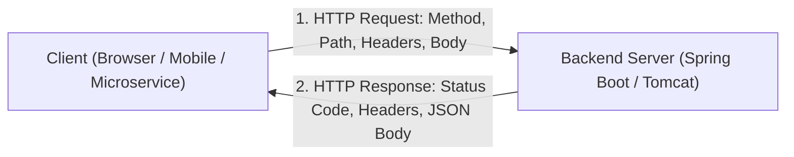
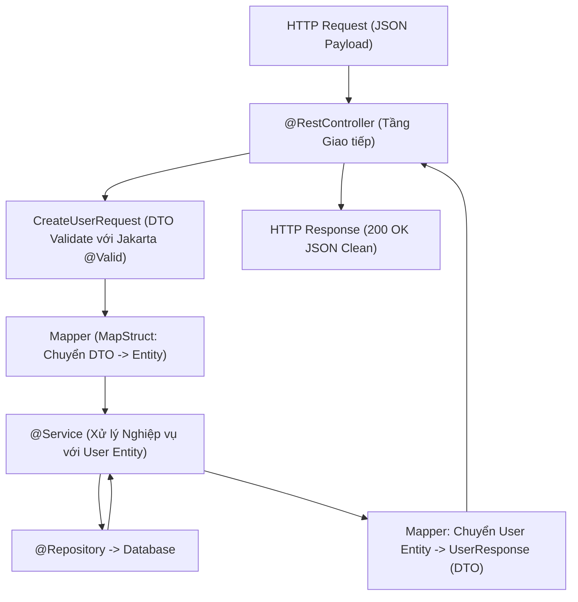
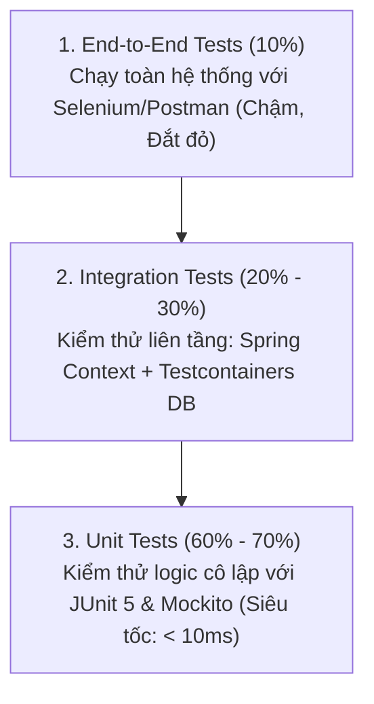
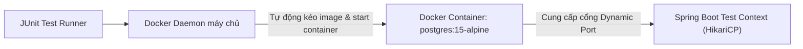

# 3.3. HTTP, REST API Design & Testing Engineering (Thiết kế RESTful & Kỹ nghệ Kiểm thử)

> [!IMPORTANT]
> **Nếu bạn chỉ được nhớ một điều duy nhất:** Trong kiến trúc Backend hiện đại, **Entity của cơ sở dữ liệu tuyệt đối không bao giờ được phơi bày trực tiếp ra ngoài API** (phải luôn qua tầng DTO để tránh rò rỉ cấu trúc dữ liệu nội bộ và lỗi vòng lặp JSON); đồng thời, kiểm thử phải tuân thủ **Kim tự tháp kiểm thử (Test Pyramid)** — nơi Unit Test với Mockito bao phủ phần lớn logic nghiệp vụ với tốc độ mili-giây, còn Integration Test với **Testcontainers** đảm bảo tính tương thích $100\%$ với Database thực tế thay vì phụ thuộc vào cơ sở dữ liệu giả lập (như H2).

---

## 1. Bản Chất Giao Thức HTTP & Ma Trận Phương Thức (HTTP Semantics)

Mỗi yêu cầu HTTP là một giao thức phi trạng thái (Stateless Request-Response) vận hành trên nền kết nối socket TCP.



### 1.1. Ma Trận Tính An Toàn (Safe) & Tính Bất Biến Lặp (Idempotent)

Hai khái niệm tối quan trọng khi thiết kế API phân tán:
* **Safe (An toàn)**: Lời gọi hàm **chỉ đọc**, không làm thay đổi trạng thái tài nguyên trên máy chủ.
* **Idempotent (Bất biến lặp)**: Gọi một lần hay gọi $1,000$ lần liên tiếp với cùng tham số thì **trạng thái hệ thống cuối cùng là giống hệt nhau** (rất quan trọng khi mạng bị timeout và hệ thống tự động retry).

| Phương thức HTTP | Ý nghĩa Nghiệp vụ | Tính An Toàn (Safe) | Tính Bất Biến Lặp (Idempotent) | Mã Trả Về Tiêu Chuẩn |
| :--- | :--- | :--- | :--- | :--- |
| **`GET`** | Truy xuất dữ liệu tài nguyên | **Có** | **Có** | `200 OK` |
| **`POST`** | Tạo mới tài nguyên hoặc kích hoạt tác vụ | **Không** | **Không** (Mỗi lần gọi tạo 1 record mới) | `201 Created` |
| **`PUT`** | Thay thế toàn bộ bản ghi tài nguyên | **Không** | **Có** (Ghi đè cùng dữ liệu) | `200 OK` / `204 No Content` |
| **`PATCH`** | Cập nhật một phần trường dữ liệu | **Không** | **Không** (Mặc định không bắt buộc) | `200 OK` |
| **`DELETE`** | Xóa bỏ tài nguyên | **Không** | **Có** (Xóa 1 lần hay nhiều lần tài nguyên vẫn biến mất) | `204 No Content` / `200 OK` |

---

## 2. Thiết Kế Chuẩn RESTful & Mô Hình Phân Tách DTO (Data Transfer Object)



### Tại sao KHÔNG BAO GIỜ trả thẳng `@Entity` về Client?
1. **Lỗi Vòng Lặp Tuần Hoàn (Circular Serialization)**: Nếu `User` chứa `List<Order>` và `Order` lại trỏ ngược về `User`, thư viện chuyển đổi JSON (Jackson) sẽ rơi vào vòng lặp vô tận $\to$ Ném lỗi `StackOverflowError` làm sập luồng xử lý!
2. **Rò Rỉ Dữ Liệu Nhạy Cảm**: Vô tình làm lộ các trường mật như `passwordHash`, `ssn`, `internalAuditStatus` ra ngoài Internet.
3. **Phá Vỡ Hợp Đồng API Khi Thay Đổi Database**: Bất cứ khi nào bạn đổi tên cột trong bảng DB, toàn bộ các ứng dụng Mobile/Frontend bên ngoài sẽ bị crash nếu không có tầng DTO làm bộ đệm bảo vệ.

---

## 3. Chiến Lược Kiểm Thử: Kim Tự Tháp Kiểm Thử (The Test Pyramid)



---

## 4. Viết Unit Test Chuyên Nghiệp với JUnit 5 & Mockito

Unit Test phải tuân thủ nguyên tắc **FIRST** (Fast, Isolated, Repeatable, Self-validating, Timely) và cấu trúc **AAA (Arrange - Act - Assert)**.

```java
import org.junit.jupiter.api.DisplayName;
import org.junit.jupiter.api.Test;
import org.junit.jupiter.api.extension.ExtendWith;
import org.mockito.InjectMocks;
import org.mockito.Mock;
import org.mockito.junit.jupiter.MockitoExtension;

import java.util.Optional;

import static org.junit.jupiter.api.Assertions.*;
import static org.mockito.BDDMockito.*;

@ExtendWith(MockitoExtension.class) // Tích hợp Mockito vào vòng đời của JUnit 5
class UserServiceUnitTest {

    @Mock
    private UserRepository userRepository; // Giả lập tầng Database không cần kết nối mạng

    @InjectMocks
    private UserService userService; // Tự động tiêm các Mock ở trên vào Service cần test

    @Test
    @DisplayName("Nên ném lỗi UserNotFoundException khi không tìm thấy người dùng theo ID")
    void shouldThrowExceptionWhenUserNotFound() {
        // 1. ARRANGE (Chuẩn bị dữ liệu và hành vi giả lập)
        long nonExistentId = 999L;
        given(userRepository.findById(nonExistentId)).willReturn(Optional.empty());

        // 2. ACT & 3. ASSERT (Thực thi và khẳng định ngoại lệ được ném ra đúng như thiết kế)
        assertThrows(UserNotFoundException.class, () -> {
            userService.getUserProfile(nonExistentId);
        });

        // Xác minh rằng userRepository.findById() thực sự được gọi đúng 1 lần duy nhất
        then(userRepository).should(times(1)).findById(nonExistentId);
        // Đảm bảo không còn bất kỳ tương tác ngoài ý muốn nào khác với repository
        then(userRepository).shouldHaveNoMoreInteractions();
    }
}
```

---

## 5. Integration Testing Thực Chiến với Testcontainers

Rất nhiều dự án sử dụng Database bộ nhớ giả lập **H2** khi chạy test. Đây là một cạm bẫy lớn vì:
- H2 không hỗ trợ cú pháp đặc thù của PostgreSQL (như kiểu dữ liệu `JSONB`, `ARRAY`, mệnh đề `ON CONFLICT DO NOTHING`).
- Cơ chế khóa (Locking) và cách đánh Index của H2 hoàn toàn khác xa môi trường Production thực tế.

**Testcontainers** giải quyết triệt để vấn đề này bằng cách tự động kéo hình ảnh Docker của cơ sở dữ liệu thật (PostgreSQL, Redis, Kafka) và khởi chạy trong vài giây cho bộ Integration Test:



```java
import org.junit.jupiter.api.Test;
import org.springframework.beans.factory.annotation.Autowired;
import org.springframework.boot.test.context.SpringBootTest;
import org.springframework.test.context.DynamicPropertyRegistry;
import org.springframework.test.context.DynamicPropertySource;
import org.testcontainers.containers.PostgreSQLContainer;
import org.testcontainers.junit.jupiter.Container;
import org.testcontainers.junit.jupiter.Testcontainers;

import static org.junit.jupiter.api.Assertions.assertEquals;

@SpringBootTest
@Testcontainers // Quản lý vòng đời Docker Container tự động theo vòng đời Test
class UserIntegrationTest {

    // Khởi tạo container PostgreSQL thật
    @Container
    static PostgreSQLContainer<?> postgres = new PostgreSQLContainer<>("postgres:15-alpine")
            .withDatabaseName("test_db")
            .withUsername("test_user")
            .withPassword("test_pass");

    // Tự động ghi đè thông tin kết nối DataSource của Spring Boot bằng cổng ngẫu nhiên của Docker
    @DynamicPropertySource
    static void configureProperties(DynamicPropertyRegistry registry) {
        registry.add("spring.datasource.url", postgres::getJdbcUrl);
        registry.add("spring.datasource.username", postgres::getUsername);
        registry.add("spring.datasource.password", postgres::getPassword);
    }

    @Autowired
    private UserRepository userRepository;

    @Test
    void shouldPersistAndRetrieveUserFromRealDatabase() {
        User user = new User("tri.nguyen", "tri@gmail.com");
        User saved = userRepository.save(user);

        User found = userRepository.findById(saved.getId()).orElseThrow();
        assertEquals("tri.nguyen", found.getUsername());
    }
}
```

---

## 6. Checklist Tự Kiểm Tra (Self-Verification)

- [ ] Phân biệt sự khác nhau giữa tính chất An Toàn (Safe) và Bất Biến Lặp (Idempotent) của phương thức HTTP?
- [ ] Tại sao phương thức `POST` không có tính Idempotent nhưng `PUT` và `DELETE` lại có?
- [ ] Những nguy cơ chết người nào xảy ra nếu bạn trả thẳng JPA `@Entity` ra tầng Controller?
- [ ] Sự khác biệt giữa `@Mock` và `@InjectMocks` trong Mockito là gì?
- [ ] Tại sao Testcontainers lại an toàn và đáng tin cậy hơn nhiều so với việc dùng In-memory H2 Database?
