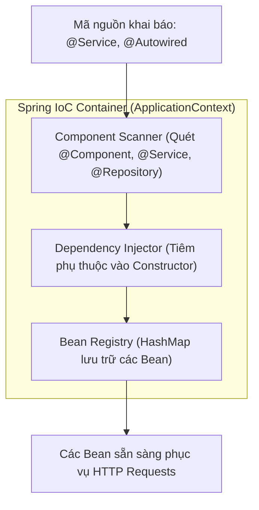
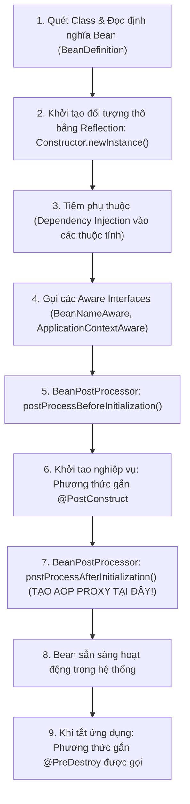
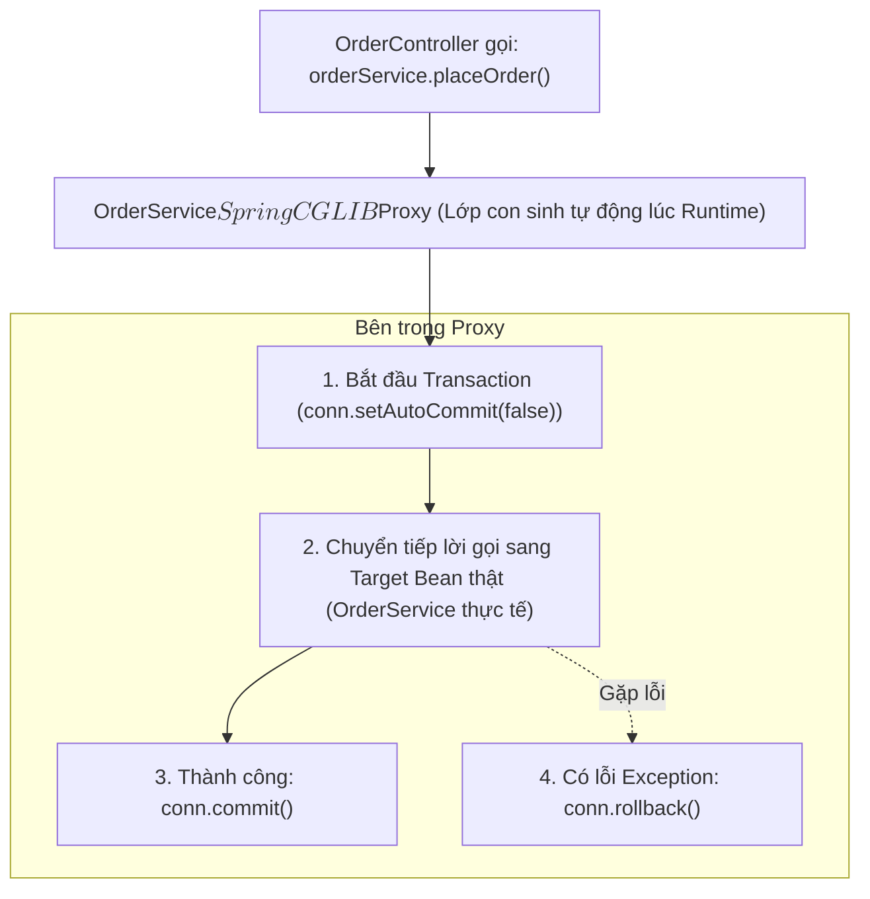
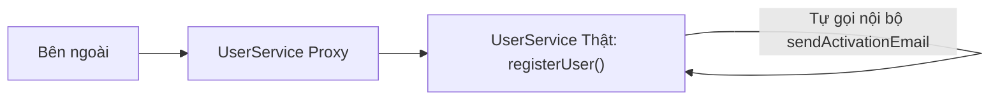

# 4.1. Spring Core: IoC Container, Dependency Injection & AOP Proxy (Trọng Tâm Spring Framework)

> [!IMPORTANT]
> **Nếu bạn chỉ được nhớ một điều duy nhất:** Spring Framework không vận hành bằng "phép thuật" (*no magic*), mà dựa trên hai cơ chế kỹ thuật cốt lõi: **Inversion of Control (IoC) Container** đóng vai trò nhà máy phản xạ quản lý vòng đời và tiêm phụ thuộc của các Singleton Bean; và **Aspect-Oriented Programming (AOP)** vận hành bằng cách tạo các **Đối tượng ủy nhiệm động (Dynamic Proxy Object qua CGLIB / ByteBuddy)** bọc bên ngoài Bean thực tế để can thiệp các hành vi xuyên suốt như `@Transactional`, `@Cacheable` và `@Async`.

---

## 1. Bản Chất của IoC (Inversion of Control) & DI (Dependency Injection)

Trong lập trình hướng đối tượng truyền thống, một đối tượng cấp cao phải tự chịu trách nhiệm khởi tạo đối tượng phụ thuộc của nó bằng từ khóa `new`:
```java
// CÁCH CŨ (Tight Coupling - Phụ thuộc cứng):
public class OrderService {
    private PaymentGateway paymentGateway = new VnpayPaymentGateway(); // Khó test, khó thay thế!
}
```

Nguyên lý **Inversion of Control (Đảo ngược quyền điều khiển)** chuyển giao toàn bộ quyền khởi tạo, cấu hình và liên kết các phụ thuộc này cho một thực thể trung tâm: **Spring IoC Container**.



### 1.1. BeanFactory vs ApplicationContext

* **`BeanFactory`**: Là interface gốc sơ khai nhất của Spring. Áp dụng cơ chế **Lazy Loading** (chỉ khởi tạo Bean khi có lời gọi `.getBean()`). Thích hợp cho thiết bị hạn chế RAM.
* **`ApplicationContext`**: Là interface kế thừa từ `BeanFactory`, cung cấp tính năng cấp doanh nghiệp cho Backend:
  - Khởi tạo trước toàn bộ các Singleton Bean ngay khi ứng dụng khởi động (**Eager Pre-instantiation**), giúp phát hiện lỗi cấu hình sớm.
  - Tích hợp xuất sắc với Spring AOP, Đa ngôn ngữ (i18n), Event Publishing, và nạp tài nguyên cấu hình môi trường (`Environment`).

---

## 2. Vòng Đời Hoàn Chỉnh của một Spring Bean (Bean Lifecycle)

Khi Spring Boot khởi động, mỗi Bean trải qua một chuỗi xử lý nghiêm ngặt được điều phối bởi các **`BeanPostProcessor`**:



### 2.1. Constructor Injection: Tiêu Chuẩn Vàng Bắt Buộc

Spring cung cấp 3 cách tiêm phụ thuộc, nhưng trong môi trường Production chuyên nghiệp:

| Kiểu Tiêm | Cú pháp | Đánh giá Kỹ thuật |
| :--- | :--- | :--- |
| **Field Injection** | `@Autowired private OrderRepo repo;` | **Code Smell tệ hại**: Vi phạm đóng gói, phụ thuộc chặt vào Reflection, không thể viết Unit Test nếu không nạp Spring Context, dễ giấu giếm phụ thuộc vòng tròn (Circular Dependency). |
| **Setter Injection** | `@Autowired public void setRepo(...)` | Chỉ dùng cho phụ thuộc tùy chọn (Optional Dependencies) có thể thay đổi lúc runtime. |
| **Constructor Injection** | Khai báo qua Constructor | **TIÊU CHUẨN VÀNG**: Đảm bảo tính bất biến (`final fields`), bảo vệ đối tượng không bao giờ bị khởi tạo ở trạng thái null dở dang, viết Unit Test bằng `new` thuần túy trong 1 dòng. |

```java
@Service
public class OrderService {
    // 1. Khai báo final để đảm bảo Thread-safe và Immutability
    private final PaymentGateway paymentGateway;
    private final NotificationService notificationService;

    // 2. Tiêm qua Constructor (Spring 4.3+ tự động inject mà không cần viết @Autowired)
    public OrderService(PaymentGateway paymentGateway, NotificationService notificationService) {
        this.paymentGateway = paymentGateway;
        this.notificationService = notificationService;
    }
}
```

---

## 3. Bản Chất của Spring AOP & Đối Tượng Ủy Nhiệm (Dynamic Proxy)

Lập trình hướng khía cạnh (**Aspect-Oriented Programming - AOP**) giải quyết bài toán các mối bận tâm xuyên suốt (**Cross-cutting Concerns**) như Logging, Bảo mật, và Quản lý Giao dịch (`@Transactional`).

### 3.1. Cơ chế Tạo Proxy: JDK Dynamic Proxy vs CGLIB Proxy

Khi một Bean được đánh dấu cần can thiệp AOP, Spring **KHÔNG BAO GIỜ** giao trực tiếp đối tượng gốc cho các class khác. Thay vào đó, Spring bọc đối tượng gốc bên trong một **Proxy**:



* **JDK Dynamic Proxy**: Áp dụng khi Bean implements một Interface. Sử dụng `java.lang.reflect.Proxy` của JDK.
* **CGLIB / ByteBuddy Proxy**: Áp dụng khi Bean là một Class cụ thể không có Interface. Spring tự động sinh ra một lớp con kế thừa từ Bean gốc bằng cách thao tác mã Bytecode lúc chạy (**Mặc định trong Spring Boot 2 và 3**).

### 3.2. Cạm Bẫy Chết Người: Lỗi Tự Gọi Nội Bộ (Self-Invocation Pitfall)

Đây là một trong những bug bí ẩn và phổ biến nhất trong các dự án Spring Boot thực tế:

```java
@Service
public class UserService {

    public void registerUser(UserDto dto) {
        // Thực hiện logic kiểm tra...
        
        // CẠM BẪY CHẾT NGƯỜI: Lời gọi hàm nội bộ (this.sendActivationEmail)
        this.sendActivationEmail(dto.getEmail()); 
    }

    @Async // Hoặc @Transactional
    public void sendActivationEmail(String email) {
        // Gửi email tốn 3 giây...
    }
}
```



* **Nguyên nhân cốt lõi**: Khi hàm `registerUser()` gọi `this.sendActivationEmail()`, từ khóa `this` trỏ trực tiếp vào **đối tượng gốc bên trong**, hoàn toàn **bỏ qua (bypass) lớp vỏ Proxy bên ngoài**!
* **Hậu quả**: Annotation `@Async` hoặc `@Transactional` trên hàm `sendActivationEmail()` **hoàn toàn vô tác dụng**! Thao tác gửi email vẫn chạy đồng bộ (blocking), hoặc transaction không hề được kích hoạt!
* **Cách khắc phục chuẩn**: Tách logic có annotation AOP sang một Service độc lập khác và inject nó vào.

---

## 4. Phân Biệt Các Stereotype Annotations

| Annotation | Tầng Kiến Trúc | Vai Trò Kỹ Thuật Đặc Biệt |
| :--- | :--- | :--- |
| **`@Component`** | Bất kỳ đâu | Đánh dấu chung cho một Java class do Spring quản lý vòng đời. |
| **`@Service`** | Business Logic | Chứa các quy tắc nghiệp vụ (Domain Logic), kết hợp với `@Transactional`. |
| **`@Repository`** | Data Access Layer | Thao tác cơ sở dữ liệu. **Điểm đặc biệt**: Tự động bắt các `SQLException` của JDBC và dịch sang hệ thống ngoại lệ nhất quán `DataAccessException` của Spring! |
| **`@Controller` / `@RestController`** | Presentation Layer | Tiếp nhận HTTP Request, xử lý định tuyến (Routing) và trả về View HTML hoặc JSON payload. |

---

## 5. Checklist Tự Kiểm Tra (Self-Verification)

- [ ] Phân biệt sự khác biệt giữa `BeanFactory` và `ApplicationContext`?
- [ ] Tại sao Field Injection (`@Autowired` trên biến) lại bị coi là thực hành xấu (anti-pattern) trong các dự án Backend chuyên nghiệp?
- [ ] Giai đoạn nào trong Bean Lifecycle là nơi Spring AOP tiến hành bọc đối tượng gốc bằng Dynamic Proxy?
- [ ] Giải thích nguyên nhân tại sao gọi phương thức mang annotation `@Transactional` từ một phương thức khác trong cùng một class lại không kích hoạt transaction?
- [ ] Mặc định một Bean trong Spring có phạm vi (Scope) là gì? Singleton Bean có đồng nghĩa với việc nó tự động thread-safe không?
