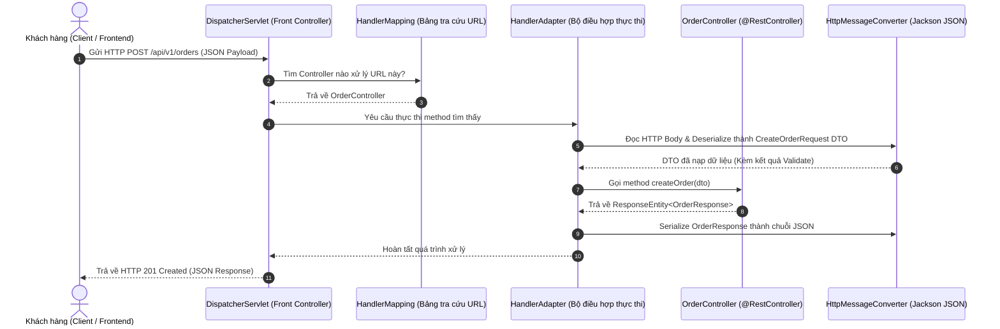
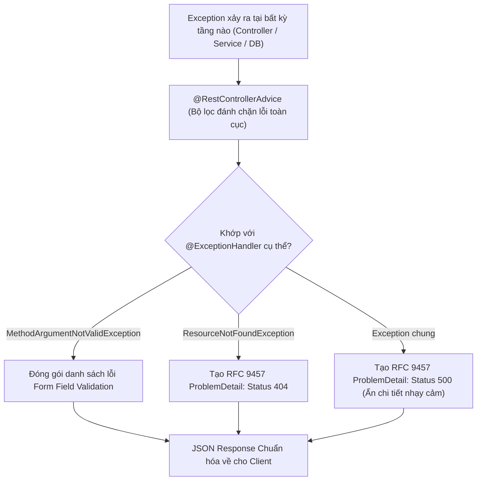

# 4.2. Spring MVC REST Architecture & Spring Data JPA (Phát triển REST API & Thao tác Dữ liệu)

> [!IMPORTANT]
> **Nếu bạn chỉ được nhớ một điều duy nhất:** Mọi yêu cầu HTTP đi vào Spring Boot đều được định tuyến qua duy nhất một đầu mối **Front Controller (DispatcherServlet)**, nơi điều phối quá trình chuyển đổi giao thức, giải mã JSON sang DTO có kiểm tra tính hợp lệ (**Jakarta Validation**), và ủy quyền xử lý cho Controller; trong khi đó, **Spring Data JPA** loại bỏ toàn bộ mã truy vấn boilerplate bằng cơ chế sinh proxy tự động cho các Repository interface, kết hợp phân trang (**Pagination**) và chuẩn hóa phản hồi lỗi theo đặc tả **RFC 9457 Problem Details**.

---

## 1. Vòng Đời Xử Lý Yêu Cầu trong Spring MVC (DispatcherServlet Lifecycle)

Spring MVC hiện thực hóa mẫu thiết kế **Front Controller Pattern** kinh điển. Toàn bộ các HTTP Request từ bên ngoài đều phải đi qua một Servlet trung tâm duy nhất: `DispatcherServlet`.



---

## 2. Xây Dựng REST Controller Chuẩn Doanh Nghiệp

Một Controller chuyên nghiệp phải thực hiện phân tách rõ rệt: Nhận DTO $\to$ Kiểm tra tính hợp lệ $\to$ Gọi Service $\to$ Đóng gói mã trạng thái HTTP chuẩn mực.

```java
import jakarta.validation.Valid;
import org.springframework.data.domain.Page;
import org.springframework.data.domain.Pageable;
import org.springframework.data.web.PageableDefault;
import org.springframework.http.HttpStatus;
import org.springframework.http.ResponseEntity;
import org.springframework.web.bind.annotation.*;

@RestController
@RequestMapping("/api/v1/users")
public class UserController {

    private final UserService userService;

    public UserController(UserService userService) {
        this.userService = userService;
    }

    // 1. Tạo mới tài nguyên: Trả về mã 201 CREATED kèm DTO mới tạo
    @PostMapping
    public ResponseEntity<UserResponse> createUser(@Valid @RequestBody CreateUserRequest request) {
        UserResponse response = userService.createUser(request);
        return ResponseEntity.status(HttpStatus.CREATED).body(response);
    }

    // 2. Truy xuất theo ID: Trả về mã 200 OK
    @GetMapping("/{id}")
    public ResponseEntity<UserResponse> getUserById(@PathVariable Long id) {
        return ResponseEntity.ok(userService.getUserById(id));
    }

    // 3. Phân trang & Sắp xếp an toàn: Tự động parse ?page=0&size=20&sort=createdAt,desc
    @GetMapping
    public ResponseEntity<Page<UserResponse>> getAllUsers(
            @PageableDefault(page = 0, size = 20, sort = "id") Pageable pageable) {
        return ResponseEntity.ok(userService.getAllUsers(pageable));
    }

    // 4. Xóa tài nguyên: Trả về mã 204 NO CONTENT (không có body)
    @DeleteMapping("/{id}")
    public ResponseEntity<Void> deleteUser(@PathVariable Long id) {
        userService.deleteUser(id);
        return ResponseEntity.noContent().build();
    }
}
```

---

## 3. Kiểm Tra Dữ Liệu Đầu Vào (Jakarta Bean Validation)

Không bao giờ tin tưởng dữ liệu từ Client gửi lên. Sử dụng các ràng buộc khai báo (Declarative Validation) trên Request DTO:

```java
import jakarta.validation.constraints.*;

public record CreateUserRequest(
    @NotBlank(message = "Tên đăng nhập không được để trống")
    @Size(min = 4, max = 30, message = "Tên đăng nhập phải từ 4 đến 30 ký tự")
    String username,

    @NotBlank(message = "Email không được để trống")
    @Email(message = "Định dạng email không hợp lệ")
    String email,

    @NotBlank(message = "Mật khẩu không được để trống")
    @Size(min = 8, message = "Mật khẩu phải chứa ít nhất 8 ký tự")
    String password,

    @Min(value = 18, message = "Người dùng phải đủ 18 tuổi trở lên")
    int age
) {}
```

---

## 4. Bắt Lỗi Tập Trung Toàn Cục & Chuẩn RFC 9457 Problem Details

Khi Validation thất bại hoặc xảy ra Exception nghiệp vụ, hệ thống không bao giờ được phép để lộ Stack Trace của Java ra ngoài. Trong Spring Boot 3, chuẩn quốc tế **RFC 9457 (Problem Details for HTTP APIs)** là tiêu chuẩn vàng:



```java
import org.springframework.http.HttpStatus;
import org.springframework.http.ProblemDetail;
import org.springframework.validation.FieldError;
import org.springframework.web.bind.MethodArgumentNotValidException;
import org.springframework.web.bind.annotation.ExceptionHandler;
import org.springframework.web.bind.annotation.RestControllerAdvice;

import java.net.URI;
import java.time.Instant;
import java.util.HashMap;
import java.util.Map;

@RestControllerAdvice
public class GlobalExceptionHandler {

    // 1. Xử lý lỗi không tìm thấy tài nguyên (404 Not Found)
    @ExceptionHandler(ResourceNotFoundException.class)
    public ProblemDetail handleResourceNotFound(ResourceNotFoundException ex) {
        ProblemDetail problem = ProblemDetail.forStatusAndDetail(HttpStatus.NOT_FOUND, ex.getMessage());
        problem.setTitle("Tài nguyên không tồn tại");
        problem.setType(URI.create("https://api.system.com/errors/not-found"));
        problem.setProperty("timestamp", Instant.now());
        return problem;
    }

    // 2. Xử lý lỗi validate form dữ liệu đầu vào (400 Bad Request)
    @ExceptionHandler(MethodArgumentNotValidException.class)
    public ProblemDetail handleValidationExceptions(MethodArgumentNotValidException ex) {
        ProblemDetail problem = ProblemDetail.forStatusAndDetail(
                HttpStatus.BAD_REQUEST, "Dữ liệu gửi lên không vượt qua bài kiểm tra hợp lệ");
        problem.setTitle("Lỗi Kiểm Tra Dữ Liệu");
        problem.setProperty("timestamp", Instant.now());

        Map<String, String> fieldErrors = new HashMap<>();
        for (FieldError error : ex.getBindingResult().getFieldErrors()) {
            fieldErrors.put(error.getField(), error.getDefaultMessage());
        }
        problem.setProperty("invalid_fields", fieldErrors);
        return problem;
    }
}
```

---

## 5. Thực Chiến với Spring Data JPA Repository

Spring Data JPA cho phép bạn chỉ cần khai báo một `interface` kế thừa `JpaRepository`, Spring sẽ tự động sinh mã Proxy thực thi toàn bộ các câu lệnh SQL ngầm bên dưới.

### 5.1. Derived Query Methods & Tùy biến với `@Query`

```java
import org.springframework.data.domain.Page;
import org.springframework.data.domain.Pageable;
import org.springframework.data.jpa.repository.JpaRepository;
import org.springframework.data.jpa.repository.Query;
import org.springframework.data.repository.query.Param;
import org.springframework.stereotype.Repository;

import java.util.Optional;

@Repository
public interface UserRepository extends JpaRepository<User, Long> {

    // 1. Derived Query Method: Tự động phân tích tên hàm thành câu SQL
    // Tương đương: SELECT * FROM users WHERE email = ? AND status = ?
    Optional<User> findByEmailAndStatus(String email, String status);

    // 2. Kiểm tra tồn tại siêu tốc (Trả về boolean, DB dùng SELECT EXISTS)
    boolean existsByUsername(String username);

    // 3. JPQL Query (Java Persistence Query Language): Truy vấn trên Đối tượng Entity
    @Query("SELECT u FROM User u WHERE LOWER(u.username) LIKE LOWER(CONCAT('%', :keyword, '%'))")
    Page<User> searchUsersByKeyword(@Param("keyword") String keyword, Pageable pageable);

    // 4. Native SQL Query: Sử dụng cú pháp đặc thù của riêng PostgreSQL
    @Query(value = "SELECT * FROM users WHERE metadata->>'role' = :role", nativeQuery = true)
    Page<User> findByCustomJsonbMetadata(@Param("role") String role, Pageable pageable);
}
```

### 5.2. JPA Auditing: Tự Động Theo Vết Lịch Sử Dữ Liệu

Trong các hệ thống phân tán cấp doanh nghiệp, mọi bản ghi đều bắt buộc phải có thông tin: Ai tạo, tạo khi nào, ai sửa cuối cùng?

```java
import jakarta.persistence.EntityListeners;
import jakarta.persistence.MappedSuperclass;
import org.springframework.data.annotation.CreatedDate;
import org.springframework.data.annotation.LastModifiedDate;
import org.springframework.data.jpa.domain.support.AuditingEntityListener;

import java.time.Instant;

@MappedSuperclass // Đóng vai trò lớp cha chứa các thuộc tính dùng chung cho mọi bảng
@EntityListeners(AuditingEntityListener.class) // Đăng ký Listener theo dõi tự động
public abstract class BaseAuditableEntity {

    @CreatedDate
    private Instant createdAt; // Tự động điền timestamp khi INSERT bản ghi

    @LastModifiedDate
    private Instant updatedAt; // Tự động cập nhật timestamp khi UPDATE bản ghi

    public Instant getCreatedAt() { return createdAt; }
    public Instant getUpdatedAt() { return updatedAt; }
}
```

Chỉ cần thêm annotation `@EnableJpaAuditing` trên cấu hình của ứng dụng, toàn bộ các bảng kế thừa từ `BaseAuditableEntity` sẽ được cập nhật mốc thời gian tự động $100\%$!

---

## 6. Checklist Tự Kiểm Tra (Self-Verification)

- [ ] Trình bày chuỗi luồng xử lý từ lúc Client gửi request tới khi `DispatcherServlet` trả kết quả JSON?
- [ ] Sự khác biệt giữa `@RequestParam` và `@PathVariable` là gì?
- [ ] Chuẩn RFC 9457 Problem Details mang lại lợi ích gì cho việc tích hợp giữa Frontend và Backend?
- [ ] Tại sao phương thức truy vấn `existsByUsername()` lại có hiệu năng tốt hơn việc gọi `findByUsername()` rồi kiểm tra null?
- [ ] Cơ chế JPA Auditing hoạt động dựa trên cơ chế kỹ thuật nào của Hibernate/JPA?
