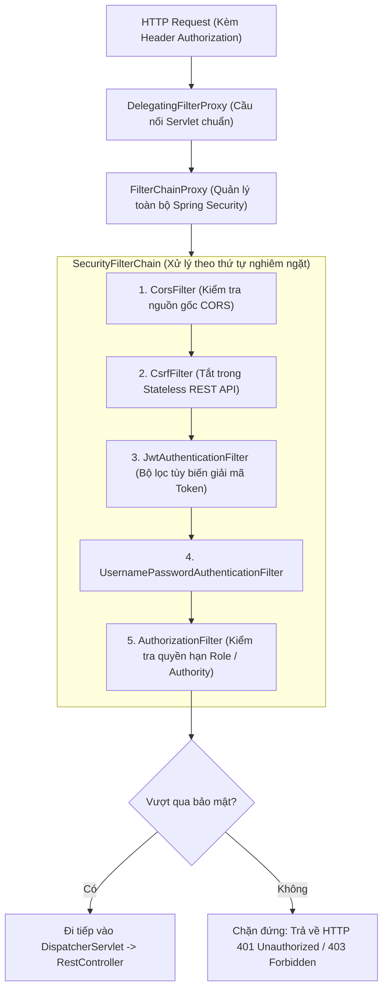
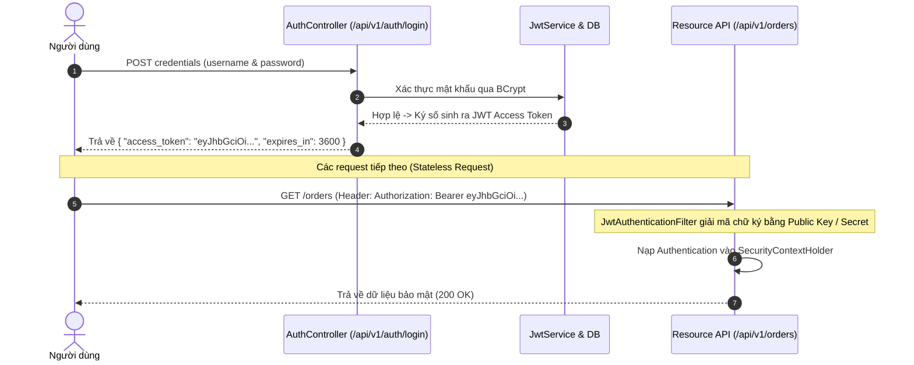
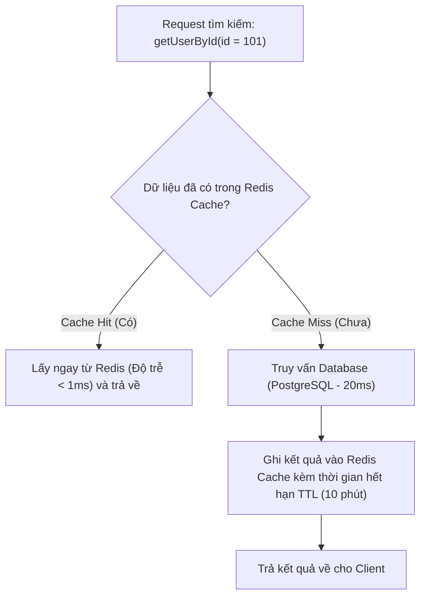

# 4.3. Spring Security, JWT & Production Deployment (Bảo Mật Hệ Thống & Triển Khai Sản Xuất)

> [!IMPORTANT]
> **Nếu bạn chỉ được nhớ một điều duy nhất:** Spring Security là một chuỗi các bộ lọc Servlet (**Security Filter Chain**) chặn đứng mọi request trước khi chạm tới Controller; trong kiến trúc Microservices và REST API hiện đại, cơ chế xác thực phải là **Phi trạng thái (Stateless)** thông qua JSON Web Token (JWT) và lưu trữ bối cảnh trên luồng cục bộ (**SecurityContextHolder**); kết hợp với việc đóng gói **Multi-stage Docker** và tinh chỉnh thông số bộ nhớ JVM nhận thức Container (**Container-aware RAM Percentage**) để hệ thống vận hành bền bỉ trên môi trường sản xuất.

---

## 1. Kiến Trúc Bộ Lọc Spring Security (Security Filter Chain)

Khi một HTTP Request đi vào ứng dụng Spring Boot, nó không đi thẳng vào Spring MVC mà phải vượt qua một bức tường thành gồm các bộ lọc tuần tự (**Filter Chain**):



---

## 2. Xác Thực Phi Trạng Thái với JWT (Stateless JWT Authentication)

Trong mô hình kiến trúc phân tán (Distributed System / Load Balancer), việc dùng HTTP Session truyền thống lưu trên RAM máy chủ sẽ làm mất khả năng mở rộng ngang (Horizontal Scaling). Do đó, **JWT (JSON Web Token)** là giải pháp chuẩn mực.



### 2.1. Bộ Lọc Giải Mã Token: `OncePerRequestFilter`

```java
import jakarta.servlet.FilterChain;
import jakarta.servlet.ServletException;
import jakarta.servlet.http.HttpServletRequest;
import jakarta.servlet.http.HttpServletResponse;
import org.springframework.security.authentication.UsernamePasswordAuthenticationToken;
import org.springframework.security.core.context.SecurityContextHolder;
import org.springframework.security.core.userdetails.UserDetails;
import org.springframework.security.core.userdetails.UserDetailsService;
import org.springframework.security.web.authentication.WebAuthenticationDetailsSource;
import org.springframework.stereotype.Component;
import org.springframework.web.filter.OncePerRequestFilter;

import java.io.IOException;

@Component
public class JwtAuthenticationFilter extends OncePerRequestFilter {

    private final JwtService jwtService;
    private final UserDetailsService userDetailsService;

    public JwtAuthenticationFilter(JwtService jwtService, UserDetailsService userDetailsService) {
        this.jwtService = jwtService;
        this.userDetailsService = userDetailsService;
    }

    @Override
    protected void doFilterInternal(HttpServletRequest request,
                                    HttpServletResponse response,
                                    FilterChain filterChain) throws ServletException, IOException {
        final String authHeader = request.getHeader("Authorization");

        // 1. Kiểm tra sự tồn tại của tiền tố Bearer
        if (authHeader == null || !authHeader.startsWith("Bearer ")) {
            filterChain.doFilter(request, response);
            return;
        }

        final String jwt = authHeader.substring(7);
        final String username = jwtService.extractUsername(jwt);

        // 2. Nếu trích xuất được username và SecurityContext hiện tại chưa được xác thực
        if (username != null && SecurityContextHolder.getContext().getAuthentication() == null) {
            UserDetails userDetails = this.userDetailsService.loadUserByUsername(username);

            // 3. Kiểm tra tính hợp lệ của chữ ký và hạn dùng Token
            if (jwtService.isTokenValid(jwt, userDetails)) {
                var authToken = new UsernamePasswordAuthenticationToken(
                        userDetails, null, userDetails.getAuthorities());
                authToken.setDetails(new WebAuthenticationDetailsSource().buildDetails(request));

                // 4. Ghi nhận thông tin xác thực vào SecurityContext (Lưu trong ThreadLocal)
                SecurityContextHolder.getContext().setAuthentication(authToken);
            }
        }

        // Chuyển tiếp request cho bộ lọc tiếp theo
        filterChain.doFilter(request, response);
    }
}
```

### 2.2. Cấu Hình Chuỗi Bảo Mật Hiện Đại (Spring Security 6+ DSL)

Trong các phiên bản Spring Boot mới nhất, lớp kế thừa `WebSecurityConfigurerAdapter` đã bị loại bỏ hoàn toàn. Bạn phải khai báo tường minh qua bean `SecurityFilterChain`:

```java
import org.springframework.context.annotation.Bean;
import org.springframework.context.annotation.Configuration;
import org.springframework.security.config.annotation.method.configuration.EnableMethodSecurity;
import org.springframework.security.config.annotation.web.builders.HttpSecurity;
import org.springframework.security.config.annotation.web.configuration.EnableWebSecurity;
import org.springframework.security.config.annotation.web.configurers.AbstractHttpConfigurer;
import org.springframework.security.config.http.SessionCreationPolicy;
import org.springframework.security.crypto.bcrypt.BCryptPasswordEncoder;
import org.springframework.security.crypto.password.PasswordEncoder;
import org.springframework.security.web.SecurityFilterChain;
import org.springframework.security.web.authentication.UsernamePasswordAuthenticationFilter;

@Configuration
@EnableWebSecurity
@EnableMethodSecurity // Kích hoạt bảo mật theo phương thức: @PreAuthorize("hasRole('ADMIN')")
public class SecurityConfiguration {

    private final JwtAuthenticationFilter jwtAuthFilter;

    public SecurityConfiguration(JwtAuthenticationFilter jwtAuthFilter) {
        this.jwtAuthFilter = jwtAuthFilter;
    }

    @Bean
    public SecurityFilterChain securityFilterChain(HttpSecurity http) throws Exception {
        http
            // Tắt CSRF vì REST API dùng token phi trạng thái, không dùng cookie-session
            .csrf(AbstractHttpConfigurer::disable)
            // Cấu hình quyền truy cập theo đường dẫn
            .authorizeHttpRequests(auth -> auth
                .requestMatchers("/api/v1/auth/**", "/actuator/health").permitAll() // Công khai
                .requestMatchers("/api/v1/admin/**").hasRole("ADMIN") // Chỉ dành cho Admin
                .anyRequest().authenticated() // Mọi endpoint khác đều phải đăng nhập
            )
            // Thiết lập Session phi trạng thái (Stateless)
            .sessionManagement(session -> session.sessionCreationPolicy(SessionCreationPolicy.STATELESS))
            // Thêm bộ lọc JWT của chúng ta đứng trước bộ lọc UsernamePasswordAuthenticationFilter
            .addFilterBefore(jwtAuthFilter, UsernamePasswordAuthenticationFilter.class);

        return http.build();
    }

    @Bean
    public PasswordEncoder passwordEncoder() {
        // Thuật toán băm mật khẩu có Salt tự động và chi phí tính toán thích ứng
        return new BCryptPasswordEncoder();
    }
}
```

---

## 3. Tăng Tốc Backend với Bộ Nhớ Đệm Phân Tán (Redis Caching)

Áp dụng mẫu thiết kế **Cache-Aside Pattern** để giảm tải tối đa cho Database:



```java
import org.springframework.cache.annotation.CacheEvict;
import org.springframework.cache.annotation.Cacheable;
import org.springframework.stereotype.Service;

@Service
public class ProductService {

    private final ProductRepository productRepository;

    public ProductService(ProductRepository productRepository) {
        this.productRepository = productRepository;
    }

    // Cache-Aside: Nếu có trong cache 'products' thì lấy luôn, nếu chưa thì chạy method và lưu cache
    @Cacheable(value = "products", key = "#id")
    public ProductDto getProductById(Long id) {
        return productRepository.findById(id)
            .map(ProductDto::fromEntity)
            .orElseThrow(() -> new ResourceNotFoundException("Product not found"));
    }

    // Cache Invalidation: Khi cập nhật sản phẩm, lập tức xóa cache cũ để tránh dữ liệu sai lệch (Stale Data)
    @CacheEvict(value = "products", key = "#id")
    public void updateProduct(Long id, UpdateProductRequest request) {
        Product product = productRepository.findById(id).orElseThrow();
        product.updateDetails(request.name(), request.price());
        productRepository.save(product);
    }
}
```

---

## 4. Xử Lý Bất Đồng Bộ (@Async) & Cấu Hình Thread Pool Chuyên Biệt

Để tránh việc gửi email hay gọi webhook làm nghẽn luồng xử lý HTTP chính của người dùng:

```java
import org.springframework.context.annotation.Bean;
import org.springframework.context.annotation.Configuration;
import org.springframework.scheduling.annotation.Async;
import org.springframework.scheduling.annotation.EnableAsync;
import org.springframework.scheduling.concurrent.ThreadPoolTaskExecutor;

import java.util.concurrent.Executor;

@Configuration
@EnableAsync
public class AsyncConfiguration {

    // Khởi tạo ThreadPoolTaskExecutor riêng biệt cho các tác vụ nền
    @Bean(name = "backgroundTaskExecutor")
    public Executor backgroundTaskExecutor() {
        ThreadPoolTaskExecutor executor = new ThreadPoolTaskExecutor();
        executor.setCorePoolSize(5);
        executor.setMaxPoolSize(20);
        executor.setQueueCapacity(500);
        executor.setThreadNamePrefix("AsyncWorker-");
        executor.initialize();
        return executor;
    }
}

@Service
public class EmailNotificationService {

    // Phương thức này sẽ được thực thi trên Thread của backgroundTaskExecutor mà không block Controller
    @Async("backgroundTaskExecutor")
    public void sendWelcomeEmail(String toEmail) {
        System.out.println("Bắt đầu gửi email nền trên thread: " + Thread.currentThread().getName());
        // Logic gửi email qua SMTP...
    }
}
```

---

## 5. Đóng Gói Docker Tối Ưu Sản Xuất (Multi-Stage Dockerfile)

Một file `Dockerfile` chuẩn Production phải đạt được 3 tiêu chí:
1. **Dung lượng siêu nhỏ** (chỉ chứa JRE runtime, không chứa Maven hay JDK compiler).
2. **Bảo mật tuyệt đối** (chạy bằng tài khoản non-root).
3. **Nhận thức giới hạn tài nguyên container** (`Container-aware JVM flags`).

```dockerfile
# ==========================================
# GIAI ĐOẠN 1: BUILD MÃ NGUỒN (BUILD STAGE)
# ==========================================
FROM eclipse-temurin:21-jdk-alpine AS builder
WORKDIR /workspace

# Tận dụng cơ chế Docker Layer Caching: Chỉ copy pom.xml trước để tải thư viện
COPY pom.xml .
COPY .mvn .mvn
COPY mvnw .
RUN ./mvnw dependency:go-offline -B

# Copy toàn bộ mã nguồn và đóng gói JAR
COPY src src
RUN ./mvnw clean package -DskipTests

# ==========================================
# GIAI ĐOẠN 2: CHẠY PRODUCTION (RUNTIME STAGE)
# ==========================================
FROM eclipse-temurin:21-jre-alpine
WORKDIR /app

# Tạo user không có đặc quyền root để bảo vệ máy chủ an toàn
RUN addgroup -S appgroup && adduser -S appuser -G appgroup
USER appuser:appgroup

# Chỉ copy file JAR đã build từ giai đoạn 1 sang (Dung lượng image chỉ còn ~150MB)
COPY --from=builder /workspace/target/*.jar app.jar

# Biến môi trường cấu hình JVM tối ưu cho môi trường Docker / Kubernetes:
# Sử dụng tối đa 75% RAM của Container được cấp phát bởi K8s cgroups
ENV JAVA_OPTS="-XX:InitialRAMPercentage=75.0 -XX:MaxRAMPercentage=75.0 -XX:+UseG1GC -Djava.security.egd=file:/dev/./urandom"

# Mở cổng ứng dụng
EXPOSE 8080

# Chạy ứng dụng
ENTRYPOINT ["sh", "-c", "java $JAVA_OPTS -jar app.jar"]
```

---

## 6. Giám Sát Hệ Thống với Spring Boot Actuator & Prometheus

Trong môi trường Production, bạn cần biết máy chủ có còn "sống" không (Liveness Probe) và có sẵn sàng nhận tải không (Readiness Probe):

```properties
# Kích hoạt các điểm cuối giám sát của Actuator
management.endpoints.web.exposure.include=health,metrics,prometheus
management.endpoint.health.show-details=always
management.endpoint.health.probes.enabled=true
```

Khi tích hợp với Kubernetes, hệ thống tự động kiểm tra:
* `http://localhost:8080/actuator/health/liveness` $\to$ Báo hiệu ứng dụng không bị Deadlock hay crash.
* `http://localhost:8080/actuator/health/readiness` $\to$ Báo hiệu ứng dụng đã kết nối Database và Redis thành công, sẵn sàng đón nhận luồng HTTP traffic từ Load Balancer!

---

## 7. Checklist Tự Kiểm Tra (Self-Verification)

- [ ] Trình bày luồng vận hành của một HTTP Request khi đi qua `SecurityFilterChain`?
- [ ] Tại sao trong kiến trúc Stateless REST API với JWT, chúng ta bắt buộc phải tắt tính năng CSRF?
- [ ] Làm cách nào `SecurityContextHolder` có thể lưu trữ thông tin đăng nhập của từng người dùng riêng biệt trên cùng một máy chủ?
- [ ] Mẫu thiết kế Cache-Aside Pattern giải quyết bài toán hiệu năng đọc dữ liệu như thế nào?
- [ ] Tại sao các tham số `-XX:InitialRAMPercentage` và `-XX:MaxRAMPercentage` lại bắt buộc phải có khi chạy Java ứng dụng trong Docker/Kubernetes?
