# 1.1. Computational Thinking Principles (Tư duy Tính toán và Mô hình hóa Bài toán)

## Tổng quan về Computational Thinking
Tư duy tính toán (Computational Thinking - CT) không đơn thuần là kỹ năng viết mã (coding), mà là nền tảng tư duy toán học và kỹ thuật nhằm phân rã, trừu tượng hóa và mô hình hóa một bài toán thực tế thành một cấu trúc thuật toán mà thực thể tính toán (máy tính phần cứng hoặc hệ thống phân tán) có thể giải quyết một cách hiệu quả và tự động.

Về bản chất toán học:
$$\text{Problem} \xrightarrow{\text{Abstraction \& Modeling}} \mathcal{M} = (S, I, O, T, C, \mathcal{I})$$
Trong đó:
- $S$: Không gian trạng thái (State space).
- $I$: Tập hợp dữ liệu đầu vào (Input domain).
- $O$: Tập hợp dữ liệu đầu ra (Output codomain).
- $T$: Hàm chuyển dịch trạng thái (Transition function: $S \times I \to S$).
- $C$: Tập ràng buộc giới hạn tài nguyên và tính đúng đắn (Constraints).
- $\mathcal{I}$: Các bất biến bảo toàn tính toàn vẹn (Invariants).

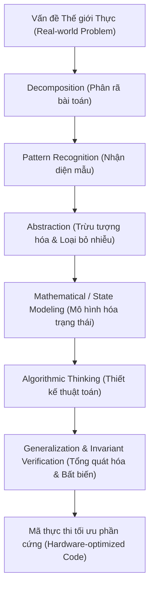

---

## 2. Chi tiết từng Keyword (Under-the-Hood Deep Dive)

---

### 1. Abstraction (Trừu tượng hóa)

#### 1. Khái niệm bản chất (What & Why)
- **Định nghĩa**: Trừu tượng hóa là quá trình loại bỏ các chi tiết vật lý, thuộc tính ngẫu nhiên không liên quan đến bài toán để chỉ giữ lại các đặc tính cốt lõi cấu thành mô hình tính toán.
- **Tại sao cần thiết**: Bộ não con người và dung lượng bộ nhớ máy tính đều có giới hạn hữu hạn (working memory). Nếu không trừu tượng hóa, độ phức tạp $O(2^n)$ của thế giới thực sẽ làm tê liệt khả năng thiết kế hệ thống.

#### 2. Cơ chế hoạt động sâu (Under the hood / Hardcore Internals)
- **Tầng Compiler & Memory**:
  - Trừu tượng hóa trong C++ thông qua zero-cost abstractions (`templates`, `concepts`, `constexpr`). Trình biên dịch loại bỏ toàn bộ lớp trừu tượng tại compile-time, sinh mã máy tương đương với việc viết mã assembly thủ công mà không tốn chi phí gián tiếp (pointer indirection / vptr overhead).
  - Trừu tượng hóa động (dynamic polymorphism) sử dụng VTable/VPTR đưa vào chi phí gián tiếp: mỗi lần gọi phương thức ảo tiêu tốn một lần truy cập bộ nhớ bổ sung ($*(\text{vptr} + \text{offset})$) và gây cản trở inline optimization của trình biên dịch cũng như branch predictor của CPU.

#### 3. Sơ đồ minh họa
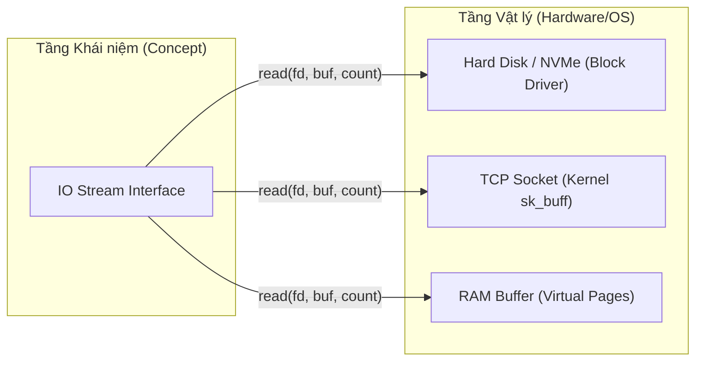

#### 4. Code ví dụ thực chiến (C++20 Zero-cost Abstraction)
```cpp
#include <iostream>
#include <concepts>
#include <vector>
#include <numeric>

// Trừu tượng hóa giao diện tính toán tải trọng (Workload) không tốn chi phí vptr
template <typename T>
concept NumericStorage = requires(T a) {
    { a.data() } -> std::same_as<const double*>;
    { a.size() } -> std::same_as<std::size_t>;
};

template <NumericStorage S>
class StatisticsEngine {
public:
    explicit StatisticsEngine(const S& storage) : storage_(storage) {}

    // Trình biên dịch inline hoàn toàn vòng lặp này, vector hóa qua AVX-512
    [[nodiscard]] double compute_mean() const noexcept {
        if (storage_.size() == 0) return 0.0;
        const double* ptr = storage_.data();
        double sum = 0.0;
        for (std::size_t i = 0; i < storage_.size(); ++i) {
            sum += ptr[i];
        }
        return sum / static_cast<double>(storage_.size());
    }

private:
    const S& storage_;
};

int main() {
    std::vector<double> latencies = {12.4, 15.1, 9.8, 22.3, 18.0};
    StatisticsEngine engine(latencies);
    std::cout << "Mean latency: " << engine.compute_mean() << " ms\n";
    return 0;
}
```

#### 5. Ưu / Nhược điểm, Pitfalls & Anti-patterns
- **Ưu điểm**: Thu hẹp không gian nhận thức (cognitive load), cô lập lỗi.
- **Pitfall**: *Leaky Abstraction* (Trừu tượng hóa rò rỉ). Ví dụ: TCP trừu tượng hóa mạng internet thành luồng byte tin cậy không mất mát, nhưng khi đứt cáp hoặc packet loss cao, ứng dụng bị lag do TCP retransmission và Head-of-Line blocking.
- **Anti-pattern**: *Over-abstraction* (Tạo quá nhiều lớp Interface chỉ có 1 implementation cụ thể, làm phân mảnh bộ nhớ đệm lệnh L1i cache).

#### 6. Ứng dụng thực tế trong Backend / Systems
- Hệ thống POSIX Virtual File System (VFS): Trừu tượng hóa mọi thiết bị (disk, terminal, socket, pipe) thành định dạng File Descriptor (`fd`) với các syscall đồng nhất (`read`, `write`, `close`).

---

### 2. Decomposition (Phân rã bài toán)

#### 1. Khái niệm bản chất (What & Why)
- **Định nghĩa**: Kỹ thuật chia nhỏ một bài toán lớn, phức tạp hoặc không xác định thành các bài toán con (sub-problems) độc lập hoặc có liên kết yếu (loosely coupled), có thể giải quyết và kiểm chứng riêng biệt.
- **Tại sao cần thiết**: Độ phức tạp giải thuật và bảo trì tăng theo hàm mũ đối với kích thước bài toán. Phân rã cho phép áp dụng nguyên tắc Divide & Conquer, song song hóa tính toán trên nhiều lõi CPU hoặc nhiều worker nodes.

#### 2. Cơ chế hoạt động sâu (Under the hood / Hardcore Internals)
- **Tầng CPU & Multi-threading**:
  - Phân rã luồng công việc thành các Task nhỏ trong Thread Pool với cấu trúc Work-Stealing Queue (như Tokio runtime hoặc Go scheduler).
  - Tránh hiện tượng False Sharing khi phân rã dữ liệu: Các biến của các bài toán con khác nhau không được nằm trên cùng một đường truyền bộ nhớ đệm (Cache Line 64 bytes).

#### 3. Sơ đồ minh họa
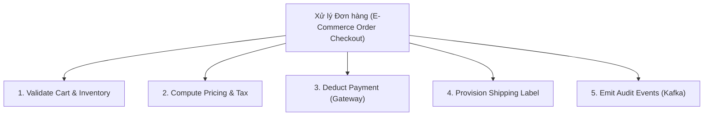

#### 4. Code ví dụ thực chiến (C++ Thread-safe Subtask Pipeline)
```cpp
#include <iostream>
#include <future>
#include <string>

struct OrderContext {
    uint64_t order_id;
    double amount;
    bool is_inventory_locked{false};
    bool is_payment_charged{false};
};

bool lock_inventory(OrderContext& ctx) {
    // Mô phỏng kiểm tra và giữ hàng trong Redis / DB
    ctx.is_inventory_locked = true;
    return true;
}

bool charge_payment(OrderContext& ctx) {
    // Mô phỏng gọi Payment Gateway
    if (!ctx.is_inventory_locked) return false;
    ctx.is_payment_charged = true;
    return true;
}

int main() {
    OrderContext order{1001, 250.50};
    
    // Phân rã thành các bước kiểm tra tuần tự có ràng buộc
    if (lock_inventory(order)) {
        if (charge_payment(order)) {
            std::cout << "Order " << order.order_id << " processed successfully.\n";
        }
    }
    return 0;
}
```

#### 5. Ưu / Nhược điểm, Pitfalls & Anti-patterns
- **Pitfall**: Phân rã sai ranh giới dẫn đến "Chatty Communication" (các module con phải gọi nhau liên tục qua mạng với overhead serialize/deserialize JSON/Protobuf khổng lồ).
- **Anti-pattern**: Phân rã quá mức thành Microservices khi quy mô đội ngũ và hệ thống chỉ cần một Modular Monolith.

#### 6. Ứng dụng thực tế trong Backend / Systems
- Kiến trúc microservices và MapReduce: Master node phân rã dữ liệu terabyte thành các Splits nhỏ 64MB cho hàng trăm Mapper worker thực thi độc lập.

---

### 3. Pattern Recognition (Nhận diện mẫu)

#### 1. Khái niệm bản chất (What & Why)
- **Định nghĩa**: Khả năng phát hiện các đặc tính tương đồng, quy luật tuần hoàn, chu kỳ xuất hiện hoặc cấu trúc dữ liệu quen thuộc giữa các bài toán khác nhau.
- **Tại sao cần thiết**: Giúp tái sử dụng các giải pháp đã được chứng minh tính đúng đắn toán học (như Đồ thị, Quy hoạch động, Design Patterns) thay vì phát minh lại bánh xe xe bò.

#### 2. Cơ chế hoạt động sâu (Under the hood / Hardcore Internals)
- **Tầng Cấu trúc Dữ liệu & Giải thuật**:
  - Nhận diện bài toán định tuyến mạng viễn thông bản chất là bài toán Tìm đường đi ngắn nhất trên đồ thị có trọng số $\to$ Dùng thuật toán Dijkstra với Priority Queue (Min-Heap $O((V+E)\log V)$).
  - Nhận diện luồng truy cập phân phối dạng Zipf (80% request tập trung vào 20% dữ liệu) $\to$ Áp dụng cấu trúc LRU Cache với $O(1)$ Hash Map + Doubly Linked List.

#### 3. Sơ đồ minh họa
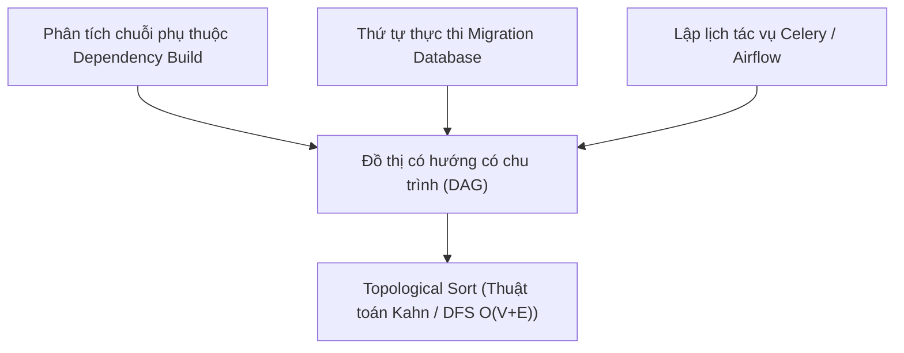

#### 4. Code ví dụ thực chiến (C++ Topological Sort)
```cpp
#include <iostream>
#include <vector>
#include <queue>

// Nhận diện mẫu đồ thị phụ thuộc (Dependency Resolution)
std::vector<int> resolve_dependencies(int num_tasks, const std::vector<std::pair<int, int>>& deps) {
    std::vector<std::vector<int>> adj(num_tasks);
    std::vector<int> in_degree(num_tasks, 0);

    for (const auto& [u, v] : deps) { // u phụ thuộc v (v chạy trước u)
        adj[v].push_back(u);
        in_degree[u]++;
    }

    std::queue<int> q;
    for (int i = 0; i < num_tasks; ++i) {
        if (in_degree[i] == 0) q.push(i);
    }

    std::vector<int> order;
    while (!q.empty()) {
        int curr = q.front();
        q.pop();
        order.push_back(curr);

        for (int neighbor : adj[curr]) {
            if (--in_degree[neighbor] == 0) {
                q.push(neighbor);
            }
        }
    }

    if (order.size() != static_cast<std::size_t>(num_tasks)) {
        return {}; // Phát hiện Deadlock / Chu trình vòng tròn (Circular Dependency)
    }
    return order;
}

int main() {
    // 3 task: Task 0 phụ thuộc 1, Task 1 phụ thuộc 2
    std::vector<std::pair<int, int>> deps = {{0, 1}, {1, 2}};
    auto exec_plan = resolve_dependencies(3, deps);
    for (int task : exec_plan) std::cout << "Run Task: " << task << " -> ";
    std::cout << "Done\n";
    return 0;
}
```

#### 5. Ưu / Nhược điểm, Pitfalls & Anti-patterns
- **Pitfall**: Nhận định sai bản chất (False Pattern Matching). Ví dụ: thấy dữ liệu dạng cây liền vội vã dùng Recursion mà không nhận thức kích thước cây có thể sâu $10^6$ nodes gây Stack Overflow.

#### 6. Ứng dụng thực tế trong Backend / Systems
- Engine tính toán Dependency Tree của Webpack/Vite hoặc Cargo/NPM để build packages theo thứ tự tối ưu và song song hóa.

---

### 4. Algorithmic Thinking (Tư duy Thuật toán)

#### 1. Khái niệm bản chất (What & Why)
- **Định nghĩa**: Khả năng xây dựng một tập hợp các chỉ thị hữu hạn, tường minh, không mập mờ (deterministic/well-defined) nhằm biến đổi tập đầu vào $I$ thành đầu ra $O$ thỏa mãn các điều kiện tiên quyết.
- **Tại sao cần thiết**: Máy tính không có trực giác. Mọi hành vi thông minh của phần mềm đều là kết quả của các bước xử lý logic cơ bản được xâu chuỗi một cách chặt chẽ.

#### 2. Cơ chế hoạt động sâu (Under the hood / Hardcore Internals)
- **Tầng CPU Pipeline & Instruction Execution**:
  - Tư duy thuật toán tốt không chỉ tối ưu số phép tính trên giấy (Big-O) mà phải tối ưu trên kiến trúc phần cứng: Hạn chế Branch Misprediction (sắp xếp dữ liệu trước để CPU Branch Predictor dự đoán đúng nhánh `if-else`), tận dụng SIMD registers (Single Instruction Multiple Data).

#### 3. Sơ đồ minh họa
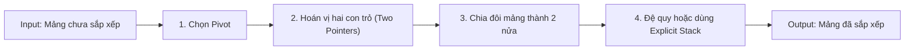

#### 4. Code ví dụ thực chiến (C++ Branchless Binary Search)
```cpp
#include <iostream>
#include <vector>

// Thuật toán tìm kiếm nhị phân loại bỏ rẽ nhánh (Branchless) tránh CPU Pipeline Flush
int branchless_lower_bound(const int* arr, int n, int target) {
    const int* base = arr;
    while (n > 1) {
        int half = n / 2;
        // Tận dụng lệnh CMOV (Conditional Move) của CPU x86-64 thay vì lệnh nhảy JMP
        base = (base[half] < target) ? base + half : base;
        n -= half;
    }
    return (*base < target) ? (base - arr + 1) : (base - arr);
}

int main() {
    int data[] = {1, 3, 5, 7, 9, 11, 13, 15, 17};
    int idx = branchless_lower_bound(data, 9, 11);
    std::cout << "Index of 11: " << idx << "\n";
    return 0;
}
```

#### 5. Ưu / Nhược điểm, Pitfalls & Anti-patterns
- **Anti-pattern**: Viết mã "Clever code" (quá bí hiểm, dùng bit-hack phức tạp không cần thiết) làm suy giảm khả năng maintain mà hiệu năng không chênh lệch đáng kể so với mã tối ưu của Compiler.

#### 6. Ứng dụng thực tế trong Backend / Systems
- Thuật toán đồng thuận Paxos/Raft: Xác định chính xác các bước bầu cử Leader, ghi Log và Commit trạng thái phân tán mà không tạo ra phân rã dữ liệu (Split-brain).

---

### 5. Problem Reduction (Quy giảm bài toán)

#### 1. Khái niệm bản chất (What & Why)
- **Định nghĩa**: Kỹ thuật biến đổi một bài toán chưa biết $A$ về một bài toán đã biết cách giải $B$ thông qua một hàm ánh xạ $f: A \to B$ với chi phí đa thức (Polynomial-time reduction).
- **Tại sao cần thiết**: Cho phép dùng lại các thư viện, thuật toán tối ưu có sẵn mà không cần nghiên cứu thuật giải từ đầu; đồng thời là công cụ chứng minh độ khó của bài toán (NP-Completeness).

#### 2. Cơ chế hoạt động sâu (Under the hood / Hardcore Internals)
- Khi quy giảm bài toán Maximum Bipartite Matching (Ghép cặp cực đại trên đồ thị 2 phía) về bài toán Maximum Flow (Luồng cực đại trong mạng), ta thêm Source node $S$, Sink node $T$ và gán dung lượng cạnh (Capacity) bằng 1. Giải bằng Ford-Fulkerson hoặc Dinic algorithm trong $O(V \cdot E^2)$.

#### 3. Sơ đồ minh họa


#### 4. Code ví dụ thực chiến (C++ Reduction: Max Flow sang Matching)
```cpp
#include <iostream>
#include <vector>
#include <queue>
#include <cstring>

// Thuật toán Edmonds-Karp giải Max Flow
class MaxFlowNetwork {
    int n_;
    std::vector<std::vector<int>> capacity_;
    std::vector<std::vector<int>> adj_;

public:
    explicit MaxFlowNetwork(int n) : n_(n), capacity_(n, std::vector<int>(n, 0)), adj_(n) {}

    void add_edge(int u, int v, int cap) {
        adj_[u].push_back(v);
        adj_[v].push_back(u);
        capacity_[u][v] += cap;
    }

    int bfs(int s, int t, std::vector<int>& parent) {
        std::fill(parent.begin(), parent.end(), -1);
        parent[s] = -2;
        std::queue<std::pair<int, int>> q;
        q.push({s, 1e9});

        while (!q.empty()) {
            auto [cur, flow] = q.front();
            q.pop();

            for (int next : adj_[cur]) {
                if (parent[next] == -1 && capacity_[cur][next] > 0) {
                    parent[next] = cur;
                    int new_flow = std::min(flow, capacity_[cur][next]);
                    if (next == t) return new_flow;
                    q.push({next, new_flow});
                }
            }
        }
        return 0;
    }

    int compute_max_flow(int s, int t) {
        int flow = 0;
        std::vector<int> parent(n_);
        int new_flow = 0;
        while ((new_flow = bfs(s, t, parent)) > 0) {
            flow += new_flow;
            int cur = t;
            while (cur != s) {
                int prev = parent[cur];
                capacity_[prev][cur] -= new_flow;
                capacity_[cur][prev] += new_flow;
                cur = prev;
            }
        }
        return flow;
    }
};

int main() {
    // Quy giảm bài toán gán 2 server cho 2 jobs
    // 0: Source, 1-2: Jobs, 3-4: Servers, 5: Sink
    MaxFlowNetwork network(6);
    network.add_edge(0, 1, 1);
    network.add_edge(0, 2, 1);
    network.add_edge(1, 3, 1); // Job 1 chạy được trên Server 1
    network.add_edge(2, 4, 1); // Job 2 chạy được trên Server 2
    network.add_edge(3, 5, 1);
    network.add_edge(4, 5, 1);

    std::cout << "Max jobs scheduled: " << network.compute_max_flow(0, 5) << "\n";
    return 0;
}
```

#### 5. Ưu / Nhược điểm, Pitfalls & Anti-patterns
- **Pitfall**: Chi phí quy giảm (reduction overhead) lớn hơn chi phí giải trực tiếp bài toán ban đầu.

#### 6. Ứng dụng thực tế trong Backend / Systems
- Quy giảm bài toán phát hiện chu trình phụ thuộc tài nguyên (Deadlock Detection) trong Database Engine về bài toán Tìm chu trình trong đồ thị có hướng (Cycle Detection via DFS/Tarjan).

---

### 6. Generalization (Tổng quát hóa)

#### 1. Khái niệm bản chất (What & Why)
- **Định nghĩa**: Quá trình chuyển hóa một giải pháp giải quyết một trường hợp cụ thể (specific case) thành một giải pháp tổng quát có thể áp dụng cho toàn bộ một lớp các bài toán tương tự.
- **Tại sao cần thiết**: Tăng cường khả năng tái sử dụng mã (Code Reusability), giảm thiểu sự phân mảnh logic nghiệp vụ và giảm chi phí kiểm thử phần mềm.

#### 2. Cơ chế hoạt động sâu (Under the hood / Hardcore Internals)
- **Tầng Compiler & Metaprogramming**:
  - Trong C++, tổng quát hóa được thực thi thông qua Templates. Khi trình biên dịch thấy hàm tổng quát `template <typename T>`, nó sinh mã máy thực tế qua quá trình **Template Monomorphization**. Nghĩa là mỗi kiểu dữ liệu cụ thể (`int`, `double`, `UserDTO`) sẽ được tạo ra một bản assembly riêng biệt, đảm bảo tối đa hóa hiệu năng runtime mà không phải trả giá bằng chi phí boxing/unboxing như trong Java/C#.

#### 3. Sơ đồ minh họa
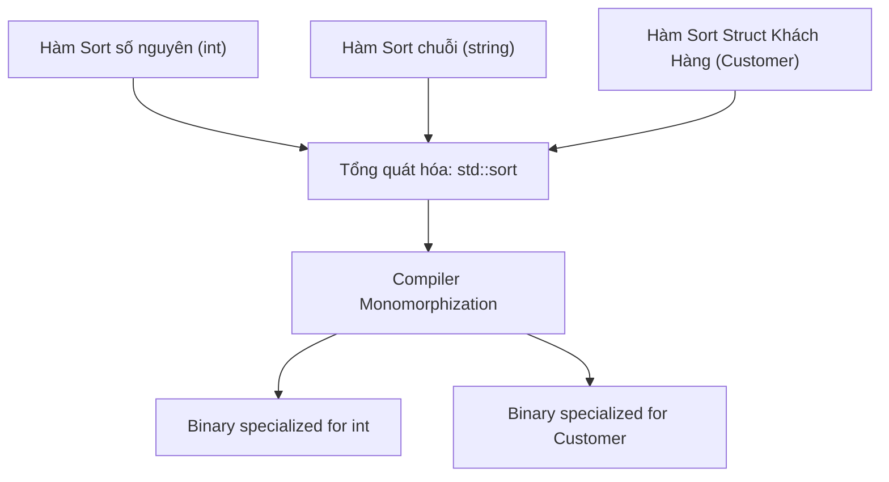

#### 4. Code ví dụ thực chiến (C++ Generic Ring Buffer)
```cpp
#include <iostream>
#include <array>
#include <optional>

template <typename T, std::size_t Capacity>
class CircularBuffer {
    static_assert(Capacity > 0, "Capacity must be positive");
public:
    bool push(const T& item) {
        if (full()) return false;
        data_[tail_] = item;
        tail_ = (tail_ + 1) % Capacity;
        ++size_;
        return true;
    }

    std::optional<T> pop() {
        if (empty()) return std::nullopt;
        T val = data_[head_];
        head_ = (head_ + 1) % Capacity;
        --size_;
        return val;
    }

    [[nodiscard]] bool empty() const noexcept { return size_ == 0; }
    [[nodiscard]] bool full() const noexcept { return size_ == Capacity; }

private:
    std::array<T, Capacity> data_{};
    std::size_t head_{0};
    std::size_t tail_{0};
    std::size_t size_{0};
};

int main() {
    CircularBuffer<int, 4> int_queue;
    int_queue.push(10);
    int_queue.push(20);
    std::cout << "Popped: " << *int_queue.pop() << "\n";
    return 0;
}
```

#### 5. Ưu / Nhược điểm, Pitfalls & Anti-patterns
- **Pitfall**: *Code Bloat* (Phình to kích thước file thực thi nhị phân do sinh ra quá nhiều phiên bản monomorphized template, làm tràn L1 Instruction Cache).

#### 6. Ứng dụng thực tế trong Backend / Systems
- Thư viện ORM (Hibernate, Prisma, GORM): Tổng quát hóa cơ chế ánh xạ giữa bảng cơ sở dữ liệu quan hệ và các Object trong bộ nhớ qua các Generic Repository Pattern.

---

### 7. Step-by-step Reasoning (Suy luận từng bước)

#### 1. Khái niệm bản chất (What & Why)
- **Định nghĩa**: Phương pháp tư duy logic suy luận có thứ tự nghiêm ngặt, trong đó tính đúng đắn của bước $k+1$ được chứng minh trực tiếp dựa trên trạng thái hợp lệ của bước $k$.
- **Tại sao cần thiết**: Giúp lập trình viên và kiểm thử viên truy vết chính xác nguồn gốc lỗi (Root Cause Analysis), đồng thời là nền tảng để xây dựng các hệ thống xác minh hình thức (Formal Verification).

#### 2. Cơ chế hoạt động sâu (Under the hood / Hardcore Internals)
- **Tầng CPU Execution & Call Stack**:
  - Mọi bước tính toán được biểu diễn thành các Instruction Pointer (`RIP`) di chuyển tuần tự qua các dòng lệnh máy. Mỗi bước gọi hàm tạo một Stack Frame chứa tham số, địa chỉ quay về (Return Address) và biến cục bộ.

#### 3. Sơ đồ minh họa
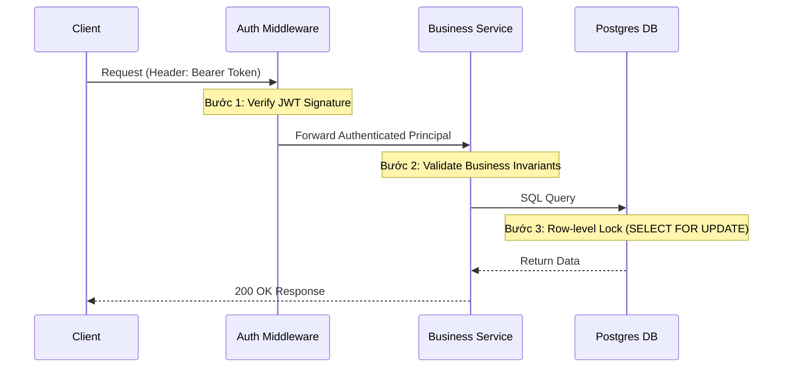

#### 4. Code ví dụ thực chiến (TypeScript Railway-Oriented Programming)
```typescript
type Result<T, E> = { success: true; data: T } | { success: false; error: E };

function parseJson(raw: string): Result<Record<string, unknown>, string> {
    try {
        return { success: true, data: JSON.parse(raw) };
    } catch {
        return { success: false, error: "Invalid JSON format" };
    }
}

function validateEmail(obj: Record<string, unknown>): Result<string, string> {
    if (typeof obj.email === "string" && obj.email.includes("@")) {
        return { success: true, data: obj.email };
    }
    return { success: false, error: "Missing or malformed email" };
}

// Suy luận logic từng bước: Step 1 -> Step 2
function processRegistration(rawPayload: string): string {
    const jsonResult = parseJson(rawPayload);
    if (!jsonResult.success) return `Error at Step 1: ${jsonResult.error}`;

    const emailResult = validateEmail(jsonResult.data);
    if (!emailResult.success) return `Error at Step 2: ${emailResult.error}`;

    return `Success: User registered with email ${emailResult.data}`;
}

console.log(processRegistration('{"email": "engineer@system.internal"}'));
```

#### 5. Ưu / Nhược điểm, Pitfalls & Anti-patterns
- **Anti-pattern**: Nested Callback Hell / Arrow Code (Viết mã lồng nhau quá sâu làm mất tính tuần tự trực quan của các bước). Khắc phục bằng Async/Await hoặc Monadic Pipeline.

#### 6. Ứng dụng thực tế trong Backend / Systems
- Hệ thống SAGA Pattern: Thực thi chuỗi các Local Transactions qua các microservices với cơ chế bù trừ (Compensating Transactions) nếu bất kỳ bước nào trong chuỗi suy luận thất bại.

---

### 8. State Representation (Biểu diễn Trạng thái)

#### 1. Khái niệm bản chất (What & Why)
- **Định nghĩa**: Cách thức mã hóa toàn bộ dữ liệu, cờ trạng thái (flags) và thuộc tính của một hệ thống tại một thời điểm $t$ cụ thể vào các cấu trúc dữ liệu trong bộ nhớ hoặc bộ nhớ lưu trữ bền vững.
- **Tại sao cần thiết**: Trạng thái xác định hành vi của hệ thống khi nhận kích thích (event/input). Biểu diễn sai trạng thái sẽ dẫn đến rò rỉ dữ liệu hoặc sai lệch nghiệp vụ.

#### 2. Cơ chế hoạt động sâu (Under the hood / Hardcore Internals)
- **Tầng Memory & Struct Alignment**:
  - Trong C++, cách sắp xếp các trường trong `struct` quyết định kích thước vật lý của nó do quy tắc căn lề bộ nhớ (Memory Alignment) của CPU (thường là 4 hoặc 8 bytes). Việc sắp xếp các trường từ lớn đến nhỏ giúp giảm Padding bytes vô nghĩa.
  - Sử dụng Bitmask / Bitfields để gom nhiều cờ boolean vào 1 byte duy nhất.

#### 3. Sơ đồ minh họa
```text
Cấu trúc Struct Memory Padding trong RAM:
[Unoptimized]
| uint8_t (1B) | PADDING (7B) | uint64_t (8B) | uint8_t (1B) | PADDING (7B) | => 24 Bytes!

[Optimized State Representation]
| uint64_t (8B) | uint8_t (1B) | uint8_t (1B) | PADDING (6B) | => 16 Bytes!
```

#### 4. Code ví dụ thực chiến (C++ Bitmask State Representation)
```cpp
#include <iostream>
#include <cstdint>

enum class UserPermission : uint8_t {
    None    = 0,
    Read    = 1 << 0, // 0000 0001
    Write   = 1 << 1, // 0000 0010
    Execute = 1 << 2, // 0000 0100
    Admin   = 1 << 3  // 0000 1000
};

inline UserPermission operator|(UserPermission a, UserPermission b) {
    return static_cast<UserPermission>(static_cast<uint8_t>(a) | static_cast<uint8_t>(b));
}

inline bool has_permission(UserPermission mask, UserPermission target) {
    return (static_cast<uint8_t>(mask) & static_cast<uint8_t>(target)) != 0;
}

int main() {
    UserPermission user_role = UserPermission::Read | UserPermission::Write;
    
    std::cout << "Can Read? " << (has_permission(user_role, UserPermission::Read) ? "Yes" : "No") << "\n";
    std::cout << "Can Admin? " << (has_permission(user_role, UserPermission::Admin) ? "Yes" : "No") << "\n";
    return 0;
}
```

#### 5. Ưu / Nhược điểm, Pitfalls & Anti-patterns
- **Pitfall**: Sử dụng kiểu dữ liệu `float` để biểu diễn trạng thái số dư tiền tệ, gây lỗi sai số dấu phẩy động (Floating point rounding error). Phải luôn dùng `int64_t` (Cent/Xu) hoặc Arbitrary Precision Decimal.

#### 6. Ứng dụng thực tế trong Backend / Systems
- Redis Bitmaps: Biểu diễn trạng thái Online/Offline của 100 triệu người dùng chỉ tốn khoảng 12MB RAM ($10^8 \text{ bits} / 8 \approx 12.5\text{MB}$).

---

### 9. Input / Output Modeling (Mô hình hóa Đầu vào / Đầu ra)

#### 1. Khái niệm bản chất (What & Why)
- **Định nghĩa**: Quá trình định hình ranh giới (boundary), kiểu dữ liệu, định dạng mã hóa và miền giá trị hợp lệ của thông tin đi vào (Ingress) và đi ra (Egress) của một đơn vị tính toán.
- **Tại sao cần thiết**: Tuân thủ nguyên lý: *"Never trust user input"*. Ngăn chặn các lỗ hổng Injection, Buffer Overflow và Data Corruption.

#### 2. Cơ chế hoạt động sâu (Under the hood / Hardcore Internals)
- **Tầng OS Kernel Buffer & Serialization**:
  - Dữ liệu I/O đi từ Network Card vào Kernel Buffer (`sk_buff`), sau đó được copy sang User Space Buffer thông qua syscall `read()` hoặc `recv()`.
  - Zero-copy I/O: Sử dụng `sendfile()` hoặc `io_uring` để truyền trực tiếp dữ liệu từ Disk Cache sang Network Socket mà không tốn chi phí Context Switch và Copy RAM qua CPU.

#### 3. Sơ đồ minh họa
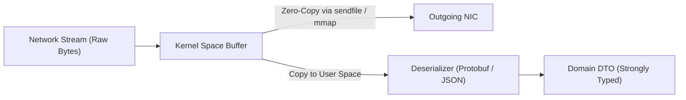

#### 4. Code ví dụ thực chiến (TypeScript Schema Validation)
```typescript
// Định nghĩa tường minh miền Input / Output DTO
interface UserRegistrationInput {
    username: string;
    age: number;
}

interface UserResponseOutput {
    id: string;
    username: string;
    createdAt: string;
}

function sanitizeAndValidate(raw: unknown): UserRegistrationInput {
    if (typeof raw !== "object" || raw === null) {
        throw new Error("Invalid payload: must be an object");
    }
    const r = raw as Record<string, unknown>;
    if (typeof r.username !== "string" || r.username.length < 3) {
        throw new Error("Invalid username: must be string of at least 3 chars");
    }
    if (typeof r.age !== "number" || r.age < 18 || r.age > 120) {
        throw new Error("Invalid age: must be an integer between 18 and 120");
    }
    return { username: r.username, age: r.age };
}

const cleanInput = sanitizeAndValidate({ username: "alice_backend", age: 28 });
console.log("Validated Input:", cleanInput);
```

#### 5. Ưu / Nhược điểm, Pitfalls & Anti-patterns
- **Anti-pattern**: Trả trực tiếp Database Entity ra API response làm lộ các thông tin nhạy cảm (như mật khẩu hashed, cờ bảo mật nội bộ) thay vì sử dụng Data Transfer Object (DTO).

#### 6. Ứng dụng thực tế trong Backend / Systems
- Định nghĩa gRPC Protobuf Contracts: Ràng buộc chặt chẽ kiểu dữ liệu đầu vào và đầu ra giữa các microservices qua file `.proto`.

---

### 10. Constraint Identification (Xác định Ràng buộc)

#### 1. Khái niệm bản chất (What & Why)
- **Định nghĩa**: Việc phát hiện và lượng hóa các giới hạn cứng (Hard constraints - giới hạn vật lý, SLA, dung lượng RAM) và giới hạn mềm (Soft constraints - thẩm mỹ, tiện lợi) áp đặt lên hệ thống.
- **Tại sao cần thiết**: Một giải pháp kỹ thuật hoàn hảo về mặt toán học nhưng vi phạm ràng buộc phần cứng (ví dụ: cần 1TB RAM trong khi máy chỉ có 16GB) là hoàn toàn vô dụng.

#### 2. Cơ chế hoạt động sâu (Under the hood / Hardcore Internals)
- **Ràng buộc phần cứng**:
  - Giới hạn băng thông RAM (Memory Bandwidth limit): CPU hiện đại có thể xử lý hàng chục tỷ phép tính mỗi giây nhưng tốc độ truyền dữ liệu từ RAM bị nghẽn (Memory Wall).
  - Tốc độ đọc ghi đĩa: NVMe SSD (vài GB/s) vs HDD (khoảng 150MB/s) vs Network Latency (vài chục ms qua đại dương).

#### 3. Sơ đồ minh họa
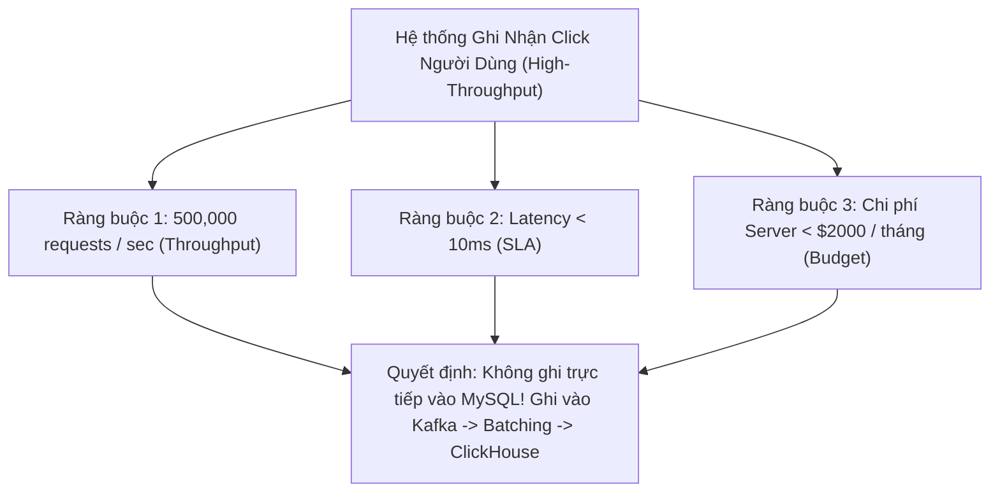

#### 4. Code ví dụ thực chiến (C++ Bounded Resource Guard)
```cpp
#include <iostream>
#include <stdexcept>
#include <chrono>

class RateLimiterConstraint {
    const uint32_t max_ops_per_sec_;
    uint32_t current_ops_{0};
    std::chrono::steady_clock::time_point window_start_;

public:
    explicit RateLimiterConstraint(uint32_t max_ops) 
        : max_ops_per_sec_(max_ops), window_start_(std::chrono::steady_clock::now()) {}

    bool allow_request() {
        auto now = std::chrono::steady_clock::now();
        if (std::chrono::duration_cast<std::chrono::seconds>(now - window_start_).count() >= 1) {
            window_start_ = now;
            current_ops_ = 0;
        }

        if (current_ops_ < max_ops_per_sec_) {
            ++current_ops_;
            return true;
        }
        return false; // Vi phạm ràng buộc băng thông hệ thống
    }
};

int main() {
    RateLimiterConstraint limiter(2);
    std::cout << "Req 1: " << limiter.allow_request() << "\n";
    std::cout << "Req 2: " << limiter.allow_request() << "\n";
    std::cout << "Req 3: " << limiter.allow_request() << "\n"; // Sẽ bị chặn (false)
    return 0;
}
```

#### 5. Ưu / Nhược điểm, Pitfalls & Anti-patterns
- **Pitfall**: Không nhận diện được *N+1 Query Problem* trong tầng dữ liệu, dẫn đến vi phạm ràng buộc số lượng kết nối tối đa (Max Database Connections).

#### 6. Ứng dụng thực tế trong Backend / Systems
- Cơ chế Backpressure trong Reactive Streams: Tự động giảm tốc độ nạp dữ liệu khi bộ đệm của Consumer đạt đến ngưỡng giới hạn bộ nhớ.

---

### 11. Trade-off Analysis (Phân tích Đánh đổi)

#### 1. Khái niệm bản chất (What & Why)
- **Định nghĩa**: Đánh giá và so sánh định lượng giữa các yếu tố xung đột trong thiết kế: Thời gian thực thi vs Dung lượng bộ nhớ (Time-Space Trade-off), Tính nhất quán vs Tính khả dụng (CAP Theorem), Tốc độ phát triển vs Hiệu năng runtime.
- **Quy luật bất biến**: Trong kỹ thuật máy tính, không có bữa trưa miễn phí (*There are no solutions, only trade-offs*).

#### 2. Cơ chế hoạt động sâu (Under the hood / Hardcore Internals)
- **Time-Space Trade-off**:
  - Dùng bảng Look-up Table (LUT) hoặc Memoization: Tiêu tốn thêm dung lượng RAM để giảm độ phức tạp thời gian từ $O(2^n)$ hoặc $O(n)$ xuống $O(1)$.
  - Nén dữ liệu (Zstandard / Snappy): Tiêu tốn chu kỳ tính toán của CPU để giảm kích thước truyền qua mạng I/O hoặc lưu trữ trên đĩa.

#### 3. Sơ đồ minh họa
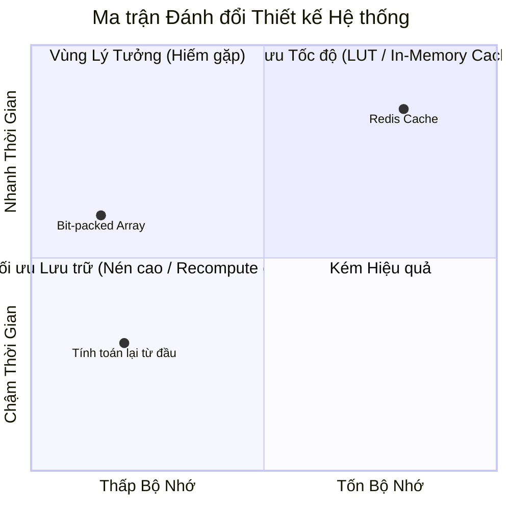

#### 4. Code ví dụ thực chiến (C++ Trade-off: Space vs Time via Precomputed Lookup)
```cpp
#include <iostream>
#include <array>
#include <cstdint>

// Đánh đổi: Dùng 256 bytes bộ nhớ để đếm số bit 1 trong O(1) không cần lặp
constexpr std::array<uint8_t, 256> generate_bit_counts() {
    std::array<uint8_t, 256> table{};
    for (int i = 0; i < 256; ++i) {
        table[i] = (i & 1) + table[i / 2];
    }
    return table;
}

constexpr auto BIT_LOOKUP_TABLE = generate_bit_counts();

int fast_popcount_byte(uint8_t val) {
    return BIT_LOOKUP_TABLE[val]; // O(1) memory lookup
}

int main() {
    uint8_t byte = 0b10110110;
    std::cout << "Bits set in " << (int)byte << " is: " << fast_popcount_byte(byte) << "\n";
    return 0;
}
```

#### 5. Ưu / Nhược điểm, Pitfalls & Anti-patterns
- **Anti-pattern**: Premature Optimization (Tối ưu hóa quá sớm). Đánh đổi tính rõ ràng của code lấy vi tối ưu micro-seconds tại các đoạn mã chỉ chạy một lần lúc khởi động hệ thống.

#### 6. Ứng dụng thực tế trong Backend / Systems
- Lựa chọn Database: Đánh đổi ACID chuẩn của PostgreSQL lấy tính mở rộng ngang vô hạn (Horizontal Scalability) và Eventual Consistency của Apache Cassandra.

---

### 12. Invariant Identification (Xác định Bất biến)

#### 1. Khái niệm bản chất (What & Why)
- **Định nghĩa**: Một điều kiện, thuộc tính hoặc mệnh đề logic luôn giữ nguyên giá trị đúng ($\text{True}$) trong suốt toàn bộ quá trình thực thi thuật toán hoặc biến đổi dữ liệu, bất kể trạng thái của hệ thống thay đổi thế nào.
- **Tại sao cần thiết**: Là cơ sở toán học vững chắc duy nhất để chứng minh thuật toán hoạt động chính xác (Correctness Proof) và bảo vệ hệ sinh thái dữ liệu tài chính không bị thất thoát.

#### 2. Cơ chế hoạt động sâu (Under the hood / Hardcore Internals)
- **Tầng Cấu trúc Dữ liệu**:
  - Cây Đỏ-Đen (Red-Black Tree): Luôn duy trì 5 bất biến (ví dụ: Mọi đường đi từ gốc tới lá đều chứa số lượng nút đen bằng nhau). Mọi thao tác chèn/xóa phải thực hiện phép xoay (Tree Rotation) để khôi phục bất biến này.
  - Vòng đời giao dịch (Double-entry Bookkeeping): Tổng số tiền Nợ (Debit) luôn bằng tổng số tiền Có (Credit).

#### 3. Sơ đồ minh họa
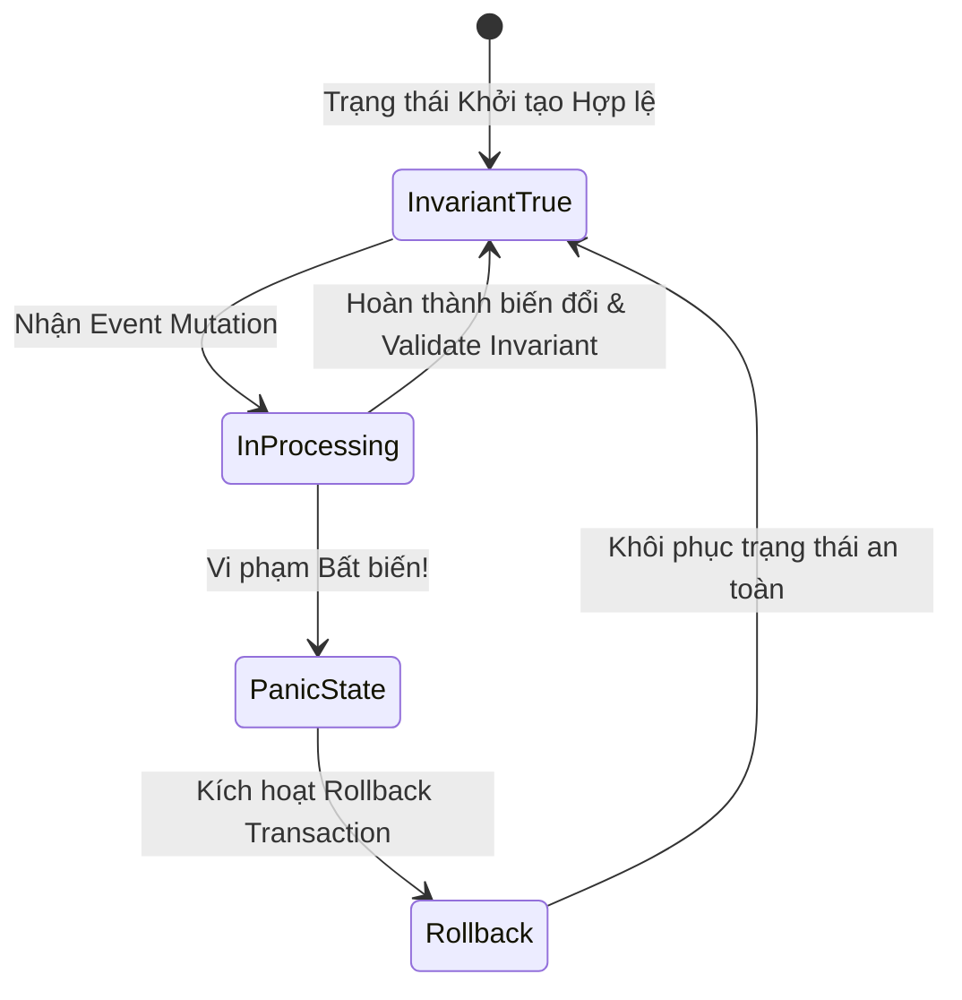

#### 4. Code ví dụ thực chiến (C++ RAII & Class Invariant Enforcement)
```cpp
#include <iostream>
#include <cassert>

// Lớp tài khoản ngân hàng bảo toàn bất biến: Số dư không bao giờ âm
class BankAccount {
    int64_t balance_cents_{0};

    // Hàm kiểm tra bất biến (Class Invariant)
    void check_invariant() const noexcept {
        assert(balance_cents_ >= 0 && "INVARIANT VIOLATED: Account balance cannot be negative!");
    }

public:
    explicit BankAccount(int64_t initial_cents) : balance_cents_(initial_cents) {
        check_invariant();
    }

    void deposit(int64_t amount_cents) {
        if (amount_cents <= 0) return;
        balance_cents_ += amount_cents;
        check_invariant();
    }

    bool withdraw(int64_t amount_cents) {
        if (amount_cents <= 0 || amount_cents > balance_cents_) {
            return false;
        }
        balance_cents_ -= amount_cents;
        check_invariant();
        return true;
    }

    [[nodiscard]] int64_t get_balance() const noexcept { return balance_cents_; }
};

int main() {
    BankAccount acc(10000); // 100.00 USD
    acc.deposit(5000);
    acc.withdraw(8000);
    std::cout << "Final balance: " << acc.get_balance() << " cents\n";
    return 0;
}
```

#### 5. Ưu / Nhược điểm, Pitfalls & Anti-patterns
- **Pitfall**: Không bảo vệ bất biến khi gặp lỗi ngoại lệ (Exception-safety failure), khiến trạng thái bị nửa chừng (half-mutated state) và làm hỏng toàn bộ bộ nhớ của tiến trình.

#### 6. Ứng dụng thực tế trong Backend / Systems
- Hệ thống Sổ cái Kế toán (Ledger Engine): Bất biến tổng tài sản của hệ thống luôn bằng tổng nghĩa vụ nợ cộng vốn chủ sở hữu ($\text{Assets} = \text{Liabilities} + \text{Equity}$). Bất kỳ giao dịch nào làm chệch lệch dù 1 cent cũng phải bị abort lập tức.
