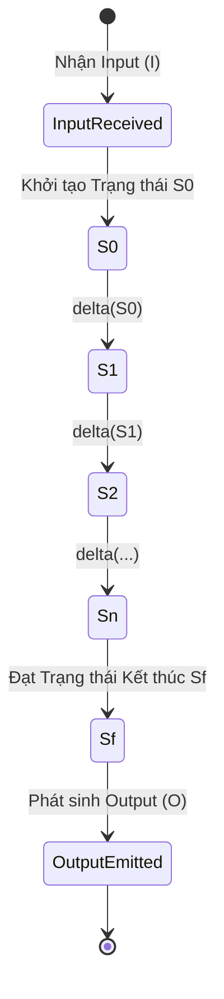
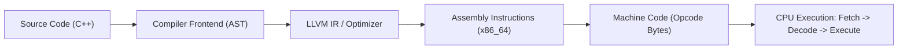
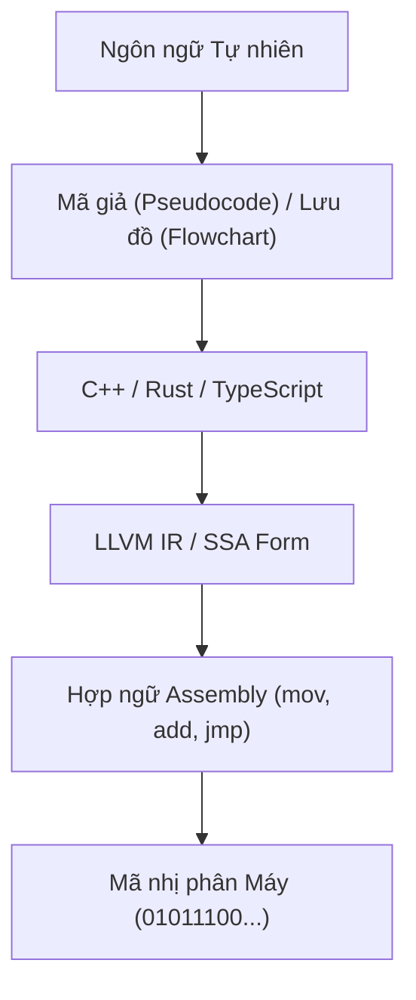
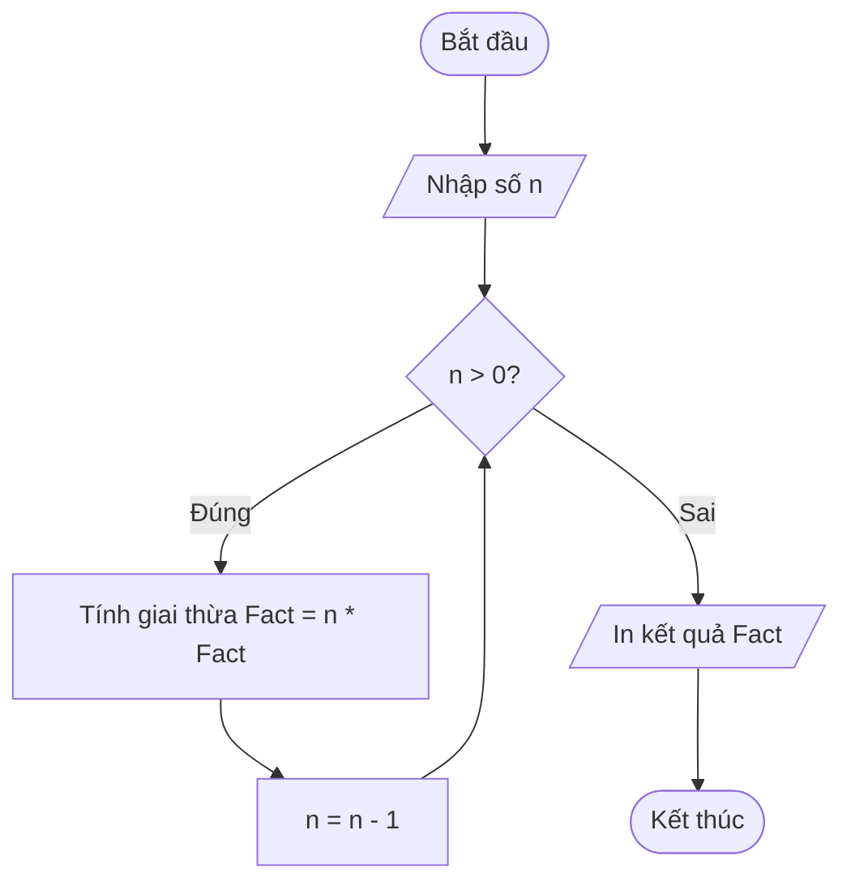
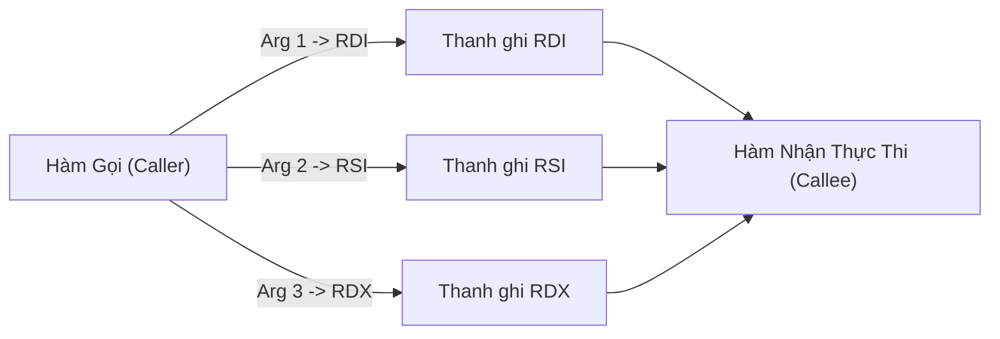
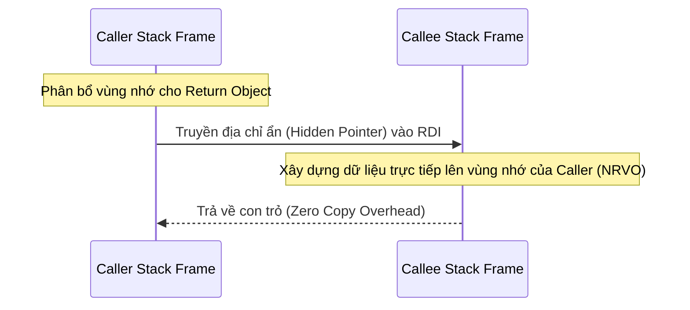
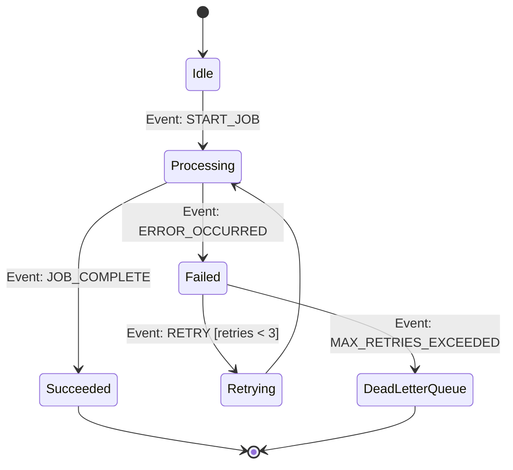

# 2.1. Algorithm Definition and Representation (Định nghĩa và Biểu diễn Thuật toán)

## Tổng quan về Biểu diễn Thuật toán và Tính toán
Về mặt toán học hình thức, một **Thuật toán (Algorithm)** là một dãy hữu hạn các chỉ thị được định nghĩa rõ ràng, có thể thực thi một cách cơ học (mechanical procedure) để giải quyết một lớp bài toán cụ thể hoặc thực hiện một phép tính toán xác định.

Hệ thống tính toán có thể mô tả bằng một bộ ngũ toán học:
$$\mathcal{A} = (S, S_0, S_f, I, \delta)$$
- $S$: Tập hợp các trạng thái tính toán hữu hạn hoặc đếm được.
- $S_0 \subseteq S$: Tập trạng thái khởi tạo tiếp nhận dữ liệu đầu vào $I$.
- $S_f \subseteq S$: Tập trạng thái kết thúc sinh dữ liệu đầu ra $O$.
- $\delta: S \to S$: Hàm chuyển dịch trạng thái tất định (State Transition Function).



---

## 2. Chi tiết từng Keyword (Under-the-Hood Deep Dive)

---

### 1. Algorithm Definition (Định nghĩa Thuật toán)

#### 1. Khái niệm bản chất (What & Why)
- **Định nghĩa**: Một thuật toán là một quy trình tính toán từng bước có tính chất:
  1. **Finiteness (Tính hữu hạn)**: Phải dừng sau một số bước hữu hạn.
  2. **Definiteness (Tính xác định)**: Mỗi bước phải hoàn toàn rõ ràng, không có sự mập mờ ngữ nghĩa.
  3. **Input (Đầu vào)**: Có 0 hoặc nhiều dữ liệu đầu vào từ một tập hợp xác định.
  4. **Output (Đầu ra)**: Tạo ra ít nhất một giá trị đầu ra có mối quan hệ xác định với đầu vào.
  5. **Effectiveness (Tính hiệu quả)**: Mỗi thao tác phải đủ cơ bản để có thể thực thi được bằng giấy bút hoặc mạch logic trong thời gian hữu hạn.
- **Tại sao cần thiết**: Là cầu nối giữa ý niệm toán học trừu tượng và sự biến đổi vật lý của các transistor bán dẫn trong CPU.

#### 2. Cơ chế hoạt động sâu (Under the hood / Hardcore Internals)
- **Tầng CPU Instruction Cycle (Fetch - Decode - Execute)**:
  - Một thuật toán cấp cao khi biên dịch ra mã máy sẽ trở thành một chuỗi các chỉ thị máy (Machine Instructions). Con trỏ lệnh `RIP` (Instruction Pointer trên x86-64) trỏ tới địa chỉ của chỉ thị hiện tại trong bộ nhớ.
  - Mỗi chỉ thị làm thay đổi trạng thái của các Registers (`RAX`, `RBX`, `RFLAGS`) hoặc vùng nhớ RAM.

#### 3. Sơ đồ minh họa


#### 4. Code ví dụ thực chiến (C++ Định nghĩa Thuật toán Euclid tính GCD)
```cpp
#include <iostream>
#include <cstdint>

// Thuật toán Euclid tính Ước số chung lớn nhất (Greatest Common Divisor)
// Tính chất: Hữu hạn, xác định, có input (a, b) và output (kết quả)
uint64_t compute_gcd(uint64_t a, uint64_t b) noexcept {
    while (b != 0) {
        uint64_t temp = b;
        b = a % b; // Phép chia lấy dư dịch chuyển trạng thái
        a = temp;
    }
    return a; // Output
}

int main() {
    uint64_t num1 = 48, num2 = 18;
    std::cout << "GCD(" << num1 << ", " << num2 << ") = " << compute_gcd(num1, num2) << "\n";
    return 0;
}
```

#### 5. Ưu / Nhược điểm, Pitfalls & Anti-patterns
- **Pitfall**: Viết quy trình lặp vô tận không có điều kiện dừng (vi phạm thuộc tính *Finiteness*), làm treo tiến trình và cạn kiệt CPU.

#### 6. Ứng dụng thực tế trong Backend / Systems
- Thuật toán mã hóa RSA / Elliptic Curve Cryptography: Dựa trên các thuật toán số học có độ phức tạp được chứng minh để bảo mật kết nối HTTPS/TLS.

---

### 2. Algorithm Representation (Biểu diễn Thuật toán)

#### 1. Khái niệm bản chất (What & Why)
- **Định nghĩa**: Các hình thức và ngôn ngữ khác nhau được sử dụng để truyền tải, lưu trữ và giao tiếp logic của thuật toán từ người sang người, hoặc từ người sang máy tính.
- **Các cấp độ biểu diễn**:
  1. Ngôn ngữ tự nhiên (Natural Language).
  2. Mã giả (Pseudocode).
  3. Lưu đồ (Flowchart).
  4. Ngôn ngữ lập trình cấp cao (High-level Language: C++, TypeScript).
  5. Mã trung gian (Intermediate Representation: LLVM IR, Bytecode).
  6. Hợp ngữ (Assembly) và Mã máy (Binary Opcodes).

#### 2. Cơ chế hoạt động sâu (Under the hood / Hardcore Internals)
- Biểu diễn càng gần phần cứng (Low-level representation) càng giảm thiểu các lớp trừu tượng (Indirection), cho phép kiểm soát trực tiếp thanh ghi (Registers), bộ đệm CPU cache và đường ống lệnh (Instruction Pipeline).

#### 3. Sơ đồ minh họa


#### 4. Code ví dụ thực chiến (So sánh Biểu diễn qua C++ và Assembly)
```cpp
// C++ Source
int add_elements(int a, int b) {
    return a + b;
}

/* Biểu diễn Assembly tương ứng trên x86-64 (System V AMD64 ABI):
add_elements(int, int):
    lea     eax, [rdi + rsi]   ; Tận dụng Load Effective Address để cộng thanh ghi trong 1 cycle
    ret                        ; Trả về giá trị chứa trong thanh ghi EAX
*/
```

#### 5. Ưu / Nhược điểm, Pitfalls & Anti-patterns
- **Pitfall**: Sử dụng ngôn ngữ tự nhiên mơ hồ để viết đặc tả thuật toán cho nhóm phát triển, dẫn đến việc cài đặt sai logic tại các trường hợp biên (Corner Cases).

#### 6. Ứng dụng thực tế trong Backend / Systems
- RFC Specifications của IETF (ví dụ RFC 793 cho TCP, RFC 9110 cho HTTP/1.1): Sử dụng ABNF (Augmented Backus-Naur Form) và mã giả chuẩn để mô tả thuật toán xử lý gói tin đồng nhất trên toàn cầu.

---

### 3. Pseudocode (Mã giả)

#### 1. Khái niệm bản chất (What & Why)
- **Định nghĩa**: Ngôn ngữ mô tả thuật toán phi hình thức, kết hợp giữa cú pháp cấu trúc của ngôn ngữ lập trình với ngữ nghĩa ngắn gọn của ngôn ngữ tự nhiên và ký hiệu toán học, bỏ qua các chi tiết kỹ thuật cú pháp rườm rà (như quản lý bộ nhớ, định kiểu, import).
- **Tại sao cần thiết**: Tập trung tuyệt đối vào logic cốt lõi và độ phức tạp tính toán mà không bị phân tâm bởi các quy tắc của từng trình biên dịch.

#### 2. Cơ chế hoạt động sâu (Under the hood / Hardcore Internals)
- Mã giả chuẩn mực thường tuân theo quy ước của trường phái CLRS (*Introduction to Algorithms*):
  - Khối lệnh lùi dòng (Indentation-based).
  - Biến là cục bộ theo mặc định.
  - Phép gán tường minh ($\leftarrow$ hoặc $:=$).
  - Mảng bắt đầu từ 1 (theo toán học) hoặc từ 0 (theo khoa học máy tính).

#### 3. Sơ đồ minh họa
```text
Thủ tục BINARY-SEARCH(A, target):
    low ← 0
    high ← length(A) - 1
    khi low ≤ high lặp:
        mid ← low + floor((high - low) / 2)
        nếu A[mid] == target thì:
            trả về mid
        ngược lại nếu A[mid] < target thì:
            low ← mid + 1
        ngược lại:
            high ← mid - 1
    trả về KHÔNG_TÌM_THẤY
```

#### 4. Code ví dụ thực chiến (TypeScript đối chiếu từ Pseudocode)
```typescript
function binarySearch(arr: readonly number[], target: number): number {
    let low = 0;
    let high = arr.length - 1;

    while (low <= high) {
        // Tránh lỗi tràn số nguyên (Integer Overflow) khi low + high vượt ngưỡng an toàn
        const mid = low + Math.floor((high - low) / 2);
        
        if (arr[mid] === target) {
            return mid;
        } else if (arr[mid] < target) {
            low = mid + 1;
        } else {
            high = mid - 1;
        }
    }

    return -1; // Not found
}

const list = [2, 4, 6, 8, 10, 12, 14];
console.log("Index:", binarySearch(list, 10)); // 4
```

#### 5. Ưu / Nhược điểm, Pitfalls & Anti-patterns
- **Pitfall**: Viết mã giả che giấu các thao tác có độ phức tạp tiềm ẩn cao (ví dụ: viết bước `Check if element exists in array` mà coi như $O(1)$ trong khi thực tế là $O(n)$).

#### 6. Ứng dụng thực tế trong Backend / Systems
- Tài liệu Whitepaper của các hệ thống cơ sở dữ liệu (Google Spanner, Bigtable) luôn dùng Pseudocode để trình bày thuật toán phân tán (Two-phase Commit, TrueTime protocol).

---

### 4. Flowchart (Lưu đồ Thuật toán)

#### 1. Khái niệm bản chất (What & Why)
- **Định nghĩa**: Biểu diễn đồ họa của thuật toán bằng các hình khối tiêu chuẩn hóa (hình oval: Start/End, hình bình hành: Input/Output, hình chữ nhật: Process, hình thoi: Decision) được liên kết bằng các mũi tên chỉ hướng luồng điều khiển.
- **Tại sao cần thiết**: Trực quan hóa các nhánh rẽ điều kiện phức tạp và vòng lặp, giúp phát hiện sớm các nhánh bế tắc (Dead-ends) hoặc vòng lặp vô hạn.

#### 2. Cơ chế hoạt động sâu (Under the hood / Hardcore Internals)
- **Tầng Đồ thị Luồng Điều khiển (Control Flow Graph - CFG)**:
  - Trong trình biên dịch (LLVM/GCC), Flowchart tương ứng với **CFG**. Các hình khối chữ nhật là các **Basic Blocks** (dãy lệnh tuần tự chỉ có 1 điểm vào và 1 điểm ra). Các hình thoi tạo ra các cạnh có điều kiện (Conditional Branching via `cmp` và `jne`/`je` instructions).

#### 3. Sơ đồ minh họa


#### 4. Code ví dụ thực chiến (C++ Ánh xạ trực tiếp từ Flowchart CFG)
```cpp
#include <iostream>

// Hàm tính giai thừa có cấu trúc ánh xạ trực tiếp sang Basic Blocks
uint64_t compute_factorial(uint32_t n) noexcept {
    // Block: Init
    uint64_t fact = 1;

    // Block: Loop Condition & Body
    while (n > 0) {
        fact *= n;
        --n;
    }

    // Block: Return
    return fact;
}

int main() {
    std::cout << "5! = " << compute_factorial(5) << "\n";
    return 0;
}
```

#### 5. Ưu / Nhược điểm, Pitfalls & Anti-patterns
- **Pitfall**: Lưu đồ quá phức tạp (Spaghetti Flowchart) với hàng chục đường chéo đan xen nhau phản ánh thiết kế mã vi phạm nguyên lý Single Responsibility.

#### 6. Ứng dụng thực tế trong Backend / Systems
- Thiết kế hệ thống phê duyệt thanh toán (Payment Approval Workflows) hoặc công cụ BPMN (Business Process Model and Notation) trong ngân hàng số.

---

### 5. Input (Đầu vào)

#### 1. Khái niệm bản chất (What & Why)
- **Định nghĩa**: Tập hợp các đại lượng, tín hiệu hoặc dữ liệu được cung cấp từ môi trường bên ngoài vào thuật toán trước hoặc trong quá trình thực thi.
- **Phân loại**:
  - Tĩnh (Static inputs): Truyền vào một lần qua đối số hàm hoặc file cấu hình.
  - Động (Streaming inputs): Dòng dữ liệu liên tục không có điểm dừng (Network sockets, Event streams).

#### 2. Cơ chế hoạt động sâu (Under the hood / Hardcore Internals)
- **Tầng Memory & ABI Calling Convention**:
  - Trên kiến trúc x86-64 System V, 6 đối số đầu vào số nguyên/con trỏ đầu tiên được truyền qua các thanh ghi tốc độ cao: `RDI`, `RSI`, `RDX`, `RCX`, `R8`, `R9`. Chỉ khi vượt quá 6 tham số, trình biên dịch mới đẩy lên Call Stack (tiêu tốn bộ nhớ RAM).

#### 3. Sơ đồ minh họa


#### 4. Code ví dụ thực chiến (C++ Input Validation & Immutability)
```cpp
#include <iostream>
#include <string_view>
#include <system_error>

struct ServiceRequestInput {
    std::string_view user_id;
    int32_t request_quota;
};

// Đầu vào được đánh dấu const reference để đảm bảo tính bất biến (Immutability)
bool validate_input(const ServiceRequestInput& input) noexcept {
    if (input.user_id.empty() || input.request_quota <= 0) {
        return false;
    }
    return true;
}

int main() {
    ServiceRequestInput req{"usr_88291", 50};
    if (validate_input(req)) {
        std::cout << "Input valid. Proceeding.\n";
    }
    return 0;
}
```

#### 5. Ưu / Nhược điểm, Pitfalls & Anti-patterns
- **Pitfall**: *Missing Size/Boundary Checks* trên buffer đầu vào dẫn đến tấn công tràn bộ đệm (Buffer Overflow / `gets()` vulnerability).

#### 6. Ứng dụng thực tế trong Backend / Systems
- API Gateway Validation (Envoy / Kong): Kiểm tra kích thước header, body payload, và rate limits của Ingress traffic trước khi cho phép vào mạng nội bộ.

---

### 6. Output (Đầu ra)

#### 1. Khái niệm bản chất (What & Why)
- **Định nghĩa**: Giá trị, dữ liệu hoặc sự thay đổi trạng thái môi trường (Side-effect) được sinh ra bởi thuật toán sau khi xử lý thành công hoặc thất bại.
- **Đặc tính**: Phải có quan hệ hàm số xác định với đầu vào ($O = f(I)$) đối với các hàm thuần túy (Pure Functions).

#### 2. Cơ chế hoạt động sâu (Under the hood / Hardcore Internals)
- **Tầng CPU Registers & Return Value Optimization (RVO)**:
  - Giá trị trả về số nguyên nhỏ được đặt trong thanh ghi `RAX`.
  - Đối với các Object lớn trong C++, trình biên dịch áp dụng **Named Return Value Optimization (NRVO)**: Vùng nhớ cho đối tượng trả về được phân bổ sẵn trực tiếp trên stack frame của Caller, loại bỏ hoàn toàn thao tác copy hoặc move dữ liệu.

#### 3. Sơ đồ minh họa


#### 4. Code ví dụ thực chiến (C++ Zero-Copy Return via RVO)
```cpp
#include <iostream>
#include <vector>

struct LargePayload {
    std::vector<uint8_t> buffer;
    LargePayload(std::size_t size) : buffer(size, 0xFF) {
        std::cout << "Allocated 1MB Payload\n";
    }
    LargePayload(const LargePayload&) { std::cout << "Copied!\n"; }
    LargePayload(LargePayload&&) noexcept { std::cout << "Moved!\n"; }
};

LargePayload generate_output() {
    LargePayload data(1024 * 1024); // 1 MB
    return data; // Kích hoạt NRVO, không Copy, không Move!
}

int main() {
    LargePayload result = generate_output();
    std::cout << "Buffer size: " << result.buffer.size() << " bytes\n";
    return 0;
}
```

#### 5. Ưu / Nhược điểm, Pitfalls & Anti-patterns
- **Pitfall**: Trả về tham chiếu hoặc con trỏ trỏ tới biến cục bộ đã bị hủy sau khi hàm kết thúc (Dangling Reference / Returning pointer to local stack variable).

#### 6. Ứng dụng thực tế trong Backend / Systems
- Chuẩn hóa cấu trúc API Response JSON (Envelope Pattern: `{ "data": ..., "error": null, "meta": { "page": 1 } }`).

---

### 7. State (Trạng thái Tính toán)

#### 1. Khái niệm bản chất (What & Why)
- **Định nghĩa**: Toàn bộ thông tin được ghi nhớ và bảo toàn bởi thực thể tính toán tại một thời điểm $t$. Trạng thái quyết định cách hệ thống phản ứng với các tác nhân đầu vào kế tiếp.
- **Phân loại**:
  - Ephemeral State (Trạng thái tạm thời trong thanh ghi CPU, biến cục bộ trên RAM).
  - Persistent State (Trạng thái bền vững lưu trong Disk, SSD, Database WAL logs).

#### 2. Cơ chế hoạt động sâu (Under the hood / Hardcore Internals)
- **Tầng Process Memory Space**:
  - Trạng thái của một tiến trình được xác định bởi: Nội dung các thanh ghi CPU, Nội dung Stack segment, Heap segment, Data/BSS segment, và bảng ánh xạ File Descriptors trong Kernel task_struct.

#### 3. Sơ đồ minh họa
```text
Cấu trúc Trạng thái Tiến trình trong Không gian Địa chỉ Ảo (Virtual Address Space):
+--------------------------+ 0xFFFFFFFFFFFFFFFF (Kernel Space)
| Kernel Memory Mapping    |
+--------------------------+ 0x7FFFFFFFFFFF
| Stack (Grows Downward)   | <- RSP (Thanh ghi con trỏ Stack)
|          |               |
|          v               |
|                          |
|          ^               |
|          |               |
| Heap (Grows Upward)      | <- brk / mmap pointer
+--------------------------+
| BSS Segment (Uninit)     |
+--------------------------+
| Data Segment (Init)      |
+--------------------------+
| Text Segment (Code - RX) | <- RIP (Thanh ghi con trỏ Lệnh)
+--------------------------+ 0x0000000000000000
```

#### 4. Code ví dụ thực chiến (C++ Encapsulated Internal State)
```cpp
#include <iostream>
#include <cstdint>

class ConnectionSession {
public:
    enum class State : uint8_t {
        Disconnected,
        Connecting,
        Connected,
        Terminated
    };

    void connect() {
        if (state_ == State::Disconnected) {
            state_ = State::Connecting;
            // Thực hiện bắt tay mạng...
            state_ = State::Connected;
        }
    }

    [[nodiscard]] State current_state() const noexcept { return state_; }

private:
    State state_{State::Disconnected}; // Bộ nhớ trạng thái 1 byte
};

int main() {
    ConnectionSession session;
    session.connect();
    std::cout << "Session state: " << (session.current_state() == ConnectionSession::State::Connected ? "Connected" : "Other") << "\n";
    return 0;
}
```

#### 5. Ưu / Nhược điểm, Pitfalls & Anti-patterns
- **Anti-pattern**: Sử dụng biến toàn cục có thể thay đổi (Mutable Global State) trong ứng dụng đa luồng dẫn đến Race Conditions và Deadlocks.

#### 6. Ứng dụng thực tế trong Backend / Systems
- Thiết kế Stateless Microservices: Chuyển toàn bộ Session State ra ngoài ứng dụng và lưu tập trung vào Redis Cluster để hỗ trợ Auto-scaling linh hoạt.

---

### 8. State Transition (Chuyển dịch Trạng thái)

#### 1. Khái niệm bản chất (What & Why)
- **Định nghĩa**: Một bước nguyên tử hoặc một hàm ánh xạ $\delta(S_{\text{current}}, \text{Input}) \to S_{\text{next}}$, đưa hệ thống từ trạng thái hiện tại sang trạng thái mới.
- **Tính chất**: Phải đảm bảo tính nhất quán (Consistency) và không để hệ thống rơi vào trạng thái không xác định (Undefined state).

#### 2. Cơ chế hoạt động sâu (Under the hood / Hardcore Internals)
- **Tầng Database Atomic State Transition**:
  - Trong RDBMS, việc chuyển dịch trạng thái được bảo vệ bởi giao thức **WAL (Write-Ahead Logging)** và khóa hàng (Row-level Locking). Mọi sự chuyển trạng thái chỉ được coi là thành công khi con trỏ log (LSN) được ghi bền vững xuống đĩa thông qua lệnh `fsync()`.

#### 3. Sơ đồ minh họa


#### 4. Code ví dụ thực chiến (TypeScript Exhaustive State Machine Transition)
```typescript
type OrderState = 
    | { status: 'Draft'; cartId: string }
    | { status: 'Paid'; paymentRef: string; amount: number }
    | { status: 'Fulfilled'; trackingCode: string }
    | { status: 'Cancelled'; reason: string };

type OrderEvent = 
    | { type: 'PAY'; paymentRef: string; amount: number }
    | { type: 'SHIP'; trackingCode: string }
    | { type: 'CANCEL'; reason: string };

function transitionOrder(current: OrderState, event: OrderEvent): OrderState {
    switch (current.status) {
        case 'Draft':
            if (event.type === 'PAY') {
                return { status: 'Paid', paymentRef: event.paymentRef, amount: event.amount };
            }
            if (event.type === 'CANCEL') {
                return { status: 'Cancelled', reason: event.reason };
            }
            throw new Error(`Invalid transition from Draft via event ${event.type}`);

        case 'Paid':
            if (event.type === 'SHIP') {
                return { status: 'Fulfilled', trackingCode: event.trackingCode };
            }
            throw new Error(`Cannot ship unpaid order or cancel already paid order directly`);

        case 'Fulfilled':
        case 'Cancelled':
            throw new Error(`Terminal state reached: Cannot transition out of ${current.status}`);
    }
}

const s1: OrderState = { status: 'Draft', cartId: 'c_991' };
const s2 = transitionOrder(s1, { type: 'PAY', paymentRef: 'txn_abc', amount: 500 });
console.log("Next State:", s2.status); // Paid
```

#### 5. Ưu / Nhược điểm, Pitfalls & Anti-patterns
- **Pitfall**: *Illegal State Mutation* (Bỏ qua khâu kiểm tra điều kiện chuyển dịch, ví dụ cho phép cập nhật trạng thái đơn hàng sang "Shipped" khi chưa có xác nhận "Paid").

#### 6. Ứng dụng thực tế trong Backend / Systems
- Giao thức bắt tay TCP 3 bước (SYN $\to$ SYN-ACK $\to$ ACK) và kết thúc 4 bước (FIN $\to$ ACK $\to$ FIN $\to$ ACK): Chuyển dịch qua các trạng thái `LISTEN`, `SYN_SENT`, `ESTABLISHED`, `FIN_WAIT`, `TIME_WAIT`.
