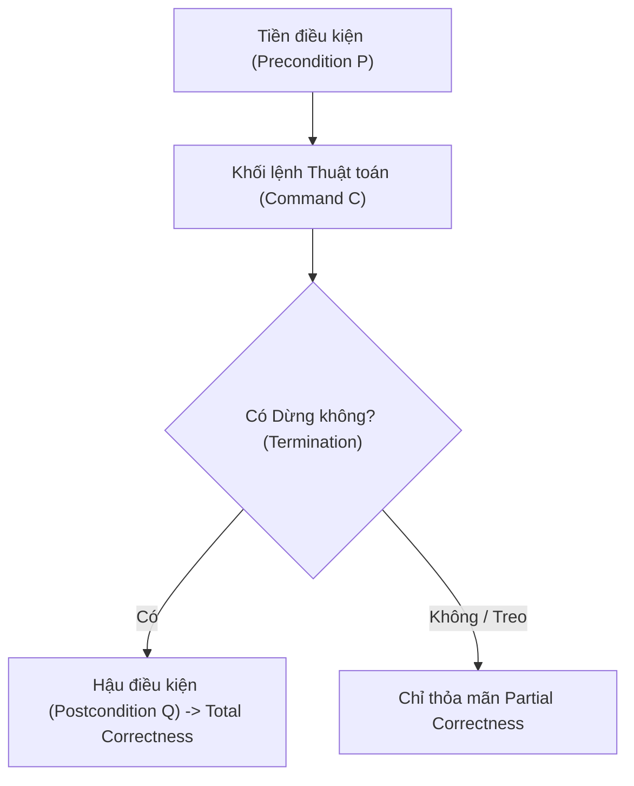
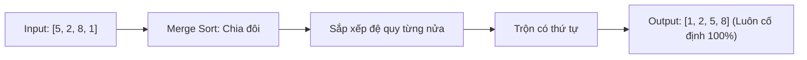
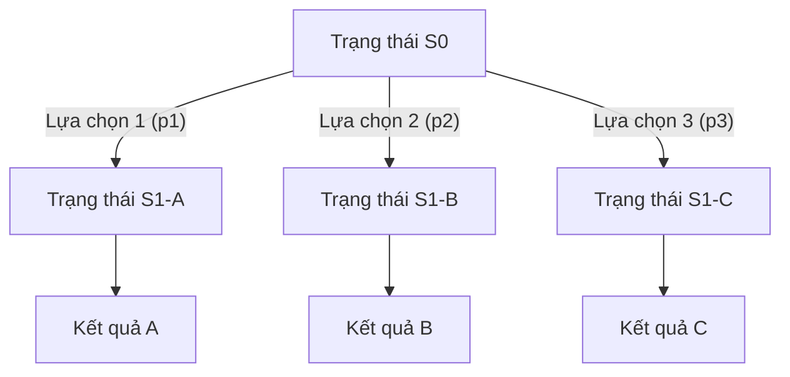
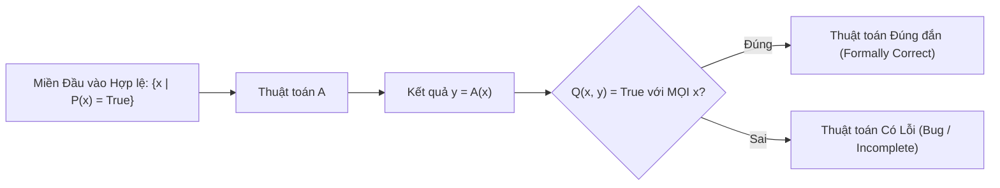
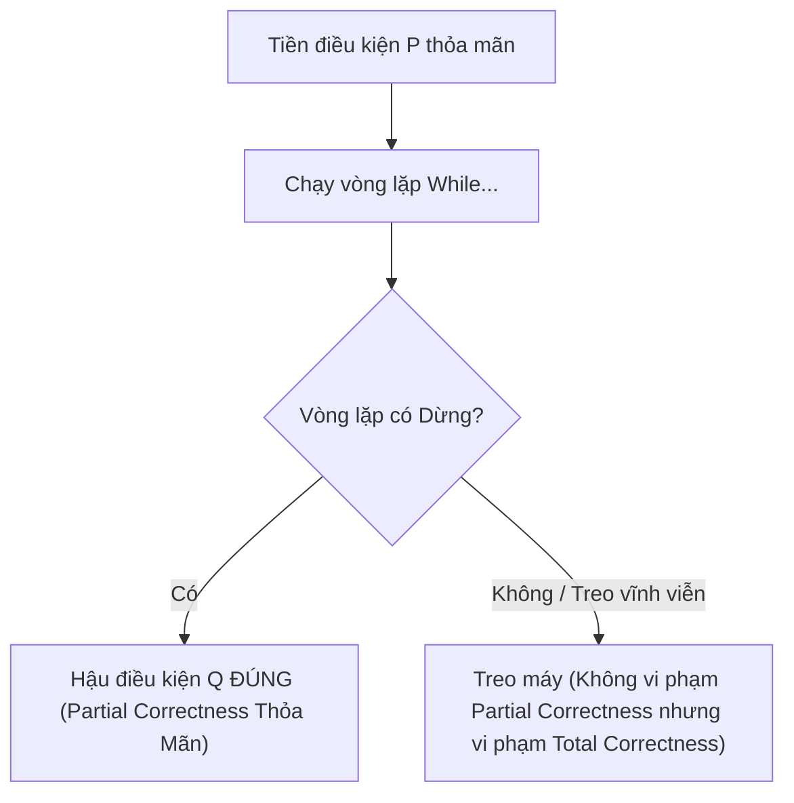
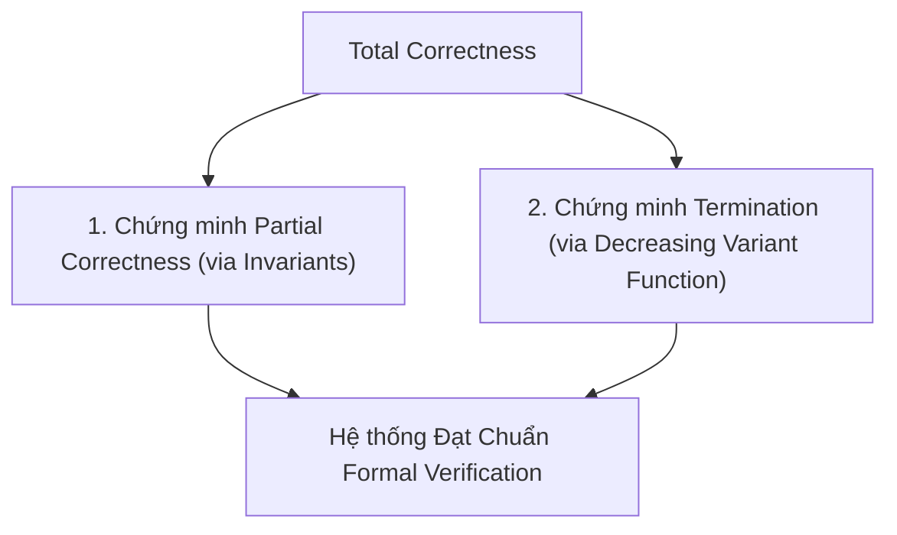
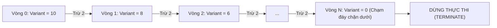
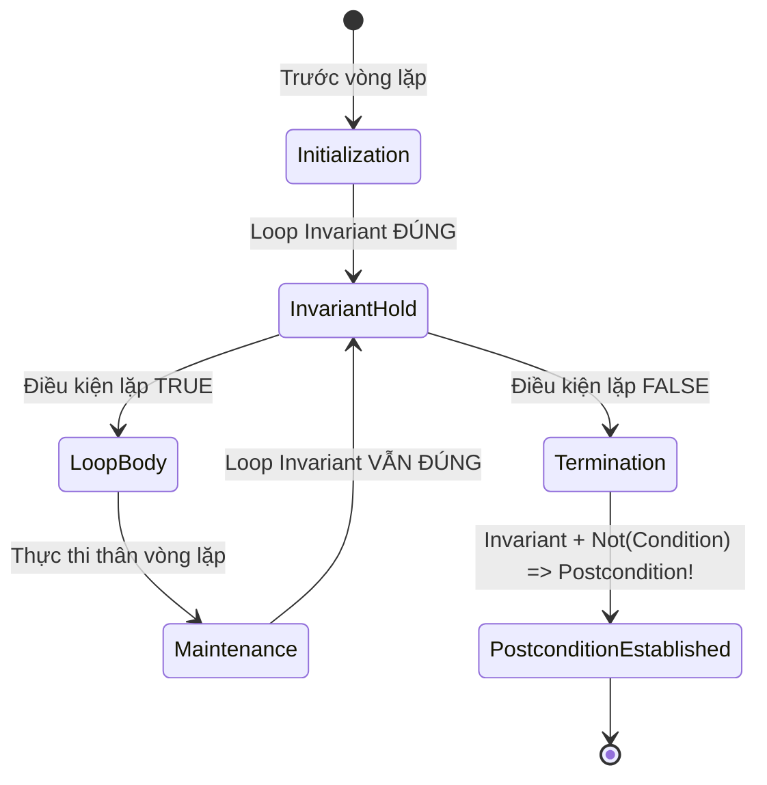
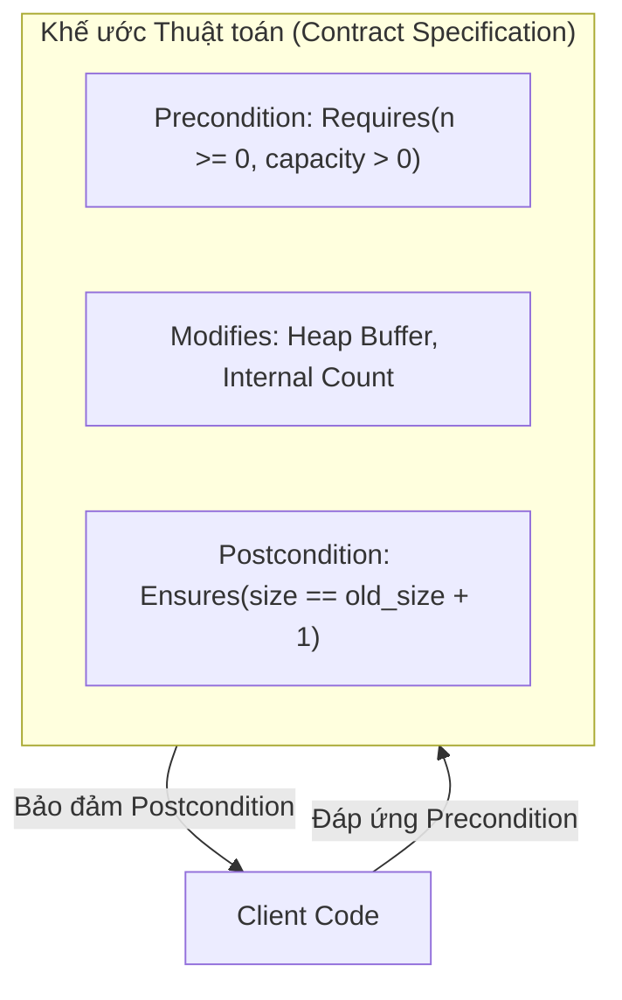
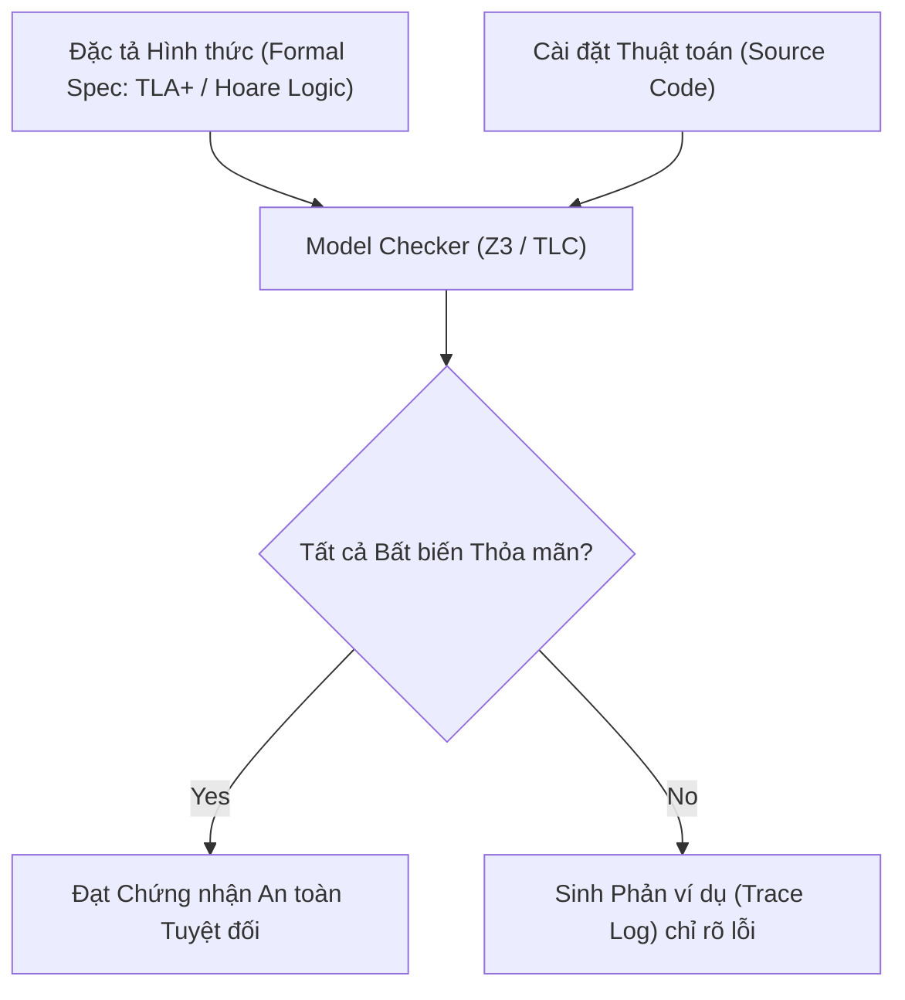

# 2.2. Algorithm Properties and Verification (Đặc tính và Xác minh Tính Đúng đắn của Thuật toán)

## Tổng quan về Thuộc tính và Xác minh Thuật toán
Để một thuật toán có thể triển khai an toàn trong các hệ thống phần mềm tài chính, hạ tầng mạng hoặc hàng không vũ trụ, việc viết mã chạy thử (Testing) là chưa đủ. Khoa học máy tính đòi hỏi thuật toán phải có **đặc tả hình thức (Formal Specification)** và được **chứng minh tính đúng đắn toán học (Formal Verification)**.

Toán học hình thức sử dụng hệ tiên đề Hoare (Hoare Logic):
$$\{P\} \quad \mathcal{C} \quad \{Q\}$$
Trong đó:
- $P$: Tiền điều kiện (Precondition) phải thỏa mãn trước khi khối lệnh $\mathcal{C}$ chạy.
- $\mathcal{C}$: Chuỗi các câu lệnh thuật toán (Command / Program).
- $Q$: Hậu điều kiện (Postcondition) được bảo đảm sau khi $\mathcal{C}$ kết thúc.



---

## 2. Chi tiết từng Keyword (Under-the-Hood Deep Dive)

---

### 1. Deterministic Algorithm (Thuật toán Tất định)

#### 1. Khái niệm bản chất (What & Why)
- **Định nghĩa**: Một thuật toán mà với cùng một trạng thái nội tại và cùng một dữ liệu đầu vào $I$, nó sẽ luôn trải qua chính xác cùng một chuỗi các bước chuyển dịch trạng thái $\delta$ và tạo ra duy nhất một kết quả đầu ra $O$.
- **Tại sao cần thiết**: Tính có thể tái lập (Reproducibility), dễ dàng debug và kiểm thử hồi quy (Regression Testing).

#### 2. Cơ chế hoạt động sâu (Under the hood / Hardcore Internals)
- **Tầng Hardware & Compiler**:
  - CPU thực thi các tập lệnh tất định (ALU operations, Memory loads/stores).
  - Các yếu tố phá vỡ tính tất định trong thực tế: Đọc đồng hồ thực thời gian (`rdtsc`, `gettimeofday`), truy cập bộ đệm phần cứng ngẫu nhiên (`/dev/urandom`), và các Race Conditions giữa nhiều luồng cạnh tranh trên bộ nhớ RAM.

#### 3. Sơ đồ minh họa


#### 4. Code ví dụ thực chiến (C++ Deterministic Pure Function)
```cpp
#include <iostream>
#include <vector>
#include <algorithm>

// Thuật toán tất định hoàn toàn không phụ thuộc vào trạng thái toàn cục
[[nodiscard]] std::vector<int> deterministic_sort(std::vector<int> data) noexcept {
    std::sort(data.begin(), data.end());
    return data;
}

int main() {
    std::vector<int> v = {9, 3, 7, 1};
    auto sorted = deterministic_sort(v);
    for (int x : sorted) std::cout << x << " ";
    std::cout << "\n";
    return 0;
}
```

#### 5. Ưu / Nhược điểm, Pitfalls & Anti-patterns
- **Pitfall**: Dùng hàm băm mặc định không cố định seed trong các ngôn ngữ hiện đại (như Python hash randomization để chống HashDoS) khiến thứ tự duyệt hash map khác nhau giữa các lần chạy.

#### 6. Ứng dụng thực tế trong Backend / Systems
- Blockchain Smart Contracts (Ethereum EVM): Toàn bộ việc thực thi code phải mang tính tất định tuyệt đối để hàng chục nghìn nodes phân tán đạt được cùng một trạng thái sau mỗi block.

---

### 2. Non-deterministic Algorithm (Thuật toán Không tất định)

#### 1. Khái niệm bản chất (What & Why)
- **Định nghĩa**: Một thuật toán mà tại một hoặc nhiều bước thực thi, nó có thể có nhiều lựa chọn chuyển dịch trạng thái tiếp theo hợp lệ. Cùng một đầu vào có thể dẫn đến các chuỗi thực thi khác nhau và các kết quả đầu ra khác nhau.
- **Phân loại**:
  - Thuật toán Ngẫu nhiên hóa (Randomized Algorithms: Monte Carlo, Las Vegas).
  - Máy Turing không tất định (Nondeterministic Turing Machine - NTM) trong lý thuyết độ phức tạp tính toán.

#### 2. Cơ chế hoạt động sâu (Under the hood / Hardcore Internals)
- **Tầng OS Entropy & Hardware RNG**:
  - Sử dụng lệnh CPU phần cứng `RDRAND` / `RDSEED` để thu thập nhiễu nhiệt (Thermal Noise) từ mạch bán dẫn, cung cấp nguồn ngẫu nhiên thực sự (True Randomness) vào Linux Kernel Entropy Pool (`/dev/random`).

#### 3. Sơ đồ minh họa


#### 4. Code ví dụ thực chiến (C++ Randomized Quicksort - Las Vegas Algorithm)
```cpp
#include <iostream>
#include <vector>
#include <random>
#include <utility>

// Randomized Quicksort: Chọn pivot ngẫu nhiên để triệt tiêu trường hợp xấu nhất O(n^2)
int partition_random(std::vector<int>& arr, int low, int high) {
    static std::mt19937_64 rng(1337); // Seed
    std::uniform_int_distribution<int> dist(low, high);
    int random_pivot_idx = dist(rng);
    std::swap(arr[random_pivot_idx], arr[high]);

    int pivot = arr[high];
    int i = low - 1;
    for (int j = low; j < high; ++j) {
        if (arr[j] <= pivot) {
            ++i;
            std::swap(arr[i], arr[j]);
        }
    }
    std::swap(arr[i + 1], arr[high]);
    return i + 1;
}

void quicksort(std::vector<int>& arr, int low, int high) {
    if (low < high) {
        int pi = partition_random(arr, low, high);
        quicksort(arr, low, pi - 1);
        quicksort(arr, pi + 1, high);
    }
}

int main() {
    std::vector<int> nums = {10, 7, 8, 9, 1, 5};
    quicksort(nums, 0, nums.size() - 1);
    for (int x : nums) std::cout << x << " ";
    std::cout << "\n";
    return 0;
}
```

#### 5. Ưu / Nhược điểm, Pitfalls & Anti-patterns
- **Ưu điểm**: Phá vỡ sự bế tắc trong các bài toán NP-Hard hoặc giải quyết bài toán đồng thuận phân tán nhanh chóng hơn.
- **Pitfall**: Khó viết unit test tự động nếu không cô lập nguồn ngẫu nhiên qua Mocking/Seeding.

#### 6. Ứng dụng thực tế trong Backend / Systems
- Thuật toán Exponential Backoff with Jitter trong kết nối mạng phân tán: Thêm yếu tố ngẫu nhiên vào thời gian retry để tránh hiện tượng Thundering Herd Problem làm sập server.

---

### 3. Algorithm Correctness (Tính Đúng đắn của Thuật toán)

#### 1. Khái niệm bản chất (What & Why)
- **Định nghĩa**: Một thuật toán được gọi là đúng đắn (Correct) đối với một đặc tả hình thức nếu với mọi đầu vào hợp lệ thỏa mãn Tiền điều kiện $P$, thuật toán dừng lại và tạo ra kết quả thỏa mãn Hậu điều kiện $Q$.
- **Khẳng định**: Đúng đắn là một khái niệm tuyệt đối theo nghĩa toán học, khác hoàn toàn với khái niệm "chạy thử qua 100 test case".

#### 2. Cơ chế hoạt động sâu (Under the hood / Hardcore Internals)
- Chứng minh tính đúng đắn được thực hiện thông qua:
  1. Quy nạp toán học (Mathematical Induction) trên số bước thực thi hoặc kích thước dữ liệu $n$.
  2. Bất biến vòng lặp (Loop Invariants).
  3. Quan hệ đệ quy (Recurrence Relations).

#### 3. Sơ đồ minh họa


#### 4. Code ví dụ thực chiến (C++ Contract-based Correctness)
```cpp
#include <iostream>
#include <cassert>
#include <vector>

// Đặc tả: Tìm phần tử lớn nhất trong mảng không rỗng
// Precondition: arr.size() > 0
// Postcondition: Trả về max_val sao cho với mọi x thuộc arr: max_val >= x
int find_maximum(const std::vector<int>& arr) {
    // 1. Kiểm tra Precondition
    assert(!arr.empty() && "Precondition Failed: Array must not be empty");

    int max_val = arr[0];
    for (std::size_t i = 1; i < arr.size(); ++i) {
        if (arr[i] > max_val) {
            max_val = arr[i];
        }
    }

    // 2. Xác minh Postcondition (trong môi trường Debug/Testing)
    for (int x : arr) {
        assert(max_val >= x && "Postcondition Failed: Result is not the maximum");
    }

    return max_val;
}

int main() {
    std::vector<int> numbers = {15, 42, 8, 99, 23};
    std::cout << "Max: " << find_maximum(numbers) << "\n";
    return 0;
}
```

#### 5. Ưu / Nhược điểm, Pitfalls & Anti-patterns
- **Anti-pattern**: Nhầm lẫn giữa "Test Pass 100%" và "Thuật toán đúng đắn". Dijkstra từng nói: *"Testing shows the presence, not the absence of bugs."*

#### 6. Ứng dụng thực tế trong Backend / Systems
- Hệ thống nhân Kernel seL4: Hệ điều hành microkernel đầu tiên trên thế giới được chứng minh toán học hình thức hoàn toàn không có lỗi tràn bộ đệm, lỗi con trỏ null hay memory leaks.

---

### 4. Partial Correctness (Tính Đúng đắn Một phần)

#### 1. Khái niệm bản chất (What & Why)
- **Định nghĩa**: Một thuật toán đạt tính đúng đắn một phần đối với tiền điều kiện $P$ và hậu điều kiện $Q$ nếu: **NẾU** thuật toán dừng (terminates), thì kết quả đầu ra đảm bảo thỏa mãn $Q$. Tuy nhiên, nó không đảm bảo thuật toán có thực sự dừng hay không.
- Ký hiệu Hoare:
  $$\models_{\text{partial}} \{P\} \quad \mathcal{C} \quad \{Q\}$$

#### 2. Cơ chế hoạt động sâu (Under the hood / Hardcore Internals)
- Khi phân tích Partial Correctness, ta tạm thời bỏ qua nguy cơ vòng lặp vô tận (Infinite Loop) hoặc đệ quy vô hạn (Infinite Recursion). Ta chỉ tập trung chứng minh rằng mỗi bước lặp bảo toàn tính bất biến logic.

#### 3. Sơ đồ minh họa


#### 4. Code ví dụ thực chiến (C++ Minh họa Partial Correctness)
```cpp
#include <iostream>

// Hàm tìm số nguyên dương chẵn n > 2 không phải tổng của 2 số nguyên tố (Giả thuyết Goldbach)
// Nếu hàm này tìm thấy và trả về kết quả, kết quả đó 100% đúng là phản ví dụ của Goldbach.
// Nhưng không ai biết hàm có bao giờ dừng hay không!
void search_goldbach_counterexample() {
    uint64_t n = 4;
    while (true) {
        // Kiểm tra điều kiện...
        // Nếu thỏa mãn thì return n;
        n += 2;
    }
}
```

#### 5. Ưu / Nhược điểm, Pitfalls & Anti-patterns
- **Pitfall**: Đánh giá một thuật toán chỉ trên Partial Correctness mà không chứng minh Termination, dẫn đến các dịch vụ Backend bị treo CPU 100% khi gặp dữ liệu cạnh (Edge Cases).

#### 6. Ứng dụng thực tế trong Backend / Systems
- Các vòng lặp dịch vụ nền (Daemon Loop / Event Loop): Thiết kế có chủ ý để không bao giờ dừng (`while (true) { epoll_wait(...) }`), nhưng mỗi chu kỳ xử lý message phải đạt tính đúng đắn một phần.

---

### 5. Total Correctness (Tính Đúng đắn Toàn phần)

#### 1. Khái niệm bản chất (What & Why)
- **Định nghĩa**: Thuật toán đạt tính đúng đắn toàn phần khi và chỉ khi nó thỏa mãn hai điều kiện đồng thời:
  1. **Partial Correctness**: Nếu dừng thì kết quả phải đúng.
  2. **Termination**: Thuật toán chắc chắn phải dừng sau một số bước hữu hạn với mọi đầu vào hợp lệ.
- Công thức logic:
  $$\text{Total Correctness} = \text{Partial Correctness} \land \text{Termination}$$

#### 2. Cơ chế hoạt động sâu (Under the hood / Hardcore Internals)
- Để chứng minh Total Correctness, các nhà khoa học máy tính sử dụng một hàm thứ tự tốt (Well-founded relation / Variant Function) $v: S \to \mathbb{N}$. Giá trị của $v$ là một số nguyên không âm và giảm nghiêm ngặt sau mỗi bước lặp ($v_{k+1} < v_k$). Vì tập số tự nhiên có chặn dưới là 0, vòng lặp bắt buộc phải dừng.

#### 3. Sơ đồ minh họa


#### 4. Code ví dụ thực chiến (C++ Variant Function for Termination)
```cpp
#include <iostream>

// Thuật toán trừ liên tiếp để chia nguyên: a / b
// Precondition: a >= 0, b > 0
// Variant function: v = remainder. Sau mỗi bước, remainder giảm đi b > 0.
// Do remainder >= 0, vòng lặp bắt buộc dừng -> Total Correctness
std::pair<int, int> integer_division(int a, int b) {
    int quotient = 0;
    int remainder = a; // Biến suy giảm (Variant)

    while (remainder >= b) {
        remainder -= b; // remainder(k+1) = remainder(k) - b < remainder(k)
        ++quotient;
    }

    return {quotient, remainder};
}

int main() {
    auto [q, r] = integer_division(29, 5);
    std::cout << "29 / 5 = " << q << " du " << r << "\n";
    return 0;
}
```

#### 5. Ưu / Nhược điểm, Pitfalls & Anti-patterns
- **Anti-pattern**: Sử dụng biến kiểu số thực `float` làm biến đếm vòng lặp (`for (float x = 0.0; x != 1.0; x += 0.1)`), do sai số làm tròn số thực, `x` không bao giờ bằng chính xác `1.0`, phá vỡ hoàn toàn tính Termination.

#### 6. Ứng dụng thực tế trong Backend / Systems
- Hệ thống xử lý thanh toán tài chính (Stripe, SWIFT): Bắt buộc đạt Total Correctness để mọi giao dịch đều phải chuyển về một trạng thái cuối cùng (Committed hoặc Aborted), không bao giờ được phép treo lơ lửng.

---

### 6. Termination (Tính Dừng của Thuật toán)

#### 1. Khái niệm bản chất (What & Why)
- **Định nghĩa**: Thuộc tính đảm bảo rằng một quy trình tính toán sẽ không rơi vào trạng thái lặp vô hạn (Infinite Loop) hoặc đệ quy không đáy (Infinite Recursion), mà chắc chắn sẽ chạm tới trạng thái kết thúc sau một số lượng hữu hạn các bước chuyển dịch.
- **Tại sao cần thiết**: Máy tính giải quyết vấn đề bằng cách trả về kết quả; một hệ thống không dừng sẽ không bao giờ giải phóng tài nguyên CPU/RAM.

#### 2. Cơ chế hoạt động sâu (Under the hood / Hardcore Internals)
- **Vấn đề Dừng (The Halting Problem - Alan Turing 1936)**:
  - Về mặt lý thuyết tổng quát, không tồn tại bất kỳ một siêu thuật toán nào có thể kiểm tra một chương trình tùy ý với đầu vào bất kỳ có dừng hay không.
  - Tuy nhiên, đối với một thuật toán cụ thể, ta hoàn toàn có thể chứng minh tính dừng bằng cách chỉ ra một **Hàm suy biến (Loop Variant Function)** bị chặn dưới.

#### 3. Sơ đồ minh họa


#### 4. Code ví dụ thực chiến (C++ Chứng minh Termination trên Cấu trúc Cây)
```cpp
#include <iostream>
#include <memory>

struct TreeNode {
    int val;
    std::unique_ptr<TreeNode> left;
    std::unique_ptr<TreeNode> right;
    explicit TreeNode(int v) : val(v) {}
};

// Hàm đếm số node: Variant ở đây là chiều cao/số node còn lại của cây.
// Mỗi lần gọi đệ quy, kích thước cây con giảm nghiêm ngặt -> Chắc chắn dừng.
int count_nodes(const TreeNode* root) noexcept {
    if (root == nullptr) { // Điều kiện dừng (Base case)
        return 0;
    }
    return 1 + count_nodes(root->left.get()) + count_nodes(root->right.get());
}

int main() {
    auto root = std::make_unique<TreeNode>(1);
    root->left = std::make_unique<TreeNode>(2);
    root->right = std::make_unique<TreeNode>(3);
    std::cout << "Total nodes: " << count_nodes(root.get()) << "\n";
    return 0;
}
```

#### 5. Ưu / Nhược điểm, Pitfalls & Anti-patterns
- **Pitfall**: Đồ thị có chu trình nhưng duyệt bằng DFS/BFS không có mảng đánh dấu `visited`, dẫn đến lặp vô tận và tràn Stack (Stack Overflow).

#### 6. Ứng dụng thực tế trong Backend / Systems
- Thiết lập Timeout (Request Timeouts & Deadlines trong gRPC/HTTP): Là biện pháp bảo vệ vật lý cưỡng chế tính dừng cho các hệ thống phân tán khi không thể chứng minh hình thức tính dừng do sự không chắc chắn của môi trường mạng.

---

### 7. Loop Invariant (Bất biến Vòng lặp)

#### 1. Khái niệm bản chất (What & Why)
- **Định nghĩa**: Một mệnh đề logic $I_{\text{loop}}$ luôn đúng tại 3 thời điểm then chốt của một vòng lặp:
  1. **Initialization (Khởi tạo)**: Đúng trước khi vòng lặp bắt đầu bước lặp đầu tiên.
  2. **Maintenance (Duy trì)**: Nếu nó đúng trước một bước lặp, nó vẫn phải đúng sau khi bước lặp đó kết thúc.
  3. **Termination (Kết thúc)**: Khi vòng lặp dừng lại, bất biến kết hợp với điều kiện dừng sẽ suy ra trực tiếp tính đúng đắn của thuật toán (Postcondition).
- **Tại sao cần thiết**: Là công cụ quy nạp toán học mạnh mẽ nhất để chứng minh thuật toán lặp hoạt động chuẩn xác.

#### 2. Cơ chế hoạt động sâu (Under the hood / Hardcore Internals)
- Phương pháp tương đương với Nguyên lý Quy nạp Toán học (Mathematical Induction):
  - Khởi tạo = Bước cơ sở ($n = 0$).
  - Duy trì = Bước quy nạp (Giả sử đúng với $k$, chứng minh đúng với $k+1$).
  - Kết thúc = Áp dụng mệnh đề đã chứng minh cho toàn bộ không gian bài toán.

#### 3. Sơ đồ minh họa


#### 4. Code ví dụ thực chiến (C++ Chứng minh Loop Invariant trong Insertion Sort)
```cpp
#include <iostream>
#include <vector>

void insertion_sort(std::vector<int>& arr) {
    // LOOP INVARIANT:
    // Tại đầu mỗi vòng lặp i, đoạn con arr[0 ... i-1] luôn luôn được sắp xếp theo thứ tự tăng dần.

    // 1. Initialization: Khi i = 1, đoạn arr[0 ... 0] chỉ có 1 phần tử -> Luôn sắp xếp (ĐÚNG)
    for (std::size_t i = 1; i < arr.size(); ++i) {
        int key = arr[i];
        int j = static_cast<int>(i) - 1;

        // Dịch chuyển các phần tử lớn hơn key sang phải 1 vị trí
        while (j >= 0 && arr[j] > key) {
            arr[j + 1] = arr[j];
            --j;
        }
        arr[j + 1] = key;
        // 2. Maintenance: Chèn key vào đúng vị trí -> Đoạn arr[0 ... i] được sắp xếp (ĐÚNG)
    }
    // 3. Termination: Vòng lặp dừng khi i = arr.size().
    // Theo invariant, đoạn arr[0 ... arr.size() - 1] đã được sắp xếp -> Toàn bộ mảng đã sort!
}

int main() {
    std::vector<int> data = {5, 2, 4, 6, 1, 3};
    insertion_sort(data);
    for (int x : data) std::cout << x << " ";
    std::cout << "\n";
    return 0;
}
```

#### 5. Ưu / Nhược điểm, Pitfalls & Anti-patterns
- **Pitfall**: Đặt sai vị trí của lệnh tăng biến đếm hoặc thay đổi dữ liệu khiến bất biến bị phá vỡ giữa các bước lặp mà không được khôi phục.

#### 6. Ứng dụng thực tế trong Backend / Systems
- Garbage Collection Algorithms (Tri-color Marking): Duy trì bất biến không có đối tượng đen nào trỏ trực tiếp tới đối tượng trắng mà không thông qua đối tượng xám trong suốt quá trình dọn rác đồng thời (Concurrent GC).

---

### 8. Algorithm Specification (Đặc tả Thuật toán)

#### 1. Khái niệm bản chất (What & Why)
- **Định nghĩa**: Một bản mô tả toán học chính xác và phi mập mờ về những gì thuật toán phải hoàn thành (What to do), chứ không phải cách thức nó cài đặt (How to do it).
- **Thành phần cốt lõi**:
  - Tên thuật toán và kiểu dữ liệu các tham số.
  - **Requires (Preconditions)**: Các điều kiện ràng buộc đối với dữ liệu đầu vào.
  - **Ensures (Postconditions)**: Các bảo đảm toán học về dữ liệu đầu ra và trạng thái sau khi hoàn tất.
  - **Modifies (Side effects)**: Danh sách các ô nhớ hoặc tài nguyên bị biến đổi.

#### 2. Cơ chế hoạt động sâu (Under the hood / Hardcore Internals)
- **Design by Contract (DbC - Bertrand Meyer)**:
  - Nếu Caller vi phạm Precondition $\to$ Lỗi thuộc về Caller.
  - Nếu Callee vi phạm Postcondition $\to$ Lỗi thuộc về Callee (Bug trong thuật toán).
  - Trình biên dịch hiện đại (như C++26 Contracts hoặc công cụ phân tích tĩnh Frama-C) có thể kiểm tra các hợp đồng này tự động tại compile time.

#### 3. Sơ đồ minh họa


#### 4. Code ví dụ thực chiến (TypeScript Design by Contract Pattern)
```typescript
class BankVault {
    private balance: number = 0;

    /**
     * @spec
     * Requires: amount > 0
     * Modifies: this.balance
     * Ensures: this.balance === old(this.balance) + amount
     */
    public deposit(amount: number): void {
        // Precondition Check
        if (amount <= 0) {
            throw new Error("CONTRACT VIOLATION: Precondition failed (amount <= 0)");
        }

        const oldBalance = this.balance;

        // Implementation
        this.balance += amount;

        // Postcondition Check
        if (this.balance !== oldBalance + amount) {
            throw new Error("CONTRACT VIOLATION: Postcondition failed (state corrupted)");
        }
    }

    public getBalance(): number {
        return this.balance;
    }
}

const vault = new BankVault();
vault.deposit(100);
console.log("Vault Balance:", vault.getBalance());
```

#### 5. Ưu / Nhược điểm, Pitfalls & Anti-patterns
- **Anti-pattern**: Viết đặc tả quá chặt chẽ làm lộ chi tiết cài đặt nội bộ (ví dụ: yêu cầu đầu ra phải dùng QuickSort thay vì chỉ yêu cầu mảng đầu ra phải có thứ tự tăng dần).

#### 6. Ứng dụng thực tế trong Backend / Systems
- OpenAPI / Swagger & GraphQL Schema: Đóng vai trò là bản Contract đặc tả giao thức API giữa Client và Server.

---

### 9. Algorithm Verification (Xác minh Thuật toán)

#### 1. Khái niệm bản chất (What & Why)
- **Định nghĩa**: Quá trình chứng minh hoặc bác bỏ một cách hình thức và khoa học rằng một thuật toán cụ thể có thỏa mãn đầy đủ bản đặc tả của nó hay không.
- **Phương pháp tiếp cận**:
  - Kiểm thử mô hình hình thức (Model Checking: TLA+, SPIN).
  - Trợ lý chứng minh định lý tự động (Theorem Proving: Coq, Isabelle/HOL, Z3 SMT Solver).
  - Phân tích tĩnh ký hiệu (Symbolic Execution: KLEE).

#### 2. Cơ chế hoạt động sâu (Under the hood / Hardcore Internals)
- **TLA+ (Temporal Logic of Actions - Leslie Lamport)**:
  - Cho phép mô hình hóa các trạng thái của hệ thống phân tán dưới dạng các công thức toán học logic mệnh đề và kiểm tra toàn bộ không gian trạng thái ($S$) để tìm kiếm Deadlocks hoặc Liveness violations trước khi viết bất kỳ dòng mã nào.

#### 3. Sơ đồ minh họa


#### 4. Code ví dụ thực chiến (C++ Static Assert Verification at Compile Time)
```cpp
#include <iostream>
#include <type_traits>

// Xác minh tính chất thuật toán tại Compile-Time qua constexpr
constexpr uint64_t const_factorial(uint32_t n) {
    uint64_t res = 1;
    for (uint32_t i = 1; i <= n; ++i) {
        res *= i;
    }
    return res;
}

// Compile-Time Verification (Nếu sai, code sẽ không bao giờ biên dịch được)
static_assert(const_factorial(0) == 1, "Verification Failed for n = 0");
static_assert(const_factorial(3) == 6, "Verification Failed for n = 3");
static_assert(const_factorial(5) == 120, "Verification Failed for n = 5");

int main() {
    std::cout << "Factorial algorithm mathematically verified at compile-time!\n";
    return 0;
}
```

#### 5. Ưu / Nhược điểm, Pitfalls & Anti-patterns
- **Ưu điểm**: Loại bỏ hoàn toàn lỗi tiềm ẩn trước khi đưa vào sản xuất.
- **Nhược điểm**: Chi phí chuyên gia và thời gian chứng minh toán học cực kỳ đắt đỏ; thường chỉ áp dụng cho lõi phần cứng CPU, hệ thống điều khiển tên lửa, hoặc giao thức mật mã học.

#### 6. Ứng dụng thực tế trong Backend / Systems
- Amazon Web Services (AWS): Sử dụng TLA+ để xác minh tính đúng đắn của thuật toán đồng thuận trong Amazon S3 và DynamoDB, phát hiện nhiều bug nghiêm trọng mà hàng nghìn giờ unit testing không bao giờ tìm ra.
