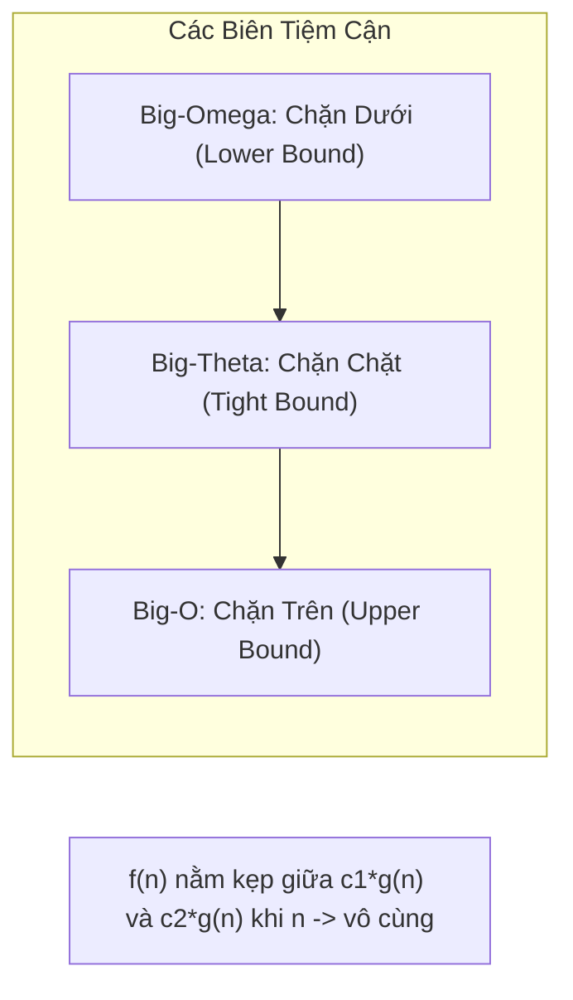
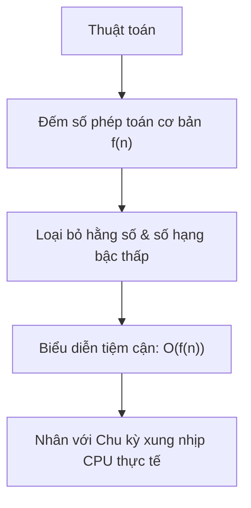
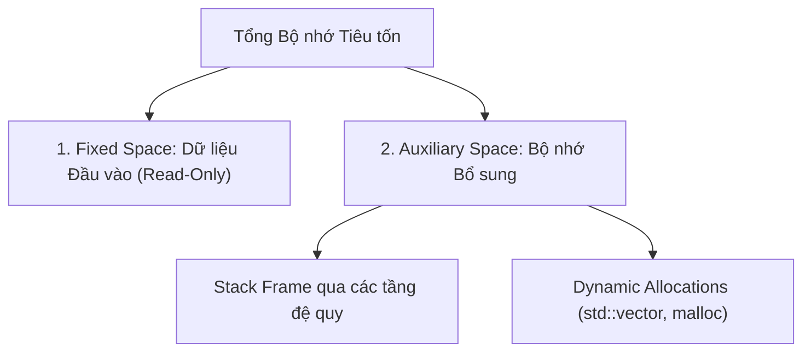
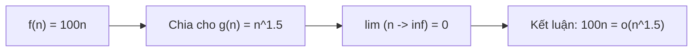
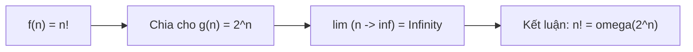
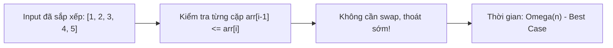
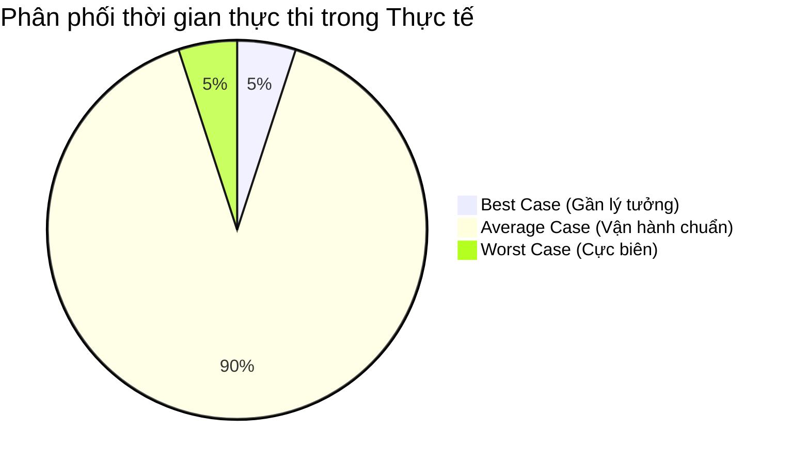
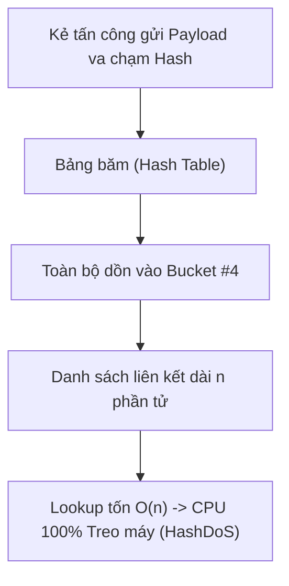

# 3.1. Asymptotic Analysis (Phân tích Tiệm cận và Đánh giá Hiệu năng Thuật toán)

## Tổng quan về Phân tích Tiệm cận
Phân tích tiệm cận (Asymptotic Analysis) là phương pháp toán học đo lường hiệu năng của một thuật toán khi kích thước đầu vào $n$ tiến dần tới vô cùng ($n \to \infty$). 

Thay vì đo thời gian chạy bằng giây thực tế (vốn phụ thuộc chặt chẽ vào xung nhịp CPU, dung lượng RAM, hệ điều hành và tối ưu hóa của trình biên dịch), phân tích tiệm cận trừu tượng hóa chi phí tính toán thành hàm số $f(n)$ biểu diễn số phép toán cơ bản (Primitive Operations) được thực thi.

Định nghĩa toán học của các biên tiệm cận:
$$\begin{aligned}
\mathcal{O}(g(n)) &= \{ f(n) : \exists c > 0, n_0 > 0 \text{ sao cho } 0 \le f(n) \le c \cdot g(n), \, \forall n \ge n_0 \} \\
\Omega(g(n)) &= \{ f(n) : \exists c > 0, n_0 > 0 \text{ sao cho } 0 \le c \cdot g(n) \le f(n), \, \forall n \ge n_0 \} \\
\Theta(g(n)) &= \{ f(n) : \exists c_1, c_2 > 0, n_0 > 0 \text{ sao cho } c_1 \cdot g(n) \le f(n) \le c_2 \cdot g(n), \, \forall n \ge n_0 \}
\end{aligned}$$



---

## 2. Chi tiết từng Keyword (Under-the-Hood Deep Dive)

---

### 1. Time Complexity (Độ phức tạp Thời gian)

#### 1. Khái niệm bản chất (What & Why)
- **Định nghĩa**: Hàm số $T(n)$ biểu diễn số lượng chỉ thị lệnh cơ bản mà CPU phải thực thi để hoàn thành thuật toán, đo theo hàm của kích thước đầu vào $n$.
- **Tại sao cần thiết**: Giúp dự đoán chính xác khả năng chịu tải và độ trễ (latency) của hệ thống khi quy mô dữ liệu tăng từ hàng nghìn lên hàng tỷ bản ghi.

#### 2. Cơ chế hoạt động sâu (Under the hood / Hardcore Internals)
- **Tầng CPU Clock Cycles & Instruction Retiring**:
  - Không phải mọi phép toán đều có thời gian chạy bằng nhau. Trong CPU x86-64:
    - Phép toán cộng logic bit (`ADD`, `XOR`): 1 chu kỳ CPU (CPU Cycle $\approx 0.25\text{ns}$ trên chip 4GHz).
    - Phép nhân số nguyên (`IMUL`): 3-4 chu kỳ.
    - Phép chia số nguyên (`IDIV`): 15-40 chu kỳ CPU (rất chậm).
    - Truy cập RAM chính (Cache Miss): 100-200 chu kỳ CPU (Khoảng cách cực lớn so với L1 Cache chỉ mất 4-5 chu kỳ).

#### 3. Sơ đồ minh họa


#### 4. Code ví dụ thực chiến (C++ Đo lường chu kỳ CPU thực tế qua RDTSC)
```cpp
#include <iostream>
#include <vector>
#include <x86intrin.h> // Hỗ trợ __rdtsc() trên x86-64

uint64_t benchmark_linear_scan(const std::vector<int>& data, int target) {
    uint64_t start_cycles = __rdtsc(); // Đọc thanh ghi Time Stamp Counter của CPU
    
    volatile int found = -1;
    for (std::size_t i = 0; i < data.size(); ++i) {
        if (data[i] == target) {
            found = static_cast<int>(i);
            break;
        }
    }

    uint64_t end_cycles = __rdtsc();
    return end_cycles - start_cycles;
}

int main() {
    std::vector<int> numbers(1'000'000, 42);
    uint64_t cycles = benchmark_linear_scan(numbers, 99);
    std::cout << "Linear Scan of 1M items took: " << cycles << " CPU Cycles\n";
    return 0;
}
```

#### 5. Ưu / Nhược điểm, Pitfalls & Anti-patterns
- **Pitfall**: Đánh đồng $O(n)$ luôn nhanh hơn $O(n^2)$. Nếu $T_1(n) = 10^6 \cdot n$ và $T_2(n) = 2 \cdot n^2$, với $n = 100$, thuật toán $O(n^2)$ nhanh hơn gấp hàng nghìn lần thuật toán $O(n)$!

#### 6. Ứng dụng thực tế trong Backend / Systems
- Thiết lập SLA / SLO về độ trễ dịch vụ: Một truy vấn tìm kiếm elasticsearch phải đảm bảo hoàn tất trong $O(\log n)$ thời gian để giữ p99 latency dưới 20ms.

---

### 2. Space Complexity (Độ phức tạp Không gian)

#### 1. Khái niệm bản chất (What & Why)
- **Định nghĩa**: Lượng bộ nhớ bổ sung (Auxiliary Space) mà thuật toán tiêu tốn để giải quyết bài toán ngoài vùng nhớ lưu trữ dữ liệu đầu vào, đo theo hàm kích thước $n$.
- **Thành phần**:
  - Bộ nhớ trên Call Stack (biến cục bộ, địa chỉ hàm đệ quy).
  - Bộ nhớ động trên Heap (mảng động, con trỏ, cây, bảng băm).

#### 2. Cơ chế hoạt động sâu (Under the hood / Hardcore Internals)
- **Tầng Virtual Memory & RSS (Resident Set Size)**:
  - Khi phân bổ bộ nhớ động quá lớn ($O(n^2)$), tiến trình vượt quá dung lượng RAM vật lý sẽ bị hệ điều hành hoán đổi ra đĩa (Paging/Swapping) làm hiệu năng sụp đổ hàng nghìn lần, hoặc bị Kernel **OOM Killer (Out-of-Memory Killer)** bắn tín hiệu `SIGKILL`.

#### 3. Sơ đồ minh họa


#### 4. Code ví dụ thực chiến (C++ Đổi O(n) Space sang O(1) Space trong Fibonacci)
```cpp
#include <iostream>
#include <vector>

// Cách 1: Tiêu tốn O(n) Heap Space
uint64_t fib_space_on(int n) {
    if (n <= 1) return n;
    std::vector<uint64_t> dp(n + 1);
    dp[0] = 0; dp[1] = 1;
    for (int i = 2; i <= n; ++i) dp[i] = dp[i - 1] + dp[i - 2];
    return dp[n];
}

// Cách 2: Tối ưu về O(1) Auxiliary Space qua 2 biến cục bộ
uint64_t fib_space_o1(int n) noexcept {
    if (n <= 1) return n;
    uint64_t prev2 = 0, prev1 = 1;
    for (int i = 2; i <= n; ++i) {
        uint64_t curr = prev1 + prev2;
        prev2 = prev1;
        prev1 = curr;
    }
    return prev1;
}

int main() {
    std::cout << "Fib(50) with O(1) space: " << fib_space_o1(50) << "\n";
    return 0;
}
```

#### 5. Ưu / Nhược điểm, Pitfalls & Anti-patterns
- **Pitfall**: Đệ quy sâu không có Tail-call Optimization gây tràn ngăn xếp (Stack Overflow Exception).

#### 6. Ứng dụng thực tế trong Backend / Systems
- Cấu trúc dữ liệu HyperLogLog trong Redis: Cho phép đếm số lượng người dùng duy nhất (Cardinality) lên tới hàng tỷ người với sai số $\approx 0.81\%$ nhưng chỉ tốn cố định $O(1)$ không gian (chính xác 12KB RAM).

---

### 3. Input Size (Kích thước Đầu vào)

#### 1. Khái niệm bản chất (What & Why)
- **Định nghĩa**: Đại lượng đo lường số lượng phần tử hoặc số lượng bit nhị phân cần thiết để mã hóa và biểu diễn toàn bộ dữ liệu đầu vào của bài toán.
- **Ký hiệu**: Thường ký hiệu là $n$, hoặc $|V| + |E|$ trong đồ thị, hoặc số bit $k = \lceil \log_2 N \rceil$ trong lý thuyết số.

#### 2. Cơ chế hoạt động sâu (Under the hood / Hardcore Internals)
- **Sự khác biệt giữa Giá trị số $N$ và Kích thước biểu diễn $n$**:
  - Kiểm tra số nguyên tố cho số $N$: Nếu thuật toán chạy trong $O(N)$ phép tính, nó thực chất là thuật toán có độ phức tạp hàm mũ theo kích thước đầu vào vì $n = \log_2 N \implies N = 2^n$ (Pseudo-polynomial time).

#### 3. Sơ đồ minh họa
```text
Bản chất Kích thước Đầu vào:
Dãy số: [12, 45, 78, 90]        -> Input size n = 4 phần tử
Ma trận NxN                    -> Input size n = N^2 ô nhớ
Đồ thị G = (V, E)              -> Input size = |V| đỉnh + |E| cạnh
Số nguyên lớn BigInt (2^1024)  -> Input size = 1024 bits
```

#### 4. Code ví dụ thực chiến (C++ Phân tích Input Size đa chiều trên Đồ thị)
```cpp
#include <iostream>
#include <vector>

// Input size là hàm của cả 2 biến: |V| (Vertices) và |E| (Edges)
class GraphAdjacencyList {
    int v_count_;
    std::vector<std::vector<int>> adj_;

public:
    explicit GraphAdjacencyList(int v) : v_count_(v), adj_(v) {}

    void add_edge(int u, int v) {
        adj_[u].push_back(v);
    }

    // Space Complexity: O(|V| + |E|)
    // Time Complexity duyệt toàn bộ đồ thị qua BFS/DFS: O(|V| + |E|)
    [[nodiscard]] std::size_t total_memory_footprint() const noexcept {
        std::size_t edges = 0;
        for (const auto& list : adj_) edges += list.size();
        return (v_count_ * sizeof(std::vector<int>)) + (edges * sizeof(int));
    }
};

int main() {
    GraphAdjacencyList g(100);
    g.add_edge(0, 1);
    std::cout << "Approx size: " << g.total_memory_footprint() << " bytes\n";
    return 0;
}
```

#### 5. Ưu / Nhược điểm, Pitfalls & Anti-patterns
- **Pitfall**: Đánh giá thuật toán theo kích thước dòng của file (Lines) thay vì số bytes hoặc số lượng entities cần xử lý.

#### 6. Ứng dụng thực tế trong Backend / Systems
- Kafka Batch Size Tuning: Gom các message nhỏ thành Batch có kích thước tối ưu (ví dụ 64KB) để giảm chi phí syscall I/O và tăng throughput của network.

---

### 4. Growth Rate (Tốc độ Tăng trưởng)

#### 1. Khái niệm bản chất (What & Why)
- **Định nghĩa**: Tốc độ mà hàm chi phí thời gian hoặc không gian $T(n)$ tăng lên khi kích thước đầu vào $n$ tăng dần.
- **Thang bậc tăng trưởng chuẩn**:
  $$O(1) < O(\log n) < O(\sqrt{n}) < O(n) < O(n \log n) < O(n^2) < O(n^3) < O(2^n) < O(n!)$$

#### 2. Cơ chế hoạt động sâu (Under the hood / Hardcore Internals)
- Khi $n = 100$:
  - $n = 100$ phép tính $\implies$ CPU thực thi trong vài nanoseconds.
  - $n^2 = 10,000$ phép tính $\implies$ vài microseconds.
  - $2^n \approx 1.26 \times 10^{30}$ phép tính $\implies$ nhiều tỷ năm (vượt quá tuổi thọ vũ trụ).
- Tốc độ tăng trưởng quyết định tính khả thi (Feasibility) của phần mềm trên thế giới thực.

#### 3. Sơ đồ minh họa
```text
Tốc độ bùng nổ của các hàm tăng trưởng khi n tăng:
Chi phí ^
        |                                      * O(2^n)
        |                               * O(n^2)
        |                        * O(n log n)
        |                 * O(n)
        |          * O(log n)
        |  * O(1)
        +---------------------------------------------> Kích thước n
```

#### 4. Code ví dụ thực chiến (TypeScript Quan sát Tốc độ Tăng trưởng Thực tế)
```typescript
function measureOperationGrowth(): void {
    const sizes = [1000, 10000, 100000];

    for (const n of sizes) {
        // O(n) Operations
        let linearSteps = 0;
        for (let i = 0; i < n; i++) linearSteps++;

        // O(n log n) Operations
        let nlognSteps = 0;
        for (let i = 0; i < n; i++) {
            for (let j = 1; j < n; j *= 2) nlognSteps++;
        }

        console.log(`n = ${n} | Linear steps = ${linearSteps} | N Log N steps = ${nlognSteps}`);
    }
}

measureOperationGrowth();
```

#### 5. Ưu / Nhược điểm, Pitfalls & Anti-patterns
- **Pitfall**: Đánh giá thấp hàm đa thức bậc cao ($O(n^4)$), coi nó là khả thi. Với $n = 10^4$, $n^4 = 10^{16}$ phép tính, hệ thống sẽ sập do timeout.

#### 6. Ứng dụng thực tế trong Backend / Systems
- Thiết kế thuật toán Autoscale cho Kubernetes: Theo dõi tốc độ tăng trưởng của hàng đợi tin nhắn (Queue Length Growth Rate) để mở rộng số lượng Pods trước khi hệ thống bị nghẽn.

---

### 5. Big O (Ký hiệu O lớn - Chặn trên tiệm cận)

#### 1. Khái niệm bản chất (What & Why)
- **Định nghĩa**: Ký hiệu $f(n) = \mathcal{O}(g(n))$ biểu thị rằng hàm $f(n)$ bị chặn trên tiệm cận (Asymptotic Upper Bound) bởi một bội số nguyên dương của $g(n)$ đối với mọi giá trị $n$ đủ lớn.
- **Ý nghĩa thực tế**: Đảm bảo rằng trong trường hợp tồi tệ nhất, thời gian chạy của thuật toán sẽ không phát triển nhanh hơn tốc độ của $g(n)$.

#### 2. Cơ chế hoạt động sâu (Under the hood / Hardcore Internals)
- Chứng minh hình thức: Tìm bộ đôi hằng số $c > 0$ và $n_0 > 0$ thỏa mãn:
  $$f(n) \le c \cdot g(n), \quad \forall n \ge n_0$$
- Ví dụ: Chứng minh $f(n) = 3n^2 + 5n + 7$ là $\mathcal{O}(n^2)$:
  Với mọi $n \ge 1$: $5n \le 5n^2$ và $7 \le 7n^2$.
  Do đó: $3n^2 + 5n + 7 \le 3n^2 + 5n^2 + 7n^2 = 15n^2$.
  Chọn $c = 15$ và $n_0 = 1 \implies f(n) \le 15n^2, \forall n \ge 1$. Hoàn tất chứng minh.

#### 3. Sơ đồ minh họa
```text
Biểu diễn hình học của Big-O:
Giá trị ^
        |            c * g(n) (Đường chặn trên)
        |          /
        |         /   f(n) (Hàm chi phí thực tế)
        |        /   /
        |       /   /
        |      / . '
        +-----*--------------------> n
             n0
```

#### 4. Code ví dụ thực chiến (C++ O(1) vs O(n) Lookup)
```cpp
#include <iostream>
#include <unordered_map>
#include <vector>

// Big-O Upper Bound Demonstration
int main() {
    // std::unordered_map: Thao tác tìm kiếm trung bình là O(1), chặn trên tồi tệ nhất O(n) khi va chạm hash
    std::unordered_map<int, std::string> lookup;
    lookup[101] = "Alpha";
    lookup[202] = "Beta";

    // Phép tìm kiếm luôn hoàn thành trong hằng số thao tác với bảng băm lý tưởng
    auto it = lookup.find(101);
    if (it != lookup.end()) {
        std::cout << "Found: " << it->second << "\n";
    }
    return 0;
}
```

#### 5. Ưu / Nhược điểm, Pitfalls & Anti-patterns
- **Pitfall**: Lạm dụng Big-O để nói về chặn chặt. Viết $n = \mathcal{O}(n^2)$ hoặc $n = \mathcal{O}(2^n)$ là hoàn toàn đúng về mặt toán học, nhưng vô nghĩa về mặt kỹ thuật thực tế vì biên chặn trên quá lỏng.

#### 6. Ứng dụng thực tế trong Backend / Systems
- Cam kết SLA của Cloud Provider: AWS DynamoDB cam kết thời gian đọc ghi dữ liệu đơn lẻ trong biên $\mathcal{O}(1)$ với Single-digit millisecond latency ở bất kỳ quy mô dữ liệu nào.

---

### 6. Big Omega (Ký hiệu Omega lớn - Chặn dưới tiệm cận)

#### 1. Khái niệm bản chất (What & Why)
- **Định nghĩa**: Ký hiệu $f(n) = \Omega(g(n))$ biểu thị rằng hàm $f(n)$ bị chặn dưới tiệm cận (Asymptotic Lower Bound). Nghĩa là thuật toán phải tốn **ít nhất** $c \cdot g(n)$ phép toán khi $n$ đủ lớn.
- **Ý nghĩa kỹ thuật**: Giúp xác định giới hạn dưới của một bài toán (Algorithmic Lower Bound). Bất kỳ thuật toán nào muốn giải quyết bài toán đó đều không thể nhanh hơn biên $\Omega$.

#### 2. Cơ chế hoạt động sâu (Under the hood / Hardcore Internals)
- Định lý kinh điển: Mọi thuật toán sắp xếp dựa trên so sánh (Comparison-based Sorting) đều có giới hạn dưới thời gian là $\Omega(n \log n)$ trong trường hợp xấu nhất, chứng minh qua Cây quyết định (Decision Tree) có ít nhất $n!$ lá $\implies \text{Chiều cao cây} \ge \log_2(n!) = \Omega(n \log n)$.

#### 3. Sơ đồ minh họa
```text
Biểu diễn hình học của Big-Omega:
Giá trị ^
        |            f(n) (Hàm chi phí thực tế)
        |          /
        |         /   c * g(n) (Đường chặn dưới tối thiểu)
        |        /   /
        |       /   /
        |      / . '
        +-----*--------------------> n
             n0
```

#### 4. Code ví dụ thực chiến (C++ Minh họa Chặn Dưới Đọc Mảng)
```cpp
#include <iostream>
#include <vector>

// Mọi thuật toán tìm phần tử nhỏ nhất bắt buộc phải đọc qua tất cả phần tử ít nhất 1 lần.
// Do đó, cận dưới của bài toán này là Omega(n). Không thể có thuật toán O(log n) giải bài này!
int find_min_element(const std::vector<int>& arr) {
    int min_val = arr[0];
    for (std::size_t i = 1; i < arr.size(); ++i) { // Bắt buộc duyệt n-1 phần tử -> Omega(n)
        if (arr[i] < min_val) {
            min_val = arr[i];
        }
    }
    return min_val;
}

int main() {
    std::cout << "Min element: " << find_min_element({4, 1, 9, -2, 5}) << "\n";
    return 0;
}
```

#### 5. Ưu / Nhược điểm, Pitfalls & Anti-patterns
- **Pitfall**: Nhầm lẫn Big Omega với Best Case. Big Omega là chặn dưới toán học cho bất kỳ trường hợp nào (Best, Average, hoặc Worst case) của hàm $f(n)$.

#### 6. Ứng dụng thực tế trong Backend / Systems
- Chứng minh tính tối ưu của Network IO: Để truyền tải một file kích thước $B$ bytes qua mạng có băng thông $W$, thời gian tối thiểu luôn là $\Omega(B / W)$.

---

### 7. Big Theta (Ký hiệu Theta lớn - Chặn chặt tiệm cận)

#### 1. Khái niệm bản chất (What & Why)
- **Định nghĩa**: Ký hiệu $f(n) = \Theta(g(n))$ biểu thị rằng hàm $f(n)$ bị chặn chặt (Asymptotically Tight Bound) cả trên và dưới bởi bội số của $g(n)$.
- Điều kiện tương đương:
  $$f(n) = \Theta(g(n)) \iff f(n) = \mathcal{O}(g(n)) \quad \text{và} \quad f(n) = \Omega(g(n))$$

#### 2. Cơ chế hoạt động sâu (Under the hood / Hardcore Internals)
- Tồn tại các hằng số dương $c_1, c_2, n_0$ sao cho:
  $$c_1 \cdot g(n) \le f(n) \le c_2 \cdot g(n), \quad \forall n \ge n_0$$
- Đây là ký hiệu chính xác nhất để mô tả độ phức tạp thực sự của thuật toán vì nó loại trừ hoàn toàn biên lỏng.

#### 3. Sơ đồ minh họa
```text
Biểu diễn hình học của Big-Theta:
Giá trị ^
        |            c2 * g(n) (Chặn trên)
        |          /
        |         /   f(n) (Kẹp chặt ở giữa)
        |        /   /
        |       /   /   c1 * g(n) (Chặn dưới)
        +-----*--------------------> n
             n0
```

#### 4. Code ví dụ thực chiến (C++ Merge Sort là Theta(n log n))
```cpp
#include <iostream>
#include <vector>

// Merge Sort luôn luôn chia đôi và trộn trong mọi tình huống (tốt nhất, xấu nhất, trung bình).
// Do đó, thời gian thực thi của nó là Theta(n log n) chặt chẽ.
void merge(std::vector<int>& arr, int l, int m, int r) {
    std::vector<int> left(arr.begin() + l, arr.begin() + m + 1);
    std::vector<int> right(arr.begin() + m + 1, arr.begin() + r + 1);

    std::size_t i = 0, j = 0, k = l;
    while (i < left.size() && j < right.size()) {
        arr[k++] = (left[i] <= right[j]) ? left[i++] : right[j++];
    }
    while (i < left.size()) arr[k++] = left[i++];
    while (j < right.size()) arr[k++] = right[j++];
}

void merge_sort(std::vector<int>& arr, int l, int r) {
    if (l < r) {
        int m = l + (r - l) / 2;
        merge_sort(arr, l, m);
        merge_sort(arr, m + 1, r);
        merge(arr, l, m, r);
    }
}

int main() {
    std::vector<int> nums = {38, 27, 43, 3, 9, 82, 10};
    merge_sort(nums, 0, nums.size() - 1);
    for (int x : nums) std::cout << x << " ";
    std::cout << "\n";
    return 0;
}
```

#### 5. Ưu / Nhược điểm, Pitfalls & Anti-patterns
- **Anti-pattern**: Trong giao tiếp hàng ngày, các kỹ sư thường nói "Big-O" nhưng ngữ nghĩa thực tế mà họ muốn ám chỉ chính là "Big-Theta" (chặn chặt).

#### 6. Ứng dụng thực tế trong Backend / Systems
- Dự toán chi phí tài nguyên Cloud Compute: Khi biết dịch vụ chạy trong $\Theta(n)$ CPU, việc dự báo hóa đơn AWS EC2 hàng tháng theo lượng traffic là tuyến tính và hoàn toàn chính xác.

---

### 8. Little o (Ký hiệu o nhỏ - Chặn trên nghiêm ngặt)

#### 1. Khái niệm bản chất (What & Why)
- **Định nghĩa**: Ký hiệu $f(n) = o(g(n))$ biểu thị rằng $f(n)$ bị chặn trên nghiêm ngặt bởi $g(n)$, nghĩa là $f(n)$ tăng trưởng chậm hơn $g(n)$ một cách tuyệt đối khi $n \to \infty$.
- Định nghĩa giới hạn (Limit Definition):
  $$\lim_{n \to \infty} \frac{f(n)}{g(n)} = 0$$

#### 2. Cơ chế hoạt động sâu (Under the hood / Hardcore Internals)
- Khác với Big-O (cho phép $f(n)$ tăng cùng tốc độ với $g(n)$, ví dụ $3n = \mathcal{O}(n)$), Little-o đòi hỏi bất đẳng thức phải đúng với **MỌI** hằng số dương $c > 0$.
- Ví dụ: $n = o(n^2)$ vì $\lim_{n \to \infty} \frac{n}{n^2} = 0$. Nhưng $3n \neq o(n)$ vì tỉ số là 3.

#### 3. Sơ đồ minh họa


#### 4. Code ví dụ thực chiến (C++ Phân tích Tỉ số Tăng trưởng)
```cpp
#include <iostream>
#include <cmath>

// Minh họa giới hạn: log(n) = o(n)
int main() {
    for (double n = 10.0; n <= 1e8; n *= 10.0) {
        double ratio = std::log2(n) / n;
        std::cout << "n = " << n << " | log(n)/n = " << ratio << "\n";
    }
    // Giá trị tiệm cận về 0 khi n cực lớn -> log(n) = o(n)
    return 0;
}
```

#### 5. Ưu / Nhược điểm, Pitfalls & Anti-patterns
- **Pitfall**: Viết $f(n) = o(f(n))$ là sai lầm nghiêm trọng vì một hàm không thể tăng trưởng nghiêm ngặt chậm hơn chính nó.

#### 6. Ứng dụng thực tế trong Backend / Systems
- Phân tích độ trễ phụ: Chứng minh rằng chi phí giải phóng bộ nhớ (Cleanup Overhead) là $o(T_{\text{process}})$, đảm bảo không ảnh hưởng đến luồng phục vụ request chính.

---

### 9. Little omega (Ký hiệu omega nhỏ - Chặn dưới nghiêm ngặt)

#### 1. Khái niệm bản chất (What & Why)
- **Định nghĩa**: Ký hiệu $f(n) = \omega(g(n))$ biểu thị rằng $f(n)$ bị chặn dưới nghiêm ngặt bởi $g(n)$, nghĩa là $f(n)$ tăng trưởng nhanh hơn $g(n)$ một cách tuyệt đối khi $n \to \infty$.
- Định nghĩa giới hạn:
  $$\lim_{n \to \infty} \frac{f(n)}{g(n)} = \infty$$

#### 2. Cơ chế hoạt động sâu (Under the hood / Hardcore Internals)
- Quan hệ đối ngẫu:
  $$f(n) = \omega(g(n)) \iff g(n) = o(f(n))$$
- Ví dụ: $n^2 = \omega(n \log n)$ vì $\lim_{n \to \infty} \frac{n^2}{n \log n} = \lim_{n \to \infty} \frac{n}{\log n} = \infty$.

#### 3. Sơ đồ minh họa


#### 4. Code ví dụ thực chiến (C++ Minh họa Tăng trưởng Nhanh Tuyệt đối)
```cpp
#include <iostream>

// Hàm minh họa n^2 = omega(n)
int main() {
    for (uint64_t n = 10; n <= 100000; n *= 10) {
        uint64_t ratio = (n * n) / n;
        std::cout << "n = " << n << " | (n^2)/n = " << ratio << "\n";
    }
    // Tỉ số tiến tới vô cực khi n tăng -> n^2 = omega(n)
    return 0;
}
```

#### 5. Ưu / Nhược điểm, Pitfalls & Anti-patterns
- **Pitfall**: Sử dụng $\omega$ khi chỉ có chặn dưới không nghiêm ngặt (nên dùng $\Omega$).

#### 6. Ứng dụng thực tế trong Backend / Systems
- Đánh giá khả năng chống tấn công Brute-force: Một thuật toán băm mật khẩu (như Argon2id, bcrypt) phải có không gian tính toán là $\omega(2^{64})$ để ngăn chặn bẻ khóa bằng dàn GPU đào coin.

---

### 10. Best Case (Trường hợp Tốt nhất)

#### 1. Khái niệm bản chất (What & Why)
- **Định nghĩa**: Kịch bản dữ liệu đầu vào có cấu trúc thuận lợi nhất, khiến thuật toán thực thi với số lượng phép tính ít nhất có thể.
- **Tại sao cần thiết**: Giúp hiểu rõ tiềm năng tối đa của thuật toán khi dữ liệu đã có sẵn trật tự hoặc cấu trúc đặc thù.

#### 2. Cơ chế hoạt động sâu (Under the hood / Hardcore Internals)
- Ví dụ trong **Insertion Sort**: Khi mảng đầu vào đã được sắp xếp sẵn từ trước, vòng lặp bên trong không bao giờ chạy. Thuật toán chỉ duyệt qua $n$ phần tử đúng 1 lần:
  $$T_{\text{best}}(n) = \Theta(n)$$
- Tối ưu hóa nhánh rẽ của CPU (Branch Prediction): Trong kịch bản Best Case, CPU Branch Predictor đạt tỷ lệ đoán trúng gần 100%, đường ống lệnh không bị gián đoạn.

#### 3. Sơ đồ minh họa


#### 4. Code ví dụ thực chiến (C++ Early Exit for Best Case)
```cpp
#include <iostream>
#include <vector>

// Bubble Sort có cờ kiểm tra tối ưu cho Best Case: O(n)
void optimized_bubble_sort(std::vector<int>& arr) {
    std::size_t n = arr.size();
    for (std::size_t i = 0; i < n - 1; ++i) {
        bool swapped = false;
        for (std::size_t j = 0; j < n - i - 1; ++j) {
            if (arr[j] > arr[j + 1]) {
                std::swap(arr[j], arr[j + 1]);
                swapped = true;
            }
        }
        // Nếu không có bất kỳ swap nào, mảng đã sắp xếp -> Dừng ngay!
        if (!swapped) break;
    }
}

int main() {
    std::vector<int> sorted_arr = {1, 2, 3, 4, 5, 6};
    optimized_bubble_sort(sorted_arr);
    std::cout << "Best case executed in 1 pass.\n";
    return 0;
}
```

#### 5. Ưu / Nhược điểm, Pitfalls & Anti-patterns
- **Anti-pattern**: Quảng cáo sản phẩm phần mềm dựa trên số đo của Best Case (ví dụ: "Hệ thống phản hồi trong 1ms" nhưng đó là lúc Cache Hit 100% trong phòng thí nghiệm).

#### 6. Ứng dụng thực tế trong Backend / Systems
- Tối ưu hóa Fast-Path trong Network Kernel: Gói tin TCP hợp lệ đi qua Fast-Path trong $O(1)$ mà không cần đi qua bộ phân tích kiểm tra gói tin phức tạp của Slow-Path.

---

### 11. Average Case (Trường hợp Trung bình)

#### 1. Khái niệm bản chất (What & Why)
- **Định nghĩa**: Giá trị kỳ vọng toán học (Expected Value) của thời gian thực thi thuật toán, tính trung bình trên toàn bộ các cấu hình đầu vào khả dĩ theo một phân phối xác suất xác định (thường giả định phân phối đều - Uniform Distribution):
  $$T_{\text{avg}}(n) = \sum_{I \in \text{Inputs}} P(I) \cdot T(I)$$
- **Tại sao cần thiết**: Phản ánh sát thực nhất hiệu năng hàng ngày của hệ thống trong môi trường sản xuất thực tế.

#### 2. Cơ chế hoạt động sâu (Under the hood / Hardcore Internals)
- Ví dụ trong **QuickSort**:
  Mặc dù Worst Case của QuickSort là $\mathcal{O}(n^2)$, nhưng xác suất để rơi vào trường hợp xấu nhất là cực kỳ nhỏ ($1 / n!$). Với dữ liệu ngẫu nhiên, tỉ lệ phân chia pivot trung bình tiệm cận $50-50$, dẫn đến phương trình đệ quy:
  $$T(n) = 2T(n/2) + \Theta(n) \implies T_{\text{avg}}(n) = \Theta(n \log n)$$

#### 3. Sơ đồ minh họa


#### 4. Code ví dụ thực chiến (C++ Phân tích Kỳ vọng Trung bình)
```cpp
#include <iostream>
#include <vector>
#include <numeric>

// Tìm kiếm tuyến tính: Giả sử target có xác suất xuất hiện đồng đều tại mọi vị trí từ 0 đến n-1.
// Số phép so sánh trung bình: (1 + 2 + ... + n) / n = (n + 1) / 2 => O(n)
double average_comparisons_linear_search(int n) {
    double total_comparisons = 0;
    for (int i = 1; i <= n; ++i) {
        total_comparisons += i;
    }
    return total_comparisons / n;
}

int main() {
    int n = 1000;
    std::cout << "Kỳ vọng số phép so sánh khi n = 1000: " 
              << average_comparisons_linear_search(n) << " (~ n/2)\n";
    return 0;
}
```

#### 5. Ưu / Nhược điểm, Pitfalls & Anti-patterns
- **Pitfall**: Giả định sai phân phối xác suất đầu vào. Trong thực tế, dữ liệu hiếm khi phân phối đều mà thường tuân theo phân phối Power-law hoặc Pareto (80/20).

#### 6. Ứng dụng thực tế trong Backend / Systems
- Thiết kế Hash Table (như `std::unordered_map` hoặc Go `map`): Đạt kỳ vọng trung bình $O(1)$ cho thao tác chèn và truy xuất key-value.

---

### 12. Worst Case (Trường hợp Xấu nhất)

#### 1. Khái niệm bản chất (What & Why)
- **Định nghĩa**: Kịch bản đầu vào bất lợi nhất, buộc thuật toán phải thực hiện số lượng thao tác tối đa:
  $$T_{\text{worst}}(n) = \max_{I \in \text{Inputs}, |I|=n} T(I)$$
- **Tại sao cần thiết**: Cung cấp một cam kết thép (Hard Guarantee). Hệ thống sẽ không bao giờ chạy chậm hơn ngưỡng này trong bất kỳ hoàn cảnh nào.

#### 2. Cơ chế hoạt động sâu (Under the hood / Hardcore Internals)
- **Hash Table Collision Attack (HashDoS)**:
  - Nếu kẻ tấn công cố tình gửi lên các key có cùng giá trị hash code, tất cả các phần tử sẽ rơi vào cùng một Bucket liên kết. Thao tác lookup từ trung bình $\mathcal{O}(1)$ bị suy biến thành trường hợp xấu nhất $\mathcal{O}(n)$, làm CPU máy chủ đạt 100% và sập toàn bộ dịch vụ.

#### 3. Sơ đồ minh họa


#### 4. Code ví dụ thực chiến (C++ Worst Case Mitigation qua std::map fallback)
```cpp
#include <iostream>
#include <vector>
#include <algorithm>

// QuickSort chọn pivot ở cuối mảng: Bị Worst-case O(n^2) khi mảng đã sắp xếp sẵn
// Khắc phục: Dùng Introsort (kết hợp Quicksort + Heapsort khi đệ quy vượt quá 2*log(n))
void safe_system_sort(std::vector<int>& data) {
    // std::sort của C++ là Introsort, cam kết Worst-Case luôn là O(n log n)
    std::sort(data.begin(), data.end());
}

int main() {
    std::vector<int> worst_case_input(10000);
    std::iota(worst_case_input.begin(), worst_case_input.end(), 1); // Đã sắp xếp
    safe_system_sort(worst_case_input);
    std::cout << "Sorted safely without O(n^2) degradation.\n";
    return 0;
}
```

#### 5. Ưu / Nhược điểm, Pitfalls & Anti-patterns
- **Ưu điểm**: Là thước đo quan trọng nhất cho hệ thống thời gian thực (Hard Real-Time Systems: máy thở, tên lửa, phanh ABS).

#### 6. Ứng dụng thực tế trong Backend / Systems
- Thiết kế hệ thống phòng vệ DDoS: Đảm bảo độ phức tạp xử lý gói tin xấu nhất luôn là $O(1)$ hoặc $O(\log n)$ tại tầng tường lửa Cloudflare / AWS Shield.

---

### 13. Amortized Analysis (Phân tích Khấu hao - Khái niệm Nền tảng)

#### 1. Khái niệm bản chất (What & Why)
- **Định nghĩa**: Phương pháp đánh giá thời gian trung bình được đảm bảo cho mỗi thao tác trong một chuỗi gồm $m$ thao tác liên tiếp, trong đó một vài thao tác hiếm gặp có thể cực kỳ tốn kém ($O(n)$) nhưng chi phí của nó được bù đắp bởi đa số các thao tác cực nhanh ($O(1)$) khác.
- **Khác biệt cốt lõi**: Khác với Average Case (dựa trên xác suất), Amortized Analysis là một cam kết tất định (Deterministic Guarantee) không phụ thuộc vào may rủi dữ liệu.

#### 2. Cơ chế hoạt động sâu (Under the hood / Hardcore Internals)
- **Cơ chế cấp phát lại của Dynamic Array (`std::vector` / `ArrayList`)**:
  - Khi vector đầy, nó cấp phát mảng mới lớn gấp đôi ($2\times$) và copy toàn bộ $n$ phần tử sang vùng nhớ mới (tốn $O(n)$).
  - Tuy nhiên, để xảy ra lần copy tiếp theo, ta phải thực hiện thêm $n$ thao tác chèn $O(1)$ nữa. Chi phí trung bình khấu hao cho mỗi lần `push_back` chỉ là:
    $$\text{Amortized Cost} = \frac{O(n) + n \times O(1)}{n} = O(1)$$

#### 3. Sơ đồ minh họa


#### 4. Code ví dụ thực chiến (C++ Quan sát Cấp phát Khấu hao của std::vector)
```cpp
#include <iostream>
#include <vector>

int main() {
    std::vector<int> vec;
    std::size_t last_cap = vec.capacity();
    std::cout << "Initial capacity: " << last_cap << "\n";

    for (int i = 0; i < 65; ++i) {
        vec.push_back(i);
        if (vec.capacity() != last_cap) {
            std::cout << "Element " << i << " triggered reallocation: " 
                      << last_cap << " -> " << vec.capacity() << " elements\n";
            last_cap = vec.capacity();
        }
    }
    return 0;
}
```

#### 5. Ưu / Nhược điểm, Pitfalls & Anti-patterns
- **Pitfall**: Nhầm lẫn giữa Amortized $O(1)$ và Real-time $O(1)$. Một hệ thống giao dịch chứng khoán tần suất cao (HFT) không thể dùng `std::vector::push_back` tùy tiện vì một lần copy $O(n)$ bất ngờ sẽ gây Spike Latency vi phạm SLA microsecond.

#### 6. Ứng dụng thực tế trong Backend / Systems
- Garbage Collection trong Java/Go hoặc Redis BGSAVE: Thực hiện dọn dẹp hoặc snapshot đắt đỏ theo chu kỳ khấu hao để giữ cho các thao tác ghi dữ liệu thường nhật diễn ra mượt mà.
