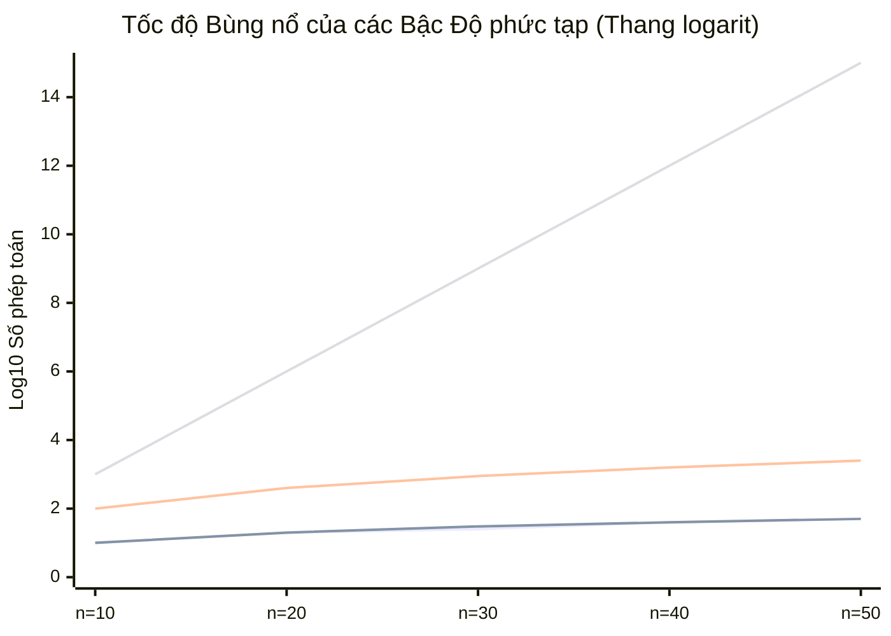
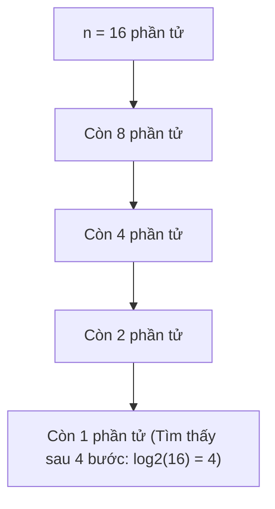
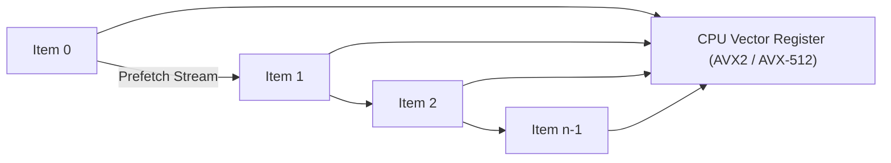
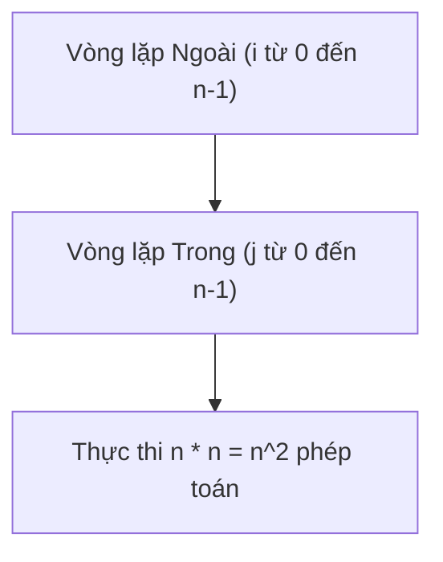
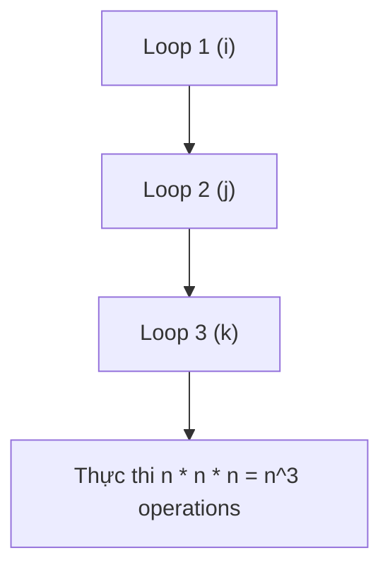
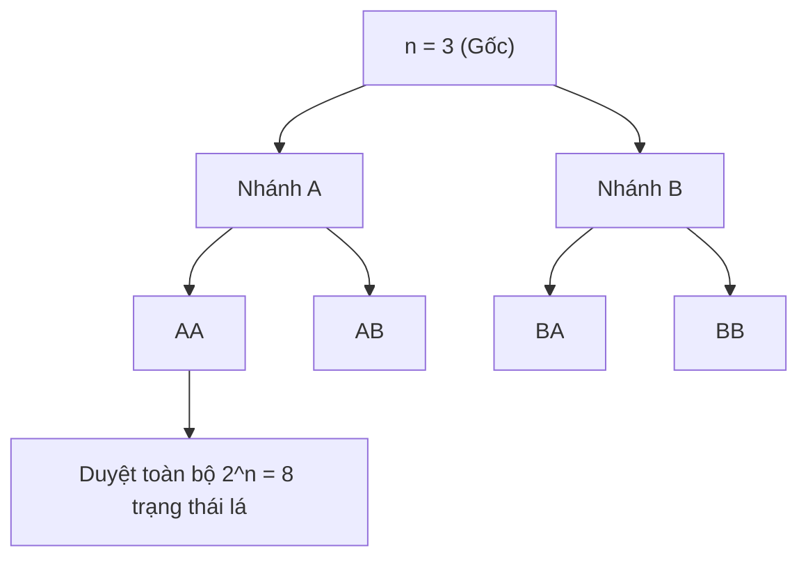
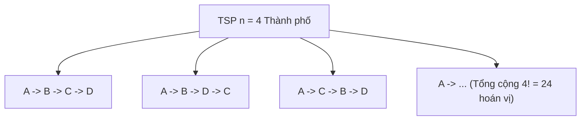

# 3.2. Complexity Classes and Orders of Growth (Các Lớp Độ phức tạp Thời gian và Bậc Tăng trưởng)

## Tổng quan về Bậc Tăng trưởng
Trong khoa học máy tính, tốc độ tăng trưởng của hàm thời gian $T(n)$ phân định ranh giới giữa những thuật toán có thể ứng dụng trong đời thực và những thuật toán chỉ mang ý nghĩa lý thuyết.

Bảng so sánh số lượng phép toán khi kích thước đầu vào $n$ thay đổi:

| Bậc Tăng trưởng | Tên gọi | $n = 10$ | $n = 100$ | $n = 10^6$ | Khả thi trong Thực tế? |
| :--- | :--- | :--- | :--- | :--- | :--- |
| $\mathcal{O}(1)$ | Constant | $1$ | $1$ | $1$ | Tức thì (Nanoseconds) |
| $\mathcal{O}(\log n)$ | Logarithmic | $\approx 3.3$ | $\approx 6.6$ | $\approx 20$ | Cực nhanh |
| $\mathcal{O}(n)$ | Linear | $10$ | $100$ | $1,000,000$ | Nhanh, chuẩn cho stream |
| $\mathcal{O}(n \log n)$ | Linearithmic | $\approx 33$ | $\approx 664$ | $\approx 2 \times 10^7$ | Tối ưu cho Sorting |
| $\mathcal{O}(n^2)$ | Quadratic | $100$ | $10,000$ | $10^{12}$ | Chậm khi $n > 10^4$ |
| $\mathcal{O}(n^3)$ | Cubic | $1,000$ | $1,000,000$ | $10^{18}$ | Bất khả thi cho dữ liệu lớn |
| $\mathcal{O}(2^n)$ | Exponential | $1,024$ | $\approx 1.26 \times 10^{30}$ | Vượt số nguyên tử vũ trụ | Bế tắc hoàn toàn |
| $\mathcal{O}(n!)$ | Factorial | $3,628,800$ | $\approx 9.33 \times 10^{157}$ | Không tưởng | Bế tắc ngay khi $n > 20$ |



---

## 2. Chi tiết từng Keyword (Under-the-Hood Deep Dive)

---

### 1. Constant Time: O(1) (Thời gian Hằng số)

#### 1. Khái niệm bản chất (What & Why)
- **Định nghĩa**: Thời gian thực thi của thuật toán độc lập hoàn toàn với kích thước tập dữ liệu đầu vào $n$.
- **Bản chất**: Thuật toán chỉ thực hiện một số lượng hữu hạn các chỉ thị máy cố định, không phụ thuộc vào quy mô dữ liệu dù $n = 10$ hay $n = 10^{12}$.

#### 2. Cơ chế hoạt động sâu (Under the hood / Hardcore Internals)
- **Địa chỉ hóa ô nhớ trực tiếp (Direct Memory Addressing)**:
  - Truy xuất phần tử mảng `arr[i]` là phép toán $O(1)$ thuần túy trên phần cứng:
    $$\text{Target Address} = \text{Base Address} + i \times \text{sizeof}(\text{Element})$$
  - CPU x86-64 thực thi phép toán này trong đúng 1 lệnh máy: `mov eax, [rdi + rsi * 4]`.
  - Nếu cache line chứa địa chỉ này đang nằm trong L1 Cache, thao tác mất chính xác $\approx 1\text{ns}$ (4 chu kỳ xung nhịp).

#### 3. Sơ đồ minh họa


#### 4. Code ví dụ thực chiến (C++ O(1) Stack Operation)
```cpp
#include <iostream>
#include <vector>
#include <stdexcept>

template <typename T>
class FastStack {
    std::vector<T> data_;
public:
    void push(T val) { data_.push_back(std::move(val)); } // Amortized O(1)
    
    // O(1) Strict: Luôn thực thi trong 3 lệnh assembly cơ bản
    [[nodiscard]] const T& peek() const {
        if (data_.empty()) throw std::runtime_error("Stack is empty");
        return data_.back(); 
    }
};

int main() {
    FastStack<int> s;
    s.push(10);
    s.push(20);
    std::cout << "Top: " << s.peek() << "\n";
    return 0;
}
```

#### 5. Ưu / Nhược điểm, Pitfalls & Anti-patterns
- **Pitfall**: Nhầm lẫn giữa "$O(1)$" và "Nhanh". Một thuật toán $O(1)$ nhưng chạy một triệu phép tính vòng lặp cố định vẫn chậm hơn một thuật toán $O(n)$ với $n = 5$.

#### 6. Ứng dụng thực tế trong Backend / Systems
- Truy vấn Redis qua lệnh `GET / SET`: Thao tác trên bảng băm trong bộ nhớ RAM diễn ra trong $\mathcal{O}(1)$ thời gian, phục vụ hàng trăm nghìn QPS.

---

### 2. Logarithmic Time: O(log n) (Thời gian Logarit)

#### 1. Khái niệm bản chất (What & Why)
- **Định nghĩa**: Thời gian thực thi tỉ lệ thuận với logarit của kích thước đầu vào (thường là cơ số 2: $\log_2 n$).
- **Đặc điểm**: Mỗi bước tính toán loại bỏ được một tỷ lệ phần trăm cố định (thường là một nửa) của không gian tìm kiếm còn lại.

#### 2. Cơ chế hoạt động sâu (Under the hood / Hardcore Internals)
- **Số lần chia đôi để về 1**:
  $$\frac{n}{2^k} = 1 \iff n = 2^k \iff k = \log_2 n$$
- Với toàn bộ dân số thế giới ($n \approx 8 \times 10^9$ người), $\log_2(8 \times 10^9) \approx 33$ phép so sánh!
- Thuật toán logarit cực kỳ thân thiện với bộ đệm CPU nếu cấu trúc cây dữ liệu được gom cụm (như B-Tree Cache Concurrency).

#### 3. Sơ đồ minh họa


#### 4. Code ví dụ thực chiến (C++ O(log n) Binary Search)
```cpp
#include <iostream>
#include <vector>

int binary_search(const std::vector<int>& arr, int target) noexcept {
    int low = 0;
    int high = static_cast<int>(arr.size()) - 1;

    while (low <= high) { // Chạy tối đa log2(n) lần lặp
        int mid = low + (high - low) / 2;
        if (arr[mid] == target) return mid;
        if (arr[mid] < target) low = mid + 1;
        else high = mid - 1;
    }
    return -1;
}

int main() {
    std::vector<int> sorted_data = {1, 3, 5, 7, 9, 11, 13, 15, 17, 19};
    std::cout << "Index of 13: " << binary_search(sorted_data, 13) << "\n";
    return 0;
}
```

#### 5. Ưu / Nhược điểm, Pitfalls & Anti-patterns
- **Pitfall**: Nhầm lẫn cây tìm kiếm nhị phân thông thường (BST) luôn là $O(\log n)$. Nếu cây bị lệch (Degenerate Tree), chiều cao cây trở thành $O(n)$, làm thời gian tìm kiếm suy biến thành tuyến tính! Phải dùng Tự cân bằng (AVL, Red-Black Tree).

#### 6. Ứng dụng thực tế trong Backend / Systems
- B-Tree và B+ Tree Indexing trong Database (Postgres, MySQL InnoDB): Chỉ cần 3-4 lần đọc trang đĩa (Disk I/O) là có thể tìm ra bản ghi giữa hàng trăm triệu dòng dữ liệu.

---

### 3. Linear Time: O(n) (Thời gian Tuyến tính)

#### 1. Khái niệm bản chất (What & Why)
- **Định nghĩa**: Thời gian thực thi tăng tỷ lệ thuận tuyến tính $1:1$ với kích thước đầu vào $n$.
- **Ý nghĩa**: Thuật toán phải duyệt qua mỗi phần tử của tập dữ liệu một số lần không đổi (thường là 1 hoặc 2 lần).

#### 2. Cơ chế hoạt động sâu (Under the hood / Hardcore Internals)
- **Hardware Hardware Prefetching & Streaming SIMD**:
  - Khi duyệt mảng liên tục theo chiều dài $O(n)$, CPU Hardware Prefetcher sẽ nhận diện mẫu truy cập tuần tự (Sequential Stride) và chủ động tải trước các Cache Lines tiếp theo từ RAM vào L3/L2/L1 Cache trước cả khi mã lệnh yêu cầu.
  - Tận dụng tập lệnh vector SIMD (AVX-512) cho phép CPU xử lý 16 số nguyên 32-bit cùng một lúc trong một chu kỳ máy.

#### 3. Sơ đồ minh họa


#### 4. Code ví dụ thực chiến (C++ O(n) Single-pass Reduction)
```cpp
#include <iostream>
#include <vector>
#include <numeric>

// Duyệt mảng đúng 1 lần: O(n) Time, O(1) Auxiliary Space
int64_t compute_sum(const std::vector<int>& arr) noexcept {
    int64_t sum = 0;
    for (int val : arr) {
        sum += val;
    }
    return sum;
}

int main() {
    std::vector<int> nums(100'000, 1);
    std::cout << "Sum: " << compute_sum(nums) << "\n";
    return 0;
}
```

#### 5. Ưu / Nhược điểm, Pitfalls & Anti-patterns
- **Pitfall**: Đặt các hàm có độ phức tạp $O(n)$ ẩn bên trong vòng lặp $O(n)$ (ví dụ: gọi `arr.indexOf(item)` hoặc `std::string::substr` bên trong `for`), vô tình biến thuật toán thành $O(n^2)$.

#### 6. Ứng dụng thực tế trong Backend / Systems
- Kafka / Event Streaming Processing: Xử lý sự kiện thời gian thực theo mô hình Single-pass stream processing với $O(n)$ time complexity và $O(1)$ memory buffer.

---

### 4. Linearithmic Time: O(n log n) (Thời gian Tuyến tính - Logarit)

#### 1. Khái niệm bản chất (What & Why)
- **Định nghĩa**: Thời gian thực thi là tích giữa tuyến tính $n$ và logarit $\log n$.
- **Xuất hiện**: Thường là kết quả của chiến lược Chia để trị (Divide and Conquer), trong đó bài toán kích thước $n$ được chia đôi qua $\log n$ tầng đệ quy, và tại mỗi tầng ta tốn công sức $O(n)$ để phân chia hoặc trộn lại.

#### 2. Cơ chế hoạt động sâu (Under the hood / Hardcore Internals)
- **Master Theorem (Định lý Thơ)**:
  $$T(n) = 2T(n/2) + \Theta(n) \implies T(n) = \Theta(n \log n)$$
- Đây là giới hạn toán học tối ưu đã được chứng minh ($\Omega(n \log n)$) cho mọi thuật toán sắp xếp tổng quát dựa trên phép so sánh (MergeSort, HeapSort, Introsort).

#### 3. Sơ đồ minh họa
```text
Cấu trúc Cây Đệ quy của Merge Sort:
Tầng 0: [                  n                  ] -> Tốn n công
Tầng 1: [       n/2       ] [       n/2       ] -> Tốn n công
Tầng 2: [  n/4  ] [  n/4  ] [  n/4  ] [  n/4  ] -> Tốn n công
...
Tầng log2(n): [1][1][1] ... [1][1][1]          -> Tốn n công
Tổng công sức: n * log2(n) phép tính
```

#### 4. Code ví dụ thực chiến (C++ O(n log n) Heapsort)
```cpp
#include <iostream>
#include <vector>
#include <algorithm>

void heapify(std::vector<int>& arr, int n, int i) {
    int largest = i;
    int l = 2 * i + 1;
    int r = 2 * i + 2;

    if (l < n && arr[l] > arr[largest]) largest = l;
    if (r < n && arr[r] > arr[largest]) largest = r;

    if (largest != i) {
        std::swap(arr[i], arr[largest]);
        heapify(arr, n, largest); // O(log n)
    }
}

// Heapsort: O(n log n) cả Best, Average, và Worst Case. In-place O(1) space!
void heap_sort(std::vector<int>& arr) {
    int n = static_cast<int>(arr.size());
    for (int i = n / 2 - 1; i >= 0; --i) heapify(arr, n, i); // Build heap O(n)
    for (int i = n - 1; i > 0; --i) {
        std::swap(arr[0], arr[i]);
        heapify(arr, i, 0); // n lần gọi heapify O(log n) => O(n log n)
    }
}

int main() {
    std::vector<int> nums = {12, 11, 13, 5, 6, 7};
    heap_sort(nums);
    for (int x : nums) std::cout << x << " ";
    std::cout << "\n";
    return 0;
}
```

#### 5. Ưu / Nhược điểm, Pitfalls & Anti-patterns
- **Pitfall**: HeapSort tuy có cùng độ phức tạp tiệm cận $O(n \log n)$ như QuickSort nhưng trong thực tế chạy chậm hơn từ 2-3 lần do các bước truy cập bộ nhớ nhảy cóc (non-sequential memory access), gây ra tỷ lệ Cache Miss cao ở phần cứng.

#### 6. Ứng dụng thực tế trong Backend / Systems
- Câu lệnh `ORDER BY` trong Database Engines: Khi dữ liệu không có index sẵn, DBMS sẽ nạp dữ liệu vào bộ nhớ đệm và thực hiện External Merge Sort với độ phức tạp $O(n \log n)$.

---

### 5. Quadratic Time: O(n²) (Thời gian Bậc hai)

#### 1. Khái niệm bản chất (What & Why)
- **Định nghĩa**: Thời gian thực thi tỉ lệ thuận với bình phương kích thước đầu vào $n$.
- **Dấu hiệu nhận biết**: Thường xuất hiện khi có hai vòng lặp lồng nhau (Nested Loops), so sánh từng cặp phần tử (All-pairs comparisons) trong tập dữ liệu.

#### 2. Cơ chế hoạt động sâu (Under the hood / Hardcore Internals)
- Khi $n = 10,000 \implies n^2 = 100,000,000$ phép tính.
- Khi $n = 100,000 \implies n^2 = 10,000,000,000$ phép tính (mất $\approx 3-10$ giây CPU).
- Khi $n = 1,000,000 \implies n^2 = 10^{12}$ phép tính (mất hàng giờ).
- Thuật toán bậc hai hoàn toàn không thể scale cho các bài toán dữ liệu lớn (Big Data).

#### 3. Sơ đồ minh họa


#### 4. Code ví dụ thực chiến (TypeScript Anti-pattern O(n²) vs Refactored O(n))
```typescript
// BÀI TOÁN: Kiểm tra mảng có 2 số có tổng bằng target không (Two Sum)

// ANTI-PATTERN: O(n^2) - 2 vòng lặp lồng nhau
function twoSumQuadratic(arr: number[], target: number): boolean {
    for (let i = 0; i < arr.length; i++) {
        for (let j = i + 1; j < arr.length; j++) {
            if (arr[i] + arr[j] === target) return true;
        }
    }
    return false;
}

// OPTIMIZED: O(n) - Đánh đổi bộ nhớ Hash Set
function twoSumLinear(arr: number[], target: number): boolean {
    const seen = new Set<number>();
    for (const val of arr) {
        if (seen.has(target - val)) return true;
        seen.add(val);
    }
    return false;
}

const data = [3, 8, 12, 5, 9];
console.log("Found:", twoSumLinear(data, 14)); // true (9 + 5)
```

#### 5. Ưu / Nhược điểm, Pitfalls & Anti-patterns
- **Anti-pattern**: Thực hiện JOIN hai bảng cơ sở dữ liệu lớn không có Index bằng thuật toán Nested Loop Join, dẫn đến việc quét toàn bộ ổ đĩa $O(M \times N)$ gây sập database server.

#### 6. Ứng dụng thực tế trong Backend / Systems
- Thuật toán phát hiện va chạm vật lý (Naive Collision Detection) giữa $n$ vật thể trong không gian 2D/3D (sau đó phải tối ưu bằng BVH hoặc QuadTree để giảm về $O(n \log n)$).

---

### 6. Cubic Time: O(n³) (Thời gian Bậc ba)

#### 1. Khái niệm bản chất (What & Why)
- **Định nghĩa**: Thời gian thực thi tỉ lệ thuận với lập phương kích thước đầu vào $n$.
- **Xuất hiện**: Thường thấy trong ba vòng lặp lồng nhau hoặc các thuật toán đại số tuyến tính cơ bản (như Nhân 2 ma trận thông thường, Floyd-Warshall tìm đường đi ngắn nhất mọi cặp đỉnh).

#### 2. Cơ chế hoạt động sâu (Under the hood / Hardcore Internals)
- Nhân ma trận $A_{n \times n} \times B_{n \times n}$:
  $$C_{i,j} = \sum_{k=1}^n A_{i,k} \cdot B_{k,j}$$
  Yêu cầu $n^3$ phép nhân và cộng. Với $n = 2000$, số phép toán là $8 \times 10^9$.
- Tối ưu hóa ở tầng Cache: Thuật toán ngây thơ bị nhảy cache line theo cột trong ma trận $B$. Chuyển sang duyệt theo thứ tự `i-k-j` (Loop Tiling / Cache Blocking) giúp tăng tốc độ lên gấp 10-20 lần dù độ phức tạp lý thuyết vẫn là $O(n^3)$.

#### 3. Sơ đồ minh họa


#### 4. Code ví dụ thực chiến (C++ Floyd-Warshall All-Pairs Shortest Path)
```cpp
#include <iostream>
#include <vector>
#include <algorithm>

constexpr int INF = 1e9;

// Floyd-Warshall: O(V^3) Time, O(V^2) Space
void floyd_warshall(std::vector<std::vector<int>>& dist, int V) {
    for (int k = 0; k < V; ++k) {
        for (int i = 0; i < V; ++i) {
            for (int j = 0; j < V; ++j) {
                if (dist[i][k] < INF && dist[k][j] < INF) {
                    dist[i][j] = std::min(dist[i][j], dist[i][k] + dist[k][j]);
                }
            }
        }
    }
}

int main() {
    int V = 4;
    std::vector<std::vector<int>> dist = {
        {0,   5,  INF, 10},
        {INF, 0,   3,  INF},
        {INF, INF, 0,   1},
        {INF, INF, INF, 0}
    };
    floyd_warshall(dist, V);
    std::cout << "Shortest path 0 -> 2: " << dist[0][2] << " (5 + 3 = 8)\n";
    return 0;
}
```

#### 5. Ưu / Nhược điểm, Pitfalls & Anti-patterns
- **Pitfall**: Triển khai thuật toán $O(n^3)$ cho các hệ thống trực tuyến có đầu vào không kiểm soát, người dùng gửi payload $n = 500$ có thể gây Denial of Service (DoS).

#### 6. Ứng dụng thực tế trong Backend / Systems
- Phân tích chu trình định tuyến viễn thông (Routing Loop Detection) hoặc tính toán đồ thị chuyển dịch trạng thái toàn cục trong mạng nội bộ.

---

### 7. Exponential Time: O(2ⁿ) (Thời gian Hàm mũ)

#### 1. Khái niệm bản chất (What & Why)
- **Định nghĩa**: Thời gian thực thi tăng gấp đôi sau mỗi khi kích thước đầu vào $n$ tăng thêm 1 đơn vị ($T(n+1) = 2 \cdot T(n)$).
- **Ý nghĩa**: Đại diện cho sự bùng nổ tổ hợp (Combinatorial Explosion). Thuật toán phải duyệt qua toàn bộ $2^n$ tập con (Subsets) khả dĩ của bài toán.

#### 2. Cơ chế hoạt động sâu (Under the hood / Hardcore Internals)
- Khi $n = 40 \implies 2^{40} \approx 1.1 \times 10^{12}$ phép toán (vài phút tính toán).
- Khi $n = 60 \implies 2^{60} \approx 1.15 \times 10^{18}$ phép toán (hàng chục năm trên siêu máy tính).
- Khi $n = 300 \implies 2^{300}$ vượt quá tổng số hạt cơ bản trong toàn bộ vũ trụ quan sát được.
- Đây là giới hạn bất khả kháng của vật lý đối với máy tính cổ điển (Silicon-based computing).

#### 3. Sơ đồ minh họa


#### 4. Code ví dụ thực chiến (C++ Naive Exponential vs Memoized Dynamic Programming)
```cpp
#include <iostream>
#include <vector>

// Naive: O(2^n) - Cây đệ quy bùng nổ
uint64_t fib_naive(int n) {
    if (n <= 1) return n;
    return fib_naive(n - 1) + fib_naive(n - 2);
}

// Memoized: Cắt tỉa cây đệ quy về O(n)
uint64_t fib_memo(int n, std::vector<uint64_t>& memo) {
    if (n <= 1) return n;
    if (memo[n] != 0) return memo[n];
    return memo[n] = fib_memo(n - 1, memo) + fib_memo(n - 2, memo);
}

int main() {
    int n = 35;
    std::cout << "Fib naive(" << n << "): " << fib_naive(n) << "\n";
    std::vector<uint64_t> memo(n + 1, 0);
    std::cout << "Fib memo(" << n << "): " << fib_memo(n, memo) << "\n";
    return 0;
}
```

#### 5. Ưu / Nhược điểm, Pitfalls & Anti-patterns
- **Anti-pattern**: Sử dụng đệ quy quay lui (Backtracking) thuần túy không có kỹ thuật cắt tỉa nhánh (Branch & Bound) hoặc ghi nhớ (Memoization).

#### 6. Ứng dụng thực tế trong Backend / Systems
- Giải bài toán Cái túi 0/1 (0/1 Knapsack Problem) bằng Brute-Force, hoặc bài toán kiểm tra tính thỏa mãn mệnh đề Boolean (SAT Problem).

---

### 8. Factorial Time: O(n!) (Thời gian Giai thừa)

#### 1. Khái niệm bản chất (What & Why)
- **Định nghĩa**: Thời gian thực thi tỉ lệ thuận với giai thừa của $n$ ($n! = 1 \times 2 \times \dots \times n$).
- **Xuất hiện**: Trong các bài toán sinh toàn bộ các hoán vị (Permutations) của $n$ phần tử, tiêu biểu là bài toán Người du lịch (Traveling Salesperson Problem - TSP) giải bằng vét cạn.

#### 2. Cơ chế hoạt động sâu (Under the hood / Hardcore Internals)
- Tốc độ tăng trưởng giai thừa nhanh hơn cả hàm mũ ($n! \gg 2^n$ khi $n \ge 4$):
  - $n = 10 \implies 10! \approx 3.6 \times 10^6$.
  - $n = 15 \implies 15! \approx 1.3 \times 10^{12}$.
  - $n = 20 \implies 20! \approx 2.43 \times 10^{18}$ (CPU 3GHz mất khoảng 25 năm liên tục).
- Không thể giải bài toán $O(n!)$ với $n > 20$ bằng bất kỳ hệ thống phần cứng máy tính nào hiện nay. Bắt buộc phải chuyển hướng sang Heuristics hoặc Thuật toán Gần đúng (Approximation Algorithms).

#### 3. Sơ đồ minh họa


#### 4. Code ví dụ thực chiến (C++ O(n!) Permutation Generator)
```cpp
#include <iostream>
#include <vector>
#include <numeric>
#include <algorithm>

// Sinh toàn bộ hoán vị: O(n * n!) thời gian
void generate_all_permutations(int n) {
    std::vector<int> p(n);
    std::iota(p.begin(), p.end(), 1);

    uint64_t count = 0;
    do {
        ++count;
    } while (std::next_permutation(p.begin(), p.end()));

    std::cout << "Generated " << count << " permutations for n = " << n << "\n";
}

int main() {
    generate_all_permutations(8); // 8! = 40,320
    return 0;
}
```

#### 5. Ưu / Nhược điểm, Pitfalls & Anti-patterns
- **Pitfall**: Cố gắng tìm lời giải tối ưu tuyệt đối cho bài toán TSP trong bài toán định tuyến xe giao hàng (Logistics Routing) bằng vét cạn thay vì dùng thuật toán Genetic Algorithm hoặc Simulated Annealing.

#### 6. Ứng dụng thực tế trong Backend / Systems
- Hệ thống định tuyến Logistics & Dispatching (Grab, Shopee): Thay vì giải chính xác $O(n!)$, các hệ thống backend áp dụng thuật toán gần đúng Lin-Kernighan heuristic để tìm ra lộ trình gần tối ưu trong vài chục milliseconds.
