# 3.3. Computational Complexity Classes (Các Lớp Độ phức tạp Tính toán)

## Tổng quan về Các Lớp Độ phức tạp Tính toán
Lý thuyết độ phức tạp tính toán (Computational Complexity Theory) phân loại các bài toán theo lượng tài nguyên nội tại (thời gian CPU, không gian bộ nhớ) cần thiết để giải quyết chúng trên một mô hình máy tính hình thức (Máy Turing).

Mối quan hệ bao hàm giữa các lớp độ phức tạp kinh điển:
$$\text{P} \subseteq \text{NP} \subseteq \text{PSPACE} \subseteq \text{EXPTIME}$$
Giả thuyết thiên niên kỷ lớn nhất của Khoa học máy tính:
$$\text{P} \stackrel{?}{=} \text{NP}$$

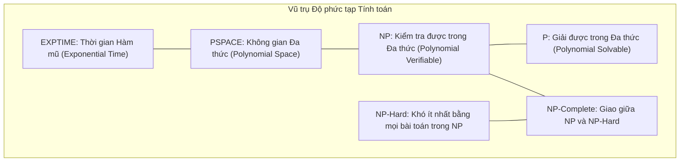

---

## 2. Chi tiết từng Keyword (Under-the-Hood Deep Dive)

---

### 1. Decision Problems (Bài toán Quyết định)

#### 1. Khái niệm bản chất (What & Why)
- **Định nghĩa**: Một bài toán tính toán mà câu trả lời đầu ra chỉ có hai giá trị nhị phân duy nhất: **YES** (Đúng / 1) hoặc **NO** (Sai / 0) đối với một chuỗi đầu vào $x \in \Sigma^*$.
- **Bản chất hình thức**: Tương đương với việc quyết định một chuỗi $x$ có thuộc về một ngôn ngữ hình thức $L \subseteq \Sigma^*$ hay không ($x \in L$).
- **Tại sao cần thiết**: Là nền tảng toán học chuẩn hóa để so sánh độ khó của tất cả các bài toán trong lý thuyết tính toán.

#### 2. Cơ chế hoạt động sâu (Under the hood / Hardcore Internals)
- Bất kỳ bài toán tính toán nào cũng có thể quy đổi về bài toán quyết định. Ví dụ:
  - Bài toán Tìm kiếm: "Tìm đường đi ngắn nhất từ A tới B."
  - Bài toán Quyết định tương đương: "Có tồn tại đường đi từ A tới B với tổng trọng số $\le K$ hay không?"

#### 3. Sơ đồ minh họa
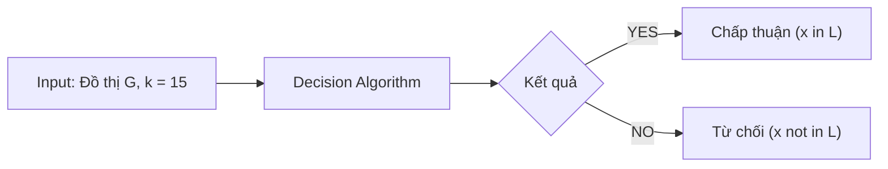

#### 4. Code ví dụ thực chiến (C++ Decision Problem: Subset Sum Decision)
```cpp
#include <iostream>
#include <vector>

// Decision Problem: Liệu có tồn tại tập con có tổng chính xác bằng Target? (YES / NO)
bool subset_sum_decision(const std::vector<int>& arr, int target) {
    int n = static_cast<int>(arr.size());
    std::vector<bool> dp(target + 1, false);
    dp[0] = true;

    for (int val : arr) {
        for (int j = target; j >= val; --j) {
            if (dp[j - val]) dp[j] = true;
        }
    }
    return dp[target]; // YES (true) hoặc NO (false)
}

int main() {
    std::vector<int> nums = {3, 34, 4, 12, 5, 2};
    std::cout << "Can sum to 9? " << (subset_sum_decision(nums, 9) ? "YES" : "NO") << "\n";
    return 0;
}
```

#### 5. Ưu / Nhược điểm, Pitfalls & Anti-patterns
- **Pitfall**: Nhầm lẫn giữa việc chỉ cần trả về YES/NO với việc phải tìm ra cấu trúc lời giải chi tiết.

#### 6. Ứng dụng thực tế trong Backend / Systems
- Hệ thống Ủy quyền (Authorization Engine - OPA / Casbin): Đưa ra quyết định nhị phân: "Liệu User X có quyền ghi vào Resource Y hay không?" (Allow / Deny).

---

### 2. Optimization Problems (Bài toán Tối ưu hóa)

#### 1. Khái niệm bản chất (What & Why)
- **Định nghĩa**: Một bài toán yêu cầu tìm kiếm trong không gian các nghiệm khả dĩ (Feasible Solutions) một nghiệm có giá trị hàm mục tiêu (Objective Function) đạt cực đại (Maximize) hoặc cực tiểu (Minimize).
- **Ví dụ**: Tìm đường đi ngắn nhất, Tìm luồng cực đại, Tìm cách đóng gói balo đạt giá trị lớn nhất.

#### 2. Cơ chế hoạt động sâu (Under the hood / Hardcore Internals)
- Quan hệ với Bài toán Quyết định: Một bài toán tối ưu có thể được giải bằng cách gọi liên tiếp $\mathcal{O}(\log(\text{Range}))$ lần một bài toán quyết định thông qua tìm kiếm nhị phân trên không gian giá trị mục tiêu (Binary Search on Answer).

#### 3. Sơ đồ minh họa


#### 4. Code ví dụ thực chiến (TypeScript Binary Search on Answer for Optimization)
```typescript
// Tìm công suất vận chuyển nhỏ nhất để hoàn thành giao hàng trong D ngày
function canShipWithinDays(weights: number[], days: number, capacity: number): boolean {
    let daysNeeded = 1;
    let currentLoad = 0;
    for (const w of weights) {
        if (currentLoad + w > capacity) {
            daysNeeded++;
            currentLoad = 0;
        }
        currentLoad += w;
    }
    return daysNeeded <= days; // Decision Problem: YES/NO
}

function minShipCapacity(weights: number[], days: number): number {
    let low = Math.max(...weights);
    let high = weights.reduce((a, b) => a + b, 0);
    let optimalCapacity = high;

    while (low <= high) {
        const mid = Math.floor((low + high) / 2);
        if (canShipWithinDays(weights, days, mid)) {
            optimalCapacity = mid;
            high = mid - 1; // Thử tìm công suất nhỏ hơn
        } else {
            low = mid + 1;
        }
    }
    return optimalCapacity; // Nghiệm tối ưu
}

console.log("Min Capacity:", minShipCapacity([1, 2, 3, 4, 5, 6, 7, 8, 9, 10], 5)); // 15
```

#### 5. Ưu / Nhược điểm, Pitfalls & Anti-patterns
- **Pitfall**: Sa lầy vào việc tìm kiếm nghiệm tối ưu tuyệt đối khi bài toán thuộc lớp NP-Hard, gây nghẽn toàn bộ luồng xử lý của hệ thống.

#### 6. Ứng dụng thực tế trong Backend / Systems
- Database Query Optimizer: Tìm Execution Plan có Estimated Cost (CPU, I/O) nhỏ nhất giữa hàng nghìn hoán vị thứ tự JOIN bảng.

---

### 3. P (Polynomial Time - Thời gian Đa thức)

#### 1. Khái niệm bản chất (What & Why)
- **Định nghĩa**: Lớp tất cả các bài toán quyết định có thể được giải quyết bởi một **Máy Turing tất định (Deterministic Turing Machine)** trong thời gian đa thức:
  $$T(n) = \mathcal{O}(n^k) \quad \text{với } k \text{ là hằng số}$$
- **Ý nghĩa**: Được coi là tập hợp các bài toán có thể giải quyết một cách hiệu quả và thực tế trên máy tính (Tractable Problems).

#### 2. Cơ chế hoạt động sâu (Under the hood / Hardcore Internals)
- Mọi thuật toán chạy trong $O(1), O(\log n), O(n), O(n \log n), O(n^2), O(n^3)$ đều nằm trong lớp $\text{P}$.
- Tính chất đóng (Closure properties): Lớp $\text{P}$ đóng dưới các phép toán hợp (union), giao (intersection), bù (complement), và nối (concatenation).

#### 3. Sơ đồ minh họa
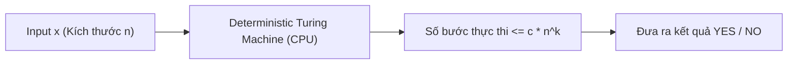

#### 4. Code ví dụ thực chiến (C++ Bài toán trong P: Kiểm tra Kết nối Đồ thị via BFS)
```cpp
#include <iostream>
#include <vector>
#include <queue>

// Kiểm tra 2 đỉnh có liên thông: O(|V| + |E|) <= O(V^2) -> Nằm trong lớp P
bool is_connected_in_p(int n, const std::vector<std::vector<int>>& adj, int src, int dst) {
    std::vector<bool> visited(n, false);
    std::queue<int> q;
    q.push(src);
    visited[src] = true;

    while (!q.empty()) {
        int u = q.front();
        q.pop();
        if (u == dst) return true;

        for (int v : adj[u]) {
            if (!visited[v]) {
                visited[v] = true;
                q.push(v);
            }
        }
    }
    return false;
}

int main() {
    std::vector<std::vector<int>> adj = {{1}, {0, 2}, {1}};
    std::cout << "Path 0 -> 2 exists? " << (is_connected_in_p(3, adj, 0, 2) ? "YES" : "NO") << "\n";
    return 0;
}
```

#### 5. Ưu / Nhược điểm, Pitfalls & Anti-patterns
- **Pitfall**: Giả định rằng mọi bài toán trong $\text{P}$ đều nhanh. Nếu $k = 100$ ($T(n) = \mathcal{O}(n^{100})$), thuật toán đó nằm trong $\text{P}$ nhưng hoàn toàn không thể chạy nổi trong thực tế (Galactic Algorithm).

#### 6. Ứng dụng thực tế trong Backend / Systems
- Thuật toán tìm kiếm văn bản KMP (Knuth-Morris-Pratt) hoặc Aho-Corasick: Đảm bảo thời gian quét từ khóa trong log file luôn là $O(n)$ trong lớp P.

---

### 4. NP (Nondeterministic Polynomial Time)

#### 1. Khái niệm bản chất (What & Why)
- **Định nghĩa**: Lớp các bài toán quyết định mà nếu ai đó đưa cho bạn một "chứng chỉ" (Certificate / Witness) chứng minh câu trả lời là YES, bạn có thể **kiểm tra (Verify)** tính đúng đắn của chứng chỉ đó trên một Máy Turing tất định trong thời gian đa thức $\mathcal{O}(n^k)$.
- **Định nghĩa tương đương**: Các bài toán có thể được **giải quyết** trên một **Máy Turing không tất định (Nondeterministic Turing Machine)** trong thời gian đa thức.

#### 2. Cơ chế hoạt động sâu (Under the hood / Hardcore Internals)
- Quan sát bản chất: Việc giải bài toán có thể rất khó (phải mò mẫm trong không gian hàm mũ), nhưng việc kiểm tra một đáp án có sẵn lại cực kỳ dễ dàng.
  - Ví dụ: Giải Sudoku cỡ $N \times N$ rất khó, nhưng đưa một bảng Sudoku đã điền xong thì việc kiểm tra các hàng, cột, ô vuông xem có trùng số không chỉ tốn thời gian $O(N^2)$ (đa thức).

#### 3. Sơ đồ minh họa
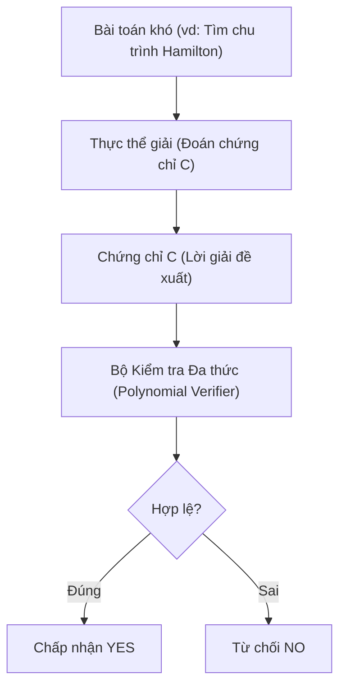

#### 4. Code ví dụ thực chiến (C++ NP Verifier cho Bài toán Chu trình Hamilton)
```cpp
#include <iostream>
#include <vector>

// Bộ kiểm chứng đa thức O(V): Kiểm tra một dãy đỉnh đề xuất có phải là chu trình Hamilton
bool verify_hamiltonian_cycle(int V, const std::vector<std::vector<bool>>& adj, const std::vector<int>& cert) {
    if (cert.size() != static_cast<std::size_t>(V + 1)) return false;
    if (cert.front() != cert.back()) return false; // Phải là chu trình khép kín

    std::vector<bool> visited(V, false);
    for (std::size_t i = 0; i < cert.size() - 1; ++i) {
        int u = cert[i];
        int v = cert[i + 1];
        if (!adj[u][v]) return false; // Không có cạnh nối giữa 2 đỉnh liên tiếp
        if (visited[u]) return false; // Thăm lại đỉnh cũ
        visited[u] = true;
    }
    return true; // Chứng chỉ hợp lệ trong O(V) time!
}

int main() {
    int V = 3;
    std::vector<std::vector<bool>> adj = {
        {0, 1, 1},
        {1, 0, 1},
        {1, 1, 0}
    };
    std::vector<int> candidate = {0, 1, 2, 0};
    std::cout << "Certificate valid? " << (verify_hamiltonian_cycle(V, adj, candidate) ? "YES" : "NO") << "\n";
    return 0;
}
```

#### 5. Ưu / Nhược điểm, Pitfalls & Anti-patterns
- **Sai lầm phổ biến nhất**: Nhầm tưởng "NP" là "Non-Polynomial" (Không phải đa thức). **NP là Nondeterministic Polynomial**.

#### 6. Ứng dụng thực tế trong Backend / Systems
- Mật mã học khóa công khai (Public Key Cryptography - RSA): Tìm thừa số nguyên tố của số lớn $N = p \cdot q$ thuộc NP (rất khó giải để bẻ khóa), nhưng nhân kiểm tra $p \times q = N$ chỉ mất vài chu kỳ CPU trong P.

---

### 5. NP-hard (Độ khó NP)

#### 1. Khái niệm bản chất (What & Why)
- **Định nghĩa**: Một bài toán $H$ được gọi là **NP-hard** nếu mọi bài toán $L$ thuộc lớp $\text{NP}$ đều có thể quy giảm đa thức về $H$ ($L \le_P H$).
- **Đặc điểm**: Bài toán NP-hard khó **ít nhất bằng** mọi bài toán trong $\text{NP}$. Bản thân bài toán NP-hard **không bắt buộc phải nằm trong NP** (nó thậm chí có thể không giải được - Undecidable, như Halting Problem).

#### 2. Cơ chế hoạt động sâu (Under the hood / Hardcore Internals)
- Nếu ai đó tìm ra một thuật toán giải quyết bất kỳ bài toán NP-hard nào trong thời gian đa thức $O(n^k)$, thì toàn bộ mọi bài toán trong $\text{NP}$ đều sẽ được giải trong thời gian đa thức ($\text{P} = \text{NP}$).

#### 3. Sơ đồ minh họa
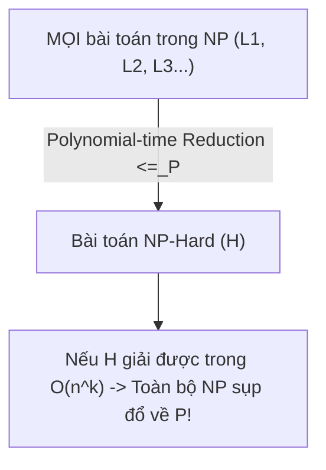

#### 4. Code ví dụ thực chiến (C++ Mô phỏng Bản chất NP-Hard qua Bài toán TSP Tối ưu)
```cpp
// Bài toán Người Du Lịch TSP dạng Tối ưu hóa:
// "Tìm chu trình có tổng trọng số nhỏ nhất tuyệt đối đi qua mọi đỉnh"
// Bài toán này là NP-Hard (không phải bài toán quyết định YES/NO nên không nằm trong NP).
```

#### 5. Ưu / Nhược điểm, Pitfalls & Anti-patterns
- **Pitfall**: Nghĩ rằng NP-hard chỉ gồm các bài toán tối ưu. Bài toán dừng (Halting Problem) là bài toán quyết định nhưng vẫn là NP-hard.

#### 6. Ứng dụng thực tế trong Backend / Systems
- Lập lịch CPU / Kubernetes Pod Scheduling (Bin Packing Problem): Xếp $n$ tiến trình với dung lượng RAM/CPU khác nhau vào số lượng node tối thiểu là bài toán NP-hard.

---

### 6. NP-complete (NP-đầy đủ)

#### 1. Khái niệm bản chất (What & Why)
- **Định nghĩa**: Một bài toán $X$ được gọi là **NP-complete** nếu nó thỏa mãn đồng thời hai điều kiện:
  1. $X \in \text{NP}$ (Kiểm tra nghiệm trong thời gian đa thức).
  2. $X \in \text{NP-hard}$ (Mọi bài toán trong NP đều quy giảm đa thức về $X$).
- **Ý nghĩa**: Là những bài toán "khó nhất" trong lớp NP.

#### 2. Cơ chế hoạt động sâu (Under the hood / Hardcore Internals)
- **Định lý Cook-Levin (1971)**:
  - Chứng minh rằng bài toán **Boolean Satisfiability (SAT)** là bài toán NP-complete đầu tiên trong lịch sử bằng cách mô phỏng trực tiếp hoạt động của bất kỳ Máy Turing không tất định nào thành một công thức mệnh đề logic Boolean dạng CNF.
  - Danh sách 21 bài toán NP-complete của Richard Karp (1972): Clique, Vertex Cover, Hamiltonian Cycle, Subset Sum, Graph Coloring...

#### 3. Sơ đồ minh họa
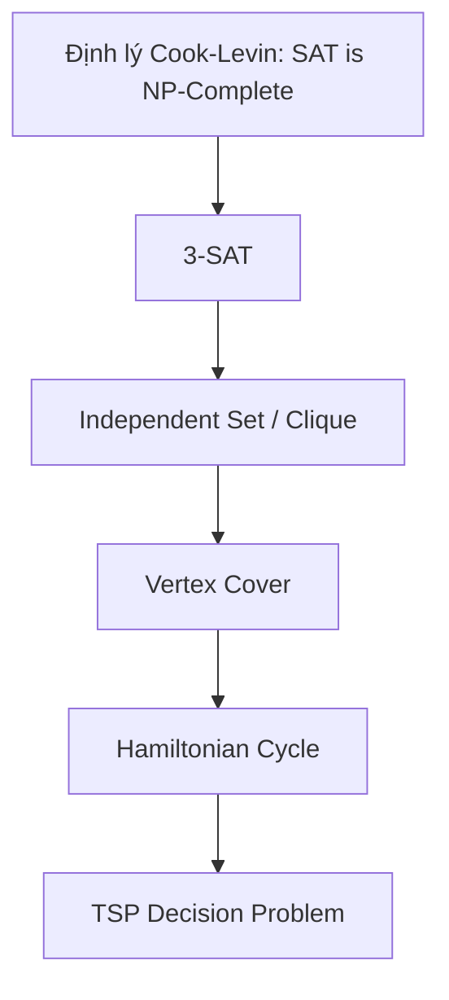

#### 4. Code ví dụ thực chiến (TypeScript Phân biệt NP-Complete Decision vs NP-Hard Optimization)
```typescript
// 1. TSP Decision (NP-Complete): "Liệu có tour nào chi phí <= 100?" -> Tra cứu trong NP
function isTourUnderLimit(graph: number[][], tour: number[], limit: number): boolean {
    let cost = 0;
    for (let i = 0; i < tour.length - 1; i++) {
        cost += graph[tour[i]][tour[i + 1]];
    }
    cost += graph[tour[tour.length - 1]][tour[0]];
    return cost <= limit; // O(V) Verification -> NP-Complete
}

// 2. TSP Optimization (NP-Hard): "Tìm tour có chi phí nhỏ nhất tuyệt đối" -> Không thuộc NP!
```

#### 5. Ưu / Nhược điểm, Pitfalls & Anti-patterns
- **Pitfall**: Cố gắng tìm thuật toán chính xác thời gian đa thức cho một bài toán đã được chứng minh là NP-complete mà không biết rằng mình đang cố gắng giải bài toán trị giá 1 triệu USD ($\text{P} \stackrel{?}{=} \text{NP}$).

#### 6. Ứng dụng thực tế trong Backend / Systems
- Circuit Breaker & Dependency Resolution: Phân giải xung đột phiên bản dependencies của `npm install` hoặc `cargo build` bản chất là bài toán SAT (NP-complete).

---

### 7. PSPACE (Không gian Đa thức)

#### 1. Khái niệm bản chất (What & Why)
- **Định nghĩa**: Lớp tất cả các bài toán quyết định có thể giải quyết được bằng một Máy Turing sử dụng lượng bộ nhớ (băng ghi) là một hàm đa thức của kích thước đầu vào:
  $$\text{Space}(n) = \mathcal{O}(n^k)$$
  không giới hạn về mặt thời gian (thời gian có thể là hàm mũ $2^{n^k}$).

#### 2. Cơ chế hoạt động sâu (Under the hood / Hardcore Internals)
- **Định lý Savitch (1970)**:
  - Máy Turing không tất định không có ưu thế về không gian bộ nhớ so với Máy tất định:
    $$\text{NPSPACE} = \text{PSPACE}$$
  - Quan hệ: $\text{P} \subseteq \text{NP} \subseteq \text{PSPACE}$.
- Bài toán kinh điển trong PSPACE-complete: Trò chơi cờ vua, cờ vây trên bàn cờ $N \times N$, hoặc bài toán True Quantified Boolean Formulas (QBF / QSAT).

#### 3. Sơ đồ minh họa
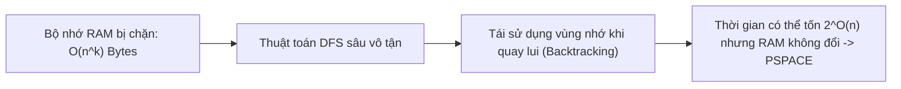

#### 4. Code ví dụ thực chiến (C++ Mô phỏng PSPACE: Đệ quy Không gian Đa thức $O(n)$)
```cpp
#include <iostream>
#include <vector>

// Giải quyết cây trò chơi hai người chơi qua Minimax:
// Chiều cao cây = n -> Chi phí bộ nhớ Call Stack chỉ là O(n) (Đa thức)
// Dù số lượng nút duyệt qua là 2^n (Thời gian Hàm mũ). Nằm hoàn toàn trong PSPACE!
int minimax(int depth, bool is_max, int alpha, int beta) {
    if (depth == 0) return 42; // Base evaluation

    if (is_max) {
        int max_eval = -1e9;
        for (int child = 0; child < 2; ++child) {
            int eval = minimax(depth - 1, false, alpha, beta);
            max_eval = std::max(max_eval, eval);
            alpha = std::max(alpha, eval);
            if (beta <= alpha) break; // Pruning
        }
        return max_eval;
    } else {
        int min_eval = 1e9;
        for (int child = 0; child < 2; ++child) {
            int eval = minimax(depth - 1, true, alpha, beta);
            min_eval = std::min(min_eval, eval);
            beta = std::min(beta, eval);
            if (beta <= alpha) break;
        }
        return min_eval;
    }
}

int main() {
    std::cout << "Minimax evaluation: " << minimax(10, true, -1e9, 1e9) << "\n";
    return 0;
}
```

#### 5. Ưu / Nhược điểm, Pitfalls & Anti-patterns
- **Nhược điểm**: Bộ nhớ rất nhỏ nhưng thời gian thực thi có thể kéo dài qua nhiều thế kỷ.

#### 6. Ứng dụng thực tế trong Backend / Systems
- Model Checking & Formal Verification (như phần mềm SPIN/NuSMV): Kiểm tra toàn bộ không gian trạng thái của hệ thống microservices chống race conditions.

---

### 8. EXPTIME (Thời gian Hàm mũ)

#### 1. Khái niệm bản chất (What & Why)
- **Định nghĩa**: Lớp tất cả các bài toán quyết định giải quyết được trong thời gian hàm mũ:
  $$T(n) = \mathcal{O}(2^{n^k}) \quad \text{với } k > 0$$
- **Quan hệ đã được chứng minh**:
  $$\text{P} \subsetneq \text{EXPTIME}$$
  Định lý Phân cấp Thời gian (Time Hierarchy Theorem) đã chứng minh hình thức rằng $\text{P}$ là tập con thực sự của $\text{EXPTIME}$. Chắc chắn tồn tại những bài toán trong EXPTIME không thể giải được trong thời gian đa thức!

#### 2. Cơ chế hoạt động sâu (Under the hood / Hardcore Internals)
- Các bài toán EXPTIME-complete điển hình: Trò chơi cờ vua tổng quát $N \times N$ với quy luật 50 nước đi không ăn quân, bài toán tương đương giữa 2 biểu thức chính quy mở rộng (Regular Expressions with Squaring).

#### 3. Sơ đồ minh họa
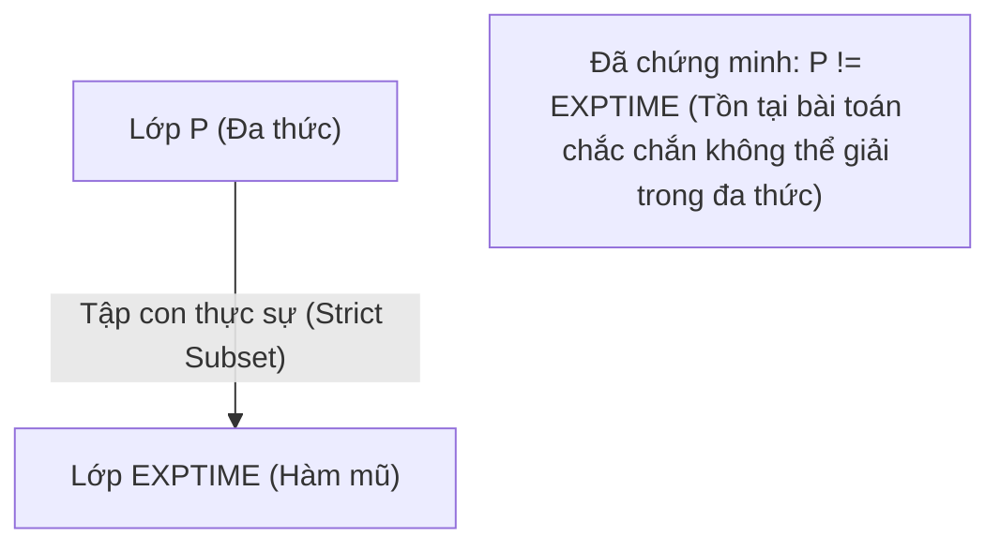

#### 4. Code ví dụ thực chiến (C++ EXPTIME Traversal)
```cpp
#include <iostream>

// Hàm có số bước thực thi chính xác 2^n
void exptime_recursive(int n) {
    if (n <= 0) return;
    exptime_recursive(n - 1);
    exptime_recursive(n - 1);
}

int main() {
    exptime_recursive(20); // 2^20 operations
    std::cout << "Done 2^20 calls.\n";
    return 0;
}
```

#### 5. Ưu / Nhược điểm, Pitfalls & Anti-patterns
- **Pitfall**: Đưa thuật toán EXPTIME vào quy trình tự động hóa CI/CD, khiến pipeline build bị đóng băng vĩnh viễn.

#### 6. Ứng dụng thực tế trong Backend / Systems
- Đánh giá giới hạn an toàn của hệ mật mã: Độ phức tạp để giải mã vét cạn khóa AES-256 là $2^{256}$ phép tính (nằm trong EXPTIME), đảm bảo tính an toàn trước mọi máy tính vật lý.

---

### 9. Polynomial-time Reduction (Quy giảm Đa thức)

#### 1. Khái niệm bản chất (What & Why)
- **Định nghĩa**: Kỹ thuật biến đổi một thể hiện (instance) của bài toán $A$ thành một thể hiện của bài toán $B$ bằng một hàm tính toán được trong thời gian đa thức $f: \Sigma^* \to \Sigma^*$ sao cho:
  $$x \in A \iff f(x) \in B$$
- Ký hiệu: $A \le_P B$ (Đọc là: "$A$ quy giảm đa thức về $B$", nghĩa là $B$ khó ít nhất bằng $A$).

#### 2. Cơ chế hoạt động sâu (Under the hood / Hardcore Internals)
- Ý nghĩa bắc cầu (Transitivity): Nếu $A \le_P B$ và $B \le_P C$ thì $A \le_P C$.
- Ý nghĩa giải thuật: Nếu ta có một hàm thư viện giải được $B$ trong thời gian đa thức, ta chỉ cần tốn $O(n^k)$ để biến đổi input của $A$ rồi truyền vào hàm $B \implies A$ cũng được giải trong thời gian đa thức.

#### 3. Sơ đồ minh họa
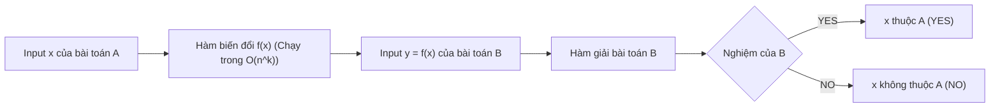

#### 4. Code ví dụ thực chiến (C++ Reduction: Independent Set sang Vertex Cover)
```cpp
#include <iostream>
#include <vector>

// Định lý: Tập hợp độc lập kích thước k tồn tại khi và chỉ khi
// Tập đỉnh phủ (Vertex Cover) kích thước V - k tồn tại.
// Hàm quy giảm: f(G, k) -> (G, V - k) chạy trong O(1)!
struct ProblemReduction {
    static int reduce_independent_set_to_vertex_cover(int total_vertices, int k) {
        return total_vertices - k; // Chuyển đổi tham số mục tiêu
    }
};

int main() {
    int V = 10;
    int k_independent = 4;
    int k_vertex_cover = ProblemReduction::reduce_independent_set_to_vertex_cover(V, k_independent);
    std::cout << "Independent Set (k = 4) tương đương Vertex Cover (k = " << k_vertex_cover << ")\n";
    return 0;
}
```

#### 5. Ưu / Nhược điểm, Pitfalls & Anti-patterns
- **Pitfall**: Nhầm lẫn chiều quy giảm! Để chứng minh $B$ là NP-hard, ta phải quy giảm từ một bài toán NP-hard đã biết $A$ về $B$ ($A \le_P B$). Quy giảm ngược chiều ($B \le_P A$) là hoàn toàn vô giá trị trong chứng minh NP-hard!

#### 6. Ứng dụng thực tế trong Backend / Systems
- Phân tích luồng nghiệp vụ: Quy giảm bài toán phát hiện vòng lặp phân quyền truy cập người dùng (RBAC Circular Delegation) về bài toán chu trình đồ thị có hướng (Cycle Detection).

---

### 10. Approximation Algorithms (Thuật toán Gần đúng)

#### 1. Khái niệm bản chất (What & Why)
- **Định nghĩa**: Một thuật toán chạy trong **thời gian đa thức** giải một bài toán tối ưu hóa NP-hard, đảm bảo tìm ra một nghiệm khả dĩ với giá trị mục tiêu nằm trong một khoảng tỉ lệ được cam kết toán học so với nghiệm tối ưu tuyệt đối:
  $$\max\left(\frac{C}{C^*}, \frac{C^*}{C}\right) \le \rho(n)$$
  Trong đó $C$ là nghiệm của thuật toán, $C^*$ là nghiệm tối ưu lý tưởng, $\rho(n)$ là Hệ số xấp xỉ (Approximation Ratio).
- **Tại sao cần thiết**: Vì không thể giải chính xác NP-hard trong thời gian chấp nhận được, nên ta hy sinh một phần độ chính xác để đổi lấy tốc độ chạy thực tế.

#### 2. Cơ chế hoạt động sâu (Under the hood / Hardcore Internals)
- Ví dụ: **2-Approximation Vertex Cover**: Thuật toán tham lam chọn lần lượt 2 đầu mút của một cạnh bất kỳ và xóa bỏ mọi cạnh kề. Thuật toán chạy trong $O(V + E)$ thời gian và cam kết nghiệm tìm được không bao giờ vượt quá $2 \times \text{OPT}$.

#### 3. Sơ đồ minh họa
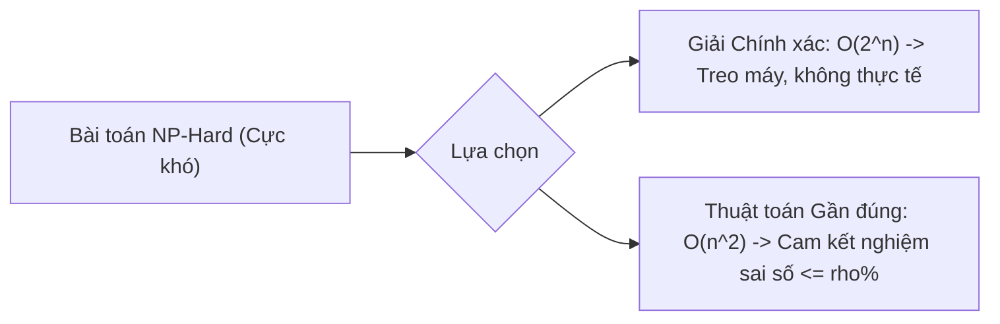

#### 4. Code ví dụ thực chiến (C++ 2-Approximation Vertex Cover)
```cpp
#include <iostream>
#include <vector>

// 2-Approximation Algorithm cho Vertex Cover: Chạy trong O(V + E)
std::vector<int> approx_vertex_cover(int V, const std::vector<std::pair<int, int>>& edges) {
    std::vector<bool> visited(V, false);
    std::vector<int> vertex_cover;

    for (const auto& [u, v] : edges) {
        if (!visited[u] && !visited[v]) {
            // Đưa cả 2 đỉnh vào tập phủ
            visited[u] = true;
            visited[v] = true;
            vertex_cover.push_back(u);
            vertex_cover.push_back(v);
        }
    }
    return vertex_cover; // Cam kết |vertex_cover| <= 2 * OPT
}

int main() {
    int V = 4;
    std::vector<std::pair<int, int>> edges = {{0, 1}, {1, 2}, {2, 3}};
    auto cover = approx_vertex_cover(V, edges);
    std::cout << "Approx Vertex Cover size: " << cover.size() << "\n";
    return 0;
}
```

#### 5. Ưu / Nhược điểm, Pitfalls & Anti-patterns
- **Khác biệt cốt lõi**: Khác với Heuristics (không có bảo đảm toán học, có thể sai lệch vô hạn trong trường hợp xấu), Approximation Algorithm **bắt buộc phải có chứng minh toán học về biên sai số $\rho$**.

#### 6. Ứng dụng thực tế trong Backend / Systems
- Hệ thống Phân bổ Tài nguyên Kubernetes / Nomad: Sử dụng thuật toán First Fit Decreasing (FFD) xấp xỉ tỉ lệ $\frac{11}{9} \text{OPT} + 1$ để xếp container vào các máy chủ vật lý.

---

### 11. Tractable Problems (Bài toán Dễ xử lý)

#### 1. Khái niệm bản chất (What & Why)
- **Định nghĩa**: Những bài toán tính toán có thể được giải quyết bằng các thuật toán có độ phức tạp thời gian tăng trưởng theo hàm đa thức bậc thấp ($\mathcal{O}(n^c)$ với $c$ nhỏ, ví dụ $c \le 3$).
- **Ý nghĩa kỹ thuật**: Là những bài toán mà hệ thống máy tính có thể xử lý mượt mà và mở rộng quy mô (Scale-up/Scale-out) khi dữ liệu người dùng tăng trưởng.

#### 2. Cơ chế hoạt động sâu (Under the hood / Hardcore Internals)
- Thuộc lớp $\text{P}$. Tận dụng tối đa kiến trúc phần cứng hiện đại: Bộ nhớ đệm cache, vector hóa SIMD, và song song hóa đa luồng (Multi-core Threading).

#### 3. Sơ đồ minh họa
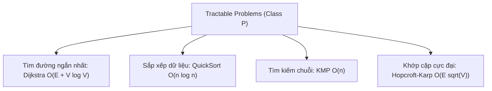

#### 4. Code ví dụ thực chiến (C++ Tractable Algorithm: Dijkstra Shortest Path)
```cpp
#include <iostream>
#include <vector>
#include <queue>

// Dijkstra: O((V + E) log V) - Hoàn toàn Tractable
std::vector<int> dijkstra(int n, const std::vector<std::vector<std::pair<int, int>>>& adj, int src) {
    std::vector<int> dist(n, 1e9);
    std::priority_queue<std::pair<int, int>, std::vector<std::pair<int, int>>, std::greater<>> pq;

    dist[src] = 0;
    pq.push({0, src});

    while (!pq.empty()) {
        auto [d, u] = pq.top();
        pq.pop();

        if (d > dist[u]) continue;

        for (const auto& [v, w] : adj[u]) {
            if (dist[u] + w < dist[v]) {
                dist[v] = dist[u] + w;
                pq.push({dist[v], v});
            }
        }
    }
    return dist;
}

int main() {
    int n = 3;
    std::vector<std::vector<std::pair<int, int>>> adj(n);
    adj[0].push_back({1, 10});
    adj[1].push_back({2, 5});
    auto d = dijkstra(n, adj, 0);
    std::cout << "Shortest path 0 -> 2: " << d[2] << "\n";
    return 0;
}
```

#### 5. Ưu / Nhược điểm, Pitfalls & Anti-patterns
- **Pitfall**: Cho rằng thuật toán trong lớp P thì không cần tối ưu. Một thuật toán $O(n^3)$ trên $n = 50,000$ vẫn làm sập server do tiêu tốn $1.25 \times 10^{14}$ phép tính!

#### 6. Ứng dụng thực tế trong Backend / Systems
- Các dịch vụ định tuyến bản đồ (Google Maps, OSRM): Sử dụng thuật toán Dijkstra kết hợp Contraction Hierarchies để phản hồi lộ trình lái xe giữa hàng chục triệu nút giao thông trong vòng vài chục milliseconds.

---

### 12. Intractable Problems (Bài toán Bất khả kham)

#### 1. Khái niệm bản chất (What & Why)
- **Định nghĩa**: Những bài toán tính toán về mặt lý thuyết là giải được (Solvable / Decidable), nhưng mọi thuật toán giải chính xác chúng đều đòi hỏi tài nguyên thời gian hoặc không gian tăng trưởng theo hàm siêu đa thức (Super-polynomial) hoặc hàm mũ ($\mathcal{O}(2^n)$, $\mathcal{O}(n!)$).
- **Ý nghĩa kỹ thuật**: Không thể giải chính xác cho các bộ dữ liệu lớn trong thực tế, bất kể bạn có nâng cấp bao nhiêu máy chủ hay chip tính toán mạnh cỡ nào.

#### 2. Cơ chế hoạt động sâu (Under the hood / Hardcore Internals)
- **Định luật Moore bất lực trước Intractability**:
  - Giả sử máy tính tăng tốc độ lên gấp 1000 lần.
  - Với thuật toán tuyến tính $O(n)$: Ta xử lý được dữ liệu lớn gấp 1000 lần.
  - Với thuật toán hàm mũ $O(2^n)$: Ta chỉ giải thêm được bài toán với $n' = n + \log_2(1000) \approx n + 10$ phần tử! Tăng tốc độ phần cứng 1000 lần chỉ giúp xử lý thêm đúng 10 phần tử!

#### 3. Sơ đồ minh họa
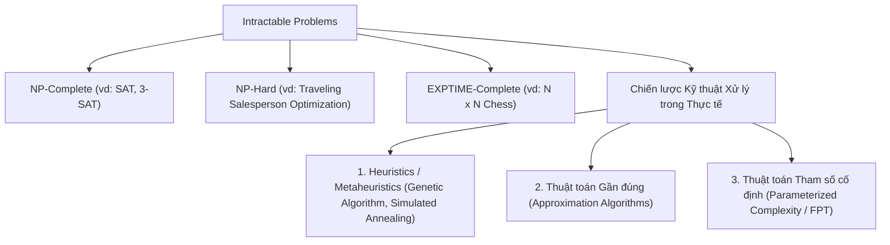

#### 4. Code ví dụ thực chiến (C++ Intractable Solver Brute Force vs Early Bounding)
```cpp
#include <iostream>
#include <vector>

// Giải bài toán Intractable: Tìm Clique cực đại bằng vét cạn Bitmask O(n^2 * 2^n)
int max_clique_brute_force(int n, const std::vector<std::vector<bool>>& adj) {
    int max_size = 0;
    int total_subsets = 1 << n; // 2^n trạng thái

    for (int mask = 1; mask < total_subsets; ++mask) {
        std::vector<int> nodes;
        for (int i = 0; i < n; ++i) {
            if (mask & (1 << i)) nodes.push_back(i);
        }

        bool is_clique = true;
        for (std::size_t i = 0; i < nodes.size() && is_clique; ++i) {
            for (std::size_t j = i + 1; j < nodes.size(); ++j) {
                if (!adj[nodes[i]][nodes[j]]) {
                    is_clique = false;
                    break;
                }
            }
        }

        if (is_clique) {
            max_size = std::max(max_size, static_cast<int>(nodes.size()));
        }
    }
    return max_size;
}

int main() {
    int n = 4;
    std::vector<std::vector<bool>> adj = {
        {0, 1, 1, 1},
        {1, 0, 1, 0},
        {1, 1, 0, 1},
        {1, 0, 1, 0}
    };
    std::cout << "Max Clique size: " << max_clique_brute_force(n, adj) << "\n";
    return 0;
}
```

#### 5. Ưu / Nhược điểm, Pitfalls & Anti-patterns
- **Anti-pattern**: Đưa một bài toán Intractable vào luồng Synchronous HTTP Request / Response, làm treo toàn bộ HTTP Worker Threads và kích hoạt 504 Gateway Timeout.

#### 6. Ứng dụng thực tế trong Backend / Systems
- Kiến trúc xử lý tác vụ bất đồng bộ (Asynchronous Background Job Queues via Celery / BullMQ): Chuyển các tác vụ NP-hard/Intractable (như tối ưu hóa lộ trình xe bốc hàng kho bãi) vào Worker nền chạy dài hạn với các thuật toán Heuristics tiến hóa.
