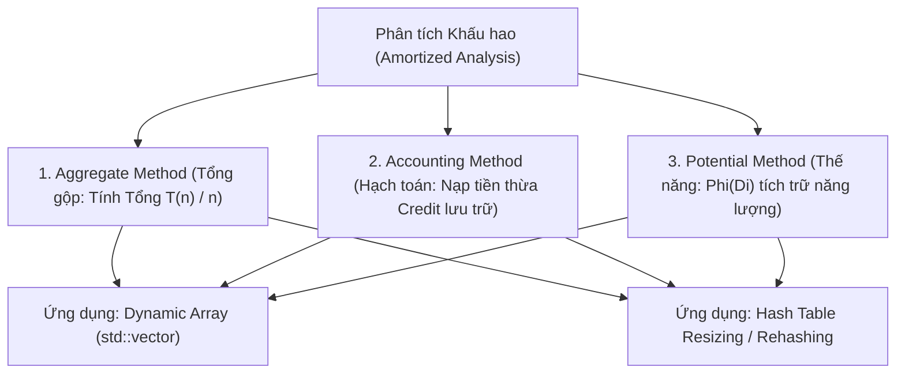
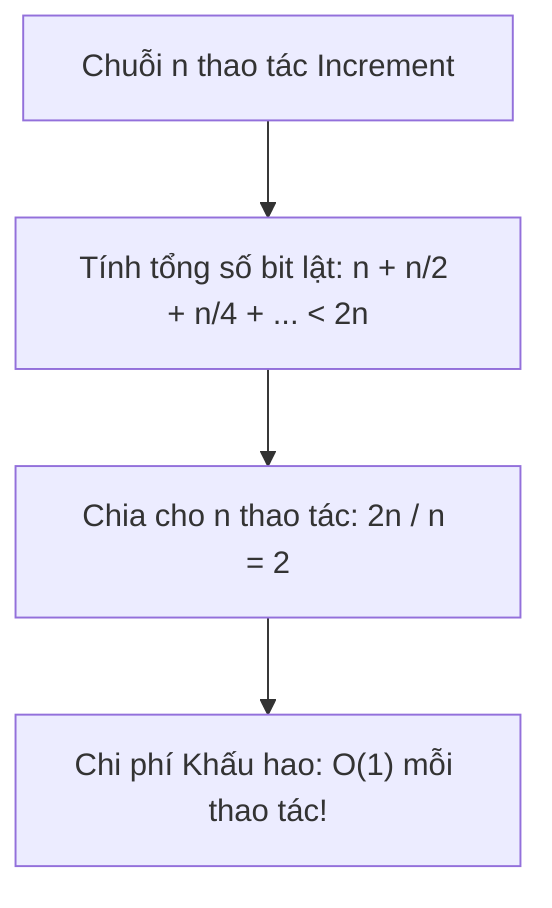
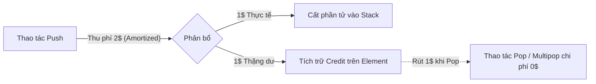
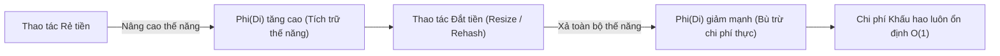
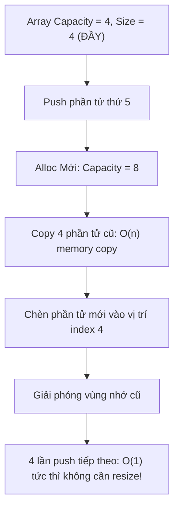
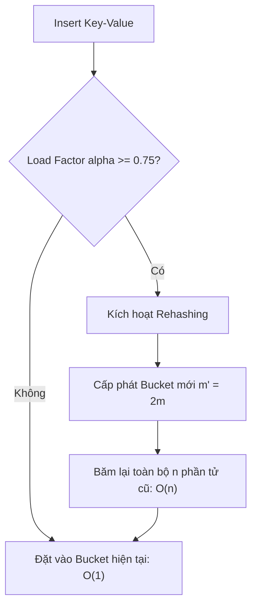

# 3.4. Amortized Analysis Techniques (Các Phương pháp Phân tích Chi phí Khấu hao)

## Tổng quan về Phân tích Khấu hao
Trong nhiều cấu trúc dữ liệu thực tế, một thao tác đơn lẻ có thể thỉnh thoảng tốn chi phí thời gian rất lớn ($\mathcal{O}(n)$), nhưng tần suất xuất hiện của nó lại cực kỳ thưa thớt so với hàng loạt các thao tác rẻ tiền ($\mathcal{O}(1)$) đi kèm. 

Nếu ta chỉ đánh giá theo Trường hợp xấu nhất (Worst Case), ta sẽ kết luận sai lầm rằng toàn bộ chuỗi thao tác là chậm chạp. **Phân tích Khấu hao (Amortized Analysis)** cung cấp công cụ toán học chặt chẽ để tính trung bình chi phí trên toàn bộ chuỗi $n$ thao tác liên tiếp trong trường hợp tồi tệ nhất:
$$T_{\text{amortized}} = \frac{1}{n} \sum_{i=1}^n c_i$$
Trong đó $c_i$ là chi phí thực tế của thao tác thứ $i$.

Ba phương pháp phân tích kinh điển:
1. **Phương pháp Tổng gộp (Aggregate Method)**.
2. **Phương pháp Hạch toán / Kế toán (Accounting / Banker's Method)**.
3. **Phương pháp Thế năng (Potential / Physicist's Method)**.



---

## 2. Chi tiết từng Keyword (Under-the-Hood Deep Dive)

---

### 1. Aggregate Method (Phương pháp Tổng gộp)

#### 1. Khái niệm bản chất (What & Why)
- **Định nghĩa**: Phương pháp đơn giản và trực quan nhất. Ta tính toán trực tiếp tổng chi phí thực tế của một chuỗi gồm $n$ thao tác trong trường hợp xấu nhất là $T(n)$, sau đó chia đều cho $n$ để thu được chi phí khấu hao cho mỗi thao tác:
  $$c_{\text{amortized}} = \frac{T(n)}{n}$$
- **Đặc điểm**: Mọi thao tác trong chuỗi đều được gán cùng một chi phí khấu hao như nhau, không phân biệt loại thao tác (Push hay Pop).

#### 2. Cơ chế hoạt động sâu (Under the hood / Hardcore Internals)
- **Ví dụ kinh điển: Bộ đếm nhị phân $k$-bit (Binary Counter)**:
  - Một mảng bit $A[0 \dots k-1]$ khởi tạo toàn 0. Thao tác `Increment` lật các bit từ 0 sang 1 và ngược lại.
  - Phân tích ngây thơ: Mỗi lần `Increment` có thể lật tối đa $k$ bits $\implies n$ lần lặp tốn $O(n \cdot k)$ thời gian.
  - Phân tích Tổng gộp chính xác:
    - Bit $A[0]$ bị lật mỗi lần: $n$ lần.
    - Bit $A[1]$ bị lật mỗi 2 lần: $\lfloor n / 2 \rfloor$ lần.
    - Bit $A[i]$ bị lật mỗi $2^i$ lần: $\lfloor n / 2^i \rfloor$ lần.
    - Tổng số lần lật bit trên toàn bộ chuỗi $n$ lần Increment:
      $$T(n) = \sum_{i=0}^{\lfloor \log_2 n \rfloor} \left\lfloor \frac{n}{2^i} \right\rfloor < n \sum_{i=0}^\infty \frac{1}{2^i} = n \cdot 2 = 2n$$
    - Chi phí khấu hao mỗi lần Increment:
      $$c_{\text{amortized}} = \frac{T(n)}{n} = \frac{2n}{n} = \mathcal{O}(1)$$

#### 3. Sơ đồ minh họa


#### 4. Code ví dụ thực chiến (C++ Mô phỏng Binary Counter Flip Bit)
```cpp
#include <iostream>
#include <vector>

class BinaryCounter {
    std::vector<bool> bits_;
    uint64_t total_flips_{0};

public:
    explicit BinaryCounter(int k) : bits_(k, false) {}

    void increment() {
        int i = 0;
        while (i < bits_.size() && bits_[i]) {
            bits_[i] = false;
            ++total_flips_; // Lật từ 1 về 0
            ++i;
        }
        if (i < bits_.size()) {
            bits_[i] = true;
            ++total_flips_; // Lật từ 0 lên 1
        }
    }

    [[nodiscard]] uint64_t get_total_flips() const noexcept { return total_flips_; }
};

int main() {
    int n = 1000000;
    BinaryCounter counter(32);
    for (int i = 0; i < n; ++i) {
        counter.increment();
    }
    std::cout << "Total flips for " << n << " increments: " << counter.get_total_flips() << "\n";
    std::cout << "Flips per increment: " << (double)counter.get_total_flips() / n << " (< 2.0!)\n";
    return 0;
}
```

#### 5. Ưu / Nhược điểm, Pitfalls & Anti-patterns
- **Nhược điểm**: Không phân biệt được chi phí riêng biệt giữa các loại thao tác khác nhau trong cùng một cấu trúc (ví dụ: chi phí khác biệt giữa Enqueue và Dequeue).

#### 6. Ứng dụng thực tế trong Backend / Systems
- Nhật ký WAL Checkpoint của Cơ sở dữ liệu: Gom hàng nghìn giao dịch nhỏ vào bộ đệm và chỉ xả đĩa (Flush to disk) một lần, chi phí ghi I/O trung bình cho mỗi transaction đạt $O(1)$.

---

### 2. Accounting Method (Phương pháp Hạch toán / Kế toán)

#### 1. Khái niệm bản chất (What & Why)
- **Định nghĩa**: Ta gán một khoản "phí hạch toán" (Amortized Cost $\hat{c}_i$) cho từng loại thao tác.
  - Nếu phí hạch toán lớn hơn chi phí thực tế ($\hat{c}_i > c_i$), khoản chênh lệch dư thừa được nạp vào tài khoản ngân hàng ảo như một khoản "tín dụng" (Credit).
  - Khi một thao tác đắt đỏ xuất hiện trong tương lai ($c_j > \hat{c}_j$), khoản tín dụng tích lũy này được rút ra để chi trả cho phần vượt mức.
- **Ràng buộc vàng của Kế toán**: Số dư tín dụng trong tài khoản không bao giờ được phép âm tại bất kỳ thời điểm nào:
  $$\sum_{i=1}^m \hat{c}_i \ge \sum_{i=1}^m c_i, \quad \forall m \ge 1$$

#### 2. Cơ chế hoạt động sâu (Under the hood / Hardcore Internals)
- **Phân tích Ngăn xếp có thao tác Multipop (Stack with Multipop)**:
  - Chi phí thực tế: `Push`: 1 đồng, `Pop`: 1 đồng, `Multipop(k)`: $\min(k, s)$ đồng.
  - Thiết lập phí hạch toán:
    - Thu phí thao tác `Push`: **2 đồng**.
      - 1 đồng dùng để trả cho thao tác push phần tử vào stack ngay lúc đó.
      - 1 đồng dư thừa gắn trực tiếp lên phần tử vừa push như một khoản tiền tiết kiệm (Credit).
    - Thu phí thao tác `Pop`: **0 đồng** (Dùng chính 1 đồng credit gắn trên phần tử đó để trả).
    - Thu phí thao tác `Multipop(k)`: **0 đồng** (Mỗi phần tử bị pop tự rút 1 đồng credit của chính nó để chi trả).
  - Vì mỗi phần tử trong stack luôn có sẵn 1 đồng credit và stack không thể có số phần tử âm, tài khoản tín dụng luôn $\ge 0$.
  - Kết luận: Cả `Push`, `Pop` và `Multipop` đều có chi phí khấu hao là $\mathcal{O}(1)$!

#### 3. Sơ đồ minh họa


#### 4. Code ví dụ thực chiến (C++ Mô phỏng Accounting Method trên Stack)
```cpp
#include <iostream>
#include <vector>
#include <algorithm>

class AccountingMonitoredStack {
    std::vector<int> stack_;
    int bank_credit_{0};

public:
    void push(int val) {
        // Thu phí hạch toán 2 đồng, chi phí thực tế 1 đồng -> Tiết kiệm 1 đồng
        stack_.push_back(val);
        bank_credit_ += 1; 
    }

    void multipop(int k) {
        int actual_pops = std::min(k, static_cast<int>(stack_.size()));
        for (int i = 0; i < actual_pops; ++i) {
            stack_.pop_back();
            bank_credit_ -= 1; // Rút 1 đồng credit đã lưu
        }
        // Bảo đảm bất biến kế toán: Bank credit luôn >= 0
        if (bank_credit_ < 0) {
            std::cerr << "BANKRUPT! Accounting method failed.\n";
        }
    }

    [[nodiscard]] int get_credit() const noexcept { return bank_credit_; }
};

int main() {
    AccountingMonitoredStack s;
    for (int i = 0; i < 5; ++i) s.push(i);
    std::cout << "Credit after 5 pushes: " << s.get_credit() << "\n"; // 5
    s.multipop(3);
    std::cout << "Credit after multipop 3: " << s.get_credit() << "\n"; // 2 (Luôn >= 0)
    return 0;
}
```

#### 5. Ưu / Nhược điểm, Pitfalls & Anti-patterns
- **Pitfall**: Đặt phí hạch toán quá thấp khiến tài khoản tín dụng bị âm tại một thời điểm nào đó, làm mất tính hợp lệ của phép chứng minh.

#### 6. Ứng dụng thực tế trong Backend / Systems
- Hệ thống Token Bucket Rate Limiter: Tích lũy token (credits) trong những khoảng thời gian nhàn rỗi để cho phép Client gửi các đợt lưu lượng đột biến (Burst Traffic) mà không bị từ chối.

---

### 3. Potential Method (Phương pháp Thế năng)

#### 1. Khái niệm bản chất (What & Why)
- **Định nghĩa**: Phương pháp hình thức và mạnh mẽ nhất, vay mượn khái niệm thế năng trong vật lý. Ta định nghĩa một hàm thế năng $\Phi(D)$ ánh xạ trạng thái cấu trúc dữ liệu $D$ thành một số thực.
- **Công thức Chi phí Khấu hao**:
  $$\hat{c}_i = c_i + \Phi(D_i) - \Phi(D_{i-1}) = c_i + \Delta\Phi_i$$
  Trong đó $c_i$ là chi phí thực tế, và $\Delta\Phi_i = \Phi(D_i) - \Phi(D_{i-1})$ là độ biến thiên thế năng.
- **Ràng buộc cốt lõi**: Thế năng tại mọi thời điểm phải lớn hơn hoặc bằng thế năng ban đầu:
  $$\Phi(D_i) \ge \Phi(D_0), \quad \forall i$$
  (Thường quy ước $\Phi(D_0) = 0$ và $\Phi(D_i) \ge 0$).

#### 2. Cơ chế hoạt động sâu (Under the hood / Hardcore Internals)
- **Cơ chế bù trừ toán học**:
  - Khi thao tác rẻ tiền chạy ($c_i$ nhỏ), nó làm tăng thế năng ($\Delta\Phi_i > 0$), tích trữ năng lượng vào cấu trúc dữ liệu.
  - Khi thao tác đắt đỏ xuất hiện ($c_i$ rất lớn), nó giải phóng toàn bộ thế năng tích lũy ($\Delta\Phi_i \ll 0$), kéo chi phí khấu hao $\hat{c}_i$ trở về một hằng số nhỏ $\mathcal{O}(1)$.
- **Tổng chi phí thực tế qua biến đổi đại số**:
  $$\sum_{i=1}^n c_i = \sum_{i=1}^n \left( \hat{c}_i - \Phi(D_i) + \Phi(D_{i-1}) \right) = \left( \sum_{i=1}^n \hat{c}_i \right) - \Phi(D_n) + \Phi(D_0)$$
  Vì $\Phi(D_n) \ge \Phi(D_0)$, nên tổng chi phí khấu hao luôn là một chặn trên chắc chắn của tổng chi phí thực tế:
  $$\sum_{i=1}^n c_i \le \sum_{i=1}^n \hat{c}_i$$

#### 3. Sơ đồ minh họa


#### 4. Code ví dụ thực chiến (C++ Đánh giá Hàm Thế năng)
```cpp
#include <iostream>
#include <cmath>

// Thế năng của Binary Counter: Phi(D) = Số lượng bit 1 đang bật
// Mỗi thao tác Increment: Giả sử lật t bit 1 về 0, và lật 1 bit 0 lên 1.
// Chi phí thực: c_i = t + 1
// Biến thiên thế năng: Delta_Phi = 1 - t
// Chi phí khấu hao: c_hat = c_i + Delta_Phi = (t + 1) + (1 - t) = 2 = O(1)!
int compute_potential_bits(uint32_t val) {
    return __builtin_popcount(val); // Phi(D)
}

int main() {
    uint32_t counter = 7; // 0000 0111 -> Phi = 3
    std::cout << "Potential before increment: " << compute_potential_bits(counter) << "\n";
    counter++; // 8 = 0000 1000 -> Phi = 1 (Thế năng giảm để bù chi phí lật 3 bits)
    std::cout << "Potential after increment: " << compute_potential_bits(counter) << "\n";
    return 0;
}
```

#### 5. Ưu / Nhược điểm, Pitfalls & Anti-patterns
- **Ưu điểm**: Có thể phân tích các cấu trúc dữ liệu cực kỳ phức tạp như Fibonacci Heap (thao tác `decrease-key` đạt $O(1)$ amortized) hoặc Splay Tree.
- **Thách thức**: Việc lựa chọn một hàm thế năng $\Phi(D)$ phù hợp đòi hỏi trực giác toán học sâu sắc.

#### 6. Ứng dụng thực tế trong Backend / Systems
- Quản lý bộ nhớ đệm Cache Eviction (Splay Trees / LFU Trees): Sử dụng hàm thế năng để chứng minh rằng chuỗi truy xuất dữ liệu cục bộ luôn đạt hiệu năng tối ưu tiệm cận với Offline Optimal Algorithm.

---

### 4. Dynamic Array Amortized Cost (Chi phí Khấu hao của Mảng động)

#### 1. Khái niệm bản chất (What & Why)
- **Định nghĩa**: Mảng động (`std::vector` trong C++, `ArrayList` trong Java, `List` trong Python) là cấu trúc mảng liên tục tự động mở rộng dung lượng khi đầy bằng cách cấp phát một vùng nhớ mới lớn hơn theo một hệ số nhân hình học (Geometric Growth Factor $\alpha > 1$).
- **Chi phí Khấu hao**: Dù việc sao chép mảng tốn $\mathcal{O}(n)$, chi phí khấu hao của thao tác chèn cuối (`push_back`) luôn là **$\mathcal{O}(1)$**.

#### 2. Cơ chế hoạt động sâu (Under the hood / Hardcore Internals)
- **Hệ số nhân $\alpha = 2$ vs $\alpha = 1.5$**:
  - GCC `libstdc++` dùng $\alpha = 2.0$.
  - MSVC STL và Facebook Folly `FBVector` dùng $\alpha = 1.5$.
  - **Lý do phần cứng**: Khi $\alpha = 2.0$, kích thước vùng nhớ mới luôn lớn hơn tổng tất cả các vùng nhớ cũ đã từng giải phóng ($\sum_{i=0}^{k-1} 2^i = 2^k - 1 < 2^k$). Do đó, Memory Allocator của hệ điều hành không bao giờ có thể tái sử dụng lại các ô nhớ cũ, gây phân mảnh bộ nhớ RAM. Với $\alpha = 1.5$, sau một số lần cấp phát, vùng nhớ mới có thể nằm vừa vặn vào các khối bộ nhớ cũ được tái chế!
- **Chứng minh bằng Phương pháp Thế năng**:
  - Đặt $\Phi(D) = 2 \times \text{size} - \text{capacity}$.
  - Khi mảng đầy ($\text{size} = \text{capacity}$): $\Phi = 2n - n = n$.
  - Sau khi nhân đôi dung lượng ($\text{capacity}' = 2n, \text{size}' = n + 1$):
    $\Phi' = 2(n + 1) - 2n = 2$.
  - Chi phí thực tế copy $n$ phần tử và thêm 1 phần tử: $c_i = n + 1$.
  - Biến thiên thế năng: $\Delta\Phi = 2 - n$.
  - Chi phí khấu hao:
    $$\hat{c}_i = c_i + \Delta\Phi = (n + 1) + (2 - n) = 3 = \mathcal{O}(1)$$

#### 3. Sơ đồ minh họa


#### 4. Code ví dụ thực chiến (C++ Tự Cài đặt Dynamic Array với Khấu hao O(1))
```cpp
#include <iostream>
#include <memory>
#include <algorithm>

template <typename T>
class CustomVector {
    std::size_t capacity_{1};
    std::size_t size_{0};
    std::unique_ptr<T[]> buffer_{std::make_unique<T[]>(1)};

    void resize(std::size_t new_cap) {
        auto new_buffer = std::make_unique<T[]>(new_cap);
        for (std::size_t i = 0; i < size_; ++i) {
            new_buffer[i] = std::move(buffer_[i]); // O(n) reallocation
        }
        buffer_ = std::move(new_buffer);
        capacity_ = new_cap;
    }

public:
    void push_back(T val) {
        if (size_ == capacity_) {
            resize(capacity_ * 2); // Tăng trưởng hình học 2x
        }
        buffer_[size_++] = std::move(val); // O(1) insert
    }

    [[nodiscard]] std::size_t capacity() const noexcept { return capacity_; }
    [[nodiscard]] std::size_t size() const noexcept { return size_; }
    const T& operator[](std::size_t idx) const { return buffer_[idx]; }
};

int main() {
    CustomVector<int> vec;
    for (int i = 0; i < 10; ++i) vec.push_back(i * 10);
    std::cout << "Final Size: " << vec.size() << " | Capacity: " << vec.capacity() << "\n";
    return 0;
}
```

#### 5. Ưu / Nhược điểm, Pitfalls & Anti-patterns
- **Anti-pattern**: Mở rộng mảng theo cấp số cộng ($\text{capacity} = \text{capacity} + C$). Nếu mỗi lần chỉ tăng thêm một hằng số $C = 100$ phần tử, tổng chi phí copy sau $n$ phần tử sẽ là $\sum_{i=1}^{n/C} (i \cdot C) = \mathcal{O}(n^2) \implies$ Chi phí khấu hao bị suy biến thành $\mathcal{O}(n)$ cực kỳ tệ hại!

#### 6. Ứng dụng thực tế trong Backend / Systems
- Tối ưu hóa trước với `vector.reserve(N)`: Nếu biết trước số lượng phần tử đầu vào từ Database query, gọi `reserve()` sẽ cấp phát đủ bộ nhớ trong 1 lần duy nhất, loại bỏ hoàn toàn mọi chi phí khấu hao và reallocations.

---

### 5. Hash Table Amortized Cost (Chi phí Khấu hao của Bảng băm)

#### 1. Khái niệm bản chất (What & Why)
- **Định nghĩa**: Bảng băm (Hash Table) lưu trữ các cặp key-value với kỳ vọng truy cập trung bình là $\mathcal{O}(1)$. Để duy trì tốc độ này, bảng băm phải kiểm soát **Hệ số tải (Load Factor)**:
  $$\alpha = \frac{n}{m}$$
  Trong đó $n$ là số phần tử lưu trữ và $m$ là số lượng bucket.
- Khi $\alpha$ vượt qua một ngưỡng (thường là $\alpha_{\text{max}} = 0.75$), bảng băm bắt buộc phải thực hiện thao tác **Rehashing**: Cấp phát số lượng bucket mới gấp đôi ($m' = 2m$) và tính toán lại vị trí băm cho toàn bộ $n$ phần tử cũ.

#### 2. Cơ chế hoạt động sâu (Under the hood / Hardcore Internals)
- **Chứng minh Khấu hao $\mathcal{O}(1)$**:
  - Tương tự như Dynamic Array, chi phí thực tế của một lần Rehashing là $\mathcal{O}(n)$.
  - Tuy nhiên, để hệ số tải tăng từ $0.5$ lên lại $0.75$, cần ít nhất $0.25 \times m$ thao tác chèn mới.
  - Chi phí khấu hao trung bình cho mỗi thao tác `Insert`:
    $$\hat{c}_{\text{insert}} = \mathcal{O}(1) + \frac{\mathcal{O}(n)}{0.25 \times m} = \mathcal{O}(1) + \mathcal{O}(1) = \mathcal{O}(1)$$
- **Incremental Rehashing (Băm lại tăng dần - Redis)**:
  - Nếu bảng băm Redis chứa 20 triệu keys, việc rehash toàn bộ trong một thao tác duy nhất sẽ làm server bị "đơ" (Stop-the-world) trong vài giây.
  - Redis giải quyết bằng cách duy trì hai bảng băm `ht[0]` và `ht[1]`. Mỗi khi có request đọc/ghi bình thường, nó tiện thể di chuyển dần dần 1 bucket từ `ht[0]` sang `ht[1]`, làm mượt hoàn toàn chi phí khấu hao theo thời gian thực mà không gây spike latency.

#### 3. Sơ đồ minh họa


#### 4. Code ví dụ thực chiến (C++ Incremental Resizing Concepts)
```cpp
#include <iostream>
#include <vector>
#include <list>
#include <string>

class SimpleHashTable {
    std::size_t num_elements_{0};
    std::size_t num_buckets_{4};
    std::vector<std::list<std::pair<std::string, int>>> buckets_{4};

    void rehash() {
        std::size_t new_cap = num_buckets_ * 2;
        std::vector<std::list<std::pair<std::string, int>>> new_buckets(new_cap);

        for (const auto& chain : buckets_) {
            for (const auto& [k, v] : chain) {
                std::size_t new_idx = std::hash<std::string>{}(k) % new_cap;
                new_buckets[new_idx].emplace_back(k, v);
            }
        }
        buckets_ = std::move(new_buckets);
        num_buckets_ = new_cap;
    }

public:
    void insert(const std::string& key, int val) {
        if ((double)(num_elements_ + 1) / num_buckets_ > 0.75) {
            rehash(); // Amortized O(1)
        }
        std::size_t idx = std::hash<std::string>{}(key) % num_buckets_;
        buckets_[idx].emplace_back(key, val);
        ++num_elements_;
    }

    [[nodiscard]] std::size_t bucket_count() const noexcept { return num_buckets_; }
};

int main() {
    SimpleHashTable ht;
    std::cout << "Initial Buckets: " << ht.bucket_count() << "\n";
    for (int i = 0; i < 20; ++i) {
        ht.insert("key_" + std::to_string(i), i);
    }
    std::cout << "Buckets after 20 inserts: " << ht.bucket_count() << " (Resized smoothly)\n";
    return 0;
}
```

#### 5. Ưu / Nhược điểm, Pitfalls & Anti-patterns
- **Pitfall**: Sử dụng hàm băm chất lượng kém dẫn đến va chạm hàng loạt, khiến chi phí tìm kiếm suy biến thành $\mathcal{O}(n)$ cho dù chi phí chèn và rehash vẫn là $\mathcal{O}(1)$ khấu hao.

#### 6. Ứng dụng thực tế trong Backend / Systems
- Bảng băm nội tại của JVM (ConcurrentHashMap) và Go Runtime Map: Thiết kế kỹ thuật phân vùng bucket và rehash không khóa (Lock-free / Concurrent Rehashing) để duy trì Throughput hàng triệu thao tác ghi mỗi giây trong môi trường đa lõi CPU.
