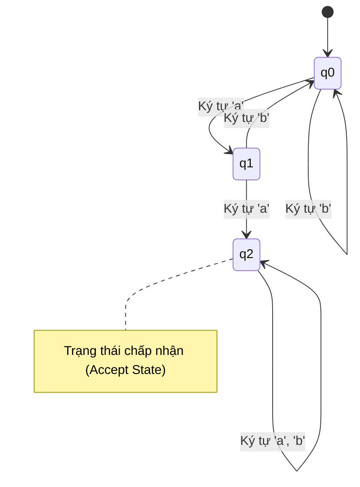
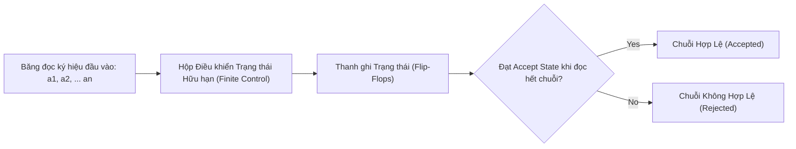
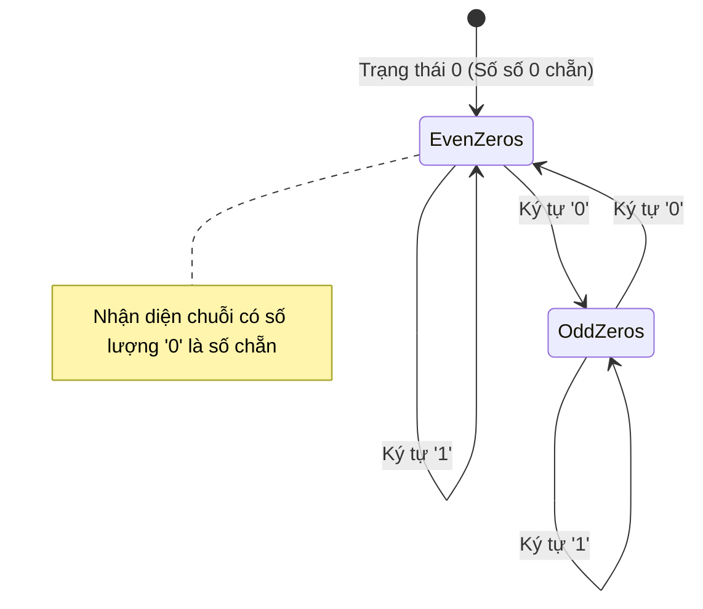
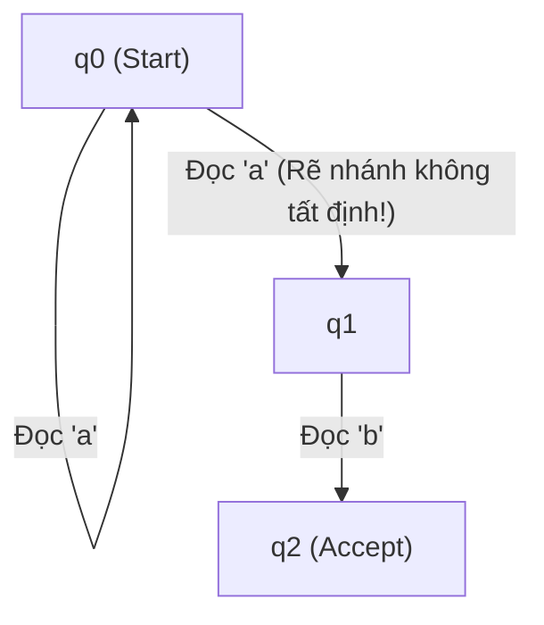
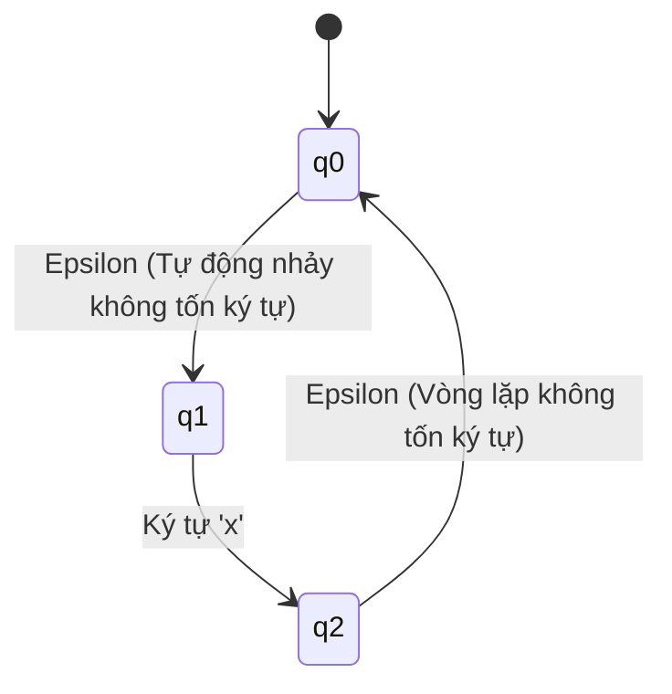
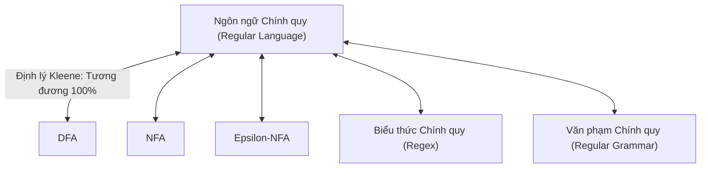
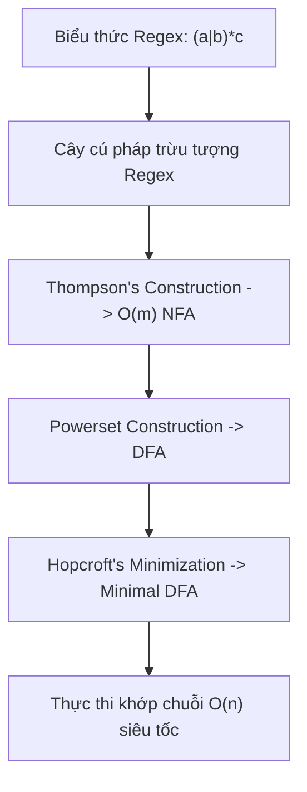
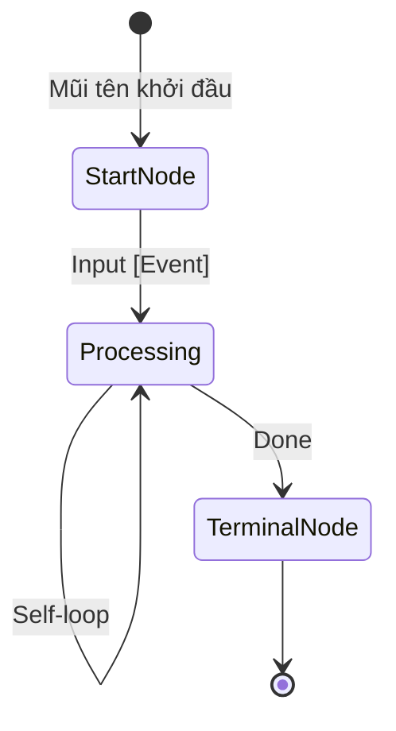
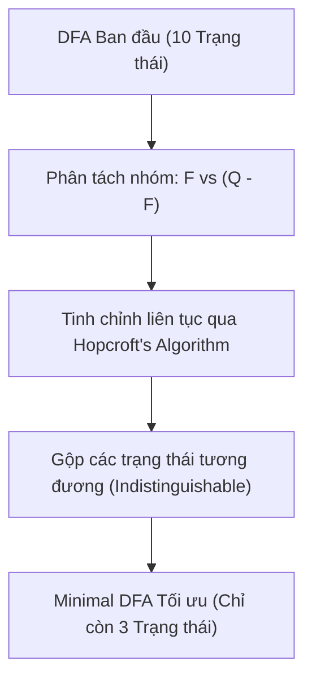
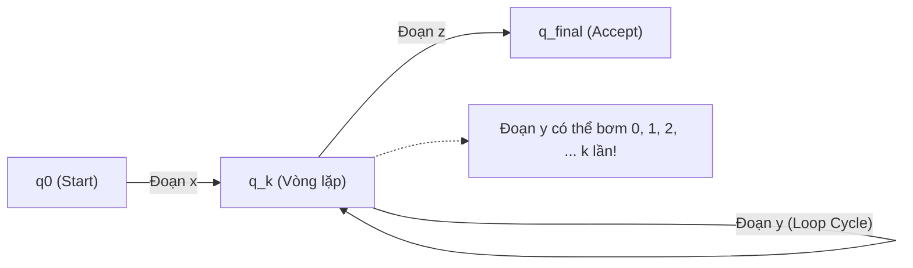

# 4.1. Automata Theory (Lý thuyết Otomat và Ngôn ngữ Chính quy)

## Tổng quan về Lý thuyết Otomat
Lý thuyết Otomat (Automata Theory) là nghiên cứu toán học về các cỗ máy trừu tượng (Abstract Computing Devices) và các bài toán tính toán có thể được giải quyết bằng các cỗ máy này. 

Cấp độ cơ bản nhất trong hệ thống phân cấp tính toán là **Otomat Hữu hạn (Finite Automaton - FA)** — mô hình máy tính có lượng bộ nhớ cực kỳ hạn chế (chỉ ghi nhớ được một số lượng hữu hạn các trạng thái, không có bộ nhớ ngoài hay ngăn xếp).

Định nghĩa toán học của một Otomat Hữu hạn Tất định (DFA):
$$M = (Q, \Sigma, \delta, q_0, F)$$
Trong đó:
- $Q$: Tập hữu hạn các trạng thái (States).
- $\Sigma$: Bảng chữ cái hữu hạn các ký hiệu đầu vào (Alphabet).
- $\delta: Q \times \Sigma \to Q$: Hàm chuyển dịch trạng thái tất định (Transition function).
- $q_0 \in Q$: Trạng thái bắt đầu (Start / Initial state).
- $F \subseteq Q$: Tập hợp các trạng thái kết thúc / chấp nhận (Accepting / Final states).



---

## 2. Chi tiết từng Keyword (Under-the-Hood Deep Dive)

---

### 1. Finite Automata (Otomat Hữu hạn)

#### 1. Khái niệm bản chất (What & Why)
- **Định nghĩa**: Một mô hình toán học của một hệ thống có các đầu vào rời rạc, chuyển đổi qua lại giữa một số lượng hữu hạn các trạng thái nội tại theo các quy tắc xác định.
- **Tại sao cần thiết**: Là nền tảng để thiết kế phần cứng vi mạch số (Sequential Circuits), bộ phân tích từ vựng (Lexer/Tokenizer) trong các trình biên dịch, và các bộ điều khiển logic công nghiệp.

#### 2. Cơ chế hoạt động sâu (Under the hood / Hardcore Internals)
- **Tầng Hardware**: Một Otomat hữu hạn có thể được triển khai trực tiếp trên phần cứng bằng các Flip-Flops (D-Flip-Flop lưu trữ bit trạng thái) kết hợp với các cổng logic tổ hợp (AND, OR, NOT) tính toán hàm $\delta$.
- Không có bộ nhớ Stack hoặc RAM ngoài. Khả năng nhận diện của nó bị giới hạn chặt chẽ: Nó không thể đếm số lượng ký tự tùy ý (ví dụ: không thể nhận diện chuỗi có số chữ 'a' bằng số chữ 'b').

#### 3. Sơ đồ minh họa


#### 4. Code ví dụ thực chiến (C++ Framework Otomat Hữu hạn Tổng quát)
```cpp
#include <iostream>
#include <string_view>
#include <unordered_set>
#include <functional>

// Khung Otomat Hữu hạn trừu tượng
class FiniteAutomaton {
public:
    using State = int;
    using Symbol = char;

    FiniteAutomaton(State start, std::unordered_set<State> accept_states,
                    std::function<State(State, Symbol)> transition)
        : current_state_(start), start_state_(start), 
          accept_states_(std::move(accept_states)), delta_(std::move(transition)) {}

    bool process(std::string_view input) {
        current_state_ = start_state_;
        for (Symbol c : input) {
            current_state_ = delta_(current_state_, c);
        }
        return accept_states_.contains(current_state_);
    }

private:
    State current_state_;
    State start_state_;
    std::unordered_set<State> accept_states_;
    std::function<State(State, Symbol)> delta_;
};
```

#### 5. Ưu / Nhược điểm, Pitfalls & Anti-patterns
- **Giới hạn**: Không thể giải quyết các bài toán đòi hỏi bộ nhớ vô hạn hoặc kiểm tra tính đối xứng đóng mở ngoặc lồng nhau tùy ý (Nested Parentheses).

#### 6. Ứng dụng thực tế trong Backend / Systems
- Network Protocol Handshake Parser: Nhân Linux Kernel triển khai Otomat hữu hạn để phân tích từng byte gói tin TCP header và chuyển trạng thái socket.

---

### 2. Deterministic Finite Automata - DFA (Otomat Hữu hạn Tất định)

#### 1. Khái niệm bản chất (What & Why)
- **Định nghĩa**: Một loại Otomat hữu hạn mà tại mỗi trạng thái $q$, với mỗi ký hiệu đầu vào $a \in \Sigma$, luôn tồn tại **duy nhất một** trạng thái tiếp theo $\delta(q, a)$.
- **Tính chất**: Hoàn toàn tất định, không có sự mập mờ hay lựa chọn ngẫu nhiên. Khi đọc một chuỗi $w$, chỉ có đúng một đường đi duy nhất trên đồ thị trạng thái.

#### 2. Cơ chế hoạt động sâu (Under the hood / Hardcore Internals)
- **Tầng CPU Execution**:
  - Hàm chuyển dịch $\delta(q, a)$ của DFA thường được biên dịch thành một bảng hai chiều phẳng trong bộ nhớ (2D Transition Table): `next_state = transition_table[state][symbol]`.
  - Nhờ vậy, việc xử lý mỗi ký tự chỉ tốn chính xác một phép truy cập bộ nhớ $O(1)$ và một lệnh nhảy gián tiếp, đạt tốc độ hàng trăm Megabytes/giây trên một luồng CPU đơn lẻ.

#### 3. Sơ đồ minh họa


#### 4. Code ví dụ thực chiến (C++ Zero-Overhead DFA Table Lookup)
```cpp
#include <iostream>
#include <string_view>
#include <array>

// DFA nhận diện chuỗi nhị phân kết thúc bằng "01"
// Bảng chữ cái: '0' (idx 0), '1' (idx 1)
// Các trạng thái: Q0 (Start), Q1 (vừa thấy '0'), Q2 (vừa thấy "01" - Accept)
class BinaryDFA {
    // transition_table[State][Symbol]
    static constexpr std::array<std::array<int, 2>, 3> DELTA = {{
        /* Q0 */ {1, 0},
        /* Q1 */ {1, 2},
        /* Q2 */ {1, 0}
    }};

public:
    static bool accepts(std::string_view s) noexcept {
        int state = 0; // Q0
        for (char c : s) {
            if (c != '0' && c != '1') return false;
            int symbol_idx = c - '0';
            state = DELTA[state][symbol_idx]; // O(1) Memory lookup
        }
        return state == 2; // Q2 is accept state
    }
};

int main() {
    std::cout << "1001: " << (BinaryDFA::accepts("1001") ? "Accepted" : "Rejected") << "\n"; // Accept
    std::cout << "1010: " << (BinaryDFA::accepts("1010") ? "Accepted" : "Rejected") << "\n"; // Reject
    return 0;
}
```

#### 5. Ưu / Nhược điểm, Pitfalls & Anti-patterns
- **Ưu điểm**: Thời gian nhận diện chuỗi có độ dài $n$ là $\mathcal{O}(n)$ tuyệt đối (tối ưu nhất có thể).
- **Nhược điểm**: Bùng nổ trạng thái (State Explosion) khi chuyển từ NFA sang DFA: Một NFA có $n$ trạng thái có thể sinh ra DFA có tới $2^n$ trạng thái.

#### 6. Ứng dụng thực tế trong Backend / Systems
- Thư viện Regex hiệu năng cao RE2 của Google: RE2 biên dịch biểu thức chính quy thành DFA để đảm bảo thời gian khớp chuỗi luôn tuyến tính $\mathcal{O}(n)$, chống lại tấn công ReDoS (Regular Expression Denial of Service).

---

### 3. Nondeterministic Finite Automata - NFA (Otomat Hữu hạn Không tất định)

#### 1. Khái niệm bản chất (What & Why)
- **Định nghĩa**: Một Otomat hữu hạn mà tại một trạng thái $q$, với cùng một ký hiệu đầu vào $a$, có thể có **không, một hoặc nhiều** trạng thái tiếp theo:
  $$\delta: Q \times \Sigma \to \mathcal{P}(Q)$$
  (Trong đó $\mathcal{P}(Q)$ là tập lũy thừa / tập các tập con của $Q$).
- **Điều kiện chấp nhận**: Một chuỗi $w$ được NFA chấp nhận nếu tồn tại **ít nhất một** đường đi tính toán từ trạng thái bắt đầu đến một trạng thái kết thúc bất kỳ.

#### 2. Cơ chế hoạt động sâu (Under the hood / Hardcore Internals)
- **Mô phỏng Đa trạng thái (State-set Simulation)**:
  - Máy tính vật lý không thể "đoán mò" đường đi đúng. Do đó, khi mô phỏng NFA trong bộ nhớ, tại mỗi bước ta duy trì một tập hợp tất cả các trạng thái đang hoạt động đồng thời:
    $$S_{k} = \bigcup_{q \in S_{k-1}} \delta(q, c_k)$$
  - Việc này tương đương với tìm kiếm theo chiều rộng (BFS) trên đồ thị trạng thái.

#### 3. Sơ đồ minh họa


#### 4. Code ví dụ thực chiến (C++ NFA State-Set Simulation)
```cpp
#include <iostream>
#include <vector>
#include <unordered_set>
#include <string_view>

// NFA nhận diện chuỗi chứa từ con "ab"
class SimpleNFA {
public:
    static bool simulate(std::string_view text) {
        std::unordered_set<int> current_states = {0}; // Bắt đầu tại Q0

        for (char c : text) {
            std::unordered_set<int> next_states;
            for (int s : current_states) {
                if (s == 0) {
                    next_states.insert(0); // Vòng lặp tại Q0 với mọi ký tự
                    if (c == 'a') next_states.insert(1); // Rẽ nhánh sang Q1
                } else if (s == 1) {
                    if (c == 'b') next_states.insert(2); // Chuyển sang Q2
                } else if (s == 2) {
                    next_states.insert(2); // Vòng lặp tại Accept state
                }
            }
            current_states = std::move(next_states);
        }

        return current_states.contains(2); // Có nhánh nào chạm tới Q2 không?
    }
};

int main() {
    std::cout << "zzzabzzz: " << (SimpleNFA::simulate("zzzabzzz") ? "Match" : "No match") << "\n";
    return 0;
}
```

#### 5. Ưu / Nhược điểm, Pitfalls & Anti-patterns
- **Định lý tương đương (Equivalence Theorem)**: Mọi NFA đều có thể quy đổi thành một DFA tương đương nhận diện cùng một ngôn ngữ (qua thuật toán Powerset Construction). NFA không có sức mạnh tính toán vượt trội hơn DFA, nhưng thiết kế NFA thường nhỏ gọn và trực quan hơn rất nhiều.

#### 6. Ứng dụng thực tế trong Backend / Systems
- Thuật toán dựng đồ thị Thompson (Thompson's Construction Algorithm): Chuyển biểu thức chính quy (Regex) sang NFA trong thời gian tuyến tính $\mathcal{O}(m)$.

---

### 4. Epsilon-NFA ($\epsilon$-NFA - NFA với Chuyển dịch Rỗng)

#### 1. Khái niệm bản chất (What & Why)
- **Định nghĩa**: Một mở rộng của NFA cho phép máy tính chuyển từ trạng thái này sang trạng thái khác mà **không cần đọc bất kỳ ký hiệu đầu vào nào** (gọi là $\epsilon$-transition):
  $$\delta: Q \times (\Sigma \cup \{\epsilon\}) \to \mathcal{P}(Q)$$
- **Tại sao cần thiết**: Cho phép ghép nối các khối otomat con lại với nhau một cách dễ dàng khi biên dịch các toán tử Regex như nối chuỗi (Concatenation), lựa chọn (Union `$a|b$`) và lặp (Kleene Star `$a^*$`).

#### 2. Cơ chế hoạt động sâu (Under the hood / Hardcore Internals)
- **Khái niệm $\epsilon$-Closure (Bao đóng Epsilon)**:
  - $\epsilon\text{-closure}(q)$ là tập hợp tất cả các trạng thái có thể tới được từ $q$ bằng cách đi qua chuỗi các bước chuyển dịch $\epsilon$ liên tiếp (độ dài $\ge 0$).
  - Trong trình biên dịch, $\epsilon$-Closure được tính toán bằng giải thuật duyệt đồ thị Depth-First Search (DFS).

#### 3. Sơ đồ minh họa


#### 4. Code ví dụ thực chiến (C++ Tính Epsilon-Closure via DFS)
```cpp
#include <iostream>
#include <vector>
#include <unordered_set>

class EpsilonNFA {
    int num_states_;
    std::vector<std::vector<int>> epsilon_transitions_;

public:
    explicit EpsilonNFA(int n) : num_states_(n), epsilon_transitions_(n) {}

    void add_epsilon_edge(int from, int to) {
        epsilon_transitions_[from].push_back(to);
    }

    // Tính epsilon-closure của một trạng thái
    std::unordered_set<int> compute_closure(int state) {
        std::unordered_set<int> closure;
        std::vector<int> stack = {state};
        closure.insert(state);

        while (!stack.empty()) {
            int u = stack.back();
            stack.pop_back();

            for (int v : epsilon_transitions_[u]) {
                if (!closure.contains(v)) {
                    closure.insert(v);
                    stack.push_back(v);
                }
            }
        }
        return closure;
    }
};

int main() {
    EpsilonNFA enfa(4);
    enfa.add_epsilon_edge(0, 1);
    enfa.add_epsilon_edge(1, 2);
    auto closure0 = enfa.compute_closure(0);
    std::cout << "Epsilon Closure of Q0 contains " << closure0.size() << " states (Q0, Q1, Q2)\n";
    return 0;
}
```

#### 5. Ưu / Nhược điểm, Pitfalls & Anti-patterns
- **Pitfall**: Chu trình $\epsilon$ vô tận nếu không có cơ chế memoization/visited set sẽ gây treo tiến trình khi phân tích ngữ pháp.

#### 6. Ứng dụng thực tế trong Backend / Systems
- Công cụ sinh trình phân tích từ vựng Flex / Lex: Dùng $\epsilon$-NFA làm bước trung gian để kết nối hàng trăm quy tắc biểu thức chính quy của ngôn ngữ lập trình trước khi tối ưu hóa thành bảng DFA.

---

### 5. Regular Languages (Ngôn ngữ Chính quy)

#### 1. Khái niệm bản chất (What & Why)
- **Định nghĩa**: Một ngôn ngữ $L \subseteq \Sigma^*$ được gọi là **Ngôn ngữ Chính quy (Regular Language)** nếu và chỉ nếu tồn tại một Otomat Hữu hạn (DFA hoặc NFA) chấp nhận nó.
- **Tính chất đóng (Closure Properties)**: Ngôn ngữ chính quy đóng dưới mọi phép toán tập hợp đại số: Hợp ($L_1 \cup L_2$), Giao ($L_1 \cap L_2$), Bù ($\overline{L}$), Nối ($L_1 L_2$), Đảo ngược ($L^R$), và Sao Kleene ($L^*$).

#### 2. Cơ chế hoạt động sâu (Under the hood / Hardcore Internals)
- **Định lý Myhill-Nerode**:
  - Cung cấp điều kiện cần và đủ để một ngôn ngữ là chính quy dựa trên số lượng lớp tương đương hữu hạn (Finite Equivalence Classes) của quan hệ tiền tố. Số lượng lớp tương đương này chính bằng số trạng thái tối thiểu của DFA nhận diện ngôn ngữ đó.

#### 3. Sơ đồ minh họa


#### 4. Code ví dụ thực chiến (C++ Nhận diện Ngôn ngữ Chính quy $L = \{w \mid w \text{ có số 'a' chẵn}\}$)
```cpp
#include <iostream>
#include <string_view>

bool is_in_regular_language(std::string_view w) noexcept {
    bool even_a = true;
    for (char c : w) {
        if (c == 'a') {
            even_a = !even_a; // Lật trạng thái
        }
    }
    return even_a; // Chấp nhận nếu số lượng 'a' là chẵn
}

int main() {
    std::cout << "baab: " << is_in_regular_language("baab") << "\n"; // 1 (True)
    std::cout << "baaab: " << is_in_regular_language("baaab") << "\n"; // 0 (False)
    return 0;
}
```

#### 5. Ưu / Nhược điểm, Pitfalls & Anti-patterns
- **Sai lầm kinh điển**: Cố gắng dùng Regex để parse HTML/XML. HTML có cấu trúc thẻ lồng nhau vô hạn ($<tag> ... </tag>$), đây là Ngôn ngữ Phi ngữ cảnh (Context-Free Language), vượt ra ngoài khả năng của Ngôn ngữ Chính quy!

#### 6. Ứng dụng thực tế trong Backend / Systems
- Định dạng dữ liệu tuần tự chuẩn (Data Validation): Xác thực địa chỉ IP, số điện thoại, định dạng ngày tháng ISO-8601 đều là các bài toán thuộc Ngôn ngữ Chính quy.

---

### 6. Regular Expressions (Biểu thức Chính quy - Regex)

#### 1. Khái niệm bản chất (What & Why)
- **Định nghĩa**: Một chuỗi ký tự định nghĩa một mẫu tìm kiếm (Search Pattern) mang tính đại số hình thức.
- **Ba phép toán nền tảng cấu thành**:
  1. **Nối (Concatenation)**: $ab$
  2. **Lựa chọn (Alternation / Union)**: $a \mid b$
  3. **Lặp Kleene (Kleene Star)**: $a^*$ (0 hoặc nhiều lần)

#### 2. Cơ chế hoạt động sâu (Under the hood / Hardcore Internals)
- **Sự khác biệt giữa Lý thuyết và Thực tế (Theoretical Regex vs PCRE)**:
  - Regex lý thuyết thuần túy chỉ có 3 phép toán trên $\to$ Tương đương hoàn toàn với DFA $\to$ Khớp trong thời gian $O(n)$.
  - Regex trong các ngôn ngữ lập trình hiện đại (Perl, Python, JavaScript, Java - PCRE) hỗ trợ thêm **Backreferences** (ví dụ `/(a+)\1/`) $\to$ Việc khớp PCRE có Backreferences đã được chứng minh là bài toán **NP-Complete**, chạy bằng thuật toán đệ quy quay lui (Backtracking) có thể bị bùng nổ thời gian $\mathcal{O}(2^n)$ dẫn đến **ReDoS**.

#### 3. Sơ đồ minh họa


#### 4. Code ví dụ thực chiến (TypeScript An toàn chống ReDoS)
```typescript
// MINH HỌA REDOS VULNERABILITY
// Regex có thảm họa quay lui: /^(a+)+$/
// Khi kiểm tra chuỗi: "aaaaaaaaaaaaaaaaaaaaaaaaaaaa!"
// Engine Backtracking sẽ thử 2^n nhánh đệ quy làm CPU 100% treo Node.js Event Loop!

function safeRegexMatch(input: string): boolean {
    // Sử dụng Regex tuyến tính không có nhóm lồng nhau đa nghĩa
    const safePattern = /^a+b$/;
    return safePattern.test(input);
}

console.log("Safe match:", safeRegexMatch("aaaaab")); // true
```

#### 5. Ưu / Nhược điểm, Pitfalls & Anti-patterns
- **Anti-pattern**: Viết regex có dạng $(A+)+$ hoặc $(A|B)*$ với $A$ và $B$ có thể khớp cùng một tiền tố, tạo cơ hội cho kẻ tấn công thực hiện khai thác ReDoS làm sập hệ thống Backend.

#### 6. Ứng dụng thực tế trong Backend / Systems
- Định tuyến URL trong Web Frameworks (Express, Fastify, Gin): Ánh xạ mẫu URL `/users/:id/posts/:slug` thành Regex tối ưu để điều phối request tới Controller.

---

### 7. State Transition Diagram (Sơ đồ Chuyển dịch Trạng thái)

#### 1. Khái niệm bản chất (What & Why)
- **Định nghĩa**: Một đồ thị có hướng có nhãn (Directed Labeled Graph) trong đó:
  - Mỗi đỉnh (Node) biểu diễn một trạng thái trong $Q$.
  - Mỗi cạnh có hướng (Edge) từ $u$ sang $v$ mang nhãn $a \in \Sigma$ biểu thị bước chuyển dịch $\delta(u, a) = v$.
  - Trạng thái bắt đầu được chỉ định bởi một mũi tên không có nguồn gốc.
  - Các trạng thái chấp nhận được vẽ bằng vòng tròn đôi (Double Circle).

#### 2. Cơ chế hoạt động sâu (Under the hood / Hardcore Internals)
- Sơ đồ chuyển dịch trạng thái là bản thiết kế trực quan hóa trực tiếp của ma trận kề (Adjacency Matrix) hoặc bảng chuyển dịch trạng thái trong bộ nhớ máy tính.

#### 3. Sơ đồ minh họa


#### 4. Code ví dụ thực chiến (C++ Biểu diễn State Diagram qua Transition Map)
```cpp
#include <iostream>
#include <map>
#include <string>

enum class State { Locked, Unlocked };
enum class Event { Push, Coin };

// Ánh xạ trực tiếp từ sơ đồ chuyển dịch cửa xoay (Turnstile)
State get_next_state(State current, Event event) {
    static const std::map<std::pair<State, Event>, State> diagram = {
        {{State::Locked, Event::Coin}, State::Unlocked},
        {{State::Locked, Event::Push}, State::Locked},
        {{State::Unlocked, Event::Coin}, State::Unlocked},
        {{State::Unlocked, Event::Push}, State::Locked}
    };
    return diagram.at({current, event});
}

int main() {
    State s = State::Locked;
    s = get_next_state(s, Event::Coin);
    std::cout << "State after coin: " << (s == State::Unlocked ? "Unlocked" : "Locked") << "\n";
    return 0;
}
```

#### 5. Ưu / Nhược điểm, Pitfalls & Anti-patterns
- **Pitfall**: Thiếu các cạnh chuyển dịch đối với các ký tự không mong muốn (Dead-end states không xác định), khiến chương trình bị crash khi gặp input lạ.

#### 6. Ứng dụng thực tế trong Backend / Systems
- Thiết kế luồng xác thực OAuth2 / OpenID Connect: Trực quan hóa toàn bộ chuỗi chuyển dịch trạng thái giữa Client, Auth Server và Resource Server.

---

### 8. State Minimization (Tối thiểu hóa Trạng thái DFA)

#### 1. Khái niệm bản chất (What & Why)
- **Định nghĩa**: Quá trình biến đổi một DFA cho trước thành một DFA tương đương nhận diện chính xác cùng một ngôn ngữ nhưng có **số lượng trạng thái ít nhất có thể**.
- **Định lý**: DFA tối thiểu cho một ngôn ngữ chính quy là **duy nhất** (Unique up to isomorphism).

#### 2. Cơ chế hoạt động sâu (Under the hood / Hardcore Internals)
- **Thuật toán Phân hoạch Hopcroft (Hopcroft's Algorithm)**:
  - Độ phức tạp thời gian: $\mathcal{O}(k \cdot |Q| \log |Q|)$ (với $k = |\Sigma|$).
  - Hoạt động bằng cách phân hoạch tập trạng thái $Q$ thành các nhóm tương đương. Ban đầu chia thành 2 nhóm: Nhóm kết thúc ($F$) và Nhóm không kết thúc ($Q \setminus F$). Sau đó liên tục phân tách các nhóm dựa trên hành vi phân biệt (Distinguishability) khi nhận ký tự đầu vào.
- **Tối ưu phần cứng**: Giảm số trạng thái giúp giảm dung lượng RAM của bảng chuyển dịch và vừa vặn vào L1 Data Cache của CPU, tăng tốc độ xử lý gói tin mạng.

#### 3. Sơ đồ minh họa


#### 4. Code ví dụ thực chiến (C++ Phân biệt Trạng thái Tương đương)
```cpp
#include <iostream>
#include <vector>

// Mô phỏng kiểm tra hai trạng thái có thể phân biệt hay không (Table-filling algorithm)
bool are_states_distinguishable(int s1, int s2, const std::vector<bool>& is_accept) {
    // Nếu một trạng thái là accept state và trạng thái kia không phải -> Phân biệt được ngay!
    return is_accept[s1] != is_accept[s2];
}

int main() {
    std::vector<bool> is_accept = {false, false, true, true};
    std::cout << "State 0 & 2 distinguishable? " 
              << (are_states_distinguishable(0, 2, is_accept) ? "YES" : "NO") << "\n";
    return 0;
}
```

#### 5. Ưu / Nhược điểm, Pitfalls & Anti-patterns
- **Pitfall**: Quên loại bỏ các trạng thái không thể chạm tới (Unreachable States) từ trạng thái xuất phát $q_0$ trước khi chạy thuật toán tối thiểu hóa.

#### 6. Ứng dụng thực tế trong Backend / Systems
- Bộ lọc tường lửa Firewall WAF (như ModSecurity): Tối thiểu hóa hàng nghìn quy tắc lọc URL để tiết kiệm bộ nhớ trên các Router biên có phần cứng hạn chế.

---

### 9. Pumping Lemma for Regular Languages (Bổ đề Bơm cho Ngôn ngữ Chính quy)

#### 1. Khái niệm bản chất (What & Why)
- **Định nghĩa**: Một tính chất toán học cơ bản mà **mọi** ngôn ngữ chính quy đều bắt buộc phải thỏa mãn.
- **Công dụng duy nhất**: Được sử dụng như một phương pháp chứng minh bằng phản chứng để khẳng định một ngôn ngữ **KHÔNG PHẢI** là ngôn ngữ chính quy.

#### 2. Cơ chế hoạt động sâu (Under the hood / Hardcore Internals)
- **Nội dung Bổ đề Bơm**:
  Nếu $L$ là một ngôn ngữ chính quy, thì tồn tại một hằng số $p \ge 1$ (gọi là Pumping Length / Độ dài bơm) sao cho bất kỳ chuỗi $s \in L$ có độ dài $|s| \ge p$ đều có thể phân tách thành ba phần:
  $$s = xyz$$
  thỏa mãn đồng thời ba điều kiện:
  1. Với mọi $i \ge 0$, chuỗi $x y^i z \in L$ (Có thể "bơm" phần $y$ tùy ý số lần mà chuỗi vẫn thuộc $L$).
  2. $|y| > 0$ (Phần được bơm không được rỗng).
  3. $|xy| \le p$.
- **Nguyên lý Chuồng Bồ Câu (Pigeonhole Principle)**:
  - Nếu DFA có $p$ trạng thái, khi nó đọc một chuỗi có độ dài $\ge p$, nó phải ghé thăm ít nhất $p + 1$ trạng thái.
  - Theo nguyên lý chuồng bồ câu, chắc chắn phải có ít nhất một trạng thái bị lặp lại $\implies$ Tồn tại một chu trình vòng lặp (Cycle). Chu trình này chính là đoạn $y$ có thể quay lặp lại vô tận lần ($y^i$).

#### 3. Sơ đồ minh họa


#### 4. Code ví dụ thực chiến (Chứng minh $L = \{0^n 1^n \mid n \ge 0\}$ không chính quy)
```cpp
/*
CHỨNG MINH TOÁN HỌC HÌNH THỨC QUA BỔ ĐỀ BƠM:
Chứng minh ngôn ngữ L = {0^n 1^n | n >= 0} (Số số 0 bằng số số 1) KHÔNG CHÍNH QUY.

1. Giả sử phản chứng: L là ngôn ngữ chính quy.
2. Theo Pumping Lemma, tồn tại pumping length p.
3. Chọn chuỗi s = 0^p 1^p thuộc L (rõ ràng |s| = 2p >= p).
4. Phân tách s = xyz thỏa mãn |xy| <= p và |y| > 0.
   Vì |xy| <= p, nên cả x và y bắt buộc phải hoàn toàn được tạo thành từ các ký tự '0'.
   Do đó: y = 0^k với k > 0.
5. Xét chuỗi được bơm với i = 2: s' = x y^2 z.
   Số lượng ký tự '0' trong s' sẽ là p + k.
   Số lượng ký tự '1' trong s' vẫn chỉ là p.
   Vì k > 0, nên p + k != p (Số số 0 không bằng số số 1).
   Do đó: s' = x y^2 z KHÔNG THUỘC L.
6. MÂU THUẪN với điều kiện 1 của Bổ đề Bơm!
   KẾT LUẬN: L không phải là ngôn ngữ chính quy. Q.E.D.
*/
```

#### 5. Ưu / Nhược điểm, Pitfalls & Anti-patterns
- **Sai lầm phổ biến**: Dùng Bổ đề Bơm để chứng minh một ngôn ngữ là chính quy. Bổ đề Bơm chỉ là điều kiện cần, không phải điều kiện đủ. Thỏa mãn Bổ đề Bơm không đảm bảo ngôn ngữ đó là chính quy.

#### 6. Ứng dụng thực tế trong Backend / Systems
- Lý giải giới hạn của Công cụ: Hiểu được vì sao các thư viện Regex chuẩn không thể kiểm tra tính hợp lệ của cú pháp JSON lồng nhau hoặc cân bằng dấu ngoặc SQL, buộc kỹ sư hệ thống phải chuyển sang dùng Context-Free Parser (như ANTLR).
