# 4.2. Formal Languages and Chomsky Hierarchy (Ngôn ngữ Hình thức và Hệ thống Phân cấp Chomsky)

## Tổng quan về Ngôn ngữ Hình thức và Phân cấp Chomsky
Ngôn ngữ hình thức (Formal Language) là một tập hợp các chuỗi ký hiệu hữu hạn được xây dựng từ một bảng chữ cái xác định theo các quy tắc cú pháp toán học nghiêm ngặt. 

Năm 1956, nhà ngôn ngữ học và khoa học máy tính Noam Chomsky đã thiết lập **Hệ thống phân cấp Chomsky (Chomsky Hierarchy)**, phân loại mọi văn phạm hình thức thành 4 cấp bậc dựa trên mức độ hạn chế của các quy tắc sinh (Production Rules):

| Cấp bậc | Tên Văn phạm | Ngôn ngữ tương ứng | Cỗ máy Tự động Nhận diện | Dạng Quy tắc Sinh |
| :--- | :--- | :--- | :--- | :--- |
| **Type 3** | Regular | Regular Languages | Finite Automaton (DFA / NFA) | $A \to aB$ hoặc $A \to a$ |
| **Type 2** | Context-Free | Context-Free Languages | Pushdown Automaton (PDA) | $A \to \gamma$ ($A \in V$) |
| **Type 1** | Context-Sensitive | Context-Sensitive Languages | Linear Bounded Automaton (LBA) | $\alpha A \beta \to \alpha \gamma \beta$ |
| **Type 0** | Unrestricted | Recursively Enumerable | Turing Machine (TM) | $\alpha \to \beta$ |

$$\text{Type 3} \subsetneq \text{Type 2} \subsetneq \text{Type 1} \subsetneq \text{Type 0}$$

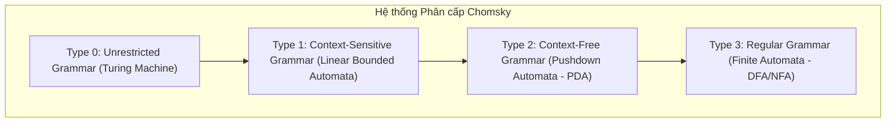

---

## 2. Chi tiết từng Keyword (Under-the-Hood Deep Dive)

---

### 1. Alphabet (Bảng chữ cái)

#### 1. Khái niệm bản chất (What & Why)
- **Định nghĩa**: Một tập hợp hữu hạn, không rỗng các ký hiệu cơ bản (Symbols / Characters). Ký hiệu chuẩn là $\Sigma$.
- **Ví dụ**:
  - Bảng chữ cái nhị phân: $\Sigma = \{0, 1\}$.
  - Bảng chữ cái ASCII: $\Sigma = \{0, 1, \dots, 127\}$.
  - Bảng chữ cái DNA: $\Sigma = \{A, C, G, T\}$.

#### 2. Cơ chế hoạt động sâu (Under the hood / Hardcore Internals)
- **Tầng Byte Encoding & Memory**:
  - Máy tính không lưu trữ ký tự trừu tượng mà mã hóa thành bit nhị phân. Ví dụ UTF-8 mã hóa ký tự từ 1 đến 4 bytes. Bảng chữ cái của ngôn ngữ máy chính là tập hợp 256 giá trị byte khả dĩ $[0x00, 0xFF]$.

#### 3. Sơ đồ minh họa
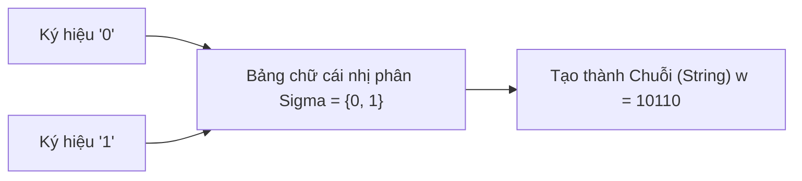

#### 4. Code ví dụ thực chiến (C++ Alphabet Domain Definition)
```cpp
#include <iostream>
#include <unordered_set>

class FormalAlphabet {
    std::unordered_set<char> symbols_;
public:
    FormalAlphabet(std::initializer_list<char> list) : symbols_(list) {}

    [[nodiscard]] bool contains(char c) const noexcept {
        return symbols_.contains(c);
    }
};

int main() {
    FormalAlphabet binary_alpha{'0', '1'};
    std::cout << "'0' valid? " << binary_alpha.contains('0') << "\n";
    std::cout << "'a' valid? " << binary_alpha.contains('a') << "\n";
    return 0;
}
```

#### 5. Ưu / Nhược điểm, Pitfalls & Anti-patterns
- **Pitfall**: Nhầm lẫn giữa bảng chữ cái vô hạn và hữu hạn. Trong lý thuyết tính toán chuẩn, $\Sigma$ **bắt buộc phải hữu hạn**.

#### 6. Ứng dụng thực tế trong Backend / Systems
- Định nghĩa Token Stream trong Lexer: Bảng chữ cái của Parser cấp cao không phải là các ký tự riêng lẻ mà là tập hợp các Tokens (`KEYWORD`, `IDENTIFIER`, `NUMBER`, `SEMICOLON`).

---

### 2. String (Chuỗi / Từ)

#### 1. Khái niệm bản chất (What & Why)
- **Định nghĩa**: Một dãy hữu hạn các ký hiệu được chọn từ bảng chữ cái $\Sigma$.
- **Ký hiệu**: $w = a_1 a_2 \dots a_n$ với $a_i \in \Sigma$.
  - Độ dài chuỗi $|w|$: Số lượng ký hiệu trong chuỗi.
  - Chuỗi rỗng: Ký hiệu là $\epsilon$ hoặc $\lambda$, với $|\epsilon| = 0$.
  - Tập hợp tất cả các chuỗi có thể tạo thành từ $\Sigma$: Ký hiệu là $\Sigma^*$ (Bao đóng Kleene).

#### 2. Cơ chế hoạt động sâu (Under the hood / Hardcore Internals)
- **Tầng Memory Layout**:
  - Trong C++ (`std::string`), một chuỗi thường áp dụng **SSO (Small String Optimization)**: Nếu chuỗi ngắn ($\le 15$ bytes), nó được lưu trữ trực tiếp trên Stack frame của struct mà không cần gọi `malloc` cấp phát bộ nhớ Heap.

#### 3. Sơ đồ minh họa
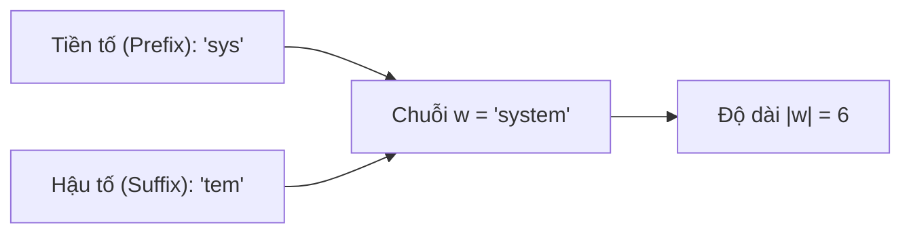

#### 4. Code ví dụ thực chiến (C++ String Operations in Theory of Computation)
```cpp
#include <iostream>
#include <string>

// Phép toán nối chuỗi (Concatenation) và lũy thừa chuỗi (w^k)
std::string repeat_string(const std::string& w, int k) {
    if (k == 0) return ""; // Epsilon string
    std::string result;
    result.reserve(w.size() * k);
    for (int i = 0; i < k; ++i) result += w;
    return result;
}

int main() {
    std::string w = "ab";
    std::cout << "w^3 = " << repeat_string(w, 3) << "\n"; // ababab
    return 0;
}
```

#### 5. Ưu / Nhược điểm, Pitfalls & Anti-patterns
- **Pitfall**: Sao chép chuỗi không cần thiết trong các vòng lặp sâu gây tiêu tốn bộ nhớ và kích hoạt CPU cache evictions. Nên dùng `std::string_view` trong C++20.

#### 6. Ứng dụng thực tế trong Backend / Systems
- Kỹ thuật String Interning trong JVM / V8 Engine: Lưu trữ duy nhất một bản copy của các chuỗi bất biến trong bộ nhớ nội bộ để tối ưu hóa phép so sánh con trỏ $O(1)$.

---

### 3. Language (Ngôn ngữ)

#### 1. Khái niệm bản chất (What & Why)
- **Định nghĩa**: Một tập hợp bất kỳ các chuỗi được tạo thành từ bảng chữ cái $\Sigma$. Nói cách khác, một ngôn ngữ $L$ là một tập con của $\Sigma^*$:
  $$L \subseteq \Sigma^*$$
- **Đặc điểm**: Ngôn ngữ có thể rỗng ($L = \emptyset$), hữu hạn ($L = \{"hello", "world"\}$), hoặc vô hạn ($L = \{a^n b^n \mid n \ge 0\}$).

#### 2. Cơ chế hoạt động sâu (Under the hood / Hardcore Internals)
- Mọi bài toán quyết định trong khoa học máy tính đều tương đương với việc xác định một chuỗi $w$ có thuộc về ngôn ngữ $L$ hay không:
  $$\text{Problem}(w) \equiv (w \in L)$$

#### 3. Sơ đồ minh họa
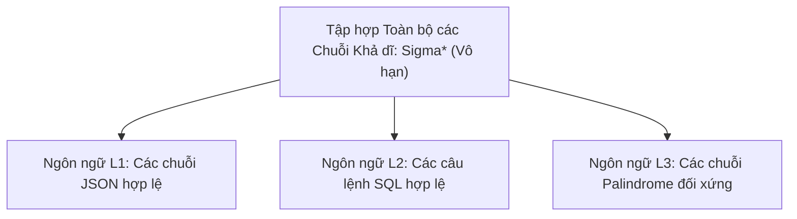

#### 4. Code ví dụ thực chiến (TypeScript Decision Function for Language Membership)
```typescript
// Ngôn ngữ L = { w in {a, b}* | w bắt đầu và kết thúc bằng 'a' }
function isInLanguage(w: string): boolean {
    if (w.length === 0) return false;
    return w.startsWith('a') && w.endsWith('a');
}

console.log("aba in L?", isInLanguage("aba")); // true
console.log("abb in L?", isInLanguage("abb")); // false
```

#### 5. Ưu / Nhược điểm, Pitfalls & Anti-patterns
- **Pitfall**: Nhầm lẫn giữa tập rỗng $\emptyset$ (ngôn ngữ không có chuỗi nào) và tập chứa chuỗi rỗng $\{\epsilon\}$ (ngôn ngữ có đúng 1 chuỗi có độ dài bằng 0).

#### 6. Ứng dụng thực tế trong Backend / Systems
- Compiler Frontend Validation: Mã nguồn C++ hoặc TypeScript hợp lệ là một chuỗi $w$ thuộc về ngôn ngữ $L_{\text{grammar}}$ được chấp nhận bởi trình biên dịch.

---

### 4. Grammar / Formal Grammar (Văn phạm Hình thức)

#### 1. Khái niệm bản chất (What & Why)
- **Định nghĩa**: Một cấu trúc toán học 4 thành phần định nghĩa cú pháp và quy tắc sinh (Generative Rules) cho một ngôn ngữ:
  $$G = (V, \Sigma, R, S)$$
  Trong đó:
  - $V$: Tập hữu hạn các ký hiệu biến (Non-terminals / Variables).
  - $\Sigma$: Tập hữu hạn các ký hiệu kết thúc (Terminals), với $V \cap \Sigma = \emptyset$.
  - $R$: Tập các quy tắc sinh (Production Rules) có dạng $\alpha \to \beta$.
  - $S \in V$: Biến bắt đầu (Start symbol).

#### 2. Cơ chế hoạt động sâu (Under the hood / Hardcore Internals)
- Văn phạm hoạt động theo cơ chế **Sinh (Generative Mechanism)**: Bắt đầu từ biến $S$, liên tục thay thế vế trái $\alpha$ bằng vế phải $\beta$ cho đến khi chuỗi chỉ còn chứa toàn các ký hiệu kết thúc $\Sigma$. Ngôn ngữ sinh bởi văn phạm $G$ được ký hiệu là $L(G)$.

#### 3. Sơ đồ minh họa
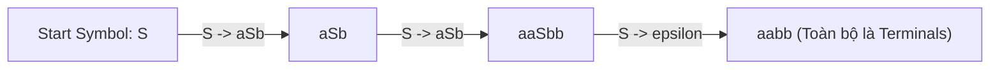

#### 4. Code ví dụ thực chiến (C++ Mô phỏng Hệ thống Sản xuất Quy tắc Sinh)
```cpp
#include <iostream>
#include <string>
#include <vector>

// Văn phạm sinh các chuỗi đối xứng a^n b^n:
// S -> a S b | epsilon
std::string derive_an_bn(int n) {
    std::string s = "S";
    for (int i = 0; i < n; ++i) {
        // Thay thế S -> aSb
        auto pos = s.find('S');
        s.replace(pos, 1, "aSb");
    }
    // Thay thế S -> epsilon
    auto pos = s.find('S');
    s.erase(pos, 1);
    return s;
}

int main() {
    std::cout << "Generated (n = 3): " << derive_an_bn(3) << "\n"; // aaabbb
    return 0;
}
```

#### 5. Ưu / Nhược điểm, Pitfalls & Anti-patterns
- **Pitfall**: Đặt các quy tắc sinh tạo vòng lặp vô hạn không bao giờ chạm tới Terminals, khiến văn phạm không thể sinh ra bất kỳ chuỗi hữu hạn nào.

#### 6. Ứng dụng thực tế trong Backend / Systems
- BNF (Backus-Naur Form): Định dạng văn phạm chuẩn để đặc tả cú pháp ngôn ngữ lập trình, tài liệu RFC và giao thức mạng.

---

### 5. Chomsky Hierarchy (Hệ thống Phân cấp Chomsky)

#### 1. Khái niệm bản chất (What & Why)
- **Định nghĩa**: Hệ thống phân loại toán học do Noam Chomsky đề xuất, phân chia các văn phạm hình thức thành 4 cấp bậc bao hàm nhau dựa trên dạng ràng buộc của các quy tắc sản xuất $R$.
- **Ý nghĩa**: Xác lập mối quan hệ tương đương tuyệt đối giữa cấu trúc ngữ pháp ngôn ngữ và sức mạnh tính toán của cỗ máy phần cứng tương ứng.

#### 2. Cơ chế hoạt động sâu (Under the hood / Hardcore Internals)
- Hệ thống phân cấp thể hiện sự đánh đổi giữa **Khả năng biểu đạt (Expressive Power)** và **Chi phí tính toán (Computational Complexity)**:
  - Càng lên cao (Type 0, Type 1): Ngôn ngữ càng biểu đạt được nhiều bài toán phức tạp nhưng thuật toán kiểm tra cú pháp (Parsing) càng chậm hoặc thậm chí không thể quyết định được (Undecidable).
  - Càng xuống thấp (Type 2, Type 3): Ngôn ngữ bị giới hạn nhưng thuật toán kiểm tra cực kỳ nhanh ($\mathcal{O}(n)$ với Type 3, $\mathcal{O}(n^3)$ hoặc $\mathcal{O}(n)$ với Type 2).

#### 3. Sơ đồ minh họa
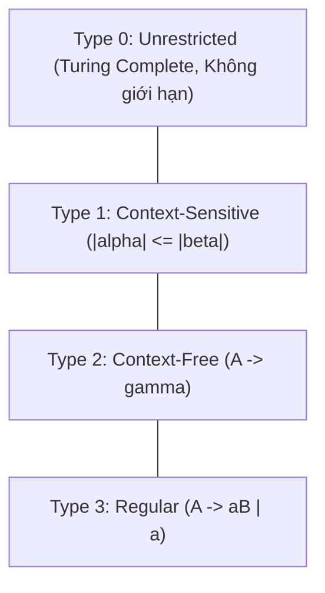

#### 4. Code ví dụ thực chiến (Phân cấp trong Trình biên dịch)
```cpp
// Minh họa sự phân tầng trong Compiler:
// 1. Lexer dùng Type 3 (Regular Grammar) -> Nhận diện Token trong O(n)
// 2. Parser dùng Type 2 (Context-Free Grammar) -> Xây dựng Cây cú pháp AST trong O(n)
// 3. Semantic Analysis dùng Type 1 (Context-Sensitive) -> Kiểm tra kiểu biến và khai báo trước khi dùng
```

#### 5. Ưu / Nhược điểm, Pitfalls & Anti-patterns
- **Pitfall**: Cố gắng dùng Context-Free Grammar để kiểm tra xem một biến đã được khai báo trước khi sử dụng hay chưa. Ràng buộc đó mang tính nhạy ngữ cảnh (Context-Sensitive), không thể giải quyết thuần túy ở tầng CFG Parser!

#### 6. Ứng dụng thực tế trong Backend / Systems
- Kiến trúc Trình biên dịch hiện đại (Clang/LLVM, Rustc, V8): Phân chia rõ ràng các phase biên dịch theo đúng các bậc của phân cấp Chomsky để đạt hiệu năng tối đa.

---

### 6. Regular Grammar (Văn phạm Chính quy - Type 3)

#### 1. Khái niệm bản chất (What & Why)
- **Định nghĩa**: Văn phạm có quy tắc sản xuất bị giới hạn nghiêm ngặt nhất. Phân thành 2 loại:
  - **Right-linear Grammar**: Mọi quy tắc có dạng $A \to aB$ hoặc $A \to a$ hoặc $A \to \epsilon$.
  - **Left-linear Grammar**: Mọi quy tắc có dạng $A \to Ba$ hoặc $A \to a$ hoặc $A \to \epsilon$.
  (Trong đó $A, B \in V$ và $a \in \Sigma$).

#### 2. Cơ chế hoạt động sâu (Under the hood / Hardcore Internals)
- Văn phạm chính quy tương đương 1-1 với Otomat Hữu hạn (DFA/NFA): Mỗi Non-terminal $A$ tương ứng với một trạng thái của Otomat, và quy tắc $A \to aB$ tương ứng với bước chuyển dịch $\delta(A, a) = B$.

#### 3. Sơ đồ minh họa
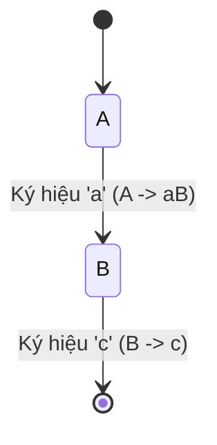

#### 4. Code ví dụ thực chiến (C++ Ánh xạ Văn phạm Type 3 sang NFA)
```cpp
#include <iostream>
#include <string_view>

// Văn phạm sinh chuỗi kết thúc bằng 'b':
// S -> aS | bS | b
bool match_type3_grammar(std::string_view w) noexcept {
    if (w.empty()) return false;
    for (char c : w) {
        if (c != 'a' && c != 'b') return false;
    }
    return w.back() == 'b';
}

int main() {
    std::cout << "aab: " << match_type3_grammar("aab") << "\n"; // 1
    std::cout << "aaba: " << match_type3_grammar("aaba") << "\n"; // 0
    return 0;
}
```

#### 5. Ưu / Nhược điểm, Pitfalls & Anti-patterns
- **Pitfall**: Trộn lẫn Right-linear và Left-linear trong cùng một văn phạm (ví dụ vừa có $A \to aB$ vừa có $B \to Ca$), điều này sẽ làm văn phạm mất tính chính quy và nhảy lên Type 2!

#### 6. Ứng dụng thực tế trong Backend / Systems
- Lexical Analyzers: Các trình quét mã nguồn (Scanners) sinh mã tự động nhận diện từ khóa, toán tử và số thực hoàn toàn dựa trên Type 3 Regular Grammars.

---

### 7. Context-Free Grammar - CFG (Văn phạm Phi ngữ cảnh - Type 2)

#### 1. Khái niệm bản chất (What & Why)
- **Định nghĩa**: Văn phạm mà vế trái của mọi quy tắc sinh bắt buộc phải là **duy nhất một ký hiệu biến đơn lẻ** ($A \in V$), còn vế phải là một chuỗi ký hiệu bất kỳ ($\gamma \in (V \cup \Sigma)^*$):
  $$A \to \gamma$$
- **Tại sao gọi là Phi ngữ cảnh**: Biến $A$ có thể được thay thế bằng chuỗi $\gamma$ ở bất kỳ vị trí nào mà không phụ thuộc vào các ký hiệu xung quanh nó (không cần quan tâm ngữ cảnh đứng trước hay đứng sau).

#### 2. Cơ chế hoạt động sâu (Under the hood / Hardcore Internals)
- CFG có khả năng diễn đạt cấu trúc đệ quy và lồng nhau vô hạn (Nested Structures), tiêu biểu là cặp dấu ngoặc đóng mở cân bằng, cấu trúc khối lệnh `if ... else`, khối hàm trong lập trình.
- Cỗ máy nhận diện CFG là **Otomat Đẩy Xuống (Pushdown Automaton - PDA)** sử dụng bộ nhớ Stack ngoài.

#### 3. Sơ đồ minh họa
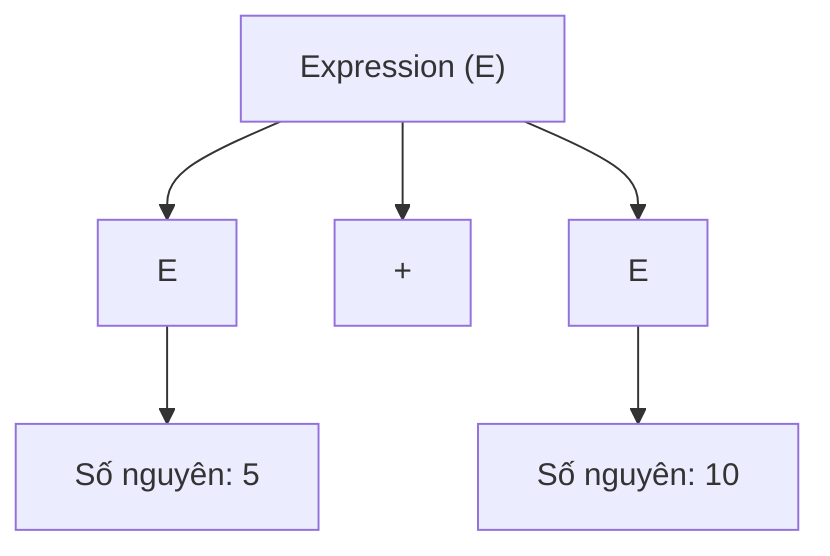

#### 4. Code ví dụ thực chiến (TypeScript Recursive Descent Parser cho CFG Số học)
```typescript
// CFG:
// Expr   -> Term (('+' | '-') Term)*
// Term   -> Factor (('*' | '/') Factor)*
// Factor -> NUMBER | '(' Expr ')'

class ArithmeticParser {
    private pos = 0;
    constructor(private src: string) {}

    private peek(): string { return this.src[this.pos] || ''; }
    private get(): string { return this.src[this.pos++] || ''; }

    public parseExpr(): number {
        let val = this.parseTerm();
        while (this.peek() === '+' || this.peek() === '-') {
            const op = this.get();
            const nextVal = this.parseTerm();
            val = (op === '+') ? val + nextVal : val - nextVal;
        }
        return val;
    }

    private parseTerm(): number {
        let val = this.parseFactor();
        while (this.peek() === '*' || this.peek() === '/') {
            const op = this.get();
            const nextVal = this.parseFactor();
            val = (op === '*') ? val * nextVal : val / nextVal;
        }
        return val;
    }

    private parseFactor(): number {
        if (this.peek() === '(') {
            this.get(); // consume '('
            const val = this.parseExpr();
            this.get(); // consume ')'
            return val;
        }
        let numStr = '';
        while (/\d/.test(this.peek())) numStr += this.get();
        return parseInt(numStr, 10);
    }
}

const parser = new ArithmeticParser("3+(4*5)");
console.log("Evaluated AST Result:", parser.parseExpr()); // 23
```

#### 5. Ưu / Nhược điểm, Pitfalls & Anti-patterns
- **Ưu điểm**: Cân bằng hoàn hảo giữa sức mạnh cú pháp và chi phí phân tích (Parsing trong $\mathcal{O}(n)$ với LL(k)/LR(k) grammars).

#### 6. Ứng dụng thực tế trong Backend / Systems
- Bộ phân tích cú pháp JSON / YAML / XML và SQL Query Parsers đều được xây dựng dựa trên Context-Free Grammars.

---

### 8. Context-Sensitive Grammar - CSG (Văn phạm Nhạy ngữ cảnh - Type 1)

#### 1. Khái niệm bản chất (What & Why)
- **Định nghĩa**: Văn phạm có quy tắc sản xuất dạng:
  $$\alpha A \beta \to \alpha \gamma \beta$$
  Trong đó $A \in V$, $\gamma \in (V \cup \Sigma)^+$ (chuỗi không rỗng), và $\alpha, \beta \in (V \cup \Sigma)^*$.
- **Ý nghĩa**: Biến $A$ chỉ được phép thay thế bằng chuỗi $\gamma$ khi và chỉ khi nó xuất hiện trong ngữ cảnh có $\alpha$ đứng ngay trước và $\beta$ đứng ngay sau.
- **Ràng buộc độ dài không suy giảm**: $|\alpha A \beta| \le |\alpha \gamma \beta|$ (Vế phải luôn dài hơn hoặc bằng vế trái).

#### 2. Cơ chế hoạt động sâu (Under the hood / Hardcore Internals)
- Cỗ máy nhận diện CSG là **Linear Bounded Automaton (LBA)** — một máy Turing bị giới hạn bộ nhớ băng ghi đúng bằng độ dài của chuỗi đầu vào $n$.
- Bài toán kinh điển giải được bởi CSG mà CFG bất lực: $L = \{a^n b^n c^n \mid n \ge 1\}$.

#### 3. Sơ đồ minh họa
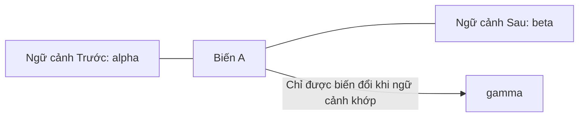

#### 4. Code ví dụ thực chiến (C++ Phân tích Ngữ cảnh Semantic Check)
```cpp
#include <iostream>
#include <string>
#include <unordered_set>

// Minh họa kiểm tra ngữ cảnh: Một biến phải được khai báo Type trước khi gán giá trị
class SemanticContextChecker {
    std::unordered_set<std::string> symbol_table_;

public:
    void declare_variable(const std::string& var_name) {
        symbol_table_.insert(var_name);
    }

    // Quy tắc nhạy ngữ cảnh: Gán giá trị chỉ hợp lệ nếu var_name đã tồn tại trong bảng ký hiệu
    bool validate_assignment(const std::string& var_name) {
        return symbol_table_.contains(var_name);
    }
};

int main() {
    SemanticContextChecker checker;
    checker.declare_variable("total_requests");
    std::cout << "Valid assignment: " << checker.validate_assignment("total_requests") << "\n"; // 1
    std::cout << "Invalid assignment: " << checker.validate_assignment("undefined_var") << "\n"; // 0
    return 0;
}
```

#### 5. Ưu / Nhược điểm, Pitfalls & Anti-patterns
- **Nhược điểm**: Độ phức tạp giải thuật để parse một ngôn ngữ Type 1 tổng quát là **PSPACE-complete**, quá chậm để có thể ứng dụng trong parser của trình biên dịch thời gian thực.

#### 6. Ứng dụng thực tế trong Backend / Systems
- Ngôn ngữ tự nhiên (Natural Language Processing): Cấu trúc ngữ pháp tiếng người phụ thuộc chặt chẽ vào ngữ cảnh của câu.

---

### 9. Unrestricted Grammar (Văn phạm Không hạn chế - Type 0)

#### 1. Khái niệm bản chất (What & Why)
- **Định nghĩa**: Văn phạm không áp đặt bất kỳ một hạn chế nào lên các quy tắc sản xuất, ngoại trừ việc vế trái không được là chuỗi rỗng:
  $$\alpha \to \beta \quad \text{với } \alpha \in (V \cup \Sigma)^+, \beta \in (V \cup \Sigma)^*$$
- **Khả năng tương đương**: Sinh ra chính xác lớp **Ngôn ngữ Đệ quy Đếm được (Recursively Enumerable Languages)**, tương đương 100% với sức mạnh của **Máy Turing**.

#### 2. Cơ chế hoạt động sâu (Under the hood / Hardcore Internals)
- Văn phạm Type 0 có thể mô phỏng lại bất kỳ chương trình máy tính nào (C++, Python, Java). Do đạt Turing Completeness, bài toán quyết định một chuỗi $w$ có được sinh ra bởi một văn phạm Type 0 hay không là bài toán **Undecidable** (Không thể quyết định được - tương đương Halting Problem).

#### 3. Sơ đồ minh họa
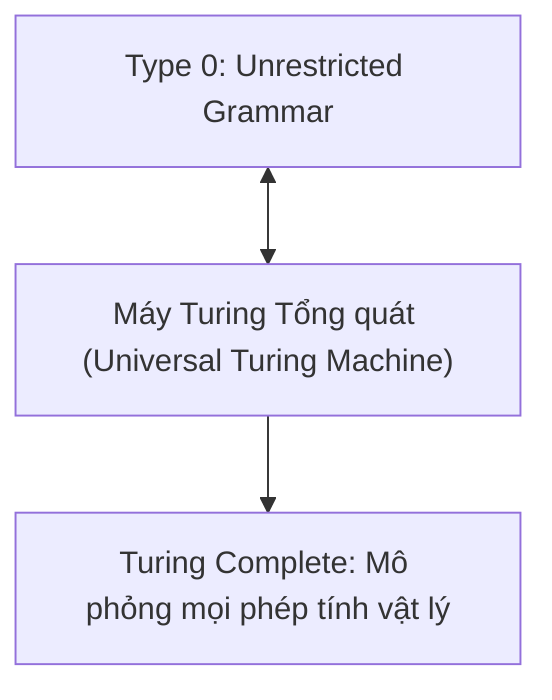

#### 4. Code ví dụ thực chiến (C++ Turing Complete Simulation)
```cpp
// Bất kỳ đoạn mã C++ nào với vòng lặp vô hạn và bộ nhớ động đều là hiện thân của Type 0.
```

#### 5. Ưu / Nhược điểm, Pitfalls & Anti-patterns
- **Pitfall**: Cố gắng viết parser tự động cho một văn phạm Type 0 tùy ý, chương trình phân tích có thể rơi vào vòng lặp vô hạn và không bao giờ trả về kết quả.

#### 6. Ứng dụng thực tế trong Backend / Systems
- Hệ thống thực thi mã động (Dynamic Code Execution Engines / WebAssembly Runtimes).

---

### 10. Parse Tree (Cây Phân tích Cú pháp)

#### 1. Khái niệm bản chất (What & Why)
- **Định nghĩa**: Một biểu diễn đồ họa dạng cây có thứ bậc minh họa trực quan cách một chuỗi ký hiệu kết thúc được sinh ra từ biến bắt đầu $S$ của văn phạm.
- **Quy tắc cấu trúc**:
  - Gốc của cây: Biến bắt đầu $S$.
  - Các nút nội tại (Internal Nodes): Các ký hiệu biến (Non-terminals).
  - Các nút lá (Leaves): Các ký hiệu kết thúc (Terminals) hoặc $\epsilon$, khi đọc từ trái sang phải tạo thành chính xác chuỗi đầu vào.

#### 2. Cơ chế hoạt động sâu (Under the hood / Hardcore Internals)
- **Concrete Syntax Tree (CST) vs Abstract Syntax Tree (AST)**:
  - Parse Tree (CST) chứa toàn bộ các chi tiết cú pháp bao gồm dấu chấm phẩy, dấu ngoặc đơn, từ khóa.
  - Trình biên dịch sau đó rút gọn Parse Tree thành **AST** (loại bỏ nhiễu cú pháp không cần thiết, chỉ giữ lại cấu trúc logic toán học) để tối ưu hóa bộ nhớ và chuyển đổi sang Intermediate Representation (IR).

#### 3. Sơ đồ minh họa
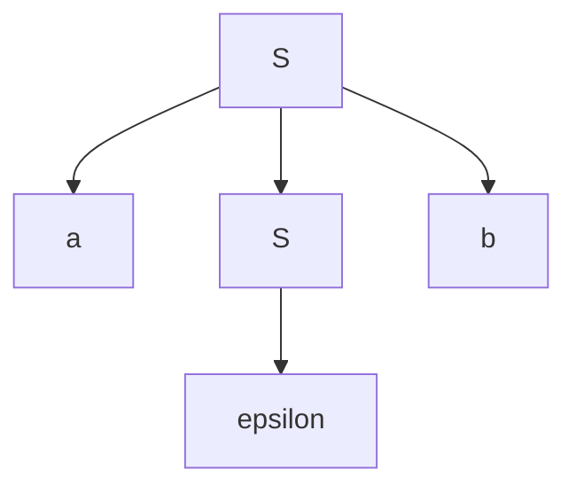

#### 4. Code ví dụ thực chiến (C++ Cấu trúc Node Cây Phân tích Cú pháp AST)
```cpp
#include <iostream>
#include <memory>
#include <string>

struct ASTNode {
    std::string op_or_val;
    std::unique_ptr<ASTNode> left;
    std::unique_ptr<ASTNode> right;

    explicit ASTNode(std::string val) : op_or_val(std::move(val)) {}
};

int evaluate(const ASTNode* root) {
    if (!root) return 0;
    if (!root->left && !root->right) {
        return std::stoi(root->op_or_val); // Leaf node
    }
    int l = evaluate(root->left.get());
    int r = evaluate(root->right.get());
    if (root->op_or_val == "+") return l + r;
    if (root->op_or_val == "*") return l * r;
    return 0;
}

int main() {
    // Biểu thức: (2 * 3) + 4
    auto root = std::make_unique<ASTNode>("+");
    root->left = std::make_unique<ASTNode>("*");
    root->left->left = std::make_unique<ASTNode>("2");
    root->left->right = std::make_unique<ASTNode>("3");
    root->right = std::make_unique<ASTNode>("4");

    std::cout << "Evaluated Result: " << evaluate(root.get()) << "\n"; // 10
    return 0;
}
```

#### 5. Ưu / Nhược điểm, Pitfalls & Anti-patterns
- **Pitfall**: Lưu giữ CST quá lớn trong RAM đối với các file mã nguồn hàng trăm nghìn dòng, làm tràn bộ nhớ của Language Server Protocol (LSP).

#### 6. Ứng dụng thực tế trong Backend / Systems
- Công cụ chuyển mã (Transpilers như Babel, SWC, TypeScript Compiler): Duyệt cây AST để biến đổi cú pháp hiện đại về chuẩn ECMAScript tương thích cũ.

---

### 11. Derivation (Sự Dẫn xuất)

#### 1. Khái niệm bản chất (What & Why)
- **Định nghĩa**: Dãy các bước biến đổi liên tiếp áp dụng các quy tắc sinh để đi từ biến bắt đầu $S$ tới chuỗi kết thúc:
  $$S \Rightarrow \alpha_1 \Rightarrow \alpha_2 \Rightarrow \dots \Rightarrow w$$
- **Phân loại**:
  - **Leftmost Derivation (Dẫn xuất Trái nhất)**: Tại mỗi bước, Non-terminal nằm ở vị trí tận cùng bên trái luôn được chọn để thay thế trước.
  - **Rightmost Derivation (Dẫn xuất Phải nhất / Canonical Derivation)**: Tại mỗi bước, Non-terminal nằm ở vị trí tận cùng bên phải luôn được chọn để thay thế trước.

#### 2. Cơ chế hoạt động sâu (Under the hood / Hardcore Internals)
- **Top-Down Parsing (LL Parser)**: Tương ứng với việc xây dựng Leftmost Derivation.
- **Bottom-Up Parsing (LR / Shift-Reduce Parser)**: Tương ứng với việc đảo ngược của Rightmost Derivation (Reverse Rightmost Derivation).

#### 3. Sơ đồ minh họa
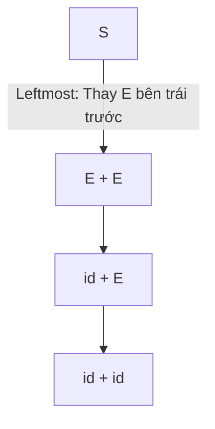

#### 4. Code ví dụ thực chiến (C++ Trình diễn Leftmost Derivation)
```cpp
#include <iostream>
#include <vector>
#include <string>

// Trace log các bước dẫn xuất trái nhất: S => aAB => aaB => aab
void trace_derivation() {
    std::vector<std::string> steps = {
        "S",
        "a A B   (via S -> aAB)",
        "a a B   (via A -> a, thay thế biến bên trái nhất)",
        "a a b   (via B -> b, thay thế biến tiếp theo)"
    };
    for (const auto& step : steps) {
        std::cout << "=> " << step << "\n";
    }
}

int main() {
    trace_derivation();
    return 0;
}
```

#### 5. Ưu / Nhược điểm, Pitfalls & Anti-patterns
- **Pitfall**: Tồn tại nhiều cách dẫn xuất khác nhau cho cùng một chuỗi không có nghĩa là văn phạm bị mơ hồ, nếu chúng cùng tạo ra một Parse Tree duy nhất. Mơ hồ chỉ xảy ra khi tồn tại hai Parse Tree khác biệt cấu trúc.

#### 6. Ứng dụng thực tế trong Backend / Systems
- Trình tạo Parser Yacc / Bison: Sử dụng LALR(1) dựa trên Rightmost Derivation để phân tích ngữ pháp SQL và shell bash.

---

### 12. Ambiguity (Tính Mơ hồ / Đa nghĩa của Văn phạm)

#### 1. Khái niệm bản chất (What & Why)
- **Định nghĩa**: Một văn phạm phi ngữ cảnh (CFG) được gọi là **Mơ hồ (Ambiguous)** nếu tồn tại ít nhất một chuỗi $w \in L(G)$ có thể sinh ra **từ hai Parse Tree cấu trúc khác nhau** (hoặc tương đương: có từ hai Leftmost Derivations khác nhau).
- **Tại sao nguy hiểm**: Máy tính không thể biết phải thực thi chuỗi đó theo ngữ nghĩa nào, dẫn đến sai lệch kết quả tính toán hoặc lỗ hổng bảo mật cú pháp.

#### 2. Cơ chế hoạt động sâu (Under the hood / Hardcore Internals)
- **Bài toán Dangling Else kinh điển**:
  Xét văn phạm:
  $$S \to \text{if } C \text{ then } S \mid \text{if } C \text{ then } S \text{ else } S$$
  Với câu lệnh: `if C1 then if C2 then S1 else S2`.
  Trình biên dịch không biết nhánh `else S2` thuộc về `if C1` hay `if C2`!
  - Khắc phục: Ép luật ưu tiên (Precedence/Associativity) gắn `else` với `if` gần nhất, hoặc thiết kế lại ngữ pháp không mơ hồ.

#### 3. Sơ đồ minh họa
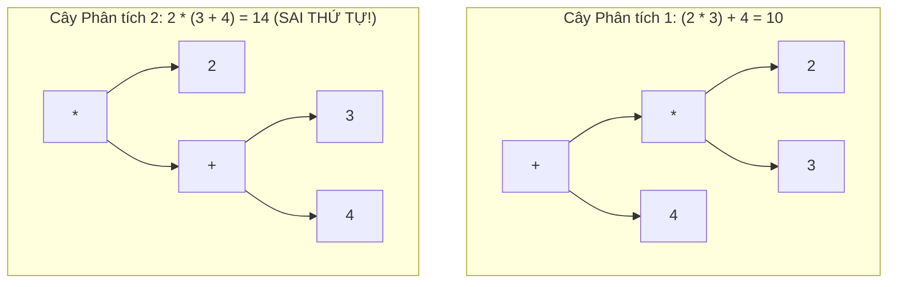

#### 4. Code ví dụ thực chiến (C++ Khử Mơ hồ bằng Cấu trúc Phân tầng Ưu tiên)
```cpp
/*
VĂN PHẠM MƠ HỒ:
E -> E + E | E * E | id

VĂN PHẠM KHỬ MƠ HỒ (Đảm bảo * có độ ưu tiên cao hơn +, kết hợp từ trái sang phải):
E -> E + T | T
T -> T * F | F
F -> id | ( E )
*/
```

#### 5. Ưu / Nhược điểm, Pitfalls & Anti-patterns
- **Định lý Bất khả quyết (Undecidability of Ambiguity)**: Không tồn tại bất kỳ thuật toán tổng quát nào có thể kiểm tra một CFG tùy ý có bị mơ hồ hay không! Kỹ sư phải tự thiết kế văn phạm cẩn thận theo chuẩn LL(k) hoặc LR(k).

#### 6. Ứng dụng thực tế trong Backend / Systems
- Thiết kế đặc tả ngôn ngữ Go và Rust: Cú pháp ngôn ngữ Go và Rust được thiết kế bắt buộc phải có dấu ngoặc nhọn `{}` trong khối `if` để triệt tiêu hoàn toàn bài toán Dangling Else Ambiguity ngay từ cấp độ ngữ pháp.
