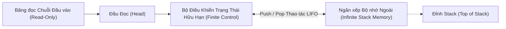
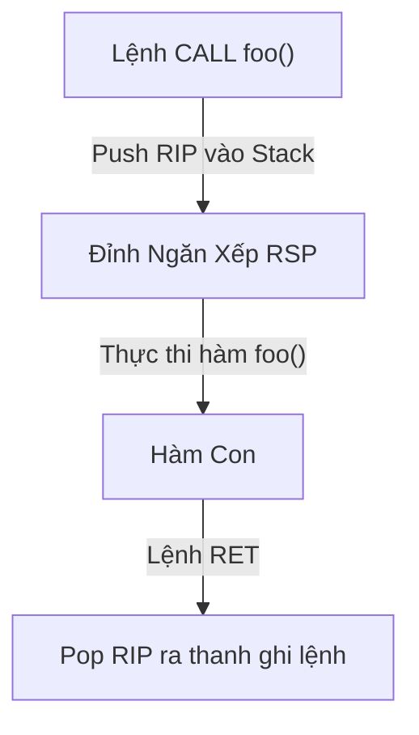
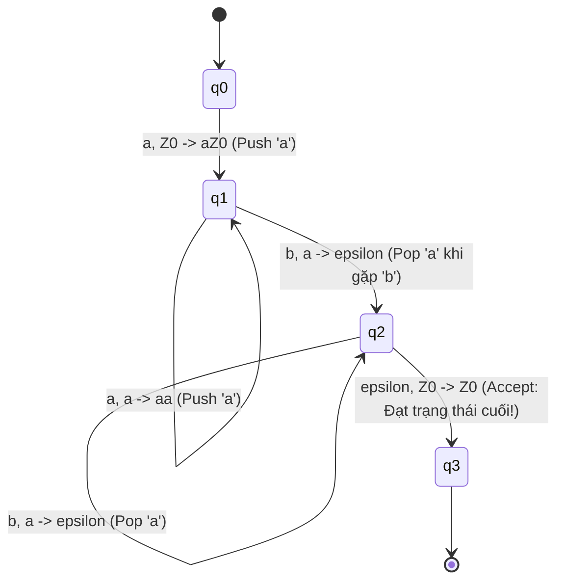
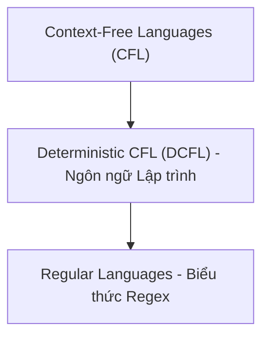
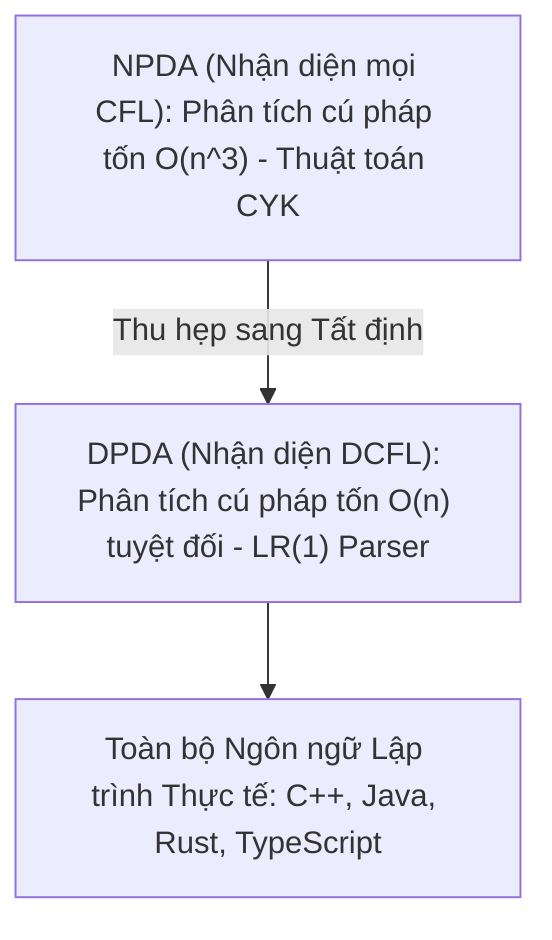
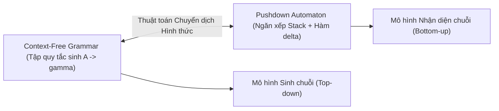

# 4.3. Pushdown Automata (Otomat Đẩy Xuống và Ngôn ngữ Phi ngữ cảnh)

## Tổng quan về Otomat Đẩy Xuống (PDA)
Otomat Đẩy Xuống (Pushdown Automaton - PDA) là mô hình tính toán hình thức mở rộng từ Otomat Hữu hạn (Finite Automaton) bằng cách bổ sung một cấu trúc bộ nhớ ngoài không giới hạn hoạt động theo cơ chế **Ngăn xếp (Stack - LIFO: Last In First Out)**.

Sự bổ sung ngăn xếp cho phép PDA "đếm" và "ghi nhớ" các ký hiệu không giới hạn về số lượng (miễn là tuân theo thứ tự ngược lại), giúp nó nhận diện được các cấu trúc đối xứng, ngoặc lồng nhau mà DFA/NFA hoàn toàn bất lực.

Định nghĩa toán học của một Pushdown Automaton là một bộ 7 (7-tuple):
$$M = (Q, \Sigma, \Gamma, \delta, q_0, Z_0, F)$$
Trong đó:
- $Q$: Tập hữu hạn các trạng thái nội tại.
- $\Sigma$: Bảng chữ cái đầu vào (Input Alphabet).
- $\Gamma$: Bảng chữ cái ngăn xếp (Stack Alphabet - các ký hiệu được phép lưu trong Stack).
- $\delta: Q \times (\Sigma \cup \{\epsilon\}) \times \Gamma \to \mathcal{P}_{\text{finite}}(Q \times \Gamma^*)$: Hàm chuyển dịch trạng thái.
- $q_0 \in Q$: Trạng thái bắt đầu.
- $Z_0 \in \Gamma$: Ký hiệu đáy ngăn xếp ban đầu (Initial stack symbol).
- $F \subseteq Q$: Tập các trạng thái chấp nhận (Final / Accepting states).



---

## 2. Chi tiết từng Keyword (Under-the-Hood Deep Dive)

---

### 1. Stack Automata (Otomat Ngăn xếp Tổng quát)

#### 1. Khái niệm bản chất (What & Why)
- **Định nghĩa**: Một lớp mở rộng của các cỗ máy tính toán sử dụng ngăn xếp làm bộ nhớ phụ trợ. 
- Trong lý thuyết máy tính nâng cao, Stack Automata tổng quát có thể cho phép đầu đọc ngăn xếp đi sâu vào bên trong stack để đọc dữ liệu (Read-only Stack Traversal), nhưng chỉ được phép thêm (Push) hoặc bớt (Pop) tại đỉnh stack.
- Nếu chỉ được phép đọc và thao tác tại đỉnh stack, cỗ máy được gọi là **Pushdown Automaton (PDA)** chuẩn.

#### 2. Cơ chế hoạt động sâu (Under the hood / Hardcore Internals)
- **Phần cứng Call Stack của CPU**:
  - Kiến trúc CPU máy tính thực tế (x86-64, ARM64) quản lý luồng thực thi chương trình dựa trên chính mô hình Otomat Ngăn xếp: Con trỏ ngăn xếp `RSP` trỏ tới đỉnh Stack trong bộ nhớ RAM. Các lệnh `CALL` đẩy địa chỉ quay về vào stack (Push), và lệnh `RET` rút địa chỉ ra (Pop) để chuyển quyền điều khiển.

#### 3. Sơ đồ minh họa


#### 4. Code ví dụ thực chiến (C++ CPU Stack Frame Simulation)
```cpp
#include <iostream>
#include <vector>
#include <cstdint>

// Mô phỏng Stack Automata của CPU
class VirtualCallStack {
    std::vector<uint64_t> stack_;

public:
    void call_instruction(uint64_t return_address) {
        stack_.push_back(return_address); // PUSH RIP
    }

    uint64_t ret_instruction() {
        if (stack_.empty()) throw std::runtime_error("Stack Underflow");
        uint64_t ret_addr = stack_.back();
        stack_.pop_back(); // POP RIP
        return ret_addr;
    }

    [[nodiscard]] std::size_t depth() const noexcept { return stack_.size(); }
};

int main() {
    VirtualCallStack cpu_stack;
    cpu_stack.call_instruction(0x00401050);
    cpu_stack.call_instruction(0x00401120);
    std::cout << "Returning to: 0x" << std::hex << cpu_stack.ret_instruction() << "\n"; // 0x401120
    return 0;
}
```

#### 5. Ưu / Nhược điểm, Pitfalls & Anti-patterns
- **Pitfall**: Đệ quy quá sâu vượt quá kích thước phân bổ cố định của OS Stack (mặc định 8MB trên Linux) dẫn đến lỗi `SIGSEGV` (Stack Overflow).

#### 6. Ứng dụng thực tế trong Backend / Systems
- Bytecode Virtual Machines (như JVM, Python VM, WebAssembly Wasm): Sử dụng kiến trúc Stack-based Architecture để thực thi các chỉ thị `iadd`, `isub`, `iload`.

---

### 2. Pushdown Automaton - PDA (Otomat Đẩy Xuống)

#### 1. Khái niệm bản chất (What & Why)
- **Định nghĩa**: Một Otomat hữu hạn được trang bị một ngăn xếp (Stack) duy nhất với các thao tác đọc và sửa đổi chỉ diễn ra tại **đỉnh ngăn xếp (Top of Stack)**.
- **Hành vi chuyển dịch**:
  $$\delta(q, a, X) = \{(p, \gamma)\}$$
  Nghĩa là: Khi đang ở trạng thái $q$, đọc ký hiệu đầu vào $a$ (hoặc $\epsilon$), và ký hiệu trên đỉnh stack là $X$, cỗ máy chuyển sang trạng thái $p$, đồng thời thay thế $X$ trên đỉnh stack bằng chuỗi ký hiệu $\gamma \in \Gamma^*$:
  - Nếu $\gamma = \epsilon$: Thao tác **POP** (Xóa $X$ khỏi stack).
  - Nếu $\gamma = X$: Giữ nguyên stack (**No-op**).
  - Nếu $\gamma = YX$: Thao tác **PUSH** ký hiệu $Y$ lên trên $X$.

#### 2. Cơ chế hoạt động sâu (Under the hood / Hardcore Internals)
- **Hai cơ chế chấp nhận chuỗi**:
  1. **Chấp nhận bằng Trạng thái Kết thúc (Acceptance by Final State)**: Khi đọc hết chuỗi đầu vào, PDA dừng tại một trạng thái thuộc $F$ (bất kể stack còn gì hay không).
  2. **Chấp nhận bằng Ngăn xếp Rỗng (Acceptance by Empty Stack)**: Khi đọc hết chuỗi đầu vào, ngăn xếp bị xóa sạch hoàn toàn (Stack rỗng, bất kể đang ở trạng thái nào).
  - Định lý: Hai cơ chế chấp nhận này là **hoàn toàn tương đương** về mặt sức mạnh tính toán.

#### 3. Sơ đồ minh họa


#### 4. Code ví dụ thực chiến (C++ PDA Nhận diện Ngôn ngữ Cân bằng $L = \{a^n b^n \mid n \ge 1\}$)
```cpp
#include <iostream>
#include <vector>
#include <string_view>

class PushdownAutomatonAnBn {
public:
    static bool accepts(std::string_view w) {
        std::vector<char> stack;
        stack.push_back('Z'); // Ký hiệu đáy ngăn xếp Z0
        int state = 0; // q0: Trạng thái đọc 'a', q1: Trạng thái đọc 'b', q2: Kết thúc

        for (char c : w) {
            if (state == 0) {
                if (c == 'a') {
                    stack.push_back('a'); // Push 'a'
                } else if (c == 'b') {
                    // Chuyển sang pha đọc 'b' và Pop 'a'
                    if (stack.empty() || stack.back() != 'a') return false;
                    stack.pop_back();
                    state = 1;
                } else {
                    return false;
                }
            } else if (state == 1) {
                if (c == 'b') {
                    if (stack.empty() || stack.back() != 'a') return false;
                    stack.pop_back(); // Tiếp tục Pop 'a'
                } else {
                    return false; // Không được phép có 'a' sau 'b'
                }
            }
        }

        // Chấp nhận nếu đã ở state 1 và stack chỉ còn lại đúng đáy Z
        return state == 1 && stack.size() == 1 && stack.back() == 'Z';
    }
};

int main() {
    std::cout << "aaabbb: " << (PushdownAutomatonAnBn::accepts("aaabbb") ? "Valid" : "Invalid") << "\n"; // Valid
    std::cout << "aabbb:  " << (PushdownAutomatonAnBn::accepts("aabbb") ? "Valid" : "Invalid") << "\n"; // Invalid
    return 0;
}
```

#### 5. Ưu / Nhược điểm, Pitfalls & Anti-patterns
- **Giới hạn cấu trúc**: PDA chỉ có thể đối chiếu hai yếu tố đối xứng ngược ($a^n b^n$). Nếu có 3 yếu tố ($a^n b^n c^n$), một stack đơn lẻ không thể vừa kiểm tra $a-b$ vừa giữ lại thông tin cho $c$. Để nhận diện $a^n b^n c^n$, cần **2 ngăn xếp** (2-Stack PDA tương đương Máy Turing!).

#### 6. Ứng dụng thực tế trong Backend / Systems
- Kiểm tra tính cân bằng của các thẻ HTML và dấu ngoặc JSON trong trình phân tích (Syntax Highlighter, IDE Linter).

---

### 3. Context-Free Languages - CFL (Ngôn ngữ Phi ngữ cảnh)

#### 1. Khái niệm bản chất (What & Why)
- **Định nghĩa**: Tập hợp tất cả các ngôn ngữ được sinh ra bởi một Văn phạm Phi ngữ cảnh (CFG), hoặc tương đương, tập hợp các ngôn ngữ được chấp nhận bởi một Otomat Đẩy Xuống Không tất định (NPDA).
- **Tính chất bao hàm**:
  $$\text{Regular Languages} \subsetneq \text{Context-Free Languages}$$

#### 2. Cơ chế hoạt động sâu (Under the hood / Hardcore Internals)
- **Tính chất đóng (Closure Properties của CFL)**:
  - CFL **đóng** dưới phép: Hợp ($L_1 \cup L_2$), Nối ($L_1 L_2$), và Sao Kleene ($L^*$).
  - CFL **KHÔNG ĐÓNG** dưới phép: Giao ($L_1 \cap L_2$) và Bù ($\overline{L}$).
  - *Chứng minh phản chứng*: Cho $L_1 = \{a^n b^n c^m \mid n, m \ge 0\}$ (CFL) và $L_2 = \{a^m b^n c^n \mid m, n \ge 0\}$ (CFL). Giao của chúng là $L_1 \cap L_2 = \{a^n b^n c^n\}$, đây không phải là CFL!

#### 3. Sơ đồ minh họa


#### 4. Code ví dụ thực chiến (C++ Kiểm tra Ngôn ngữ Palindrome Đối xứng chẵn $w w^R$)
```cpp
#include <iostream>
#include <string_view>
#include <vector>

// Nhận diện x c x^R (với 'c' là điểm phân cách giữa 2 nửa)
bool is_context_free_palindrome(std::string_view s) {
    auto c_pos = s.find('c');
    if (c_pos == std::string_view::npos) return false;

    std::vector<char> stack;
    for (std::size_t i = 0; i < c_pos; ++i) {
        stack.push_back(s[i]);
    }

    for (std::size_t i = c_pos + 1; i < s.size(); ++i) {
        if (stack.empty() || stack.back() != s[i]) return false;
        stack.pop_back();
    }
    return stack.empty();
}

int main() {
    std::cout << "abba c abba^R: " << is_context_free_palindrome("abbacabba") << "\n"; // 1
    std::cout << "abcba: " << is_context_free_palindrome("abcba") << "\n"; // 0
    return 0;
}
```

#### 5. Ưu / Nhược điểm, Pitfalls & Anti-patterns
- **Pitfall**: Nghĩ rằng CFL đóng dưới phép giao, dẫn đến thiết kế sai các quy tắc kiểm tra ràng buộc chéo trong văn phạm.

#### 6. Ứng dụng thực tế trong Backend / Systems
- Cấu trúc cây DOM của trình duyệt Web và Schema của GraphQL: Hoàn toàn được mô hình hóa dưới dạng cây phân tích cú pháp của Context-Free Languages.

---

### 4. Deterministic Pushdown Automata - DPDA (PDA Tất định)

#### 1. Khái niệm bản chất (What & Why)
- **Định nghĩa**: Một PDA mà tại mọi thời điểm, với bất kỳ cấu hình trạng thái, ký hiệu đầu vào và ký hiệu đỉnh stack nào, **chỉ có tối đa một** thao tác chuyển dịch khả dĩ:
  $$|\delta(q, a, X)| + |\delta(q, \epsilon, X)| \le 1, \quad \forall q \in Q, a \in \Sigma, X \in \Gamma$$
- **Sự khác biệt mang tính cách mạng so với FA**:
  - Với Otomat hữu hạn: $\text{DFA} \equiv \text{NFA}$ (Sức mạnh ngang nhau).
  - Với Otomat đẩy xuống: $\textbf{DPDA} \subsetneq \textbf{NPDA}$ (DPDA yếu hơn nghiêm ngặt so với NPDA!). Có những ngôn ngữ CFL chỉ có thể nhận diện bởi NPDA mà DPDA không thể nhận diện được (ví dụ: ngôn ngữ Palindrome chẵn không có ký tự phân cách giữa $w w^R$).

#### 2. Cơ chế hoạt động sâu (Under the hood / Hardcore Internals)
- Ngôn ngữ được nhận diện bởi DPDA gọi là **Deterministic Context-Free Languages (DCFL)**.
- **Ý nghĩa sống còn trong Kỹ thuật Phần mềm**:
  - Toàn bộ các ngôn ngữ lập trình thực tế (C++, Rust, Go, Python, Java) đều bắt buộc phải được thiết kế nằm trong lớp **DCFL**.
  - Lý do: Ngôn ngữ thuộc DCFL có thể được phân tích cú pháp (Parsing) một cách tất định trong **thời gian tuyến tính $\mathcal{O}(n)$** mà không cần đệ quy quay lui (No Backtracking), sử dụng kỹ thuật **LR(k)** hoặc **LL(k)** Parser!

#### 3. Sơ đồ minh họa


#### 4. Code ví dụ thực chiến (TypeScript Tất định Khớp Dấu Ngoặc Lồng nhau Đa loại)
```typescript
// DPDA kiểm tra tính hợp lệ của dấu ngoặc: (), [], {} trong O(n) Time và O(n) Space
function isBalancedBracketsDPDA(code: string): boolean {
    const stack: string[] = [];
    const pairMap: Record<string, string> = { ')': '(', ']': '[', '}': '{' };

    for (const char of code) {
        if (char === '(' || char === '[' || char === '{') {
            stack.push(char); // Push tất định
        } else if (char === ')' || char === ']' || char === '}') {
            if (stack.length === 0 || stack[stack.length - 1] !== pairMap[char]) {
                return false; // Vi phạm chuyển dịch DPDA
            }
            stack.pop(); // Pop tất định
        }
    }

    return stack.length === 0;
}

console.log("Valid Code:", isBalancedBracketsDPDA("function foo() { return arr[0]; }")); // true
console.log("Invalid Code:", isBalancedBracketsDPDA("function foo() { return arr[0); }")); // false
```

#### 5. Ưu / Nhược điểm, Pitfalls & Anti-patterns
- **Ưu điểm**: Đảm bảo tốc độ biên dịch mã nguồn cực nhanh, thời gian parse tỉ lệ thuận $1:1$ với số dòng mã.
- **Nhược điểm**: Không thể nhận diện các ngữ pháp đa nghĩa hoặc cần đoán trước vô hạn ký tự.

#### 6. Ứng dụng thực tế trong Backend / Systems
- Trình phân tích cú pháp AST của V8 Engine (Node.js/Chrome): Triển khai thuật toán phân tích cú pháp dự đoán tất định (Deterministic Predictive Parser) để vừa tải mã JavaScript vừa parse song song ngay trong luồng mạng (Streaming Parsing).

---

### 5. CFG and PDA Equivalence (Tính Tương đương giữa CFG và PDA)

#### 1. Khái niệm bản chất (What & Why)
- **Định lý then chốt của Chomsky & Schützenberger**:
  Một ngôn ngữ $L$ là Ngôn ngữ Phi ngữ cảnh (sinh bởi một CFG) **khi và chỉ khi** tồn tại một Otomat Đẩy Xuống Không tất định (NPDA) nhận diện nó:
  $$L \in \text{CFL} \iff \exists M_{\text{NPDA}} \text{ sao cho } L(M_{\text{NPDA}}) = L$$
- **Ý nghĩa**: Xác lập cầu nối toán học hoàn hảo giữa phương pháp mô tả cú pháp bằng quy tắc sinh (Grammar - Declarative/Generative) và phương pháp kiểm tra cú pháp bằng cỗ máy thuật toán (Automaton - Procedural/Recognition).

#### 2. Cơ chế hoạt động sâu (Under the hood / Hardcore Internals)
- **Thuật toán chuyển từ CFG sang PDA**:
  - Với mỗi quy tắc sinh $A \to \gamma$ trong CFG, ta tạo một bước chuyển dịch $\epsilon$ trong PDA: Khi thấy $A$ trên đỉnh stack, thay thế $A$ bằng chuỗi $\gamma$.
  - Khi thấy một Terminal $a$ trên đỉnh stack và ký hiệu đầu vào là $a$, thực hiện thao tác Pop và dịch đầu đọc chuỗi.
- **Thuật toán chuyển từ PDA sang CFG**:
  - Biến đổi mỗi bộ ba trạng thái $[q X p]$ (biểu thị việc chuyển từ trạng thái $q$ sang $p$ và xóa bỏ ký hiệu $X$ khỏi stack) thành một Non-terminal trong CFG.

#### 3. Sơ đồ minh họa


#### 4. Code ví dụ thực chiến (C++ CFG to PDA Top-down Simulator)
```cpp
#include <iostream>
#include <vector>
#include <string>

// Giả lập cơ chế PDA mở rộng quy tắc CFG trên Stack:
// CFG: S -> aSb | epsilon
void simulate_cfg_on_pda_stack() {
    std::vector<std::string> stack = {"S"};
    std::cout << "Init Stack: S\n";

    // Bước 1: Mở rộng S -> aSb
    stack.pop_back();
    stack.push_back("b");
    stack.push_back("S");
    stack.push_back("a");
    std::cout << "Stack after expand S -> aSb: [bottom] b S a [top]\n";

    // Bước 2: Match terminal 'a' với input
    stack.pop_back(); // Pop 'a'
    std::cout << "Matched 'a', Stack now: [bottom] b S [top]\n";
}

int main() {
    simulate_cfg_on_pda_stack();
    return 0;
}
```

#### 5. Ưu / Nhược điểm, Pitfalls & Anti-patterns
- **Pitfall**: Chuyển đổi thủ công từ CFG sang PDA thường sinh ra rất nhiều $\epsilon$-transitions không cần thiết, làm tăng chi phí mô phỏng nếu không áp dụng dạng chuẩn Chomsky (Chomsky Normal Form - CNF).

#### 6. Ứng dụng thực tế trong Backend / Systems
- Parser Generators (ANTLR, JavaCC, Tree-sitter): Nhận đầu vào là file định nghĩa ngữ pháp CFG (`.g4`) và tự động sinh ra mã nguồn C++/Java cài đặt cỗ máy Pushdown Automaton tối ưu hóa cao.
