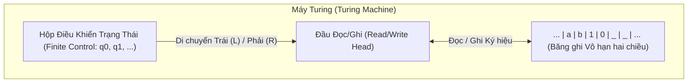
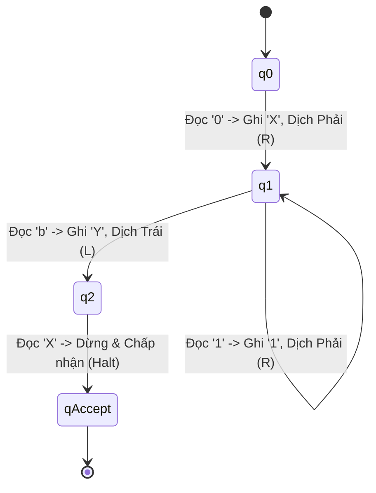
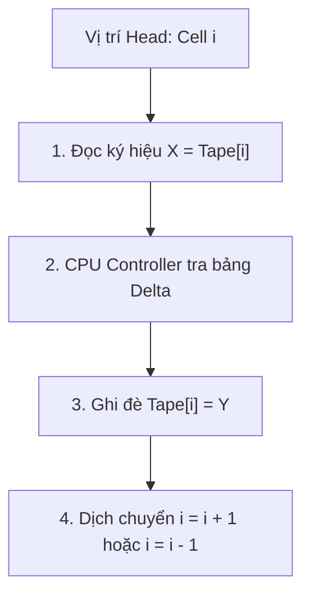
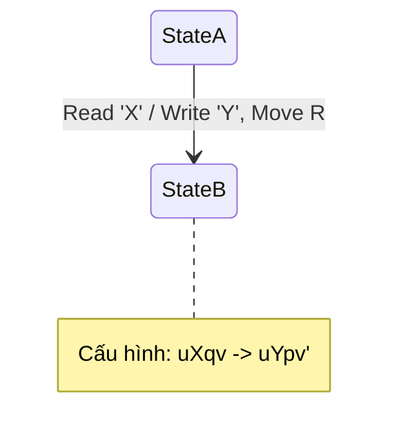
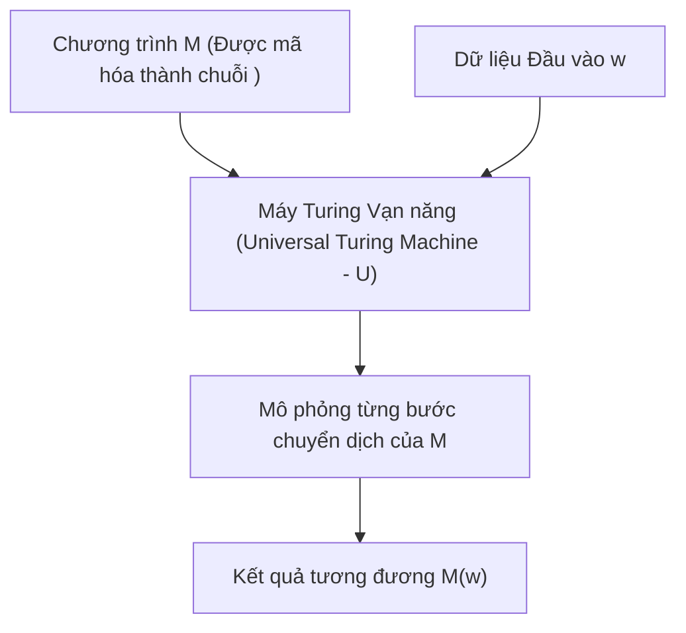
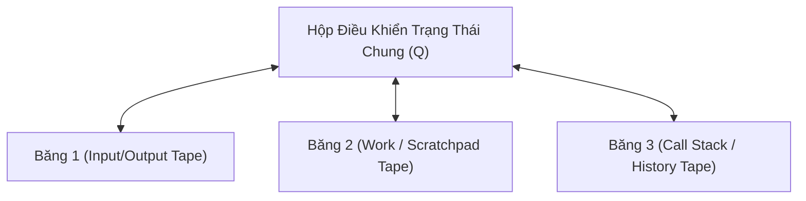
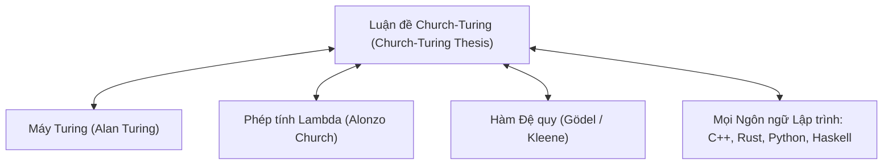
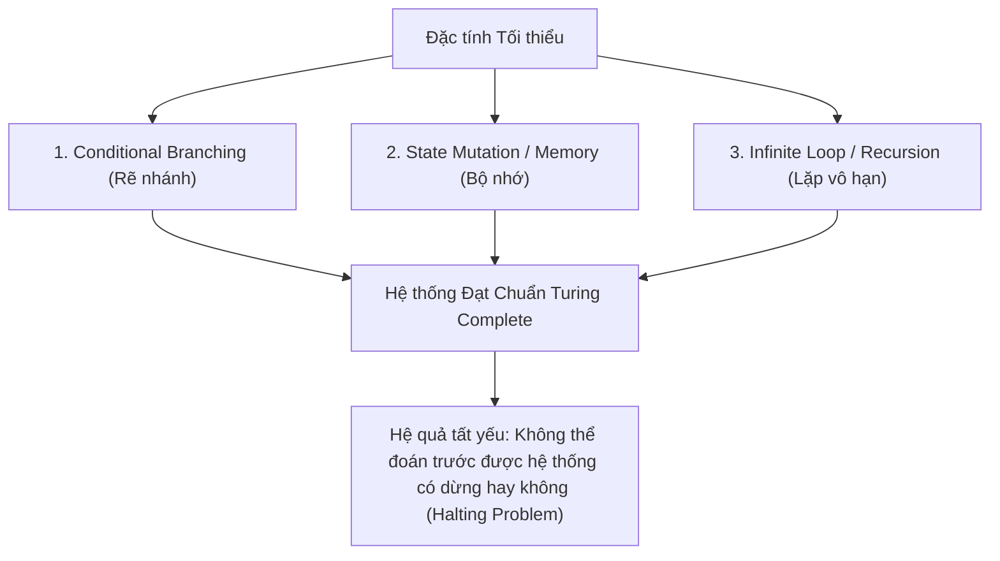

# 4.4. Turing Machines and Computability (Máy Turing và Lý thuyết Khả toán)

## Tổng quan về Máy Turing
Năm 1936, nhà toán học Alan Turing đã phát minh ra **Máy Turing (Turing Machine - TM)** — mô hình toán học chuẩn mực định nghĩa thế nào là một "thuật toán" và thế nào là một "hành vi tính toán cơ học".

Mặc dù có cấu trúc cực kỳ tối giản (chỉ gồm một dải băng vô hạn và một đầu đọc/ghi di chuyển qua lại), Máy Turing có khả năng thực hiện **bất kỳ phép tính toán nào** mà một siêu máy tính hiện đại nhất hoặc bất kỳ cỗ máy điện toán lượng tử nào có thể thực hiện được.

Định nghĩa toán học của một Máy Turing tất định 1 băng:
$$M = (Q, \Sigma, \Gamma, \delta, q_0, q_{\text{accept}}, q_{\text{reject}})$$
Trong đó:
- $Q$: Tập hữu hạn các trạng thái nội tại.
- $\Sigma$: Bảng chữ cái đầu vào (Input Alphabet), không chứa ký hiệu khoảng trắng blank ($\sqcup \notin \Sigma$).
- $\Gamma$: Bảng chữ cái của băng ghi (Tape Alphabet), với $\Sigma \subset \Gamma$ và $\sqcup \in \Gamma$.
- $\delta: Q \times \Gamma \to Q \times \Gamma \times \{L, R\}$: Hàm chuyển dịch trạng thái (State Transition Function).
- $q_0 \in Q$: Trạng thái bắt đầu.
- $q_{\text{accept}} \in Q$: Trạng thái chấp nhận (Halt and Accept).
- $q_{\text{reject}} \in Q$: Trạng thái từ chối (Halt and Reject), với $q_{\text{reject}} \neq q_{\text{accept}}$.



---

## 2. Chi tiết từng Keyword (Under-the-Hood Deep Dive)

---

### 1. Turing Machine (Máy Turing)

#### 1. Khái niệm bản chất (What & Why)
- **Định nghĩa**: Một cỗ máy tính toán trừu tượng có bộ nhớ không giới hạn dưới dạng một dải băng chứa các ô rời rạc, được trang bị một đầu đọc/ghi có khả năng đọc ký hiệu, ghi đè ký hiệu mới và di chuyển sang trái hoặc sang phải từng ô một theo một bảng quy tắc trạng thái xác định.
- **Tại sao cần thiết**: Cung cấp định nghĩa toán học chính xác nhất về "Tính toán được" (Computable) và là thước đo chuẩn mực để đánh giá sức mạnh của mọi kiến trúc máy tính.

#### 2. Cơ chế hoạt động sâu (Under the hood / Hardcore Internals)
- **Quy trình hoạt động của một bước tính toán**:
  1. Đầu đọc đọc ký hiệu hiện tại $X \in \Gamma$ tại ô đang đứng.
  2. Dựa trên trạng thái hiện tại $q \in Q$ và ký hiệu $X$, tra cứu hàm $\delta(q, X) = (p, Y, D)$:
     - Chuyển trạng thái nội tại sang $p$.
     - Ghi đè ký hiệu $Y \in \Gamma$ vào ô nhớ hiện tại.
     - Dịch chuyển đầu đọc một ô sang hướng $D \in \{L, R\}$ ($L$: Left, $R$: Right).
  3. Nếu chạm tới $q_{\text{accept}}$ hoặc $q_{\text{reject}}$, cỗ máy lập tức **dừng lại (Halt)**. Nếu không bao giờ chạm tới 2 trạng thái này, cỗ máy chạy vô tận (Looping forever).

#### 3. Sơ đồ minh họa


#### 4. Code ví dụ thực chiến (C++ Trình giả lập Máy Turing Đầy đủ)
```cpp
#include <iostream>
#include <vector>
#include <string>
#include <map>

enum class Direction { L, R };

struct Transition {
    int next_state;
    char write_char;
    Direction dir;
};

class TuringMachine {
    int state_{0};
    int head_pos_{0};
    std::string tape_;
    std::map<std::pair<int, char>, Transition> transitions_;
    int accept_state_{99};

public:
    explicit TuringMachine(std::string initial_tape, int accept_st) 
        : tape_(std::move(initial_tape)), accept_state_(accept_st) {}

    void add_rule(int cur_st, char read_c, int next_st, char write_c, Direction d) {
        transitions_[{cur_st, read_c}] = {next_st, write_c, d};
    }

    bool run(int max_steps = 1000) {
        int steps = 0;
        while (state_ != accept_state_ && steps++ < max_steps) {
            char current_char = (head_pos_ < tape_.size()) ? tape_[head_pos_] : '_';
            auto it = transitions_.find({state_, current_char});
            if (it == transitions_.end()) return false; // Rejected (No transition)

            const auto& rule = it->second;
            state_ = rule.next_state;
            tape_[head_pos_] = rule.write_char;

            if (rule.dir == Direction::R) {
                ++head_pos_;
                if (head_pos_ >= tape_.size()) tape_.push_back('_');
            } else {
                if (head_pos_ > 0) --head_pos_;
            }
        }
        return state_ == accept_state_;
    }

    [[nodiscard]] const std::string& get_tape() const noexcept { return tape_; }
};

int main() {
    // Máy Turing tăng số nhị phân: Biến "101" -> "110"
    TuringMachine tm("101", 99);
    // Đi tới cuối chuỗi
    tm.add_rule(0, '1', 0, '1', Direction::R);
    tm.add_rule(0, '0', 0, '0', Direction::R);
    tm.add_rule(0, '_', 1, '_', Direction::L);
    // Tăng bit cuối
    tm.add_rule(1, '1', 1, '0', Direction::L); // Carry
    tm.add_rule(1, '0', 99, '1', Direction::R); // Done
    tm.run();
    std::cout << "Result Tape: " << tm.get_tape() << "\n"; // 110
    return 0;
}
```

#### 5. Ưu / Nhược điểm, Pitfalls & Anti-patterns
- **Đặc trưng**: Máy Turing không được thiết kế để lập trình ứng dụng thực tế (vì việc viết mã cho nó vô cùng thủ công), mà để làm công cụ toán học chứng minh giới hạn tính toán.

#### 6. Ứng dụng thực tế trong Backend / Systems
- Định nghĩa giới hạn của WebAssembly Sandbox: Đảm bảo máy ảo Wasm chạy an toàn với bộ nhớ tuyến tính cô lập (Linear Memory) tương đương với một dải băng Máy Turing hữu hạn.

---

### 2. Tape (Băng ghi)

#### 1. Khái niệm bản chất (What & Why)
- **Định nghĩa**: Môi trường lưu trữ dữ liệu của Máy Turing, được chia thành một dãy vô hạn các ô rời rạc (Cells). Mỗi ô có khả năng lưu trữ chính xác một ký hiệu thuộc bảng chữ cái $\Gamma$.
- **Đặc điểm**: Băng ghi ban đầu chứa chuỗi đầu vào $w$ ở những ô đầu tiên, toàn bộ các ô còn lại vô tận về phía sau đều chứa ký hiệu trắng (Blank $\sqcup$).

#### 2. Cơ chế hoạt động sâu (Under the hood / Hardcore Internals)
- **Tương đương với Không gian Địa chỉ Ảo (Virtual Address Space)**:
  - Băng ghi của Máy Turing là tiền thân của bộ nhớ RAM tuyến tính: Mỗi ô trên băng ghi tương đương một địa chỉ byte trong RAM ($[0 \dots 2^{64}-1]$).
  - Sự khác biệt: Máy Turing phải di chuyển đầu đọc tuần tự từng ô ($O(k)$ thời gian để nhảy $k$ ô), trong khi RAM thực tế hỗ trợ Random Access ($O(1)$ để nhảy tới bất kỳ địa chỉ nào nhờ mạch giải mã địa chỉ Address Decoder).

#### 3. Sơ đồ minh họa
```text
Cấu trúc Băng ghi Máy Turing:
+---+---+---+---+---+---+---+---+---+---+
| a | b | 1 | 0 | _ | _ | _ | _ | _ |... (Vô hạn về bên phải)
+---+---+---+---+---+---+---+---+---+---+
          ^
       Đầu Đọc
```

#### 4. Code ví dụ thực chiến (C++ Infinite Tape Simulation via Dynamic Deque)
```cpp
#include <iostream>
#include <deque>

class InfiniteTape {
    std::deque<char> tape_{'_'};
    int head_index_{0};

public:
    void move_right() {
        ++head_index_;
        if (head_index_ == tape_.size()) tape_.push_back('_');
    }

    void move_left() {
        if (head_index_ == 0) {
            tape_.push_front('_'); // Mở rộng vô hạn về bên trái
        } else {
            --head_index_;
        }
    }

    void write(char c) { tape_[head_index_] = c; }
    [[nodiscard]] char read() const noexcept { return tape_[head_index_]; }
};

int main() {
    InfiniteTape t;
    t.write('X');
    t.move_right();
    t.write('Y');
    std::cout << "Tape cell 1: " << t.read() << "\n"; // Y
    return 0;
}
```

#### 5. Ưu / Nhược điểm, Pitfalls & Anti-patterns
- **Pitfall**: Nhầm lẫn giữa băng ghi vô hạn thực tế và băng ghi vô hạn tiềm năng. Một máy Turing tại bất kỳ bước dừng $T$ nào chỉ có thể sử dụng tối đa $T$ ô nhớ trên băng ghi.

#### 6. Ứng dụng thực tế trong Backend / Systems
- Hệ thống tệp Append-Only Log trong Kafka / RocksDB: Hoạt động như một dải băng ghi tuần tự vô hạn, chỉ ghi nối tiếp vào đuôi và đọc tuần tự để đạt tốc độ disk I/O hàng Gigabytes/giây.

---

### 3. Head (Đầu Đọc / Ghi)

#### 1. Khái niệm bản chất (What & Why)
- **Định nghĩa**: Thực thể vật lý/logic trỏ vào ô nhớ hiện tại trên dải băng, có quyền năng thực hiện hai thao tác cơ bản:
  1. Cảm biến ký hiệu đang nằm tại ô hiện tại (Read).
  2. Biến đổi ký hiệu tại ô đó (Write).
  3. Dịch chuyển vị trí sang ô láng giềng kề sát bên trái ($L$) hoặc bên phải ($R$).

#### 2. Cơ chế hoạt động sâu (Under the hood / Hardcore Internals)
- **Tương đương với con trỏ phần cứng**:
  - Tương đương với cặp thanh ghi `RIP` (Instruction Pointer) và `RSP` / Memory Pointer trong kiến trúc CPU.
  - Trong ổ cứng cơ truyền thống (HDD), Head chính là đầu đọc/ghi từ tính cơ học di chuyển dọc theo các rãnh đĩa (Tracks).

#### 3. Sơ đồ minh họa


#### 4. Code ví dụ thực chiến (C++ Head Bound Checker)
```cpp
#include <iostream>
#include <cassert>

struct TuringHead {
    int64_t position{0};

    void move(char direction) {
        if (direction == 'R') ++position;
        else if (direction == 'L') --position;
        else assert(false && "Invalid head direction");
    }
};

int main() {
    TuringHead head;
    head.move('R');
    head.move('R');
    head.move('L');
    std::cout << "Head Position: " << head.position << "\n"; // 1
    return 0;
}
```

#### 5. Ưu / Nhược điểm, Pitfalls & Anti-patterns
- **Pitfall**: Cố gắng di chuyển đầu đọc sang trái khi đang ở ô đầu tiên của băng ghi 1 phía (Semi-infinite tape), gây lỗi ranh giới biên (Boundary fault).

#### 6. Ứng dụng thực tế trong Backend / Systems
- Con trỏ Cursor trong Database Streaming (Postgres Cursors): Cho phép ứng dụng duyệt qua hàng tỷ bản ghi mà không cần nạp toàn bộ tập dữ liệu vào bộ nhớ RAM.

---

### 4. State Transition (Chuyển dịch Trạng thái của Máy Turing)

#### 1. Khái niệm bản chất (What & Why)
- **Định nghĩa**: Khối lệnh nguyên tử duy nhất của Máy Turing, được định nghĩa bởi hàm toán học:
  $$\delta(q, a) = (p, b, D)$$
  (Từ trạng thái $q$, đọc $a \implies$ chuyển sang $p$, ghi $b$, dịch chuyển $D$).
- **Cấu hình (Configuration / Instantaneous Description - ID)**: Một bức ảnh chụp toàn bộ trạng thái tính toán tại thời điểm $t$, ký hiệu là $u \, q \, v$ (với $q$ là trạng thái, $u$ là nội dung băng bên trái đầu đọc, $v$ là nội dung từ đầu đọc về bên phải).

#### 2. Cơ chế hoạt động sâu (Under the hood / Hardcore Internals)
- Một chuỗi tính toán của Máy Turing là một dãy các chuyển dịch cấu hình:
  $$C_1 \vdash C_2 \vdash C_3 \vdash \dots \vdash C_k$$
- Đây chính là dạng chuẩn tắc hình thức của một thuật toán toán học.

#### 3. Sơ đồ minh họa


#### 4. Code ví dụ thực chiến (TypeScript State Transition Dispatcher)
```typescript
interface TransitionRule {
    nextState: string;
    writeSymbol: string;
    moveDirection: 'L' | 'R';
}

type TransitionTable = Record<string, Record<string, TransitionRule>>;

const rules: TransitionTable = {
    'q_init': {
        '0': { nextState: 'q_zero', writeSymbol: 'X', moveDirection: 'R' },
        '1': { nextState: 'q_one', writeSymbol: 'Y', moveDirection: 'R' }
    }
};

function getNextStep(currentState: string, currentSymbol: string): TransitionRule | null {
    return rules[currentState]?.[currentSymbol] || null;
}

console.log("Next Transition:", getNextStep('q_init', '0'));
```

#### 5. Ưu / Nhược điểm, Pitfalls & Anti-patterns
- **Pitfall**: Thiếu luật chuyển dịch cho một cặp `(state, symbol)` dẫn đến việc cỗ máy bị treo bất thường (Abnormal termination).

#### 6. Ứng dụng thực tế trong Backend / Systems
- Dispatcher trong Redux / Event Sourcing Engine: Nhận `(CurrentState, Action)` và sinh ra `(NextState, SideEffect)` tương đương một bước chuyển dịch trạng thái tất định.

---

### 5. Universal Turing Machine - UTM (Máy Turing Vạn năng)

#### 1. Khái niệm bản chất (What & Why)
- **Định nghĩa**: Một Máy Turing đặc biệt $U$ có khả năng nhận đầu vào là mã hóa nhị phân của một Máy Turing bất kỳ $\langle M \rangle$ cùng với dữ liệu đầu vào $w$ của nó, và **mô phỏng chính xác** hành vi của $M$ trên $w$:
  $$U(\langle M, w \rangle) = M(w)$$
- **Ý nghĩa lịch sử**: Trước Turing, mỗi cỗ máy chỉ làm được một việc duy nhất (như máy dệt, máy tính cộng cơ học). Phát minh ra UTM chính là **khái niệm đầu tiên về PHẦN MỀM (Software)**: Một phần cứng cố định duy nhất có thể chạy vô số chương trình khác nhau chỉ bằng cách thay đổi dữ liệu đầu vào!

#### 2. Cơ chế hoạt động sâu (Under the hood / Hardcore Internals)
- **Nền tảng của Kiến trúc Von Neumann**:
  - Cả chương trình (Mã lệnh $\langle M \rangle$) và Dữ liệu ($w$) đều được lưu trữ chung trong một không gian bộ nhớ thống nhất (Stored-program Computer).
  - CPU ngày nay chính là một hiện thân phần cứng của Máy Turing Vạn năng UTM: CPU đọc các opcode từ bộ nhớ RAM và mô phỏng lại các thuật toán mà lập trình viên viết ra.

#### 3. Sơ đồ minh họa


#### 4. Code ví dụ thực chiến (C++ Trình Thông dịch Mô phỏng UTM)
```cpp
#include <iostream>
#include <string>
#include <vector>

// UTM đơn giản: Bộ thông dịch Bytecode (Interpreter)
class VirtualMachineUTM {
public:
    void execute_program(const std::vector<int>& bytecode, std::vector<int>& memory) {
        int ip = 0; // Instruction Pointer
        while (ip < bytecode.size()) {
            int opcode = bytecode[ip++];
            switch (opcode) {
                case 1: { // ADD mem[a] = mem[b] + mem[c]
                    int a = bytecode[ip++];
                    int b = bytecode[ip++];
                    int c = bytecode[ip++];
                    memory[a] = memory[b] + memory[c];
                    break;
                }
                case 99: return; // HALT
            }
        }
    }
};

int main() {
    VirtualMachineUTM vm;
    std::vector<int> memory = {0, 15, 25}; // memory[0]=result, memory[1]=15, memory[2]=25
    std::vector<int> program = {1, 0, 1, 2, 99}; // ADD 0 1 2, HALT
    vm.execute_program(program, memory);
    std::cout << "UTM Executed Result: memory[0] = " << memory[0] << "\n"; // 40
    return 0;
}
```

#### 5. Ưu / Nhược điểm, Pitfalls & Anti-patterns
- **Cái giá của sự trừu tượng**: Việc mô phỏng qua UTM đưa vào một hệ số chậm đa thức (Polynomial Simulation Overhead), nhưng không làm thay đổi lớp độ phức tạp của bài toán.

#### 6. Ứng dụng thực tế trong Backend / Systems
- Hệ điều hành ảo hóa (Hypervisors như KVM, QEMU, Docker Containers): Đóng vai trò là cỗ máy UTM cấp cao mô phỏng lại toàn bộ một hệ thống máy tính hoàn chỉnh bên trong một tiến trình phần mềm.

---

### 6. Multi-tape Turing Machine (Máy Turing Đa băng)

#### 1. Khái niệm bản chất (What & Why)
- **Định nghĩa**: Một Máy Turing sở hữu $k$ dải băng độc lập ($k \ge 2$), mỗi dải băng có đầu đọc/ghi riêng biệt.
- **Hàm chuyển dịch**:
  $$\delta: Q \times \Gamma^k \to Q \times \Gamma^k \times \{L, R\}^k$$
  Tại mỗi bước, máy có thể đọc đồng thời $k$ ký hiệu, ghi $k$ ký hiệu và di chuyển $k$ đầu đọc theo các hướng độc lập nhau.

#### 2. Cơ chế hoạt động sâu (Under the hood / Hardcore Internals)
- **Định lý tương đương (Equivalence of Multi-tape and Single-tape)**:
  - Mọi Máy Turing đa băng chạy trong $t(n)$ bước đều có thể được mô phỏng bởi một Máy Turing 1 băng chạy trong $\mathcal{O}(t(n)^2)$ bước.
  - **Kết luận sống còn**: Bổ sung thêm nhiều băng ghi giúp thuật toán chạy nhanh hơn và lập trình dễ hơn, nhưng **HOÀN TOÀN KHÔNG làm tăng thêm sức mạnh tính toán** của máy. Tập các bài toán giải được vẫn giữ nguyên 100%!

#### 3. Sơ đồ minh họa


#### 4. Code ví dụ thực chiến (C++ Nhận diện Palindrome trong O(n) trên Máy 2 Băng)
```cpp
#include <iostream>
#include <string_view>
#include <string>

// Trên máy 1 băng, kiểm tra Palindrome tốn O(n^2) vì đầu đọc phải chạy qua lại giữa 2 đầu.
// Trên máy 2 băng: Copy input sang băng 2, đảo ngược băng 2, rồi so sánh song song -> O(n)!
bool check_palindrome_two_tapes(std::string_view tape1) {
    std::string tape2(tape1.rbegin(), tape1.rend()); // Băng 2 lưu chuỗi đảo ngược
    for (std::size_t i = 0; i < tape1.size(); ++i) { // Duyệt song song 2 băng
        if (tape1[i] != tape2[i]) return false;
    }
    return true; // Hoàn tất trong O(n)
}

int main() {
    std::cout << "racecar is palindrome? " << check_palindrome_two_tapes("racecar") << "\n"; // 1
    return 0;
}
```

#### 5. Ưu / Nhược điểm, Pitfalls & Anti-patterns
- **Ý nghĩa kỹ thuật**: Giúp phân tách rõ ràng giữa bộ nhớ dữ liệu (Data Cache) và bộ nhớ lệnh (Instruction Cache) trong kiến trúc Harvard của CPU máy tính hiện đại.

#### 6. Ứng dụng thực tế trong Backend / Systems
- Hệ thống xử lý Two-phase Commit (2PC): Băng 1 phục vụ ghi nhận dữ liệu người dùng, Băng 2 phục vụ ghi nhận Undo/Redo Log (Write-Ahead Logging).

---

### 7. Church-Turing Thesis (Luận đề Church-Turing)

#### 1. Khái niệm bản chất (What & Why)
- **Định nghĩa**: Luận đề khẳng định rằng:
  *"Bất kỳ hàm số hoặc thuật toán nào có thể tính toán được một cách hiệu quả bởi trực giác con người hoặc bất kỳ thiết bị vật lý nào trong vũ trụ, đều có thể tính toán được bằng một Máy Turing."*
- **Bản chất**: Đây là một **Luận đề (Thesis / Hypothesis)** chứ không phải một Định lý toán học (Theorem), vì khái niệm "tính toán trực giác" không thể định nghĩa bằng tiên đề hình thức để chứng minh. Tuy nhiên, suốt gần một thế kỷ qua, không có bất kỳ mô hình điện toán nào (kể cả máy tính lượng tử) có thể bác bỏ được luận đề này.

#### 2. Cơ chế hoạt động sâu (Under the hood / Hardcore Internals)
- **Sự hội tụ của các mô hình tính toán độc lập năm 1936**:
  - Alan Turing phát minh ra **Máy Turing**.
  - Alonzo Church phát minh ra **Phép tính Lambda ($\lambda$-Calculus)**.
  - Kurt Gödel & Stephen Kleene phát minh ra **Hàm đệ quy chung ($\mu$-Recursive Functions)**.
  - Cả ba nhà toán học đều độc lập chứng minh rằng ba hệ thống này có sức mạnh biểu đạt **hoàn toàn tương đương nhau 100%**.

#### 3. Sơ đồ minh họa


#### 4. Code ví dụ thực chiến (TypeScript Phép tính Lambda tương đương Thuật toán Máy Turing)
```typescript
// Định nghĩa Số tự nhiên Church (Church Numerals) trong Phép tính Lambda thuần túy:
type ChurchNum<T> = (f: (x: T) => T) => (x: T) => T;

const zero: ChurchNum<any> = f => x => x;
const one: ChurchNum<any> = f => x => f(x);
const two: ChurchNum<any> = f => x => f(f(x));

// Hàm cộng Church: plus = m => n => f => x => m(f)(n(f)(x))
const add = (m: ChurchNum<any>, n: ChurchNum<any>): ChurchNum<any> => 
    f => x => m(f)(n(f)(x));

// Kiểm chứng tương đương với máy tính số học
const toInt = (cn: ChurchNum<number>): number => cn(n => n + 1)(0);
console.log("Church 1 + 2 =", toInt(add(one, two))); // 3
```

#### 5. Ưu / Nhược điểm, Pitfalls & Anti-patterns
- **Pitfall**: Nhầm lẫn rằng Máy tính Lượng tử (Quantum Computers) phá vỡ Luận đề Church-Turing. Máy tính lượng tử chỉ có thể giải một số bài toán nhanh hơn (như thuật toán Shor phân tích thừa số nguyên tố), nhưng **không thể giải quyết được bất kỳ bài toán Undecidable nào** mà Máy Turing không giải được.

#### 6. Ứng dụng thực tế trong Backend / Systems
- Thiết kế Ngôn ngữ Lập trình Hàm (Haskell, Lisp, Elixir, Scala): Xây dựng toàn bộ hệ thống xử lý backend dựa trên nền tảng $\lambda$-Calculus của Church.

---

### 8. Turing Completeness (Tính Đầy đủ Turing)

#### 1. Khái niệm bản chất (What & Why)
- **Định nghĩa**: Một hệ thống tính toán, ngôn ngữ lập trình hoặc cỗ máy được gọi là **Turing Complete** nếu nó có thể mô phỏng lại bất kỳ Máy Turing vạn năng nào.
- **Tiêu chí tối thiểu để một hệ thống đạt Turing Complete**:
  1. Khả năng rẽ nhánh có điều kiện (Conditional Branching: `if` hoặc lệnh nhảy `jmp`).
  2. Khả năng lặp lại trạng thái tùy ý (Arbitrary Looping: `while`, `goto` hoặc đệ quy `recursion`).
  3. Khả năng ghi nhớ và thao tác trên một không gian bộ nhớ không bị giới hạn cố định.

#### 2. Cơ chế hoạt động sâu (Under the hood / Hardcore Internals)
- **Turing Tarpit (Đầm lầy Turing)**:
  - Một ngôn ngữ cực kỳ tối giản như **Brainfuck** (chỉ có đúng 8 ký tự lệnh: `>`, `<`, `+`, `-`, `.`, `,`, `[`, `]`) đã đạt đầy đủ Turing Complete!
  - Nhiều công cụ tưởng chừng như vô hại nhưng vô tình đạt Turing Complete: C++ Template Metaprogramming, SQL-92 (với Recursive CTE), CSS3 (kết hợp HTML checkboxes), Minecraft Redstone circuits, TypeScript Type System!

#### 3. Sơ đồ minh họa


#### 4. Code ví dụ thực chiến (C++ Template Metaprogramming is Turing Complete)
```cpp
#include <iostream>

// Tính toán hoàn toàn tại COMPILE-TIME thông qua C++ Templates:
template <int N>
struct CompileTimeFactorial {
    static constexpr uint64_t value = N * CompileTimeFactorial<N - 1>::value;
};

// Base case (Điều kiện dừng)
template <>
struct CompileTimeFactorial<0> {
    static constexpr uint64_t value = 1;
};

int main() {
    // Trình biên dịch C++ hoạt động như một Máy Turing tính toán trước kết quả
    constexpr uint64_t result = CompileTimeFactorial<5>::value;
    std::cout << "Computed at compile-time: 5! = " << result << "\n"; // 120
    return 0;
}
```

#### 5. Ưu / Nhược điểm, Pitfalls & Anti-patterns
- **Lỗ hổng bảo mật chết người**: Nếu bạn cho phép người dùng tải lên các cấu hình (Config files) mà công cụ cấu hình đó vô tình đạt Turing Complete (như Smart Contracts hoặc Template Engines), kẻ tấn công có thể tạo ra các vòng lặp vô hạn gây cạn kiệt tài nguyên CPU của máy chủ.

#### 6. Ứng dụng thực tế trong Backend / Systems
- Ethereum Virtual Machine (EVM): Thiết kế EVM là Turing Complete để hỗ trợ các ứng dụng DeFi phức tạp, nhưng phải đưa vào cơ chế **Gas Fee** (tính phí cho mỗi chỉ thị opcode) để cưỡng chế ngắt các vòng lặp vô hạn và bảo vệ mạng lưới blockchain.
