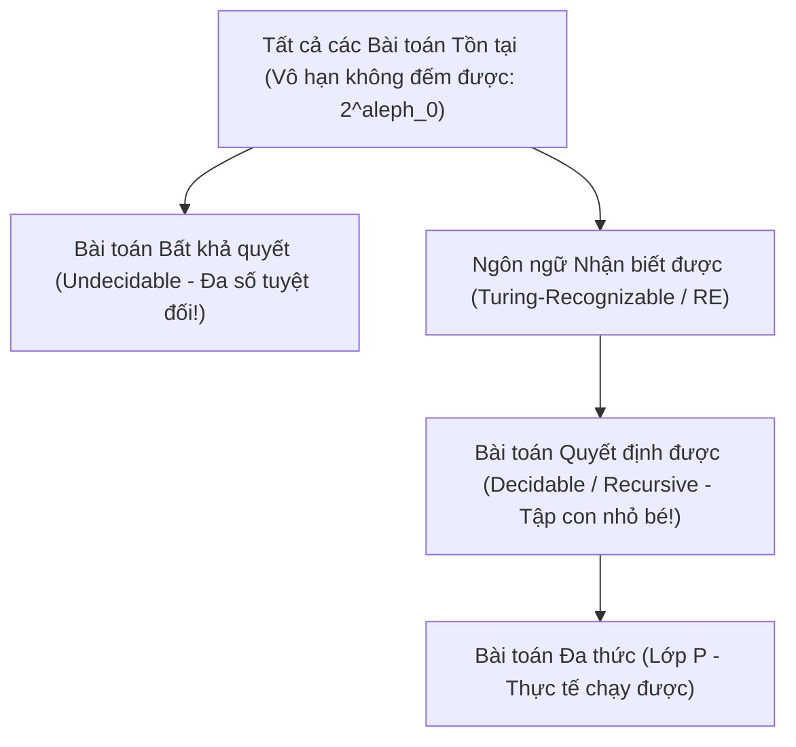
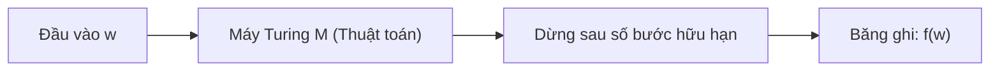
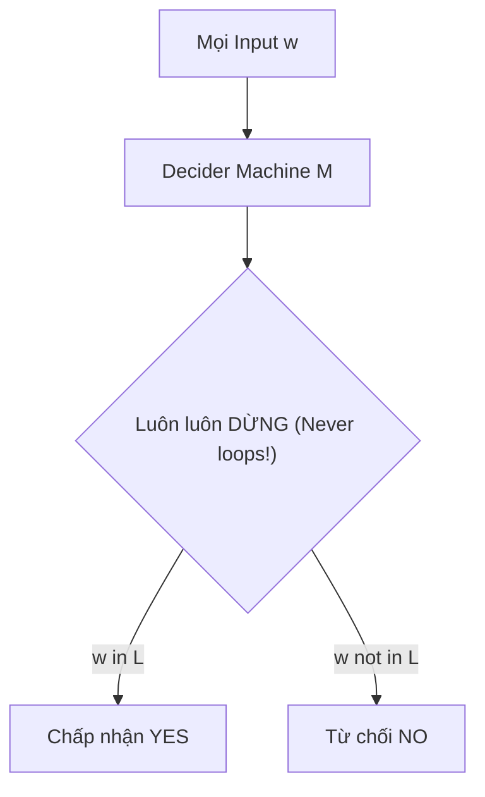
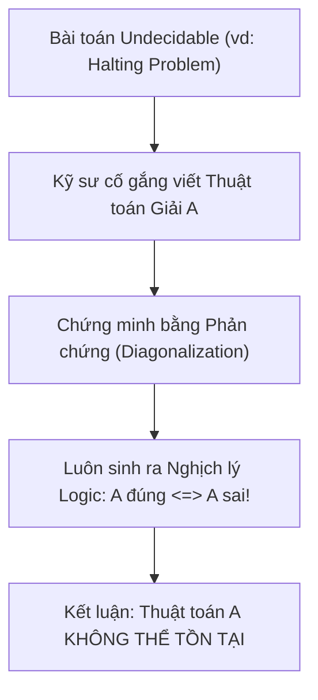
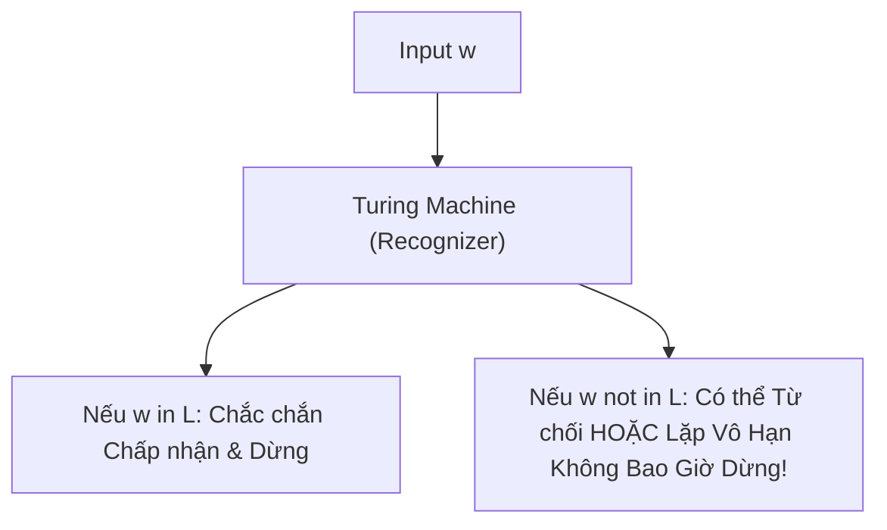
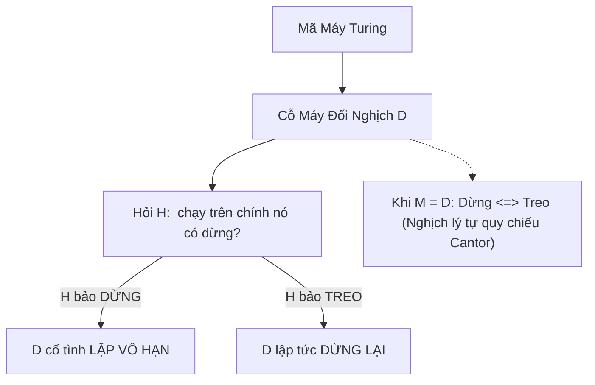
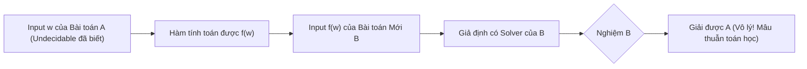
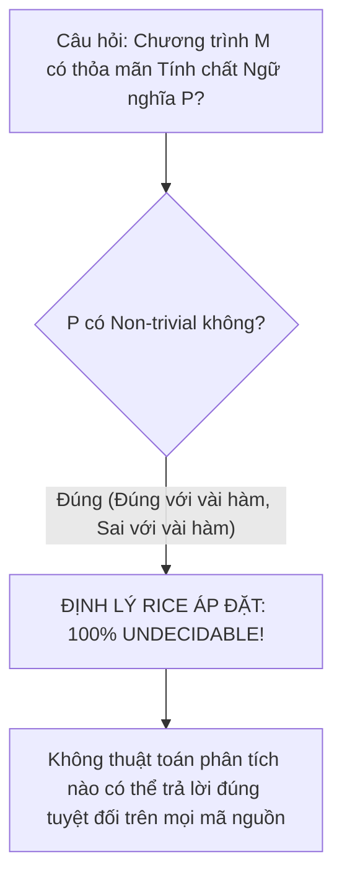
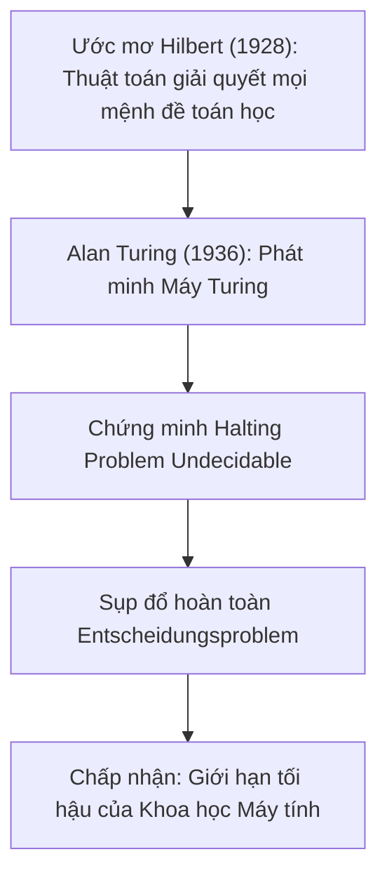
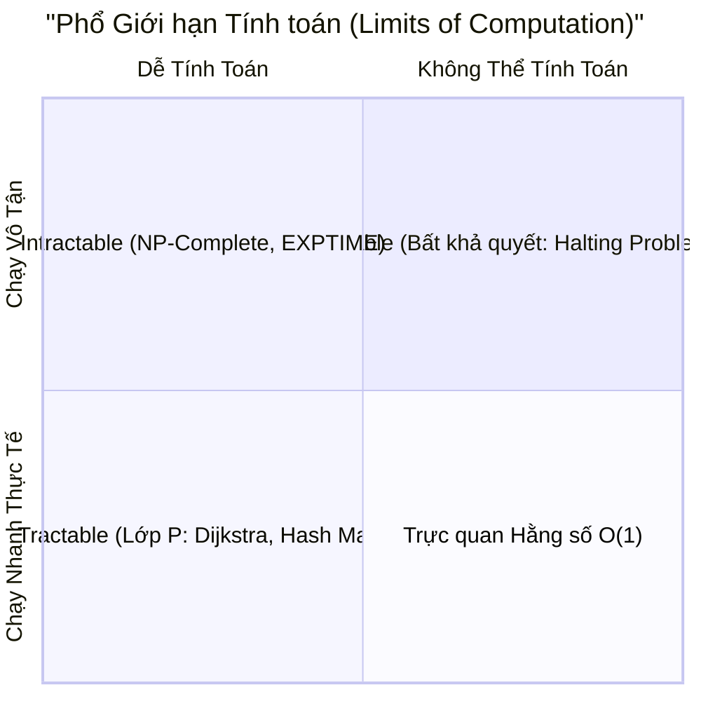

# 5.1. Computability and Undecidability (Lý thuyết Khả toán và Giới hạn Tính toán Tuyệt đối)

## Tổng quan về Lý thuyết Khả toán
Lý thuyết Khả toán (Computability Theory) nghiên cứu câu hỏi nền tảng nhất của toàn bộ nền khoa học máy tính:
$$\textbf{"Một bài toán có thể giải quyết được bằng một thuật toán hay không?"}$$

Điểm cốt lõi mang tính định hình của toàn bộ ngành:
> [!IMPORTANT]
> **Không phải mọi bài toán đều có thể giải quyết bằng một chương trình máy tính**, dù bạn có sở hữu phần cứng mạnh đến đâu, có nâng cấp bao nhiêu máy chủ, hay cho chương trình chạy qua bao nhiêu tỷ năm.

Về mặt toán học:
- Tập hợp tất cả các chương trình máy tính khả dĩ là **vô hạn đếm được** ($\aleph_0$ - tương đương với lực lượng tập số tự nhiên $\mathbb{N}$).
- Tập hợp tất cả các bài toán quyết định khả dĩ (các hàm nhị phân $f: \{0, 1\}^* \to \{0, 1\}$) là **vô hạn không đếm được** ($2^{\aleph_0} = \mathfrak{c}$ - tương đương lực lượng tập số thực $\mathbb{R}$).
- Do đó, theo nguyên lý chuồng bồ câu của Cantor: **Hầu như mọi bài toán tồn tại trong vũ trụ toán học đều KHÔNG THỂ giải được bằng thuật toán!**



---

## 2. Chi tiết từng Keyword (Under-the-Hood Deep Dive)

---

### 1. Computable Functions (Hàm Tính toán được)

#### 1. Khái niệm bản chất (What & Why)
- **Định nghĩa**: Một hàm số toán học $f: \Sigma^* \to \Sigma^*$ được gọi là **Tính toán được (Computable / Turing-computable)** nếu tồn tại một Máy Turing $M$ sao cho với mọi chuỗi đầu vào $w$:
  - Máy $M$ luôn dừng lại (halts).
  - Khi dừng lại, nội dung trên dải băng của $M$ chính là giá trị $f(w)$.
- **Ý nghĩa**: Là các hàm số mà con người hoặc máy tính có thể xây dựng một quy trình cơ học hữu hạn từng bước để tính ra đáp án chính xác.

#### 2. Cơ chế hoạt động sâu (Under the hood / Hardcore Internals)
- Tương đương hoàn toàn với lớp **Hàm đệ quy $\mu$ (Partial Recursive Functions)** theo hệ tiên đề Gödel-Kleene: Mọi hàm tính toán được đều có thể xây dựng từ 3 hàm cơ sở (Hàm 0, Hàm Kế tiếp, Hàm Chiếu) kết hợp với 3 toán tử (Hợp thành, Đệ quy nguyên thủy, và Toán tử Cực tiểu hóa $\mu$).

#### 3. Sơ đồ minh họa


#### 4. Code ví dụ thực chiến (C++ Computable Function: Ackermann Function)
```cpp
#include <iostream>
#include <cstdint>

// Hàm Ackermann: Hàm tính toán được siêu tăng trưởng (không phải đệ quy nguyên thủy)
uint64_t ackermann(uint64_t m, uint64_t n) {
    if (m == 0) return n + 1;
    if (m > 0 && n == 0) return ackermann(m - 1, 1);
    return ackermann(m - 1, ackermann(m, n - 1));
}

int main() {
    std::cout << "Ackermann(2, 3) = " << ackermann(2, 3) << "\n"; // 9
    std::cout << "Ackermann(3, 2) = " << ackermann(3, 2) << "\n"; // 29
    return 0;
}
```

#### 5. Ưu / Nhược điểm, Pitfalls & Anti-patterns
- **Pitfall**: Nhầm tưởng hàm tính toán được phải chạy nhanh. Hàm Ackermann tính toán được nhưng với $A(4, 2)$, số kết quả có tới $19,729$ chữ số thập phân, máy tính sẽ tràn bộ nhớ trước khi hoàn thành.

#### 6. Ứng dụng thực tế trong Backend / Systems
- Các thư viện mật mã học (OpenSSL / Libsodium): Mọi thuật toán sinh khóa, băm và mã hóa bắt buộc phải là các hàm Computable.

---

### 2. Decidable Problems (Bài toán Quyết định được)

#### 1. Khái niệm bản chất (What & Why)
- **Định nghĩa**: Một bài toán quyết định (ngôn ngữ $L \subseteq \Sigma^*$) được gọi là **Quyết định được (Decidable / Recursive)** nếu tồn tại một Máy Turing $M$ (gọi là **Decider**) sao cho với MỌI chuỗi đầu vào $w$:
  - Nếu $w \in L \implies M$ chấp nhận và DỪNG.
  - Nếu $w \notin L \implies M$ từ chối và DỪNG.
- **Tính chất cốt lõi**: Decider **BẮT BUỘC PHẢI DỪNG TRÊN MỌI ĐẦU VÀO**, không bao giờ bị rơi vào vòng lặp vô hạn.

#### 2. Cơ chế hoạt động sâu (Under the hood / Hardcore Internals)
- Lớp các ngôn ngữ quyết định được đóng dưới mọi phép toán logic và tập hợp: Hợp, Giao, Bù, Nối, và Kleene star.
- Nếu $L$ là Decidable thì phần bù $\overline{L}$ cũng chắc chắn là Decidable (chỉ cần hoán đổi trạng thái $q_{\text{accept}}$ và $q_{\text{reject}}$ của Decider).

#### 3. Sơ đồ minh họa


#### 4. Code ví dụ thực chiến (C++ Decidable Problem: Graph Bipartiteness Checking)
```cpp
#include <iostream>
#include <vector>
#include <queue>

// Bài toán quyết định: Đồ thị có phải là đồ thị 2 phía (Bipartite) không?
// Luôn dừng lại sau O(V + E) bước trên mọi input đồ thị -> Decidable!
bool is_bipartite_decidable(int n, const std::vector<std::vector<int>>& adj) {
    std::vector<int> color(n, -1);

    for (int i = 0; i < n; ++i) {
        if (color[i] != -1) continue;
        color[i] = 0;
        std::queue<int> q;
        q.push(i);

        while (!q.empty()) {
            int u = q.front();
            q.pop();

            for (int v : adj[u]) {
                if (color[v] == -1) {
                    color[v] = 1 - color[u];
                    q.push(v);
                } else if (color[v] == color[u]) {
                    return false; // NO: Không phải 2 phía
                }
            }
        }
    }
    return true; // YES: Là đồ thị 2 phía
}

int main() {
    std::vector<std::vector<int>> adj = {{1, 3}, {0, 2}, {1, 3}, {0, 2}};
    std::cout << "Is bipartite? " << (is_bipartite_decidable(4, adj) ? "YES" : "NO") << "\n";
    return 0;
}
```

#### 5. Ưu / Nhược điểm, Pitfalls & Anti-patterns
- **Pitfall**: Viết một hàm kiểm tra mà có một nhánh điều kiện rơi vào vòng lặp vô tận khi gặp input không hợp lệ, làm hàm đó mất đi tính chất của một Decider.

#### 6. Ứng dụng thực tế trong Backend / Systems
- Compiler Type Checker: Kiểm tra kiểu dữ liệu trong Rust hoặc TypeScript là bài toán Decidable (trình biên dịch luôn dừng lại và thông báo biến có khớp kiểu hay không).

---

### 3. Undecidable Problems (Bài toán Bất khả quyết)

#### 1. Khái niệm bản chất (What & Why)
- **Định nghĩa**: Một bài toán quyết định được gọi là **Bất khả quyết (Undecidable)** nếu **KHÔNG TỒN TẠI** bất kỳ một thuật toán hoặc Máy Turing nào có thể đưa ra câu trả lời đúng YES/NO và luôn dừng lại trên mọi chuỗi đầu vào.
- **Tuyên ngôn khoa học**: Đây không phải là sự giới hạn tạm thời của công nghệ hiện tại, mà là một **chân lý toán học vĩnh cửu**: Sẽ không bao giờ có một chương trình máy tính nào có thể giải quyết được bài toán này!

#### 2. Cơ chế hoạt động sâu (Under the hood / Hardcore Internals)
- **Các bài toán Undecidable kinh điển**:
  1. **Bài toán Dừng (The Halting Problem)**: Kiểm tra chương trình tùy ý có dừng không.
  2. **Định lý Rice (Rice's Theorem)**: Kiểm tra bất kỳ tính chất ngữ nghĩa nào của mã nguồn.
  3. **Bài toán Tương ứng Post (Post Correspondence Problem - PCP)**.
  4. **Bài toán Hilbert thứ 10**: Tìm nghiệm nguyên của phương trình Diophantine đa thức.
  5. **Tính mơ hồ của CFG**: Kiểm tra một văn phạm phi ngữ cảnh có mơ hồ hay không.

#### 3. Sơ đồ minh họa


#### 4. Code ví dụ thực chiến (Chứng minh Logic về Nghịch lý Tự quy chiếu)
```typescript
// NGHỊCH LÝ CHỨNG MINH TÍNH BẤT KHẢ QUYẾT (HALTING PROBLEM PARADOX)
// Giả sử tồn tại hàm canHalt(fnString, input) luôn trả về true/false chính xác 100%:

declare function canHalt(programCode: string, input: string): boolean;

// Ta xây dựng một chương trình quái dị 'paradox':
function paradoxProgram(selfCode: string) {
    if (canHalt(selfCode, selfCode)) {
        // Nếu canHalt nói rằng paradoxProgram sẽ DỪNG -> Ta cố tình LẶP VÔ HẠN!
        while (true) { /* loop forever */ }
    } else {
        // Nếu canHalt nói rằng paradoxProgram sẽ TREO -> Ta LẬP TỨC DỪNG LẠI!
        return;
    }
}

// BÂY GIỜ CHẠY: paradoxProgram(paradoxProgramCode)
// - Nếu paradoxProgram dừng => canHalt trả về true => vòng lặp chạy => paradoxProgram KHÔNG DỪNG!
// - Nếu paradoxProgram không dừng => canHalt trả về false => return => paradoxProgram DỪNG!
// MÂU THUẪN TUYỆT ĐỐI! Do đó hàm canHalt không thể tồn tại. Q.E.D.
```

#### 5. Ưu / Nhược điểm, Pitfalls & Anti-patterns
- **Pitfall**: Cố gắng tìm kiếm một công cụ phân tích tĩnh (Static Analyzer) hoàn hảo không có False Positives và không có False Negatives. Điều này là **bất khả thi về mặt toán học** do tính bất khả quyết!

#### 6. Ứng dụng thực tế trong Backend / Systems
- Thiết kế Antivirus / WAF: Nhận thức rằng không thể viết một phần mềm diệt virus hoàn hảo có thể phát hiện 100% mã độc mà không bao giờ báo nhầm (báo động giả).

---

### 4. Recognizable Languages (Ngôn ngữ Nhận biết được - Turing-Recognizable / RE)

#### 1. Khái niệm bản chất (What & Why)
- **Định nghĩa**: Một ngôn ngữ $L$ được gọi là **Nhận biết được bằng Máy Turing (Turing-Recognizable / Recursively Enumerable - RE)** nếu tồn tại một Máy Turing $M$ sao cho với mọi chuỗi $w$:
  - Nếu $w \in L \implies M$ chấp nhận và DỪNG.
  - Nếu $w \notin L \implies M$ có thể **từ chối và dừng**, HOẶC **rơi vào vòng lặp vô hạn (Loop forever)**.
- **Khác biệt cốt lõi với Decidable**: Cỗ máy không có nghĩa vụ phải dừng khi chuỗi đầu vào không thuộc ngôn ngữ!

#### 2. Cơ chế hoạt động sâu (Under the hood / Hardcore Internals)
- **Định lý Bổ sung**: Một ngôn ngữ $L$ là **Decidable** khi và chỉ khi cả $L$ và phần bù $\overline{L}$ đều là **Turing-Recognizable**:
  $$L \in \text{Decidable} \iff L \in \text{RE} \land \overline{L} \in \text{RE}$$
- Ngôn ngữ dừng $A_{\text{TM}} = \{\langle M, w \rangle \mid M \text{ chấp nhận } w\}$ là Turing-Recognizable, nhưng phần bù $\overline{A_{\text{TM}}}$ thậm chí **không phải là Turing-Recognizable** (Nằm ngoài rìa nhận thức của máy tính!).

#### 3. Sơ đồ minh họa


#### 4. Code ví dụ thực chiến (C++ Turing Recognizer Simulator)
```cpp
#include <iostream>
#include <string>

// Mô phỏng Recognizer cho ngôn ngữ: L = { chuỗi chứa ít nhất một ký tự 'X' }
// Với chuỗi không có 'X', máy rơi vào vòng lặp vô hạn (chỉ nhận biết, không quyết định)
void semi_decider_recognize(const std::string& s) {
    std::size_t i = 0;
    while (true) {
        if (i < s.size() && s[i] == 'X') {
            std::cout << "ACCEPTED! Found 'X' at position " << i << "\n";
            return; // Dừng và chấp nhận
        }
        ++i;
        // Nếu không có 'X', i tăng mãi mãi và vòng lặp không dừng!
    }
}
```

#### 5. Ưu / Nhược điểm, Pitfalls & Anti-patterns
- **Pitfall**: Đặt niềm tin rằng một hệ thống nhận biết sẽ tự động timeout. Nếu không có cơ chế Timeout can thiệp từ bên ngoài hệ điều hành, tiến trình sẽ treo vĩnh viễn.

#### 6. Ứng dụng thực tế trong Backend / Systems
- Hệ thống Tìm kiếm Chứng minh Tự động (Automated Theorem Provers): Chạy tìm kiếm chứng minh toán học trong không gian vô hạn; nếu định lý đúng, nó sẽ tìm ra và dừng; nếu định lý sai, nó có thể chạy mãi mãi.

---

### 5. Halting Problem (Bài toán Dừng)

#### 1. Khái niệm bản chất (What & Why)
- **Định nghĩa**: Bài toán xác định xem một chương trình máy tính tùy ý $M$ khi chạy trên một dữ liệu đầu vào $w$ sẽ dừng lại (hoàn thành) hay sẽ chạy mãi mãi trong một vòng lặp vô tận:
  $$A_{\text{TM}} = \{ \langle M, w \rangle \mid M \text{ là Máy Turing và } M \text{ dừng trên } w \}$$
- **Alan Turing (1936)** đã chứng minh bằng toán học rằng: **Bài toán Dừng là BẤT KHẢ QUYẾT (Undecidable)**.

#### 2. Cơ chế hoạt động sâu (Under the hood / Hardcore Internals)
- **Phương pháp Đường chéo Cantor (Cantor's Diagonalization Method)**:
  - Giả sử tồn tại Máy Turing $H$ giải quyết được Halting Problem:
    $$H(\langle M, w \rangle) = \begin{cases} \text{ACCEPT} & \text{nếu } M \text{ dừng trên } w \\ \text{REJECT} & \text{nếu } M \text{ lặp vô hạn trên } w \end{cases}$$
  - Ta chế tạo cỗ máy đối nghịch $D$: Nhận đầu vào là mã của máy $M$, $D$ gọi $H(\langle M, \langle M \rangle \rangle)$:
    - Nếu $H$ trả về ACCEPT $\implies D$ cố tình lặp vô hạn.
    - Nếu $H$ trả về REJECT $\implies D$ lập tức dừng lại.
  - Cho $D$ chạy trên chính mã của nó: $D(\langle D \rangle)$:
    - $D$ dừng $\iff H(\langle D, \langle D \rangle \rangle) = \text{REJECT} \iff D$ không dừng!
    - Mâu thuẫn logic toán học không thể hóa giải! $\implies H$ không thể tồn tại.

#### 3. Sơ đồ minh họa


#### 4. Code ví dụ thực chiến (C++ Phân tích Nguy cơ Vòng lặp Vô hạn không thể dự đoán)
```cpp
#include <iostream>

// Bài toán Collatz (3n + 1): Đến nay toán học vẫn chưa chứng minh được
// hàm này có dừng với MỌI số nguyên dương n hay không!
void collatz(uint64_t n) {
    while (n > 1) {
        if (n % 2 == 0) n /= 2;
        else n = 3 * n + 1;
    }
    std::cout << "Terminated successfully at 1.\n";
}

int main() {
    collatz(27); // Cần tới 111 bước tính toán mới dừng!
    return 0;
}
```

#### 5. Ưu / Nhược điểm, Pitfalls & Anti-patterns
- **Hệ quả thực tiễn**: Không bao giờ có thể tạo ra một trình biên dịch kiểm tra trước 100% mã nguồn người dùng có bị Infinite Loop hay không.

#### 6. Ứng dụng thực tế trong Backend / Systems
- Thiết lập Deadlines & Timeouts trong Microservices: Vì không thể biết chắc một downstream RPC service có dừng hay không, bắt buộc phải dùng Circuit Breaker và Context Deadline (`context.WithTimeout`) để tự ngắt kết nối.

---

### 6. Reduction & Mapping Reduction (Quy giảm và Quy giảm Ánh xạ)

#### 1. Khái niệm bản chất (What & Why)
- **Định nghĩa**: Phương pháp quy một bài toán chưa biết tính khả toán $B$ về một bài toán đã biết là bất khả quyết $A$ (như Halting Problem).
- **Mapping Reduction (Many-One Reduction)**: Ký hiệu $A \le_m B$. Nghĩa là tồn tại một hàm tính toán được $f: \Sigma^* \to \Sigma^*$ sao cho:
  $$w \in A \iff f(w) \in B$$
- **Nguyên lý Đòn Bẩy**:
  - Nếu $A \le_m B$ và $A$ là **Undecidable** $\implies B$ cũng bắt buộc phải là **Undecidable**!

#### 2. Cơ chế hoạt động sâu (Under the hood / Hardcore Internals)
- Chứng minh $B$ bất khả quyết bằng phản chứng:
  - Giả sử $B$ là Decidable (có thuật toán giải $M_B$).
  - Ta có thể giải $A$ bằng cách: Với input $w$ của $A$, tính $f(w)$, rồi truyền vào $M_B$.
  - Vì $M_B(f(w))$ giải được $A$, suy ra $A$ cũng Decidable.
  - Điều này mâu thuẫn với việc $A$ đã được chứng minh là Undecidable! Do đó $B$ bắt buộc phải là Undecidable.

#### 3. Sơ đồ minh họa


#### 4. Code ví dụ thực chiến (C++ Khái niệm Ánh xạ Reduction)
```cpp
#include <iostream>
#include <string>

// Ánh xạ bài toán kiểm tra số chẵn sang bài toán chia hết cho 2:
// x in Even <=> f(x) = (x % 2 == 0)
std::string reduction_mapping(int x) {
    return (x % 2 == 0) ? "YES" : "NO";
}

int main() {
    std::cout << "4 is even: " << reduction_mapping(4) << "\n";
    return 0;
}
```

#### 5. Ưu / Nhược điểm, Pitfalls & Anti-patterns
- **Sai lầm kinh điển**: Đảo lộn chiều quy giảm ($B \le_m A$). Việc quy giảm một bài toán chưa biết về một bài toán bất khả quyết chỉ chứng minh bài toán chưa biết không khó hơn bài toán kia, chứ **không chứng minh được nó bất khả quyết**!

#### 6. Ứng dụng thực tế trong Backend / Systems
- Chứng minh độ an toàn của hệ thống phân quyền (Harrison-Ruzzo-Ullman Result): Quy giảm Halting Problem về bài toán kiểm tra rò rỉ quyền hạn (Access Matrix Leakage), chứng minh rằng việc tự động xác minh tính bảo mật tuyệt đối của một hệ điều hành là Undecidable!

---

### 7. Rice's Theorem (Định lý Rice)

#### 1. Khái niệm bản chất (What & Why)
- **Định nghĩa**: Henry Gordon Rice (1953) đã chứng minh một định lý chấn động:
  *"Mọi tính chất ngữ nghĩa (Semantic Property) không tầm thường (Non-trivial) của một ngôn ngữ được nhận diện bởi Máy Turing đều là BẤT KHẢ QUYẾT (Undecidable)."*
- **Tính chất ngữ nghĩa**: Tính chất liên quan đến hành vi/kết quả đầu ra của chương trình ($L(M)$), chứ không phải cú pháp viết code của nó.
- **Không tầm thường**: Tính chất đó đúng với ít nhất một chương trình và sai với ít nhất một chương trình khác.

#### 2. Cơ chế hoạt động sâu (Under the hood / Hardcore Internals)
- **Hệ quả quét sạch của Định lý Rice**:
  Tất cả các câu hỏi sau đây về một chương trình máy tính tùy ý đều **HOÀN TOÀN KHÔNG THỂ TRẢ LỜI ĐƯỢC BẰNG THUẬT TOÁN**:
  1. Chương trình này có bao giờ in ra chuỗi "Hello World" không?
  2. Chương trình này có bao giờ bị lỗi chia cho 0 (`DivideByZeroException`) không?
  3. Chương trình này có bao giờ bị rò rỉ bộ nhớ (Memory Leak) không?
  4. Hai chương trình này có cùng trả về một kết quả với mọi đầu vào không?
  5. Chương trình này có chứa mã độc (Virus/Backdoor) không?

#### 3. Sơ đồ minh họa


#### 4. Code ví dụ thực chiến (TypeScript Minh họa Ý nghĩa Định lý Rice)
```typescript
// Định lý Rice khẳng định: Không thể viết hàm analyzeProgram(code)
// để biết code có bao giờ throw lỗi không!
function mysteryFunction(n: number): number {
    // Trình phân tích tĩnh không thể biết khối lệnh throw này có bao giờ chạy không
    // nếu logic bên trong phụ thuộc vào một bài toán Undecidable
    if (n === 42) {
        throw new Error("Critical Failure");
    }
    return n * 2;
}

console.log("Safe run:", mysteryFunction(10));
```

#### 5. Ưu / Nhược điểm, Pitfalls & Anti-patterns
- **Nhầm lẫn giữa Ngữ nghĩa (Semantics) và Cú pháp (Syntax)**: Việc kiểm tra "Mã nguồn có chứa từ khóa `while` hay không?" là bài toán cú pháp $\to$ Cực kỳ dễ dàng ($O(n)$ Decidable). Nhưng kiểm tra "Vòng lặp `while` đó có chạy quá 100 lần hay không?" là bài toán ngữ nghĩa $\to$ **Undecidable theo Định lý Rice**!

#### 6. Ứng dụng thực tế trong Backend / Systems
- Công cụ Phân tích Tĩnh (SonarQube, ESLint, Coverity): Vì Định lý Rice khẳng định không thể kiểm tra chính xác 100%, các công cụ này bắt buộc phải sử dụng kỹ thuật xấp xỉ (Heuristics / Abstract Interpretation) và chấp nhận đánh đổi giữa False Positives và False Negatives.

---

### 8. Entscheidungsproblem (Bài toán Quyết định Hilbert)

#### 1. Khái niệm bản chất (What & Why)
- **Định nghĩa**: Năm 1928, nhà toán học vĩ đại David Hilbert đặt ra câu hỏi tối hậu cho nền toán học thế giới:
  *"Liệu có tồn tại một quy trình cơ học (thuật toán) nào có thể nhận vào một phát biểu toán học logic cấp một bất kỳ và tự động đưa ra kết luận phát biểu đó là ĐÚNG hay SAI hay không?"*
- **Hồi kết**: Năm 1936-1937, Alan Turing và Alonzo Church đã độc lập giáng một đòn sụp đổ vào tham vọng của Hilbert, chứng minh rằng **Entscheidungsproblem là BẤT KHẢ QUYẾT**. Toán học không thể bị tự động hóa hoàn toàn bằng máy tính.

#### 2. Cơ chế hoạt động sâu (Under the hood / Hardcore Internals)
- Alan Turing đã giải quyết bài toán này bằng cách:
  1. Phát minh ra mô hình Máy Turing để định nghĩa thế nào là "Quy trình cơ học".
  2. Xây dựng Bài toán Dừng (Halting Problem).
  3. Quy giảm Bài toán Dừng về Entscheidungsproblem trong logic cấp một.
  4. Suy ra: Vì Halting Problem không giải được, nên Entscheidungsproblem cũng vĩnh viễn không thể giải được!

#### 3. Sơ đồ minh họa


#### 4. Code ví dụ thực chiến (C++ Giả lập Tính Không thể Khẳng định Mệnh đề Logic)
```cpp
// Minh họa định lý bất toàn: Không thể viết hàm verify_all_math_statements()
```

#### 5. Ưu / Nhược điểm, Pitfalls & Anti-patterns
- **Ý nghĩa triết học**: Máy tính là một công cụ vĩ đại, nhưng nó có giới hạn nội tại không thể vượt qua. Con người không bao giờ có thể tạo ra một cỗ máy AI toàn năng có thể tự chứng minh được mọi sự thật trong toán học.

#### 6. Ứng dụng thực tế trong Backend / Systems
- Hệ thống SMT Solvers (Z3, CVC5): Giải các bài toán logic trong một không gian bị giới hạn (Decidable Fragments of First-order Logic) như Presburger Arithmetic thay vì cố gắng giải logic tổng quát.

---

### 9. Limits of Computation (Giới hạn của Tính toán)

#### 1. Khái niệm bản chất (What & Why)
- **Định nghĩa**: Bức tường ranh giới tuyệt đối phân định giữa những gì phần mềm máy tính có thể làm được và những gì nó **vĩnh viễn không bao giờ có thể làm được**.
- **Ba bức tường giới hạn**:
  1. **Giới hạn Khả toán (Computability Limits)**: Các bài toán Undecidable (Halting Problem, Rice's Theorem) - Không có thuật toán nào giải được.
  2. **Giới hạn Độ phức tạp (Complexity Limits)**: Các bài toán Intractable / NP-Hard / EXPTIME - Giải được nhưng tốn hàng tỷ năm tính toán.
  3. **Giới hạn Vật lý (Physical Limits)**: Giới hạn nhiệt động lực học Landauer (mỗi bit xóa tiêu tốn $k_B T \ln 2$ Joules), giới hạn tốc độ ánh sáng trong dây dẫn cáp quang ($3 \times 10^8 \text{ m/s}$).

#### 2. Cơ chế hoạt động sâu (Under the hood / Hardcore Internals)
- Bất kể trong tương lai con người chế tạo ra máy tính sinh học (DNA Computing), máy tính lượng tử (Quantum Computing) hay siêu trí tuệ nhân tạo (AGI), tất cả đều bị ràng buộc bởi các định lý giới hạn tính toán của Turing và Gödel.

#### 3. Sơ đồ minh họa


#### 4. Code ví dụ thực chiến (TypeScript Xử lý Thực tế khi Chạm Giới hạn Tính toán)
```typescript
// KHI CHẠM GIỚI HẠN TÍNH TOÁN TRONG THỰC TẾ:
// Thay vì cố gắng giải quyết một bài toán bất khả thi, kỹ sư hệ thống sử dụng:
// 1. Time-bounded Execution (Ngắt cưỡng chế)
// 2. Fallback Heuristics (Giải pháp thay thế an toàn)

async function executeWithHardLimit<T>(task: () => Promise<T>, timeoutMs: number, fallback: T): Promise<T> {
    const timer = new Promise<T>((_, reject) => 
        setTimeout(() => reject(new Error("COMPUTATION_LIMIT_EXCEEDED")), timeoutMs)
    );

    try {
        return await Promise.race([task(), timer]);
    } catch (err) {
        console.warn("Chạm giới hạn thời gian tính toán! Kích hoạt fallback an toàn.");
        return fallback;
    }
}
```

#### 5. Ưu / Nhược điểm, Pitfalls & Anti-patterns
- **Anti-pattern**: Đặt mục tiêu kiến trúc hệ thống vi phạm các giới hạn tính toán (ví dụ: yêu cầu một hệ thống phân tán hoàn hảo vừa có 100% Consistency vừa có 100% Availability trong mạng chập chờn - vi phạm Định lý CAP).

#### 6. Ứng dụng thực tế trong Backend / Systems
- Thiết kế Hệ thống Thực tế Chịu lỗi (Resilient System Architecture): Chấp nhận các giới hạn của thế giới thực bằng cách áp dụng kiến trúc Eventual Consistency, Bounded Buffers, Graceful Degradation và Circuit Breakers.
