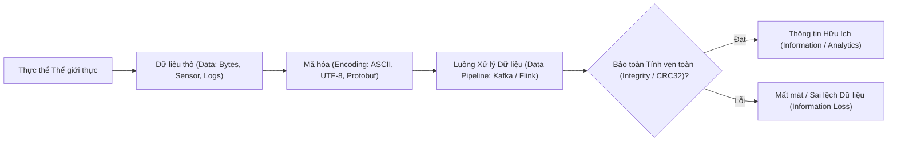
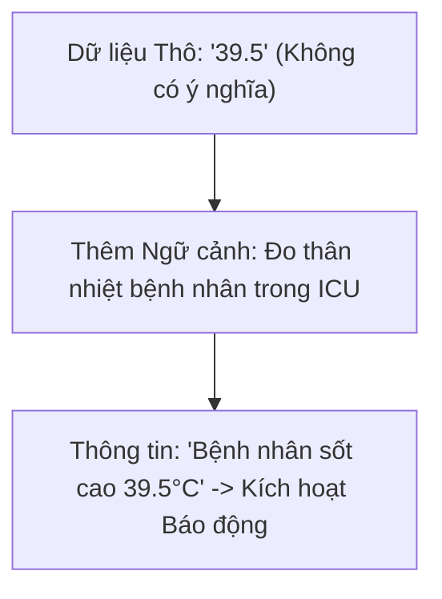
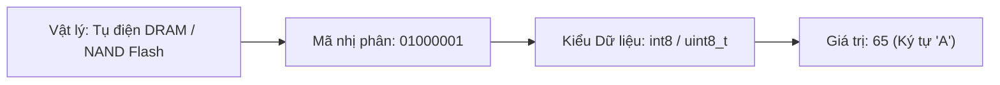
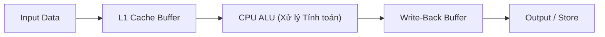
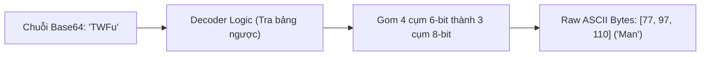
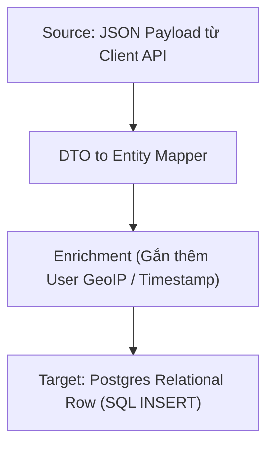
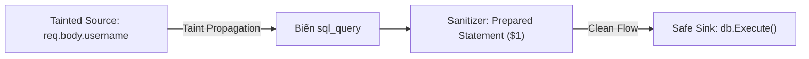
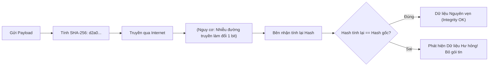
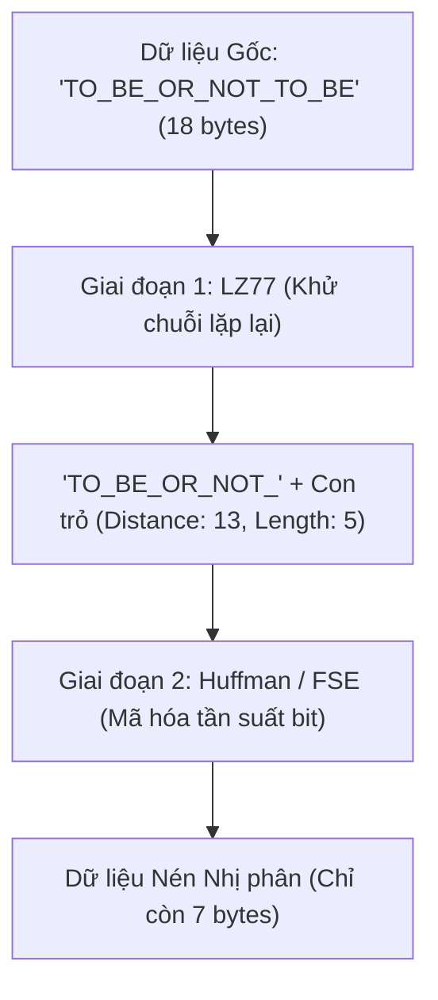

# 6.1. Information Representation and Flow (Nền tảng Xử lý và Luồng Dữ liệu / Thông tin)

## Tổng quan về Xử lý Thông tin
Mọi hệ thống tính toán về bản chất vật lý là một cỗ máy xử lý thông tin (Information Processing Engine). 

Năm 1948, Claude Shannon đã đặt nền móng cho **Lý thuyết Thông tin (Information Theory)**, lượng hóa "thông tin" thành đại lượng toán học gọi là **Entropy ($H$)**, đo lường mức độ bất định (Uncertainty) chứa đựng trong một nguồn tin:
$$H(X) = - \sum_{i=1}^n P(x_i) \log_2 P(x_i) \quad (\text{đơn vị: bits})$$

Trong kỹ thuật phần mềm, chu trình vòng đời thông tin diễn ra qua các giai đoạn:
$$\text{Thế giới thực} \xrightarrow{\text{Thu thập}} \text{Data (Dữ liệu thô)} \xrightarrow{\text{Encoding}} \text{Bits nhị phân} \xrightarrow{\text{Processing \& Transformation}} \text{Information (Thông tin có giá trị)} \xrightarrow{\text{Pipeline}} \text{Lưu trữ / Quyết định}$$



---

## 2. Chi tiết từng Keyword (Under-the-Hood Deep Dive)

---

### 1. Information (Thông tin)

#### 1. Khái niệm bản chất (What & Why)
- **Định nghĩa**: Dữ liệu đã được gán ngữ cảnh, được cấu trúc hóa và xử lý để mang lại ý nghĩa, giúp giảm bớt sự không chắc chắn (Uncertainty reduction) cho người nhận hoặc hệ thống ra quyết định.
- **Theo định nghĩa Shannon**: Lượng thông tin thu nhận được từ một sự kiện tỉ lệ nghịch với xác suất xảy ra của sự kiện đó:
  $$I(x) = \log_2 \frac{1}{P(x)} = - \log_2 P(x)$$
  Một sự kiện chắc chắn xảy ra ($P(x) = 1$) mang lại 0 bit thông tin; một sự kiện cực kỳ hiếm gặp mang lại lượng thông tin rất lớn.

#### 2. Cơ chế hoạt động sâu (Under the hood / Hardcore Internals)
- **Entropy và Giới hạn Nén Lý thuyết (Shannon's Source Coding Theorem)**:
  - Định lý chứng minh rằng không thể nén một dòng dữ liệu xuống kích thước trung bình nhỏ hơn Entropy $H(X)$ của nó mà không làm mất thông tin.
  - Dữ liệu hoàn toàn ngẫu nhiên (Uniform Noise) có Entropy cực đại $\implies$ Không thể nén được.

#### 3. Sơ đồ minh họa


#### 4. Code ví dụ thực chiến (C++ Tính Shannon Entropy của một Chuỗi Bytes)
```cpp
#include <iostream>
#include <vector>
#include <cmath>
#include <string_view>
#include <array>

// Tính toán Shannon Entropy: Đo lường lượng thông tin thực sự trong 1 chuỗi bytes
double calculate_shannon_entropy(std::string_view data) {
    if (data.empty()) return 0.0;

    std::array<uint32_t, 256> frequencies{};
    for (unsigned char c : data) {
        frequencies[c]++;
    }

    double entropy = 0.0;
    double len = static_cast<double>(data.size());

    for (uint32_t count : frequencies) {
        if (count > 0) {
            double p = count / len;
            entropy -= p * std::log2(p);
        }
    }
    return entropy; // Đơn vị: Bits per byte (Max: 8.0 bits)
}

int main() {
    std::string text_repeat = "AAAAAAAAAAAAAAAA"; // Dữ liệu lặp lại, ít thông tin
    std::string text_random = "a8#F19z@!pQ981m$"; // Dữ liệu ngẫu nhiên, nhiều thông tin

    std::cout << "Entropy lặp lại:  " << calculate_shannon_entropy(text_repeat) << " bits/byte\n"; // 0
    std::cout << "Entropy ngẫu nhiên: " << calculate_shannon_entropy(text_random) << " bits/byte\n"; // Cao (~4)
    return 0;
}
```

#### 5. Ưu / Nhược điểm, Pitfalls & Anti-patterns
- **Pitfall**: Đánh đồng dữ liệu dung lượng lớn (nhiều Gigabytes) là có nhiều thông tin. Một file 10GB toàn số 0 thực chất chỉ chứa 0 bit thông tin mới!

#### 6. Ứng dụng thực tế trong Backend / Systems
- Hệ thống phát hiện tấn công DDoS / Gian lận: Theo dõi sự sụt giảm hoặc gia tăng đột ngột của Entropy trong gói tin mạng để phát hiện luồng tấn công SYN Flood hoặc DNS Amplification.

---

### 2. Data (Dữ liệu)

#### 1. Khái niệm bản chất (What & Why)
- **Định nghĩa**: Các ký hiệu, con số, sự kiện hoặc giá trị thô, chưa qua xử lý, chưa được đặt vào ngữ cảnh, được lưu trữ dưới dạng các tín hiệu vật lý (điện áp, từ tính hoặc xung ánh sáng).
- **Phân loại**:
  - Dữ liệu có cấu trúc (Structured Data: Bảng quan hệ SQL).
  - Dữ liệu bán cấu trúc (Semi-structured Data: JSON, YAML, Protocol Buffers).
  - Dữ liệu phi cấu trúc (Unstructured Data: Video, Audio, Log files thô).

#### 2. Cơ chế hoạt động sâu (Under the hood / Hardcore Internals)
- **Lưu trữ vật lý**:
  - Trên SSD NVMe: Dữ liệu là các mức điện áp lưu giữ trong các ô nhớ NAND Flash (SLC: 1 bit, MLC: 2 bits, TLC: 3 bits, QLC: 4 bits/cell).
  - Trên DRAM: Dữ liệu là các điện tích lưu trong tụ điện của transistor (cần được Refresh mỗi 64ms để tránh rò rỉ điện tích).

#### 3. Sơ đồ minh họa


#### 4. Code ví dụ thực chiến (C++ Memory Layout của Kiểu Dữ liệu Nguyên thủy)
```cpp
#include <iostream>
#include <iomanip>

void inspect_memory_bytes(const void* ptr, std::size_t size) {
    const auto* byte_ptr = reinterpret_cast<const uint8_t*>(ptr);
    std::cout << "Memory dump (" << size << " bytes): ";
    for (std::size_t i = 0; i < size; ++i) {
        std::cout << "0x" << std::hex << std::setw(2) << std::setfill('0') 
                  << static_cast<int>(byte_ptr[i]) << " ";
    }
    std::cout << std::dec << "\n";
}

int main() {
    int32_t num = 0x12345678;
    // Quan sát cách dữ liệu được lưu trong RAM máy tính (Little-Endian trên x86)
    inspect_memory_bytes(&num, sizeof(num)); // 78 56 34 12
    return 0;
}
```

#### 5. Ưu / Nhược điểm, Pitfalls & Anti-patterns
- **Anti-pattern**: Lưu trữ dữ liệu phi cấu trúc (Raw BLOBs) trực tiếp vào hàng nghìn cột cơ sở dữ liệu quan hệ gây phình to Table Bloat và cạn kiệt Buffer Pool.

#### 6. Ứng dụng thực tế trong Backend / Systems
- Hệ thống Data Lake (Apache Iceberg, Delta Lake trên AWS S3): Lưu trữ petabytes dữ liệu thô dạng Parquet columnar format để tối ưu hóa chi phí lưu trữ và tốc độ truy vấn phân tán.

---

### 3. Information Processing (Xử lý Thông tin)

#### 1. Khái niệm bản chất (What & Why)
- **Định nghĩa**: Toàn bộ quá trình tiếp nhận dữ liệu đầu vào (Input), biến đổi trạng thái nội tại theo các chỉ thị thuật toán (Transformation / Computation), và sản sinh ra dữ liệu đầu ra có ý nghĩa (Output).
- **Mô hình kinh điển**: IPO Model (Input $\to$ Process $\to$ Output).

#### 2. Cơ chế hoạt động sâu (Under the hood / Hardcore Internals)
- **Tầng CPU Pipeline & Memory Hierarchy**:
  - Xử lý thông tin đạt hiệu năng tối đa khi dữ liệu nằm vừa trong L1/L2 Cache của lõi CPU ($~1-3\text{ns}$ latency) và xử lý liên tục qua bộ xử lý số học ALU / FPU mà không bị chặn bởi việc nạp dữ liệu từ RAM chính ($~60-100\text{ns}$).
  - SIMD Processing: Áp dụng cùng một phép toán số học lên nhiều dòng dữ liệu song song trong 1 chu kỳ CPU (Data-parallel processing).

#### 3. Sơ đồ minh họa


#### 4. Code ví dụ thực chiến (C++ Batch Processing Pipeline)
```cpp
#include <iostream>
#include <vector>
#include <algorithm>

struct SensorTelemetry {
    uint64_t timestamp;
    float temperature_celsius;
};

// Xử lý thông tin: Lọc nhiễu và chuyển đổi đơn vị
std::vector<float> process_telemetry(const std::vector<SensorTelemetry>& raw) {
    std::vector<float> fahrenheit_readings;
    fahrenheit_readings.reserve(raw.size());

    for (const auto& item : raw) {
        // Lọc bỏ dữ liệu lỗi (Noise Filtering)
        if (item.temperature_celsius > -50.0f && item.temperature_celsius < 100.0f) {
            // Biến đổi: C -> F
            float f = (item.temperature_celsius * 1.8f) + 32.0f;
            fahrenheit_readings.push_back(f);
        }
    }
    return fahrenheit_readings;
}

int main() {
    std::vector<SensorTelemetry> stream = {{100, 25.0f}, {101, -999.0f}, {102, 30.5f}};
    auto results = process_telemetry(stream);
    std::cout << "Valid processed points: " << results.size() << "\n";
    return 0;
}
```

#### 5. Ưu / Nhược điểm, Pitfalls & Anti-patterns
- **Pitfall**: Xử lý dữ liệu từng bản ghi riêng lẻ (Row-by-row processing / Cursor iteration) trong các bài toán Big Data, gây lãng phí chu kỳ CPU do chi phí gọi hàm gián tiếp lặp đi lặp lại. Phải chuyển sang **Vectorized / Columnar Processing**.

#### 6. Ứng dụng thực tế trong Backend / Systems
- Apache Flink & Apache Spark: Xử lý hàng chục triệu sự kiện mỗi giây với độ trễ sub-millisecond thông qua mô hình Stream Processing.

---

### 4. Information Representation (Biểu diễn Thông tin)

#### 1. Khái niệm bản chất (What & Why)
- **Định nghĩa**: Quy ước chuẩn hóa dùng để ánh xạ các khái niệm trừu tượng của con người (Số nguyên, Số thực dấu phẩy động, Văn bản, Âm thanh, Hình ảnh) thành chuỗi các bit nhị phân $0$ và $1$.
- **Tại sao cần thiết**: Máy tính bán dẫn chỉ hiểu được 2 mức điện áp (High: 1, Low: 0). Mọi thông tin biểu diễn sai quy ước sẽ bị hiểu sai hoàn toàn.

#### 2. Cơ chế hoạt động sâu (Under the hood / Hardcore Internals)
- **Các chuẩn biểu diễn phần cứng**:
  - **Số nguyên có dấu**: Chuẩn **Two's Complement (Bù hai)**. Đảo toàn bộ bit và cộng thêm 1 ($\sim x + 1$). Ưu điểm: Phép cộng và trừ số âm số dương dùng chung mạch logic ALU duy nhất mà không cần phần cứng riêng.
  - **Số thực**: Chuẩn **IEEE-754 Floating Point**:
    $$\text{Value} = (-1)^{\text{sign}} \times (1 + \text{mantissa}) \times 2^{\text{exponent} - \text{bias}}$$
    Float 32-bit (1 bit sign, 8 bits exponent, 23 bits mantissa). Double 64-bit (1 bit sign, 11 bits exponent, 52 bits mantissa).
  - **Thứ tự Byte (Endianness)**:
    - **Little-Endian (x86, ARM mặc định)**: Byte ít quan trọng nhất (LSB) nằm ở địa chỉ bộ nhớ thấp nhất.
    - **Big-Endian (Network Byte Order)**: Byte quan trọng nhất (MSB) nằm ở địa chỉ bộ nhớ thấp nhất.

#### 3. Sơ đồ minh họa
```text
Biểu diễn Số thực 32-bit (IEEE-754):
[Sign (1b)] [Exponent (8b)] [Mantissa / Fraction (23b)]
    0          10000001        01000000000000000000000   => Giá trị: 5.0
```

#### 4. Code ví dụ thực chiến (C++ IEEE-754 Bit Inspection via Type Punning)
```cpp
#include <iostream>
#include <bitset>
#include <cstring>

void inspect_float_representation(float val) {
    uint32_t bits = 0;
    std::memcpy(&bits, &val, sizeof(float)); // Safe type punning in C++

    std::bitset<32> b(bits);
    std::cout << "Float: " << val << " -> Bits: " << b << "\n";
    std::cout << "Sign: " << b[31] 
              << " | Exp: " << ((bits >> 23) & 0xFF) 
              << " | Mantissa: 0x" << std::hex << (bits & 0x7FFFFF) << std::dec << "\n";
}

int main() {
    inspect_float_representation(5.0f);
    inspect_float_representation(-0.15625f);
    return 0;
}
```

#### 5. Ưu / Nhược điểm, Pitfalls & Anti-patterns
- **Pitfall**: Không chuyển đổi Endianness khi đọc dữ liệu thô từ mạng (Network Byte Order là Big-Endian) sang bộ nhớ CPU x86-64 (Little-Endian) bằng hàm `ntohl()`/`htonl()`, dẫn đến việc số `1` bị biến thành `16777216`!

#### 6. Ứng dụng thực tế trong Backend / Systems
- Định dạng dữ liệu nhị phân hiệu năng cao (Apache Arrow): Chuẩn hóa cách biểu diễn bộ nhớ cột (Columnar Memory Layout) để chia sẻ dữ liệu Zero-Copy giữa C++, Python, Rust và Spark.

---

### 5. Encoding (Mã hóa Biểu diễn)

#### 1. Khái niệm bản chất (What & Why)
- **Định nghĩa**: Quá trình chuyển đổi dữ liệu từ dạng biểu diễn này sang dạng biểu diễn khác theo một bộ quy tắc được chuẩn hóa công khai, phục vụ mục đích truyền tải mạng, lưu trữ hoặc tương thích hệ thống.
- **Phân biệt với Mã hóa Mật mã (Encryption)**: Encoding KHÔNG nhằm mục đích bảo mật dữ liệu (bất kỳ ai cũng có thể Decode ngược lại).

#### 2. Cơ chế hoạt động sâu (Under the hood / Hardcore Internals)
- **UTF-8 (Unicode Transformation Format - 8 bit)**:
  - Mã hóa độ dài biến thiên (Variable-length encoding: 1 đến 4 bytes).
  - Tương thích 100% ngược với mã ASCII chuẩn (các ký tự ASCII $0-127$ chỉ tốn đúng 1 byte duy nhất, bit đầu luôn là 0).
  - Tiết kiệm bộ nhớ vượt trội so với UTF-16 hoặc UTF-32 đối với các hệ thống backend chủ yếu sử dụng tiếng Anh và ký hiệu máy tính.
- **Base64**:
  - Mã hóa 3 bytes nhị phân bất kỳ (24 bits) thành 4 ký tự ASCII an toàn (mỗi ký tự 6 bits: $2^6 = 64$ ký tự khả dĩ).
  - Kích thước dữ liệu tăng khoảng $33\%$ sau khi encode qua Base64.

#### 3. Sơ đồ minh họa
```text
Cơ chế Mã hóa Base64:
3 Bytes nhị phân:  [01001101] [01100001] [01101110] (24 bits)
Chia 4 cụm 6-bit:  [010011]   [010110]   [000101]   [101110]
Giá trị thập phân:    19         22         5          46
Ký tự Base64:         T          W          F          u
```

#### 4. Code ví dụ thực chiến (C++ Base64 Encoding Engine)
```cpp
#include <iostream>
#include <string>
#include <string_view>

static constexpr char BASE64_CHARS[] = 
    "ABCDEFGHIJKLMNOPQRSTUVWXYZabcdefghijklmnopqrstuvwxyz0123456789+/";

std::string base64_encode(std::string_view in) {
    std::string out;
    int val = 0, valb = -6;
    for (uint8_t c : in) {
        val = (val << 8) + c;
        valb += 8;
        while (valb >= 0) {
            out.push_back(BASE64_CHARS[(val >> valb) & 0x3F]);
            valb -= 6;
        }
    }
    if (valb > -6) out.push_back(BASE64_CHARS[((val << 8) >> (valb + 8)) & 0x3F]);
    while (out.size() % 4) out.push_back('='); // Padding
    return out;
}

int main() {
    std::cout << "Base64('Man'): " << base64_encode("Man") << "\n"; // TWFu
    return 0;
}
```

#### 5. Ưu / Nhược điểm, Pitfalls & Anti-patterns
- **Anti-pattern**: Lưu trữ file ảnh hoặc video kích thước lớn dưới dạng chuỗi Base64 trực tiếp vào Database column thay vì lưu vào Object Storage (S3) và chỉ lưu URL.

#### 6. Ứng dụng thực tế trong Backend / Systems
- HTTP Header / JWT (JSON Web Tokens): Sử dụng Base64URL encoding để truyền tải thông tin định danh người dùng an toàn qua URL và HTTP Headers.

---

### 6. Decoding (Giải mã Biểu diễn)

#### 1. Khái niệm bản chất (What & Why)
- **Định nghĩa**: Quá trình chuyển đổi ngược lại dữ liệu từ định dạng mã hóa về dạng cấu trúc dữ liệu nguyên bản trong bộ nhớ mà ứng dụng có thể hiểu và thao tác được.
- **Tính chất**: Phải là hàm ánh xạ nghịch đảo chính xác ($f^{-1}(f(x)) = x$). Mọi ký tự vi phạm bảng quy ước phải bị từ chối an toàn.

#### 2. Cơ chế hoạt động sâu (Under the hood / Hardcore Internals)
- **Xử lý Malformed Byte Sequences trong UTF-8**:
  - Trình phân tích giải mã UTF-8 phải kiểm tra tính hợp lệ của các byte tiếp nối (Continuation Bytes: bit cao bắt buộc phải là `10xxxxxx`). Nếu gặp byte rác hoặc chuỗi bị cắt cụt do đứt gói tin mạng, bộ giải mã phải thay thế bằng ký tự an toàn `U+FFFD` (Replacement Character: ) hoặc bắn lỗi parsing.

#### 3. Sơ đồ minh họa


#### 4. Code ví dụ thực chiến (TypeScript An toàn khi Decode Dữ liệu Người dùng)
```typescript
function safeDecodeUtf8(buffer: Uint8Array): string {
    const decoder = new TextDecoder('utf-8', { fatal: true }); // Bắn exception nếu có byte lỗi
    try {
        return decoder.decode(buffer);
    } catch (err) {
        throw new Error("MALFORMED_UTF8_STREAM: Dữ liệu chứa chuỗi byte không hợp lệ!");
    }
}

const validBytes = new Uint8Array([0x48, 0x65, 0x6c, 0x6c, 0x6f]); // "Hello"
console.log("Decoded:", safeDecodeUtf8(validBytes));
```

#### 5. Ưu / Nhược điểm, Pitfalls & Anti-patterns
- **Lỗ hổng bảo mật**: Lỗ hổng *Double Decoding Vulnerability* (Giải mã 2 lần trên URL path `%252e%252e%252f` $\to$ bypass WAF traversal sang `../`).

#### 6. Ứng dụng thực tế trong Backend / Systems
- Giao tiếp microservices qua gRPC: Tự động deserialize các bytes nhị phân Protobuf nhận được từ mạng thành C++ DTO structs bằng code sinh tự động từ `protoc`.

---

### 7. Data Transformation (Biến đổi Dữ liệu)

#### 1. Khái niệm bản chất (What & Why)
- **Định nghĩa**: Quá trình thay đổi định dạng, cấu trúc, kiểu dữ liệu hoặc nội dung của dữ liệu từ mô hình dữ liệu nguồn (Source Schema) sang mô hình dữ liệu đích (Target Schema).
- **Các thao tác cơ bản**:
  - Filtering (Lọc bản ghi).
  - Mapping / Projection (Chiếu trường thông tin).
  - Aggregation (Gom nhóm và tính tổng, trung bình).
  - Normalization & Denormalization (Chuẩn hóa và Phi chuẩn hóa).

#### 2. Cơ chế hoạt động sâu (Under the hood / Hardcore Internals)
- **CPU Cache Alignment trong Data Transformation**:
  - Khi biến đổi từ cấu trúc **AoS (Array of Structures)** sang **SoA (Structure of Arrays)**:
    - AoS: `[ {id, price, tax}, {id, price, tax}, ... ]` (Thích hợp cho CRUD).
    - SoA: `{ ids: [...], prices: [...], taxes: [...] }` (Thích hợp cho Analytics).
  - SoA cho phép CPU nạp toàn bộ mảng `prices` liên tục vào Cache Line và tính toán tổng bằng SIMD instructions nhanh hơn gấp 10 lần so với AoS!

#### 3. Sơ đồ minh họa


#### 4. Code ví dụ thực chiến (C++ AoS to SoA Transformation for SIMD Acceleration)
```cpp
#include <iostream>
#include <vector>

// AoS
struct OrderAoS {
    int id;
    float price;
    float discount;
};

// SoA: Thích hợp cho Vectorized Batch Transformation
struct OrderSoA {
    std::vector<int> ids;
    std::vector<float> prices;
    std::vector<float> discounts;

    void reserve(std::size_t n) {
        ids.reserve(n);
        prices.reserve(n);
        discounts.reserve(n);
    }
};

OrderSoA transform_aos_to_soa(const std::vector<OrderAoS>& aos) {
    OrderSoA soa;
    soa.reserve(aos.size());
    for (const auto& item : aos) {
        soa.ids.push_back(item.id);
        soa.prices.push_back(item.price);
        soa.discounts.push_back(item.discount);
    }
    return soa;
}

int main() {
    std::vector<OrderAoS> orders = {{1, 100.0f, 0.1f}, {2, 200.0f, 0.2f}};
    auto soa = transform_aos_to_soa(orders);
    std::cout << "SoA transformed successfully. Total prices count: " << soa.prices.size() << "\n";
    return 0;
}
```

#### 5. Ưu / Nhược điểm, Pitfalls & Anti-patterns
- **Pitfall**: Thực hiện biến đổi dữ liệu trên từng hàng đơn lẻ bằng các hàm không thuần túy (Impure transformations) tạo ra side-effects ngoài ý muốn khiến pipeline không thể chạy lại an toàn (Idempotency failure).

#### 6. Ứng dụng thực tế trong Backend / Systems
- Công cụ dbt (Data Build Tool) trong Data Warehouse: Thực thi các câu lệnh biến đổi SQL mô hình hóa dữ liệu từ tầng Staging sang tầng Marts.

---

### 8. Information Flow (Luồng Thông tin)

#### 1. Khái niệm bản chất (What & Why)
- **Định nghĩa**: Con đường và trình tự mà dữ liệu/thông tin di chuyển qua các thành phần khác nhau của một hệ thống máy tính, từ giao diện người dùng, mạng internet, bộ nhớ tiến trình, kernel hệ điều hành, cho đến đĩa cứng.
- **Kiểm soát Luồng Thông tin (Information Flow Control - IFC)**: Mô hình bảo mật kiểm soát xem thông tin nhạy cảm (Confidential data) có bị rò rỉ tới các kênh không đáng tin cậy hay không.

#### 2. Cơ chế hoạt động sâu (Under the hood / Hardcore Internals)
- **Taint Analysis (Phân tích Vấy bẩn)**:
  - Dữ liệu đi vào từ nguồn không tin cậy (như HTTP Request Body) bị đánh dấu là "Tainted".
  - Bất kỳ biến nào được tính toán dựa trên biến bị vấy bẩn cũng sẽ bị lây nhiễm (Taint Propagation).
  - Luồng thông tin chỉ được phép đi vào "Sink" nhạy cảm (như SQL query execution, file system access) nếu nó đã đi qua một hàm khử độc (Sanitization Filter).

#### 3. Sơ đồ minh họa


#### 4. Code ví dụ thực chiến (TypeScript Type-safe Information Flow Taint Tracking)
```typescript
// Sử dụng Branded Types để bảo vệ Luồng Thông tin
type UntrustedInput = string & { readonly __brand: unique symbol };
type SanitizedString = string & { readonly __brand: unique symbol };

function markUntrusted(raw: string): UntrustedInput {
    return raw as UntrustedInput;
}

function sanitizeInput(input: UntrustedInput): SanitizedString {
    // Khử các ký tự nguy hiểm chống SQL Injection / XSS
    return input.replace(/['";\\]/g, "") as SanitizedString;
}

function executeDatabaseQuery(safeQuery: SanitizedString): void {
    console.log("Thực thi câu truy vấn an toàn:", safeQuery);
}

const userInput = markUntrusted("admin' OR '1'='1");
// executeDatabaseQuery(userInput); // COMPILE ERROR: Không thể truyền Untrusted vào DB!
const safe = sanitizeInput(userInput);
executeDatabaseQuery(safe); // Hợp lệ!
```

#### 5. Ưu / Nhược điểm, Pitfalls & Anti-patterns
- **Pitfall**: Kênh truyền bí mật (Covert Channels): Thông tin bị rò rỉ không qua dữ liệu mà qua thời gian thực thi (Timing Attacks) hoặc mức tiêu thụ điện năng của CPU.

#### 6. Ứng dụng thực tế trong Backend / Systems
- Hệ thống tuân thủ GDPR / PCI-DSS: Cô lập luồng thông tin chứa dữ liệu thẻ tín dụng (PAN) sang một mạng cô lập (Cardholder Data Environment - CDE).

---

### 9. Data Pipeline (Đường ống Dữ liệu)

#### 1. Khái niệm bản chất (What & Why)
- **Định nghĩa**: Một chuỗi các phần tử xử lý dữ liệu được kết nối tuần tự với nhau, trong đó đầu ra của bước trước là đầu vào của bước tiếp theo.
- **Hai kiến trúc chủ đạo**:
  - **Batch Pipeline (ETL / ELT)**: Xử lý theo lô dữ liệu lớn định kỳ (hàng giờ, hàng ngày).
  - **Streaming Pipeline**: Xử lý từng sự kiện liên tục theo thời gian thực (Event-driven).

#### 2. Cơ chế hoạt động sâu (Under the hood / Hardcore Internals)
- **Cơ chế Backpressure và Bounded Buffers**:
  - Nếu thành phần xử lý phía sau (Consumer) chậm hơn thành phần phía trước (Producer), bộ đệm trung gian sẽ đầy.
  - Một Pipeline chuẩn phải có cơ chế Backpressure: Báo hiệu ngược lại cho Producer giảm tốc độ gửi dữ liệu, tránh làm tràn RAM gây crash server.

#### 3. Sơ đồ minh họa


#### 4. Code ví dụ thực chiến (C++ Concurrent Pipeline via Producer-Consumer Queue)
```cpp
#include <iostream>
#include <queue>
#include <mutex>
#include <condition_variable>
#include <thread>

template <typename T>
class BoundedDataPipelineQueue {
    std::queue<T> queue_;
    std::size_t max_size_;
    std::mutex mtx_;
    std::condition_variable not_full_;
    std::condition_variable not_empty_;

public:
    explicit BoundedDataPipelineQueue(std::size_t max_size) : max_size_(max_size) {}

    void push(T item) {
        std::unique_lock<std::mutex> lock(mtx_);
        not_full_.wait(lock, [this]() { return queue_.size() < max_size_; }); // Backpressure!
        queue_.push(std::move(item));
        not_empty_.notify_one();
    }

    T pop() {
        std::unique_lock<std::mutex> lock(mtx_);
        not_empty_.wait(lock, [this]() { return !queue_.empty(); });
        T item = std::move(queue_.front());
        queue_.pop();
        not_full_.notify_one();
        return item;
    }
};

int main() {
    BoundedDataPipelineQueue<int> pipeline(2); // Bộ đệm tối đa 2 items
    std::thread producer([&]() {
        for (int i = 1; i <= 3; ++i) {
            pipeline.push(i);
            std::cout << "Produced: " << i << "\n";
        }
    });

    std::thread consumer([&]() {
        for (int i = 1; i <= 3; ++i) {
            int val = pipeline.pop();
            std::cout << "Consumed: " << val << "\n";
        }
    });

    producer.join();
    consumer.join();
    return 0;
}
```

#### 5. Ưu / Nhược điểm, Pitfalls & Anti-patterns
- **Pitfall**: Không thiết kế Dead Letter Queue (DLQ). Khi gặp 1 bản ghi lỗi cú pháp (Poison Pill), toàn bộ pipeline bị tắc nghẽn vô hạn.

#### 6. Ứng dụng thực tế trong Backend / Systems
- Hệ thống Data Platform của Uber / Netflix: Xử lý hàng nghìn tỷ message mỗi ngày qua hệ thống pipeline kết hợp Kafka + Apache Flink + Iceberg.

---

### 10. Information Loss (Mất mát Thông tin)

#### 1. Khái niệm bản chất (What & Why)
- **Định nghĩa**: Hiện tượng một phần thông tin bị biến mất vĩnh viễn và không thể khôi phục lại trong quá trình xử lý, chuyển đổi kiểu dữ liệu hoặc nén.
- **Nguyên nhân chính**:
  - Ép kiểu dữ liệu hẹp dần (Narrowing Cast / Truncation).
  - Sai số làm tròn số thực dấu phẩy động (Floating-point precision loss).
  - Nén có mất mát (Lossy Compression).

#### 2. Cơ chế hoạt động sâu (Under the hood / Hardcore Internals)
- **Lỗi ép kiểu số nguyên**:
  - Ép kiểu `int64_t` sang `int32_t`: 32 bit cao bị CPU cắt bỏ hoàn toàn (`x86 movsxd / truncation`).
- **Sai số số thực**:
  - Trong IEEE-754, phép tính `0.1 + 0.2` không bằng `0.3` mà bằng `0.30000000000000004` do số $0.1$ không thể biểu diễn chính xác tuyệt đối dưới dạng phân số nhị phân hữu hạn.

#### 3. Sơ đồ minh họa
```text
Minh họa Mất mát Thông tin do Cắt gọt bit (Integer Truncation):
Số ban đầu (64-bit): 0x0000 0001 0000 0005 (4,294,967,301)
Ép sang (32-bit):    [BỎ PHẦN NÀY] | 0x0000 0005
Số sau ép kiểu:      5 (Mất mát thông tin nghiêm trọng!)
```

#### 4. Code ví dụ thực chiến (C++ Minh họa Lỗi Mất mát Dữ liệu Tài chính)
```cpp
#include <iostream>
#include <iomanip>

void demonstrate_floating_point_loss() {
    double original_amount = 0.1;
    double sum = 0.0;
    for (int i = 0; i < 10; ++i) {
        sum += original_amount;
    }

    std::cout << std::setprecision(18);
    std::cout << "Sum of 10 times 0.1: " << sum << "\n"; // 0.999999999999999889 != 1.0!
    if (sum != 1.0) {
        std::cout << "CRITICAL: Information Loss occurred in financial computation!\n";
    }
}

int main() {
    demonstrate_floating_point_loss();
    return 0;
}
```

#### 5. Ưu / Nhược điểm, Pitfalls & Anti-patterns
- **Thảm họa lịch sử**: Tên lửa Ariane 5 phát nổ năm 1996 do lỗi chuyển đổi biến số thực 64-bit sang số nguyên có dấu 16-bit gây số tràn số (Integer Overflow).

#### 6. Ứng dụng thực tế trong Backend / Systems
- Hệ thống Thanh toán Ngân hàng: Tuyệt đối cấm sử dụng kiểu `float/double`. Bắt buộc dùng `BigInt` lưu số tiền theo đơn vị nhỏ nhất (Cents/Xu) hoặc thư viện Fixed-point Decimal.

---

### 11. Data Integrity (Tính Toàn vẹn Dữ liệu)

#### 1. Khái niệm bản chất (What & Why)
- **Định nghĩa**: Độ chính xác, tính đầy đủ và tính nhất quán toán học của dữ liệu trong suốt toàn bộ vòng đời lưu trữ và truyền tải, bảo đảm dữ liệu không bị thay đổi, hư hỏng hoặc giả mạo.
- **Phương tiện xác minh**:
  - Mã sửa lỗi phần cứng (ECC Memory).
  - Mã kiểm tra vòng (CRC32 Checksum).
  - Hàm băm mật mã học (SHA-256 / BLAKE3).
  - Chữ ký điện tử số (HMAC / RSA Signatures).

#### 2. Cơ chế hoạt động sâu (Under the hood / Hardcore Internals)
- **Bit Rot (Sự thối rữa bit)**:
  - Các hạt tia vũ trụ (Cosmic Rays) hoặc sự suy thoái vật lý của bóng bán dẫn có thể ngẫu nhiên lật 1 bit trong RAM hoặc ổ đĩa mà hệ điều hành không hề hay biết (Silent Data Corruption).
  - Các hệ thống tệp hiện đại (ZFS, Btrfs) lưu trữ mã Checksum bên cạnh dữ liệu của mỗi block đĩa. Khi đọc block, ZFS tính lại Checksum; nếu không khớp, nó tự động lấy block sao lưu từ đĩa Mirror để tự chữa lành (Self-healing).

#### 3. Sơ đồ minh họa


#### 4. Code ví dụ thực chiến (C++ CRC32 Fast Checksum Verification)
```cpp
#include <iostream>
#include <string_view>
#include <array>

// Bảng Lookup CRC32
constexpr auto generate_crc32_table() {
    std::array<uint32_t, 256> table{};
    for (uint32_t i = 0; i < 256; ++i) {
        uint32_t crc = i;
        for (uint32_t j = 0; j < 8; ++j) {
            crc = (crc >> 1) ^ ((crc & 1) ? 0xEDB88320 : 0);
        }
        table[i] = crc;
    }
    return table;
}

constexpr auto CRC_TABLE = generate_crc32_table();

uint32_t compute_crc32(std::string_view data) {
    uint32_t crc = 0xFFFFFFFF;
    for (uint8_t b : data) {
        crc = (crc >> 8) ^ CRC_TABLE[(crc ^ b) & 0xFF];
    }
    return crc ^ 0xFFFFFFFF;
}

int main() {
    std::string message = "Transaction: User A transfers 100$ to User B";
    uint32_t checksum = compute_crc32(message);
    std::cout << "CRC32 Checksum: 0x" << std::hex << checksum << std::dec << "\n";
    return 0;
}
```

#### 5. Ưu / Nhược điểm, Pitfalls & Anti-patterns
- **Pitfall**: Sử dụng CRC32 để chống giả mạo bảo mật. Kẻ tấn công có thể dễ dàng sửa đổi nội dung và tính lại CRC32 giả mạo. Phải dùng HMAC-SHA256 kết hợp khóa bí mật.

#### 6. Ứng dụng thực tế trong Backend / Systems
- Git Version Control: Toàn bộ cấu trúc commit và lịch sử file của Git được quản lý dưới dạng đồ thị có hướng không chu trình (Merkle DAG) dựa trên mã băm SHA-1 / SHA-256.

---

### 12. Data Compression (Nén Dữ liệu)

#### 1. Khái niệm bản chất (What & Why)
- **Định nghĩa**: Quá trình mã hóa thông tin sử dụng ít bits hơn so với dạng biểu diễn gốc, nhằm tiết kiệm dung lượng lưu trữ đĩa và băng thông truyền tải mạng.
- **Hai nhánh phân loại**:
  1. **Nén không mất mát (Lossless Compression)**: Dữ liệu sau khi giải nén giống hệt $100\%$ bản gốc (Gzip, Zstandard, LZ4, Snappy, PNG). Bắt buộc cho Text, Code, Database, Tài liệu.
  2. **Nén có mất mát (Lossy Compression)**: Loại bỏ các thông tin mà giác quan con người khó nhận biết (JPEG, MP3, H.264/HEVC Video). Không thể áp dụng cho mã nguồn hoặc dữ liệu nhị phân.

#### 2. Cơ chế hoạt động sâu (Under the hood / Hardcore Internals)
- **Bộ đôi kinh điển của Nén Không Mất Mát**:
  - **Mã hóa Từ điển LZ77 / LZ4**: Tìm các chuỗi byte lặp lại trong quá khứ (Sliding Window) và thay thế bằng cặp con trỏ `(Distance, Length)`.
  - **Mã hóa Entropy (Huffman Coding / ANS)**: Gán các mã bit ngắn cho các ký tự xuất hiện thường xuyên, và mã bit dài cho các ký tự hiếm gặp.
  - **Zstandard (zstd do Facebook phát triển)**: Kết hợp LZ77 với Finite State Entropy (FSE), cho tốc độ giải nén hàng Gigabytes/giây trên một lõi CPU.

#### 3. Sơ đồ minh họa


#### 4. Code ví dụ thực chiến (C++ Run-Length Encoding - Thuật toán Nén Lossless Đơn giản nhất)
```cpp
#include <iostream>
#include <string>
#include <string_view>

// Run-Length Encoding: Nén các chuỗi ký tự lặp liên tiếp: "AAAAABBBCC" -> "5A3B2C"
std::string run_length_encode(std::string_view in) {
    if (in.empty()) return "";
    std::string out;
    std::size_t i = 0;

    while (i < in.size()) {
        char c = in[i];
        int count = 1;
        while (i + 1 < in.size() && in[i + 1] == c) {
            ++count;
            ++i;
        }
        out += std::to_string(count);
        out.push_back(c);
        ++i;
    }
    return out;
}

int main() {
    std::string text = "WWWWWWWWWWWWBWWWWWWWWWWWWBBB";
    std::cout << "Original size:   " << text.size() << " bytes\n";
    std::string compressed = run_length_encode(text);
    std::cout << "Compressed size: " << compressed.size() << " bytes -> " << compressed << "\n";
    return 0;
}
```

#### 5. Ưu / Nhược điểm, Pitfalls & Anti-patterns
- **Pitfall**: Cố gắng nén dữ liệu đã được mã hóa (Encrypted data) hoặc dữ liệu có Entropy cực đại, việc này chỉ làm kích thước file to hơn do chi phí header của thuật toán nén.

#### 6. Ứng dụng thực tế trong Backend / Systems
- HTTP Compression (`Content-Encoding: gzip, zstd`): Giảm kích thước phản hồi API JSON từ máy chủ xuống 70-80%, giảm thời gian tải trang và chi phí băng thông Cloud Egress.
