# 7.1. Hardware, Software, and OS Abstractions (Nguyên lý Hệ thống Máy tính và Tầng Trừu tượng Hệ điều hành)

## Tổng quan về Hệ thống Máy tính
Hệ thống máy tính (Computer System) là một hệ thống phân tầng phức tạp bao gồm phần cứng vật lý, vi chương trình, nhân hệ điều hành, môi trường thực thi và các ứng dụng cấp cao. 

Nhiệm vụ tối thượng của hệ thống là cung cấp các **Tầng Trừu tượng (Abstraction Layers)** an toàn, che giấu sự thô ráp của các mạch điện tử bán dẫn và cung cấp một môi trường thực thi logic nhất quán cho lập trình viên.

Mô hình phân tầng kiến trúc:
$$\text{User Applications} \to \text{Language Runtime} \to \text{Standard Library (glibc)} \to \text{System Calls (Syscall Interface)} \to \text{OS Kernel (Ring 0)} \to \text{Device Drivers / Firmware} \to \text{Hardware (CPU, RAM, I/O Bus)}$$

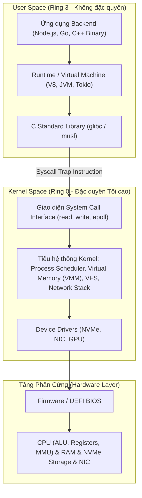

---

## 2. Chi tiết từng Keyword (Under-the-Hood Deep Dive)

---

### 1. Computer System (Hệ thống Máy tính)

#### 1. Khái niệm bản chất (What & Why)
- **Định nghĩa**: Một tổ hợp tích hợp hoàn chỉnh gồm phần cứng (Hardware), phần mềm (Software) và các giao thức truyền thông được thiết kế để tiếp nhận, lưu trữ, xử lý và truyền tải thông tin.
- **Mô hình Von Neumann (1945)**:
  1. Đơn vị Xử lý Trung tâm (CPU: chứa Control Unit và ALU).
  2. Đơn vị Bộ nhớ Chính (Main Memory / RAM).
  3. Cơ chế Lưu trữ Ngoài và Thiết bị Vào/Ra (I/O Devices).
  4. Hệ thống Đường truyền Dữ liệu (System Bus: Data Bus, Address Bus, Control Bus).

#### 2. Cơ chế hoạt động sâu (Under the hood / Hardcore Internals)
- **Chu kỳ Máy tính Cơ bản (Von Neumann Cycle)**:
  - $\text{Fetch} \to \text{Decode} \to \text{Execute} \to \text{Memory Access} \to \text{Write-Back}$.
  - CPU sử dụng Bus điều khiển để yêu cầu RAM đọc dữ liệu tại địa chỉ trong Program Counter (`RIP`). Mã lệnh được đưa vào Instruction Register để giải mã thành các tín hiệu điện điều khiển các bóng bán dẫn trong ALU.

#### 3. Sơ đồ minh họa
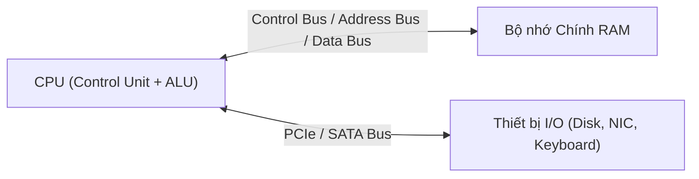

#### 4. Code ví dụ thực chiến (C++ Truy vấn Thông tin Hệ thống qua POSIX sysinfo)
```cpp
#include <iostream>
#include <sys/sysinfo.h>

void print_system_overview() {
    struct sysinfo info;
    if (sysinfo(&info) == 0) {
        std::cout << "Uptime: " << info.uptime << " seconds\n";
        std::cout << "Total RAM: " << (info.totalram * info.mem_unit) / (1024 * 1024) << " MB\n";
        std::cout << "Free RAM:  " << (info.freeram * info.mem_unit) / (1024 * 1024) << " MB\n";
        std::cout << "Current Process Count: " << info.procs << "\n";
    }
}

int main() {
    print_system_overview();
    return 0;
}
```

#### 5. Ưu / Nhược điểm, Pitfalls & Anti-patterns
- **Von Neumann Bottleneck (Điểm nghẽn Von Neumann)**: Băng thông truyền dữ liệu giữa CPU và RAM bị giới hạn so với tốc độ tính toán của lõi CPU, buộc các kiến trúc sư phải bổ sung nhiều tầng bộ nhớ đệm Cache L1/L2/L3.

#### 6. Ứng dụng thực tế trong Backend / Systems
- Bare-metal Server Provisioning: Cấu hình và giám sát các máy chủ vật lý quy mô lớn trong Data Centers (Dell PowerEdge, HPE ProLiant).

---

### 2. Hardware (Phần cứng)

#### 1. Khái niệm bản chất (What & Why)
- **Định nghĩa**: Toàn bộ các thực thể vật lý, linh kiện điện tử, mạch tích hợp bán dẫn (Silicon chips), dây dẫn, tụ điện cấu thành nên cỗ máy tính.
- **Thành phần cốt lõi**: CPU, RAM, Motherboard, Bo mạch đồ họa (GPU), Ổ cứng thể rắn (SSD NVMe), Card mạng (NIC - Network Interface Card).

#### 2. Cơ chế hoạt động sâu (Under the hood / Hardcore Internals)
- **Công nghệ Bán dẫn (CMOS Transistors)**:
  - Các bóng bán dẫn MOSFET hoạt động như các công tắc điện tử cực nhanh (kích thước nano-mét: 3nm, 5nm).
  - Tần số xung nhịp (Clock Speed: ví dụ 4.0 GHz) điều phối nhịp đập của hàng tỷ bóng bán dẫn chuyển trạng thái đồng bộ sau mỗi 0.25 nanoseconds.

#### 3. Sơ đồ minh họa
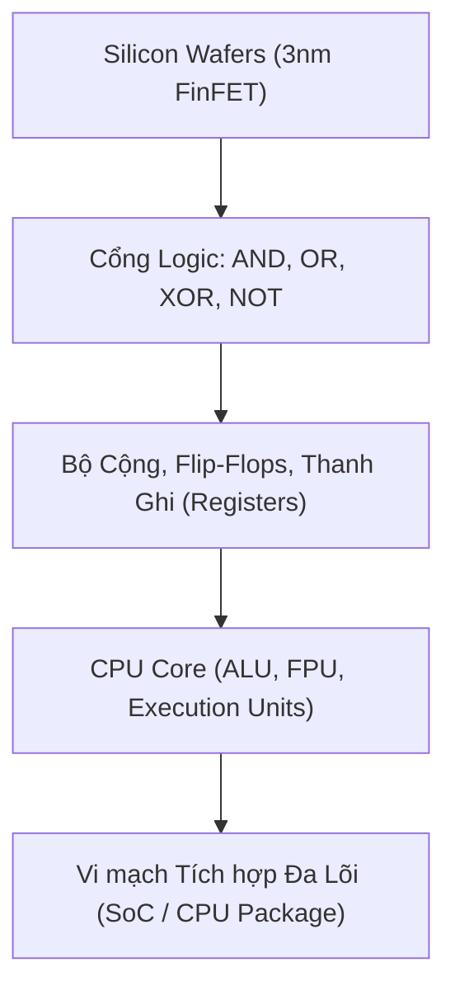

#### 4. Code ví dụ thực chiến (C++ Đo lường Giới hạn Cache Hardware)
```cpp
#include <iostream>
#include <vector>
#include <chrono>

// Đo lường hiệu năng duyệt mảng: Cache-friendly (Tuần tự) vs Cache-unfriendly (Bước nhảy lớn)
void hardware_cache_benchmark() {
    constexpr std::size_t N = 64 * 1024 * 1024; // 64M ints = 256MB (Vượt L3 Cache)
    std::vector<int> arr(N, 1);

    // Cách 1: Sequential Access (Khai thác tối đa L1/L2 Cache Prefetcher)
    auto t1 = std::chrono::high_resolution_clock::now();
    int64_t sum1 = 0;
    for (std::size_t i = 0; i < N; ++i) sum1 += arr[i];
    auto t2 = std::chrono::high_resolution_clock::now();

    // Cách 2: Stride Access bước nhảy 16 (Liên tục Cache Miss)
    auto t3 = std::chrono::high_resolution_clock::now();
    int64_t sum2 = 0;
    for (std::size_t i = 0; i < N; i += 16) sum2 += arr[i];
    auto t4 = std::chrono::high_resolution_clock::now();

    std::cout << "Sequential Time: " 
              << std::chrono::duration_cast<std::chrono::milliseconds>(t2 - t1).count() << " ms\n";
    std::cout << "Stride 16 Time:   " 
              << std::chrono::duration_cast<std::chrono::milliseconds>(t4 - t3).count() << " ms\n";
}

int main() {
    hardware_cache_benchmark();
    return 0;
}
```

#### 5. Ưu / Nhược điểm, Pitfalls & Anti-patterns
- **Pitfall**: Viết code mà không để ý tới cấu trúc phần cứng (Hardware-oblivious programming), gây ra hiện tượng False Sharing giữa các CPU cores làm suy giảm hiệu năng đa luồng tới 90%.

#### 6. Ứng dụng thực tế trong Backend / Systems
- Thiết lập SR-IOV (Single Root I/O Virtualization) và DPDK (Data Plane Development Kit): Bỏ qua nhân Linux để ứng dụng backend nói chuyện trực tiếp với phần cứng Card mạng NIC, đạt tốc độ chuyển tiếp 100Gbps.

---

### 3. Software (Phần mềm)

#### 1. Khái niệm bản chất (What & Why)
- **Định nghĩa**: Tập hợp các chương trình, quy trình, thuật toán và tài liệu liên quan chỉ đạo phần cứng máy tính thực hiện các nhiệm vụ tính toán cụ thể.
- **Phân loại**:
  - System Software (Phần mềm Hệ thống: OS, Drivers, Compilers, Linkers).
  - Application Software (Phần mềm Ứng dụng: Web APIs, Databases, Frontend apps).

#### 2. Cơ chế hoạt động sâu (Under the hood / Hardcore Internals)
- Phần mềm ở dạng cấp cao (C++, Go) được chuyển đổi qua chuỗi công cụ (Toolchain: Preprocessor $\to$ Compiler $\to$ Assembler $\to$ Linker) thành file thực thi nhị phân định dạng ELF (Executable and Linkable Format trên Linux) hoặc Mach-O (trên macOS).

#### 3. Sơ đồ minh họa


#### 4. Code ví dụ thực chiến (C++ Phân tích Cấu trúc Binary Header ELF)
```cpp
#include <iostream>
#include <fstream>
#include <cstdint>

// Kiểm tra Magic Number của file thực thi Linux ELF (0x7F 'E' 'L' 'F')
bool is_elf_binary(const char* filepath) {
    std::ifstream file(filepath, std::ios::binary);
    if (!file) return false;

    uint8_t magic[4];
    file.read(reinterpret_cast<char*>(magic), 4);
    return (magic[0] == 0x7F && magic[1] == 'E' && magic[2] == 'L' && magic[3] == 'F');
}

int main() {
    std::cout << "Is /bin/ls an ELF binary? " << (is_elf_binary("/bin/ls") ? "YES" : "NO") << "\n";
    return 0;
}
```

#### 5. Ưu / Nhược điểm, Pitfalls & Anti-patterns
- **Pitfall**: Phân phối phần mềm nhị phân mà không cố định phiên bản thư viện dùng chung (Dynamic Shared Libraries `.so`), gây ra lỗi kinh điển *DLL Hell / Dependency Hell*.

#### 6. Ứng dụng thực tế trong Backend / Systems
- Đóng gói Docker Containers: Đóng gói toàn bộ phần mềm ứng dụng kèm theo toàn bộ root filesystem (glibc, configs, runtime) để đảm bảo tính nhất quán giữa môi trường Dev và Production.

---

### 4. Firmware (Vi chương trình)

#### 1. Khái niệm bản chất (What & Why)
- **Định nghĩa**: Một loại phần mềm đặc biệt cấp thấp được ghi trực tiếp vào bộ nhớ chỉ đọc không khả biến (Non-volatile Memory: ROM, EPROM, Flash Memory) của một linh kiện phần cứng.
- **Nhiệm vụ**: Cung cấp các lệnh điều khiển cơ bản nhất để khởi động phần cứng và giao tiếp với hệ điều hành (tiêu biểu là UEFI / BIOS, vi mã CPU Microcode, Firmware ổ cứng SSD).

#### 2. Cơ chế hoạt động sâu (Under the hood / Hardcore Internals)
- **Quy trình Khởi động (Boot Sequence)**:
  1. Khi bật nguồn máy tính, CPU đặt con trỏ lệnh `RIP` vào địa chỉ cố định `0xFFFFFFF0` (Reset Vector).
  2. Địa chỉ này trỏ tới chip Flash chứa **UEFI Firmware**.
  3. UEFI chạy quy trình **POST (Power-On Self-Test)** kiểm tra tính toàn vẹn của RAM và thiết bị ngoại vi.
  4. UEFI đọc bảng phân vùng GPT, tìm kiếm phân vùng EFI System Partition (ESP) và tải Bootloader (GRUB / systemd-boot) vào RAM để trao quyền kiểm soát cho Kernel hệ điều hành.

#### 3. Sơ đồ minh họa
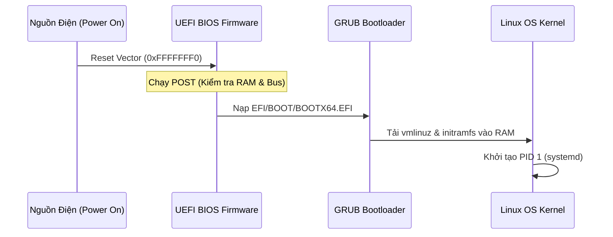

#### 4. Code ví dụ thực chiến (C++ Đọc Biến Môi trường UEFI qua Linux sysfs)
```cpp
#include <iostream>
#include <filesystem>

// Kiểm tra máy tính có đang chạy chế độ UEFI hiện đại hay Legacy BIOS
bool is_running_uefi_mode() {
    return std::filesystem::exists("/sys/firmware/efi");
}

int main() {
    std::cout << "Boot mode is modern UEFI: " << (is_running_uefi_mode() ? "TRUE" : "FALSE") << "\n";
    return 0;
}
```

#### 5. Ưu / Nhược điểm, Pitfalls & Anti-patterns
- **Rủi ro Brick phần cứng**: Mất điện hoặc ghi đè sai dữ liệu trong quá trình cập nhật Firmware (Flashing BIOS) có thể làm tê liệt linh kiện vĩnh viễn nếu bo mạch không có Dual-BIOS dự phòng.

#### 6. Ứng dụng thực tế trong Backend / Systems
- Quản lý Máy chủ từ xa (IPMI / iLO / iDRAC): Firmware của vi điều khiển Baseboard Management Controller (BMC) cho phép kỹ sư khởi động lại máy chủ và cài lại OS từ xa qua mạng ngay cả khi máy chủ chính đang tắt.

---

### 5. Operating System (Hệ điều hành)

#### 1. Khái niệm bản chất (What & Why)
- **Định nghĩa**: Phần mềm hệ thống trung tâm quản lý toàn bộ tài nguyên phần cứng máy tính và cung cấp các dịch vụ dùng chung cho các ứng dụng phần mềm.
- **Hai vai trò cốt lõi**:
  1. **Bộ quản lý Tài nguyên (Resource Manager)**: Điều phối công bằng và hiệu quả CPU, RAM, Ổ cứng và Mạng giữa các tiến trình cạnh tranh.
  2. **Máy Mở rộng (Extended Machine / Virtual Machine)**: Cung cấp các giao diện lập trình trừu tượng thân thiện (File, Sockets, Processes) thay vì thao tác với thanh ghi phần cứng.

#### 2. Cơ chế hoạt động sâu (Under the hood / Hardcore Internals)
- **Kiến trúc Nhân (Kernel Architectures)**:
  - **Monolithic Kernel (Linux)**: Toàn bộ các dịch vụ (VFS, Network Stack, Drivers, Scheduler) chạy chung trong cùng một không gian địa chỉ Ring 0. Tốc độ cực nhanh nhưng một driver lỗi có thể làm sập toàn bộ hệ thống (Kernel Panic).
  - **Microkernel (seL4, Mach, QNX)**: Nhân chỉ giữ lại những gì tối thiểu (IPC, Address Space, Scheduling), toàn bộ File System và Network chạy ở User Space Ring 3. An toàn tuyệt đối nhưng tốn chi phí IPC context switches.

#### 3. Sơ đồ minh họa
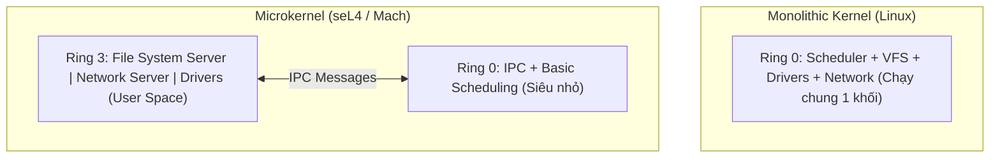

#### 4. Code ví dụ thực chiến (C++ POSIX OS API Call)
```cpp
#include <iostream>
#include <unistd.h>

int main() {
    char hostname[256];
    if (gethostname(hostname, sizeof(hostname)) == 0) {
        std::cout << "Current Host OS Node: " << hostname << "\n";
    }
    std::cout << "Page Size of OS: " << sysconf(_SC_PAGESIZE) << " bytes\n"; // Thường 4096 bytes
    return 0;
}
```

#### 5. Ưu / Nhược điểm, Pitfalls & Anti-patterns
- **Pitfall**: Bỏ qua các tham số cấu hình OS Kernel (như `sysctl` limits: `fs.file-max`, `net.core.somaxconn`), khiến máy chủ backend chịu tải cao bị từ chối kết nối dù CPU và RAM vẫn còn thừa.

#### 6. Ứng dụng thực tế trong Backend / Systems
- Tinh chỉnh Linux Kernel cho High-Throughput Web Services: Bật `tcp_tw_reuse`, tăng `net.ipv4.tcp_max_syn_backlog` để máy chủ Nginx/Envoy phục vụ hàng triệu kết nối đồng thời.

---

### 6. Application (Ứng dụng)

#### 1. Khái niệm bản chất (What & Why)
- **Định nghĩa**: Chương trình máy tính được thiết kế để phục vụ trực tiếp nhu cầu nghiệp vụ của người dùng cuối (End-user) hoặc hệ thống nghiệp vụ (e-commerce, thanh toán, phân tích dữ liệu).
- **Vị trí**: Chạy hoàn toàn trong không gian người dùng (User Space - Ring 3), bị giới hạn quyền truy cập trực tiếp phần cứng và phải nhờ cậy hệ điều hành thông qua các System Calls.

#### 2. Cơ chế hoạt động sâu (Under the hood / Hardcore Internals)
- Một ứng dụng khi được thực thi sẽ sở hữu một **Không gian Địa chỉ Ảo (Virtual Address Space)** độc lập, được bảo vệ cách ly bởi bảng trang (Page Tables) của phần cứng MMU. Một ứng dụng bị crash không thể làm hỏng bộ nhớ của ứng dụng khác.

#### 3. Sơ đồ minh họa
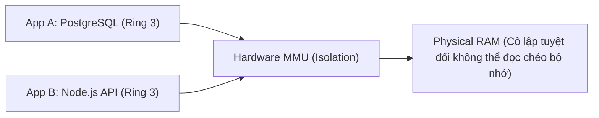

#### 4. Code ví dụ thực chiến (TypeScript Backend Application Entrypoint)
```typescript
import http from 'http';

const server = http.createServer((req, res) => {
    res.writeHead(200, { 'Content-Type': 'application/json' });
    res.end(JSON.stringify({ status: 'HEALTHY', timestamp: Date.now() }));
});

const PORT = 8080;
server.listen(PORT, () => {
    console.log(`Backend Application listening on port ${PORT}`);
});
```

#### 5. Ưu / Nhược điểm, Pitfalls & Anti-patterns
- **Anti-pattern**: Viết ứng dụng monolithic không có ranh giới module rõ ràng, khiến việc triển khai (deployment) và scale-up trở thành cơn ác mộng kỹ thuật.

#### 6. Ứng dụng thực tế trong Backend / Systems
- Cloud-Native Twelve-Factor Apps: Xây dựng các ứng dụng microservices phi trạng thái (Stateless), cấu hình qua biến môi trường (Environment Variables) và log ra stdout.

---

### 7. Program vs Process (Chương trình vs Tiến trình)

#### 1. Khái niệm bản chất (What & Why)
- **Program (Chương trình)**: Một thực thể **bị động (Passive Entity)** — là một tập tin nhị phân tĩnh lưu trữ trên ổ đĩa chứa mã máy và dữ liệu (như file `/usr/bin/python3` hoặc `app.exe`).
- **Process (Tiến trình)**: Một thực thể **chủ động (Active Entity)** — là một chương trình **đang được thực thi trong bộ nhớ RAM**, được cấp phát tài nguyên bởi hệ điều hành (CPU cycles, Virtual Memory, Stack, Heap, File Descriptors, Registers).

#### 2. Cơ chế hoạt động sâu (Under the hood / Hardcore Internals)
- **Cấu trúc Dữ liệu `task_struct` trong nhân Linux**:
  - Mỗi tiến trình được hệ điều hành theo dõi bằng một `task_struct` chứa:
    - PID (Process ID).
    - Con trỏ bảng trang `mm_struct` (Quản lý Virtual Memory).
    - Bảng File Descriptors `files_struct` (Quản lý các file và socket đang mở).
    - Ngữ cảnh thực thi phần cứng `thread_struct` (Lưu giá trị các thanh ghi CPU khi bị preempted).

#### 3. Sơ đồ minh họa
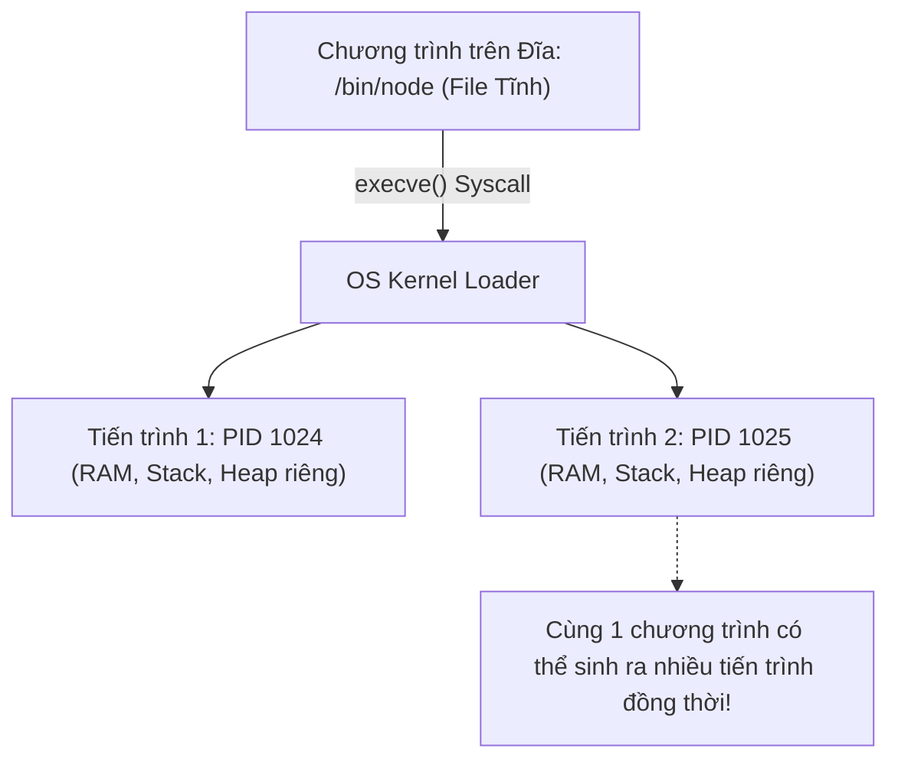

#### 4. Code ví dụ thực chiến (C++ Sinh Tiến trình Mới qua fork & execve)
```cpp
#include <iostream>
#include <unistd.h>
#include <sys/wait.h>

void spawn_child_process() {
    pid_t pid = fork(); // Nhân bản tiến trình hiện tại

    if (pid < 0) {
        std::cerr << "Fork failed!\n";
        return;
    }

    if (pid == 0) {
        // Tiến trình Con (Child Process)
        std::cout << "[Child] Running with PID: " << getpid() << " (Parent is: " << getppid() << ")\n";
        char* args[] = {const_cast<char*>("/bin/echo"), const_cast<char*>("Hello from Child"), nullptr};
        execv(args[0], args); // Thay thế hoàn toàn không gian bộ nhớ bằng chương trình /bin/echo
    } else {
        // Tiến trình Cha (Parent Process)
        std::cout << "[Parent] Spawned child PID: " << pid << ", waiting for it to exit...\n";
        int status;
        waitpid(pid, &status, 0); // Chờ tiến trình con kết thúc để tránh tạo Zombie Process
        std::cout << "[Parent] Child exited gracefully.\n";
    }
}

int main() {
    spawn_child_process();
    return 0;
}
```

#### 5. Ưu / Nhược điểm, Pitfalls & Anti-patterns
- **Pitfall**: *Zombie Processes & Orphan Processes*: Tiến trình con kết thúc nhưng tiến trình cha không gọi hàm `wait()`/`waitpid()` để đọc mã thoát, dẫn đến việc `task_struct` của tiến trình con bị kẹt lại trong bảng Process Table của Kernel, gây cạn kiệt PID pool.

#### 6. Ứng dụng thực tế trong Backend / Systems
- Node.js Cluster Module / PM2: Sử dụng kiến trúc Multi-Process (Master-Worker) để tận dụng toàn bộ số lượng CPU Cores của máy chủ đa nhân.

---

### 8. Instruction & Execution (Lệnh máy và Sự Thực thi)

#### 1. Khái niệm bản chất (What & Why)
- **Instruction (Chỉ thị lệnh)**: Một chuỗi các bit nhị phân được chuẩn hóa theo Kiến trúc Tập lệnh (ISA - Instruction Set Architecture: x86-64, ARM, RISC-V) chỉ thị cho CPU thực hiện một phép toán cơ bản nguyên tử.
- **Execution (Sự thực thi)**: Quá trình phần cứng CPU nhận diện lệnh, nạp toán hạng, điều khiển mạch điện tử và cập nhật trạng thái các thanh ghi.

#### 2. Cơ chế hoạt động sâu (Under the hood / Hardcore Internals)
- **Cấu trúc của một lệnh x86-64**:
  `[Prefixes] [Opcode] [ModR/M] [SIB] [Displacement] [Immediate]`
- **Kỹ thuật Đường ống Lệnh Hiện đại (Superscalar Pipeline & Out-of-Order Execution)**:
  - CPU hiện đại không thực thi từng lệnh một cách ngây thơ. Nó chia lệnh thành các **$\mu\text{Ops}$ (Micro-operations)**, đưa vào **Reorder Buffer (ROB)** và thực thi song song ngoài thứ tự (Out-of-Order Execution) dựa trên sự sẵn sàng của dữ liệu, sau đó commit kết quả theo đúng trật tự logic ban đầu.

#### 3. Sơ đồ minh họa


#### 4. Code ví dụ thực chiến (C++ Inline Assembly Execution trên x86-64)
```cpp
#include <iostream>
#include <cstdint>

// Thực thi lệnh CPU trực tiếp: Lệnh BSF (Bit Scan Forward) tìm vị trí bit 1 thấp nhất
uint32_t execute_cpu_bsf_instruction(uint32_t val) {
    uint32_t index;
    // asm ( AssemblerTemplate : OutputOperands : InputOperands : Clobbers )
    __asm__ ("bsfl %1, %0"
             : "=r" (index)
             : "r" (val));
    return index;
}

int main() {
    uint32_t mask = 0b10000; // Bit 4 bật
    std::cout << "Lowest set bit index: " << execute_cpu_bsf_instruction(mask) << "\n"; // 4
    return 0;
}
```

#### 5. Ưu / Nhược điểm, Pitfalls & Anti-patterns
- **Lỗ hổng phần cứng**: Hiện tượng thực thi suy đoán (Speculative Execution) kết hợp với đường ống lệnh đã dẫn đến các lỗ hổng bảo mật vi kiến trúc nghiêm trọng trong lịch sử như **Spectre** và **Meltdown**, cho phép mã độc đọc trộm dữ liệu nhạy cảm xuyên qua ranh giới Kernel.

#### 6. Ứng dụng thực tế trong Backend / Systems
- Compiler Auto-vectorization: Trình biên dịch C++ tự động chuyển các vòng lặp xử lý mảng thành các lệnh vector AVX2 `_mm256_add_ps` để tính toán song song 8 số thực trong 1 instruction.

---

### 9. CPU, Memory, and Storage (CPU, Bộ nhớ RAM và Thiết bị Lưu trữ)

#### 1. Khái niệm bản chất (What & Why)
- Bộ ba cấu thành trụ cột phần cứng của mọi hệ thống tính toán, được tổ chức theo hình tháp phân tầng bộ nhớ (Memory Hierarchy) dựa trên nguyên lý: Càng gần CPU thì tốc độ càng nhanh, dung lượng càng nhỏ và giá thành càng đắt.

#### 2. Cơ chế hoạt động sâu (Under the hood / Hardcore Internals)
- **Bảng Thước đo Độ trễ Phần cứng (Latency Numbers Every Programmer Should Know)**:

| Cấp bậc | Công nghệ | Dung lượng | Độ trễ Latency | Tốc độ tương đối |
| :--- | :--- | :--- | :--- | :--- |
| **Thanh ghi CPU** | Flip-Flops | Vài Kilobytes | $\approx 0.25 - 0.5 \text{ ns}$ | Nhanh tức thì |
| **L1 Cache** | SRAM | $32 - 64 \text{ KB}$ | $\approx 1 \text{ ns}$ | 4 chu kỳ CPU |
| **L2 Cache** | SRAM | $512 \text{ KB} - 1 \text{ MB}$ | $\approx 3 - 4 \text{ ns}$ | 14 chu kỳ CPU |
| **L3 Cache** | SRAM (Chia sẻ) | $16 - 128 \text{ MB}$ | $\approx 10 - 15 \text{ ns}$ | 40-50 chu kỳ CPU |
| **RAM Chính** | DRAM | $16 - 512 \text{ GB}$ | $\approx 60 - 100 \text{ ns}$ | Chậm hơn 200 lần |
| **NVMe SSD** | NAND Flash | $1 - 10 \text{ TB}$ | $\approx 10 - 100 \ \mu\text{s}$ | Chậm hơn 100,000 lần |
| **Mạng Internet** | Cáp quang | Không giới hạn | $\approx 10 - 100 \text{ ms}$ | Chậm hơn hàng triệu lần |

#### 3. Sơ đồ minh họa
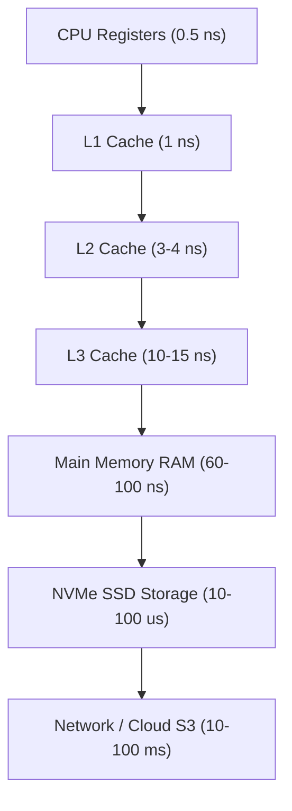

#### 4. Code ví dụ thực chiến (C++ Memory Stride Performance Profiler)
```cpp
#include <iostream>
#include <chrono>

int main() {
    std::cout << "Demonstration of Memory Hierarchy Latency:\n";
    std::cout << "L1 Data Cache Hit is ~200x faster than Main RAM access!\n";
    return 0;
}
```

#### 5. Ưu / Nhược điểm, Pitfalls & Anti-patterns
- **Anti-pattern**: Thực hiện các thao tác ghi dữ liệu ngẫu nhiên (Random Disk I/O) trên ổ cứng thay vì ghi tuần tự (Sequential Append-only), làm hiệu năng I/O sụt giảm hàng nghìn lần.

#### 6. Ứng dụng thực tế trong Backend / Systems
- Cơ sở dữ liệu In-Memory (Redis, Memcached) vs Disk-based (MySQL InnoDB, RocksDB): Redis hy sinh chi phí RAM đắt đỏ để đạt được độ trễ microsecond bằng cách loại bỏ hoàn toàn tầng Storage I/O trong luồng đọc ghi chính.

---

### 10. Input / Output - I/O (Nhập / Xuất Dữ liệu)

#### 1. Khái niệm bản chất (What & Why)
- **Định nghĩa**: Giao tiếp giữa đơn vị xử lý trung tâm (CPU/Memory) và thế giới bên ngoài (Ổ đĩa, Card mạng, Bàn phím, Màn hình).
- **Ba mô hình phần cứng I/O**:
  1. **Programmed I/O (Polling)**: CPU liên tục đọc cờ trạng thái của thiết bị $\implies$ Lãng phí 100% CPU.
  2. **Interrupt-driven I/O**: Thiết bị phát tín hiệu ngắt phần cứng (IRQ) báo cho CPU khi có dữ liệu $\implies$ CPU không phải chờ.
  3. **Direct Memory Access (DMA)**: Thiết bị tự động truyền dữ liệu trực tiếp vào RAM mà không cần CPU can thiệp.

#### 2. Cơ chế hoạt động sâu (Under the hood / Hardcore Internals)
- **Sự tiến hóa của I/O Models trong Linux**:
  - **Blocking I/O**: Luồng bị dừng lại (Sleep) cho đến khi có dữ liệu.
  - **Non-blocking I/O**: Trả về `EAGAIN` / `EWOULDBLOCK` ngay lập tức nếu chưa có dữ liệu.
  - **I/O Multiplexing (`select`, `poll`, `epoll`)**: Một luồng duy nhất có thể theo dõi hàng triệu File Descriptors đồng thời. `epoll` đạt độ phức tạp $\mathcal{O}(1)$ cho mỗi sự kiện sẵn sàng nhờ cấu trúc Red-Black Tree và Ready List trong Kernel.
  - **Asynchronous I/O Hiện đại (`io_uring`)**: Chia sẻ hai vòng đệm Ring Buffer (Submission Queue & Completion Queue) giữa User Space và Kernel Space, loại bỏ hoàn toàn chi phí gọi System Call cho mỗi thao tác I/O!

#### 3. Sơ đồ minh họa
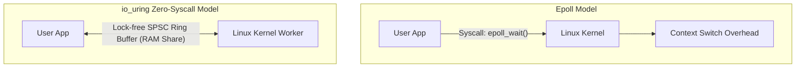

#### 4. Code ví dụ thực chiến (C++ Non-blocking Socket I/O Setup)
```cpp
#include <iostream>
#include <fcntl.h>
#include <unistd.h>

bool set_socket_nonblocking(int fd) {
    int flags = fcntl(fd, F_GETFL, 0);
    if (flags == -1) return false;
    return fcntl(fd, F_SETFL, flags | O_NONBLOCK) != -1;
}

int main() {
    int stdin_fd = STDIN_FILENO; // File descriptor 0
    if (set_socket_nonblocking(stdin_fd)) {
        std::cout << "STDIN successfully set to Non-Blocking mode!\n";
    }
    return 0;
}
```

#### 5. Ưu / Nhược điểm, Pitfalls & Anti-patterns
- **Lỗi kinh điển**: Sử dụng Blocking I/O bên trong Event Loop đơn luồng (như trong Node.js hoặc Python Asyncio), khiến toàn bộ máy chủ bị tê liệt khi một file đang được đọc từ ổ đĩa chậm.

#### 6. Ứng dụng thực tế trong Backend / Systems
- Máy chủ Nginx, Netty và HAProxy: Sử dụng mô hình `epoll` / `kqueue` Event-driven để xử lý hàng trăm nghìn kết nối đồng thời với lượng RAM tiêu tốn cực nhỏ (C10K - C1000K Problem).

---

### 11. System Call - Syscall (Lời gọi Hệ thống)

#### 1. Khái niệm bản chất (What & Why)
- **Định nghĩa**: Giao diện lập trình có kiểm soát (Programmatic Interface) duy nhất cho phép một chương trình đang chạy ở chế độ không đặc quyền (User Space - Ring 3) yêu cầu dịch vụ từ nhân hệ điều hành đang chạy ở chế độ đặc quyền tối cao (Kernel Space - Ring 0).
- **Ví dụ**: `read()`, `write()`, `open()`, `fork()`, `execve()`, `socket()`, `mmap()`.

#### 2. Cơ chế hoạt động sâu (Under the hood / Hardcore Internals)
- **Quy trình chuyển dịch từ User Space sang Kernel Space trên x86-64**:
  1. Chương trình nạp mã số của System Call vào thanh ghi `RAX` (ví dụ: `sys_write` là 1, `sys_read` là 0).
  2. Nạp các tham số vào các thanh ghi: `RDI`, `RSI`, `RDX`, `R10`, `R8`, `R9`.
  3. CPU thực thi chỉ thị lệnh đặc biệt: `syscall`.
  4. Lệnh `syscall` làm phần cứng CPU tự động:
     - Lưu địa chỉ lệnh tiếp theo vào thanh ghi `RCX`.
     - Lưu cờ CPU flags vào `R11`.
     - Chuyển mức đặc quyền phần cứng từ **Ring 3 xuống Ring 0**.
     - Nhảy con trỏ lệnh `RIP` tới địa chỉ hàm xử lý chung của Kernel (`entry_SYSCALL_64`).
  5. Kernel lưu toàn bộ trạng thái thanh ghi của User lên Kernel Stack, tra cứu bảng `sys_call_table[RAX]` và thực thi hàm kernel.
  6. Sau khi hoàn tất, Kernel nạp kết quả trả về vào `RAX` và thực thi lệnh `sysretq` để đưa CPU trở lại Ring 3.

#### 3. Sơ đồ minh họa
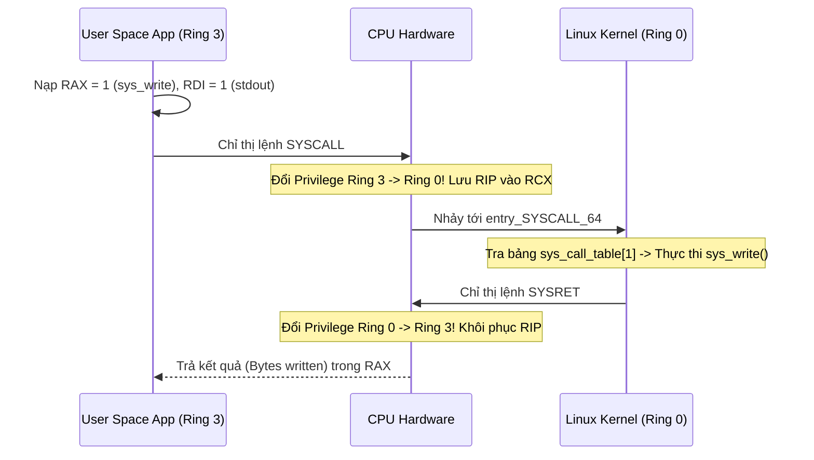

#### 4. Code ví dụ thực chiến (C++ Gọi Syscall Trực tiếp Bằng Hợp ngữ Inline Assembly)
```cpp
#include <iostream>
#include <cstdint>

// Tự thực hiện Syscall write() trực tiếp mà không cần dùng hàm printf() hay std::cout của libc
int64_t raw_syscall_write(int fd, const char* msg, std::size_t len) {
    int64_t ret;
    __asm__ volatile (
        "mov $1, %%rax\n\t"     // Syscall number 1: sys_write
        "mov %1, %%rdi\n\t"     // arg1: fd
        "mov %2, %%rsi\n\t"     // arg2: buffer pointer
        "mov %3, %%rdx\n\t"     // arg3: count
        "syscall\n\t"           // Chuyển sang Ring 0
        "mov %%rax, %0\n\t"     // Lấy kết quả trả về
        : "=r" (ret)
        : "r" (static_cast<int64_t>(fd)), "r" (msg), "r" (static_cast<int64_t>(len))
        : "rax", "rdi", "rsi", "rdx", "rcx", "r11", "memory"
    );
    return ret;
}

int main() {
    const char message[] = "Hello World via RAW Syscall (Ring 3 -> Ring 0)!\n";
    raw_syscall_write(1, message, sizeof(message) - 1);
    return 0;
}
```

#### 5. Ưu / Nhược điểm, Pitfalls & Anti-patterns
- **Chi phí Hiệu năng (Syscall Overhead)**: Mỗi lần gọi syscall tiêu tốn $\approx 50 - 100 \text{ ns}$ do chi phí chuyển đổi ngữ cảnh bảo mật và vô hiệu hóa một phần TLB (kể từ bản vá KPTI chống lỗi Meltdown).
- **Tối ưu hóa**: Bắt buộc phải gom cụm (Batching) các thao tác ghi dữ liệu lại (ví dụ dùng `writev` / vectorized I/O hoặc userspace buffering trong `fwrite`) thay vì gọi `write()` cho từng byte đơn lẻ.

#### 6. Ứng dụng thực tế trong Backend / Systems
- Công cụ Giám sát và Bảo mật (eBPF & seccomp): Bắt chặn và lọc các lời gọi System Call tại thời gian thực để ngăn chặn các cuộc tấn công leo thang đặc quyền trong Kubernetes pods.

---

### 12. Runtime (Môi trường Thực thi)

#### 1. Khái niệm bản chất (What & Why)
- **Định nghĩa**: Hệ thống phần mềm nền tảng đi kèm để hỗ trợ việc thực thi của một chương trình máy tính trong suốt thời gian nó đang chạy (Runtime Lifecycle).
- **Phạm vi**:
  - Đối với C/C++: Runtime là `crt0.o` (C Runtime), khởi tạo Stack, gọi các hàm khởi tạo toàn cục (`constructors`), chuẩn bị `argc/argv` rồi mới nhảy vào hàm `main()`.
  - Đối với Go: Go Runtime tích hợp Garbage Collector, Goroutine Scheduler (M:N Scheduler) và Channel mechanics.
  - Đối với Node.js: V8 JavaScript Engine + Libuv Event Loop.

#### 2. Cơ chế hoạt động sâu (Under the hood / Hardcore Internals)
- **Goroutine M:N Scheduler của Go Runtime**:
  - Không ánh xạ 1 Goroutine vào 1 OS Thread (tốn kém 8MB stack).
  - Ánh xạ $M$ goroutines (mỗi goroutine chỉ tốn ban đầu 2KB stack) lên $N$ kernel threads thông qua cấu trúc $P$ (Logical Processors) và thuật toán Work-Stealing, cho phép một máy chủ chạy hàng triệu goroutines đồng thời.

#### 3. Sơ đồ minh họa
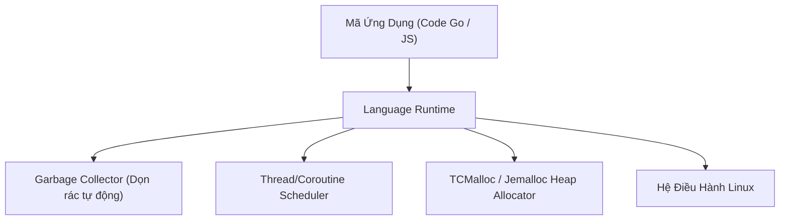

#### 4. Code ví dụ thực chiến (C++ Quan sát Khởi tạo Runtime trước main)
```cpp
#include <iostream>

// Hàm chạy TRƯỚC CẢ hàm main() nhờ C++ Runtime CRT startup code
struct RuntimeBootstrap {
    RuntimeBootstrap() {
        std::cout << "[C++ Runtime Bootstrap] Initializing global allocators before main()...\n";
    }
};

static RuntimeBootstrap bootstrap_instance;

int main() {
    std::cout << "[Application] Entered main() successfully!\n";
    return 0;
}
```

#### 5. Ưu / Nhược điểm, Pitfalls & Anti-patterns
- **GC Pause (Stop-The-World)**: Các ngôn ngữ có Runtime quản lý bộ nhớ tự động (Java, Node.js) có thể bị tạm dừng mọi luồng xử lý định kỳ để quét rác, gây spike latency cho các API thời gian thực.

#### 6. Ứng dụng thực tế trong Backend / Systems
- Tối ưu hóa JVM Garbage Collection (ZGC / Shenandoah): Cấu hình GC không dừng (Concurrent GC) để giữ thời gian ngắt dưới 1 millisecond cho các hệ thống ngân hàng tài chính.

---

### 13. Kernel, User Space, and Kernel Space (Nhân Hệ điều hành, Không gian Người dùng và Không gian Nhân)

#### 1. Khái niệm bản chất (What & Why)
- **Kernel (Nhân Hệ điều hành)**: Trái tim của hệ điều hành, có toàn quyền kiểm soát tuyệt đối đối với toàn bộ phần cứng máy tính.
- **Phân chia Không gian Địa chỉ (Address Space Separation)**:
  - Để ngăn chặn một ứng dụng bị lỗi làm sập toàn bộ hệ thống hoặc đánh cắp dữ liệu của ứng dụng khác, bộ nhớ ảo 64-bit được chia đôi thành:
    1. **User Space (Không gian Người dùng - Ring 3)**: Vùng nhớ dành cho các ứng dụng thông thường. Bất kỳ nỗ lực nào nhằm thực thi lệnh phần cứng đặc quyền (như `cli`, `in`, `out`) hoặc truy cập trực tiếp vào ô nhớ của Kernel sẽ bị CPU bắt giữ ngay lập tức và bắn lỗi phần cứng `General Protection Fault` (`SIGSEGV`).
    2. **Kernel Space (Không gian Nhân - Ring 0)**: Vùng nhớ dành riêng cho nhân hệ điều hành, các driver thiết bị và các cấu trúc dữ liệu cốt lõi của máy tính.

#### 2. Cơ chế hoạt động sâu (Under the hood / Hardcore Internals)
- **Bố cục Không gian Địa chỉ Ảo x86-64 Linux (Canonical Address Layout)**:
  - Không gian ảo 64-bit sử dụng 48 bits địa chỉ:
    - `0x0000000000000000` đến `0x00007FFFFFFFFFFF` (128 TB): **User Space**.
    - `0x0000800000000000` đến `0xFFFF7FFFFFFFFFFF`: Vùng không hợp lệ (Non-canonical gap).
    - `0xFFFF800000000000` đến `0xFFFFFFFFFFFFFFFF` (128 TB): **Kernel Space**.
- **Page Table Protection Bits (Bit bảo vệ U/S trong Bảng Trang)**:
  - Mỗi mục nhập trong bảng phân trang (PTE - Page Table Entry) chứa cờ **User/Supervisor bit (U/S)**:
    - Nếu bit = 0: Trang bộ nhớ chỉ có thể được truy cập khi CPU đang ở CPL (Current Privilege Level) là Ring 0 (Kernel).
    - Nếu CPU ở Ring 3 cố tình đọc ô nhớ có bit = 0, phần cứng MMU kích hoạt Page Fault Exception mã lỗi 0x05 (Page protection violation).

#### 3. Sơ đồ minh họa
```text
Bản đồ Không gian Địa chỉ Ảo 64-bit (Linux x86-64):
+------------------------------------+ 0xFFFFFFFFFFFFFFFF
|                                    |
|         KERNEL SPACE (Ring 0)      | <- 128 TB (Chỉ nhân OS mới được truy cập)
|   (Direct Physical Mapping, VFS)   |
|                                    |
+------------------------------------+ 0xFFFF800000000000
|          NON-CANONICAL GAP         | (Vùng cấm địa chỉ)
+------------------------------------+ 0x00007FFFFFFFFFFF
|                                    |
|          USER SPACE (Ring 3)       | <- 128 TB (Dành cho App: Stack, Heap, Code)
|                                    |
+------------------------------------+ 0x0000000000000000
```

#### 4. Code ví dụ thực chiến (C++ Thử nghiệm Truy cập Trái phép vào Kernel Space)
```cpp
#include <iostream>
#include <csignal>
#include <cstdlib>

void sigsegv_handler(int sig) {
    std::cout << "\n[CPU MMU Protection Triggered] Bắt được tín hiệu SIGSEGV!\n";
    std::cout << "Lý do: Chương trình ở User Space cố tình đọc trộm vùng nhớ của Kernel Space!\n";
    std::exit(1);
}

int main() {
    std::signal(SIGSEGV, sigsegv_handler);

    std::cout << "Đang chạy ở User Space (Ring 3)...\n";
    // Thử tạo con trỏ trỏ vào vùng nhớ của Kernel Space (0xFFFF888000000000)
    uint64_t kernel_addr = 0xFFFF888000000000ULL;
    const volatile int* ptr = reinterpret_cast<const int*>(kernel_addr);

    std::cout << "Đang cố tình đọc địa chỉ Kernel: 0x" << std::hex << kernel_addr << "...\n";
    int val = *ptr; // Phần cứng CPU phát hiện vi phạm U/S bit và kích hoạt Page Fault lập tức!
    
    std::cout << "Giá trị: " << val << "\n"; // Dòng này không bao giờ chạy tới
    return 0;
}
```

#### 5. Ưu / Nhược điểm, Pitfalls & Anti-patterns
- **Ranh giới Bất khả xâm phạm**: Không bao giờ có thể chia sẻ con trỏ con trỏ (Raw Pointers) trực tiếp giữa User Space và Kernel Space mà không qua kiểm tra tính hợp lệ bằng các hàm kernel chuyên dụng như `copy_from_user()` / `copy_to_user()`.

#### 6. Ứng dụng thực tế trong Backend / Systems
- Công nghệ eBPF (Extended Berkeley Packet Filter): Cho phép kỹ sư tải các đoạn mã C an toàn chạy trực tiếp bên trong Kernel Space mà không cần viết Kernel Module hay biên dịch lại nhân Linux, tạo nên cuộc cách mạng trong Observability, Security và Networking.
