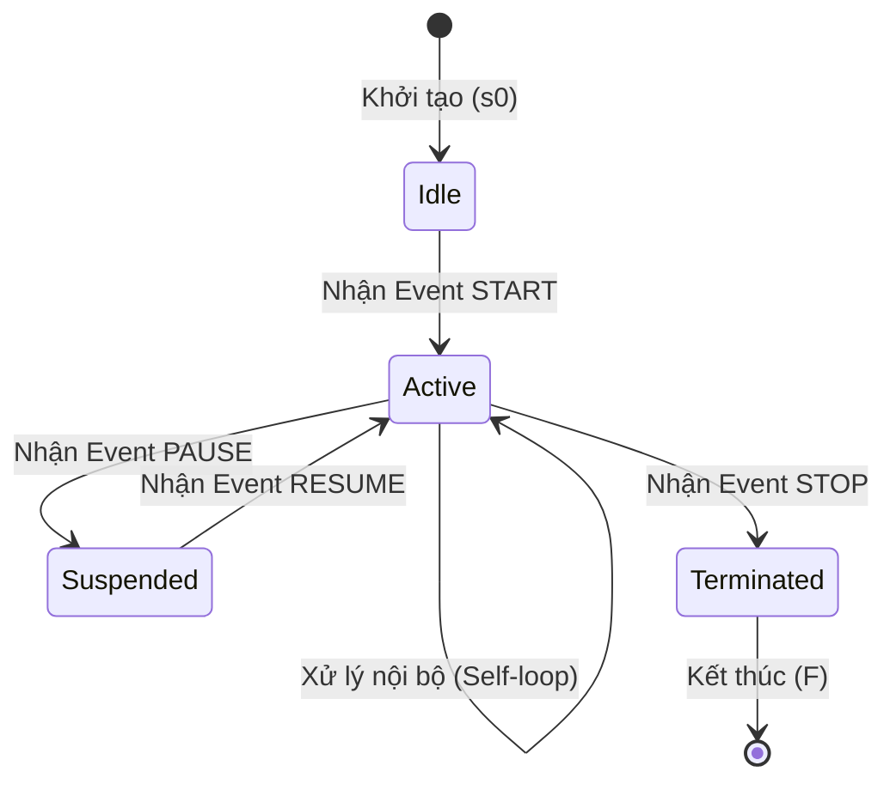
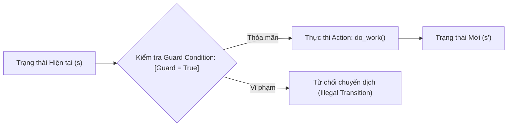
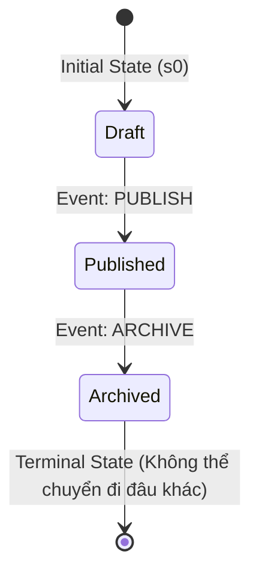
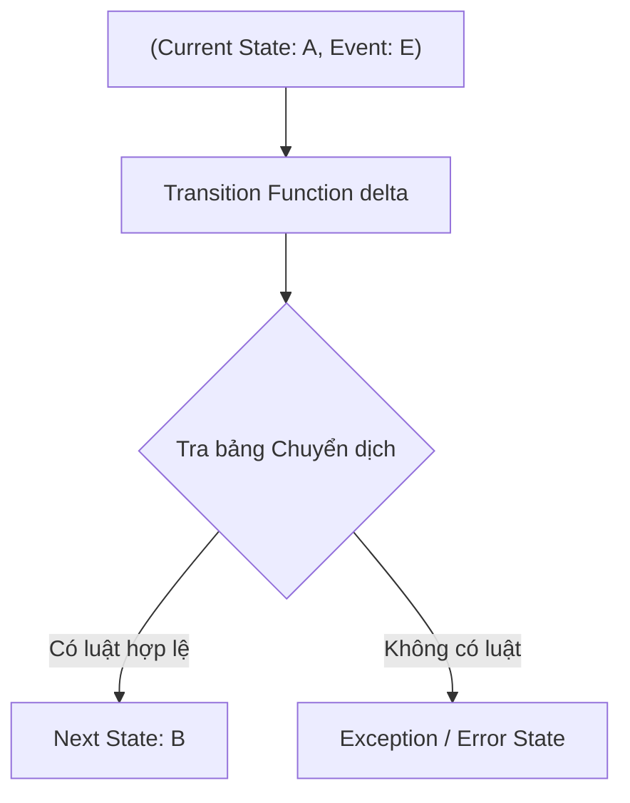
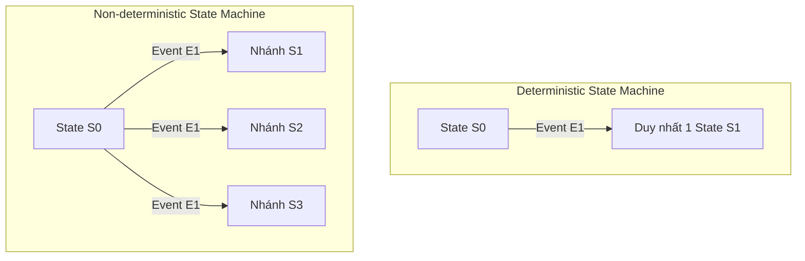
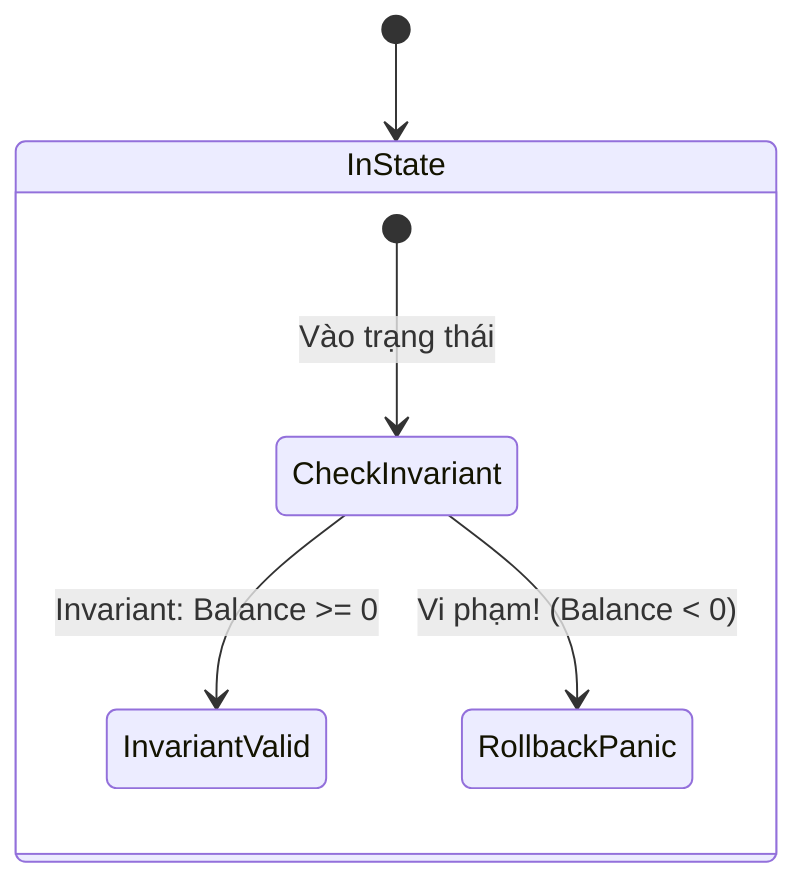
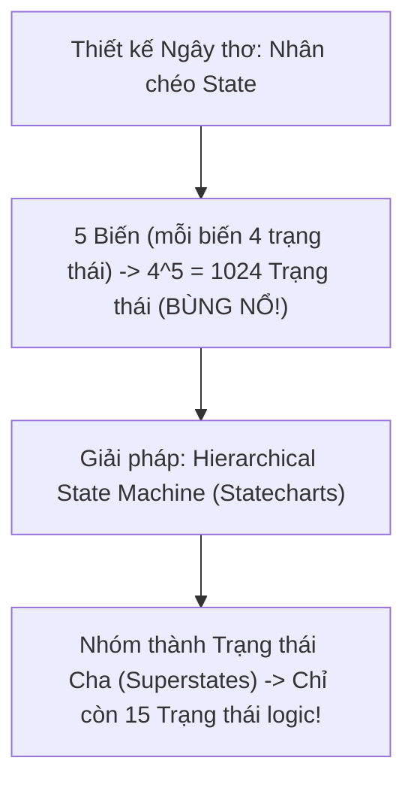
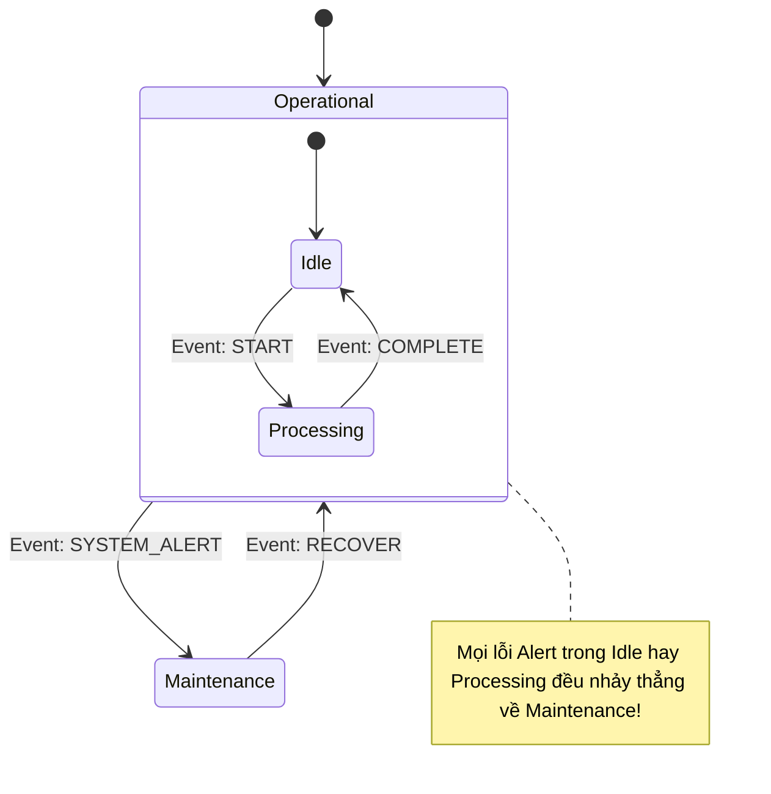
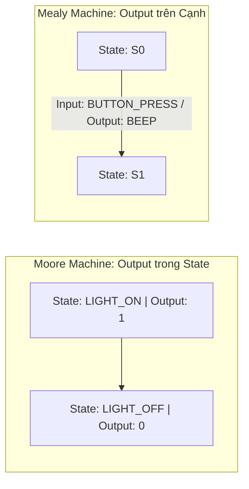

# 8.1. Finite State Machines Theory (Lý thuyết Cỗ máy Trạng thái Hữu hạn)

## Tổng quan về State Machines
Cỗ máy Trạng thái Hữu hạn (Finite State Machine - FSM) là một mô hình toán học về hành vi của một hệ thống, bao gồm một tập hợp hữu hạn các trạng thái, các điều kiện chuyển đổi giữa các trạng thái và các hành vi (Actions/Outputs) gắn liền với các trạng thái đó.

Về mặt toán học hình thức:
$$M = (S, I, O, \delta, \lambda, s_0, F)$$
Trong đó:
- $S$: Tập hữu hạn các trạng thái nội tại (State space).
- $I$: Tập hữu hạn các sự kiện / tín hiệu kích thích đầu vào (Input events).
- $O$: Tập hữu hạn các hành động đầu ra (Output actions).
- $\delta: S \times I \to S$: Hàm chuyển dịch trạng thái (Transition function).
- $\lambda$: Hàm tạo đầu ra (Output function).
- $s_0 \in S$: Trạng thái khởi tạo (Initial state).
- $F \subseteq S$: Tập các trạng thái kết thúc (Final / Terminal states).



---

## 2. Chi tiết từng Keyword (Under-the-Hood Deep Dive)

---

### 1. State & State Transition (Trạng thái và Chuyển dịch Trạng thái)

#### 1. Khái niệm bản chất (What & Why)
- **State (Trạng thái)**: Một cấu hình định tính hoặc định lượng độc nhất của hệ thống tại một thời điểm cụ thể, phản ánh toàn bộ lịch sử các tương tác trong quá khứ cần thiết để xác định phản ứng tương lai.
- **State Transition (Chuyển dịch Trạng thái)**: Một biến đổi tức thời, không thể chia cắt (Atomic transition) đưa hệ thống từ trạng thái hiện tại $s \in S$ sang trạng thái mới $s' \in S$ khi nhận được một kích thích $e \in I$ thỏa mãn các điều kiện bảo vệ (Guards).

#### 2. Cơ chế hoạt động sâu (Under the hood / Hardcore Internals)
- **Tầng Register & Mutex trong Hệ thống Phân tán**:
  - Trong bộ nhớ, trạng thái thường được mã hóa dưới dạng một số nguyên kiểu `enum class` chiếm 1, 2 hoặc 4 bytes.
  - Chuyển dịch trạng thái bắt buộc phải an toàn trong môi trường đa luồng (Thread-safe): Sử dụng thao tác nguyên tử CPU `compare_and_swap` (CAS instruction: `lock cmpxchg` trên x86-64) hoặc Khóa lạc quan (Optimistic Locking với `version` column) trong Cơ sở dữ liệu để chống Race Conditions.

#### 3. Sơ đồ minh họa


#### 4. Code ví dụ thực chiến (C++ Atomic State Transition via CAS)
```cpp
#include <iostream>
#include <atomic>

enum class NodeState : uint32_t {
    Follower = 0,
    Candidate = 1,
    Leader = 2,
    Dead = 3
};

class DistributedNodeStatus {
    std::atomic<NodeState> state_{NodeState::Follower};

public:
    // Chuyển dịch nguyên tử không khóa (Lock-free atomic transition)
    bool promote_to_candidate() {
        NodeState expected = NodeState::Follower;
        // Nếu hiện tại là Follower -> Đổi sang Candidate. Nếu không -> Trả về false
        return state_.compare_exchange_strong(expected, NodeState::Candidate);
    }

    [[nodiscard]] NodeState get_state() const noexcept { return state_.load(); }
};

int main() {
    DistributedNodeStatus node;
    std::cout << "Promote 1: " << node.promote_to_candidate() << "\n"; // 1 (Thành công)
    std::cout << "Promote 2: " << node.promote_to_candidate() << "\n"; // 0 (Thất bại vì không còn là Follower)
    return 0;
}
```

#### 5. Ưu / Nhược điểm, Pitfalls & Anti-patterns
- **Pitfall**: Thực hiện các thao tác side-effects (như gửi email, gọi API ngân hàng) TRƯỚC KHI chuyển dịch trạng thái hoàn tất thành công trong database, dẫn đến việc nếu server sập giữa chừng, side-effect đã bắn ra nhưng trạng thái không được cập nhật (Inconsistent Mutation).

#### 6. Ứng dụng thực tế trong Backend / Systems
- Quản lý trạng thái luồng tiến trình Linux: Chuyển dịch qua các trạng thái `TASK_RUNNING`, `TASK_INTERRUPTIBLE`, `TASK_UNINTERRUPTIBLE`, `TASK_STOPPED`, `EXIT_ZOMBIE`.

---

### 2. Initial State & Final State (Trạng thái Khởi tạo và Trạng thái Kết thúc)

#### 1. Khái niệm bản chất (What & Why)
- **Initial State ($s_0$)**: Trạng thái mặc định bất biến mà cỗ máy luôn luôn bắt đầu khi được khởi tạo trong bộ nhớ trước khi tiếp nhận bất kỳ sự kiện nào.
- **Final / Terminal State ($F$)**: Các trạng thái mà khi cỗ máy đã bước vào, nó sẽ dừng mọi hoạt động tiếp nhận sự kiện tiếp theo hoặc chu kỳ sống của thực thể nghiệp vụ chính thức khép lại (ví dụ: `COMPLETED`, `CANCELLED`, `REFUNDED`).

#### 2. Cơ chế hoạt động sâu (Under the hood / Hardcore Internals)
- Khi một đối tượng đạt trạng thái Terminal State:
  - Hệ thống tự động giải phóng tài nguyên nền (đóng Socket, giải phóng File Descriptors, hủy Timers).
  - Bất kỳ event nào gửi tới một đối tượng ở Terminal State đều bị hệ thống quăng lỗi `InvalidStateTransitionException` hoặc âm thầm chuyển vào Dead-Letter Queue.

#### 3. Sơ đồ minh họa


#### 4. Code ví dụ thực chiến (TypeScript Terminal State Guard)
```typescript
type DocumentState = 'Draft' | 'Review' | 'Published' | 'Archived';

class DocumentStateMachine {
    private state: DocumentState = 'Draft'; // Initial State s0

    public transition(action: string): void {
        if (this.state === 'Archived') {
            throw new Error("TERMINAL_STATE_ERROR: Văn bản đã Archived, không thể chỉnh sửa!");
        }

        if (this.state === 'Draft' && action === 'SUBMIT') {
            this.state = 'Review';
        } else if (this.state === 'Review' && action === 'APPROVE') {
            this.state = 'Published';
        } else if (this.state === 'Published' && action === 'ARCHIVE') {
            this.state = 'Archived'; // Final State
        } else {
            throw new Error(`Invalid transition: ${this.state} via ${action}`);
        }
    }

    public getState(): DocumentState { return this.state; }
}

const doc = new DocumentStateMachine();
doc.transition('SUBMIT');
doc.transition('APPROVE');
doc.transition('ARCHIVE');
console.log("Current:", doc.getState()); // Archived
// doc.transition('SUBMIT'); // Ném lỗi Terminal State ngay lập tức!
```

#### 5. Ưu / Nhược điểm, Pitfalls & Anti-patterns
- **Anti-pattern**: Cho phép một thực thể "hồi sinh" trực tiếp từ Final State mà không tạo mới bản ghi (ví dụ: cố gắng mở lại một đơn hàng đã bị Cancelled thay vì yêu cầu khách hàng tạo một đơn hàng mới).

#### 6. Ứng dụng thực tế trong Backend / Systems
- Garbage Collection Object Lifecycle: Vòng đời đối tượng trong JVM từ `Eden` $\to$ `Survivor` $\to$ `Tenured` $\to$ `Dead` (Terminal State $\implies$ giải phóng bộ nhớ RAM).

---

### 3. Transition Function (Hàm Chuyển dịch Trạng thái)

#### 1. Khái niệm bản chất (What & Why)
- **Định nghĩa**: Bản đồ toán học mô tả toàn bộ logic cốt lõi của cỗ máy trạng thái:
  $$\delta: S \times I \to S$$
  Nhận vào một cặp gồm (Trạng thái hiện tại, Sự kiện đầu vào) và trả về Trạng thái kế tiếp.
- **Tính toàn vẹn**: Hàm chuyển dịch phải được xác định rõ ràng (Well-defined) trên toàn bộ miền giá trị hợp lệ. Mọi cặp trạng thái/sự kiện không hợp lệ phải được xử lý tường minh (Explicitly handled).

#### 2. Cơ chế hoạt động sâu (Under the hood / Hardcore Internals)
- **Ba mô hình cài đặt hàm chuyển dịch trong phần mềm**:
  1. **Nested Switch-Case**: Đơn giản nhất, biên dịch thành Jump Tables tối ưu trong CPU, nhưng vi phạm nguyên lý Open/Closed (OCP).
  2. **Transition Table (Ma trận 2 chiều)**: Nhanh nhất ($O(1)$ memory lookup), nhưng tốn RAM nếu số trạng thái lớn và thưa thớt (Sparse matrix).
  3. **State Pattern (Hướng đối tượng OOP)**: Mỗi trạng thái là một Class riêng biệt. Dễ mở rộng nhưng tốn chi phí vptr indirection và heap allocation.

#### 3. Sơ đồ minh họa


#### 4. Code ví dụ thực chiến (C++ Function-Pointer Transition Matrix)
```cpp
#include <iostream>
#include <array>
#include <functional>

enum class State { Red, Yellow, Green };
enum class Event { TimerTick };

// Hàm chuyển dịch trạng thái Traffic Light
State transition_function(State current, Event event) {
    switch (current) {
        case State::Red:    return State::Green;
        case State::Green:  return State::Yellow;
        case State::Yellow: return State::Red;
        default:            return State::Red;
    }
}

int main() {
    State s = State::Red;
    s = transition_function(s, Event::TimerTick);
    std::cout << "Red -> " << (s == State::Green ? "Green" : "Other") << "\n";
    return 0;
}
```

#### 5. Ưu / Nhược điểm, Pitfalls & Anti-patterns
- **Anti-pattern**: Viết hàm chuyển dịch bị lẫn lộn giữa logic chuyển trạng thái và logic giao tiếp I/O (gọi DB, gửi message broker). Logic chuyển trạng thái phải thuần túy (Pure Function), các side-effects phải được thực thi tách biệt qua các Hooks/Actions.

#### 6. Ứng dụng thực tế trong Backend / Systems
- Parser HTTP Request trong Nginx: Sử dụng bảng chuyển dịch trạng thái viết bằng C macro để đọc và phân tích từng byte HTTP Header với tốc độ tối đa.

---

### 4. Deterministic vs Non-deterministic State Machine (Máy Trạng thái Tất định vs Không tất định)

#### 1. Khái niệm bản chất (What & Why)
- **Deterministic State Machine (DSM)**: Với mỗi trạng thái hiện tại và một sự kiện đầu vào, cỗ máy chuyển sang **duy nhất một** trạng thái tiếp theo xác định ($\delta: S \times I \to S$).
- **Non-deterministic State Machine (NSM)**: Với cùng một sự kiện đầu vào, cỗ máy có thể chuyển sang **một tập hợp nhiều trạng thái khả dĩ** ($\delta: S \times I \to \mathcal{P}(S)$), hoặc tự động chuyển trạng thái mà không cần sự kiện ($\epsilon$-transition).

#### 2. Cơ chế hoạt động sâu (Under the hood / Hardcore Internals)
- Trong các hệ thống Backend, các máy trạng thái nghiệp vụ (Order, Payment, Auth) **BẮT BUỘC PHẢI LÀ TẤT ĐỊNH 100%**. Tính không tất định trong một dịch vụ thanh toán sẽ dẫn đến việc tài khoản ngân hàng bị trừ tiền nhiều lần hoặc đơn hàng bị chuyển trạng thái ngẫu nhiên!

#### 3. Sơ đồ minh họa


#### 4. Code ví dụ thực chiến (C++ Deterministic Enforcer)
```cpp
#include <iostream>
#include <stdexcept>
#include <map>

// Đảm bảo tính tất định tuyệt đối qua Map khóa kép duy nhất
class DeterministicFSM {
    std::map<std::pair<int, char>, int> delta_;

public:
    void add_rule(int state, char input, int next_state) {
        // Chỉ cho phép DUY NHẤT một trạng thái tiếp theo cho mỗi cặp (state, input)
        delta_[{state, input}] = next_state;
    }

    int transition(int current_state, char input) {
        auto it = delta_.find({current_state, input});
        if (it == delta_.end()) {
            throw std::runtime_error("INVALID_DETERMINISTIC_TRANSITION");
        }
        return it->second;
    }
};

int main() {
    DeterministicFSM fsm;
    fsm.add_rule(0, 'A', 1);
    std::cout << "State 0 on 'A' -> " << fsm.transition(0, 'A') << "\n";
    return 0;
}
```

#### 5. Ưu / Nhược điểm, Pitfalls & Anti-patterns
- **Pitfall**: Để lọt các chuyển dịch ngẫu nhiên phụ thuộc thời gian (Race condition giữa 2 luồng cùng đổi trạng thái của 1 entity) biến một máy tất định thành không tất định ngoài ý muốn.

#### 6. Ứng dụng thực tế trong Backend / Systems
- Mô hình hóa kiểm thử tự động (Model-based Testing): Sử dụng máy trạng thái không tất định để sinh ngẫu nhiên hàng triệu kịch bản người dùng giả lập nhằm tìm kiếm các trường hợp cạnh (Edge cases).

---

### 5. State Diagram & State Transition Table (Sơ đồ Trạng thái và Bảng Chuyển dịch Trạng thái)

#### 1. Khái niệm bản chất (What & Why)
- **State Diagram (Sơ đồ Trạng thái)**: Biểu diễn đồ họa của máy trạng thái dưới dạng đồ thị có hướng (UML Statechart / Mermaid).
- **State Transition Table (Bảng Chuyển dịch Trạng thái)**: Biểu diễn dạng bảng hai chiều trong đó:
  - Các hàng biểu diễn các trạng thái hiện tại ($S$).
  - Các cột biểu diễn các sự kiện đầu vào ($I$).
  - Các ô giao nhau biểu diễn trạng thái tiếp theo ($S_{\text{next}}$) và hành động thực thi ($A$).

#### 2. Cơ chế hoạt động sâu (Under the hood / Hardcore Internals)
- Bảng chuyển dịch trạng thái là dạng biểu diễn tối ưu nhất để nạp vào bộ nhớ máy tính (Memory Table Lookup): CPU tính toán địa chỉ ô nhớ bằng phép tính nhân cộng địa chỉ cơ bản $O(1)$, hoàn toàn không cần lệnh rẽ nhánh `if/else`, loại bỏ 100% chi phí Branch Misprediction.

#### 3. Sơ đồ minh họa
```text
Bảng Chuyển dịch Trạng thái (State Transition Table):
+-------------------+--------------------+--------------------+
| Trạng thái / Event| EV_SUCCESS         | EV_FAILURE         |
+-------------------+--------------------+--------------------+
| PENDING           | PROCESSING (Log)   | REJECTED (Alert)   |
| PROCESSING        | COMPLETED (Notify) | FAILED (Retry)     |
| COMPLETED         | ILLEGAL            | ILLEGAL            |
+-------------------+--------------------+--------------------+
```

#### 4. Code ví dụ thực chiến (C++ Compile-time Flat Transition Matrix)
```cpp
#include <iostream>
#include <array>

enum StateId { St_Init = 0, St_Active = 1, St_Done = 2, St_Count = 3 };
enum EventId { Ev_Start = 0, Ev_Stop = 1, Ev_Count = 2 };

// -1 biểu thị chuyển dịch bất hợp pháp (Illegal Transition)
constexpr std::array<std::array<int, Ev_Count>, St_Count> TRANSITION_TABLE = {{
    /* St_Init   */ { St_Active, -1        },
    /* St_Active */ { -1,        St_Done   },
    /* St_Done   */ { -1,        -1        }
}};

int step_fsm(int current_state, int event) {
    int next = TRANSITION_TABLE[current_state][event];
    if (next == -1) throw std::runtime_error("Illegal FSM Step");
    return next;
}

int main() {
    int cur = St_Init;
    cur = step_fsm(cur, Ev_Start);
    std::cout << "Next state: " << cur << " (St_Active)\n";
    return 0;
}
```

#### 5. Ưu / Nhược điểm, Pitfalls & Anti-patterns
- **Nhược điểm**: Ma trận bị thưa thớt (Sparse Matrix) khi số trạng thái và sự kiện lên tới hàng trăm, gây lãng phí bộ nhớ RAM nếu không dùng kỹ thuật nén ma trận (Compressed Sparse Row - CSR).

#### 6. Ứng dụng thực tế trong Backend / Systems
- Thiết kế đặc tả kiến trúc (Architecture Design Documents): Bảng chuyển dịch trạng thái là tài liệu bắt buộc phải có khi thiết kế các cổng thanh toán hoặc hệ thống xử lý giao dịch tín dụng.

---

### 6. State Invariant (Bất biến Trạng thái)

#### 1. Khái niệm bản chất (What & Why)
- **Định nghĩa**: Một điều kiện logic hoặc ràng buộc dữ liệu bắt buộc phải luôn luôn thỏa mãn khi hệ thống đang ở một trạng thái cụ thể.
- **Tại sao cần thiết**: Đảm bảo dữ liệu không bị tha hóa (Corruption). Ví dụ: Khi đơn hàng ở trạng thái `Paid`, bất biến là số tiền đã thanh toán phải lớn hơn 0 và phải có mã giao dịch Transaction ID từ ngân hàng.

#### 2. Cơ chế hoạt động sâu (Under the hood / Hardcore Internals)
- Bất biến được kiểm tra tự động thông qua các **Assertions** hoặc **Pre-state / Post-state Contracts**. Nếu bất kỳ chuyển dịch nào đưa hệ thống sang trạng thái mới mà vi phạm bất biến của trạng thái đó, giao dịch cơ sở dữ liệu bắt buộc phải bị **Rollback** lập tức.

#### 3. Sơ đồ minh họa


#### 4. Code ví dụ thực chiến (C++ State Invariant Assertion)
```cpp
#include <iostream>
#include <cassert>
#include <string>

struct AccountState {
    enum class Status { Active, Suspended, Closed };
    Status status{Status::Active};
    int64_t balance_cents{0};

    // Bất biến trạng thái (State Invariants)
    void assert_invariants() const {
        if (status == Status::Active) {
            assert(balance_cents >= 0 && "INVARIANT VIOLATED: Active account cannot have negative balance!");
        }
        if (status == Status::Closed) {
            assert(balance_cents == 0 && "INVARIANT VIOLATED: Closed account must have zero balance!");
        }
    }
};

int main() {
    AccountState acc{AccountState::Status::Active, 5000};
    acc.assert_invariants(); // Hợp lệ
    std::cout << "Account invariants satisfied.\n";
    return 0;
}
```

#### 5. Ưu / Nhược điểm, Pitfalls & Anti-patterns
- **Pitfall**: Tắt toàn bộ assertion kiểm tra bất biến trên môi trường Production để "tăng tốc độ", khiến các dữ liệu lỗi âm thầm ghi vào database và không thể sửa chữa.

#### 6. Ứng dụng thực tế trong Backend / Systems
- Database Constraints (`CHECK (status = 'PAID' AND payment_ref IS NOT NULL)`): Triển khai bất biến trạng thái trực tiếp ở tầng lưu trữ RDBMS để bảo vệ tầng dữ liệu tuyệt đối.

---

### 7. State Explosion (Bùng nổ Không gian Trạng thái)

#### 1. Khái niệm bản chất (What & Why)
- **Định nghĩa**: Hiện tượng số lượng trạng thái tổng thể của hệ thống tăng trưởng theo cấp số nhân khi số lượng biến trạng thái hoặc số lượng thành phần con tăng lên:
  $$|S_{\text{total}}| = |S_1| \times |S_2| \times \dots \times |S_k|$$
- **Hậu quả**: Một hệ thống có 20 cờ boolean độc lập sẽ có tới $2^{20} = 1,048,576$ trạng thái khả dĩ $\implies$ Không thể kiểm thử toàn bộ và không thể viết bảng chuyển dịch trạng thái thủ công!

#### 2. Cơ chế hoạt động sâu (Under the hood / Hardcore Internals)
- **Giải pháp kỹ thuật triệt tiêu State Explosion**:
  1. **Hierarchical State Machines (HSM / Statecharts)**: Nhóm các trạng thái con vào một trạng thái cha có chung hành vi.
  2. **Orthogonal Regions (Vùng trực giao song song)**: Tách các trạng thái độc lập thành các máy trạng thái con chạy song song thay vì nhân chéo ma trận trạng thái.
  3. **Biểu diễn Ký hiệu Hình thức (Binary Decision Diagrams - BDDs)**: Nén không gian trạng thái trong các công cụ Model Checking.

#### 3. Sơ đồ minh họa


#### 4. Code ví dụ thực chiến (Refactoring Khử State Explosion qua Structured State)
```typescript
// THIẾT KẾ SAI LẦM (State Explosion):
// Có 3 biến độc lập: isConnected, isAuthenticated, isSubscribed
// Tổng cộng có 2 * 2 * 2 = 8 trạng thái lộn xộn với hàng chục cờ if/else đan xen!

// THIẾT KẾ ĐÚNG (Discriminated Union State - Không gian Trạng thái Phẳng Hợp lý):
type ClientSession = 
    | { status: 'Disconnected' }
    | { status: 'Connected'; socketId: string }
    | { status: 'Authenticated'; socketId: string; userId: string }
    | { status: 'Subscribed'; socketId: string; userId: string; channel: string };

function handlePing(session: ClientSession) {
    if (session.status === 'Disconnected') {
        console.log("Ignore ping: Disconnected");
    } else {
        console.log("Pong to socket:", session.socketId);
    }
}
```

#### 5. Ưu / Nhược điểm, Pitfalls & Anti-patterns
- **Anti-pattern**: Tạo ra quá nhiều cờ boolean (`is_loading`, `is_success`, `is_error`, `is_retrying`) trong cùng một struct dữ liệu, tạo cơ hội cho các trạng thái vô lý xuất hiện (ví dụ: vừa `is_loading = true` lại vừa `is_error = true`).

#### 6. Ứng dụng thực tế trong Backend / Systems
- Thiết kế Actor Model trong Erlang / Akka: Mỗi Actor quản lý một tập trạng thái cục bộ nhỏ gọn độc lập để triệt tiêu bùng nổ trạng thái toàn cục.

---

### 8. Hierarchical State Machine - HSM / Statecharts (Máy Trạng thái Phân cấp)

#### 1. Khái niệm bản chất (What & Why)
- **Định nghĩa**: Một mở rộng của FSM kinh điển do David Harel phát minh năm 1987, cho phép một trạng thái có thể chứa các trạng thái con bên trong nó (**Composite State / Superstate**).
- **Cơ chế Kế thừa Hành vi (Behavioral Inheritance)**: Các trạng thái con tự động kế thừa tất cả các chuyển dịch trạng thái và phản ứng sự kiện của trạng thái cha, trừ khi nó chủ động ghi đè (Override).

#### 2. Cơ chế hoạt động sâu (Under the hood / Hardcore Internals)
- Khi một sự kiện xuất hiện:
  1. Trạng thái con trong cùng (Leaf State) được ưu tiên xử lý trước.
  2. Nếu trạng thái con không xử lý được, sự kiện được truyền ngược lên cho trạng thái cha (Event Bubbling / Escalation).
  3. Cắt giảm hàng trăm đường chuyển dịch trùng lặp trong sơ đồ trạng thái phẳng.

#### 3. Sơ đồ minh họa


#### 4. Code ví dụ thực chiến (C++ Hierarchical State Machine Dispatcher)
```cpp
#include <iostream>

class HierarchicalFSM {
    enum class State { Operational_Idle, Operational_Processing, Maintenance };
    State current_state_{State::Operational_Idle};

public:
    void dispatch(const std::string& event) {
        // Xử lý sự kiện chung cấp Superstate (Operational)
        if (event == "SYSTEM_ALERT") {
            std::cout << "Superstate Handled: Transitioning to Maintenance!\n";
            current_state_ = State::Maintenance;
            return;
        }

        // Xử lý sự kiện riêng cấp Substate
        switch (current_state_) {
            case State::Operational_Idle:
                if (event == "START") {
                    current_state_ = State::Operational_Processing;
                    std::cout << "Substate Handled: Idle -> Processing\n";
                }
                break;
            case State::Operational_Processing:
                if (event == "DONE") {
                    current_state_ = State::Operational_Idle;
                    std::cout << "Substate Handled: Processing -> Idle\n";
                }
                break;
            case State::Maintenance:
                if (event == "RECOVER") {
                    current_state_ = State::Operational_Idle;
                    std::cout << "Recovered back to Operational_Idle\n";
                }
                break;
        }
    }
};

int main() {
    HierarchicalFSM hsm;
    hsm.dispatch("START"); // Substate
    hsm.dispatch("SYSTEM_ALERT"); // Kế thừa từ Superstate
    return 0;
}
```

#### 5. Ưu / Nhược điểm, Pitfalls & Anti-patterns
- **Ưu điểm**: Khắc phục triệt để hiện tượng State Explosion trong các hệ thống phức tạp.

#### 6. Ứng dụng thực tế trong Backend / Systems
- Thư viện XState (TypeScript) trong thiết kế Workflow phức tạp và UI State Management.

---

### 9. Mealy Machine vs Moore Machine (Máy Mealy và Máy Moore)

#### 1. Khái niệm bản chất (What & Why)
- Hai mô hình kinh điển để tạo ra **Đầu ra (Outputs / Actions)** trong FSM:
  - **Moore Machine (Edward F. Moore, 1956)**: Đầu ra **CHỈ phụ thuộc duy nhất vào trạng thái hiện tại**:
    $$\lambda: S \to O$$
    (Mỗi trạng thái mang một giá trị đầu ra cố định. Khi bước vào trạng thái đó, đầu ra được phát ra bất kể cỗ máy đến từ đâu).
  - **Mealy Machine (George H. Mealy, 1955)**: Đầu ra **phụ thuộc vào CẢ trạng thái hiện tại VÀ sự kiện đầu vào**:
    $$\lambda: S \times I \to O$$
    (Đầu ra được gắn trực tiếp lên **cạnh chuyển dịch** giữa hai trạng thái).

#### 2. Cơ chế hoạt động sâu (Under the hood / Hardcore Internals)
- **So sánh Phần cứng và Thời gian Phản hồi**:
  - Máy Mealy phản hồi nhanh hơn: Đầu ra thay đổi ngay trong chu kỳ xung nhịp hiện tại khi tín hiệu đầu vào thay đổi (Asynchronous output). Tuy nhiên, nó dễ bị hiện tượng xung nhiễu (Glitches).
  - Máy Moore an toàn hơn: Đầu ra được đồng bộ hóa tuyệt đối với xung nhịp đồng hồ (Clocked output), đầu ra chỉ thay đổi sau khi trạng thái mới được ghi nhận.
  - Số lượng trạng thái: Máy Mealy thường cần **ít trạng thái hơn** máy Moore để biểu diễn cùng một bài toán.

#### 3. Sơ đồ minh họa


#### 4. Code ví dụ thực chiến (C++ Đối chiếu Mealy vs Moore Implementation)
```cpp
#include <iostream>

// 1. MOORE MACHINE: Output phụ thuộc thuần túy vào State
class MooreTrafficLight {
public:
    enum class State { Green, Yellow, Red };
    std::string get_output(State s) {
        switch (s) {
            case State::Green:  return "OUTPUT: DRIVE_FAST";
            case State::Yellow: return "OUTPUT: PREPARE_STOP";
            case State::Red:    return "OUTPUT: HALT";
        }
        return "";
    }
};

// 2. MEALY MACHINE: Output phụ thuộc vào cả (State, Event)
class MealyVendingMachine {
    int balance_{0};
public:
    std::string insert_coin_and_get_output(int coin) {
        balance_ += coin;
        if (balance_ >= 10) {
            balance_ -= 10;
            return "OUTPUT: DISPENSE_SODA (Transition with Output!)";
        }
        return "OUTPUT: DISPLAY_CURRENT_BALANCE";
    }
};

int main() {
    MooreTrafficLight moore;
    std::cout << moore.get_output(MooreTrafficLight::State::Green) << "\n";

    MealyVendingMachine mealy;
    std::cout << mealy.insert_coin_and_get_output(10) << "\n";
    return 0;
}
```

#### 5. Ưu / Nhược điểm, Pitfalls & Anti-patterns
- **Lựa chọn trong Kỹ thuật**: Trong thiết kế Backend, mô hình Moore được ưu tiên áp dụng rộng rãi hơn (ví dụ: khi vào trạng thái `Paid` thì kích hoạt gửi hóa đơn), vì nó dễ kiểm thử và suy luận tính đúng đắn hơn mô hình Mealy.

#### 6. Ứng dụng thực tế trong Backend / Systems
- Thiết kế Vi mạch Giao tiếp Bus PCI-Express và USB Controller: Các kỹ sư phần cứng phân chia rõ các khối logic Mealy và Moore để tối ưu hóa thời gian trễ truyền tín hiệu.
