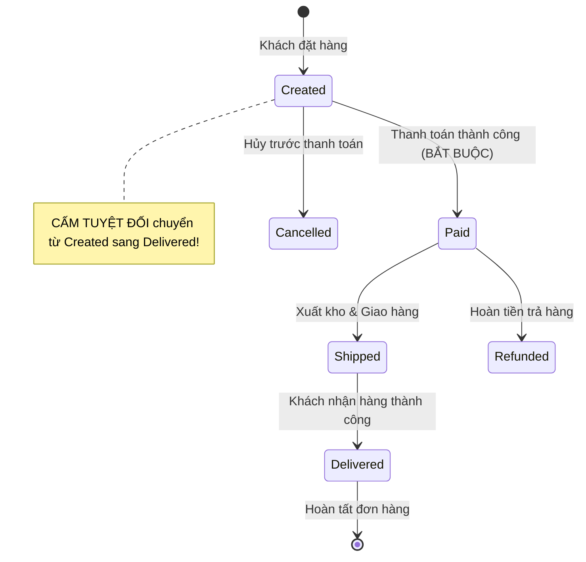
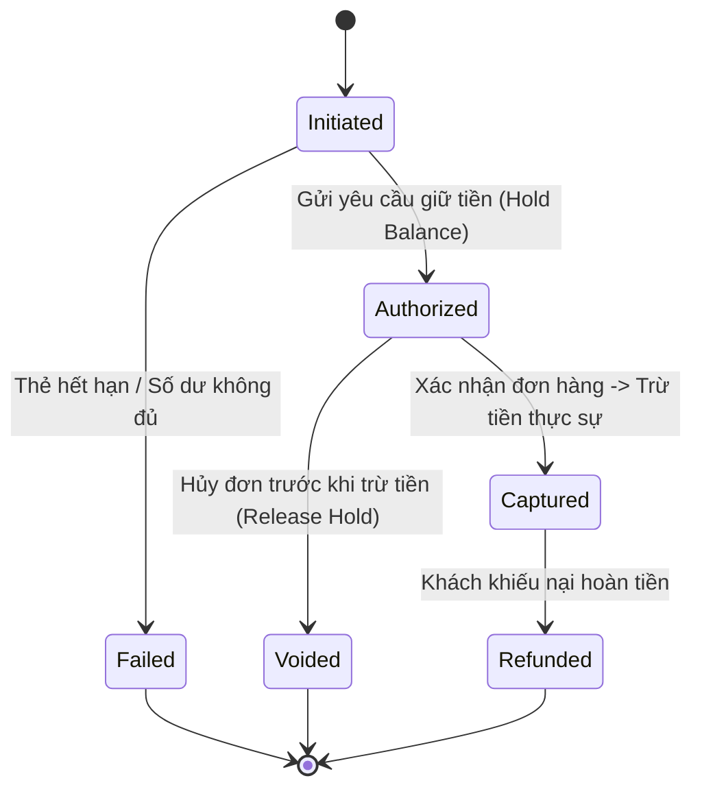
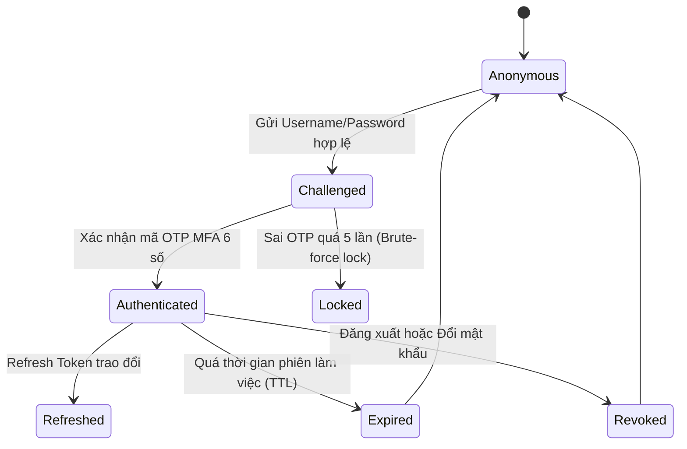
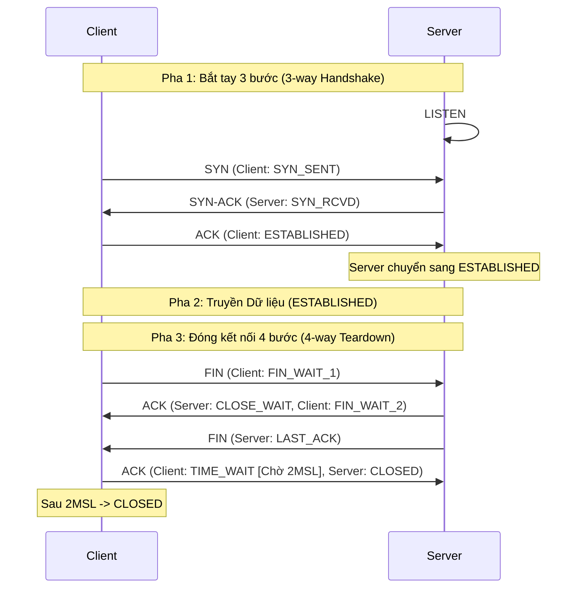
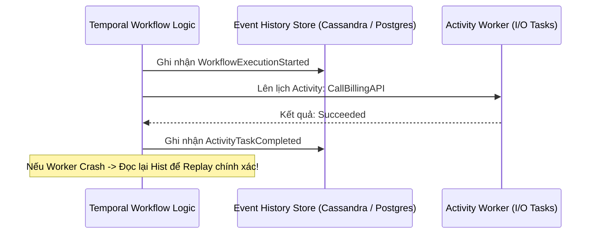
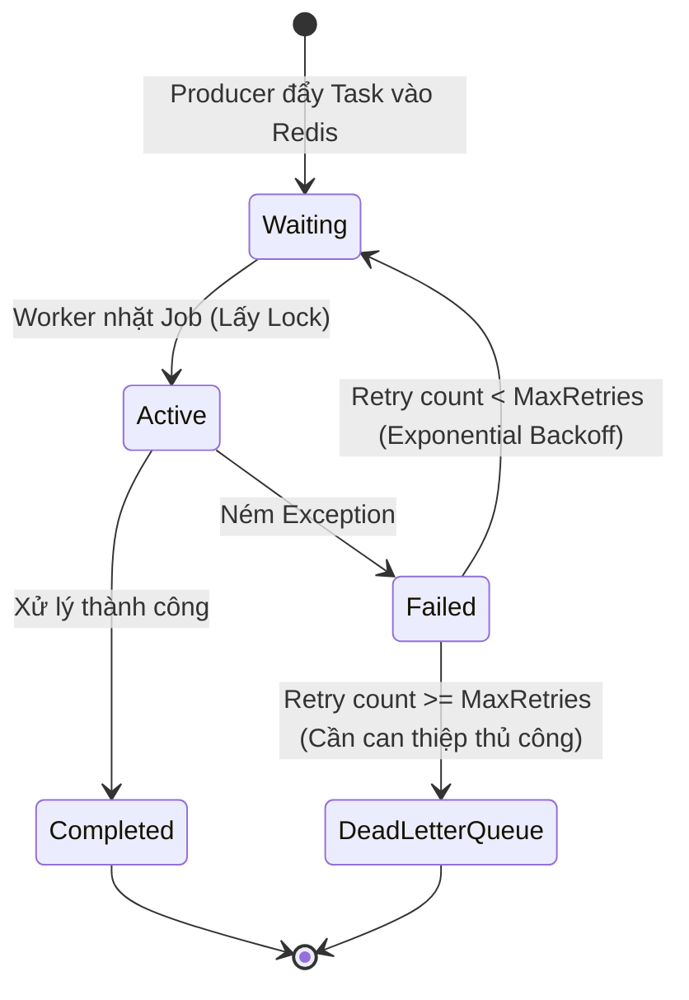
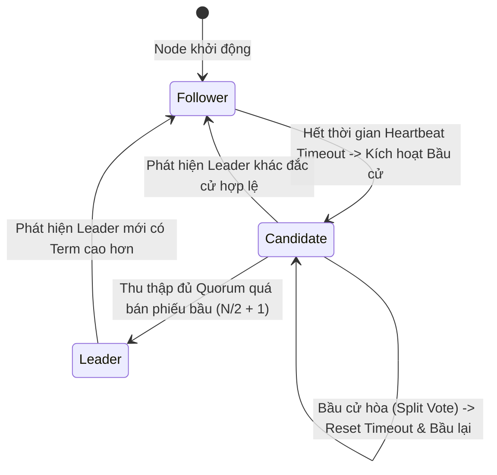

# 8.2. State Machines in Backend Systems (Ứng dụng Máy Trạng thái trong Kiến trúc Backend Thực chiến)

## Tổng quan về State Machines trong Backend
Trong kỹ thuật phần mềm Backend hiện đại, **Cỗ máy Trạng thái (State Machine)** không chỉ là một khái niệm lý thuyết trừu tượng mà là mô hình kiến trúc then chốt bảo vệ tính toàn vẹn của dữ liệu kinh doanh, kiểm soát luồng giao dịch tài chính và điều phối các giao thức mạng phức tạp.

Một hệ thống backend thiếu vắng mô hình máy trạng thái tường minh thường rơi vào tình trạng **"Boolean Hell"** (hàng chục cờ `is_paid`, `is_shipped`, `is_cancelled` được cập nhật rải rác khắp mã nguồn mà không có ma trận kiểm soát), dẫn đến các lỗi logic chết người như cho phép giao dịch chuyển thẳng từ `Created` sang `Delivered` mà không cần thanh toán (`Paid`).



---

## 2. Chi tiết từng Keyword (Under-the-Hood Deep Dive)

---

### 1. Order Lifecycle (Vòng đời Đơn hàng E-Commerce)

#### 1. Khái niệm bản chất (What & Why)
- **Định nghĩa**: Chuỗi các trạng thái nghiệp vụ mà một đơn hàng thương mại điện tử bắt buộc phải trải qua từ lúc giỏ hàng được xác nhận cho đến khi kết thúc.
- **Ràng buộc Nghiệp vụ Cốt lõi**:
  $$\text{Created} \longrightarrow \text{Paid} \longrightarrow \text{Shipped} \longrightarrow \text{Delivered}$$
  **BẢO MẬT TUYỆT ĐỐI**: Không bao giờ được phép nhảy cóc trạng thái (ví dụ: chuyển trực tiếp từ `Created` sang `Delivered` nếu nghiệp vụ không cho phép, vì điều này đồng nghĩa với việc giao hàng miễn phí mà chưa thu tiền).

#### 2. Cơ chế hoạt động sâu (Under the hood / Hardcore Internals)
- **Kiểm soát đồng thời lạc quan (Optimistic Concurrency Control - OCC)**:
  - Khi cập nhật trạng thái đơn hàng trong PostgreSQL / MySQL, ta sử dụng câu lệnh SQL có điều kiện chuyển dịch chặt chẽ kèm theo số phiên bản `version`:
    ```sql
    UPDATE orders 
    SET status = 'PAID', version = version + 1, updated_at = NOW() 
    WHERE id = $order_id AND status = 'CREATED' AND version = $current_version;
    ```
  - Nếu số hàng bị ảnh hưởng (`rows_affected`) bằng 0, có nghĩa là đã có một luồng khác chuyển trạng thái trước hoặc trạng thái hiện tại không hợp lệ $\implies$ Ném lỗi `IllegalStateTransitionException` và rollback transaction.

#### 3. Sơ đồ ma trận chuyển dịch trạng thái
```text
Ma trận Chuyển dịch Hợp lệ của Đơn hàng (Strict Transition Matrix):
+-----------------+---------------+---------------+---------------+---------------+---------------+
| Từ \ Sang       | CREATED       | PAID          | SHIPPED       | DELIVERED     | CANCELLED     |
+-----------------+---------------+---------------+---------------+---------------+---------------+
| CREATED         | KHÔNG         | HỢP LỆ        | BẤT HỢP PHÁP  | BẤT HỢP PHÁP! | HỢP LỆ        |
| PAID            | BẤT HỢP PHÁP  | KHÔNG         | HỢP LỆ        | BẤT HỢP PHÁP! | HOÀN TIỀN     |
| SHIPPED         | BẤT HỢP PHÁP  | BẤT HỢP PHÁP  | KHÔNG         | HỢP LỆ        | BẤT HỢP PHÁP  |
| DELIVERED       | BẤT HỢP PHÁP  | BẤT HỢP PHÁP  | BẤT HỢP PHÁP  | KHÔNG         | BẤT HỢP PHÁP  |
+-----------------+---------------+---------------+---------------+---------------+---------------+
```

#### 4. Code ví dụ thực chiến (TypeScript Production Order State Machine)
```typescript
export enum OrderStatus {
    Created = 'CREATED',
    Paid = 'PAID',
    Shipped = 'SHIPPED',
    Delivered = 'DELIVERED',
    Cancelled = 'CANCELLED',
    Refunded = 'REFUNDED'
}

export type OrderEvent = 
    | { type: 'PAY_SUCCESS'; transactionId: string; amount: number }
    | { type: 'SHIP_ORDER'; trackingNumber: string }
    | { type: 'CONFIRM_DELIVERY' }
    | { type: 'CANCEL'; reason: string }
    | { type: 'REFUND'; refundReason: string };

export class OrderStateMachine {
    // Định nghĩa tường minh Ma trận Chuyển dịch Trạng thái Hợp pháp
    private static readonly VALID_TRANSITIONS: Record<OrderStatus, OrderStatus[]> = {
        [OrderStatus.Created]:   [OrderStatus.Paid, OrderStatus.Cancelled],
        [OrderStatus.Paid]:      [OrderStatus.Shipped, OrderStatus.Refunded],
        [OrderStatus.Shipped]:   [OrderStatus.Delivered],
        [OrderStatus.Delivered]: [], // Terminal State
        [OrderStatus.Cancelled]: [], // Terminal State
        [OrderStatus.Refunded]:  []  // Terminal State
    };

    public static transition(currentStatus: OrderStatus, event: OrderEvent): OrderStatus {
        let nextStatus: OrderStatus;

        switch (event.type) {
            case 'PAY_SUCCESS':
                nextStatus = OrderStatus.Paid;
                break;
            case 'SHIP_ORDER':
                nextStatus = OrderStatus.Shipped;
                break;
            case 'CONFIRM_DELIVERY':
                nextStatus = OrderStatus.Delivered;
                break;
            case 'CANCEL':
                nextStatus = OrderStatus.Cancelled;
                break;
            case 'REFUND':
                nextStatus = OrderStatus.Refunded;
                break;
            default:
                throw new Error("UNKNOWN_EVENT_TYPE");
        }

        // Kiểm tra tính hợp lệ qua Ma trận chuyển dịch
        const allowedTargets = this.VALID_TRANSITIONS[currentStatus];
        if (!allowedTargets.includes(nextStatus)) {
            throw new Error(
                `ILLEGAL_STATE_TRANSITION: Nghiệp vụ nghiêm cấm chuyển từ [${currentStatus}] sang [${nextStatus}]!`
            );
        }

        return nextStatus;
    }
}

// Kiểm thử bảo vệ logic nghiệp vụ:
const s1 = OrderStatus.Created;
const s2 = OrderStateMachine.transition(s1, { type: 'PAY_SUCCESS', transactionId: 'txn_102', amount: 50 });
console.log("Status after payment:", s2); // PAID

try {
    // Cố tình nhảy cóc từ PAID sang DELIVERED mà không qua SHIPPED
    OrderStateMachine.transition(s2, { type: 'CONFIRM_DELIVERY' });
} catch (err: any) {
    console.error("Bảo vệ thành công:", err.message);
}
```

#### 5. Ưu / Nhược điểm, Pitfalls & Anti-patterns
- **Anti-pattern**: Thực hiện kiểm tra trạng thái ở tầng UI Frontend thay vì Backend. Kẻ tấn công có thể dùng Postman/Curl gửi thẳng HTTP PATCH `status: DELIVERED` lên API nếu Backend không có State Machine kiểm tra.

#### 6. Ứng dụng thực tế trong Backend / Systems
- Hệ thống Xử lý Đơn hàng của Amazon / Shopee: Quản lý hàng triệu đơn hàng mỗi ngày thông qua các State Machine Engine phân tán đảm bảo không thất thoát doanh thu.

---

### 2. Payment Lifecycle (Vòng đời Thanh toán Điện tử)

#### 1. Khái niệm bản chất (What & Why)
- **Định nghĩa**: Chu trình biến đổi trạng thái của một yêu cầu thanh toán thẻ tín dụng, ví điện tử hoặc chuyển khoản ngân hàng.
- **Tính bất biến**: Mỗi thay đổi trạng thái tiền tệ phải đạt chuẩn **ACID** và duy trì tính toàn vẹn kiểm toán (Audit Trail) không thể chối bỏ.

#### 2. Cơ chế hoạt động sâu (Under the hood / Hardcore Internals)
- **Mô hình Hai giai đoạn (Two-phase Payment: Authorize & Capture)**:
  1. `Initiated`: Khách hàng bấm thanh toán.
  2. `Authorized`: Ngân hàng phong tỏa số tiền trong thẻ của khách (Hold balance), nhưng tiền chưa chuyển về tài khoản người bán.
  3. `Captured`: Sau khi đơn hàng được xác nhận đóng gói, tiền chính thức được rút từ tài khoản khách chuyển sang người bán.
  4. `Voided` / `Refunded`: Hủy phong tỏa hoặc trả lại tiền.
- **Bảo vệ Tính Bất biến (Idempotency Key)**: Mỗi yêu cầu thanh toán phải kèm một UUID `Idempotency-Key` từ Client để nếu mạng bị ngắt kết nối và gửi lại, máy chủ thanh toán chỉ thực thi đúng 1 lần duy nhất, tránh trừ tiền 2 lần.

#### 3. Sơ đồ minh họa


#### 4. Code ví dụ thực chiến (C++ Idempotent Payment State Transition)
```cpp
#include <iostream>
#include <string>
#include <unordered_map>
#include <stdexcept>

enum class PaymentState { Initiated, Authorized, Captured, Failed, Refunded };

struct PaymentRecord {
    std::string payment_id;
    int64_t amount_cents;
    PaymentState state{PaymentState::Initiated};
};

class PaymentEngine {
    std::unordered_map<std::string, PaymentRecord> db_;

public:
    void authorize(const std::string& id, int64_t amount) {
        if (db_.contains(id)) throw std::runtime_error("IDEMPOTENCY_VIOLATION: Payment already exists");
        db_[id] = {id, amount, PaymentState::Authorized};
        std::cout << "Payment " << id << " Authorized for " << amount << " cents.\n";
    }

    void capture(const std::string& id) {
        auto& p = db_.at(id);
        if (p.state != PaymentState::Authorized) {
            throw std::runtime_error("CANNOT_CAPTURE: Payment is not in Authorized state!");
        }
        p.state = PaymentState::Captured;
        std::cout << "Payment " << id << " Captured successfully!\n";
    }
};

int main() {
    PaymentEngine engine;
    engine.authorize("pay_9981", 15000); // 150 USD
    engine.capture("pay_9981");
    return 0;
}
```

#### 5. Ưu / Nhược điểm, Pitfalls & Anti-patterns
- **Pitfall**: Không phân biệt giữa `Void` (hủy giữ tiền, không mất phí giao dịch) và `Refund` (hoàn tiền sau khi đã capture, người bán phải chịu phí xử lý của cổng thanh toán).

#### 6. Ứng dụng thực tế trong Backend / Systems
- Stripe / PayPal API Architecture: Thiết kế các Webhook Events (`payment_intent.succeeded`, `charge.refunded`) phản ánh chính xác trạng thái máy thanh toán.

---

### 3. Authentication State (Trạng thái Xác thực Người dùng)

#### 1. Khái niệm bản chất (What & Why)
- **Định nghĩa**: Trạng thái bảo mật của một phiên làm việc (Session) hoặc một kết nối Client đối với hệ thống Backend.
- **Các pha chuyển dịch**:
  `Anonymous` $\to$ `Challenged (MFA Sent)` $\to$ `Authenticated` $\to$ `Session Expired` $\to$ `Revoked`.

#### 2. Cơ chế hoạt động sâu (Under the hood / Hardcore Internals)
- **JWT vs Stateful Sessions**:
  - Trong Stateful Session: Trạng thái được lưu trong Redis với TTL (Time-To-Live). Việc chuyển trạng thái sang `Revoked` có hiệu lực tức thì trên toàn cầu.
  - Trong Stateless JWT: Máy chủ không lưu trạng thái. Để chuyển trạng thái sang `Revoked` trước khi Token hết hạn, hệ thống phải duy trì một **Token Blacklist / Bloom Filter** trong bộ nhớ đệm RAM.

#### 3. Sơ đồ minh họa


#### 4. Code ví dụ thực chiến (TypeScript Session State Guard Middleware)
```typescript
type AuthState = 
    | { status: 'Anonymous' }
    | { status: 'MfaPending'; tempUserId: string; otpExpiresAt: number }
    | { status: 'Authenticated'; userId: string; role: 'USER' | 'ADMIN' };

class UserSession {
    private state: AuthState = { status: 'Anonymous' };

    public loginWithPassword(userId: string): void {
        if (this.state.status !== 'Anonymous') throw new Error("Already logged in");
        // Chuyển sang chờ MFA
        this.state = {
            status: 'MfaPending',
            tempUserId: userId,
            otpExpiresAt: Date.now() + 5 * 60 * 1000 // 5 phút
        };
    }

    public verifyOtp(otp: string): void {
        if (this.state.status !== 'MfaPending') throw new Error("No MFA challenge pending");
        if (Date.now() > this.state.otpExpiresAt) throw new Error("OTP expired");

        if (otp === "123456") {
            this.state = { status: 'Authenticated', userId: this.state.tempUserId, role: 'USER' };
        } else {
            throw new Error("Invalid OTP code");
        }
    }

    public getStatus(): string { return this.state.status; }
}

const session = new UserSession();
session.loginWithPassword("usr_alex");
session.verifyOtp("123456");
console.log("Auth State:", session.getStatus()); // Authenticated
```

#### 5. Ưu / Nhược điểm, Pitfalls & Anti-patterns
- **Lỗ hổng bảo mật Session Fixation**: Không cấp phát Session ID mới sau khi người dùng chuyển trạng thái từ `Anonymous` sang `Authenticated`, tạo cơ hội cho kẻ tấn công chiếm quyền điều khiển phiên.

#### 6. Ứng dụng thực tế trong Backend / Systems
- Giao thức OAuth2 Authorization Code Flow with PKCE: Chuỗi chuyển dịch trạng thái trao đổi giữa Mobile App, Auth0/Keycloak và Resource API.

---

### 4. Connection State & TCP State Machine (Trạng thái Kết nối và Cỗ máy Trạng thái TCP)

#### 1. Khái niệm bản chất (What & Why)
- **Định nghĩa**: Cỗ máy trạng thái cốt lõi trong nhân Linux Kernel quản lý toàn bộ vòng đời của một kết nối mạng hướng liên kết TCP (Transmission Control Protocol - RFC 793).
- **11 Trạng thái Kinh điển của TCP**:
  1. `CLOSED`: Chưa có kết nối.
  2. `LISTEN`: Chờ kết nối từ Client.
  3. `SYN_SENT`: Client đã gửi gói SYN, chờ ACK.
  4. `SYN_RCVD`: Server đã nhận SYN, gửi lại SYN-ACK.
  5. `ESTABLISHED`: Kết nối hoàn tất, bắt đầu truyền dữ liệu hai chiều.
  6. `FIN_WAIT_1`: Đã gửi gói đóng kết nối FIN.
  7. `FIN_WAIT_2`: Đã nhận ACK cho FIN, chờ FIN từ phía đối diện.
  8. `CLOSE_WAIT`: Đã nhận FIN từ đối diện, ứng dụng cục bộ chuẩn bị đóng socket.
  9. `CLOSING`: Cả hai bên cùng gửi FIN đồng thời.
  10. `LAST_ACK`: Chờ gói ACK cuối cùng trước khi đóng hoàn toàn.
  11. `TIME_WAIT`: Chờ $2 \times \text{MSL}$ (Maximum Segment Lifetime $\approx 60-120\text{s}$) để đảm bảo gói ACK cuối cùng tới đích an toàn và các gói tin cũ trên mạng tiêu biến hết.

#### 2. Cơ chế hoạt động sâu (Under the hood / Hardcore Internals)
- **Thảm họa TIME_WAIT và CLOSE_WAIT Socket Leak**:
  - `TIME_WAIT` quá nhiều: Khi máy chủ tạo hàng chục nghìn kết nối outgoing nhanh tới Database/Microservice rồi đóng lại, các socket bị kẹt ở `TIME_WAIT` làm cạn kiệt cổng cục bộ (Ephemeral Ports exhaustion: lỗi `EADDRNOTAVAIL`).
  - `CLOSE_WAIT` tích tụ: Dấu hiệu của **Application Bug** — Phía client đã đóng socket nhưng code backend quên gọi `close(socket_fd)`, khiến socket bị treo mãi mãi trong Kernel, gây rò rỉ File Descriptors (`EMFILE: Too many open files`).

#### 3. Sơ đồ minh họa (TCP Three-way Handshake & Teardown)


#### 4. Code ví dụ thực chiến (C++ Phân tích Trạng thái TCP Socket qua `/proc/net/tcp`)
```cpp
#include <iostream>
#include <fstream>
#include <string>

// Mã số trạng thái TCP trong nhân Linux (Hex):
// 01: ESTABLISHED, 02: SYN_SENT, 07: CLOSE_WAIT, 0A: LISTEN
const char* tcp_state_name(int state_code) {
    switch (state_code) {
        case 1:  return "ESTABLISHED";
        case 2:  return "SYN_SENT";
        case 3:  return "SYN_RECV";
        case 4:  return "FIN_WAIT1";
        case 5:  return "FIN_WAIT2";
        case 6:  return "TIME_WAIT";
        case 7:  return "CLOSE_WAIT";
        case 10: return "LISTEN";
        default: return "OTHER";
    }
}

int main() {
    std::cout << "State Code 01: " << tcp_state_name(1) << "\n";
    std::cout << "State Code 06: " << tcp_state_name(6) << "\n";
    std::cout << "State Code 0A: " << tcp_state_name(10) << "\n";
    return 0;
}
```

#### 5. Ưu / Nhược điểm, Pitfalls & Anti-patterns
- **Tối ưu hóa Kernel**: Bật cờ `net.ipv4.tcp_tw_reuse = 1` trong Linux `sysctl` để cho phép tái sử dụng an toàn các socket đang ở trạng thái `TIME_WAIT` cho các kết nối mới.

#### 6. Ứng dụng thực tế trong Backend / Systems
- Thiết lập Connection Pooling (HikariCP, PgBouncer, gRPC Channel Pooling): Duy trì sẵn các kết nối ở trạng thái `ESTABLISHED` để loại bỏ chi phí bắt tay 3 bước TCP + TLS Handshake cho mỗi câu truy vấn.

---

### 5. Workflow Engine (Bộ máy Điều phối Quy trình Nghiệp vụ)

#### 1. Khái niệm bản chất (What & Why)
- **Định nghĩa**: Một hệ thống phần mềm chuyên dụng quản lý và thực thi các quy trình nghiệp vụ phức tạp, kéo dài (Long-running Workflows) kéo dài từ vài giây, vài ngày đến vài tháng qua hàng chục microservices.
- **Tiêu biểu**: Temporal.io, AWS Step Functions, Cadence, Camunda (BPMN).

#### 2. Cơ chế hoạt động sâu (Under the hood / Hardcore Internals)
- **Cơ chế Event Sourcing & Deterministic Replay**:
  - Workflow Engine không lưu trạng thái trong RAM. Nó lưu toàn bộ chuỗi các sự kiện lịch sử (History Event Log) vào Database.
  - Khi máy chủ bị crash và khởi động lại, engine đọc lại lịch sử sự kiện và **chạy lại mã code (Replay)** từ đầu để tái tạo lại trạng thái chính xác tại thời điểm trước khi crash!
  - **Quy tắc vàng**: Code của Workflow bắt buộc phải mang tính tất định tuyệt đối (không gọi `random()`, không đọc đồng hồ hệ thống `Date.now()`, không gọi API trực tiếp bên trong workflow function).

#### 3. Sơ đồ minh họa


#### 4. Code ví dụ thực chiến (TypeScript Temporal.io Workflow Pattern)
```typescript
// Mô phỏng cấu trúc Workflow tất định của Temporal
interface WorkflowContext {
    recordStep(stepName: string): void;
}

async function userOnboardingWorkflow(ctx: WorkflowContext, userId: string) {
    // Bước 1: Tạo tài khoản DB
    ctx.recordStep("CREATE_DATABASE_RECORD");

    // Bước 2: Gửi email chào mừng (Activity không đồng bộ)
    ctx.recordStep("DISPATCH_WELCOME_EMAIL");

    // Bước 3: Chờ 24h để gửi khảo sát (Durable Sleep)
    ctx.recordStep("SCHEDULED_FOLLOWUP_REMINDER");

    return { status: "COMPLETED", userId };
}
```

#### 5. Ưu / Nhược điểm, Pitfalls & Anti-patterns
- **Pitfall**: Đưa logic không tất định (Non-deterministic code) vào trong Workflow function khiến quá trình Replay bị lệch pha (Non-deterministic Error làm hỏng toàn bộ execution history).

#### 6. Ứng dụng thực tế trong Backend / Systems
- Hệ thống Xử lý Hoàn trả Hàng (E-commerce Return & Refund Pipeline): Điều phối quy trình phức tạp: Shipper đến lấy hàng $\to$ Kho kiểm tra chất lượng $\to$ Kế toán duyệt tiền $\to$ Ngân hàng hoàn tiền $\to$ Đóng ticket.

---

### 6. Job Processing (Hệ thống Xử lý Tác vụ Hàng đợi)

#### 1. Khái niệm bản chất (What & Why)
- **Định nghĩa**: Kiến trúc xử lý các tác vụ tốn thời gian hoặc tác vụ bất đồng bộ tách biệt khỏi luồng phục vụ người dùng chính (Main HTTP Request/Response Thread) thông qua Message Queues (BullMQ, Celery, Sidekiq).
- **Vòng đời chuẩn của một Job**:
  `Waiting` $\to$ `Active` $\to$ `Completed` (hoặc `Failed` $\to$ `Delayed / Retrying` $\to$ `Dead-Letter Queue`).

#### 2. Cơ chế hoạt động sâu (Under the hood / Hardcore Internals)
- **Cơ chế Khóa Trực quan và Timers (Visibility Timeout & Heartbeat Lock)**:
  - Khi một Worker nhặt một Job từ Redis: Trạng thái chuyển sang `Active`. Job bị ẩn đi đối với các worker khác trong một khoảng thời gian (ví dụ 30 giây).
  - Worker phải gửi "Heartbeat" định kỳ về Redis để gia hạn khóa.
  - Nếu Worker bị sập đột ngột (OOM/Kernel panic), hết thời gian timeout, Redis tự động đưa Job trở lại trạng thái `Waiting` để Worker khác nhặt lại (At-least-once Processing Guarantee).

#### 3. Sơ đồ minh họa


#### 4. Code ví dụ thực chiến (TypeScript BullMQ Job State Listener)
```typescript
type JobState = 'waiting' | 'active' | 'completed' | 'failed' | 'delayed';

interface BackgroundJob {
    id: string;
    payload: any;
    state: JobState;
    retryCount: number;
}

class JobQueueWorker {
    public process(job: BackgroundJob): void {
        job.state = 'active';
        console.log(`[Job ${job.id}] Status changed to ACTIVE`);

        try {
            // Thực hiện tác vụ nặng (Convert video, Render PDF)...
            if (job.payload.invalid) throw new Error("Processing failed");

            job.state = 'completed';
            console.log(`[Job ${job.id}] Status changed to COMPLETED`);
        } catch (err: any) {
            job.retryCount++;
            if (job.retryCount < 3) {
                job.state = 'delayed'; // Đưa vào hàng chờ retry sau
                console.log(`[Job ${job.id}] FAILED. Retrying later (Attempt ${job.retryCount}/3)...`);
            } else {
                job.state = 'failed'; // Chuyển vào Dead-Letter Queue
                console.error(`[Job ${job.id}] MOVED TO DEAD-LETTER QUEUE!`);
            }
        }
    }
}

const worker = new JobQueueWorker();
worker.process({ id: "job_export_pdf", payload: { invalid: true }, state: "waiting", retryCount: 0 });
```

#### 5. Ưu / Nhược điểm, Pitfalls & Anti-patterns
- **Pitfall**: Job không có tính lũy suy (Idempotency). Khi mạng bị lag khiến Worker chạy lại Job lần 2, hệ thống bị gửi 2 email cho khách hàng hoặc gửi 2 báo cáo trùng lặp.

#### 6. Ứng dụng thực tế trong Backend / Systems
- Hệ thống Mã hóa Video của YouTube / TikTok: Phân rã video thành hàng nghìn chunks nhỏ và đưa vào Job Queue phân tán để xử lý chuyển mã song song.

---

### 7. Distributed Protocols State Machines (Máy Trạng thái Giao thức Phân tán - Raft & Paxos)

#### 1. Khái niệm bản chất (What & Why)
- **Định nghĩa**: Mô hình Replicated State Machine (RSM) — nền tảng của mọi hệ thống cơ sở dữ liệu phân tán chịu lỗi (etcd, Consul, CockroachDB, Kafka KRaft).
- **Nguyên lý Replicated State Machine (Fred Schneider, 1990)**:
  Nếu tất cả các nút phân tán khởi đầu tại cùng một trạng thái $s_0$ và cùng thực thi một chuỗi các lệnh chuyển dịch trạng thái giống hệt nhau theo đúng cùng một thứ tự tất định (Deterministic Log Ordering), thì tất cả các nút sẽ luôn luôn đạt được trạng thái cuối cùng giống hệt nhau!

#### 2. Cơ chế hoạt động sâu (Under the hood / Hardcore Internals)
- **Ba trạng thái cốt lõi của một Node trong Thuật toán Đồng thuận Raft**:
  1. **Follower**: Trạng thái ban đầu. Chỉ tiếp nhận RPC từ Leader và Candidate. Nếu không nhận được Heartbeat từ Leader trước khi hết thời gian ngẫu nhiên `Election Timeout` (150ms - 300ms), Follower tự chuyển trạng thái sang `Candidate`.
  2. **Candidate**: Tăng Term hiện tại lên 1, tự bỏ phiếu cho mình và phát tán RPC `RequestVote` tới toàn bộ các node khác. Nếu thu thập đủ quá bán số phiếu (Quorum: $\lfloor N/2 \rfloor + 1$), Candidate chuyển trạng thái thành `Leader`.
  3. **Leader**: Quản lý toàn bộ việc ghi nhận Log và nhân bản dữ liệu ra các Follower. Gửi các gói Heartbeat định kỳ để duy trì quyền lực và ngăn chặn các cuộc bầu cử mới.

#### 3. Sơ đồ minh họa (Raft Node Lifecycle)


#### 4. Code ví dụ thực chiến (C++ Raft Node State Transitions)
```cpp
#include <iostream>
#include <string>

enum class RaftRole { Follower, Candidate, Leader };

class RaftNode {
    int node_id_;
    int current_term_{0};
    RaftRole role_{RaftRole::Follower};
    int votes_received_{0};

public:
    explicit RaftNode(int id) : node_id_(id) {}

    void on_election_timeout(int total_nodes) {
        if (role_ == RaftRole::Leader) return;

        // Chuyển sang Candidate
        role_ = RaftRole::Candidate;
        current_term_++;
        votes_received_ = 1; // Tự bỏ phiếu cho chính mình
        std::cout << "[Node " << node_id_ << "] Election Timeout! Became CANDIDATE for Term " 
                  << current_term_ << "\n";

        // Giả lập nhận phiếu từ các node khác
        int quorum = (total_nodes / 2) + 1;
        votes_received_ += 2; // Giả sử nhận thêm 2 phiếu

        if (votes_received_ >= quorum) {
            role_ = RaftRole::Leader;
            std::cout << "[Node " << node_id_ << "] Won Election! Promoted to LEADER!\n";
        }
    }

    [[nodiscard]] RaftRole get_role() const noexcept { return role_; }
};

int main() {
    RaftNode node(1);
    node.on_election_timeout(5); // Cụm 5 nodes (Quorum = 3)
    return 0;
}
```

#### 5. Ưu / Nhược điểm, Pitfalls & Anti-patterns
- **Thảm họa Split-Brain**: Không sử dụng Quorum quá bán ($\lfloor N/2 \rfloor + 1$) mà sử dụng mạng phân tách thành 2 nửa bằng nhau, dẫn đến việc xuất hiện 2 Leaders đồng thời trong cùng một cụm (Split-Brain), phá hủy hoàn toàn dữ liệu.

#### 6. Ứng dụng thực tế trong Backend / Systems
- Kubernetes Control Plane: Sử dụng `etcd` (chạy thuật toán Raft) để lưu trữ duy nhất và đồng thuận toàn bộ cấu hình trạng thái của hàng nghìn Pods và Services trong Cluster.
