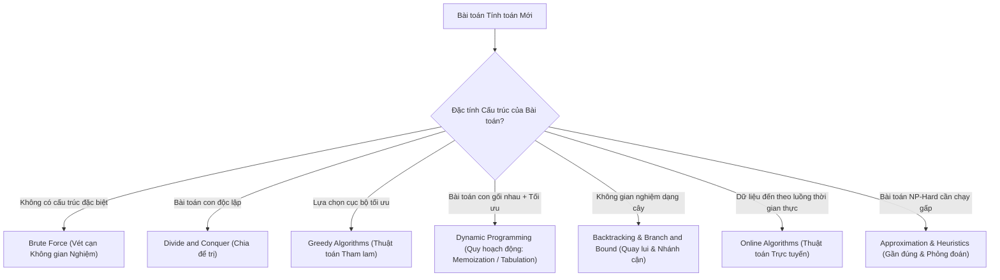
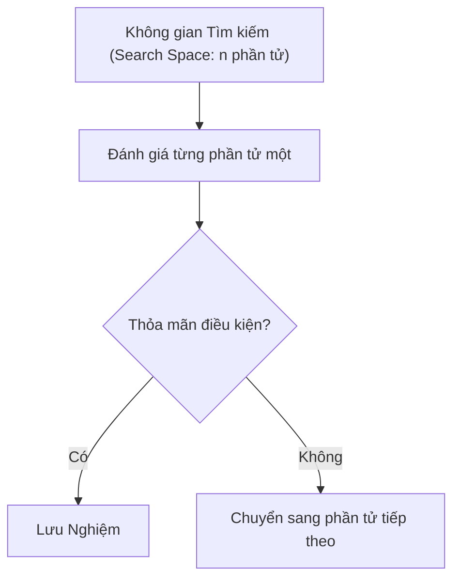
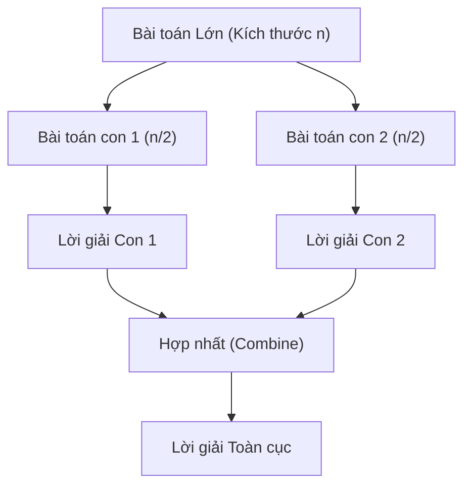
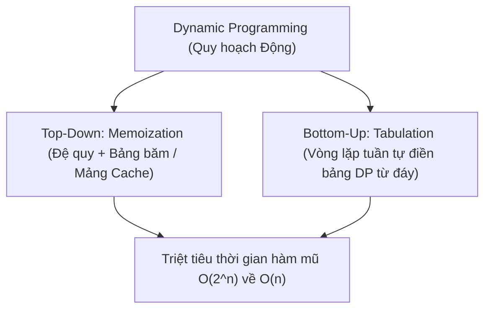
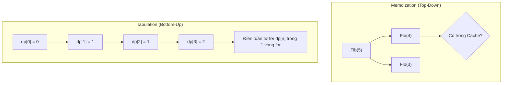
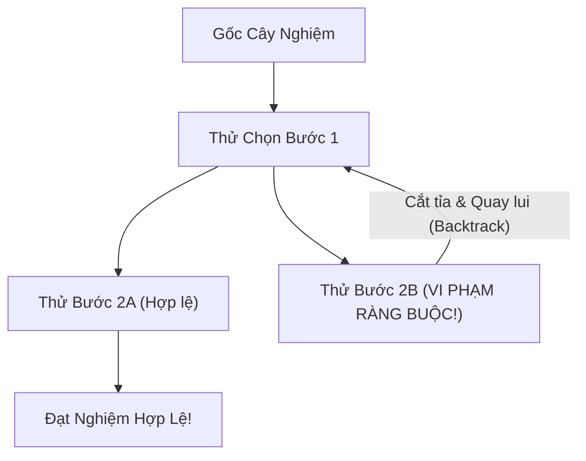
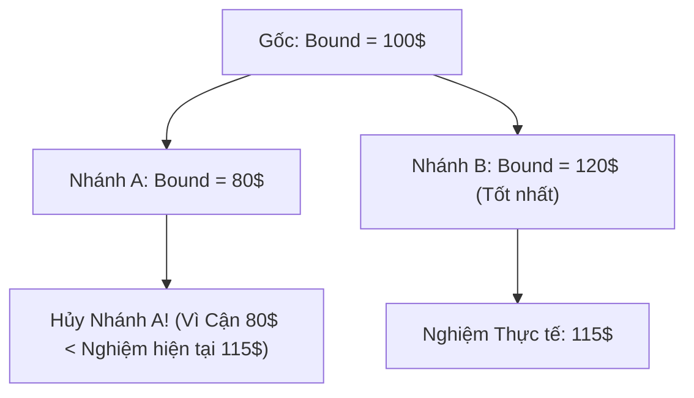
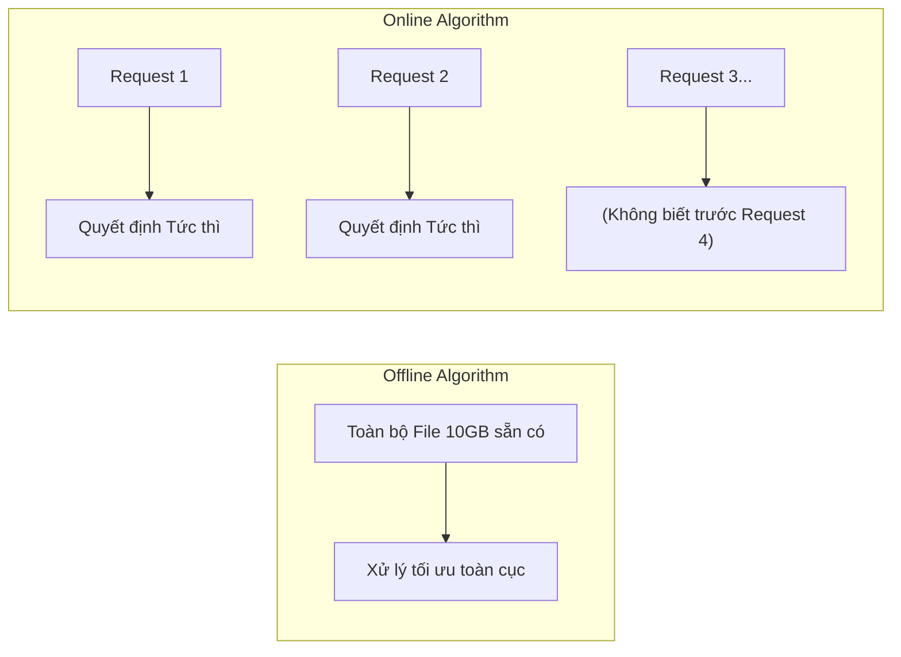
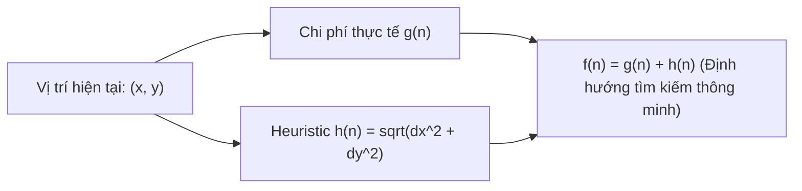
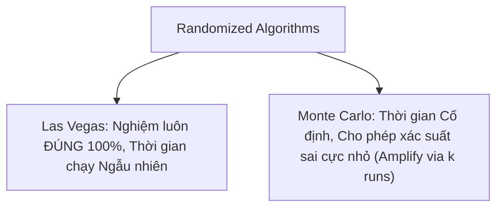

# 9.1. Core Algorithmic Paradigms (Các Trường phái Thiết kế Thuật toán Cốt lõi)

## Tổng quan về Các Trường phái Thuật toán
Một **Trường phái Thuật toán (Algorithmic Paradigm)** là một phương pháp tiếp cận hoặc triết lý thiết kế tổng quát được áp dụng để giải quyết một lớp rộng lớn các bài toán tính toán khác nhau.

Việc nắm vững các trường phái thuật toán cho phép kỹ sư phần mềm nhanh chóng nhận diện bản chất cấu trúc của bài toán để lựa chọn giải pháp tối ưu nhất, thay vì mò mẫm thử sai.



---

## 2. Chi tiết từng Keyword (Under-the-Hood Deep Dive)

---

### 1. Brute Force (Vét cạn Toàn diện)

#### 1. Khái niệm bản chất (What & Why)
- **Định nghĩa**: Phương pháp tiếp cận trực tiếp và thô sơ nhất: Duyệt qua toàn bộ mọi cấu hình, hoán vị hoặc phần tử trong không gian tìm kiếm (Search Space) để tìm ra lời giải thỏa mãn điều kiện bài toán.
- **Vai trò kỹ thuật**: Luôn được dùng làm **Thuật toán Chuẩn đối chiếu (Baseline / Ground Truth)** để kiểm tra tính đúng đắn của các thuật toán tối ưu hóa phức tạp hơn trong Unit Tests.

#### 2. Cơ chế hoạt động sâu (Under the hood / Hardcore Internals)
- **Độ phức tạp**: Thường có chi phí thời gian tăng trưởng theo hàm đa thức bậc cao hoặc hàm mũ ($\mathcal{O}(n^k)$, $\mathcal{O}(2^n)$, $\mathcal{O}(n!)$).
- **Tận dụng phần cứng**: Brute force có thể được tăng tốc cực mạnh trên phần cứng GPU thông qua hàng nghìn lõi tính toán song song (Massively Parallel SIMT) đối với các bài toán độc lập dữ liệu (Embarrassingly Parallel).

#### 3. Sơ đồ minh họa


#### 4. Code ví dụ thực chiến (C++ Brute Force Baseline Checker)
```cpp
#include <iostream>
#include <vector>

// Tìm kiếm tuyến tính vét cạn: O(n)
int brute_force_search(const std::vector<int>& arr, int target) {
    for (std::size_t i = 0; i < arr.size(); ++i) {
        if (arr[i] == target) return static_cast<int>(i);
    }
    return -1;
}

int main() {
    std::vector<int> nums = {4, 2, 7, 1, 9, 3};
    std::cout << "Index of 7: " << brute_force_search(nums, 7) << "\n";
    return 0;
}
```

#### 5. Ưu / Nhược điểm, Pitfalls & Anti-patterns
- **Ưu điểm**: Cực kỳ dễ cài đặt, không bao giờ bỏ sót nghiệm nếu có.
- **Nhược điểm**: Bất khả thi khi kích thước đầu vào $n$ tăng lên.

#### 6. Ứng dụng thực tế trong Backend / Systems
- Bẻ khóa mật mã (Brute-force Attacks): Thử lần lượt các tổ hợp ký tự để phá mã mật khẩu yếu.

---

### 2. Divide and Conquer (Chia để trị)

#### 1. Khái niệm bản chất (What & Why)
- **Định nghĩa**: Trường phái thiết kế thuật toán hoạt động qua 3 bước đệ quy:
  1. **Divide (Chia)**: Chia bài toán ban đầu thành các bài toán con nhỏ hơn có cùng bản chất.
  2. **Conquer (Trị)**: Giải quyết các bài toán con bằng đệ quy. Nếu bài toán con đủ nhỏ (Base Case), giải trực tiếp.
  3. **Combine (Kết hợp)**: Hợp nhất các lời giải của bài toán con lại để tạo thành lời giải hoàn chỉnh cho bài toán lớn ban đầu.

#### 2. Cơ chế hoạt động sâu (Under the hood / Hardcore Internals)
- **Định lý Thơ (Master Theorem)** để phân tích độ phức tạp:
  $$T(n) = a T(n/b) + f(n)$$
  Trong đó $a$ là số bài toán con, $n/b$ là kích thước mỗi bài toán con, và $f(n)$ là chi phí chia và kết hợp.
- **Tận dụng Đa lõi CPU**: Thuật toán Chia để trị là ứng viên hoàn hảo cho kiến trúc song song phân tán (Fork-Join Framework trong Java, Thread Pool Task Work-Stealing).

#### 3. Sơ đồ minh họa


#### 4. Code ví dụ thực chiến (C++ Divide and Conquer: Merge Sort)
```cpp
#include <iostream>
#include <vector>

void merge_step(std::vector<int>& arr, int l, int m, int r) {
    std::vector<int> left(arr.begin() + l, arr.begin() + m + 1);
    std::vector<int> right(arr.begin() + m + 1, arr.begin() + r + 1);

    std::size_t i = 0, j = 0, k = l;
    while (i < left.size() && j < right.size()) {
        arr[k++] = (left[i] <= right[j]) ? left[i++] : right[j++];
    }
    while (i < left.size()) arr[k++] = left[i++];
    while (j < right.size()) arr[k++] = right[j++];
}

void divide_and_conquer_sort(std::vector<int>& arr, int l, int r) {
    if (l >= r) return; // Base Case
    int m = l + (r - l) / 2; // 1. Divide
    divide_and_conquer_sort(arr, l, m); // 2. Conquer Left
    divide_and_conquer_sort(arr, m + 1, r); // 2. Conquer Right
    merge_step(arr, l, m, r); // 3. Combine
}

int main() {
    std::vector<int> data = {9, 4, 8, 3, 1, 2, 5};
    divide_and_conquer_sort(data, 0, data.size() - 1);
    for (int x : data) std::cout << x << " ";
    std::cout << "\n";
    return 0;
}
```

#### 5. Ưu / Nhược điểm, Pitfalls & Anti-patterns
- **Pitfall**: Chi phí đệ quy và cấp phát bộ nhớ phụ trợ trong bước Combine quá lớn (như trong Merge Sort cần $O(n)$ bộ nhớ RAM phụ).

#### 6. Ứng dụng thực tế trong Backend / Systems
- Thuật toán MapReduce của Google / Apache Hadoop: Chia file dữ liệu hàng trăm Terabytes thành các chunks nhỏ (Map) và tổng hợp kết quả phân tán (Reduce).

---

### 3. Greedy Algorithms (Thuật toán Tham lam)

#### 1. Khái niệm bản chất (What & Why)
- **Định nghĩa**: Thuật toán xây dựng lời giải từng bước một, tại mỗi bước nó luôn đưa ra **lựa chọn tốt nhất ở thời điểm hiện tại (Locally Optimal Choice)** với hy vọng rằng chuỗi các lựa chọn cục bộ đó sẽ dẫn đến **lời giải tối ưu toàn cục (Globally Optimal Solution)**.
- **Đặc điểm**: Một khi đã đưa ra lựa chọn, thuật toán tham lam **không bao giờ quay lui (Never Backtracks)** hay thay đổi quyết định trong quá khứ.

#### 2. Cơ chế hoạt động sâu (Under the hood / Hardcore Internals)
- **Hai thuộc tính toán học bắt buộc để thuật toán Tham lam hoạt động chính xác**:
  1. **Greedy-Choice Property**: Lời giải tối ưu toàn cục có thể đạt được bằng cách thực hiện các lựa chọn cục bộ tối ưu.
  2. **Optimal Substructure (Cấu trúc con tối ưu)**: Lời giải tối ưu cho bài toán lớn chứa đựng các lời giải tối ưu cho các bài toán con.
- **Định lý Matroid**: Cung cấp khung lý thuyết toán học đại số để chứng minh chính xác khi nào một thuật toán tham lam sẽ tìm ra nghiệm tối ưu tuyệt đối.

#### 3. Sơ đồ minh họa


#### 4. Code ví dụ thực chiến (C++ Greedy Interval Scheduling - Lập lịch Công việc Tối đa)
```cpp
#include <iostream>
#include <vector>
#include <algorithm>

struct Interval {
    int start;
    int end;
};

// Chiến lược Tham lam Tối ưu: Luôn chọn công việc có thời gian KẾT THÚC sớm nhất!
int max_non_overlapping_intervals(std::vector<Interval> intervals) {
    if (intervals.empty()) return 0;

    // Sắp xếp tăng dần theo thời gian kết thúc
    std::sort(intervals.begin(), intervals.end(), [](const Interval& a, const Interval& b) {
        return a.end < b.end;
    });

    int count = 1;
    int last_end = intervals[0].end;

    for (std::size_t i = 1; i < intervals.size(); ++i) {
        if (intervals[i].start >= last_end) {
            ++count;
            last_end = intervals[i].end; // Lựa chọn tham lam tiếp theo
        }
    }
    return count;
}

int main() {
    std::vector<Interval> tasks = {{1, 3}, {2, 5}, {4, 7}, {1, 8}, {6, 9}};
    std::cout << "Max scheduled tasks: " << max_non_overlapping_intervals(tasks) << "\n"; // 3
    return 0;
}
```

#### 5. Ưu / Nhược điểm, Pitfalls & Anti-patterns
- **Cạm bẫy Tham lam (Greedy Trap)**: Áp dụng thuật toán tham lam cho bài toán không có cấu trúc Matroid (ví dụ: bài toán Cái túi 0/1 Knapsack hoặc tìm đường ngắn nhất trên đồ thị có trọng số âm), dẫn đến việc rơi vào cực tiểu cục bộ và cho ra kết quả hoàn toàn sai lệch!

#### 6. Ứng dụng thực tế trong Backend / Systems
- Cây khung nhỏ nhất Kruskal / Prim trong thiết kế cáp quang viễn thông, Thuật toán nén Huffman Coding, Thuật toán Dijkstra tìm đường đi ngắn nhất.

---

### 4. Dynamic Programming - DP (Quy hoạch Động)

#### 1. Khái niệm bản chất (What & Why)
- **Định nghĩa**: Phương pháp giải quyết bài toán phức tạp bằng cách phân rã nó thành các bài toán con gối nhau (**Overlapping Subproblems**), giải mỗi bài toán con đúng **một lần duy nhất** và lưu trữ kết quả của chúng để tái sử dụng lại trong tương lai mà không cần tính lại.
- Richard Bellman phát minh ra thuật ngữ Dynamic Programming vào những năm 1950.

#### 2. Cơ chế hoạt động sâu (Under the hood / Hardcore Internals)
- **Hai thành phần cốt lõi**:
  1. **Optimal Substructure**: Nghiệm tối ưu của bài toán được biểu diễn dưới dạng hàm toán học của nghiệm tối ưu các bài toán con (Công thức truy hồi Bellman Equation).
  2. **Overlapping Subproblems**: Các bài toán con bị lặp đi lặp lại hàng triệu lần trong cây đệ quy nếu không lưu lại kết quả.

#### 3. Sơ đồ minh họa


#### 4. Code ví dụ thực chiến (C++ DP 0/1 Knapsack Problem)
```cpp
#include <iostream>
#include <vector>
#include <algorithm>

// 0/1 Knapsack: Bottom-up DP Tabulation
int knapsack(int W, const std::vector<int>& weights, const std::vector<int>& values, int n) {
    std::vector<std::vector<int>> dp(n + 1, std::vector<int>(W + 1, 0));

    for (int i = 1; i <= n; ++i) {
        for (int w = 0; w <= W; ++w) {
            if (weights[i - 1] <= w) {
                dp[i][w] = std::max(values[i - 1] + dp[i - 1][w - weights[i - 1]], dp[i - 1][w]);
            } else {
                dp[i][w] = dp[i - 1][w];
            }
        }
    }
    return dp[n][W]; // O(n * W) Time, O(n * W) Space
}

int main() {
    std::vector<int> values = {60, 100, 120};
    std::vector<int> weights = {10, 20, 30};
    int W = 50;
    std::cout << "Max Knapsack Value: " << knapsack(W, weights, values, 3) << "\n"; // 220
    return 0;
}
```

#### 5. Ưu / Nhược điểm, Pitfalls & Anti-patterns
- **Pitfall**: Quá tải bộ nhớ khi kích thước bảng DP quá lớn (ví dụ bảng 2D $10^5 \times 10^5$ vượt quá dung lượng RAM). Khắc phục bằng kỹ thuật Rolling Array / Space Optimization để giảm từ $O(n \times W)$ không gian về $O(W)$.

#### 6. Ứng dụng thực tế trong Backend / Systems
- Thuật toán so khớp chuỗi Levenshtein Distance trong các công cụ tìm kiếm chính tả (Elasticsearch Fuzzy Search), và Thuật toán căn chỉnh trình tự sinh học Needleman-Wunsch trong DNA Genomics.

---

### 5. Memoization vs Tabulation (Ghi nhớ Đệ quy vs Điền bảng Tuần tự)

#### 1. Khái niệm bản chất (What & Why)
- **Memoization (Top-Down)**: Bắt đầu từ bài toán lớn ban đầu, dùng hàm đệ quy đi sâu xuống các bài toán con. Trước khi tính toán một trạng thái, kiểm tra xem nó đã có trong bộ đệm (Cache) chưa; nếu có, trả về ngay.
- **Tabulation (Bottom-Up)**: Bắt đầu từ các bài toán con nhỏ nhất (Base cases), sử dụng các vòng lặp tuần tự (`for/while`) để điền giá trị dần dần vào một bảng mảng dữ liệu cho đến khi chạm tới bài toán lớn.

#### 2. Cơ chế hoạt động sâu (Under the hood / Hardcore Internals)
- **So sánh Phần cứng**:
  - **Memoization**: Chịu chi phí tạo Call Stack frames của CPU, nguy cơ bị Stack Overflow nếu bài toán đệ quy quá sâu ($> 10^5$), và truy cập cache phân tán.
  - **Tabulation**: **Tối ưu phần cứng CPU vượt trội**: Không tốn chi phí gọi hàm, dữ liệu được điền tuần tự liên tục trong mảng giúp CPU Hardware Prefetcher nạp sẵn Cache Lines, tốc độ thực thi thường nhanh hơn từ 2-5 lần so với Memoization.

#### 3. Sơ đồ minh họa


#### 4. Code ví dụ thực chiến (C++ Đối chiếu Trực tiếp Memoization vs Tabulation)
```cpp
#include <iostream>
#include <vector>

// 1. MEMOIZATION (Top-Down)
int fib_memo(int n, std::vector<int>& memo) {
    if (n <= 1) return n;
    if (memo[n] != -1) return memo[n]; // Cache Hit
    return memo[n] = fib_memo(n - 1, memo) + fib_memo(n - 2, memo);
}

// 2. TABULATION (Bottom-Up)
int fib_tabulation(int n) {
    if (n <= 1) return n;
    std::vector<int> dp(n + 1);
    dp[0] = 0; dp[1] = 1;
    for (int i = 2; i <= n; ++i) { // Cache-friendly sequential iteration
        dp[i] = dp[i - 1] + dp[i - 2];
    }
    return dp[n];
}

int main() {
    int n = 20;
    std::vector<int> memo(n + 1, -1);
    std::cout << "Memo result: " << fib_memo(n, memo) << "\n";
    std::cout << "Tabulation result: " << fib_tabulation(n) << "\n";
    return 0;
}
```

#### 5. Ưu / Nhược điểm, Pitfalls & Anti-patterns
- **Ưu điểm của Memoization**: Chỉ tính toán những bài toán con thực sự cần thiết (Lazy Evaluation), trong khi Tabulation có thể tính toán thừa một số trạng thái không bao giờ được dùng tới.

#### 6. Ứng dụng thực tế trong Backend / Systems
- Application-level In-Memory Cache (Guava Cache, Redis Memoization Decorators): Lưu trữ kết quả của các hàm tính toán nghiệp vụ đắt đỏ hoặc câu truy vấn cơ sở dữ liệu chậm.

---

### 6. Backtracking (Quay lui)

#### 1. Khái niệm bản chất (What & Why)
- **Định nghĩa**: Một biến thể nâng cao của Brute-force có cấu trúc, xây dựng dần dần các ứng viên cho lời giải dưới dạng một cây tìm kiếm và **lập tức quay lui (Abandon / Backtrack)** ngay khi xác định được nhánh con đó không thể dẫn đến một lời giải hợp lệ (Pruning / Cắt tỉa).
- **Mô hình kinh điển**: Bài toán 8 Quân hậu (N-Queens), Bài toán giải Sudoku, Sinh chuỗi hoán vị có ràng buộc.

#### 2. Cơ chế hoạt động sâu (Under the hood / Hardcore Internals)
- Hoạt động dựa trên thuật toán tìm kiếm theo chiều sâu (DFS) trên cây không gian trạng thái ảo (State-space Tree).
- Tận dụng bộ nhớ Call Stack hoặc Stack tự tạo để lưu trạng thái; khi quay lui, hoàn tác lại thay đổi (State Unwinding) để khôi phục trạng thái ban đầu cho nhánh tiếp theo.

#### 3. Sơ đồ minh họa


#### 4. Code ví dụ thực chiến (C++ Backtracking: Giải Bài toán N-Queens)
```cpp
#include <iostream>
#include <vector>
#include <string>

class NQueensSolver {
    int n_;
    std::vector<std::vector<std::string>> solutions_;

    bool is_safe(const std::vector<std::string>& board, int row, int col) {
        for (int i = 0; i < row; ++i) if (board[i][col] == 'Q') return false;
        for (int i = row - 1, j = col - 1; i >= 0 && j >= 0; --i, --j) 
            if (board[i][j] == 'Q') return false;
        for (int i = row - 1, j = col + 1; i >= 0 && j < n_; --i, ++j) 
            if (board[i][j] == 'Q') return false;
        return true;
    }

    void backtrack(std::vector<std::string>& board, int row) {
        if (row == n_) {
            solutions_.push_back(board); // Tìm thấy 1 lời giải
            return;
        }

        for (int col = 0; col < n_; ++col) {
            if (is_safe(board, row, col)) {
                board[row][col] = 'Q'; // 1. Thực hiện lựa chọn
                backtrack(board, row + 1); // 2. Đệ quy đào sâu
                board[row][col] = '.'; // 3. QUAY LUI: Hoàn tác trạng thái
            }
        }
    }

public:
    explicit NQueensSolver(int n) : n_(n) {}

    int solve() {
        std::vector<std::string> board(n_, std::string(n_, '.'));
        backtrack(board, 0);
        return static_cast<int>(solutions_.size());
    }
};

int main() {
    NQueensSolver solver(8);
    std::cout << "Total 8-Queens Solutions: " << solver.solve() << "\n"; // 92
    return 0;
}
```

#### 5. Ưu / Nhược điểm, Pitfalls & Anti-patterns
- **Pitfall**: Quên hoàn tác trạng thái (State Undo) khi thoát khỏi nhánh đệ quy, khiến các nhánh tìm kiếm sau bị ảnh hưởng bởi dữ liệu rác của nhánh trước.

#### 6. Ứng dụng thực tế trong Backend / Systems
- Regex Engine Backtracking: Trình so khớp regex sử dụng quay lui để thử các nhánh khớp chuỗi khác nhau.

---

### 7. Branch and Bound (Nhánh và Cận)

#### 1. Khái niệm bản chất (What & Why)
- **Định nghĩa**: Phương pháp thiết kế thuật toán chuyên dụng để giải các bài toán **Tối ưu hóa Tổ hợp (Combinatorial Optimization)** trong không gian trạng thái rời rạc.
- **Cơ chế**:
  - **Branch (Phân nhánh)**: Chia không gian bài toán thành các không gian con nhỏ hơn.
  - **Bound (Tính chặn)**: Tính toán nhanh một cận trên (Upper Bound) hoặc cận dưới (Lower Bound) của hàm mục tiêu trong không gian con đó.
  - **Prune (Cắt tỉa)**: Nếu cận tốt nhất của một nhánh con còn tệ hơn nghiệm khả dĩ tốt nhất hiện có, **hủy bỏ hoàn toàn** nhánh con đó mà không cần duyệt tiếp.

#### 2. Cơ chế hoạt động sâu (Under the hood / Hardcore Internals)
- Khác với Backtracking (thường duyệt theo DFS), Branch and Bound thường sử dụng **Tìm kiếm theo chiều rộng kết hợp Hàng đợi ưu tiên (Best-First Search via Priority Queue / Min-Heap)** để luôn mở rộng nhánh có tiềm năng đạt nghiệm tối ưu cao nhất trước.

#### 3. Sơ đồ minh họa


#### 4. Code ví dụ thực chiến (C++ Branch and Bound Skeleton for TSP)
```cpp
#include <iostream>
#include <queue>
#include <vector>

struct Node {
    int level;
    int cost;
    int bound; // Giá trị chặn ước lượng
    bool operator>(const Node& other) const { return bound > other.bound; }
};

int branch_and_bound_tsp_demo() {
    std::priority_queue<Node, std::vector<Node>, std::greater<Node>> pq;
    // Khởi tạo gốc
    pq.push({0, 0, 10});
    int min_cost = 1e9;

    while (!pq.empty()) {
        Node current = pq.top();
        pq.pop();

        // Nếu cận dưới của nhánh này lớn hơn chi phí tốt nhất đã tìm thấy -> Cắt tỉa!
        if (current.bound >= min_cost) continue;

        if (current.level == 4) { // Lá
            min_cost = std::min(min_cost, current.cost);
            continue;
        }

        // Mở rộng các nhánh con...
    }
    return min_cost;
}
```

#### 5. Ưu / Nhược điểm, Pitfalls & Anti-patterns
- **Ưu điểm**: Đảm bảo tìm ra nghiệm tối ưu tuyệt đối mà không cần duyệt toàn bộ không gian nghiệm.

#### 6. Ứng dụng thực tế trong Backend / Systems
- Các phần mềm giải quy hoạch tuyến tính số nguyên (ILP Solvers như Gurobi, CPLEX, SCIP): Sử dụng Branch and Bound để tối ưu hóa bài toán phân bổ nguồn lực doanh nghiệp và chuỗi cung ứng.

---

### 8. Online vs Offline Algorithms (Thuật toán Trực tuyến vs Ngoại tuyến)

#### 1. Khái niệm bản chất (What & Why)
- **Offline Algorithm (Ngoại tuyến)**: Thuật toán được cung cấp **toàn bộ dữ liệu đầu vào đầy đủ ngay từ đầu** trước khi bắt đầu tính toán (ví dụ: QuickSort nhận mảng hoàn chỉnh).
- **Online Algorithm (Trực tuyến)**: Dữ liệu đầu vào xuất hiện **từng phần một theo thời gian dưới dạng một luồng (Stream)**. Thuật toán bắt buộc phải đưa ra quyết định ngay lập tức cho từng phần tử mà **không biết trước dữ liệu trong tương lai**.

#### 2. Cơ chế hoạt động sâu (Under the hood / Hardcore Internals)
- **Tỉ số Cạnh tranh (Competitive Ratio)**:
  - Thước đo toán học đánh giá độ tốt của thuật toán Online: So sánh chi phí của thuật toán Online ($C_{\text{online}}$) với chi phí của thuật toán Offline tối ưu lý tưởng có khả năng nhìn thấu tương lai ($C_{\text{offline}}^*$):
    $$\text{Competitive Ratio } c = \max_{\text{Input}} \frac{C_{\text{online}}}{C_{\text{offline}}^*}$$
  - Thuật toán thay thế trang bộ nhớ LRU (Least Recently Used) có tỉ số cạnh tranh là $k$ (với $k$ là kích thước Cache).

#### 3. Sơ đồ minh họa


#### 4. Code ví dụ thực chiến (C++ Online Moving Average Stream Filter)
```cpp
#include <iostream>
#include <queue>

// Online Algorithm: Tính trung bình trượt của dòng dữ liệu thời gian thực
class OnlineMovingAverage {
    std::size_t window_size_;
    std::queue<double> window_;
    double current_sum_{0.0};

public:
    explicit OnlineMovingAverage(std::size_t size) : window_size_(size) {}

    // Xử lý tức thì phần tử mới xuất hiện trong O(1)
    double next(double val) {
        window_.push(val);
        current_sum_ += val;

        if (window_.size() > window_size_) {
            current_sum_ -= window_.front();
            window_.pop();
        }
        return current_sum_ / window_.size();
    }
};

int main() {
    OnlineMovingAverage avg(3);
    std::cout << "Avg: " << avg.next(10.0) << "\n"; // 10
    std::cout << "Avg: " << avg.next(20.0) << "\n"; // 15
    std::cout << "Avg: " << avg.next(30.0) << "\n"; // 20
    std::cout << "Avg: " << avg.next(40.0) << "\n"; // 30 (10 bị loại)
    return 0;
}
```

#### 5. Ưu / Nhược điểm, Pitfalls & Anti-patterns
- **Pitfall**: Cố gắng áp dụng thuật toán Offline cho dữ liệu dòng (Streaming) khiến hệ thống phải chờ tải hết dữ liệu gây cạn RAM và sập tiến trình.

#### 6. Ứng dụng thực tế trong Backend / Systems
- Thuật toán quản lý bộ nhớ đệm trang của Kernel OS (Page Replacement: LRU, Clock algorithm), Hệ thống phân bổ tài nguyên máy chủ theo thời gian thực (Real-time Cloud VM Auction).

---

### 9. Heuristics (Thuật toán Phỏng đoán)

#### 1. Khái niệm bản chất (What & Why)
- **Định nghĩa**: Một phương pháp giải bài toán dựa trên kinh nghiệm, trực giác hoặc phỏng đoán thực nghiệm để tìm ra lời giải "đủ tốt" (Good enough) trong khoảng thời gian chấp nhận được, **không có sự bảo đảm toán học** rằng nghiệm sẽ là tối ưu tuyệt đối hay thuật toán sẽ luôn hoạt động trên mọi bộ dữ liệu.
- **Khác với Approximation**: Approximation có chứng minh toán học về giới hạn sai số $\rho$, Heuristics thì không.

#### 2. Cơ chế hoạt động sâu (Under the hood / Hardcore Internals)
- **Hàm Đánh giá Heuristic $h(n)$**:
  - Trong thuật toán tìm đường $A^*$ Search:
    $$f(n) = g(n) + h(n)$$
    $g(n)$ là chi phí thực tế đã đi từ điểm xuất phát tới nút $n$, $h(n)$ là hàm Heuristic ước lượng khoảng cách từ $n$ tới đích (như khoảng cách đường chim bay Euclidean distance).
  - Nếu $h(n)$ là **Admissible** (không bao giờ ước lượng cao hơn chi phí thực tế: $h(n) \le h^*(n)$), $A^*$ Search được bảo đảm sẽ tìm ra đường đi ngắn nhất nhanh hơn Dijkstra hàng chục lần!

#### 3. Sơ đồ minh họa


#### 4. Code ví dụ thực chiến (C++ A* Search Heuristic)
```cpp
#include <iostream>
#include <cmath>

struct Point { int x, y; };

// Hàm Heuristic khoảng cách Manhattan
inline int manhattan_heuristic(Point current, Point goal) noexcept {
    return std::abs(current.x - goal.x) + std::abs(current.y - goal.y);
}

int main() {
    Point start{0, 0};
    Point destination{10, 15};
    std::cout << "Estimated distance: " << manhattan_heuristic(start, destination) << "\n"; // 25
    return 0;
}
```

#### 5. Ưu / Nhược điểm, Pitfalls & Anti-patterns
- **Pitfall**: Chọn hàm Heuristic không nhất quán (Inconsistent heuristic) trong $A^*$, khiến thuật toán phải mở lại các nút đã ghé thăm và làm giảm hiệu năng nghiêm trọng.

#### 6. Ứng dụng thực tế trong Backend / Systems
- Game AI Pathfinding, Query Planner Cost Estimator trong Database (sử dụng Heuristics thống kê histogram để chọn Index).

---

### 10. Randomized Algorithms (Thuật toán Ngẫu nhiên hóa)

#### 1. Khái niệm bản chất (What & Why)
- **Định nghĩa**: Thuật toán đưa việc sử dụng các số ngẫu nhiên vào logic tính toán để định đoạt các bước thực thi tiếp theo.
- **Hai trường phái kinh điển**:
  1. **Las Vegas Algorithm**: Luôn luôn trả về kết quả **chính xác 100%**, chỉ có thời gian chạy là biến ngẫu nhiên (ví dụ: Randomized QuickSort).
  2. **Monte Carlo Algorithm**: Luôn luôn hoàn thành trong thời gian cố định, nhưng có một xác suất nhỏ kết quả có thể bị sai lệch (ví dụ: Thuật toán kiểm tra số nguyên tố Miller-Rabin).

#### 2. Cơ chế hoạt động sâu (Under the hood / Hardcore Internals)
- **Kỹ thuật khuếch đại xác suất (Probability Amplification)**:
  - Nếu một thuật toán Monte Carlo có xác suất trả lời sai tối đa là $\frac{1}{2}$, ta cho thuật toán chạy lặp lại độc lập $k$ lần.
  - Xác suất để thuật toán trả lời sai trong toàn bộ $k$ lần chạy giảm xuống theo hàm mũ:
    $$P_{\text{error}} \le \left(\frac{1}{2}\right)^k$$
  - Với $k = 100$, xác suất sai là $2^{-100} \approx 10^{-30}$ (nhỏ hơn xác suất một thiên thạch rơi trúng máy chủ của bạn!).

#### 3. Sơ đồ minh họa


#### 4. Code ví dụ thực chiến (C++ Monte Carlo Primality Test - Miller-Rabin)
```cpp
#include <iostream>
#include <random>

uint64_t power_mod(uint64_t base, uint64_t exp, uint64_t mod) {
    uint64_t res = 1;
    base %= mod;
    while (exp > 0) {
        if (exp % 2 == 1) res = (__int128)res * base % mod;
        base = (__int128)base * base % mod;
        exp /= 2;
    }
    return res;
}

// Monte Carlo: Kiểm tra số nguyên tố Miller-Rabin
bool miller_rabin_test(uint64_t d, uint64_t n) {
    static std::mt19937_64 rng(42);
    std::uniform_int_distribution<uint64_t> dist(2, n - 2);
    uint64_t a = dist(rng);
    uint64_t x = power_mod(a, d, n);

    if (x == 1 || x == n - 1) return true;

    while (d != n - 1) {
        x = (__int128)x * x % n;
        d *= 2;
        if (x == n - 1) return true;
        if (x == 1) return false;
    }
    return false;
}

bool is_prime_monte_carlo(uint64_t n, int iterations = 20) {
    if (n <= 1 || n == 4) return false;
    if (n <= 3) return true;

    uint64_t d = n - 1;
    while (d % 2 == 0) d /= 2;

    for (int i = 0; i < iterations; ++i) { // Amplify correctness to 99.999999%
        if (!miller_rabin_test(d, n)) return false;
    }
    return true;
}

int main() {
    uint64_t prime_candidate = 1000000007;
    std::cout << prime_candidate << " is prime? " << is_prime_monte_carlo(prime_candidate) << "\n";
    return 0;
}
```

#### 5. Ưu / Nhược điểm, Pitfalls & Anti-patterns
- **Pitfall**: Sử dụng bộ sinh số ngẫu nhiên kém chất lượng (như hàm `rand()` cơ bản trong C) cho các thuật toán bảo mật hoặc Monte Carlo, làm sai lệch phân phối xác suất.

#### 6. Ứng dụng thực tế trong Backend / Systems
- Cấu trúc dữ liệu xác suất (Probabilistic Data Structures: Bloom Filter, Count-Min Sketch, HyperLogLog) và Cơ chế cân bằng tải mạng (Randomized Load Balancing with Power of Two Choices).
