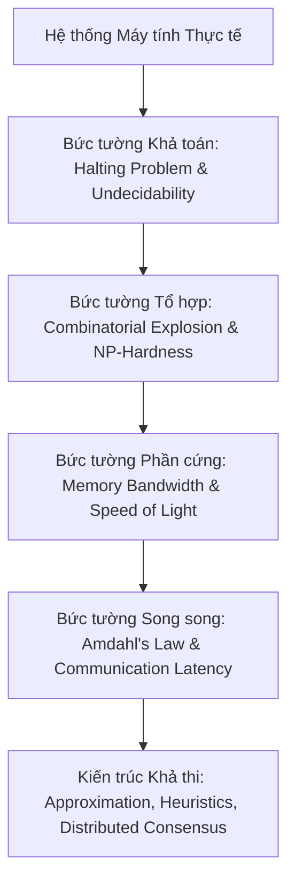
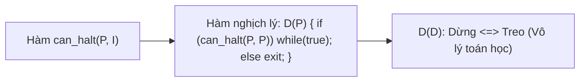
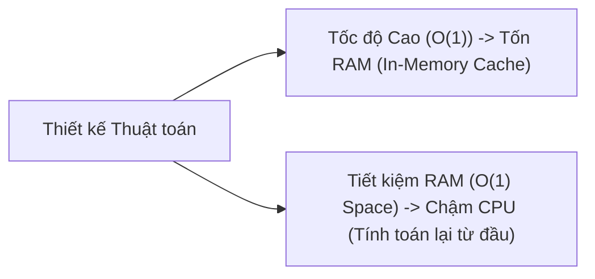
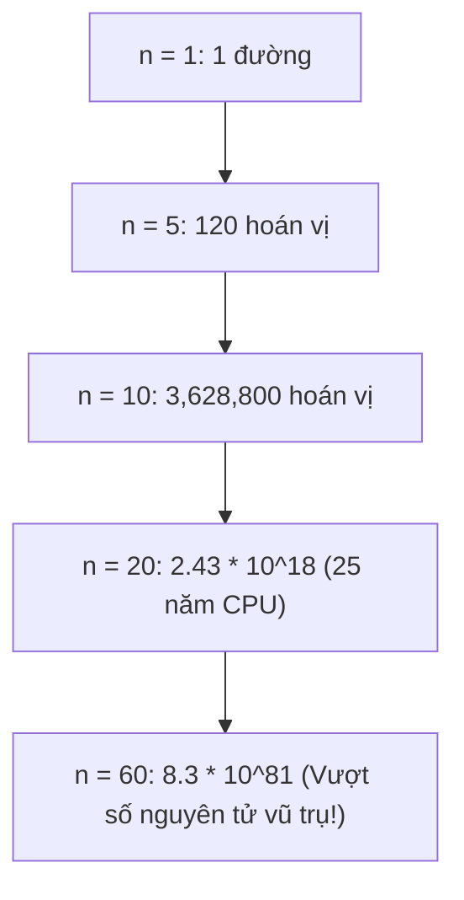
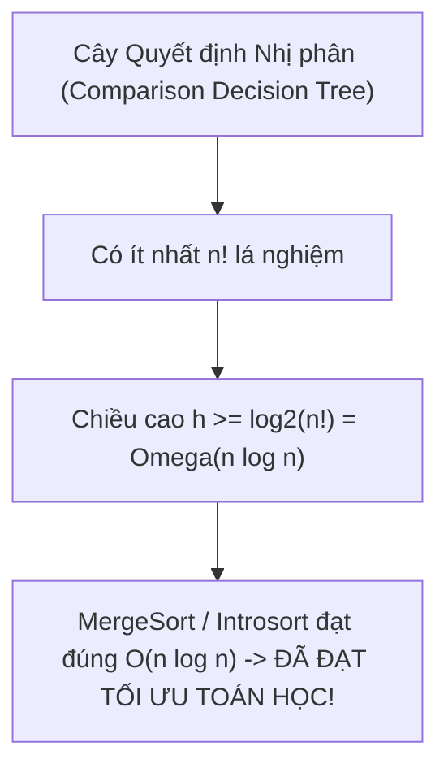
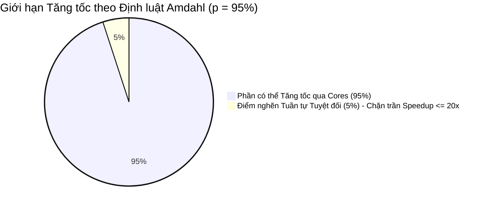
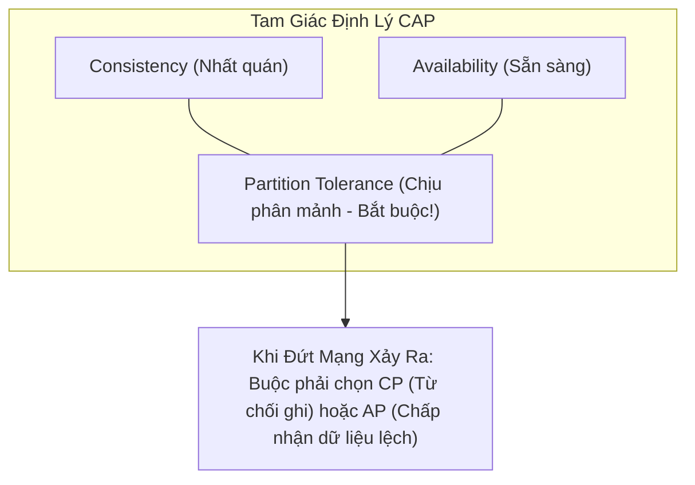

# 10.1. Limits and Bottlenecks of Computation (Các Giới hạn Vật lý và Điểm nghẽn Cốt lõi của Điện toán)

## Tổng quan về Giới hạn Tính toán
Dù công nghệ chế tạo chip bán dẫn và kiến trúc phần mềm có tiến bộ vượt bậc đến đâu, mọi kỹ sư máy tính đều phải đối mặt với **những bức tường giới hạn không thể phá vỡ** được định đoạt bởi toán học hình thức và các định luật vật lý lượng tử.

Ba ranh giới phân định năng lực tính toán của nhân loại:
1. **Giới hạn Khả toán (Undecidability)**: Những bài toán không bao giờ có thuật toán giải quyết (Halting Problem, Rice's Theorem).
2. **Giới hạn Độ phức tạp và Tổ hợp (Complexity & Combinatorial Wall)**: Những bài toán mà việc tính toán vét cạn đòi hỏi thời gian vượt quá số năm tồn tại của vũ trụ.
3. **Giới hạn Song song hóa và Phân tán (Amdahl's Law & Distributed Asynchrony)**: Việc tăng số lượng CPU cores hoặc số máy chủ không thể tăng tốc độ xử lý vô hạn do chi phí giao tiếp và phần mã tuần tự.



---

## 2. Chi tiết từng Keyword (Under-the-Hood Deep Dive)

---

### 1. Halting Problem & Computability Limits (Bài toán Dừng và Giới hạn Khả toán)

#### 1. Khái niệm bản chất (What & Why)
- **Định nghĩa**: Khẳng định của Alan Turing (1936) rằng không thể tồn tại một thuật toán tổng quát để kiểm tra xem một chương trình máy tính tùy ý có dừng trên một đầu vào hay không.
- **Ý nghĩa**: Đặt dấu chấm hết cho ảo tưởng rằng con người có thể tự động hóa toàn diện việc kiểm thử lỗi và chứng minh tính đúng đắn của mọi phần mềm.

#### 2. Cơ chế hoạt động sâu (Under the hood / Hardcore Internals)
- Chứng minh bằng kỹ thuật phản chứng đường chéo Cantor: Sự tự quy chiếu (Self-reference) luôn sinh ra nghịch lý logic nếu giả định có một chương trình kiểm tra dừng vạn năng.

#### 3. Sơ đồ minh họa


#### 4. Code ví dụ thực chiến (C++ Phân tích Vòng lặp Không thể Dự đoán Trước)
```cpp
#include <iostream>

// Hàm có tính chất phụ thuộc vào việc tìm số hoàn hảo lẻ:
// Không ai trên thế giới biết hàm này có bao giờ dừng hay không!
void open_problem_loop() {
    uint64_t n = 1;
    while (true) {
        // Kiểm tra xem n có phải số hoàn hảo lẻ hay không
        // Nếu có thì dừng: break;
        n += 2;
    }
}
```

#### 5. Ưu / Nhược điểm, Pitfalls & Anti-patterns
- **Pitfall**: Đặt kỳ vọng rằng các công cụ AI Linter có thể tìm thấy 100% bugs và infinite loops trong mã nguồn.

#### 6. Ứng dụng thực tế trong Backend / Systems
- Cưỡng chế Timeout: Thiết lập `deadline` và `cancellation tokens` cho mọi network request và database query.

---

### 2. Time-Space Trade-off (Sự Đánh đổi Thời gian - Không gian)

#### 1. Khái niệm bản chất (What & Why)
- **Định nghĩa**: Một quy luật nền tảng trong khoa học máy tính: Ta có thể giải quyết một bài toán nhanh hơn bằng cách tiêu tốn nhiều bộ nhớ hơn, hoặc ta có thể tiết kiệm bộ nhớ bằng cách chấp nhận thời gian tính toán lâu hơn.
- Không thể tối thiểu hóa đồng thời cả thời gian và không gian về 0.

#### 2. Cơ chế hoạt động sâu (Under the hood / Hardcore Internals)
- **Ví dụ kinh điển**:
  - **Tối ưu Thời gian (Tốn Không gian)**: Bảng băm Hash Table (truy cập $O(1)$ nhưng tốn thêm không gian lưu con trỏ bucket và overhead load factor), Rainbow Tables trong bẻ khóa mật mã.
  - **Tối ưu Không gian (Tốn Thời gian)**: Thuật toán tìm kiếm tuần tự Linear Scan ($O(1)$ auxiliary space nhưng tốn $O(n)$ thời gian), Nén dữ liệu đĩa (tiết kiệm ổ cứng nhưng tốn chu kỳ CPU để giải nén on-the-fly).

#### 3. Sơ đồ minh họa


#### 4. Code ví dụ thực chiến (C++ Time-Space Tradeoff: Lookup Table vs Live Compute)
```cpp
#include <iostream>
#include <array>
#include <chrono>

// Cách 1: Tốn thêm 256 bytes bộ nhớ để tính số bit 1 trong O(1)
constexpr std::array<uint8_t, 256> precomputed_popcount() {
    std::array<uint8_t, 256> t{};
    for (int i = 0; i < 256; ++i) t[i] = (i & 1) + t[i / 2];
    return t;
}
constexpr auto LUT = precomputed_popcount();

// Cách 2: Tiết kiệm 0 byte bộ nhớ nhưng tốn 8 vòng lặp CPU
int compute_live(uint8_t n) {
    int count = 0;
    while (n) { count += (n & 1); n >>= 1; }
    return count;
}

int main() {
    uint8_t val = 0b11010111;
    std::cout << "Fast (LUT - Memory Heavy): " << (int)LUT[val] << "\n";
    std::cout << "Slow (Compute - Space Light): " << compute_live(val) << "\n";
    return 0;
}
```

#### 5. Ưu / Nhược điểm, Pitfalls & Anti-patterns
- **Anti-pattern**: Cache bừa bãi mọi dữ liệu vào RAM mà không có cơ chế giới hạn dung lượng (Unbounded Memory Cache), dẫn đến cạn kiệt RAM và kích hoạt OOM Killer.

#### 6. Ứng dụng thực tế trong Backend / Systems
- Database Secondary Indexes: Tạo thêm B-Tree Index giúp tăng tốc độ câu lệnh `SELECT` từ $O(n)$ xuống $O(\log n)$, nhưng phải trả giá bằng việc tốn thêm dung lượng đĩa và làm chậm các câu lệnh `INSERT/UPDATE/DELETE`.

---

### 3. Memory Constraints & Memory Wall (Giới hạn Bộ nhớ và Bức tường Bộ nhớ)

#### 1. Khái niệm bản chất (What & Why)
- **Memory Constraints**: Bộ nhớ vật lý (RAM) của máy tính là hữu hạn. Khi tiến trình vượt quá giới hạn phân bổ, hệ điều hành sẽ kích hoạt hoán đổi trang (Swapping) hoặc tiêu diệt tiến trình.
- **The Memory Wall (Bức tường Bộ nhớ)**: Khoảng cách chênh lệch hiệu năng ngày càng lớn giữa tốc độ tính toán cực nhanh của CPU và băng thông truyền dữ liệu chậm chạp từ thanh RAM vào CPU.

#### 2. Cơ chế hoạt động sâu (Under the hood / Hardcore Internals)
- Trong khi tốc độ tính toán của CPU tăng trưởng hàng chục phần trăm mỗi năm, độ trễ truy cập RAM (DRAM Latency) hầu như không đổi trong suốt hai thập kỷ qua ($\approx 50-70\text{ns}$).
- CPU hiện đại dành phần lớn thời gian (thường từ 50% đến 80% chu kỳ) chỉ để **"ngồi chơi xơi nước" (Memory Stall)** chờ dữ liệu được nạp từ RAM vào L1 Cache!

#### 3. Sơ đồ minh họa
```text
Sự phân kỳ Hiệu năng (The Memory Wall):
Tốc độ ^
       |                                   * CPU Compute Capability (+50%/năm)
       |                            *
       |                     *
       |              *
       |       *
       |----------------------------------- DRAM Latency (Hầu như đi ngang!)
       +---------------------------------------------> Năm
```

#### 4. Code ví dụ thực chiến (C++ Data-Oriented Design to Break Memory Wall)
```cpp
#include <iostream>
#include <vector>
#include <numeric>

// Data-Oriented Design: Bố trí mảng liên tục phẳng để triệt tiêu Memory Stall
struct ParticleSystemDOD {
    std::vector<float> pos_x;
    std::vector<float> pos_y;
    std::vector<float> vel_x;
    std::vector<float> vel_y;

    void update_positions(std::size_t n, float dt) {
        // CPU prefetcher nạp liên tục các mảng phẳng vào L1 cache
        for (std::size_t i = 0; i < n; ++i) {
            pos_x[i] += vel_x[i] * dt;
            pos_y[i] += vel_y[i] * dt;
        }
    }
};

int main() {
    std::cout << "Data-Oriented Layout minimizes CPU Memory Stall cycles.\n";
    return 0;
}
```

#### 5. Ưu / Nhược điểm, Pitfalls & Anti-patterns
- **Anti-pattern**: Lạm dụng danh sách liên kết (`std::list` hoặc cấu trúc cây có con trỏ rải rác) thay vì mảng phẳng liên tục (`std::vector`), làm CPU liên tục bị Cache Misses.

#### 6. Ứng dụng thực tế trong Backend / Systems
- Cơ sở dữ liệu Cột (Column-Store: ClickHouse, DuckDB): Lưu trữ dữ liệu theo từng cột để tận dụng tối đa băng thông bộ nhớ và nén dữ liệu liên tục.

---

### 4. Combinatorial Explosion & State-space Explosion (Bùng nổ Tổ hợp và Không gian Trạng thái)

#### 1. Khái niệm bản chất (What & Why)
- **Định nghĩa**: Sự gia tăng dân số nhanh chóng mặt của số lượng hoán vị, tổ hợp hoặc cấu hình trạng thái khi kích thước bài toán chỉ tăng thêm một lượng nhỏ.
- **Biểu hiện**: Các bài toán có độ phức tạp $\mathcal{O}(2^n)$ hoặc $\mathcal{O}(n!)$.

#### 2. Cơ chế hoạt động sâu (Under the hood / Hardcore Internals)
- Khi $n = 50$:
  - $2^{50} \approx 1.12 \times 10^{15}$.
  - $50! \approx 3.04 \times 10^{64}$.
- Nếu mỗi microchip có thể kiểm tra một tỷ trạng thái mỗi giây ($10^9 \text{ ops/sec}$), và ta gom một tỷ máy tính như vậy lại, để kiểm tra $50!$ trạng thái cần:
  $$T \approx \frac{3.04 \times 10^{64}}{10^9 \times 10^9} = 3.04 \times 10^{46} \text{ giây} \approx 10^{39} \text{ năm}!$$
- Bùng nổ tổ hợp là bức tường toán học tuyệt đối mà không có bất kỳ bước đột phá phần cứng nào có thể vượt qua bằng phương pháp vét cạn.

#### 3. Sơ đồ minh họa


#### 4. Code ví dụ thực chiến (TypeScript Pruning to Control Combinatorial Explosion)
```typescript
// Cắt tỉa nhánh sớm (Early Pruning) để chống bùng nổ tổ hợp trong bài toán tìm tập con
function findSubsetsUnderLimit(nums: number[], limit: number): number[][] {
    const results: number[][] = [];
    nums.sort((a, b) => a - b); // Sắp xếp tăng dần

    function backtrack(startIndex: number, current: number[], currentSum: number) {
        results.push([...current]);

        for (let i = startIndex; i < nums.length; i++) {
            // CẮT TỈA NGAY LẬP TỨC: Nếu thêm phần tử này vượt quá limit, bỏ toàn bộ nhánh sau!
            if (currentSum + nums[i] > limit) break;

            current.push(nums[i]);
            backtrack(i + 1, current, currentSum + nums[i]);
            current.pop();
        }
    }

    backtrack(0, [], 0);
    return results;
}

console.log("Subsets with sum <= 10:", findSubsetsUnderLimit([2, 3, 5, 7, 11], 10));
```

#### 5. Ưu / Nhược điểm, Pitfalls & Anti-patterns
- **Pitfall**: Cố gắng chạy các thuật toán lập lịch tổ hợp chính xác trong môi trường sản xuất có lưu lượng lớn thay vì dùng thuật toán xấp xỉ.

#### 6. Ứng dụng thực tế trong Backend / Systems
- Thiết kế Hệ thống Ghép cặp Shipper - Đơn hàng (Grab / Uber Dispatching): Sử dụng thuật toán tham lam Hungarian hoặc Batch Auction Heuristics để đưa ra quyết định ghép chuyến trong vài trăm milliseconds.

---

### 5. Algorithmic Lower Bounds (Chặn dưới của Thuật toán)

#### 1. Khái niệm bản chất (What & Why)
- **Định nghĩa**: Một chứng minh toán học khẳng định rằng đối với một bài toán cụ thể, **không thể tồn tại bất kỳ thuật toán nào** (dù đã được phát minh hay chưa) có thể giải quyết bài toán đó với độ phức tạp thời gian hoặc không gian nhỏ hơn một hàm cận dưới $g(n)$ xác định:
  $$T(n) = \Omega(g(n))$$
- **Ý nghĩa**: Báo hiệu cho các nhà khoa học biết khi nào một thuật toán đã đạt tới **đỉnh cao tối ưu toán học tuyệt đối** để ngừng việc cố gắng tối ưu thêm.

#### 2. Cơ chế hoạt động sâu (Under the hood / Hardcore Internals)
- **Chứng minh Cận dưới $\Omega(n \log n)$ của Sắp xếp So sánh (Comparison Sort Lower Bound)**:
  - Mọi thuật toán sắp xếp dựa trên so sánh tương đương với một Cây Quyết định Nhị phân (Binary Decision Tree).
  - Có $n!$ hoán vị đầu vào khả dĩ $\implies$ Cây quyết định phải có ít nhất $n!$ nút lá.
  - Một cây nhị phân có chiều cao $h$ có tối đa $2^h$ lá:
    $$2^h \ge n! \implies h \ge \log_2(n!)$$
  - Áp dụng công thức xấp xỉ Stirling ($\ln(n!) \approx n \ln n - n$):
    $$h \ge \Omega(n \log n)$$
  - **Kết luận**: Mọi thuật toán sắp xếp so sánh (MergeSort, QuickSort, HeapSort) đều phải tốn ít nhất $\Omega(n \log n)$ phép so sánh trong trường hợp xấu nhất!

#### 3. Sơ đồ minh họa


#### 4. Code ví dụ thực chiến (C++ Non-Comparison Sort Bypassing Lower Bound: Radix Sort)
```cpp
#include <iostream>
#include <vector>
#include <algorithm>

// Phá vỡ cận dưới Omega(n log n) bằng cách KHÔNG DÙNG SO SÁNH!
// Radix Sort chạy trong O(d * (n + k)) thời gian tuyến tính!
void counting_sort_digit(std::vector<int>& arr, int exp) {
    int n = static_cast<int>(arr.size());
    std::vector<int> output(n);
    int count[10] = {0};

    for (int i = 0; i < n; ++i) count[(arr[i] / exp) % 10]++;
    for (int i = 1; i < 10; ++i) count[i] += count[i - 1];
    for (int i = n - 1; i >= 0; --i) {
        output[count[(arr[i] / exp) % 10] - 1] = arr[i];
        count[(arr[i] / exp) % 10]--;
    }
    for (int i = 0; i < n; ++i) arr[i] = output[i];
}

void radix_sort(std::vector<int>& arr) {
    int m = *std::max_element(arr.begin(), arr.end());
    for (int exp = 1; m / exp > 0; exp *= 10) {
        counting_sort_digit(arr, exp); // O(n) mỗi chữ số
    }
}

int main() {
    std::vector<int> data = {170, 45, 75, 90, 802, 24, 2, 66};
    radix_sort(data);
    for (int x : data) std::cout << x << " ";
    std::cout << "\n";
    return 0;
}
```

#### 5. Ưu / Nhược điểm, Pitfalls & Anti-patterns
- **Bài học sâu sắc**: Để vượt qua một cận dưới thuật toán, bạn bắt buộc phải **thay đổi mô hình tính toán** hoặc **bỏ qua các giả định ban đầu** (như chuyển từ so sánh sang đếm bit trong Radix Sort).

#### 6. Ứng dụng thực tế trong Backend / Systems
- Sắp xếp chỉ mục số nguyên trong Database: Dùng Radix Sort để tạo index cho hàng tỷ ID số nguyên 64-bit với tốc độ tuyến tính vượt trội hơn `std::sort`.

---

### 6. Parallelization Limits & Amdahl's Law (Giới hạn Song song hóa và Định luật Amdahl)

#### 1. Khái niệm bản chất (What & Why)
- **Định luật Amdahl (Gene Amdahl, 1967)**: Định luật toán học mô tả giới hạn lý thuyết tối đa của việc tăng tốc độ thực thi (Speedup) một chương trình khi bổ sung thêm nhiều bộ xử lý (Processors / Cores):
  $$S_{\text{latency}}(s) = \frac{1}{(1 - p) + \frac{p}{s}}$$
  Trong đó:
  - $p$: Tỷ lệ phần trăm công việc có thể song song hóa ($0 \le p \le 1$).
  - $1 - p$: Tỷ lệ phần việc bắt buộc phải chạy tuần tự (Sequential Fraction).
  - $s$: Số lượng nhân CPU (Processors / Speedup factor của phần song song).
- **Hệ quả lạnh lùng khi $s \to \infty$**:
  $$S_{\text{max}} = \lim_{s \to \infty} \frac{1}{(1 - p) + \frac{p}{s}} = \frac{1}{1 - p}$$
  Nếu một chương trình chỉ có **5% mã lệnh chạy tuần tự** ($p = 0.95$), thì cho dù bạn có trang bị **1 TRIỆU CPU CORES**, tốc độ tối đa của chương trình cũng **không bao giờ vượt quá 20 lần** ($S_{\text{max}} = \frac{1}{1 - 0.95} = 20$)!

#### 2. Cơ chế hoạt động sâu (Under the hood / Hardcore Internals)
- **Các yếu tố tuần tự không thể triệt tiêu trong thực tế**:
  - Giao tiếp và đồng bộ khóa giữa các luồng (Lock Contention via `mutex` / Cache Coherency protocols MESI).
  - Khởi tạo tiến trình, chia dữ liệu và tổng hợp kết quả cuối cùng.
  - Chi phí truyền tin qua mạng giữa các máy chủ (Network Serialization).

#### 3. Sơ đồ minh họa


#### 4. Code ví dụ thực chiến (C++ Tính toán Giới hạn Tăng tốc Amdahl)
```cpp
#include <iostream>
#include <iomanip>

double compute_amdahl_speedup(double parallel_fraction, int num_cores) {
    double sequential_fraction = 1.0 - parallel_fraction;
    return 1.0 / (sequential_fraction + (parallel_fraction / num_cores));
}

int main() {
    double p = 0.90; // 90% song song hóa được, 10% tuần tự
    std::cout << std::fixed << std::setprecision(2);
    std::cout << "Amdahl Speedup (p = 90%):\n";
    std::cout << "  4 Cores:    " << compute_amdahl_speedup(p, 4) << "x\n";
    std::cout << "  16 Cores:   " << compute_amdahl_speedup(p, 16) << "x\n";
    std::cout << "  64 Cores:   " << compute_amdahl_speedup(p, 64) << "x\n";
    std::cout << "  1000 Cores: " << compute_amdahl_speedup(p, 1000) << "x\n";
    std::cout << "  VÔ HẠN Cores: " << 1.0 / (1.0 - p) << "x (Chặn trần tuyệt đối!)\n";
    return 0;
}
```

#### 5. Ưu / Nhược điểm, Pitfalls & Anti-patterns
- **Anti-pattern**: Đổ tiền nâng cấp máy chủ từ 16 cores lên 128 cores cho một ứng dụng có điểm nghẽn là một Global Lock tuần tự, làm lãng phí 90% ngân sách hạ tầng mà hiệu năng không tăng.

#### 6. Ứng dụng thực tế trong Backend / Systems
- Thiết kế Hệ thống Song song Hóa Lock-free: Chuyển đổi từ Global Mutex sang Thread-local Storage hoặc Per-core Sharding (kiến trúc Seastar Framework / ScyllaDB) để đẩy $p$ lên sát $0.999$.

---

### 7. Fundamental Limits of Distributed Computation (Các Giới hạn Căn bản của Tính toán Phân tán)

#### 1. Khái niệm bản chất (What & Why)
- **Định nghĩa**: Những định lý toán học xác lập giới hạn bất khả kháng khi các máy tính giao tiếp với nhau qua một mạng lưới không tin cậy (Unreliable Network).
- **Ba Giới hạn Phân tán Vĩ đại nhất**:
  1. **Định lý Bất khả thi FLP (Fischer, Lynch, Paterson - 1985)**: Trong một hệ thống phân tán bất đồng bộ, **KHÔNG THỂ** có một thuật toán đồng thuận tất định nào đảm bảo đạt được đồng thuận nếu có dù chỉ **MỘT nút mạng bị lỗi sập (Crash failure)**.
  2. **Định lý CAP (Eric Brewer - 2000)**: Một hệ thống dữ liệu phân tán chỉ có thể chọn tối đa **2 trong 3** thuộc tính đồng thời:
     - **Consistency (C - Nhất quán)**.
     - **Availability (A - Sẵn sàng)**.
     - **Partition Tolerance (P - Chịu đựng Phân mảnh Mạng)**.
     Vì mạng internet luôn có thể bị đứt cáp ($P$ là bắt buộc), hệ thống chỉ có thể chọn **CP** hoặc **AP**.
  3. **Bài toán Hai Vị Tướng (Two Generals' Problem)**: Chứng minh rằng qua một kênh truyền thông tin có thể mất mát gói tin, **không có thuật toán nào** có thể đảm bảo hai bên đạt được sự thống nhất 100%.

#### 2. Cơ chế hoạt động sâu (Under the hood / Hardcore Internals)
- **Tính Bất đồng bộ và Sự Không chắc chắn của Đồng hồ (Clock Drift)**:
  - Không tồn tại một "Thời gian Toàn cục" (Global Physical Time) thống nhất giữa các máy chủ.
  - Độ lệch đồng hồ thạch anh (Clock Drift $\approx 10-50\text{ms}$) kết hợp với độ trễ mạng ngẫu nhiên (Jitter) khiến cho việc xác định thứ tự trước/sau của các sự kiện vật lý trở thành bài toán bất khả thi nếu không có các giải pháp đồng hồ logic (Lamport Timestamp, Vector Clocks) hoặc phần cứng đồng hồ nguyên tử GPS (Google TrueTime).

#### 3. Sơ đồ minh họa


#### 4. Code ví dụ thực chiến (TypeScript Phân xử CP vs AP Architecture)
```typescript
type SystemMode = 'CP_MODE' | 'AP_MODE';

class DistributedDatabaseNode {
    private isPartitioned: boolean = false;
    private data: string = "initial";

    public setNetworkPartition(status: boolean) { this.isPartitioned = status; }

    public writeData(newData: string, mode: SystemMode): string {
        if (this.isPartitioned) {
            if (mode === 'CP_MODE') {
                // Ưu tiên Consistency: Thà từ chối phục vụ (Error) chứ không để dữ liệu sai!
                throw new Error("CAP_VIOLATION_PREVENTED: Không đạt Quorum trong phân mảnh mạng!");
            } else {
                // Ưu tiên Availability: Cho phép ghi cục bộ, chấp nhận dữ liệu bị lệch (Eventual Consistency)
                this.data = newData;
                return "WRITE_ACCEPTED_WITH_STALE_RISK";
            }
        }
        this.data = newData;
        return "WRITE_SUCCESS";
    }
}

const node = new DistributedDatabaseNode();
node.setNetworkPartition(true); // Đứt cáp mạng!
try {
    node.writeData("new_balance", 'CP_MODE');
} catch (e: any) {
    console.error("CP Mode Behavior:", e.message); // Từ chối ghi
}
console.log("AP Mode Behavior:", node.writeData("new_balance", 'AP_MODE')); // Vẫn nhận ghi
```

#### 5. Ưu / Nhược điểm, Pitfalls & Anti-patterns
- **Anti-pattern**: Giả định rằng mạng nội bộ LAN / Data Center là hoàn hảo không bao giờ mất gói tin (Fallacy of Distributed Computing), dẫn đến việc không thiết kế cơ chế xử lý Network Partition.

#### 6. Ứng dụng thực tế trong Backend / Systems
- Lựa chọn Cơ sở Dữ liệu theo Phân cấp CAP:
  - Chọn **CP Database** (CockroachDB, Google Spanner, etcd): Dành cho số dư tài khoản ngân hàng, giao dịch tài chính.
  - Chọn **AP Database** (Apache Cassandra, Amazon DynamoDB, Couchbase): Dành cho giỏ hàng thương mại điện tử, mạng xã hội, tin nhắn chat.
