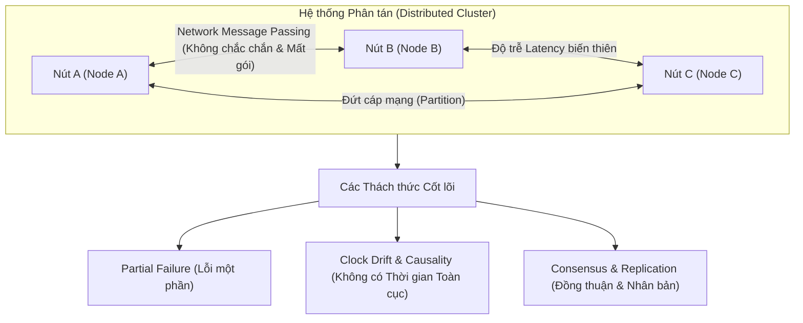
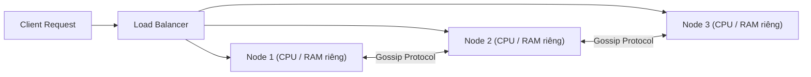
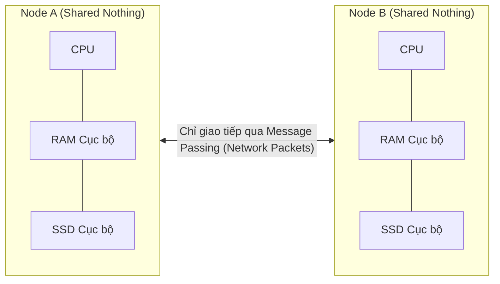
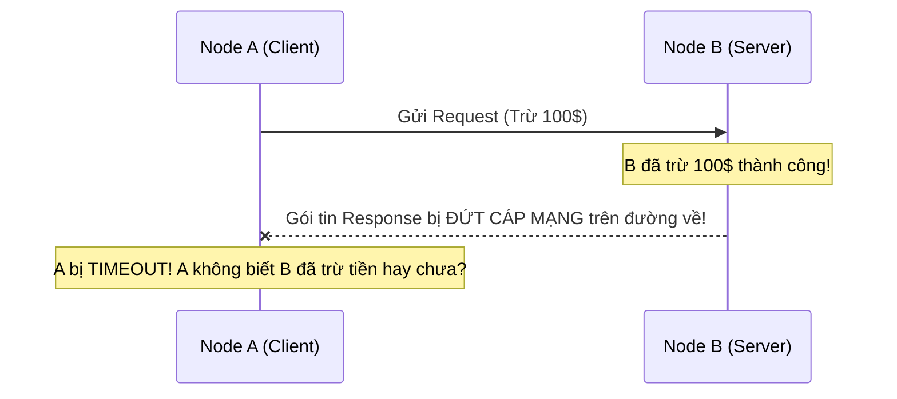
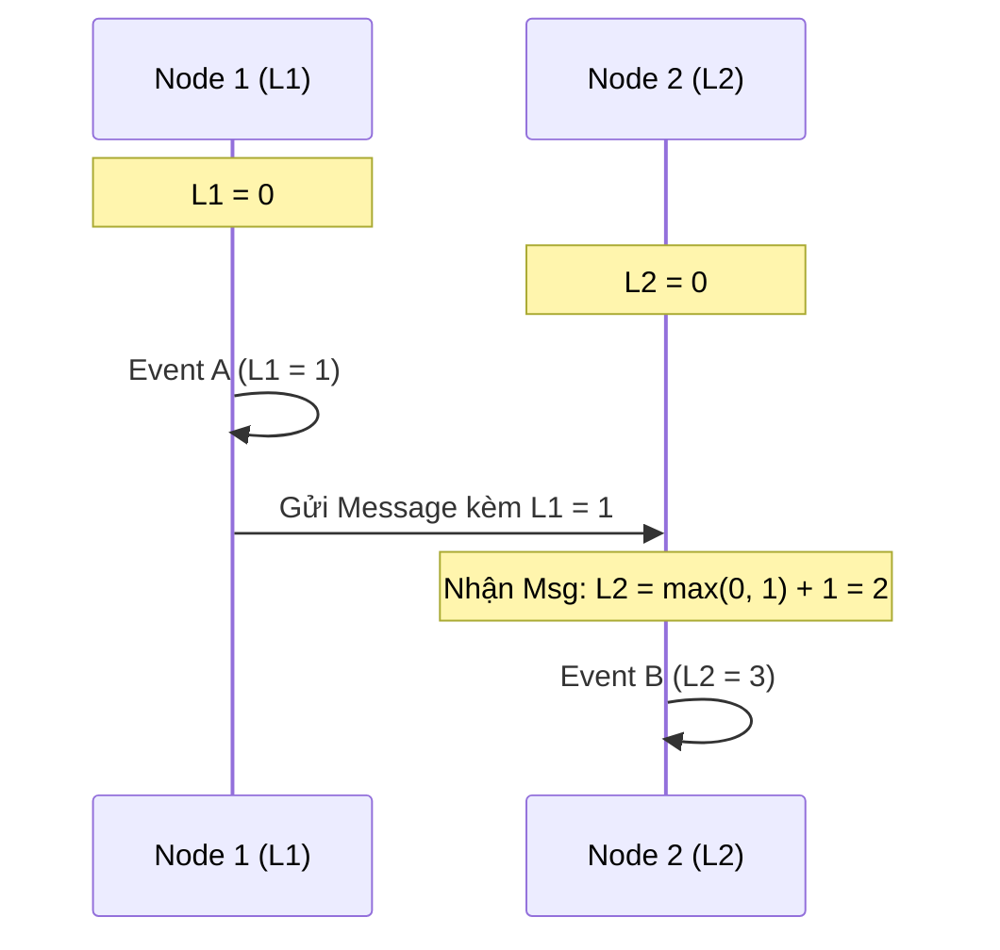
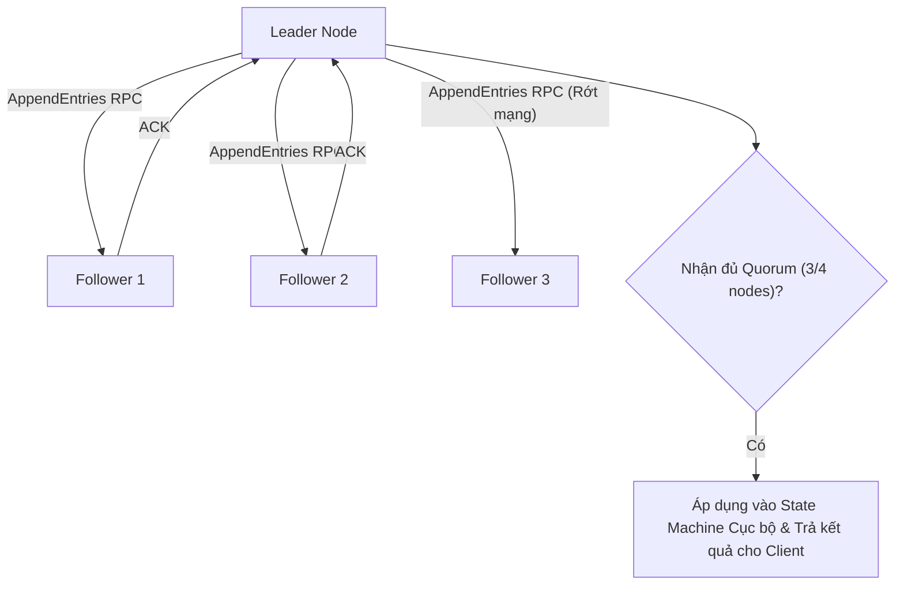
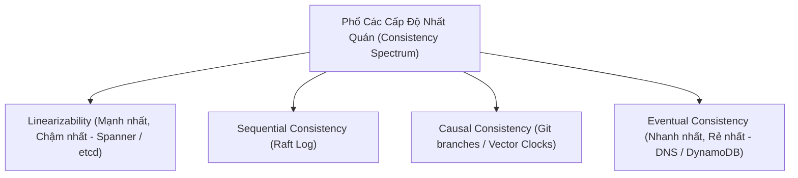
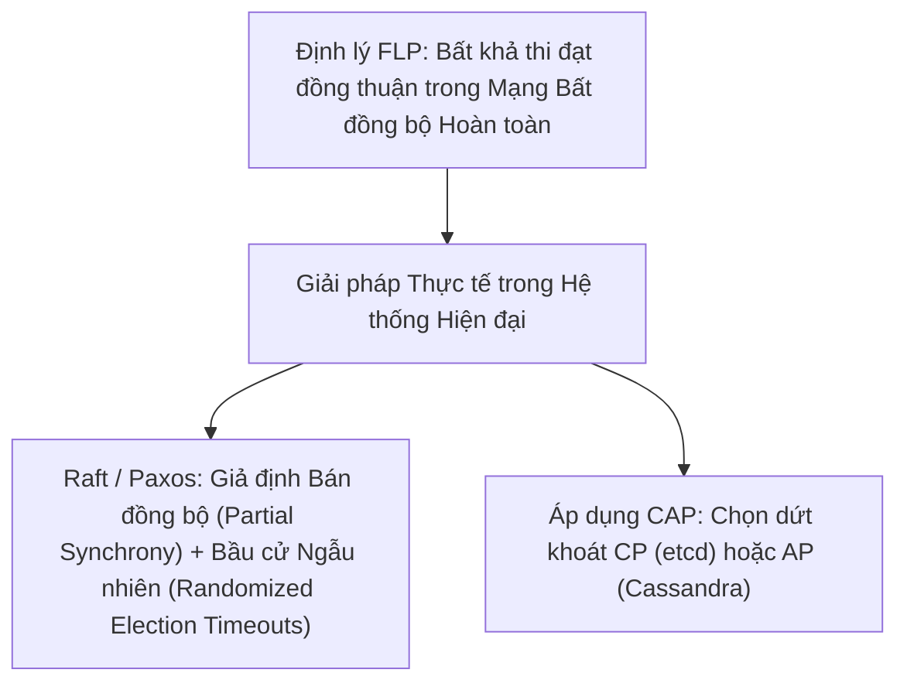

# 11.1. Distributed Systems Principles (Các Nguyên lý Cốt lõi của Hệ thống Tính toán Phân tán)

## Tổng quan về Tính toán Phân tán
Hệ thống tính toán phân tán (Distributed System) là một tập hợp các nút máy tính tự trị (Autonomous Computing Nodes), được kết nối với nhau qua một mạng truyền thông chung và phối hợp hoạt động bằng cách truyền thông điệp (Message Passing) để người dùng bên ngoài nhìn nhận hệ thống như một thực thể tính toán duy nhất và đồng nhất.

Như Leslie Lamport (người đoạt giải Turing) đã từng phát biểu một câu kinh điển:
> *"Một hệ thống phân tán là hệ thống mà sự cố của một chiếc máy tính mà bạn thậm chí chưa từng biết là nó có tồn tại lại có thể khiến chiếc máy tính của chính bạn trở nên vô dụng."*

Hai định lý toán học xác lập nền tảng và giới hạn của hệ thống phân tán:
1. **Định lý CAP (Brewer)**: Trong mạng có nguy cơ phân mảnh ($P$), chỉ được chọn Nhất quán ($C$) hoặc Sẵn sàng ($A$).
2. **Định lý Bất khả thi FLP (Fischer, Lynch, Paterson)**: Không có thuật toán đồng thuận tất định nào có thể đảm bảo giải quyết bài toán đồng thuận trong mạng bất đồng bộ nếu có nguy cơ dù chỉ một nút bị sập.



---

## 2. Chi tiết từng Keyword (Under-the-Hood Deep Dive)

---

### 1. Distributed Computing & Distributed Nodes (Tính toán Phân tán và Các Nút Phân tán)

#### 1. Khái niệm bản chất (What & Why)
- **Distributed Computing**: Mô hình tính toán trong đó các thành phần phần mềm được đặt trên nhiều máy tính nối mạng khác nhau, chia sẻ khối lượng công việc thông qua sự phối hợp thông điệp.
- **Distributed Node**: Một máy tính vật lý độc lập, một máy ảo (VM) hoặc một container sở hữu CPU, bộ nhớ RAM, đồng hồ phần cứng và hệ điều hành riêng biệt.
- **Tại sao cần thiết**:
  1. **Khả năng mở rộng ngang (Horizontal Scalability)**: Không thể nâng cấp một máy chủ đơn lẻ (Vertical Scale) mãi mãi do giới hạn vật lý và chi phí đắt đỏ theo hàm mũ.
  2. **Độ sẵn sàng cao (High Availability)**: Cho phép một vài máy chủ bị sập mà toàn bộ hệ thống vẫn tiếp tục phục vụ người dùng.

#### 2. Cơ chế hoạt động sâu (Under the hood / Hardcore Internals)
- Các nút phân tán không chia sẻ thanh ghi hay bộ nhớ RAM vật lý chung. Mọi sự hiểu biết của một nút về thế giới bên ngoài chỉ đến từ các gói tin nhị phân (Network Packets) đi qua Card mạng NIC.

#### 3. Sơ đồ minh họa


#### 4. Code ví dụ thực chiến (C++ Distributed Node Heartbeat Identifier)
```cpp
#include <iostream>
#include <string>
#include <chrono>

struct NodeIdentity {
    std::string node_id;
    std::string ip_address;
    uint16_t port;
    uint64_t last_heartbeat_timestamp;
};

bool is_node_healthy(const NodeIdentity& node, uint64_t current_time, uint64_t timeout_threshold) {
    return (current_time - node.last_heartbeat_timestamp) < timeout_threshold;
}

int main() {
    uint64_t now = 100000;
    NodeIdentity nodeA{"node_sg_01", "10.0.1.15", 8080, 99500};
    std::cout << "Node A is healthy? " << is_node_healthy(nodeA, now, 1000) << "\n"; // 1
    return 0;
}
```

#### 5. Ưu / Nhược điểm, Pitfalls & Anti-patterns
- **Ảo tưởng số 1 của Điện toán Phân tán**: Lầm tưởng rằng mạng là đáng tin cậy và băng thông là vô hạn.

#### 6. Ứng dụng thực tế trong Backend / Systems
- Kubernetes Cluster: Quản lý hàng nghìn Worker Nodes (Kubelets) phối hợp với Control Plane API Server.

---

### 2. Message Passing & Shared Nothing Architecture (Truyền Thông điệp và Kiến trúc Không Chia sẻ)

#### 1. Khái niệm bản chất (What & Why)
- **Shared Nothing Architecture (SNA)**: Mô hình kiến trúc phân tán trong đó mỗi nút mạng hoàn toàn độc lập, không dùng chung bộ nhớ RAM (No shared memory) và không dùng chung ổ đĩa (No shared disk).
- **Message Passing**: Cơ chế giao tiếp duy nhất giữa các nút trong kiến trúc SNA: Các nút gửi và nhận các thông điệp dữ liệu nhị phân thông qua giao thức mạng (TCP, UDP, gRPC, QUIC).

#### 2. Cơ chế hoạt động sâu (Under the hood / Hardcore Internals)
- **So sánh với Kiến trúc Shared Memory**:
  - Trong Shared Memory (Multi-threaded process): Các luồng cạnh tranh bằng `mutex`, `spinlock`, dễ bị bế tắc Deadlock và Cache Invalidation overhead.
  - Trong Message Passing: Loại bỏ hoàn toàn sự cạnh tranh khóa ở tầng phần cứng bộ nhớ. Trạng thái chỉ được biến đổi cục bộ bởi chính nút đó khi nhận được thông điệp hợp lệ (nguyên lý của Actor Model: Erlang/Elixir).

#### 3. Sơ đồ minh họa


#### 4. Code ví dụ thực chiến (TypeScript Message Passing Actor Pattern)
```typescript
interface NetworkMessage {
    senderId: string;
    action: string;
    payload: any;
}

class DistributedActor {
    constructor(public readonly nodeId: string) {}

    public receiveMessage(msg: NetworkMessage): void {
        console.log(`[${this.nodeId}] Nhận thông điệp từ [${msg.senderId}]: Action=${msg.action}`);
        if (msg.action === 'PING') {
            this.sendMessage(msg.senderId, 'PONG', { time: Date.now() });
        }
    }

    public sendMessage(targetId: string, action: string, payload: any): void {
        console.log(`[${this.nodeId}] Đang gửi gói tin mạng tới [${targetId}]: ${action}`);
    }
}

const nodeA = new DistributedActor("Node_A");
const nodeB = new DistributedActor("Node_B");
nodeA.receiveMessage({ senderId: "Node_B", action: "PING", payload: null });
```

#### 5. Ưu / Nhược điểm, Pitfalls & Anti-patterns
- **Chi phí Serialization/Deserialization**: Chuyển đổi qua lại giữa Object trong RAM và mảng bytes truyền qua mạng (JSON, Protobuf) ngốn tới 20-30% chu kỳ CPU của các dịch vụ backend.

#### 6. Ứng dụng thực tế trong Backend / Systems
- Apache Cassandra, Elasticsearch, CockroachDB: Toàn bộ đều áp dụng kiến trúc Shared-Nothing để mở rộng quy mô từ 3 nodes lên hàng nghìn nodes tuyến tính.

---

### 3. Partial Failure & Network Uncertainty (Sự cố Một phần và Sự Không chắc chắn của Mạng)

#### 1. Khái niệm bản chất (What & Why)
- **Partial Failure (Sự cố Một phần)**: Đặc trưng chết người của hệ thống phân tán: Một phần của hệ thống bị hỏng hóc hoặc sập, trong khi các phần khác vẫn tiếp tục hoạt động bình thường mà không hề hay biết.
- **Network Uncertainty**: Mạng truyền thông không bao giờ đảm bảo tính tức thì: Gói tin có thể bị trễ bất thường, bị định tuyến vòng vèo, bị trùng lặp hoặc bị đánh rơi hoàn toàn (Packet Loss).

#### 2. Cơ chế hoạt động sâu (Under the hood / Hardcore Internals)
- **Vấn đề Ba Trạng thái của RPC Call (The Three Outcomes of a Remote Call)**:
  Khi Nút A gửi một yêu cầu sang Nút B qua mạng, chỉ có 3 kịch bản xảy ra:
  1. `SUCCESS`: Nút B nhận được, xử lý xong và phản hồi về A an toàn.
  2. `FAILURE`: Nút B bị sập hoặc từ chối, gửi lỗi về A.
  3. `UNKNOWN (Timeout)`: **Kịch bản tồi tệ nhất** — Nút A không nhận được hồi âm sau 5 giây. Nút A hoàn toàn không thể biết được:
     - Gói tin gửi đi bị rơi trên đường tới B?
     - Hay B đã nhận được và trừ tiền xong xuôi, nhưng gói phản hồi trên đường về mới bị rơi?
     - Hay B đang bị quá tải nên xử lý chậm?

#### 3. Sơ đồ minh họa


#### 4. Code ví dụ thực chiến (C++ Idempotent Retry Policy under Network Uncertainty)
```cpp
#include <iostream>
#include <string>
#include <chrono>
#include <thread>

// Khắc phục Network Uncertainty bằng Exponential Backoff và Idempotency Key
bool send_remote_rpc_with_retry(const std::string& idempotency_key, int max_attempts) {
    int attempt = 0;
    int delay_ms = 100;

    while (attempt++ < max_attempts) {
        std::cout << "Attempt " << attempt << " with Key: " << idempotency_key << "...\n";
        // Giả lập kết nối mạng: attempt 1 và 2 bị drop gói tin
        if (attempt == 3) {
            std::cout << "RPC Succeeded on attempt 3!\n";
            return true;
        }

        std::cout << "Network Timeout. Retrying in " << delay_ms << " ms...\n";
        std::this_thread::sleep_for(std::chrono::milliseconds(delay_ms));
        delay_ms *= 2; // Exponential Backoff
    }
    return false;
}

int main() {
    send_remote_rpc_with_retry("req_uuid_99182", 3);
    return 0;
}
```

#### 5. Ưu / Nhược điểm, Pitfalls & Anti-patterns
- **Anti-pattern**: Thực hiện Retry vô hạn không có thời gian trễ ngẫu nhiên (Retry without Jitter), biến một sự cố mạng tạm thời thành thảm họa sập toàn bộ hệ sinh thái dịch vụ (Thundering Herd Problem).

#### 6. Ứng dụng thực tế trong Backend / Systems
- Circuit Breaker Pattern (Netflix Hystrix, Resilience4j): Tự động ngắt luồng gọi tới một service đang bị sự cố một phần để bảo vệ các service còn lại.

---

### 4. Clock Synchronization, Logical Clocks & Event Ordering (Đồng bộ Đồng hồ và Đồng hồ Logic)

#### 1. Khái niệm bản chất (What & Why)
- **Đồng hồ Vật lý Không thể Tin cậy (Clock Drift)**: Các máy tính sử dụng tinh thể thạch anh dao động để đếm giờ. Do nhiệt độ và độ lão hóa linh kiện, các đồng hồ trên các máy chủ khác nhau luôn bị lệch nhau vài mili-giây đến vài giây, và giao thức NTP (Network Time Protocol) chỉ có thể đồng bộ tương đối qua mạng chập chờn.
- **Hệ quả**: **Không bao giờ được dùng `System.currentTimeMillis()`** của 2 máy tính khác nhau để so sánh xem sự kiện nào xảy ra trước!

#### 2. Cơ chế hoạt động sâu (Under the hood / Hardcore Internals)
- **Lamport Timestamps (Leslie Lamport, 1978)**:
  - Định nghĩa quan hệ nhân quả "Xảy ra trước" (**Happened-Before Relation: $a \to b$**).
  - Mỗi node duy trì một biến đếm số nguyên logic $L$:
    1. Trước khi phát sinh sự kiện cục bộ: $L = L + 1$.
    2. Khi gửi thông điệp, đính kèm giá trị $L$ hiện tại vào gói tin.
    3. Khi nhận thông điệp có nhãn $L_{\text{msg}}$, node nhận cập nhật:
       $$L_{\text{local}} = \max(L_{\text{local}}, L_{\text{msg}}) + 1$$
  - Bảo đảm: Nếu $a \to b$ thì $L(a) < L(b)$.
- **Vector Clocks**: Mở rộng từ Lamport Timestamps thành một mảng vector $V = [v_1, v_2, \dots, v_n]$ giúp phát hiện chính xác khi nào hai sự kiện xảy ra đồng thời xung đột (Concurrent Conflicts).

#### 3. Sơ đồ minh họa


#### 4. Code ví dụ thực chiến (C++ Lamport Logical Clock Implementation)
```cpp
#include <iostream>
#include <algorithm>
#include <cstdint>

class LamportClock {
    uint64_t counter_{0};

public:
    // Sự kiện nội bộ
    uint64_t tick_local_event() {
        return ++counter_;
    }

    // Gửi thông điệp
    uint64_t send_event() {
        return ++counter_;
    }

    // Nhận thông điệp từ nút khác
    uint64_t receive_event(uint64_t received_timestamp) {
        counter_ = std::max(counter_, received_timestamp) + 1;
        return counter_;
    }

    [[nodiscard]] uint64_t get_time() const noexcept { return counter_; }
};

int main() {
    LamportClock n1, n2;
    uint64_t t1 = n1.tick_local_event(); // N1 = 1
    uint64_t send_t = n1.send_event();   // N1 = 2
    uint64_t recv_t = n2.receive_event(send_t); // N2 = max(0, 2) + 1 = 3

    std::cout << "Node 1 Time: " << n1.get_time() << "\n"; // 2
    std::cout << "Node 2 Time: " << n2.get_time() << "\n"; // 3 (Bảo toàn trật tự nhân quả!)
    return 0;
}
```

#### 5. Ưu / Nhược điểm, Pitfalls & Anti-patterns
- **Pitfall**: Sử dụng Last-Write-Wins (LWW) dựa trên đồng hồ vật lý NTP để giải quyết xung đột trong cơ sở dữ liệu phân tán (như Cassandra), dẫn đến việc dữ liệu ghi sau bị đè mất (Silent Data Loss) do đồng hồ máy chủ bị lệch lùi lại phía sau.

#### 6. Ứng dụng thực tế trong Backend / Systems
- Google Spanner TrueTime API: Sử dụng kết hợp Đồng hồ Nguyên tử (Atomic Clocks) và bộ thu GPS trong các trung tâm dữ liệu để giới hạn độ sai lệch thời gian vật lý $\epsilon \le 7\text{ms}$, cung cấp tính năng External Consistency trên toàn cầu.

---

### 5. Distributed State & Consensus Problem (Trạng thái Phân tán và Bài toán Đồng thuận)

#### 1. Khái niệm bản chất (What & Why)
- **Distributed State**: Toàn bộ dữ liệu, cấu hình hoặc lịch sử giao dịch được phân bổ và lưu trữ trên nhiều nút mạng khác nhau.
- **Bài toán Đồng thuận (Consensus Problem)**: Thách thức làm thế nào để tất cả các nút mạng phân tán độc lập có thể **cùng đi đến một sự thống nhất duy nhất** về một giá trị dữ liệu hoặc một chuỗi các quyết định, bất chấp môi trường mạng bị trễ và một số nút bị sập.

#### 2. Cơ chế hoạt động sâu (Under the hood / Hardcore Internals)
- **Giao thức Đồng thuận Chuẩn (Raft & Multi-Paxos)**:
  - Hoạt động dựa trên khái niệm **Quorum quá bán**: Để quyết định một giá trị được commit, phải có ít nhất $\lfloor N/2 \rfloor + 1$ nút chấp thuận.
  - Tính chất giao nhau của hai tập quá bán (Quorum Intersection Property): Bất kỳ hai tập quá bán nào trong cụm $N$ nút đều bắt buộc phải có ít nhất một nút chung:
    $$|Q_1 \cap Q_2| \ge 1$$
  - Nhờ đó, một Leader mới đắc cử luôn đảm bảo chứa đựng mọi bản ghi log đã từng được commit bởi Leader cũ!

#### 3. Sơ đồ minh họa


#### 4. Code ví dụ thực chiến (TypeScript Quorum Consensus Calculation)
```typescript
function hasConsensusQuorum(totalNodes: number, positiveAcks: number): boolean {
    const requiredQuorum = Math.floor(totalNodes / 2) + 1;
    return positiveAcks >= requiredQuorum;
}

const clusterSize = 5;
console.log("3 acks out of 5:", hasConsensusQuorum(clusterSize, 3)); // true (Đạt đồng thuận)
console.log("2 acks out of 5:", hasConsensusQuorum(clusterSize, 2)); // false (Không đủ Quorum)
```

#### 5. Ưu / Nhược điểm, Pitfalls & Anti-patterns
- **Thảm họa Split-Brain**: Cụm 4 nodes bị đứt cáp đôi thành 2 nhóm (mỗi nhóm 2 nodes). Cả hai bên đều cố gắng bầu Leader mới $\implies$ Cần số lượng node luôn là **số lẻ (3, 5, 7 nodes)** để tránh chia đều phiếu.

#### 6. Ứng dụng thực tế trong Backend / Systems
- etcd (trái tim của Kubernetes) và ZooKeeper (Hadoop/Kafka cũ): Giải quyết bài toán đồng thuận về Leader Election và Metadata Service Configuration.

---

### 6. Fault Tolerance, Replication, and Consistency (Khả năng Chịu lỗi, Nhân bản và Tính Nhất quán)

#### 1. Khái niệm bản chất (What & Why)
- **Fault Tolerance (Khả năng Chịu lỗi)**: Năng lực của hệ thống tiếp tục vận hành chuẩn xác ngay cả khi một số thành phần phần cứng hoặc phần mềm bị hư hỏng.
- **Replication (Nhân bản)**: Sao chép dữ liệu ra nhiều nút máy tính vật lý khác nhau để chống mất mát dữ liệu và phục vụ đọc dữ liệu quy mô lớn.
- **Consistency (Tính Nhất quán)**: Mức độ bảo đảm rằng các client đọc dữ liệu từ các bản sao khác nhau sẽ nhìn thấy cùng một giá trị dữ liệu chính xác theo thời gian.

#### 2. Cơ chế hoạt động sâu (Under the hood / Hardcore Internals)
- **Phổ Các Mức Độ Nhất Quán (Consistency Spectrum)**:
  - **Strict / Linearizable Consistency (Mạnh nhất)**: Mọi thao tác đọc ghi xuất hiện như thể diễn ra trên một bản sao duy nhất trong thời gian thực tức thì.
  - **Sequential Consistency**: Mọi nút nhìn thấy các thao tác theo cùng một thứ tự logic.
  - **Causal Consistency**: Chỉ các thao tác có quan hệ nhân quả mới cần được đồng bộ theo thứ tự.
  - **Eventual Consistency (Yếu nhất)**: Nếu không có cập nhật mới, sau một khoảng thời gian trôi qua, tất cả các bản sao cuối cùng sẽ hội tụ về cùng một giá trị.

#### 3. Sơ đồ minh họa


#### 4. Code ví dụ thực chiến (C++ Read-Your-Own-Writes Consistency Concept)
```cpp
#include <iostream>
#include <string>
#include <unordered_map>

// Đảm bảo tính nhất quán: Read-Your-Own-Writes cho từng User
class ReplicatedDataStore {
    std::unordered_map<std::string, std::string> primary_db_;
    std::unordered_map<std::string, std::string> replica_db_; // Bị lag 1 vài giây

public:
    void write_primary(const std::string& key, const std::string& val) {
        primary_db_[key] = val;
    }

    // Client vừa ghi xong bắt buộc phải đọc từ Primary để đảm bảo tính nhất quán cục bộ
    std::string read_consistent(const std::string& key, bool read_from_primary) {
        if (read_from_primary) return primary_db_[key];
        return replica_db_[key]; // Có thể bị dữ liệu cũ (Stale data)
    }
};

int main() {
    ReplicatedDataStore store;
    store.write_primary("user_avatar", "http://cdn.com/new.png");
    std::cout << "User reads own update: " << store.read_consistent("user_avatar", true) << "\n";
    return 0;
}
```

#### 5. Ưu / Nhược điểm, Pitfalls & Anti-patterns
- **Pitfall**: Đọc dữ liệu từ bản sao Read-Replica ngay sau khi ghi vào Master mà không đồng bộ, khiến người dùng thấy bài viết mình vừa đăng bị biến mất sau khi ấn F5!

#### 6. Ứng dụng thực tế trong Backend / Systems
- Kiến trúc PostgreSQL Primary-Replica with Streaming Replication: Cung cấp tính năng Read-Scalability cho các trang tin tức có tỷ lệ Đọc/Ghi là 100:1.

---

### 7. CAP Theorem & FLP Impossibility (Định lý CAP và Định lý Bất khả thi FLP)

#### 1. Khái niệm bản chất (What & Why)
- **CAP Theorem (Eric Brewer, 2000 & Gilbert/Lynch Proof 2002)**:
  - Khẳng định rằng trong một hệ thống dữ liệu phân tán có nguy cơ bị đứt mạng (Network Partition - $P$), kiến trúc sư hệ thống **chỉ có thể chọn 1 trong 2 con đường**:
    - **CP (Consistency + Partition Tolerance)**: Khi mạng bị đứt, thà từ chối phục vụ một số request (Mất Availability) để đảm bảo không trả về dữ liệu sai hoặc không làm phân rã trạng thái.
    - **AP (Availability + Partition Tolerance)**: Khi mạng bị đứt, vẫn tiếp tục phục vụ mọi request đọc ghi ở mọi phân vùng mạng (Mất Consistency), chấp nhận dữ liệu giữa 2 bên bị phân kỳ và sẽ giải quyết xung đột sau.
- **FLP Impossibility (Fischer, Lynch, Paterson, 1985)**:
  - Định lý chứng minh hình thức rằng: Trong một mô hình mạng phân tán bất đồng bộ hoàn toàn (Fully Asynchronous Network - nơi độ trễ thông điệp không có chặn trên), **không thể tồn tại bất kỳ thuật toán đồng thuận tất định nào** có thể đảm bảo vừa an toàn (Safety) vừa dừng lại được (Liveness) nếu có nguy cơ dù chỉ một nút bị sập.

#### 2. Cơ chế hoạt động sâu (Under the hood / Hardcore Internals)
- **Cách các hệ thống thực tế lách luật FLP**:
  - Vì FLP khẳng định không thể giải quyết trong mô hình **Bất đồng bộ hoàn toàn**, các thuật toán thực tế (Raft, Paxos) đưa vào giả định **Bán đồng bộ (Partially Synchronous)**: Mạng có thể chập chờn tạm thời, nhưng sau một thời gian, độ trễ mạng sẽ quay về trạng thái ổn định bị chặn trên bởi một ngưỡng $\Delta$.
  - Sử dụng cơ chế ngẫu nhiên hóa (Randomized Timers) trong Raft để phá vỡ thế bế tắc đồng thuận.

#### 3. Sơ đồ minh họa


#### 4. Code ví dụ thực chiến (TypeScript CAP Partition Simulation)
```typescript
class CAPNode {
    constructor(public name: string, public value: number) {}
}

class PartitionSimulator {
    nodeA = new CAPNode("Node_A", 100);
    nodeB = new CAPNode("Node_B", 100);

    // Xử lý khi đứt cáp chia đôi Node A và Node B
    public executeWrite(target: 'A' | 'B', newVal: number, policy: 'CP' | 'AP'): void {
        if (policy === 'CP') {
            // CP System: Nhận thấy không thể liên lạc với node kia để lấy Quorum -> Abort!
            throw new Error(`[CP POLICY] Ghi vào Node ${target} bị từ chối vì mất liên lạc với nút đối diện!`);
        } else {
            // AP System: Vẫn nhận ghi vào node cục bộ, chấp nhận giá trị A và B lệch nhau!
            if (target === 'A') this.nodeA.value = newVal;
            if (target === 'B') this.nodeB.value = newVal;
            console.log(`[AP POLICY] Ghi nhận thành công vào Node ${target}. Chấp nhận dữ liệu tạm thời không nhất quán!`);
        }
    }
}

const sim = new PartitionSimulator();
try {
    sim.executeWrite('A', 200, 'CP');
} catch (e: any) {
    console.error(e.message);
}
sim.executeWrite('A', 200, 'AP');
```

#### 5. Ưu / Nhược điểm, Pitfalls & Anti-patterns
- **Sai lầm tai hại**: Quảng cáo một cơ sở dữ liệu là hệ thống "CA" (vừa Consistent vừa Available). Trong thế giới vật lý, **cáp mạng luôn có thể bị đứt hoặc bị nghẽn**, do đó thuộc tính $P$ không phải là một lựa chọn để chọn hay bỏ; $P$ là quy luật tự nhiên bắt buộc phải chấp nhận!

#### 6. Ứng dụng thực tế trong Backend / Systems
- Thiết kế Hệ sinh thái Dữ liệu Đa tầng (Polyglot Persistence): Sử dụng **CP System** (ZooKeeper/etcd) cho tầng quản lý cấu hình và phân quyền Master, kết hợp với **AP System** (Cassandra/DynamoDB) cho tầng lưu trữ lịch sử tương tác người dùng có dung lượng terabytes.
