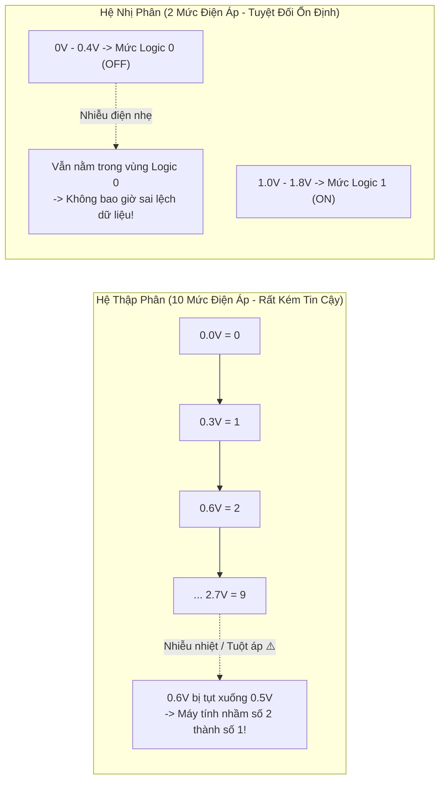
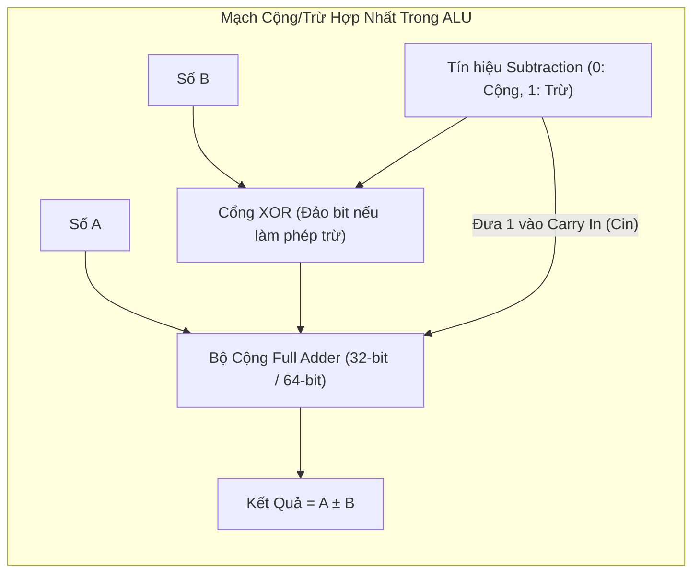
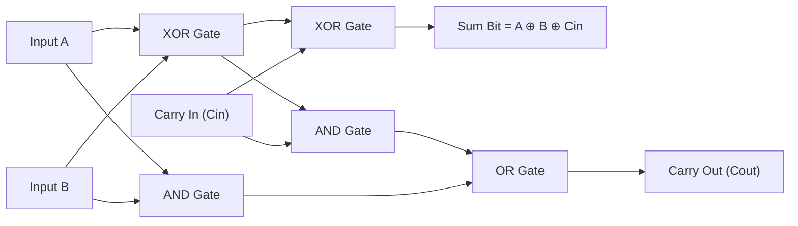

# 1.1. Number Systems (Hệ Thống Số Đếm)

> [!IMPORTANT]
> **Tuyên ngôn Cốt lõi**: Mọi kiểu dữ liệu trong máy tính – từ số nguyên, chuỗi văn bản, con trỏ bộ nhớ cho đến hình ảnh hay mô hình AI – dưới đáy sâu vật lý đều quy về các chuỗi bit nhị phân ($0$ và $1$) đại diện cho trạng thái đóng/ngắt của bóng bán dẫn (Transistors). Hệ **Thập phân (Base 10)** là ngôn ngữ của con người, nhưng hệ **Nhị phân (Base 2)** là ngôn ngữ duy nhất của phần cứng. Để bắc cầu giữa hai thế giới, hệ **Thập lục phân (Hexadecimal - Base 16)** và **Bát phân (Octal - Base 8)** ra đời như những "chiếc kính lúp nén bit", cho phép kỹ sư phần mềm đọc hiểu và thao tác chuẩn xác trên từng byte bộ nhớ mà không bị chìm nghỉm trong hàng triệu con số $0$ và $1$.

---

## 1. Trực Quan Hóa: Bản Chất Hệ Thống Số Dưới Góc Nhìn Lập Trình Viên

Mục tiêu của phần này là giải mã tại sao máy tính phải dùng hệ nhị phân, tại sao địa chỉ RAM luôn bắt đầu bằng `0x`, và cách các phép tính cộng, trừ, nhân, chia được cơ giới hóa bằng cổng logic bên trong vi xử lý.

---

### 1.1. Tại sao máy tính chỉ hiểu 0 và 1 mà không dùng hệ thập phân?

Hãy bắt đầu từ câu hỏi sơ đẳng nhất: *Tại sao máy tính không lưu số từ $0$ đến $9$ cho giống con người?*

Câu trả lời nằm ở **đặc tính vật lý của linh kiện bán dẫn (Transistors)**:
* CPU chứa hàng tỷ bóng bán dẫn MOSFET đóng vai trò như những chiếc công tắc điện tử.
* Một chiếc công tắc có hai trạng thái tự nhiên và đáng tin cậy nhất:
  * **Đóng (ON)**: Cho dòng điện chạy qua (Điện áp cao $\approx 1.2\text{V} - 3.3\text{V}$) $\rightarrow$ Quy ước là **Bit 1**.
  * **Ngắt (OFF)**: Chặn dòng điện (Điện áp thấp $\approx 0\text{V}$ / Ground) $\rightarrow$ Quy ước là **Bit 0**.



Nếu chia điện áp thành 10 mức (từ $0\text{V}$ đến $9\text{V}$ để biểu diễn số $0-9$), chỉ cần dây dẫn bị nóng lên làm điện áp lệch $0.3\text{V}$, số $2$ sẽ bị đọc nhầm thành số $1$, dẫn đến hỏng toàn bộ hệ thống tính toán. 

Ngược lại, hệ nhị phân chỉ cần phân biệt: **"Có điện" hay "Không có điện"**. Dù điện áp có dao động nhẹ, mạch logic vẫn xác định chính xác $100\%$ giá trị bit.

---

### 1.2. Hexadecimal (0x) và Octal (0o): "Chiếc Kính Lúp Nén Bit" Của Lập Trình Viên

Nhị phân tuy hoàn hảo cho phần cứng nhưng lại là thảm họa cho mắt người. 
* Giả sử bạn muốn xem một địa chỉ bộ nhớ 64-bit trên máy Mac hay Linux:
  `011111111111111011101111010011001000001000010000` (48-64 con số nhấp nháy, không thể nhớ hay phân tích nổi!).

Để giải quyết, các nhà khoa học máy tính đã phát minh ra **Hexadecimal (Base 16)** và **Octal (Base 8)**:

| Cơ số (Base) | Ký tự sử dụng | Số bit đại diện trên 1 ký tự | Ứng dụng thực chiến của kỹ sư |
| :--- | :--- | :---: | :--- |
| **Binary (Base 2)** | `0, 1` | **$1\text{ bit}$** | Mạch logic bên trong CPU / Bus vật lý. |
| **Octal (Base 8)** | `0, 1, 2, 3, 4, 5, 6, 7` | **$3\text{ bits}$** ($2^3 = 8$) | Phân quyền file trên Linux (`chmod 755`). |
| **Decimal (Base 10)**| `0, 1, ..., 9` | $\approx 3.32\text{ bits}$ | Giao tiếp người dùng, tính toán đời sống. |
| **Hexadecimal (Base 16)**| `0-9, A, B, C, D, E, F` | **$4\text{ bits}$** ($2^4 = 16$) | Địa chỉ RAM, mã màu CSS, mã opcodes CPU. |

```
    Byte nhị phân (8 bits):      [ 1  1  0  1  |  1  0  1  0 ]
                                 └─────┬─────┘  └─────┬─────┘
    Mỗi 4 bits = 1 Nibble:            D              A
    Biểu diễn Hexadecimal:                  0xDA
```

* **Quy tắc vàng của Hex**: Đúng **2 ký tự Hex đại diện trọn vẹn cho 1 Byte ($8\text{ bits}$)**.
  * Byte nhỏ nhất: `0000 0000` $\to$ `0x00` ($0_{10}$).
  * Byte lớn nhất: `1111 1111` $\to$ `0xFF` ($255_{10}$).
  * Chuỗi 64-bit nhức mắt ở trên được nén gọn gàng thành: `0x7FFEEF4C8210`.

* **Quy tắc vàng của Octal (`chmod 755`)**:
  * Mỗi nhóm quyền Linux gồm 3 cờ: `Read (r=4, bit 2)`, `Write (w=2, bit 1)`, `Execute (x=1, bit 0)`.
  * Nhóm 3 bit này khớp hoàn hảo với 1 chữ số Octal:
    $$\text{Quyền } rwx = 111_2 = \mathbf{7}_8, \quad r-x = 101_2 = \mathbf{5}_8 \implies \text{Quyền đầy đủ: } \mathbf{755}_8$$

---

### 1.3. Cơ Chế Chuyển Đổi Cơ Số: Đi Bộ Qua Ví Dụ Số Nhỏ (Toy Walkthrough)

#### 1. Đổi từ Thập phân ($45_{10}$) sang Nhị phân (Phép chia lặp cho 2)
Cứ chia liên tục cho 2 và ghi lại số dư cho đến khi thương số bằng 0. Sau đó đọc chuỗi số dư từ dưới lên:

```
  45 / 2 = 22  (dư 1)   ▲  Đọc
  22 / 2 = 11  (dư 0)   │  từ
  11 / 2 = 5   (dư 1)   │  dưới
   5 / 2 = 2   (dư 1)   │  lên
   2 / 2 = 1   (dư 0)   │  trên
   1 / 2 = 0   (dư 1)   │
  ───────────────────────────────────────
  Kết quả: 45_10 = 101101_2
```

#### 2. Đổi từ Nhị phân ($101101_2$) sang Thập lục phân (Gom nhóm 4-bit)
Thêm số 0 vào đầu cho đủ bội số của 4, sau đó ánh xạ từng nhóm:
$$\underbrace{0010}_{2} \quad \underbrace{1101}_{13 \implies \mathbf{D}} \implies \mathbf{0x2D}$$

Kiểm tra lại: $2 \times 16^1 + 13 \times 16^0 = 32 + 13 = \mathbf{45_{10}}$ *(Hoàn toàn chính xác!)*.

---

### 1.4. Số Học Nhị Phân Trong CPU: Tại Sao CPU Không Có Mạch Trừ?

Nhiều lập trình viên ngạc nhiên khi biết rằng: **Bên trong khối tính toán ALU của CPU không hề tồn tại mạch trừ riêng biệt!**

* **Bí quyết của phép bù hai (Two's Complement)**: Để tính $A - B$, CPU chuyển đổi bài toán thành phép cộng:
  $$A - B = A + (-B) = A + (\sim B + 1)$$
  *(Trong đó $\sim B$ là phép đảo ngược toàn bộ bit của $B$, rồi cộng thêm 1).*
* **Lợi ích phần cứng**: Chỉ cần duy nhất một bộ cộng số học (**Full Adder**) kết hợp với vài cổng XOR để đảo bit, CPU có thể thực hiện cả phép cộng và phép trừ với tốc độ ánh sáng mà không làm phình to diện tích con chip.



---

### 1.5. Bài Học Sống Còn Cho Backend & System Engineer

1. **IPv4 thực chất chỉ là 1 số nguyên 32-bit (`uint32_t`)**:
   Địa chỉ IP `192.168.1.1` khi lưu trong Database dưới dạng `VARCHAR(15)` tốn tới 15 bytes và làm chậm index B-Tree. Nếu chuyển thành số nguyên 32-bit:
   $$(192 \ll 24) | (168 \ll 16) | (1 \ll 8) | 1 = \mathbf{0xC0A80101} = 3,232,235,777$$
   Bạn chỉ tốn đúng **4 bytes** bộ nhớ, tăng tốc độ truy vấn tìm kiếm lên gấp 10 lần.

2. **Bitmasking thay thế bảng quan hệ cồng kềnh**:
   Thay vì tạo 10 cột boolean (`is_active`, `is_verified`, `is_vip`, `can_post`...) hoặc bảng phụ `user_roles`, bạn chỉ cần một trường `uint8_t flags`. Kiểm tra quyền trong code bằng một phép toán duy nhất: `if (user.flags & CAN_POST)` chạy trong đúng **$1$ chu kỳ xung nhịp CPU ($< 0.5\text{ ns}$)**!

---

## 2. Chi tiết từng Keyword (Under-the-Hood Deep Dive)

### 2.1. Decimal (Base 10) & Positional Number System
- **Hệ cơ số vị trí (Positional Number System)**: Giá trị của một ký tự số không chỉ phụ thuộc vào chính nó mà phụ thuộc cốt lõi vào vị trí của nó trong chuỗi số:
  $$N_b = \sum_{i=-m}^{n-1} d_i \cdot b^i = d_{n-1}b^{n-1} + \dots + d_1 b^1 + d_0 b^0 + d_{-1} b^{-1} + \dots + d_{-m} b^{-m}$$
  với $0 \le d_i < b$ là các chữ số (digits).
- **BCD (Binary Coded Decimal)**: Trong một số vi xử lý cũ hoặc hệ thống ngân hàng thời kỳ đầu, BCD dùng 4 bit để lưu từng số thập phân (ví dụ $25_{10} = 0010\ 0101_{\text{BCD}}$). Cách này lãng phí $37.5\%$ không gian trạng thái của 4 bit ($10$ trạng thái dùng / $16$ trạng thái tối đa), do đó hầu hết vi xử lý hiện đại chỉ tính toán trên số nhị phân thuần túy.

### 2.2. Binary (Base 2), Octal (Base 8), Hexadecimal (Base 16)
- **Binary (Cơ số 2)**: Trọng số lũy thừa của 2 ($2^0, 2^1, 2^2, 2^3, \dots$).
- **Octal (Cơ số 8)**: Biểu diễn 3-bit. Ứng dụng tiêu chuẩn trong phân quyền POSIX File System.
- **Hexadecimal (Cơ số 16)**: Biểu diễn 4-bit (Nibble). Ký tự từ `0-9` và `A-F` (với $A=10, B=11, C=12, D=13, E=14, F=15$). Là định dạng hiển thị tiêu chuẩn cho byte bộ nhớ, Opcode máy móc và địa chỉ con trỏ.

### 2.3. Mạch Logic Số Học Nhị Phân Trong ALU
1. **Half Adder**:
   - $Sum = A \oplus B$ (Cổng XOR)
   - $Carry = A \cdot B$ (Cổng AND)
2. **Full Adder**: Nhận thêm bit nhớ từ hàng trước ($C_{\text{in}}$):
   - $Sum = A \oplus B \oplus C_{\text{in}}$
   - $C_{\text{out}} = (A \cdot B) + (C_{\text{in}} \cdot (A \oplus B))$
3. **Carry-Lookahead Adder (CLA)**: Để tránh độ trễ dây chuyền $O(N)$ của Ripple-Carry Adder khi cộng 64 bit, CPU hiện đại dùng mạch CLA tính toán trước bit nhớ thông qua hai hàm phát sinh ($G_i = A_i \cdot B_i$) và truyền nhớ ($P_i = A_i \oplus B_i$), giảm độ trễ xuống $O(\log N)$.



---

## 3. Thực Thi Mã Nguồn & Mô Phỏng Chuyên Sâu (Dual-Engine Implementation)

### C++20: Mô Phỏng Mạch ALU Full Adder & Định Dạng Hexadecimal Thủ Công

```cpp
// alu_number_systems.cpp
// Biên dịch: g++ -std=c++20 -O3 alu_number_systems.cpp -o alu_demo
#include <iostream>
#include <bitset>
#include <string>
#include <cstdint>
#include <format>
#include <tuple>

// 1. Phép cộng nhị phân thủ công mô phỏng chính xác cổng Logic ALU (Full Adder)
std::pair<uint8_t, bool> simulate_alu_add(uint8_t a, uint8_t b) {
    uint8_t sum = 0;
    bool carry = false;

    for (int i = 0; i < 8; ++i) {
        bool bit_a = (a >> i) & 1;
        bool bit_b = (b >> i) & 1;

        // Sum = bit_a XOR bit_b XOR carry
        bool bit_sum = bit_a ^ bit_b ^ carry;
        
        // Carry out = (A & B) | (Cin & (A ^ B))
        carry = (bit_a & bit_b) | (carry & (bit_a ^ bit_b));

        if (bit_sum) {
            sum |= (1 << i);
        }
    }
    return {sum, carry}; // carry = overflow flag cho unsigned 8-bit
}

// 2. Chuyển đổi cơ số Hex thủ công tối ưu (không dùng std::hex hay sprintf)
std::string to_hex_string(uint64_t value) {
    static const char hex_digits[] = "0123456789ABCDEF";
    if (value == 0) return "0x0";
    
    std::string result;
    result.reserve(18); // "0x" + 16 chars
    
    // Đọc từng nibble (4 bits) từ MSB đến LSB
    bool leading_zeros = true;
    for (int shift = 60; shift >= 0; shift -= 4) {
        uint8_t nibble = (value >> shift) & 0x0F;
        if (nibble != 0 || !leading_zeros || shift == 0) {
            leading_zeros = false;
            result.push_back(hex_digits[nibble]);
        }
    }
    return "0x" + result;
}

int main() {
    uint8_t x = 0b11001010; // 202 thập phân = 0xCA
    uint8_t y = 0b00110111; // 55 thập phân = 0x37

    auto [sum, carry] = simulate_alu_add(x, y);

    std::cout << "=== MO PHONG ALU FULL ADDER TRONG C++20 ===\n";
    std::cout << std::format("X:   {:08b} ({:d}, {:#x})\n", x, x, x);
    std::cout << std::format("Y:   {:08b} ({:d}, {:#x})\n", y, y, y);
    std::cout << std::format("SUM: {:08b} ({:d}, {:#x}), Carry Flag: {}\n", 
                             sum, sum, sum, carry);

    uint64_t mem_addr = 0x7FFEEF4C8210ULL;
    std::cout << "\nDia chi con tro he thong: " << to_hex_string(mem_addr) << std::endl;
    
    return 0;
}
```

---

### TypeScript: Quản Lý Phân Quyền Bitmask & Bát Phân (Octal RBAC Engine)

```typescript
// rbac_octal.ts
// Chạy: npx ts-node rbac_octal.ts

export enum Permission {
  NONE    = 0b000, // 0 (000)
  EXECUTE = 0b001, // 1 (001) - x
  WRITE   = 0b010, // 2 (010) - w
  READ    = 0b100, // 4 (100) - r
}

export class RolePermissionManager {
  private mask: number;

  constructor(initialMask: number = Permission.NONE) {
    this.mask = initialMask;
  }

  // Thêm quyền bằng Bitwise OR (|)
  public grant(permission: Permission): void {
    this.mask |= permission;
  }

  // Tước quyền bằng Bitwise AND (&) với Bitwise NOT (~)
  public revoke(permission: Permission): void {
    this.mask &= ~permission;
  }

  // Kiểm tra quyền trong O(1) chỉ bằng 1 chu kỳ ALU
  public has(permission: Permission): boolean {
    return (this.mask & permission) === permission;
  }

  // Xuất dưới dạng Octal string (ví dụ "7" đại diện cho rwx)
  public toOctal(): string {
    return this.mask.toString(8);
  }
}

// Kiểm thử thực tế
const userPerms = new RolePermissionManager(Permission.READ | Permission.WRITE); // 6 (rw-)
console.log(`Initial Octal: 0o${userPerms.toOctal()}`); // 0o6
console.log(`Has Read: ${userPerms.has(Permission.READ)}`); // true
console.log(`Has Execute: ${userPerms.has(Permission.EXECUTE)}`); // false

userPerms.grant(Permission.EXECUTE); // 7 (rwx)
console.log(`After grant execute: 0o${userPerms.toOctal()}`); // 0o7
```

---

## 4. Cạm Bẫy Thực Tế Trong Sản Xuất (Production Pitfalls)

1. **Lỗi Parsing chuỗi Bát phân (Octal Trap) trong JavaScript / Python / C++**:
   * Trong nhiều ngôn ngữ, tiền tố số `0` đứng đầu biến số nguyên thành hệ Bát phân:
     ```cpp
     int code = 012; // C++: mang giá trị 10 thập phân chứ không phải 12!
     ```
   * Trong JavaScript cũ: `parseInt("08")` trả về `0` vì `8` không hợp lệ trong hệ bát phân. **Luôn luôn truyền radix tường minh**: `parseInt(str, 10)`.
2. **Chi phí phép chia số học (`/` và `%`) trong Backend Hot-Path**:
   * Phép nhân/chia với lũy thừa của 2 được Compiler biến thành phép dịch bit (`x * 8` $\to$ `x << 3`, `x % 8` $\to$ `x & 7`) chỉ tốn 1 cycle. 
   * Nhưng nếu chia cho số không phải lũy thừa của 2, CPU phải dùng lệnh `idiv` tốn tới **$20 - 80$ chu kỳ xung nhịp**, có thể biến vòng lặp triệu lần thành nút thắt cổ chai hiệu năng.

---

## 5. Bảng So Sánh & Decision Matrix

| Tiêu chí | Nhị phân (Binary) | Bát phân (Octal) | Thập phân (Decimal) | Thập lục phân (Hexadecimal) |
| :--- | :--- | :--- | :--- | :--- |
| **Cơ số (Base)** | $2$ | $8$ | $10$ | $16$ |
| **Tập ký tự** | `0, 1` | `0 - 7` | `0 - 9` | `0 - 9, A - F` |
| **Số bit tương đương**| $1\text{ bit}$ | $3\text{ bits}$ | $\approx 3.32\text{ bits}$ | $4\text{ bits}$ (1 Nibble) |
| **Thân thiện phần cứng**| Tự nhiên tối thượng | Tốt cho bó 3-bit | Không (cần mạch giải mã) | Tốt cho bó byte ($8, 16, 32, 64$) |
| **Độ gọn khi biểu diễn**| Cực kỳ dài dòng | Trung bình | Gọn gàng với con người | Cực kỳ tinh gọn (2 ký tự = 1 byte) |
| **Ứng dụng tiêu biểu**| Transistor, ALU, Bitmask | Quyền POSIX `chmod` | Giao diện UI, Báo cáo | Địa chỉ RAM, Mã màu, Hash SHA-256 |
