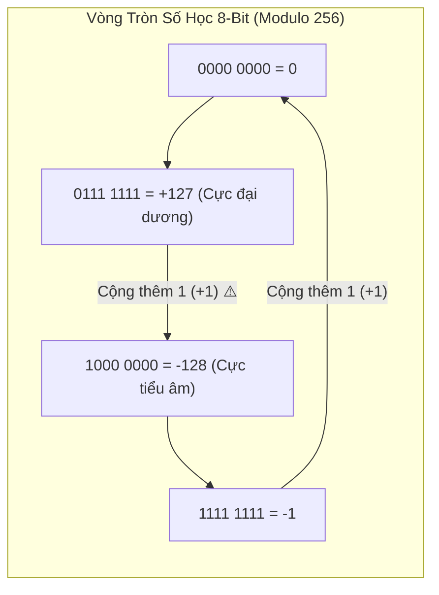

# 1.2. Integer Representation (Biểu Diễn Số Nguyên Trong Bộ Nhớ)

> [!IMPORTANT]
> **Tuyên ngôn Cốt lõi**: Trong toán học, số nguyên $\mathbb{Z}$ là tập hợp vô hạn; nhưng trên phần cứng máy tính, mọi biến số nguyên đều bị giam cầm trong những chiếc hộp có kích thước cố định ($8, 16, 32, 64\text{ bits}$). Sự ra đời của **Số Bù 2 (Two's Complement)** là một trong những phát minh vĩ đại nhất của khoa học máy tính: nó triệt tiêu hoàn toàn sự tồn tại vô lý của hai số $0$ ($+0$ và $-0$), đồng thời cho phép CPU dùng chung **đúng một bộ cộng ALU** để thực hiện cả phép cộng và phép trừ. Tuy nhiên, lập trình viên phải trả giá đắt nếu lơ là: tràn số có dấu (**Signed Overflow**) là hành vi vô định (Undefined Behavior) có thể bị compiler xóa sạch mã kiểm tra, còn sự bất tương thích về thứ tự byte (**Endianness**) có thể âm thầm bẻ gãy các gói tin mạng và dữ liệu file nhị phân.

---

## 1. Trực Quan Hóa: Bản Chất Số Nguyên Dưới Góc Nhìn Lập Trình Viên

Mục tiêu của phần này là giúp bạn hiểu rõ cơ chế vật lý đằng sau những hiện tượng kỳ quặc như `MAX_INT + 1 = MIN_INT`, tại sao rút $11$ đồng từ tài khoản $10$ đồng lại biến bạn thành tỷ phú, và tại sao ID 64-bit của cơ sở dữ liệu khi gửi qua JSON lại bị sai số.

---

### 1.1. Ẩn Dụ Chiếc Đồng Hồ Công-Tơ-Mét: Tại Sao `2,147,483,647 + 1` Lại Ra Số Âm?

Hãy tưởng tượng đồng hồ công-tơ-mét (Odometer) trên xe máy chỉ có 6 chữ số:
* Khi xe đi được `999,999` km, nếu bạn lăn bánh thêm đúng $1$ km nữa, đồng hồ sẽ quay tít về `000,000` km chứ không thể hiện lên `1,000,000` km (vì không còn chỗ chứa chữ số thứ 7).

Trong thanh ghi vi xử lý, hiện tượng này cũng xảy ra tương tự nhưng theo dạng **Vòng Tròn Số Học Modulo (Modulo Ring)**:



* Với kiểu số nguyên 32-bit có dấu (`int32_t`):
  * Giá trị lớn nhất có thể lưu là: $+2,147,483,647$ (`01111111 11111111 11111111 11111111`).
  * Khi bạn cộng thêm $1$, bit $1$ tràn sang vị trí ngoài cùng bên trái (Most Significant Bit - MSB): `10000000 ... 00000000`.
  * Trong hệ thống số bù 2, bit MSB mang trọng số âm lớn nhất, biến toàn bộ con số thành: $\mathbf{-2,147,483,648}$!

---

### 1.2. Tại Sao Số Bù 2 (Two's Complement) Thống Trị Tuyệt Đối?

Trước khi số Bù 2 trở thành chuẩn công nghiệp, các kỹ sư thời kỳ đầu đã thử nghiệm hai cách tiếp cận:

| Phương pháp | Cách biểu diễn số âm | Vấn đề chí mạng |
| :--- | :--- | :--- |
| **Sign-Magnitude** *(Dấu & Độ lớn)* | Dành bit đầu làm dấu ($0: +, 1: -$), các bit sau giữ nguyên giá trị tuyệt đối. | Tồn tại **hai số 0**: $+0$ (`00000000`) và $-0$ (`10000000`). Phải thiết kế hai mạch cộng và trừ riêng biệt, cực kỳ tốn diện tích chip. |
| **One's Complement** *(Bù 1)* | Đảo ngược toàn bộ bit ($0 \leftrightarrow 1$) của số dương để thành số âm. | Vẫn tồn tại **hai số 0**: $+0$ (`00000000`) và $-0$ (`11111111`). Khi cộng tràn phải tốn chu kỳ quay vòng bit nhớ (End-around carry). |
| **Two's Complement** *(Bù 2 - Chuẩn hiện đại)* | **Đảo ngược toàn bộ bit rồi cộng thêm 1** ($\sim X + 1$). | **Chỉ có duy nhất một số 0**. ALU **dùng chung một mạch cộng duy nhất** cho cả phép cộng và phép trừ! |

#### Phép màu của Số Bù 2: Biến phép trừ thành phép cộng
Nếu muốn tính $7 - 5$, máy tính sẽ chuyển bài toán thành $7 + (-5)$:
```
  Số +5 (8-bit):            0000 0101
  Đảo bit (Bù 1):           1111 1010
  Cộng thêm 1 (Bù 2 = -5):  1111 1011

  Bây giờ chỉ việc CỘNG 7 với (-5):
      0000 0111  (+7)
    + 1111 1011  (-5)
    ───────────
    1 0000 0010  (Bỏ bit 1 tràn ngoài cùng) -> Kết quả: 0000 0010 = +2!
```
Bộ xử lý ALU không cần biết số đó là âm hay dương. Nó chỉ việc đưa cả hai vào cùng một bộ cộng **Full Adder**, và kết quả tự động đúng $100\%$!

---

### 1.3. Cạm Bẫy Chết Người: Signed Overflow vs Unsigned Overflow

Đây là điểm khác biệt cốt tử mà mọi lập trình viên C/C++/Go/Rust phải khắc cốt ghi tâm:

1. **Unsigned Integer Overflow (Tràn số không dấu)**:
   * Được quy định rõ ràng trong chuẩn ngôn ngữ là toán học Modulo $2^N$.
   * Với `uint8_t`: $255 + 1 = 0$. Hoàn toàn hợp lệ, không gây lỗi crash chương trình.
2. **Signed Integer Overflow (Tràn số có dấu - CỰC KỲ NGUY HIỂM)**:
   * Trong chuẩn C và C++, **tràn số nguyên có dấu là Hành vi Vô định (Undefined Behavior - UB)**!
   * *Hậu quả khủng khiếp*: Do chuẩn định nghĩa UB "không bao giờ xảy ra trong code hợp lệ", trình biên dịch tối ưu (GCC/Clang với cờ `-O3`) sẽ **tự động xóa bỏ hoàn toàn** đoạn code kiểm tra tràn số của bạn!

```cpp
// ĐOẠN CODE NGUY HIỂM:
int a = get_user_input();
// Bạn nghĩ dòng này kiểm tra an toàn?
if (a + 100 < a) { 
    abort(); // TRÌNH BIÊN DỊCH CÓ QUYỀN XÓA BỎ DÒNG NÀY VÌ COI a + 100 > a LUÔN ĐÚNG!
}
```

---

### 1.4. Endianness: Đọc Sách Từ Trái Sang Phải Hay Từ Phải Sang Trái?

Khi một số nguyên có kích thước $4\text{ bytes}$ (như `0x12345678`), nó phải nằm trong 4 ô nhớ liên tiếp trên thanh RAM. Có hai trường phái lưu trữ:

```
Giá trị:  0x12345678  (Trong đó: 0x12 là MSB - Byte cao nhất, 0x78 là LSB - Byte thấp nhất)

Địa chỉ RAM tăng dần:      0x1000     0x1001     0x1002     0x1003
                          ───────    ───────    ───────    ───────
Little-Endian (x86/ARM):  [ 0x78 ]   [ 0x56 ]   [ 0x34 ]   [ 0x12 ]  <-- Byte bé nhất (LSB) nằm ở đầu!
Big-Endian (Internet IP): [ 0x12 ]   [ 0x34 ]   [ 0x56 ]   [ 0x78 ]  <-- Byte lớn nhất (MSB) nằm ở đầu!
```

* **Little-Endian (Thế giới vi xử lý)**: Được dùng bởi Intel x86/x64 và Apple Silicon (ARM64). Lợi thế là khi CPU ép kiểu con trỏ từ `uint32_t*` xuống `uint8_t*`, địa chỉ con trỏ không cần thay đổi vì byte thấp nhất nằm ngay đầu địa chỉ.
* **Big-Endian (Thế giới mạng Internet)**: Được dùng làm chuẩn truyền tải mạng quốc tế (**Network Byte Order** trong gói tin TCP/IP) và đọc thuận mắt con người (từ trái qua phải).

---

### 1.5. Hai Bài Học Xương Máu Trong Thực Chiến Backend & Bảo Mật

#### Bài học 1: Lỗ hổng rút tiền tràn số (Underflow Vulnerability)
Giả sử hệ thống game hoặc ví điện tử dùng kiểu số không dấu `uint32_t`:
```cpp
uint32_t balance = 10;
uint32_t withdrawal = 11;

// Lỗi sơ đẳng: Không kiểm tra trước khi trừ
balance = balance - withdrawal; 
// Kết quả: balance biến thành 4,294,967,295 xu! Người dùng bỗng chốc thành tỷ phú!
```

#### Bài học 2: Mất độ chính xác ID 64-bit (Twitter/Discord Snowflake ID) khi gửi qua JSON
* Các hệ thống phân tán lớn (Twitter, Discord, Instagram) đều sinh Primary Key bằng số nguyên 64-bit (`uint64_t`, ví dụ: `1548392019384729103`).
* Khi trả về qua REST API JSON: `{ "id": 1548392019384729103 }`.
* Phía Frontend (JavaScript/Node.js) dùng kiểu `Number` (chuẩn IEEE 754 Float 64-bit, chỉ có 53-bit an toàn cho số nguyên). Khi `JSON.parse`, số trên sẽ bị làm tròn thành: `1548392019384729000` $\rightarrow$ Toàn bộ chức năng Like/Retweet bị lỗi 404!
* **Quy tắc vàng Backend**: **Luôn serialize ID 64-bit thành dạng Chuỗi String (`"1548392019384729103"`) khi gửi qua HTTP/JSON.**

---

## 2. Chi tiết từng Keyword (Under-the-Hood Deep Dive)

### 2.1. Unsigned Integer & Signed Integer
- **Unsigned Integer (Số nguyên không dấu)**: Toàn bộ $N$ bit đều được dùng để biểu diễn độ lớn (Magnitude):
  $$V_{\text{unsigned}} = \sum_{i=0}^{N-1} b_i 2^i, \quad \text{Miền giá trị: } [0, 2^N - 1]$$
- **Signed Integer (Two's Complement)**: Bit trọng số cao nhất mang giá trị âm:
  $$V_{\text{signed}} = -b_{N-1} \cdot 2^{N-1} + \sum_{i=0}^{N-2} b_i \cdot 2^i, \quad \text{Miền giá trị: } [-2^{N-1}, 2^{N-1} - 1]$$
- **Tính bất đối xứng của số bù 2**: Có nhiều hơn $1$ số âm so với số dương (Ví dụ 8-bit: $[-128, +127]$). Do đó, hàm `abs(-128)` trong kiểu 8-bit không thể trả về $+128$ mà sẽ gây tràn số!

### 2.2. Integer Extension: Zero Extension vs Sign Extension
Khi nạp một biến số nguyên nhỏ vào một thanh ghi CPU lớn hơn (ví dụ 8-bit $\to$ 32-bit):
1. **Zero Extension (Lệnh x86 `movzx`)**: Dành cho số không dấu (`unsigned`). Các bit trống bậc cao được lấp đầy bằng bit `0`.
2. **Sign Extension (Lệnh x86 `movsx`)**: Dành cho số có dấu (`signed`). CPU sao chép chính bit dấu (MSB) lấp đầy toàn bộ các bit bậc cao:
   * Nếu số ban đầu là $-5$ (`0xFB` = `11111011`), khi mở rộng lên 32-bit sẽ thành `0xFFFFFFFB` để bảo toàn giá trị toán học âm.

### 2.3. Endianness & Chuyển Đổi Trong Network Programming
Các hàm chuyển đổi thứ tự byte chuẩn POSIX trên hệ điều hành Linux/UNIX:
* `htons()`: Host to Network Short (16-bit)
* `htonl()`: Host to Network Long (32-bit)
* `ntohs()`: Network to Host Short (16-bit)
* `ntohl()`: Network to Host Long (32-bit)

---

## 3. Thực Thi Mã Nguồn & Mô Phỏng Chuyên Sâu (Dual-Engine Implementation)

### C++20: Khảo Sát Bố Cục Bộ Nhớ, Endianness & Phát Hiện Tràn Số An Toàn

```cpp
// integer_internals.cpp
// Biên dịch: g++ -std=c++20 -O3 integer_internals.cpp -o int_demo
#include <iostream>
#include <cstdint>
#include <bit>
#include <limits>
#include <format>
#include <span>

// 1. Kiểm tra Endianness tại Compile-time bằng C++20 std::endian
void check_system_endianness() {
    if constexpr (std::endian::native == std::endian::little) {
        std::cout << "[System] CPU Architecture: Little-Endian (x86/ARM64 standard)\n";
    } else if constexpr (std::endian::native == std::endian::big) {
        std::cout << "[System] CPU Architecture: Big-Endian (Network standard)\n";
    }
}

// 2. Dump trực tiếp các byte vật lý trong RAM
void print_memory_bytes(const void* ptr, size_t size) {
    const auto* bytes = static_cast<const uint8_t*>(ptr);
    std::cout << "Memory Dump: ";
    for (size_t i = 0; i < size; ++i) {
        std::cout << std::format("[0x{:02X}] ", bytes[i]);
    }
    std::cout << "\n";
}

// 3. Xử lý an toàn Signed Overflow không gây Undefined Behavior
bool safe_signed_add(int32_t a, int32_t b, int32_t& result) {
    #if defined(__GNUC__) || defined(__clang__)
        // Sử dụng Compiler Built-in trực tiếp kiểm tra cờ Overflow của CPU
        return !__builtin_add_overflow(a, b, &result);
    #else
        if ((b > 0 && a > std::numeric_limits<int32_t>::max() - b) ||
            (b < 0 && a < std::numeric_limits<int32_t>::min() - b)) {
            return false; // Phát hiện nguy cơ tràn số
        }
        result = a + b;
        return true;
    #endif
}

int main() {
    std::cout << "=== KHAO SAT HE THONG SO NGUYEN VA ENDIANNESS (C++20) ===\n";
    check_system_endianness();

    // Khảo sát bố cục bộ nhớ của số nguyên 32-bit
    uint32_t num = 0x12345678;
    std::cout << "\nAnalyzing uint32_t num = 0x12345678:\n";
    print_memory_bytes(&num, sizeof(num));

    // Khảo sát Sign Extension vs Zero Extension
    int8_t negative_byte = -5; // Bù 2: 0xFB (11111011)
    int32_t sign_extended = negative_byte;   // Sign extension: 0xFFFFFFFB
    uint32_t zero_extended = static_cast<uint8_t>(negative_byte); // 0x000000FB

    std::cout << std::format("\nOriginal int8_t (-5): 0x{:02X}\n", static_cast<uint8_t>(negative_byte));
    std::cout << std::format("Sign Extended (int32_t): 0x{:08X} (Value: {:d})\n", sign_extended, sign_extended);
    std::cout << std::format("Zero Extended (uint32_t): 0x{:08X} (Value: {:d})\n", zero_extended, zero_extended);

    // Kiểm tra an toàn tràn số
    int32_t max_val = std::numeric_limits<int32_t>::max();
    int32_t res = 0;
    std::cout << "\nChecking Overflow on int32 max (2147483647) + 1:\n";
    if (!safe_signed_add(max_val, 1, res)) {
        std::cerr << "-> SUCCESS: Phat hien va chan dung tran so Signed an toan!\n";
    }

    return 0;
}
```

---

### TypeScript: Xử Lý ID 64-Bit An Toàn & Thao Tác Endianness Với Node.js Buffer

```typescript
// integer_endianness.ts
// Chạy: npx ts-node integer_endianness.ts

// 1. Cạm bẫy mất độ chính xác trong JavaScript Number (IEEE 754 float 53-bit)
const unsafeInt = 9007199254740991 + 2; 
console.log(`Precision loss in JS Number: ${unsafeInt}`); // 9007199254740992 (Lệch số!)

// Giải pháp chuẩn: Dùng BigInt nguyên bản cho ID cơ sở dữ liệu 64-bit
const safeBigInt = 9007199254740991n + 2n;
console.log(`Accurate 64-bit BigInt: ${safeBigInt.toString()}`); // 9007199254740993n (Chính xác 100%)

// 2. Thao tác nhị phân mạng với Endianness rõ ràng qua Node.js Buffer
const buf = Buffer.alloc(8);

// Ghi số nguyên 32-bit theo Big-Endian (Network Byte Order chuẩn quốc tế)
buf.writeUInt32BE(0x12345678, 0);

// Ghi số nguyên 32-bit theo Little-Endian (Host CPU Format)
buf.writeUInt32LE(0x12345678, 4);

console.log("\nNetwork BE Buffer (Byte cao nhat o dau):", buf.subarray(0, 4)); // <Buffer 12 34 56 78>
console.log("Host LE Buffer    (Byte thap nhat o dau):", buf.subarray(4, 8)); // <Buffer 78 56 34 12>
```

---

## 4. Cạm Bẫy Thực Tế Trong Sản Xuất (Production Pitfalls)

1. **Lỗi So Sánh Giữa Kiểu Có Dấu & Không Dấu (Signed vs Unsigned)**:
   ```cpp
   int32_t a = -1;
   uint32_t b = 1;
   if (a < b) { /* Bạn nghĩ nhánh này chạy? */ }
   else { /* THỰC TẾ NHÁNH NÀY CHẠY! */ }
   ```
   *Nguyên nhân*: Do quy tắc **Usual Arithmetic Conversions**, `a` bị ép kiểu ngầm định thành `uint32_t`. Giá trị `-1` biến thành `0xFFFFFFFF` ($4,294,967,295$), dẫn đến $4,294,967,295 < 1$ là **`false`**! Trong C++20, luôn dùng `std::cmp_less(a, b)`.

2. **Lỗi `abs()` trên giá trị cực tiểu âm (`INT_MIN`)**:
   * Trên kiểu 32-bit: `INT_MIN = -2147483648`, nhưng `INT_MAX = 2147483647`.
   * Lệnh `std::abs(INT_MIN)` sẽ cố gắng trả về $+2147483648$, gây tràn số có dấu ngay lập tức (Undefined Behavior).

---

## 5. Bảng So Sánh & Decision Matrix

| Kích Thước | Kiểu Dữ Liệu C++ | Miền Giá Trị Unsigned | Miền Giá Trị Signed (Two's Complement) | Ứng Dụng Thực Chiến Tiêu Biểu |
| :--- | :--- | :--- | :--- | :--- |
| **8 bits** ($1\text{ B}$) | `uint8_t` / `int8_t` | $[0, 255]$ | $[-128, +127]$ | Mã màu RGB, cờ Bitmask, Byte mạng |
| **16 bits** ($2\text{ B}$) | `uint16_t` / `int16_t`| $[0, 65,535]$ | $[-32,768, +32,767]$ | Cổng mạng TCP/UDP (Port 1 - 65535) |
| **32 bits** ($4\text{ B}$) | `uint32_t` / `int32_t`| $[0, \approx 4.29 \times 10^9]$ | $[-2.14 \times 10^9, +2.14 \times 10^9]$ | IPv4 Address, chỉ số index mảng |
| **64 bits** ($8\text{ B}$) | `uint64_t` / `int64_t`| $[0, \approx 1.84 \times 10^{19}]$ | $[-9.22 \times 10^{18}, +9.22 \times 10^{18}]$ | Con trỏ RAM 64-bit, Snowflake DB ID, Unix Timestamp micro-seconds |
