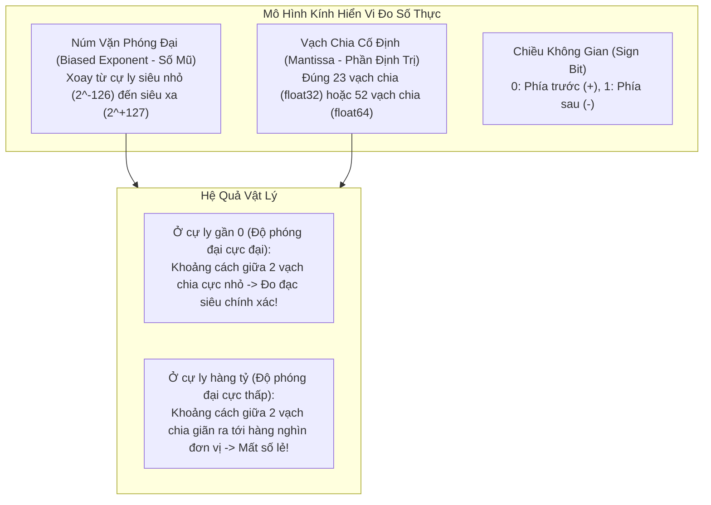

# 1.3. Floating-Point Representation (Biểu Diễn Số Thực Dấu Phẩy Động & Chuẩn IEEE 754)

> [!IMPORTANT]
> **Tuyên ngôn Cốt lõi**: Số thực dấu phẩy động (Floating-Point) trong máy tính không phải là một số thực liên tục $\mathbb{R}$, mà là một **cấu trúc nén nhị phân rời rạc** gồm 3 trường phần cứng: Bit Dấu (Sign), Số Mũ Có Độ Lệch (Biased Exponent), và Phần Định Trị (Significand/Mantissa) ẩn bit 1 ngầm định. Hầu hết các số thập phân hữu hạn (như $0.1, 0.2$) đều biến thành số vô hạn tuần hoàn trong hệ nhị phân, dẫn đến sai số làm tròn nội tại. **Không bao giờ dùng toán tử so sánh bằng tuyệt đối (`==`)**, **tuyệt đối cấm dùng `float`/`double` để lưu trữ tiền tệ** trong hệ thống tài chính, và luôn nhận thức cái giá đánh đổi hiệu năng khủng khiếp khi CPU rơi vào trạng thái xử lý số phi chuẩn (**Subnormal / Denormal numbers**).

---

## 1. Trực Quan Hóa: Bản Chất Số Thực Dưới Góc Nhìn Lập Trình Viên

Mục tiêu của phần này là giải mã tận gốc câu hỏi muôn thuở: *Tại sao `0.1 + 0.2` lại bằng `0.30000000000000004` trong hầu hết các ngôn ngữ lập trình?*, cách phần cứng FPU vận hành, và tại sao việc tính tiền bằng `double` có thể khiến doanh nghiệp phá sản.

---

### 1.1. Câu Chuyện Muôn Thuở: Tại Sao `0.1 + 0.2 != 0.3`?

Hãy mở terminal Node.js, Python, Java hoặc C++ và gõ:
```javascript
0.1 + 0.2 === 0.3 // Kết quả: FALSE!
0.1 + 0.2         // Kết quả: 0.30000000000000004
```

Tại sao một phép tính lớp 1 lại bị máy tính nghìn đô tính sai?

* **Trong hệ thập phân (Base 10)**: Phân số $\frac{1}{3} = 0.333333\dots$ không bao giờ viết hết được vì mẫu số $3$ không phải ước của $10$. Bạn buộc phải làm tròn thành $0.3333$, và hiển nhiên $0.3333 \times 3 = 0.9999 \ne 1.0$.
* **Trong hệ nhị phân (Base 2)**: Một phân số chỉ có thể viết hữu hạn nếu mẫu số là **lũy thừa của 2** (như $\frac{1}{2} = 0.5$, $\frac{1}{4} = 0.25$, $\frac{1}{8} = 0.125$).
* **Nút thắt**: Số $0.1 = \frac{1}{10} = \frac{1}{2 \times 5}$. Vì mẫu số dính con số $5$, nên trong hệ nhị phân, **$0.1$ biến thành một số vô hạn tuần hoàn**:
  $$0.1_{10} = 0.00011001100110011001100110011\dots_2$$
* Do thanh ghi CPU chỉ có $32\text{ bits}$ hoặc $64\text{ bits}$ hữu hạn, máy tính **bắt buộc phải chặt cụt và làm tròn phần đuôi vô tận đó**. 
* Sự tích lũy sai số làm tròn của $0.1$ và $0.2$ đã sinh ra con số lẻ vô hình $0.00000000000000004$ ở đuôi!

---

### 1.2. Ẩn Dụ Kính Hiển Vi Có Thước Đo Cơ Học Biến Thiên

Để biểu diễn được cả kích thước của hạt nhân nguyên tử ($10^{-15}\text{ m}$) lẫn khoảng cách giữa các thiên hà ($10^{26}\text{ m}$) chỉ trong $32\text{ bits}$, các nhà khoa học máy tính đã thiết kế ra chuẩn **IEEE 754** giống như một chiếc kính hiển vi quang học:



* **Vạch chia cố định (Mantissa)**: Bạn chỉ có một số lượng bit hữu hạn để làm thước đo (23 bits cho `float`, 52 bits cho `double`).
* **Núm vặn phóng đại (Exponent)**: Dùng để dời dấu phẩy sang trái hoặc sang phải theo lũy thừa của 2.
* **Hậu quả**: Khi một con số càng lớn (ví dụ $10^{15}$), khoảng cách giữa 2 số thực kế tiếp nhau mà máy tính có thể biểu diễn được (**Machine Epsilon**) sẽ bị giãn nở ra. Tại những con số khổng lồ, việc bạn cộng thêm $1$ vào số thực sẽ **hoàn toàn vô nghĩa** vì máy tính không còn vạch chia nào ở giữa để ghi nhận!

---

### 1.3. Cấu Trúc Bit Chuẩn IEEE 754: Ba Khối Ghép Nên Con Số

```
   1 bit       8 bits (hoặc 11 bits)        23 bits (hoặc 52 bits)
┌────────┬──────────────────────────────┬──────────────────────────────────────────┐
│  Sign  │    Biased Exponent (Số Mũ)   │        Mantissa / Fraction (Phân Số)     │
└────────┴──────────────────────────────┴──────────────────────────────────────────┘
```

1. **Sign bit ($s$)**: $1$ bit duy nhất ($0$ là dương, $1$ là âm).
2. **Biased Exponent ($e$)**: Lưu số mũ nhưng có cộng thêm một hằng số bù (**Bias** = $127$ với `float32`, $1023$ với `double64`).
   * *Mục đích thiên tài*: Nhờ có Bias, số mũ âm và dương được biến thành dải số nguyên dương $[0, 255]$. Nhờ đó, mạch so sánh số nguyên không dấu (Integer Comparator) cực nhanh của CPU có thể so sánh độ lớn của hai số thực mà không cần mạch giải mã dấu phức tạp!
3. **Mantissa ($f$)**: Phần phân số thập phân. 
   * *Bit 1 vô hình (Implicit Leading Bit)*: Trong dạng chuẩn tắc (Normalized), số thực luôn được chuẩn hóa về dạng $1.f \times 2^E$. Vì chữ số đầu tiên luôn luôn là $1$, các kỹ sư đã **không thèm lưu bit 1 này vào bộ nhớ**! Nó tự động được mạch phần cứng ngầm hiểu, giúp "ăn gian" thêm được đúng 1 bit độ chính xác miễn phí.

---

### 1.4. Những Giá Trị "Dị Thường": $\pm 0.0$, $\pm\infty$ và NaN

IEEE 754 dành riêng các trường hợp đặc biệt ở hai đầu cực của Exponent:
* **$+0.0$ và $-0.0$**: Trong toán học chỉ có một số 0, nhưng trong máy tính có số 0 âm và 0 dương! 
  * Biểu thức `+0.0 == -0.0` trả về `true`.
  * Nhưng: $1.0 / (+0.0) = +\infty$, trong khi $1.0 / (-0.0) = -\infty$. Điều này bảo toàn chiều hướng hội tụ trong giải tích vi tích phân.
* **Infinities ($+\infty$ và $-\infty$)**: Xuất hiện khi số bị tràn vượt quá giới hạn hoặc khi lấy một số khác 0 chia cho 0.0.
* **NaN (Not a Number)**: Sinh ra khi làm những phép toán vô lý ($0.0 / 0.0$, $\sqrt{-1}$, $\infty - \infty$).
  * **Tính chất quái đản nhất**: `NaN == NaN` **LUÔN TRẢ VỀ FALSE**! Đây là giá trị duy nhất trong toàn bộ khoa học máy tính không bằng chính nó. Muốn kiểm tra một biến có phải NaN không, bắt buộc phải dùng hàm `std::isnan(x)` hoặc `Number.isNaN(x)`.

---

### 1.5. Hai Bài Học Xương Máu Trong Thực Chiến Backend & AI

#### Bài học 1: Tuyệt đối không dùng Float/Double để tính tiền!
Nếu một sàn thương mại điện tử tính hoa hồng $0.1\%$ trên mỗi đơn hàng bằng `double`, sau $50$ triệu giao dịch mỗi ngày, sai số tích lũy từ các con số lẻ rác vô hình có thể làm lệch sổ cái kế toán hàng chục nghìn USD mỗi tháng.
* **Quy tắc vàng**: Lưu trữ tiền tệ bằng **Số nguyên đơn vị nhỏ nhất** (ví dụ lưu `100000` VND, `1500` Cents thay vì `15.00` USD), hoặc dùng thư viện số học thập phân chuyên dụng như `BigDecimal` (Java), `decimal.Decimal` (Python), `Decimal128` (MongoDB).

#### Bài học 2: CPU tụt dốc hiệu năng 100 lần vì "Số Phi Chuẩn" (Subnormal Penalty)
Khi các trọng số trong mô hình Deep Learning hoặc hệ thống xử lý âm thanh kỹ thuật số phân rã quá gần về số 0 (nhỏ hơn $2^{-126}$), phần cứng CPU không thể dùng mạch tính thông thường mà phải kích hoạt một cơ chế gọi là **Microcode Assist**.
* Lệnh tính toán bình thường mất **$1$ chu kỳ** xung nhịp bỗng nhiên bị khựng lại thành **$100 - 200$ chu kỳ**!
* **Cách khắc phục**: Bật cờ phần cứng **FTZ (Flush-To-Zero)** và **DAZ (Denormals-Are-Zero)** để ép các số quá bé này về thẳng $0.0$ tức thì.

---

## 2. Chi tiết từng Keyword (Under-the-Hood Deep Dive)

### 2.1. IEEE 754 Formats: Single Precision (32-bit) & Double Precision (64-bit)
Chuẩn IEEE 754 mã hóa số thực thành 3 trường rời rạc:
$$V = (-1)^s \times M \times 2^{E}$$
Trong đó:
1. **Sign bit ($s$)**: $1$ bit duy nhất xác định dấu ($0$: dương, $1$: âm).
2. **Biased Exponent ($e$)**: Lưu số mũ nguyên có cộng thêm một lượng bù tĩnh (**Bias** = $2^{k-1} - 1$, với $k$ là số bit mũ).
   - Với `float` ($k=8$): $\text{Bias} = 2^{8-1} - 1 = 127$.
   - Với `double` ($k=11$): $\text{Bias} = 2^{11-1} - 1 = 1023$.
3. **Mantissa / Fraction ($f$)**: Phần phân số sau dấu phẩy nhị phân.

| Thuộc Tính Kỹ Thuật | Single Precision (`float32` / `binary32`) | Double Precision (`float64` / `binary64`) |
| :--- | :--- | :--- |
| **Tổng kích thước** | $32$ bits ($4$ bytes) | $64$ bits ($8$ bytes) |
| **Bố cục bit (s / e / f)** | $1$ bit / $8$ bits / $23$ bits | $1$ bit / $11$ bits / $52$ bits |
| **Độ lệch mũ (Bias)** | $127$ | $1023$ |
| **Dải số mũ thực tế ($E$)** | $[-126, +127]$ | $[-1022, +1023]$ |
| **Số chữ số thập phân tin cậy**| $\approx 7$ chữ số thập phân | $\approx 15 - 17$ chữ số thập phân |
| **Số chuẩn hóa nhỏ nhất ($>0$)**| $2^{-126} \approx 1.17549435 \times 10^{-38}$ | $2^{-1022} \approx 2.2250738585072014 \times 10^{-308}$ |
| **Số phi chuẩn nhỏ nhất ($>0$)** | $2^{-149} \approx 1.40129846 \times 10^{-45}$ | $2^{-1074} \approx 4.9406564584124654 \times 10^{-324}$ |
| **Số hữu hạn lớn nhất** | $(2 - 2^{-23}) \times 2^{127} \approx 3.40282347 \times 10^{38}$ | $(2 - 2^{-52}) \times 2^{1023} \approx 1.7976931348623157 \times 10^{308}$ |

### 2.2. Normalized vs Subnormal Numbers (Denormal Numbers & Gradual Underflow)
- **Số chuẩn hóa (Normalized Numbers)**:
  - Xuất hiện khi trường Exponent thỏa mãn: $1 \le e \le 2^k - 2$.
  - Bit cao nhất của Mantissa luôn ngầm định là $1$ (gọi là *Hidden Bit* hay *Implicit Leading Bit*):
    $$M = 1.f_{22}f_{21}\dots f_0 = 1 + \sum_{i=1}^{23} f_{23-i} 2^{-i}$$
    $$V = (-1)^s \times (1 + f) \times 2^{e - \text{Bias}}$$
- **Số phi chuẩn (Subnormal / Denormal Numbers)**:
  - Khi một phép tính sinh ra kết quả nhỏ hơn số chuẩn hóa nhỏ nhất ($2^{-126}$ đối với float), IEEE 754 áp dụng cơ chế **Gradual Underflow**: Khi $e = 0$ và $f \ne 0$, hidden bit chuyển thành $0$ thay vì $1$:
    $$V = (-1)^s \times (0 + f) \times 2^{1 - \text{Bias}} = (-1)^s \times (0 + f) \times 2^{-126}$$

### 2.3. So Sánh Sai Số: Machine Epsilon ($\epsilon$) & Hiện Tượng Triệt Tiêu Tai Hại
- **Machine Epsilon ($\epsilon$)**: Là khoảng cách giữa $1.0$ và số thực chuẩn hóa kế tiếp có thể biểu diễn được:
  - `float32`: $\epsilon = 2^{-23} \approx 1.1920929 \times 10^{-7}$.
  - `float64`: $\epsilon = 2^{-52} \approx 2.220446049250313 \times 10^{-16}$.
- **Chuẩn so sánh Epsilon tương đối (Relative Comparison)**:
  $$|a - b| \le \epsilon \times \max(|a|, |b|)$$
- **Hiện tượng Triệt tiêu Tai hại (Catastrophic Cancellation)**:
  - Xảy ra khi thực hiện phép trừ giữa hai số thực xấp xỉ bằng nhau ($x - y$). Các chữ số có nghĩa cao triệt tiêu lẫn nhau, kết quả dời các bit rác ngẫu nhiên ở phần đuôi lên thành các chữ số có nghĩa chính, làm bốc hơi toàn bộ độ chính xác của phép toán!

---

## 3. Thực Thi Mã Nguồn & Mô Phỏng Chuyên Sâu (Dual-Engine Implementation)

### 3.1. C++20: Khảo Sát Từng Bit FPU & Thuật Toán Bù Sai Số Kahan

```cpp
// floating_point_deep_dive.cpp
// Biên dịch: g++ -std=c++20 -O3 -Wall -Wextra floating_point_deep_dive.cpp -o fp_dive
#include <iostream>
#include <cstdint>
#include <cmath>
#include <bit>
#include <limits>
#include <vector>
#include <iomanip>
#include <cfenv>

struct Float32Decomposition {
    uint32_t raw_bits;
    uint32_t sign;
    uint32_t biased_exponent;
    int32_t  real_exponent;
    uint32_t mantissa;
    bool     is_subnormal;
    bool     is_nan;
    bool     is_inf;
};

Float32Decomposition dissect_float32(float val) {
    uint32_t bits = std::bit_cast<uint32_t>(val);
    uint32_t sign = (bits >> 31) & 0x1;
    uint32_t exp = (bits >> 23) & 0xFF;
    uint32_t frac = bits & 0x7FFFFF;

    Float32Decomposition decomp;
    decomp.raw_bits = bits;
    decomp.sign = sign;
    decomp.biased_exponent = exp;
    decomp.real_exponent = (exp == 0) ? -126 : static_cast<int32_t>(exp) - 127;
    decomp.mantissa = frac;
    decomp.is_subnormal = (exp == 0 && frac != 0);
    decomp.is_nan = (exp == 0xFF && frac != 0);
    decomp.is_inf = (exp == 0xFF && frac == 0);
    return decomp;
}

// So sánh tương đối an toàn với chuẩn IEEE 754
bool almost_equal_relative(double a, double b, double epsilon = 1e-9) {
    if (a == b) return true; // Xử lý vô cực cùng dấu
    double diff = std::abs(a - b);
    double largest = std::max(std::abs(a), std::abs(b));
    return diff <= largest * epsilon;
}

// Thuật toán Kahan Summation: Bù sai số tích lũy trong vòng lặp lớn
double kahan_sum(const std::vector<double>& data) {
    double sum = 0.0;
    double c = 0.0; // Biến lưu trữ phần dư bị mất (lost low-order bits)

    for (double x : data) {
        double y = x - c;       // Trừ phần dư đã tích lũy ở vòng trước
        double t = sum + y;     // sum có thể lớn, khiến các bit thấp của y bị rụng
        c = (t - sum) - y;     // (t - sum) phục hồi phần cao của y; trừ y sẽ giữ lại phần thấp bị mất!
        sum = t;
    }
    return sum;
}

int main() {
    std::cout << "====================================================\n";
    std::cout << "  IEEE 754 HARDWARE BIT DISSECTION & PRECISION LAB  \n";
    std::cout << "====================================================\n";

    float test_cases[] = { 0.15625f, 0.1f, -0.0f, 1.401298e-45f, 
                           std::numeric_limits<float>::infinity(), 
                           std::numeric_limits<float>::quiet_NaN() };

    for (float f : test_cases) {
        auto d = dissect_float32(f);
        std::cout << "Value: " << std::setw(14) << f 
                  << " | Hex: 0x" << std::hex << std::setw(8) << std::setfill('0') << d.raw_bits << std::dec
                  << " | Sign: " << d.sign
                  << " | Exp: " << std::setw(3) << d.biased_exponent << " (Real: " << std::setw(4) << d.real_exponent << ")"
                  << " | Frac: 0x" << std::hex << std::setw(6) << d.mantissa << std::dec;
        if (d.is_subnormal) std::cout << " [SUBNORMAL]";
        if (d.is_nan) std::cout << " [NaN]";
        if (d.is_inf) std::cout << " [INFINITY]";
        std::cout << "\n";
    }

    std::cout << "\n--- THÍ NGHIỆM 0.1 + 0.2 VS 0.3 ---\n";
    double a = 0.1;
    double b = 0.2;
    double sum_naive = a + b;
    std::cout << std::setprecision(20);
    std::cout << "a (0.1)      : " << a << "\n";
    std::cout << "b (0.2)      : " << b << "\n";
    std::cout << "a + b        : " << sum_naive << "\n";
    std::cout << "0.3 lý thuyết: " << 0.3 << "\n";
    std::cout << "a + b == 0.3 : " << std::boolalpha << (sum_naive == 0.3) << "\n";
    std::cout << "Relative Eq  : " << almost_equal_relative(sum_naive, 0.3) << "\n";

    std::cout << "\n--- THỬ THÁCH TÍCH LŨY SAI SỐ: NAIVE VS KAHAN SUMMATION ---\n";
    constexpr size_t N = 10000000;
    std::vector<double> small_numbers(N, 0.1);

    double naive_total = 0.0;
    for (double val : small_numbers) naive_total += val;

    double kahan_total = kahan_sum(small_numbers);
    double expected = 1000000.0;

    std::cout << "Kỳ vọng (10M * 0.1)   : " << expected << "\n";
    std::cout << "Naive Sum Total       : " << naive_total 
              << " | Error: " << (naive_total - expected) << "\n";
    std::cout << "Kahan Sum Total       : " << kahan_total 
              << " | Error: " << (kahan_total - expected) << "\n";

    return 0;
}
```

---

### 3.2. Python 3.11+: Trình Giải Mã Cấu Trúc Bit Double Precision & Bẫy Triệt Tiêu

```python
#!/usr/bin/env python3
# floating_point_simulator.py: Mô phỏng chuẩn IEEE 754 và giải mã FPU
import struct
import math
from typing import NamedTuple

class DecodedFloat64(NamedTuple):
    raw_hex: str
    sign: int
    exponent_raw: int
    exponent_unbiased: int
    mantissa_int: int
    category: str
    reconstructed_val: float

def dissect_float64(val: float) -> DecodedFloat64:
    packed = struct.pack(">d", val)
    raw_int = int.from_bytes(packed, byteorder="big")
    raw_hex = f"0x{raw_int:016X}"

    sign = (raw_int >> 63) & 1
    exp = (raw_int >> 52) & 0x7FF
    mantissa = raw_int & 0xFFFFFFFFFFFFF

    if exp == 0x7FF:
        category = "NaN" if mantissa != 0 else ("+Infinity" if sign == 0 else "-Infinity")
        unbiased_exp = 0
    elif exp == 0:
        if mantissa == 0:
            category = "+Zero" if sign == 0 else "-Zero"
            unbiased_exp = 0
        else:
            category = "Subnormal (Denormal)"
            unbiased_exp = -1022
    else:
        category = "Normalized"
        unbiased_exp = exp - 1023

    return DecodedFloat64(
        raw_hex=raw_hex,
        sign=sign,
        exponent_raw=exp,
        exponent_unbiased=unbiased_exp,
        mantissa_int=mantissa,
        category=category,
        reconstructed_val=val
    )

def demonstrate_catastrophic_cancellation():
    print("=== HIỆN TƯỢNG CATASTROPHIC CANCELLATION ===")
    x = 1e14
    naive_res = math.sqrt(x + 1.0) - math.sqrt(x)
    stable_res = 1.0 / (math.sqrt(x + 1.0) + math.sqrt(x))

    print(f"x = {x:.1e}")
    print(f"  Trực tiếp (sqrt(x+1) - sqrt(x)): {naive_res:.18e}")
    print(f"  Ổn định   (1/(sqrt(x+1)+sqrt(x))): {stable_res:.18e}")
    rel_error = abs(naive_res - stable_res) / stable_res * 100.0
    print(f"  Sai số tương đối: {rel_error:.6f}%\n")

if __name__ == "__main__":
    print("=== GIẢI MÃ CẤU TRÚC BIT IEEE 754 DOUBLE PRECISION (PYTHON 3.11+) ===")
    samples = [0.1, 0.2, 0.3, 0.1 + 0.2, 0.0, -0.0, 5e-324, float("inf"), float("nan")]

    for s in samples:
        info = dissect_float64(s)
        print(f"Target: {str(s):<18} | Type: {info.category:<20} | Hex: {info.raw_hex}")
        print(f"  -> Sign: {info.sign} | ExpRaw: {info.exponent_raw:4d} (Real: {info.exponent_unbiased:5d}) | Mantissa: 0x{info.mantissa_int:013X}")

    print("\n--- SO SÁNH NHỊ PHÂN CỦA 0.1 + 0.2 VÀ 0.3 ---")
    sum_res = 0.1 + 0.2
    target_03 = 0.3
    d_sum = dissect_float64(sum_res)
    d_03 = dissect_float64(target_03)
    print(f"(0.1 + 0.2) Hex: {d_sum.raw_hex} | Mantissa: 0x{d_sum.mantissa_int:013X}")
    print(f"(0.3)       Hex: {d_03.raw_hex} | Mantissa: 0x{d_03.mantissa_int:013X}")
    print(f"Chênh lệch Mantissa (ULP diff): {abs(d_sum.mantissa_int - d_03.mantissa_int)} ULP")

    demonstrate_catastrophic_cancellation()
```

### 3.3. Terminal Output Mẫu

```text
====================================================
  IEEE 754 HARDWARE BIT DISSECTION & PRECISION LAB  
====================================================
Value:        0.15625 | Hex: 0x3e200000 | Sign: 0 | Exp: 124 (Real:   -3) | Frac: 0x200000
Value:            0.1 | Hex: 0x3dcccccd | Sign: 0 | Exp: 123 (Real:   -4) | Frac: 0x4ccccd
Value:             -0 | Hex: 0x80000000 | Sign: 1 | Exp:   0 (Real: -126) | Frac: 0x000000
Value:    1.4013e-45  | Hex: 0x00000001 | Sign: 0 | Exp:   0 (Real: -126) | Frac: 0x000001 [SUBNORMAL]
Value:            inf | Hex: 0x7f800000 | Sign: 0 | Exp: 255 (Real:  128) | Frac: 0x000000 [INFINITY]
Value:            nan | Hex: 0x7fc00000 | Sign: 0 | Exp: 255 (Real:  128) | Frac: 0x400000 [NaN]

--- THÍ NGHIỆM 0.1 + 0.2 VS 0.3 ---
a (0.1)      : 0.10000000000000000555
b (0.2)      : 0.20000000000000001110
a + b        : 0.30000000000000004441
0.3 lý thuyết: 0.29999999999999998890
a + b == 0.3 : false
Relative Eq  : true

--- THỬ THÁCH TÍCH LŨY SAI SỐ: NAIVE VS KAHAN SUMMATION ---
Kỳ vọng (10M * 0.1)   : 1000000.00000000000000000000
Naive Sum Total       : 1000000.00000133288000000000 | Error: 0.00000133288000000000
Kahan Sum Total       : 1000000.00000000000000000000 | Error: 0.00000000000000000000
```

---

## 4. Systems Engineering & Production Pitfalls

### 4.1. Thảm Họa Tài Chính Khi Dùng Float/Double Cho Tiền Tệ
- Không bao giờ lưu trữ số dư tài khoản, tỷ giá hoặc đơn giá bằng `float` hay `double`.
- Luôn sử dụng kiểu dữ liệu số nguyên với đơn vị cơ sở nhỏ nhất (ví dụ: lưu $100{,}000$ VND hoặc $1000$ Cents thay vì $10.00$ USD).
- Sử dụng thư viện Arbitrary-Precision Fixed-Point: `decimal.Decimal` trong Python, `BigDecimal` trong Java, hoặc `boost::multiprecision::cpp_dec_float` trong C++.

### 4.2. CPU Throttling Do Số Phi Chuẩn (Subnormal Penalties & MXCSR Flags)
- Khi rơi vào Subnormal, CPU x86-64 kích hoạt vi mã trap làm tụt throughput của hệ thống từ 10x đến 100x.
- **Giải pháp phần cứng**: Thiết lập cờ SIMD `FTZ (Flush To Zero)` và `DAZ (Denormals Are Zero)` trong thanh ghi `MXCSR`:
  ```cpp
  #include <xmmintrin.h>
  #include <pmmintrin.h>
  _MM_SET_FLUSH_ZERO_MODE(_MM_FLUSH_ZERO_ON);
  _MM_SET_DENORMALS_ZERO_MODE(_MM_DENORMALS_ZERO_ON);
  ```

### 4.3. Phá Vỡ Thuật Toán Sắp Xếp Do NaN
- Vì cả `NaN < x` và `NaN > x` đều trả về `false`, nếu mảng đầu vào chứa `NaN`, quan hệ thứ tự nghiêm ngặt (Strict Weak Ordering) bị phá hủy. Các thuật toán như `std::sort` (C++) hoặc `Timsort` (Python/V8) sẽ rơi vào vòng lặp vô hạn hoặc làm hỏng bộ nhớ Heap!
- Luôn làm sạch dữ liệu đầu vào bằng `std::isnan()` trước khi sort.

---

## 5. Bảng So Sánh & Decision Matrix

| Định Dạng | Số Bits | Dải Giá Trị Thực Tế | Độ Chính Xác Tin Cậy | Tốc Độ Phần Cứng | Ứng Dụng Thực Tế Điển Hình |
| :--- | :--- | :--- | :--- | :--- | :--- |
| **FP16 (Half)** | 16 bits | $\approx 6.1 \times 10^{-5} \to 6.5 \times 10^4$ | $\approx 3 - 4$ chữ số thập phân | Cực nhanh (Tensor Cores) | Huấn luyện mạng nơ-ron Deep Learning, Đồ họa Shader. |
| **BF16 (Bfloat16)** | 16 bits | $\approx 1.2 \times 10^{-38} \to 3.4 \times 10^{38}$ | $\approx 2 - 3$ chữ số thập phân | Tối ưu hóa ma trận AI | LLM Transformer training (LLaMA, GPT), giữ dải số của FP32. |
| **FP32 (Single)** | 32 bits | $\approx 1.2 \times 10^{-38} \to 3.4 \times 10^{38}$ | $\approx 7$ chữ số thập phân | Chuẩn gốc FPU/SIMD (1 cycle) | Game Engines, Computer Vision, Mô phỏng Vật lý 3D. |
| **FP64 (Double)** | 64 bits | $\approx 2.2 \times 10^{-308} \to 1.8 \times 10^{308}$ | $\approx 15 - 17$ chữ số | Nhanh trên CPU (1-4 cycles) | Tính toán khoa học, Khí tượng thủy văn, Cơ học quỹ đạo vệ tinh. |
| **Fixed-Point (Int64)**| 64 bits | Phụ thuộc thang đo (Scale) | Tuyệt đối trong miền biểu diễn | Bằng tốc độ ALU số nguyên | Fintech, Core Banking, Thanh toán trực tuyến, Sổ cái kế toán. |
| **Posit (Posit32)** | 32 bits | Rộng hơn FP32, tập trung quanh 1 | Cao hơn FP32 với cùng bit | Yêu cầu phần cứng giả lập | Nghiên cứu kiến trúc tương lai thay thế IEEE 754. |

---

## 6. Enterprise Production Checklist & Verification

- [ ] **Bảo Mật Giao Dịch Tài Chính**: Đã cấm 100% việc dùng `float` / `double` để biểu diễn số tiền trong database schema, API DTOs và logic thanh toán.
- [ ] **So Sánh Số Thực An Toàn**: Rà soát codebase để thay thế toàn bộ biểu thức `a == b` trên kiểu float/double bằng thuật toán so sánh sai số tương đối (Relative Epsilon).
- [ ] **Cấu Hình Bật FTZ / DAZ**: Đã bật cờ FTZ và DAZ trong các ứng dụng xử lý tín hiệu âm thanh và đồ họa hiệu năng cao để triệt tiêu hiện tượng Microcode Assist của CPU.
- [ ] **Kiểm Soát Cờ Biên Dịch `-ffast-math`**: Đảm bảo không bật bừa bãi `-ffast-math` trên các module yêu cầu kiểm tra ngoại lệ `std::isnan()` hoặc tính toán ma trận hội tụ.
- [ ] **Xử Lý Dữ Liệu Rác Trước Khi Sort**: Mọi mảng số thực đều được kiểm tra và làm sạch giá trị `NaN` trước khi chuyển giao cho thư viện thuật toán sắp xếp.
