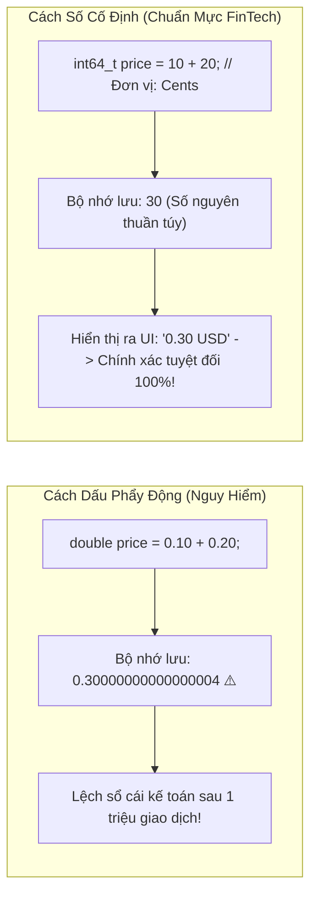

# 1.4. Fixed-Point Representation (Biểu Diễn Số Thập Phân Cố Định & Tiền Tệ)

> [!IMPORTANT]
> **Tuyên ngôn Cốt lõi**: Trái ngược với số thực dấu phẩy động (Floating-Point) có vị trí dấu phẩy nhị phân trôi nổi theo số mũ, số thực dấu phẩy cố định (**Fixed-Point**) "đóng đinh" vị trí của dấu phân cách thập phân tại một vị trí bất di bất dịch. Bản chất của Fixed-Point là kỹ thuật biểu diễn một số lẻ bằng một **số nguyên bên dưới kết hợp với một hệ số tỉ lệ cố định ($V = I / S$)**. Đây là vũ khí tối thượng giúp toàn bộ ngành FinTech, Ngân hàng, Sàn giao dịch Chứng khoán và Thương mại Điện tử triệt tiêu $100\%$ sai số làm tròn tuần hoàn nhị phân, bảo đảm tính **tiên định số học (Arithmetic Determinism)** tuyệt đối trên mọi nền tảng phần cứng.

---

## 1. Trực Quan Hóa: Bản Chất Số Cố Định Dưới Góc Nhìn Lập Trình Viên

Mục tiêu của phần này là giải thích cặn kẽ tại sao các cổng thanh toán hàng đầu thế giới (Stripe, PayPal) lại xử lý tiền tệ theo cách mà ai cũng có thể hiểu, tại sao ngân hàng lại làm tròn $2.5 \to 2$ nhưng $3.5 \to 4$, và cách các sàn giao dịch chứng khoán khớp lệnh triệu đơn hàng mỗi giây mà không cần FPU.

---

### 1.1. Ẩn Dụ Thực Tế: "Đổi Tiền Đô La Ra Xu"

Khi bạn đi mua một cốc cà phê giá $\$2.50$, bạn có thể nhìn nó theo hai cách:
1. Cách của người thường: $\$2.50$ Đô la (có dấu chấm thập phân).
2. **Cách của hệ thống máy tính ngân hàng**: Đúng $250$ Xu (Cents) – **hoàn toàn là số nguyên!**



* Bằng cách quy ước **hệ số co giãn ($S = 100$)**, máy tính không bao giờ phải lưu trữ dấu chấm thập phân trong thanh ghi. 
* Toàn bộ các phép cộng, trừ được giao cho khối tính toán số nguyên của CPU (**Integer ALU**) thực thi với tốc độ chỉ **$1$ chu kỳ xung nhịp ($< 0.5\text{ ns}$)**, không bao giờ bị dính sai số rác của chuẩn IEEE 754.

---

### 1.2. Phép Tính Số Học Tầng Thấp: Nhân Chia Fixed-Point Hoạt Động Ra Sao?

Nếu phép cộng và trừ chỉ đơn giản là cộng hai số nguyên:
$$\frac{I_1}{S} \pm \frac{I_2}{S} = \frac{I_1 \pm I_2}{S}$$
Thì phép **Nhân** và **Chia** lại có một cạm bẫy phần cứng thú vị:

#### 1. Phép Nhân: Cạm bẫy "Bình phương hệ số tỉ lệ"
Giả sử ta tính: $\$10.00 \times 2.00$ với hệ số tỉ lệ $S = 100$:
* $I_1 = 1000$ (tức $10.00$), $I_2 = 200$ (tức $2.00$).
* Nếu lấy hai số nguyên nhân với nhau: $1000 \times 200 = 200{,}000$.
* Khi chia ngược cho $S = 100$ để hiển thị: $200{,}000 / 100 = 2000.00$ (Sai bét! Kết quả đúng phải là $\$20.00$ tức $2000$).
* **Nguyên nhân**: Phép nhân đã làm hệ số tỉ lệ bị nhân đôi ($S \times S = S^2$).
* **Quy tắc**: Khi nhân hai số Fixed-point, phần mềm bắt buộc phải **chia bớt cho $S$**:
  $$I_{\text{result}} = \frac{I_1 \times I_2}{S}$$
  *(Lưu ý: Phép nhân $I_1 \times I_2$ có thể tràn 64-bit, nên CPU cần thanh ghi trung gian 128-bit `__int128_t` trước khi chia lại cho $S$)*.

#### 2. Phép Chia: Cạm bẫy "Mất số lẻ do chia nguyên"
Nếu chia $\$10.00$ cho $3$ ($I_1 = 1000, I_2 = 3$):
* Nếu chia thẳng: $1000 / 3 = 333$ (tức $3.33$). Hệ số $S$ đã bị triệt tiêu!
* **Quy tắc**: Phải **nhân số bị chia với $S$ trước rồi mới chia**:
  $$I_{\text{result}} = \frac{I_1 \times S}{I_2} = \frac{1000 \times 100}{3} = \frac{100000}{3} = 33333 \implies 3.3333$$

---

### 1.3. Banker's Rounding: Tại Sao Ngân Hàng Làm Tròn $2.5 \to 2$ Nhưng $3.5 \to 4$?

Học sinh tiểu học được dạy quy tắc: *Từ $0.5$ trở lên thì làm tròn lên* (Round Half Up: $2.5 \to 3, 3.5 \to 4$).
* **Mặt trái trong tài chính**: Trong tập hợp các số tận cùng bằng $.5$, quy tắc này luôn luôn đẩy số lên phía dương, tạo ra **sự thiên lệch thống kê dương (Positive Statistical Bias)**. Sau 100 triệu giao dịch, tổng tài sản của ngân hàng bị đội lên một khoản tiền khổng lồ ảo!
* **Giải pháp của ngành ngân hàng (Banker's Rounding - Round Half Even)**:
  * Nếu phần đuôi bằng đúng $.5$, ta **làm tròn về số chẵn gần nhất**:
    $$2.5 \longrightarrow \mathbf{2} \quad (\text{vì 2 là số chẵn})$$
    $$3.5 \longrightarrow \mathbf{4} \quad (\text{vì 4 là số chẵn})$$
  * Do xác suất gặp số chẵn và số lẻ là $50/50$, thuật toán này triệt tiêu hoàn toàn sự thiên lệch, bảo toàn tính cân bằng tài chính tuyệt đối.

---

### 1.4. Hai Bài Học Thiết Kế Hệ Thống Backend & FinTech

#### Bài học 1: Tiêu chuẩn thiết kế API của Stripe & PayPal (Minor Currency Units)
Khi thiết kế API cổng thanh toán, **không bao giờ gửi số tiền dưới dạng số thực float**:
```json
// SAI LẦM CHẾT NGƯỜI:
{ "amount": 19.99, "currency": "usd" }

// CHUẨN MỰC STRIPE:
{ "amount": 1999, "currency": "usd" } // 1999 cents
```
Mọi ngôn ngữ khi parse số nguyên `1999` đều không bị sai số dù chạy trên bất kỳ hệ điều hành nào.

#### Bài học 2: Cạm bẫy khởi tạo `BigDecimal` trong Java
Rất nhiều lập trình viên Java tưởng rằng cứ dùng `BigDecimal` là an toàn:
```java
// SAI: 0.1 đã bị IEEE 754 làm sai lệch TRƯỚC KHI truyền vào hàm!
BigDecimal bad = new BigDecimal(0.1); 
// Giá trị thực: 0.1000000000000000055511151231257827021181583404541015625

// ĐÚNG: Khởi tạo từ chuỗi String!
BigDecimal good = new BigDecimal("0.1"); 
// Giá trị thực: Chính xác tuyệt đối 0.1
```

---

## 2. Chi tiết từng Keyword (Under-the-Hood Deep Dive)

### 2.1. Phân Loại: Binary Fixed-Point ($Q_{m.n}$) vs Decimal Fixed-Point
1. **Binary Fixed-Point ($Q_{m.n}$ Format)**:
   - Hệ số tỉ lệ $S = 2^n$ ($m$ bit nguyên, $n$ bit lẻ).
   - *Ưu điểm*: Các phép co giãn tỉ lệ chỉ tốn đúng 1 lệnh dịch bit CPU (`>> n` hoặc `<< n`). Thường dùng trong chip DSP vi điều khiển nhúng không có FPU và trong đồ họa game 3D cổ điển (PlayStation 1, Game Boy Advance).
2. **Decimal Fixed-Point**:
   - Hệ số tỉ lệ $S = 10^d$ ($d$ là số chữ số thập phân cố định - Scale).
   - Là chuẩn mực bắt buộc của SQL `DECIMAL(P, S)` và mọi phần mềm tài chính kế toán.

### 2.2. Precision vs Scale Trong Cơ Sở Dữ Liệu (`DECIMAL(P, S)`)
Trong PostgreSQL, MySQL, SQL Server:
- **Precision ($P$)**: Tổng số lượng chữ số có nghĩa (cả nguyên lẫn thập phân).
- **Scale ($S$)**: Số lượng chữ số nằm sau dấu phẩy thập phân.
- Ví dụ: `DECIMAL(18, 4)` lưu trữ tối đa 18 chữ số, với 4 chữ số thập phân. Kiểu này đủ để lưu trữ từ $0.0001$ đến hàng trăm nghìn tỷ USD mà không mất một xu.

---

## 3. Thực Thi Mã Nguồn & Mô Phỏng Chuyên Sâu (Dual-Engine Implementation)

### C++20: Xây Dựng Engine Fixed-Point Hiệu Năng Cao Với Phép Nhân 128-Bit & Banker's Rounding

```cpp
// fixed_point_engine.cpp
// Biên dịch: g++ -std=c++20 -O3 fixed_point_engine.cpp -o fp_engine
#include <iostream>
#include <cstdint>
#include <format>
#include <stdexcept>
#include <cmath>

// Lớp Fixed-Point 64-bit với Scale = 10^4 (hỗ trợ 4 chữ số thập phân)
class FixedMoney {
private:
    int64_t raw_value_; // Lưu trữ nội tại: 1.0000 USD = 10000
    static constexpr int64_t SCALE = 10'000;

    explicit constexpr FixedMoney(int64_t raw) : raw_value_(raw) {}

public:
    constexpr FixedMoney() : raw_value_(0) {}

    // Khởi tạo từ phần nguyên và phần thập phân chính xác
    static FixedMoney from_parts(int64_t whole, int64_t fraction) {
        if (fraction < 0 || fraction >= SCALE) {
            throw std::invalid_argument("Fraction must be between 0 and 9999");
        }
        int64_t sign = (whole < 0) ? -1 : 1;
        return FixedMoney(whole * SCALE + sign * fraction);
    }

    // Phép cộng O(1) nguyên bản của CPU ALU
    FixedMoney operator+(const FixedMoney& other) const {
        return FixedMoney(raw_value_ + other.raw_value_);
    }

    // Phép trừ O(1)
    FixedMoney operator-(const FixedMoney& other) const {
        return FixedMoney(raw_value_ - other.raw_value_);
    }

    // Phép nhân giữa hai số tiền (ví dụ tính tỷ lệ phần trăm VAT)
    FixedMoney multiply_ratio(const FixedMoney& ratio) const {
        __int128 intermediate = static_cast<__int128>(raw_value_) * ratio.raw_value_;
        // Banker's Rounding: chia cho SCALE với làm tròn về số chẵn gần nhất
        __int128 quotient = intermediate / SCALE;
        __int128 remainder = intermediate % SCALE;
        
        if (std::abs(static_cast<int64_t>(remainder)) * 2 > SCALE) {
            quotient += (intermediate > 0) ? 1 : -1;
        } else if (std::abs(static_cast<int64_t>(remainder)) * 2 == SCALE) {
            // Half even: nếu thương lẻ thì làm tròn để thành chẵn
            if (quotient % 2 != 0) {
                quotient += (intermediate > 0) ? 1 : -1;
            }
        }
        return FixedMoney(static_cast<int64_t>(quotient));
    }

    std::string to_string() const {
        int64_t whole = raw_value_ / SCALE;
        int64_t frac = std::abs(raw_value_ % SCALE);
        return std::format("{}.{:04d}", whole, frac);
    }
};

int main() {
    std::cout << "=== FINTECH FIXED-POINT ARITHMETIC ENGINE (C++20) ===\n";

    // Kịch bản: 0.1000 USD + 0.2000 USD trong Fixed-Point
    FixedMoney m1 = FixedMoney::from_parts(0, 1000); // 0.1000
    FixedMoney m2 = FixedMoney::from_parts(0, 2000); // 0.2000

    FixedMoney sum = m1 + m2;
    std::cout << std::format("0.1000 + 0.2000 = {} USD (CHÍNH XÁC TUYỆT ĐỐI)\n", sum.to_string());

    // Tính thuế VAT 10% (0.1000) trên đơn hàng 99.9500 USD
    FixedMoney order = FixedMoney::from_parts(99, 9500);
    FixedMoney vat_rate = FixedMoney::from_parts(0, 1000);
    FixedMoney vat_tax = order.multiply_ratio(vat_rate);

    std::cout << std::format("Đơn hàng: {} USD, Thuế VAT (10%): {} USD\n", order.to_string(), vat_tax.to_string());
    return 0;
}
```

---

### TypeScript: Mô Hình Value Object Chuẩn Stripe (Minor Units & BigInt)

```typescript
// money_stripe_pattern.ts
// Chạy: npx ts-node money_stripe_pattern.ts

export class Money {
  // Luôn lưu trữ bằng BigInt theo minor units (cents) để chống tràn số
  private readonly amountInCents: bigint;
  private readonly currency: string;

  private constructor(amountInCents: bigint, currency: string) {
    this.amountInCents = amountInCents;
    this.currency = currency.toUpperCase();
  }

  // Khởi tạo an toàn từ đơn vị tiền tệ nhỏ nhất
  public static fromCents(cents: bigint | number, currency: string): Money {
    return new Money(BigInt(cents), currency);
  }

  // Khởi tạo từ định dạng chuỗi người dùng nhập (ví dụ "19.99")
  public static fromDecimalString(amountStr: string, currency: string): Money {
    const parts = amountStr.trim().split('.');
    const whole = BigInt(parts[0] || '0');
    let fractionStr = parts[1] || '0';
    if (fractionStr.length > 2) {
      fractionStr = fractionStr.substring(0, 2); // Cắt ngắn 2 số thập phân
    } else {
      fractionStr = fractionStr.padEnd(2, '0');
    }
    const cents = whole * 100n + BigInt(fractionStr);
    return new Money(cents, currency);
  }

  public add(other: Money): Money {
    this.assertSameCurrency(other);
    return new Money(this.amountInCents + other.amountInCents, this.currency);
  }

  public subtract(other: Money): Money {
    this.assertSameCurrency(other);
    return new Money(this.amountInCents - other.amountInCents, this.currency);
  }

  public formatForStripe(): number {
    return Number(this.amountInCents); // Trả về integer cents cho Stripe API
  }

  public toDisplayString(): string {
    const whole = this.amountInCents / 100n;
    const cents = this.amountInCents % 100n;
    return `${whole}.${cents.toString().padStart(2, '0')} ${this.currency}`;
  }

  private assertSameCurrency(other: Money): void {
    if (this.currency !== other.currency) {
      throw new Error(`Currency mismatch: ${this.currency} !== ${other.currency}`);
    }
  }
}

// Kiểm thử mô hình Stripe
const item1 = Money.fromDecimalString("10.10", "USD"); // 1010 cents
const item2 = Money.fromDecimalString("20.20", "USD"); // 2020 cents
const orderTotal = item1.add(item2);

console.log(`Order Total Display: ${orderTotal.toDisplayString()}`); // 30.30 USD
console.log(`Stripe API Payload Payload (Cents): ${orderTotal.formatForStripe()}`); // 3030
```

---

## 4. Cạm Bẫy Thực Tế Trong Sản Xuất (Production Pitfalls)

1. **Dùng kiểu `FLOAT` hoặc `DOUBLE` trong Schema Cơ Sở Dữ Liệu**:
   * Khai báo: `CREATE TABLE accounts (balance FLOAT);` là một sai lầm chết người!
   * Khi tài khoản tích lũy qua năm tháng, các số dư như `1000000.45` sẽ bị FPU làm tròn thành `1000000.4375`, khiến kế toán không bao giờ đối soát khớp sổ cái.
   * **Giải pháp**: Luôn sử dụng `DECIMAL(19, 4)` hoặc `NUMERIC(19, 4)`.
2. **Khởi tạo sai constructor của `BigDecimal`**:
   * Tuyệt đối không dùng `new BigDecimal(0.1)` vì bản thân số thực `0.1` đã mang sai số IEEE 754 từ trước.
   * Luôn dùng chuỗi String: `new BigDecimal("0.1")` hoặc phương thức factory `BigDecimal.valueOf(0.1)`.

---

## 5. Bảng So Sánh & Decision Matrix

| Tiêu Chí | Floating-Point (`double`) | Binary Fixed-Point ($Q_{m.n}$) | Decimal Fixed-Point (Minor Units) | Arbitrary Decimal (`BigDecimal`) |
| :--- | :--- | :--- | :--- | :--- |
| **Hệ số tỉ lệ ($S$)** | Động ($2^E$) | Cố định ($2^n$) | Cố định ($10^d$, ví dụ 100) | Tự do cấu hình động |
| **Độ chính xác** | Xấp xỉ (sai số IEEE) | Chính xác nhị phân | **Chính xác tuyệt đối thập phân** | **Chính xác tuyệt đối vô hạn** |
| **Tốc độ xử lý** | Rất nhanh (FPU hardware) | Siêu nhanh (Lệnh dịch bit) | Cực nhanh (ALU integer 1 cycle) | Rất chậm (Tạo rác GC, object heap) |
| **Dung lượng bộ nhớ** | Cố định 8 bytes | Cố định 2 - 8 bytes | Cố định 8 bytes (`int64_t`) | Động (nhiều chục bytes trên Heap) |
| **Ứng dụng tối ưu** | 3D Graphics, Game, AI | DSP nhúng, Game Console retro | **Stripe API, Core Banking, FinTech** | Tính lãi suất ngân hàng kỳ hạn, Thuế |
