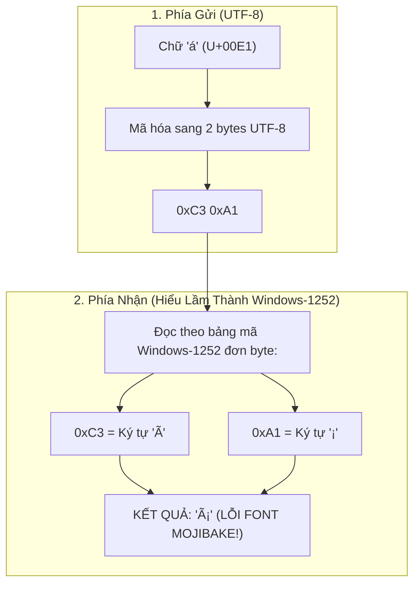

# 2.1. Character Encoding (Mã Hóa Ký Tự: ASCII, Unicode & UTF Formats)

> [!IMPORTANT]
> **Tuyên ngôn Cốt lõi**: Ký tự đồ họa của con người và byte nhị phân trong bộ nhớ máy tính là hai thế giới hoàn toàn tách biệt được kết nối qua cầu nối hai tầng: **Unicode Code Point** (ánh xạ trừu tượng ký tự sang số nguyên $\mathbb{N}$) và **Encoding Scheme** (thuật toán nhị phân hóa số nguyên đó thành chuỗi byte trong RAM). **UTF-8** thống trị toàn cầu nhờ tính năng tự đồng bộ hóa (Self-Synchronizing), tương thích ngược 100% với ASCII và thiết kế không tiền tố (Prefix-Free). Trong hệ thống phân tán và database, **tuyệt đối không bao giờ dùng `utf8` lỗi thời của MySQL** (chỉ tối đa 3 bytes, làm sập hệ thống khi gặp Emoji) mà phải luôn dùng chuẩn **`utf8mb4`**.

---

## 1. Trực Quan Hóa: Bản Chất Mã Hóa Ký Tự Dưới Góc Nhìn Lập Trình Viên

Mục tiêu của phần này là giải mã hiện tượng lỗi font chữ kinh điển `á, Ä•, Ä‘` (Mojibake), tại sao trong JavaScript chuỗi `'😀'.length` lại bằng 2, và tại sao một icon mặt cười lại có thể đánh sập cơ sở dữ liệu MySQL của bạn.

---

### 1.1. Câu Chuyện Lỗi Font "Kim Tự Tháp": `á, Ä•, Ä‘` Đến Từ Đâu?

Hầu như mọi lập trình viên đều từng gặp cảnh tượng: Một file văn bản tiếng Việt hoặc một API trả về những ký tự kỳ quặc như:
```
"Hà ng đầu Việt Nam" (Đáng lẽ là: "Hàng đầu Việt Nam")
```

Hiện tượng này trong khoa học máy tính có một cái tên riêng từ tiếng Nhật: **Mojibake (文字化け - Ký tự ma hóa)**.



* **Nguyên nhân cốt lõi**: Chuỗi byte vật lý trong bộ nhớ RAM (`0xC3 0xA1`) **hoàn toàn không mang theo thông tin về bảng mã của nó**. 
* Nếu người gửi đóng gói bằng **UTF-8** (coi 2 byte là 1 chữ), nhưng phía nhận lại dùng bảng mã cũ thời Windows 95 (**Windows-1252** - coi mỗi byte là 1 chữ độc lập), chữ `á` sẽ lập tức bị chẻ đôi thành hai ký tự rác `Ã` và `¡`!

---

### 1.2. Phân Biệt Ba Khái Niệm Thường Bị Nhầm Lẫn

Để không bao giờ bị nhầm lẫn, hãy ghi nhớ mô hình thư viện 3 tầng:

| Tầng Khái Niệm | Ẩn Dụ Thực Tế | Ví Dụ Chữ `A` | Ví Dụ Emoji `😀` |
| :--- | :--- | :--- | :--- |
| **1. Ký tự hiển thị (Glyph)** | Bức vẽ người đọc nhìn thấy trên màn hình | `A` | `😀` |
| **2. Unicode Code Point** | **Số Chứng Minh Nhân Dân / Mã ISBN** duy nhất của ký tự đó trong từ điển toàn cầu | `U+0041` ($65_{10}$) | `U+1F600` ($128,512_{10}$) |
| **3. Sơ đồ mã hóa (Encoding)** | **Phương pháp đóng thùng** con số đó thành chuỗi byte nhị phân trong RAM | UTF-8: `0x41` (1 byte) | UTF-8: `0xF0 0x9F 0x98 0x80` (4 bytes) |

Unicode **chỉ cấp mã số trừu tượng (Code Point)**, nó không quy định cách lưu con số đó vào đĩa cứng. Chính các chuẩn mã hóa (**UTF-8, UTF-16, UTF-32**) mới quyết định cách biến con số đó thành các byte `0` và `1`.

---

### 1.3. Sự Vĩ Đại Của UTF-8: "Chiếc Thùng Carton Co Giãn Thông Minh"

Được sáng tạo bởi hai huyền thoại Ken Thompson và Rob Pike vào năm 1992, **UTF-8** là chuẩn mực mã hóa thống trị hơn $98\%$ toàn bộ thế giới Web và hệ điều hành ngày nay nhờ 3 đặc tính siêu việt:

```
  ASCII (Ký tự tiếng Anh):         [ 0xxxxxxx ]                                (1 byte duy nhất)
  Tiếng Hy Lạp / Ả Rập / Latin dấu: [ 110xxxxx ] [ 10xxxxxx ]                   (2 bytes)
  Tiếng Việt / Hán Nôm / Nhật Bản:  [ 1110xxxx ] [ 10xxxxxx ] [ 10xxxxxx ]      (3 bytes)
  Emoji / Ký tự cổ đại:            [ 11110xxx ] [ 10xxxxxx ] [ 10xxxxxx ] [ 10xxxxxx ] (4 bytes)
```

1. **Tương thích ngược 100% với ASCII**: Nếu tài liệu của bạn chỉ gồm tiếng Anh, UTF-8 chỉ tốn đúng **1 byte** cho mỗi chữ, giống hệt như năm 1963. Mọi parser JSON, C compiler cũ chạy mà không nhận ra sự khác biệt.
2. **Thiết kế Prefix-Free (Không tiền tố nhập nhằng)**: Nhìn vào số lượng bit `1` ở đầu byte đầu tiên, CPU biết ngay ký tự này dài bao nhiêu bytes:
   * Bắt đầu bằng `0`: 1 byte.
   * Bắt đầu bằng `110`: 2 bytes.
   * Bắt đầu bằng `1110`: 3 bytes.
   * Bắt đầu bằng `11110`: 4 bytes.
3. **Khả năng tự đồng bộ hóa (Self-Synchronizing)**: Mọi byte đi sau đều bắt đầu bằng `10xxxxxx`. Nếu đường truyền mạng bị nhiễu làm mất 1 byte ở giữa, bộ giải mã chỉ cần lướt tới byte kế tiếp không phải `10xxxxxx` là lập tức bắt lại đúng nhịp đọc, không bao giờ bị lỗi dây chuyền toàn bộ file!

---

### 1.4. Tại Sao Trong JavaScript/Java: `'😀'.length === 2`?

Hãy thử gõ trong Console trình duyệt:
```javascript
'A'.length   // 1
'😀'.length  // 2! (Ủa, một icon mặt cười sao lại có độ dài bằng 2?)
'😀'[0]      // '' (Ký tự rác hình dấu hỏi!)
```

* **Nguyên nhân**: Cả JavaScript (V8 Engine) và Java đều được thiết kế vào giữa thập niên 1990, khi người ta tin rằng chuẩn **UTF-16** (mỗi ký tự 2 bytes) là đủ cho toàn bộ ngôn ngữ loài người.
* Khi kho Emoji và chữ Hán mở rộng bùng nổ vượt quá 65,536 ký tự, UTF-16 buộc phải dùng một cặp gồm hai khối 16-bit gọi là **Cặp Đại Diện (Surrogate Pairs)** để biểu diễn 1 icon Emoji (`U+1F600` $\to$ `0xD83D` và `0xDE00`).
* Thuộc tính `.length` trong JS và Java thực chất **chỉ đếm số lượng khối 16-bit (Code Units)** chứ không hề đếm số lượng ký tự thật sự!

---

### 1.5. Hai Bài Học Xương Máu Trong Thực Chiến Backend & Database

#### Bài học 1: Thảm họa MySQL `utf8` (Chỉ lưu tối đa 3 bytes!)
Năm 2002, khi MySQL tạo ra bảng mã đặt tên là `utf8`, tiêu chuẩn Unicode thời đó chưa dùng đến 4 bytes. MySQL đã "ăn bớt" bộ đệm và chỉ hỗ trợ tối đa 3 bytes cho charset `utf8`.
* **Hậu quả**: Khi người dùng comment icon Emoji (cần 4 bytes như `😀` hay `🔥`), câu lệnh SQL lập tức văng lỗi `Incorrect string value` và rollback toàn bộ transaction! Nếu ở chế độ non-strict, MySQL sẽ âm thầm cắt cụt toàn bộ nội dung từ sau emoji đó.
* **Quy tắc vàng**: **Luôn luôn dùng `utf8mb4`** (`UTF-8 4-Bytes`) và collation `utf8mb4_unicode_ci` trong mọi bảng database MySQL/MariaDB.

#### Bài học 2: Cạm bẫy ký tự tàng hình UTF-8 BOM (`0xEF 0xBB 0xBF`)
Trình soạn thảo Windows Notepad cổ điển có thói quen tự động chèn 3 bytes tàng hình `0xEF 0xBB 0xBF` vào đầu file UTF-8 (gọi là Byte Order Mark - BOM).
* Khi chạy script trên Linux: Dòng đầu `#!/bin/bash` bị biến thành `\xef\xbb\xbf#!/bin/bash` $\rightarrow$ Kernel báo lỗi: `No such file or directory`!
* Khi trả về JSON API: Parser phía client crash vì gặp 3 byte lạ đứng trước dấu `{`.
* **Quy tắc**: Tuyệt đối không bao giờ bật BOM khi lưu file UTF-8.

---

## 2. Chi tiết từng Keyword (Under-the-Hood Deep Dive)

### 2.1. ASCII & Extended ASCII (Code Pages)
- **ASCII chuẩn (7-bit)**: 128 điểm mã ($0 - 127$). Phép biến đổi chữ hoa sang chữ thường chỉ tốn 1 phép toán bitwise:
  $$\text{to\_lower}(c) = c \mid 0x20, \quad \text{to\_upper}(c) = c \ \& \ \sim 0x20$$
- **Extended ASCII (8-bit)**: Bổ sung 128 ký tự ($128 - 255$) bằng các bảng mã Code Pages độc lập (Windows-1252, Windows-1258, ISO-8859-1), dẫn đến hiện tượng bất tương thích Mojibake.

### 2.2. Kiến Trúc Không Gian Mã Unicode (Codespace & Planes)
Unicode định nghĩa không gian mã từ `U+0000` đến `U+10FFFF` ($1,114,112$ Code Points) chia thành 17 Mặt phẳng mã (Planes):
- **Plane 0: Basic Multilingual Plane (BMP - `U+0000` đến `U+FFFF`)**: Chứa hầu hết mọi ngôn ngữ hiện đại. Dải `U+D800` đến `U+DFFF` được bảo lưu riêng cho Surrogate Pairs trong UTF-16 (cấm gán cho ký tự độc lập).
- **Planes 1-16: Supplementary Planes (`U+10000` đến `U+10FFFF`)**: Chứa Emoji, chữ viết cổ và chữ Hán mở rộng (SMP, SIP).

### 2.3. Thuật Toán Cặp Đại Diện UTF-16 (Surrogate Pairs Arithmetic)
Chuyển đổi một Code Point $C > 0xFFFF$ sang cặp High Surrogate ($H$) và Low Surrogate ($L$):
$$C' = C - 0x10000$$
$$H = 0xD800 + (C' \gg 10), \quad L = 0xDC00 + (C' \ \& \ 0x3FF)$$

---

## 3. Thực Thi Mã Nguồn & Mô Phỏng Chuyên Sâu (Dual-Engine Implementation)

### 3.1. C++20: Bộ Giải Mã Luồng UTF-8 Tốc Độ Cao (Zero-Allocation Streaming Decoder)

```cpp
// utf8_streaming_decoder.cpp
// Biên dịch: g++ -std=c++20 -O3 -Wall -Wextra utf8_streaming_decoder.cpp -o utf8_decoder
#include <iostream>
#include <string_view>
#include <cstdint>
#include <vector>
#include <iomanip>
#include <format>

struct DecodedCodepoint {
    uint32_t codepoint;
    size_t   bytes_consumed;
    bool     is_valid;
    std::string_view error_reason;
};

// Bộ giải mã ký tự UTF-8 không cấp phát heap (Zero-Allocation)
DecodedCodepoint decode_utf8_codepoint(const uint8_t* data, size_t len) {
    if (len == 0) return {0, 0, false, "Buffer rỗng"};

    uint8_t b0 = data[0];

    // 1-Byte ASCII: 0xxxxxxx
    if ((b0 & 0x80) == 0) {
        return {b0, 1, true, ""};
    }

    // 2-Bytes: 110xxxxx 10xxxxxx
    if ((b0 & 0xE0) == 0xC0) {
        if (len < 2) return {0, 1, false, "Thiếu byte nối (Truncated)"};
        uint8_t b1 = data[1];
        if ((b1 & 0xC0) != 0x80) return {0, 1, false, "Byte nối 1 không hợp lệ"};
        uint32_t cp = ((b0 & 0x1F) << 6) | (b1 & 0x3F);
        if (cp < 0x80) return {0, 2, false, "Mã hóa thừa (Overlong Encoding)"};
        return {cp, 2, true, ""};
    }

    // 3-Bytes: 1110xxxx 10xxxxxx 10xxxxxx
    if ((b0 & 0xF0) == 0xE0) {
        if (len < 3) return {0, 1, false, "Thiếu byte nối (Truncated)"};
        uint8_t b1 = data[1];
        uint8_t b2 = data[2];
        if ((b1 & 0xC0) != 0x80 || (b2 & 0xC0) != 0x80) 
            return {0, 1, false, "Byte nối không hợp lệ"};
        uint32_t cp = ((b0 & 0x0F) << 12) | ((b1 & 0x3F) << 6) | (b2 & 0x3F);
        if (cp < 0x800) return {0, 3, false, "Mã hóa thừa (Overlong Encoding)"};
        // Cấm mã hóa dải Surrogate U+D800 - U+DFFF trong UTF-8
        if (cp >= 0xD800 && cp <= 0xDFFF) return {0, 3, false, "Chứa Surrogate Codepoint cấm"};
        return {cp, 3, true, ""};
    }

    // 4-Bytes: 11110xxx 10xxxxxx 10xxxxxx 10xxxxxx
    if ((b0 & 0xF8) == 0xF0) {
        if (len < 4) return {0, 1, false, "Thiếu byte nối (Truncated)"};
        uint8_t b1 = data[1];
        uint8_t b2 = data[2];
        uint8_t b3 = data[3];
        if ((b1 & 0xC0) != 0x80 || (b2 & 0xC0) != 0x80 || (b3 & 0xC0) != 0x80)
            return {0, 1, false, "Byte nối không hợp lệ"};
        uint32_t cp = ((b0 & 0x07) << 18) | ((b1 & 0x3F) << 12) | ((b2 & 0x3F) << 6) | (b3 & 0x3F);
        if (cp < 0x10000) return {0, 4, false, "Mã hóa thừa (Overlong Encoding)"};
        if (cp > 0x10FFFF) return {0, 4, false, "Vượt quá giới hạn Codespace Unicode"};
        return {cp, 4, true, ""};
    }

    return {0, 1, false, "Lead byte không hợp lệ"};
}

int main() {
    std::cout << "=========================================================\n";
    std::cout << "  C++20 HIGH-PERFORMANCE UTF-8 STREAMING DECODER LAB     \n";
    std::cout << "=========================================================\n";

    // Chuỗi gồm: 'C' (1B), 'ố' (3B), ' ' (1B), 'B' (1B), 'a' (1B), 'n' (1B), ' ' (1B), '🚀' (4B)
    const std::string test_str = "Cố Ban 🚀";
    const uint8_t* raw_bytes = reinterpret_cast<const uint8_t*>(test_str.data());
    size_t total_len = test_str.size();
    size_t cursor = 0;

    std::cout << "Chuỗi kiểm thử: \"" << test_str << "\" | Dung lượng RAM: " << total_len << " bytes\n\n";

    while (cursor < total_len) {
        auto res = decode_utf8_codepoint(raw_bytes + cursor, total_len - cursor);
        if (!res.is_valid) {
            std::cout << std::format("[LỖI] Byte tại offset 0x{:02X}: {}\n", cursor, res.error_reason);
            cursor += res.bytes_consumed;
            continue;
        }

        std::cout << std::format("Offset: 0x{:02X} | CodePoint: U+{:04X} | Bytes: {} | Raw: ",
                                 cursor, res.codepoint, res.bytes_consumed);
        for (size_t i = 0; i < res.bytes_consumed; ++i) {
            std::cout << std::format("{:02X} ", raw_bytes[cursor + i]);
        }
        std::cout << "\n";
        cursor += res.bytes_consumed;
    }

    return 0;
}
```

---

## 4. Systems Engineering & Production Pitfalls

### 4.1. Thảm Họa MySQL `utf8` (3-Byte Trap) vs `utf8mb4`
- MySQL `utf8` lỗi thời chỉ cấp phát tối đa 3 bytes/ký tự. Khi ứng dụng lưu Emoji (`4 bytes`), MySQL sẽ ném lỗi:
  ```text
  ERROR 1366 (HY000): Incorrect string value: '\xF0\x9F\x98\x80' for column 'comment'
  ```
- **Biện pháp bắt buộc**:
  ```sql
  ALTER DATABASE mydb CHARACTER SET = utf8mb4 COLLATE = utf8mb4_unicode_ci;
  ALTER TABLE mytable CONVERT TO CHARACTER SET utf8mb4 COLLATE utf8mb4_unicode_ci;
  ```

### 4.2. Lỗ Hổng Bảo Mật Overlong UTF-8 Sequences
- Hacker bypass bộ lọc WAF kiểm tra dấu gạch chéo `/` (`0x2F`) bằng cách mã hóa thành 2 bytes thừa (`0xC0 0xAF`). Bộ giải mã an toàn bắt buộc phải kiểm tra và từ chối ngay lập tức mọi chuỗi mã hóa Overlong.

### 4.3. Cạm Bẫy Cắt Chuỗi Đa Byte (Multi-Byte Truncation)
- Không bao giờ cắt mảng byte thô (`raw_text[:100]`) vì nếu điểm cắt rơi vào giữa các byte của một ký tự tiếng Việt (3 bytes) hoặc Emoji (4 bytes), byte mồ côi (Orphan Trail Byte) sẽ làm crash JSON parser của client!

---

## 5. Bảng So Sánh & Decision Matrix

| Sơ Đồ Mã Hóa | Kích Thước Ký Tự | Tương Thích ASCII | Độ Phức Tạp Truy Cập ($O(1)$) | Tiết Kiệm RAM (Văn Bản Latin) | Tiết Kiệm RAM (Văn Bản Châu Á) | Môi Trường Ứng Dụng Điển Hình |
| :--- | :--- | :--- | :--- | :--- | :--- | :--- |
| **ASCII** | Cố định $7\text{ bits}$ | $100\%$ Gốc | $O(1)$ | Cực cao ($1\text{ byte}$) | Không hỗ trợ ($0\%$) | HTTP/1.1 headers, SMTP, hệ thống nhúng. |
| **ISO-8859-1** | Cố định $8\text{ bits}$ | $100\%$ | $O(1)$ | Rất cao ($1\text{ byte}$) | Không hỗ trợ | Hệ thống Tây Âu cũ, Raw Byte Streams. |
| **UTF-8** | Biến thiên $1-4\text{ bytes}$| $100\%$ | $O(n)$ | Tối đa ($1\text{ byte}$) | Trung bình ($3\text{ bytes}$) | **Chuẩn thống trị toàn cầu: $98\%$ Web, JSON, Linux OS, Docker**. |
| **UTF-16** | Biến thiên $2$ hoặc $4\text{ bytes}$ | $0\%$ (Chứa NUL byte) | $O(n)$ (Do Surrogates)| Tệ ($2\text{ bytes/char}$) | Rất cao ($2\text{ bytes}$) | Chuỗi trong RAM của Java Virtual Machine (JVM), .NET CLR, V8/Node.js, Windows Win32 API. |
| **UTF-32** | Cố định đúng $4\text{ bytes}$ | $0\%$ | $O(1)$ | Rất tệ ($4\text{ bytes/char}$)| Kém ($4\text{ bytes}$) | Xử lý đồ họa font rasterization nội bộ (FreeType). |

---

## 6. Enterprise Production Checklist & Verification

- [ ] **Database Charset Chuẩn Hóa**: Đã kiểm tra toàn bộ database MySQL/MariaDB cấu hình `CHARACTER SET utf8mb4` và `COLLATE utf8mb4_unicode_ci`.
- [ ] **Loại Bỏ UTF-8 BOM Khỏi Kho Code**: Đã chạy pipeline CI quét và loại bỏ tiền tố `0xEF 0xBB 0xBF` khỏi tất cả file mã nguồn, file cấu hình `.env` và script bash.
- [ ] **Kiểm Tra Biên Khi Cắt Chuỗi**: Khi thực hiện substring trên chuỗi UTF-8 ở tầng backend, luôn dùng hàm đếm theo Code Point hoặc Grapheme Cluster (không bao giờ cắt mảng byte thô).
- [ ] **HTTP Content-Type Headers Rõ Ràng**: Đảm bảo tất cả các HTTP Response đều có header `Content-Type: application/json; charset=utf-8`.
