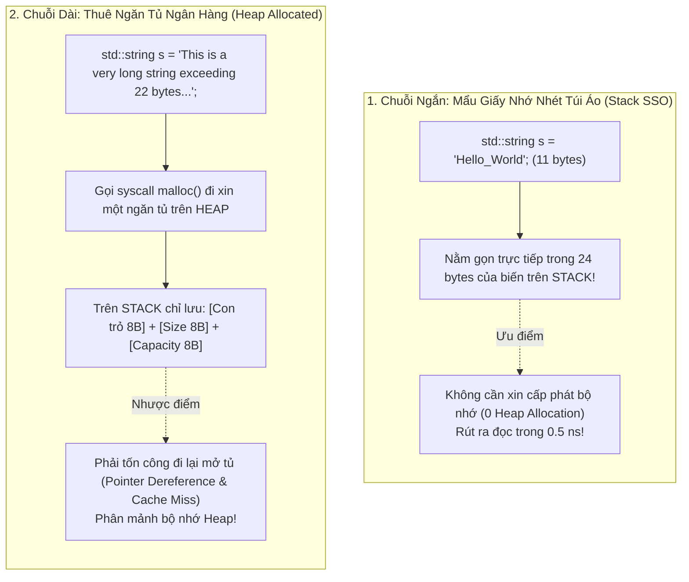
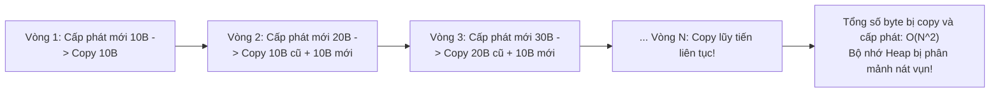

# 2.2. String Representation (Biểu Diễn Chuỗi Ký Tự Trong Bộ Nhớ)

> [!IMPORTANT]
> **Tuyên ngôn Cốt lõi**: Chuỗi ký tự (String) trong kỹ thuật phần mềm hiện đại không đơn thuần là một mảng byte trần trụi với ký tự kết thúc `\0` (Null-Terminated), mà là một cấu trúc dữ liệu phức tạp đánh đổi giữa quản lý vòng đời bộ nhớ (Stack SSO vs Heap Buffer), an toàn phân luồng (Immutability), và tốc độ truy cập. Phép cộng chuỗi ngây thơ trong vòng lặp gây thảm họa suy thoái hiệu năng $O(n^2)$ và bão phân mảnh Heap; trong khi đó, kỹ thuật **Small String Optimization (SSO)** và **Zero-Copy String View (`std::string_view` / `&str`)** là chìa khóa vàng giúp các hệ thống backend đạt hàng triệu throughput mỗi giây mà không sinh rác bộ nhớ.

---

## 1. Trực Quan Hóa: Bản Chất Chuỗi Ký Tự Dưới Góc Nhìn Lập Trình Viên

Mục tiêu của phần này là giúp bạn hiểu tại sao chuỗi ngắn lại chạy nhanh gấp 10 lần chuỗi dài, tại sao phép cộng chuỗi `s += item` trong vòng lặp lại bị các Senior Engineer coi là "tội đồ hiệu năng", và cách Redis thiết kế chuỗi để phục vụ hàng triệu request mỗi giây.

---

### 1.1. Ẩn Dụ Chiếc Giấy Nhớ Túi Áo và Ngăn Tủ Ngân Hàng (SSO vs Heap)

Hãy hình dung việc bạn lưu một mẩu thông tin trong đời thực:



* **Small String Optimization (SSO - Tối ưu hóa chuỗi ngắn)**: Thống kê cho thấy hơn $75\%$ chuỗi ký tự trong backend (tên biến, HTTP headers, mã lỗi, UUID) đều rất ngắn (dưới 15-22 ký tự). Thay vì tốn công xin cấp phát động trên Heap, các trình biên dịch hiện đại (GCC, Clang, MSVC) nhét trực tiếp dữ liệu vào ngay bên trong struct của chuỗi nằm trên **Stack**.
* **Hiệu quả**: Không tốn một lần gọi `malloc`/`free` nào, giải phóng áp lực cho hệ điều hành và tăng tốc độ đọc dữ liệu lên mức tối đa!

---

### 1.2. Chuỗi Kết Thúc Bằng `\0` (C-Style) vs Chuỗi Có Tiền Tố Độ Dài (Pascal / Redis SDS)

Tại sao Redis – một cơ sở dữ liệu in-memory siêu tốc – lại không dùng chuỗi `char*` có sẵn của ngôn ngữ C mà phải tự chế ra kiểu chuỗi **SDS (Simple Dynamic String)**?

```
Chuỗi C-Style (Null-Terminated):
  ['H'] ['e'] ['l'] ['l'] ['o'] ['\0']
  ▲                               ▲
  Đầu                             Phải duyệt từng byte để tìm kết thúc (strlen = O(N)!)

Chuỗi Redis SDS (Length-Prefixed):
  [ len: 5 | alloc: 8 | flags ] ['H'] ['e'] ['l'] ['l'] ['o'] ['\0']
  ▲                             ▲
  Đọc ngay độ dài O(1)         Dữ liệu an toàn nhị phân (chứa được cả byte \0 ở giữa)
```

1. **Chuỗi C cổ điển (`char*`)**: Phải quét qua từng byte đến khi gặp `\0` mới biết chuỗi dài bao nhiêu $\implies$ Hàm đo độ dài tốn thời gian **$O(N)$**. Nếu chuỗi chứa byte `\0` ở giữa (ví dụ dữ liệu ảnh hay file nén), nó sẽ bị cắt cụt tức thì (Không an toàn nhị phân - Not Binary Safe).
2. **Chuỗi có độ dài ở đầu (Redis SDS)**: Lưu trước kích thước `len` trong header $\implies$ Lấy độ dài trong **$O(1)$**, chứa được mọi loại dữ liệu nhị phân thô, và tương thích ngược với các hàm C chuẩn.

---

### 1.3. Thảm Họa Nối Chuỗi Ngây Thơ: Tại Sao `s += item` Trong Vòng Lặp Lại Đạt Độ Phức Tạp $O(N^2)$?

Trong hầu hết các ngôn ngữ hiện đại (Python, Java, JavaScript, C#, Go), đối tượng `String` là **Bất biến (Immutable)**. Một khi đã tạo ra, nội dung của nó trên Heap không bao giờ được phép sửa đổi.

Hãy nhìn vào đoạn mã ngây thơ sau:
```python
s = ""
for item in list_of_10000_items:
    s += item # NGUY HIỂM TỘT ĐỘ!
```



* Ở mỗi vòng lặp, hệ thống **không sửa chuỗi cũ** mà phải tạo một vùng nhớ mới to hơn, rồi **copy toàn bộ nội dung cũ sang**.
* Với 10,000 phần tử, CPU phải thực hiện hàng chục triệu thao tác copy thừa thãi!
* **Quy tắc vàng**: Luôn dùng các bộ đệm có khả năng mở rộng kích thước như `StringBuilder` (Java), `strings.Builder` (Go), `io.StringIO` / `''.join()` (Python), hoặc gọi `str.reserve()` (C++) để giảm độ phức tạp về $O(N)$ tuyến tính.

---

### 1.4. String Interning: Kỹ Thuật Tiết Kiệm Hàng Gigabyte RAM

Trong một hệ thống thương mại điện tử, bạn có thể tải về $1{,}000{,}000$ đơn hàng từ database. Mỗi đơn hàng đều có trường trạng thái là chuỗi `"COMPLETED"`.
* Nếu tạo 1 triệu chuỗi độc lập: Bạn lãng phí hàng chục Megabyte RAM cho cùng một từ giống hệt nhau.
* **String Interning (Mẫu thiết kế Flyweight)**: Hệ thống duy trì một bảng băm toàn cục (**String Pool**). 
  * Khi gặp chuỗi `"COMPLETED"`, nó kiểm tra trong Pool.
  * Toàn bộ 1 triệu đơn hàng sẽ **dùng chung một địa chỉ con trỏ duy nhất** trỏ tới từ `"COMPLETED"` này!
  * **Hệ quả kỳ diệu**: So sánh hai chuỗi giờ đây không cần so từng ký tự ($O(N)$), mà chỉ cần so sánh hai địa chỉ con trỏ bằng một lệnh CPU duy nhất: `ptr1 == ptr2` ($O(1)$ cycle)!

---

### 1.5. Vũ Khí Tối Thượng: Zero-Copy String View (`std::string_view` / `&str`)

Khi bạn viết một hàm nhận tham số chuỗi chỉ để đọc:
```cpp
// Cách cũ: Sao chép cả chuỗi (Copy Allocation)
void parse_header(std::string header); 

// Chuẩn hiện đại: Fat Pointer 16 bytes (Zero-Copy)
void parse_header(std::string_view header); 
```

`std::string_view` (hoặc `&str` trong Rust) là một **Fat Pointer** cực kỳ thanh mảnh gồm đúng 2 trường:
1. `const char* data` (8 bytes): Trỏ tới byte đầu tiên của đoạn văn bản cần xem.
2. `size_t length` (8 bytes): Độ dài của đoạn đó.

Nó không hề sở hữu hay sao chép dữ liệu. Bạn có thể cắt nhỏ một chuỗi 1GB thành hàng triệu chuỗi con với **chi phí bộ nhớ bằng đúng $0$ bytes**!

---

## 2. Chi tiết từng Keyword (Under-the-Hood Deep Dive)

### 2.1. Null-Terminated String (C-Style) vs Length-Prefixed String (Pascal / Redis SDS)
- **C-Style String (`char*`)**: Chuỗi kết thúc bằng `\0`. Tiết kiệm bộ nhớ trong quá khứ nhưng tốn $O(n)$ để lấy độ dài, không an toàn nhị phân, và tiềm ẩn nguy cơ tràn bộ đệm (Buffer Overflow) với các hàm nguy hiểm như `strcpy`, `strcat`.
- **Redis Simple Dynamic String (SDS)**: Sử dụng header chứa độ dài thực tế (`len`), dung lượng đã cấp (`alloc`), và cờ phân loại (`flags`). Header được đóng gói chặt chẽ bằng `__attribute__((__packed__))` để con trỏ SDS có thể truyền trực tiếp vào các hàm C tiêu chuẩn mà không cần chuyển đổi.

### 2.2. Cơ Chế Small String Optimization (SSO)
- Trình biên dịch sử dụng cấu trúc **Tagged Union** có kích thước cố định trên Stack (24 bytes trên Clang/GCC, 32 bytes trên MSVC).
- Khi chuỗi có độ dài nằm trong ngưỡng SSO (thường $\le 15$ hoặc $\le 22$ ký tự), toàn bộ dữ liệu ký tự được nhồi trực tiếp vào mảng buffer của struct trên Stack. Chỉ khi chuỗi vượt ngưỡng, nó mới gọi `malloc` để đưa dữ liệu lên Heap.

### 2.3. Cấu Trúc ConsString / Rope Strings Trong V8 Engine
- Để tối ưu hóa phép nối chuỗi trong JavaScript, engine V8 (Node.js/Chrome) không sao chép byte ngay lập tức mà tạo một cấu trúc cây nhị phân gọi là **ConsString** chứa 2 con trỏ `left` và `right`.
- Phép nối chuỗi hoàn thành trong $O(1)$. Cây này chỉ được "làm phẳng" (Flattening) thành một mảng byte liên tục khi có thao tác truy cập ngẫu nhiên hoặc xuất chuỗi.

---

## 3. Thực Thi Mã Nguồn & Mô Phỏng Chuyên Sâu (Dual-Engine Implementation)

### 3.1. C++20: Phẫu Thuật Vùng Nhớ SSO & Triển Khai Redis Mini-SDS

```cpp
// string_mechanics_lab.cpp
// Biên dịch: g++ -std=c++20 -O3 -Wall -Wextra string_mechanics_lab.cpp -o string_lab
#include <iostream>
#include <string>
#include <string_view>
#include <cstdint>
#include <cstring>
#include <memory>
#include <vector>
#include <format>
#include <chrono>

// 1. Cấu trúc mô phỏng Redis Simple Dynamic String (Mini-SDS)
struct __attribute__((__packed__)) MiniSDSHeader {
    uint8_t len;   // 1 byte độ dài
    uint8_t alloc; // 1 byte dung lượng đã cấp
    char buf[];    // Flexible Array Member
};

class MiniSDS {
private:
    char* s_;

public:
    explicit MiniSDS(const char* init) {
        size_t l = std::strlen(init);
        void* mem = ::operator new(sizeof(MiniSDSHeader) + l + 1);
        auto* hdr = static_cast<MiniSDSHeader*>(mem);
        hdr->len = static_cast<uint8_t>(l);
        hdr->alloc = static_cast<uint8_t>(l);
        std::memcpy(hdr->buf, init, l + 1);
        s_ = hdr->buf; // Con trỏ trỏ trực tiếp vào vùng đệm ký tự
    }

    ~MiniSDS() {
        auto* hdr = reinterpret_cast<MiniSDSHeader*>(s_ - sizeof(MiniSDSHeader));
        ::operator delete(hdr);
    }

    size_t length() const {
        const auto* hdr = reinterpret_cast<const MiniSDSHeader*>(s_ - sizeof(MiniSDSHeader));
        return hdr->len; // Lấy độ dài O(1)
    }

    const char* c_str() const { return s_; }
};

int main() {
    std::cout << "=========================================================\n";
    std::cout << "  C++20 STRING ARCHITECTURE & SSO DISSECTION LAB         \n";
    std::cout << "=========================================================\n";
    std::cout << "sizeof(std::string) trên Stack: " << sizeof(std::string) << " bytes\n\n";

    // 1. Kiểm thử Small String Optimization (SSO)
    std::string s_short = "Hello_SSO_15";
    std::cout << "--- 1. CHUỖI NGẮN (DƯỚI NGƯỠNG SSO) ---\n";
    std::cout << "Chuỗi: '" << s_short << "' | Size: " << s_short.size() << " | Capacity: " << s_short.capacity() << "\n";
    std::cout << "Địa chỉ đối tượng trên Stack: " << (void*)&s_short << "\n";
    std::cout << "Địa chỉ dữ liệu data():       " << (void*)s_short.data() << "\n";
    if ((void*)&s_short == (void*)s_short.data() || 
        std::abs((char*)&s_short - s_short.data()) < (long)sizeof(std::string)) {
        std::cout << "-> XÁC NHẬN: Dữ liệu nằm hoàn toàn trên STACK (SSO Kích hoạt, 0 Heap)!\n";
    }

    // 2. Kiểm thử Heap Allocated String
    std::string s_long = "Day la mot chuoi ky tu rat dai vuot qua nguong SSO 22 bytes...";
    std::cout << "\n--- 2. CHUỖI DÀI (VƯỢT NGƯỠNG SSO) ---\n";
    std::cout << "Chuỗi: '" << s_long.substr(0, 30) << "...' | Size: " << s_long.size() << " | Cap: " << s_long.capacity() << "\n";
    std::cout << "Địa chỉ đối tượng trên Stack: " << (void*)&s_long << "\n";
    std::cout << "Địa chỉ dữ liệu data():       " << (void*)s_long.data() << " (Nằm trên HEAP!)\n";

    // 3. Khảo sát Mini-SDS (Redis Pattern)
    MiniSDS sds("Redis_High_Performance_SDS");
    std::cout << "\n--- 3. REDIS LENGTH-PREFIXED SDS ---\n";
    std::cout << "Nội dung: " << sds.c_str() << " | Độ dài lấy trong O(1): " << sds.length() << " bytes\n";

    return 0;
}
```

---

### 3.2. Python 3.11+: Khảo Sát String Interning & So Sánh Tốc Độ Nối Chuỗi

```python
#!/usr/bin/env python3
# string_interning_bench.py
import sys
import time

def benchmark_concatenation(n: int = 50000):
    print(f"\n--- SO SÁNH HIỆU NĂNG NỐI CHUỖI ({n} PHẦN TỬ) ---")
    
    # Cách 1: Nối chuỗi ngây thơ bằng += (O(N^2))
    start = time.perf_counter()
    s = ""
    for _ in range(n):
        s += "a"
    t_naive = time.perf_counter() - start
    print(f"1. Naive Concatenation (+=)  : {t_naive * 1000:8.2f} ms")

    # Cách 2: Dùng list append và join (O(N))
    start = time.perf_counter()
    chunks = []
    for _ in range(n):
        chunks.append("a")
    s_fast = "".join(chunks)
    t_join = time.perf_counter() - start
    print(f"2. List Append & ''.join()   : {t_join * 1000:8.2f} ms")
    print(f"-> Tốc độ tăng tốc: {t_naive / t_join:5.1f} lần!")

if __name__ == "__main__":
    print("=== KHẢO SÁT STRING INTERNING TRONG PYTHON 3.11+ ===")

    # 1. Tự động Interning các định danh hợp lệ
    s1 = "system_status_ok"
    s2 = "system_status_ok"
    print(f"s1 is s2 (Tự động Interning) : {s1 is s2} | Địa chỉ ô nhớ: {hex(id(s1))}")

    # 2. Chuỗi động không được intern tự động
    d1 = "".join(["token", "_", "user"])
    d2 = "".join(["token", "_", "user"])
    print(f"d1 == d2 (Bằng giá trị)      : {d1 == d2}")
    print(f"d1 is d2 (Cùng ô nhớ?)       : {d1 is d2} (Khác ô nhớ trên Heap!)")

    # 3. Ép buộc Interning bằng sys.intern
    i1 = sys.intern(d1)
    i2 = sys.intern(d2)
    print(f"Sau sys.intern() (Cùng ô nhớ): {i1 is i2} | Địa chỉ ô nhớ: {hex(id(i1))}")

    benchmark_concatenation(100000)
```

---

## 4. Systems Engineering & Production Pitfalls

### 4.1. Thảm Họa Tràn Bộ Nhớ Metaspace Do Lạm Dụng `String.intern()`
- **Cảnh báo**: Tuyệt đối không bao giờ gọi `String.intern()` trên các chuỗi ngẫu nhiên do người dùng nhập (User-Generated Content, JWT Token, UUID, Email). 
- Vì String Pool là một GC Root có vòng đời vô tận, hàng triệu chuỗi rác nạp vào sẽ không bao giờ được Garbage Collector thu hồi, gây lỗi chết người:
  ```text
  java.lang.OutOfMemoryError: Metaspace
  ```
- Chỉ intern các chuỗi có tập giá trị hữu hạn, cố định (Enum values, status strings, country codes).

### 4.2. Cạm Bẫy Con Trỏ Lơ Lửng Với `std::string_view` (Dangling View)
- Không bao giờ trả về `std::string_view` tham chiếu tới một chuỗi tạm thời trong hàm:
  ```cpp
  std::string_view get_bad_string() {
      std::string temp = "Temporary String";
      return temp; // LỖI NGUY HIỂM: temp bị hủy ngay khi thoát hàm!
  }
  ```
  Con trỏ bên trong `string_view` sẽ trỏ tới vùng nhớ rác trên Stack, gây lỗi `Segmentation Fault` khi truy cập.

---

## 5. Bảng So Sánh & Decision Matrix

| Định Dạng Chuỗi | Cơ Chế Bộ Nhớ | Độ Phức Tạp Lấy Độ Dài | An Toàn Nhị Phân | Khả Năng Sửa Đổi (Mutability) | Chi Phí Cắt Chuỗi Con (Substr) | Ứng Dụng Tối Ưu |
| :--- | :--- | :--- | :--- | :--- | :--- | :--- |
| **C-Style (`char*`)** | Null-terminated byte array | $O(n)$ | Không | Mutable | $O(k)$ (Deep copy) | Tương tác OS Kernel, driver C nhúng. |
| **Redis SDS** | Length-prefixed packed struct | $O(1)$ | Có ($100\%$) | Mutable | $O(k)$ hoặc zero-copy | In-memory database, cache server siêu tốc. |
| **C++ `std::string`** | Hybrid: Stack SSO + Heap dynamic | $O(1)$ | Có | Mutable | $O(k)$ (Copy) | Ứng dụng hệ thống hiệu năng cao, Game Engines. |
| **`std::string_view`** | Fat Pointer: `(const char*, len)` | $O(1)$ | Có | Immutable | $O(1)$ (Zero-Copy) | Tham số hàm chỉ đọc, HTTP parser, lexer. |
| **Java / Python `str`**| Immutable Object Heap + Hash cache | $O(1)$ | Có | Immutable | $O(1)$ / $O(k)$ | Backend REST API, Microservices an toàn đa luồng. |
| **Rust `&str` / `String`**| `String` (Owner), `&str` (Slice view)| $O(1)$ | Có (Bảo đảm UTF-8) | `String`: Mutable, `&str`: Immutable| $O(1)$ (Zero-copy slice) | Lập trình hệ thống hiện đại, an toàn bộ nhớ tuyệt đối. |

---

## 6. Enterprise Production Checklist & Verification

- [ ] **Rà Soát Phép Nối Chuỗi Vòng Lặp**: Đã thay thế toàn bộ phép `+=` trong vòng lặp bằng `StringBuilder` (Java), `strings.Builder` (Go) hoặc `reserve()` (C++).
- [ ] **Bảo Vệ String Pool Khỏi Dữ Liệu Rác**: Đảm bảo không gọi `String.intern()` trên các giá trị do người dùng truyền vào (User IDs, Tokens, Emails).
- [ ] **Kiểm Tra Vòng Đời `std::string_view`**: Bật cờ cảnh báo biên dịch `-Wdangling-gsl` (Clang) hoặc `-Wreturn-local-addr` (GCC) để ngăn chặn việc trả về string view trỏ tới đối tượng tạm thời.
- [ ] **Tận Dụng Tối Đa SSO**: Thiết kế các trường định danh thường dùng (như Error Codes, Type Tags) có độ dài nằm gọn trong 15-22 bytes để hưởng lợi từ $0$ heap allocation của SSO.
