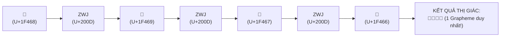

# 2.3. Advanced Text Representation (Biểu Diễn Văn Bản Nâng Cao: Grapheme, Chuẩn Hóa & Đa Ngữ)

> [!IMPORTANT]
> **Tuyên ngôn Cốt lõi**: Ký tự mà mắt người nhìn thấy trên màn hình (**Grapheme Cluster**) hoàn toàn không tương đương với một byte, một phần tử mảng hay một Code Point nhị phân. Hai chuỗi ký tự hiển thị giống hệt nhau từng pixel vẫn có thể khiến phép so sánh nhị phân `str1 == str2` thất bại nếu một chuỗi ở dạng tổ hợp (**NFD**) và chuỗi kia ở dạng dựng sẵn (**NFC**). Trong kỹ nghệ phần mềm backend, bắt buộc phải chuẩn hóa toàn bộ dữ liệu đầu vào về dạng **Unicode NFC** tại tầng API Gateway, sử dụng thuật toán Case Folding thay vì `toLowerCase()` cho authentication tokens, và dùng bộ phân đoạn Grapheme để tránh xé toạc các emoji phức hợp.

---

## 1. Trực Quan Hóa: Bản Chất Văn Bản Nâng Cao Dưới Góc Nhìn Lập Trình Viên

Mục tiêu của phần này là giúp bạn hiểu tại sao một icon gia đình đơn giản lại ngốn tới 25 bytes bộ nhớ, tại sao hai chuỗi tiếng Việt giống hệt nhau nhưng so sánh lại báo `false`, và cách hacker dùng ký tự Cyrillic để tạo ra tên miền lừa đảo hoàn hảo.

---

### 1.1. Ẩn Dụ Khối Xếp Hình Lego: Icon `👨‍👩‍👧‍👦` Thực Chất Là Gì?

Hãy tưởng tượng bạn đang ghép một mô hình Lego:
* Bạn có khối hình người đàn ông (`👨`), người phụ nữ (`👩`), bé gái (`👧`), và bé trai (`👦`).
* Để gắn chúng lại thành một khối tượng duy nhất, bạn dùng một loại keo dính đặc biệt trong suốt gọi là **Zero Width Joiner (ZWJ - `U+200D`)**.



#### Hệ quả kinh ngạc về mặt kỹ thuật phần mềm:
* **Mắt người nhìn**: Thấy đúng **1 hình vẽ gia đình (1 Grapheme Cluster)**.
* **Tổ chức Unicode tính**: Gồm **7 Code Points** riêng biệt ghép lại.
* **JavaScript / Java đo (`.length`)**: Báo độ dài là **11 Code Units**!
* **Dung lượng RAM thực tế trong UTF-8**: Ngốn tới **25 Bytes**!
* **Cạm bẫy**: Nếu bạn dùng hàm cắt chuỗi ngây thơ `text.slice(0, 2)` để lấy ký tự đầu tiên, bạn đã dùng kéo cắt đứt liên kết ZWJ, biến icon gia đình thành một người đàn ông đứng cạnh những ô vuông lỗi font gớm ghiếc!

---

### 1.2. Bốn Tầng Phân Cấp Văn Bản: Từ Điện Áp Đến Mắt Người

Để không bao giờ viết code sinh bug khi xử lý văn bản quốc tế, bạn phải phân biệt rạch ròi 4 tầng:

```
[Tầng 4: Grapheme Cluster]  -> Ký tự hoàn chỉnh mắt người nhìn thấy ('é', '👨‍👩‍👧')
           ▲
[Tầng 3: Code Point]        -> Mã số định danh Unicode (U+00E9 hoặc U+0065 + U+0301)
           ▲
[Tầng 2: Code Unit]         -> Kích thước từ mã (1 byte trong UTF-8, 2 bytes trong UTF-16)
           ▲
[Tầng 1: Physical Bytes]    -> Chuỗi bit vật lý 0 và 1 trên thanh RAM
```

---

### 1.3. Cơn Ác Mộng Chuẩn Hóa: Tại Sao `str1 == str2` Lại Bằng `FALSE`?

Hãy thử một thí nghiệm thú vị: Một người dùng gõ chữ `tiếng` trên máy Mac, và một người khác gõ chữ `tiếng` trên máy Windows. Mắt thường nhìn hai chữ này giống hệt nhau $100\%$, nhưng khi lưu vào database và so sánh:
```javascript
mac_str === win_str // KẾT QUẢ: FALSE!
```

#### Tại sao lại như vậy?
Unicode cho phép biểu diễn chữ có dấu theo hai trường phái:
1. **Dạng Dựng Sẵn (NFC - Precomposed)**: Ký tự `'é'` được lưu bằng đúng **1 Code Point duy nhất** (`U+00E9`).
2. **Dạng Tổ Hợp (NFD - Decomposed)**: Ký tự `'é'` bị tách thành **2 Code Points riêng biệt**: Chữ `'e'` (`U+0065`) đứng trước, theo sau là chiếc dấu sắc "lơ lửng" Combining Acute Accent (`U+0301`).

```
  Dạng NFC (Windows / Linux):    ['é']               (U+00E9)           -> 2 bytes UTF-8
  Dạng NFD (macOS HFS+ File):    ['e'] + ['´']       (U+0065 + U+0301)  -> 3 bytes UTF-8
```

Do các byte nhị phân trong RAM khác nhau hoàn toàn, các câu lệnh so sánh `==` hoặc câu truy vấn SQL `WHERE username = '...'` sẽ thất bại thảm hại!
* **Quy tắc vàng Backend**: **Mọi chuỗi văn bản đầu vào tại API Gateway bắt buộc phải chạy qua hàm chuẩn hóa `str.normalize('NFC')` trước khi lưu vào Database.**

---

### 1.4. Lỗ Hổng Bảo Mật Kỳ Quái "The Turkish 'I' Problem"

Nhiều lập trình viên có thói quen viết:
```java
// Kiểm tra quyền Admin nguy hiểm:
if (user.getRole().toLowerCase().equals("admin")) {
    grantSuperuserAccess();
}
```

* Trong bảng chữ cái tiếng Thổ Nhĩ Kỳ, chữ `I` in hoa khi chuyển thành chữ thường không phải là chữ `i` có chấm, mà là **chữ `ı` không có chấm (`U+0131`)**!
* Nếu máy chủ backend của bạn vô tình chạy trên hệ điều hành cài đặt vùng ngôn ngữ Thổ Nhĩ Kỳ (`tr-TR`):
  `"ADMIN".toLowerCase()` sẽ biến thành `"admın"`!
* Phép so sánh với `"admin"` trả về `false`, và toàn bộ hệ thống bị tê liệt quyền quản trị viên!
* **Quy tắc**: Tuyệt đối không dùng `toLowerCase()` cho các chuỗi logic phân quyền hoặc xác thực. Luôn dùng **Unicode Case Folding** không phụ thuộc Locale (`toLowerCase(Locale.ROOT)`).

---

### 1.5. Tấn Công Thị Giác IDN Homograph Attack: Tên Miền Giả Mạo `pаypаl.com`

Kẻ tấn công có thể đăng ký tên miền lừa đảo `pаypаl.com`.
* Trong đó, chữ cái `'а'` không phải là chữ cái Latin thông thường (`U+0061`), mà là **chữ cái tiếng Nga Cyrillic Small Letter A (`U+0430`)**.
* Trên thanh địa chỉ của trình duyệt, hai ký tự này hiển thị giống hệt nhau từng pixel! Người dùng tưởng mình đang ở trên trang PayPal thật và thản nhiên nhập mật khẩu ngân hàng.
* **Giải pháp phần cứng & DNS**: Hệ thống mạng quốc tế tự động chuyển các tên miền chứa ký tự lạ sang định dạng **Punycode**: `xn--pypal-4ve.com` để lập tức vạch trần kẻ lừa đảo.

---

## 2. Chi tiết từng Keyword (Under-the-Hood Deep Dive)

### 2.1. 4 Tầng Phân Cấp Văn Bản: Byte, Code Unit, Code Point & Grapheme Cluster
1. **Byte (Octet)**: Đơn vị đo lường lưu trữ vật lý ($8\text{ bits}$).
2. **Code Unit (Đơn vị mã)**: Kích thước khối cơ sở của bảng mã ($8\text{-bit}$ trong UTF-8, $16\text{-bit}$ trong UTF-16).
3. **Code Point (Điểm mã)**: Giá trị số nguyên trong dải `U+0000` đến `U+10FFFF`.
4. **Grapheme Cluster (Cụm ký tự đồ họa)**: Khối văn bản nhỏ nhất mắt người nhận diện là một ký tự độc lập.

### 2.2. Zero Width Joiner (ZWJ) & Bảng Màu Da Fitzpatrick
- **ZWJ (`U+200D`)**: Ký tự điều khiển tàng hình yêu cầu Text Shaper kết hợp các ký tự lân cận thành Ligature.
- **Fitzpatrick Modifiers (`U+1F3FB` - `U+1F3FF`)**: Mã đổi tông màu da theo 5 cấp độ sinh học, kết hợp với các emoji cử chỉ tay hoặc khuôn mặt.

### 2.3. Bốn Chuẩn Hóa Unicode Theo UAX #15 (NFC, NFD, NFKC, NFKD)
1. **NFD**: Phân rã toàn bộ ký tự dựng sẵn thành ký tự cơ sở + dấu kết hợp.
2. **NFC**: Phân rã rồi tái tổ hợp tối đa thành ký tự dựng sẵn (**Chuẩn trao đổi Web và API quốc tế**).
3. **NFKD**: Phân rã tương thích (biến cả các ký tự thẩm mỹ như số mũ $2^5 \to 2$ và $5$).
4. **NFKC**: Phân rã tương thích rồi tái tổ hợp tối đa (dùng để làm sạch dữ liệu đầu vào chống tấn công Homograph).

---

## 3. Thực Thi Mã Nguồn & Mô Phỏng Chuyên Sâu (Dual-Engine Implementation)

### 3.1. C++20: Quét Code Point & Nhận Diện Ký Tự Tổ Hợp ZWJ

```cpp
// unicode_text_lab.cpp
// Biên dịch: g++ -std=c++20 -O3 -Wall -Wextra unicode_text_lab.cpp -o unicode_lab
#include <iostream>
#include <string>
#include <string_view>
#include <vector>
#include <iomanip>
#include <format>

struct UnicodeCodePoint {
    uint32_t value;
    size_t byte_length;
    bool is_combining_mark;
    bool is_zwj;
};

// Quét và giải mã điểm mã Unicode từ chuỗi UTF-8
std::vector<UnicodeCodePoint> parse_utf8_sequence(std::string_view utf8_str) {
    std::vector<UnicodeCodePoint> result;
    const uint8_t* ptr = reinterpret_cast<const uint8_t*>(utf8_str.data());
    size_t len = utf8_str.size();
    size_t i = 0;

    while (i < len) {
        uint8_t b0 = ptr[i];
        uint32_t cp = 0;
        size_t bytes = 0;

        if ((b0 & 0x80) == 0) {
            cp = b0;
            bytes = 1;
        } else if ((b0 & 0xE0) == 0xC0 && i + 1 < len) {
            cp = ((b0 & 0x1F) << 6) | (ptr[i + 1] & 0x3F);
            bytes = 2;
        } else if ((b0 & 0xF0) == 0xE0 && i + 2 < len) {
            cp = ((b0 & 0x0F) << 12) | ((ptr[i + 1] & 0x3F) << 6) | (ptr[i + 2] & 0x3F);
            bytes = 3;
        } else if ((b0 & 0xF8) == 0xF0 && i + 3 < len) {
            cp = ((b0 & 0x07) << 18) | ((ptr[i + 1] & 0x3F) << 12) | ((ptr[i + 2] & 0x3F) << 6) | (ptr[i + 3] & 0x3F);
            bytes = 4;
        } else {
            bytes = 1; // Fallback byte lỗi
        }

        bool is_combining = (cp >= 0x0300 && cp <= 0x036F);
        bool is_zwj = (cp == 0x200D);

        result.push_back({cp, bytes, is_combining, is_zwj});
        i += bytes;
    }
    return result;
}

int main() {
    std::cout << "=========================================================\n";
    std::cout << "  C++20 UNICODE GRAPHEME & COMBINING MARKS SCANNER       \n";
    std::cout << "=========================================================\n";

    // Khảo sát Emoji gia đình ZWJ
    std::string family_emoji = "👨‍👩‍👧";
    auto codepoints = parse_utf8_sequence(family_emoji);

    std::cout << "Phân tích Emoji Gia Đình: '" << family_emoji << "'\n";
    std::cout << "Tổng dung lượng RAM (Bytes): " << family_emoji.size() << "\n";
    std::cout << "Tổng số Code Points:        " << codepoints.size() << "\n";

    for (size_t idx = 0; idx < codepoints.size(); ++idx) {
        const auto& item = codepoints[idx];
        std::cout << std::format("  [{}] U+{:04X} | {} bytes | ZWJ={}\n",
                                 idx, item.value, item.byte_length, item.is_zwj);
    }

    return 0;
}
```

---

### 3.2. TypeScript: Kiểm Thử Chuẩn Hóa NFC vs NFD & Phân Đoạn Grapheme An Toàn

```typescript
// unicode_normalization.ts
// Chạy: npx ts-node unicode_normalization.ts

// 1. Thí nghiệm NFC vs NFD trên tiếng Việt
const str_nfc = "tiếng"; // Dạng dựng sẵn (NFC)
const str_nfd = str_nfc.normalize("NFD"); // Dạng tổ hợp (NFD)

console.log("=== 1. THÍ NGHIỆM CHUẨN HÓA NFC VS NFD ===");
console.log(`NFC: '${str_nfc}' | Length (.length): ${str_nfc.length}`); // 5
console.log(`NFD: '${str_nfd}' | Length (.length): ${str_nfd.length}`); // 7 (chứa 2 dấu phụ độc lập!)
console.log(`So sánh nhị phân thô (str_nfc === str_nfd): ${str_nfc === str_nfd}`); // FALSE!
console.log(`So sánh sau chuẩn hóa NFC: ${str_nfc.normalize("NFC") === str_nfd.normalize("NFC")}`); // TRUE!

// 2. Cắt chuỗi Emoji ZWJ an toàn bằng Intl.Segmenter
const family = "👨‍👩‍👧‍👦";
console.log("\n=== 2. CẮT CHUỖI EMOJI PHỨC HỢP ===");
console.log(`Cắt ngây thơ bằng slice(0, 2): '${family.slice(0, 2)}' (BỊ VỠ HÌNH!)`);

// Dùng bộ phân đoạn Grapheme chuẩn Unicode (UAX #29)
const segmenter = new Intl.Segmenter("en", { granularity: "grapheme" });
const segments = Array.from(segmenter.segment(family));
console.log(`Số lượng Grapheme Cluster thực tế: ${segments.length}`); // ĐÚNG 1!
console.log(`Ký tự đầu tiên lấy an toàn: '${segments[0].segment}'`);
```

---

## 4. Systems Engineering & Production Pitfalls

### 4.1. Lỗ Hổng Trùng Lặp Khóa Cơ Sở Dữ Liệu Do Bất Đồng NFC / NFD
- **Sự cố thực tế**: Người dùng A đăng ký bằng máy Mac (gửi dạng NFD: `"nguyễn"`), người dùng B đăng ký trên Windows (gửi dạng NFC: `"nguyễn"`). Vì database so sánh byte nhị phân thô, cả hai tài khoản đều vượt qua ràng buộc `UNIQUE`!
- **Biện pháp**: Bắt buộc chuẩn hóa mọi chuỗi đầu vào về **NFC** tại tầng API Gateway trước khi ghi vào Database.

### 4.2. Cắt Vỡ Vụn Cụm Grapheme Khi Phân Trang
- Không bao giờ dùng `str.substring()` hay `slice()` để cắt ngắn văn bản chứa Emoji; bắt buộc phải sử dụng `Intl.Segmenter` (JS) hoặc `icu::BreakIterator` (C++/Java) để cắt theo biên của Grapheme Cluster.

---

## 5. Bảng So Sánh & Decision Matrix

| Dạng Chuẩn Hóa | Tên Đầy Đủ | Cơ Chế Xử Lý | Mục Tiêu Chính | Thay Đổi Ngữ Nghĩa Văn Bản? | Môi Trường Khuyến Nghị |
| :--- | :--- | :--- | :--- | :---: | :--- |
| **NFC** | Canonical Decomposition + Composition | Phân rã chuẩn tắc rồi ghép tối đa thành ký tự dựng sẵn. | Giữ nguyên vẹn văn bản, tối ưu hóa dung lượng byte. | **Không** | **Chuẩn trao đổi mặc định: REST API, JSON, SQL Database, Web**. |
| **NFD** | Canonical Decomposition | Tách rời toàn bộ dấu phụ thành các Combining Characters độc lập. | Tách dấu để xử lý ngữ âm, nhận dạng ký tự cơ sở. | **Không** | macOS File System (HFS+), Engine tìm kiếm (Search Tokenizer). |
| **NFKC** | Compatibility Decomposition + Composition | Phân rã cả ký tự thẩm mỹ/biểu tượng rồi ghép lại tối đa. | Làm sạch dữ liệu, đưa các ký tự đặc biệt về dạng gốc. | **Có thể** | Khử trùng dữ liệu đầu vào (Input Sanitization), kiểm tra Username/Password. |
| **NFKD** | Compatibility Decomposition | Tách rời toàn bộ ký tự thẩm mỹ thành các ký tự độc lập hoàn toàn. | Phân tích sâu, trích xuất văn bản thô từ tài liệu OCR/PDF. | **Có thể** | Pipeline Machine Learning xử lý ngôn ngữ tự nhiên (NLP Text Preprocessing). |

---

## 6. Enterprise Production Checklist & Verification

- [ ] **Bảo Đảm Chuẩn Hóa NFC Cổng Vào (API Gateway)**: Mọi payload JSON gửi lên hệ thống đều được tự động chạy qua bộ lọc chuẩn hóa `NFC` trước khi chuyển tới Controller.
- [ ] **Khử Trùng Username / Định Danh Bằng NFKC**: Toàn bộ chuỗi đăng ký định danh người dùng đều được chuẩn hóa bằng NFKC để ngăn chặn tấn công Homograph và giả mạo tài khoản.
- [ ] **Cấm Sử Dụng `toLowerCase()` Cho Token Xác Thực**: Rà soát lại toàn bộ codebase, thay thế các phép so sánh phân quyền nhạy cảm bằng thuật toán Case-Insensitive Collator độc lập Locale để triệt tiêu lỗi Turkish 'I'.
- [ ] **Cắt Chuỗi An Toàn Bằng Grapheme Segmenter**: Tuyệt đối không dùng `substring` hoặc `slice` thô để tóm tắt văn bản chứa Emoji; bắt buộc dùng `Intl.Segmenter` hoặc ICU BreakIterator.
