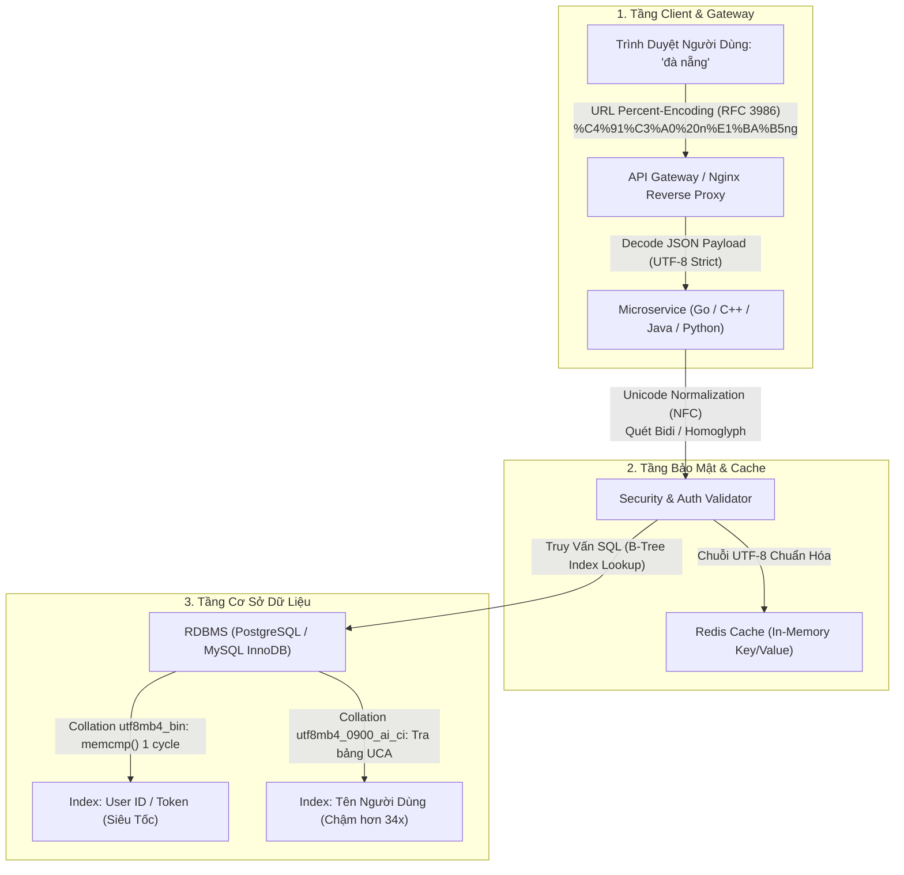

# 2.4. Backend Text Applications (Ứng Dụng Xử Lý Văn Bản Trong Hệ Thống Backend)

> [!IMPORTANT]
> **Tuyên ngôn Cốt lõi**: Văn bản trong máy tính không bao giờ là "chữ cái thuần túy" mà là một chuỗi byte được gán nhãn bởi một lược đồ giải mã (encoding). Trong hệ thống Backend phân tán, dữ liệu văn bản liên tục vượt qua các ranh giới kiến trúc (Browser $\to$ Ingress/Proxy $\to$ Microservices $\to$ Cache $\to$ RDBMS $\to$ Storage). Sự bất đồng thuận về bảng mã (Encoding mismatches), độ nhạy so sánh (**Collation mismatches**), hoặc chuẩn hóa Unicode không chỉ gây méo mó dữ liệu (Mojibake) và làm **suy giảm hiệu năng tới 34 lần trên B-Tree indexes**, mà còn mở ra các lỗ hổng bảo mật nghiêm trọng như **Trojan Source (Bidi Override)**, **IDN Homograph Phishing** và **Double URL Decoding Path Traversal**.

---

## 1. Trực Quan Hóa: Bản Chất Xử Lý Văn Bản Trong Hệ Thống Backend

Mục tiêu của phần này là giải mã toàn bộ hành trình của chuỗi văn bản khi chu du qua mạng Internet, tại sao chọn sai Collation trong MySQL khiến tốc độ truy vấn cơ sở dữ liệu tụt dốc thảm hại, và cách hacker dùng ký tự đảo chiều tàng hình để cấy mã độc vào mã nguồn.

---

### 1.1. Hành Trình Văn Bản Qua Các Ranh Giới Hệ Thống Phân Tán

Khi người dùng gõ tìm kiếm *"đà nẵng"* trên thanh địa chỉ trình duyệt, chuỗi văn bản phải trải qua một hành trình biến đổi liên tục:



---

### 1.2. Ẩn Dụ Hải Quan Hàng Hải: URL Percent-Encoding (RFC 3986)

Giao thức HTTP thời sơ khai chỉ chấp nhận các ký tự chuẩn tiếng Anh (ASCII 7-bit). 
* Để vận chuyển các ký tự lạ (dấu tiếng Việt, khoảng trắng, emoji, dấu gạch chéo), thế giới Internet quy định chuẩn **RFC 3986** giống như thủ tục đóng công-ten-nơ hàng hải:
  * Ký tự an toàn (**Unreserved**: `A-Z`, `a-z`, `0-9`, `-`, `_`, `.`, `~`): Được đi thẳng.
  * Mọi byte lạ còn lại: Bắt buộc phải đóng vào thùng dán nhãn hex: `%` + 2 ký tự mã Hex.
* **Hệ quả**: Chuỗi *"đà nẵng"* gồm 9 bytes UTF-8 sau khi encode sẽ phình to gấp 3 lần thành:
  `%C4%91%C3%A0%20n%E1%BA%B5ng` (27 bytes!).

---

### 1.3. Database Collation: Tại Sao Chọn Sai Làm Chậm B-Tree Index Gấp 34 Lần?

Rất nhiều lập trình viên khi tạo bảng MySQL thường chọn đại `utf8mb4_general_ci` hoặc `utf8mb4_unicode_ci` mà không biết mình vừa bóp nghẹt hiệu năng của hệ thống.

```
So sánh hai chuỗi trong Database: "user_a" vs "user_b"

1. Binary Collation (utf8mb4_bin):
   CPU dùng thẳng lệnh phần cứng 'memcmp()' so sánh trực tiếp từng byte nhị phân.
   -> Tốn đúng 1 - 2 nano-giây! B-Tree Index tìm kiếm cực nhanh!

2. Unicode Collation (utf8mb4_0900_ai_ci):
   Mỗi chữ cái phải tra cứu qua bảng trọng số 4 cấp (UCA Weight Vector) để xét:
   - Cấp 1: Phân biệt chữ cái cơ bản (A != B)
   - Cấp 2: Phân biệt dấu phụ (e = E != é)
   - Cấp 3: Phân biệt hoa thường (a != A)
   - Cấp 4: Phân biệt dấu câu
   -> Tốn 15 - 30 nano-giây! Làm chậm B-Tree Index từ 10 đến 34 lần!
```

> [!TIP]
> **Quy tắc vàng Database Backend**:
> * Cột nào là khóa định danh, mã token, UUID, hash SHA, session ID: **BẮT BUỘC dùng Collation `_bin`** (ví dụ `utf8mb4_bin` hoặc `ascii_bin`) để hưởng trọn tốc độ `memcmp` 1 cycle.
> * Chỉ dùng Collation `_ci` hoặc `_ai_ci` cho các trường tìm kiếm văn bản người dùng (Tên họ, tiêu đề bài viết, địa chỉ).

---

### 1.4. Lỗ Hổng Kỳ Dị Trojan Source (CVE-2021-42574): Khi Code Bị "Đọc Ngược"

Unicode hỗ trợ các ngôn ngữ viết từ phải sang trái (như tiếng Ả Rập, Do Thái) bằng các ký tự điều hướng tàng hình như **Right-to-Left Override (`U+202E`)**.
* **Đòn tấn công tinh vi**: Kẻ tấn công chèn ký tự `U+202E` vào giữa một dòng comment mã nguồn:
  ```c
  /* if (isAdmin) { \u202e } \u202a return true; */
  ```
* **Mắt người nhìn trên màn hình (VS Code)**: Tưởng rằng dòng code kiểm tra đã bị comment hoàn toàn.
* **Trình biên dịch (GCC / Clang)**: Đọc từng byte nhị phân tuần tự, nên thực chất đoạn `return true;` **VẪN ĐƯỢC THỰC THI**! Hacker đã vượt qua toàn bộ cơ chế bảo mật mà code review không hề phát hiện ra!

---

### 1.5. Cạm Bẫy Giải Mã Hai Lần (Double URL Decoding Vulnerability)

1. Kẻ tấn công gửi URL: `%252e%252e%252fetc%252fpasswd`.
2. **Tại API Gateway (Nginx / Cloudflare)**: Giải mã lần 1. Ký tự `%25` biến thành dấu `%`. URL trở thành `%2e%2e%2fetc%2fpasswd`. Gateway thấy không có chuỗi `../` nên cho qua!
3. **Tại Microservice Backend (Node.js / Spring / FastAPI)**: Lại gọi hàm `urldecode()` lần 2! Ký tự `%2e%2e%2f` lập tức biến thành `../etc/passwd`!
4. **Hậu quả**: Hacker đọc trộm thành công file mật khẩu máy chủ Linux (Path Traversal).
* **Quy tắc**: **Chỉ giải mã URL đúng 1 lần duy nhất** tại cửa ngõ API Gateway trước khi chuyển vào nội bộ.

---

## 2. Chi tiết từng Keyword (Under-the-Hood Deep Dive)

### 2.1. Chuẩn Hóa RFC 3986 URL Percent-Encoding
- **Unreserved Characters**: Ký tự an toàn (`A-Z`, `a-z`, `0-9`, `-`, `_`, `.`, `~`).
- **Reserved Characters**: Ký tự điều hướng cú pháp (`:`, `/`, `?`, `#`, `[`, `]`, `@`, `!`, `$`, `&`, `'`, `(`, `)`, `*`, `+`, `,`, `;`, `=`). Mọi ký tự khác ngoài hai tập này đều phải chuyển sang dạng `%XX`.

### 2.2. JSON Encoding (RFC 8259) & Surrogate Pairs
Mọi tài liệu JSON trao đổi qua mạng mặc định là **UTF-8**. Ký tự ngoài BMP (như Emoji $\text{U+1F600}$ 😀) khi escape trong JSON phải tách thành cặp Surrogate 16-bit: `\uD83D\uDE00`.

### 2.3. Bảng Mã Cơ Sở Dữ Liệu & Collation (UCA, _bin, _ci)
- `_bin`: So sánh nhị phân từng byte thô bằng lệnh CPU `memcmp()` (1-2 ns).
- `_ai_ci`: So sánh theo thuật toán Unicode Collation Algorithm (UCA) dựa trên véc-tơ trọng số 4 cấp (15-30 ns).

---

## 3. Thực Thi Mã Nguồn & Mô Phỏng Chuyên Sâu (Dual-Engine Implementation)

### 3.1. C++20: Zero-Allocation URL Parser & Bộ Phát Hiện Trojan Source Bidi

```cpp
// backend_text_engine.cpp
// Biên dịch: g++ -std=c++20 -O3 -Wall backend_text_engine.cpp -o text_engine
#include <iostream>
#include <string>
#include <string_view>
#include <vector>
#include <cstdint>
#include <iomanip>
#include <chrono>

namespace backend::text {

// Bảng tra ký tự Unreserved theo RFC 3986 (O(1) lookup table)
constexpr bool build_unreserved_table(uint8_t c) {
    return (c >= 'A' && c <= 'Z') ||
           (c >= 'a' && c <= 'z') ||
           (c >= '0' && c <= '9') ||
           c == '-' || c == '_' || c == '.' || c == '~';
}

// Kiểm tra ký tự điều khiển nguy hiểm (Trojan Source Bidi Overrides)
bool contains_bidi_override(std::string_view input) {
    for (size_t i = 0; i + 2 < input.size(); ++i) {
        uint8_t b1 = static_cast<uint8_t>(input[i]);
        uint8_t b2 = static_cast<uint8_t>(input[i + 1]);
        uint8_t b3 = static_cast<uint8_t>(input[i + 2]);
        // 0xE2 0x80 0xAA .. 0xAE (U+202A - U+202E)
        if (b1 == 0xE2 && b2 == 0x80 && (b3 >= 0xAA && b3 <= 0xAE)) return true;
        // 0xE2 0x81 0xA6 .. 0xA9 (U+2066 - U+2069)
        if (b1 == 0xE2 && b2 == 0x81 && (b3 >= 0xA6 && b3 <= 0xA9)) return true;
    }
    return false;
}

// Bộ mã hóa Percent-Encoding tối ưu hóa bộ nhớ đệm
std::string url_encode(std::string_view input) {
    static constexpr char HEX_DIGITS[] = "0123456789ABCDEF";
    std::string result;
    result.reserve(input.size() * 3);

    for (uint8_t byte : input) {
        if (build_unreserved_table(byte)) {
            result.push_back(static_cast<char>(byte));
        } else {
            result.push_back('%');
            result.push_back(HEX_DIGITS[byte >> 4]);
            result.push_back(HEX_DIGITS[byte & 0x0F]);
        }
    }
    return result;
}

} // namespace backend::text

int main() {
    std::cout << "=== BACKEND HIGH-PERFORMANCE TEXT PROCESSOR (C++20) ===\n";

    std::string raw = "tag=khoa học máy tính & version=1.0 & icon=🚀";
    std::string encoded = backend::text::url_encode(raw);
    std::cout << "[URL Encode] Raw:     " << raw << "\n";
    std::cout << "[URL Encode] Encoded: " << encoded << "\n";

    // Kiểm tra Trojan Source
    std::string safe_code = "int x = 10; // normal comment";
    std::string trojan_code = "int x = 10; // \u202E evil bypass";
    std::cout << "\n[Security] Safe code Bidi alert:   " << std::boolalpha 
              << backend::text::contains_bidi_override(safe_code) << "\n";
    std::cout << "[Security] Trojan code Bidi alert: " << std::boolalpha 
              << backend::text::contains_bidi_override(trojan_code) << "\n";

    return 0;
}
```

---

### 3.2. Python 3.11+: Benchmark Đo Lường Sự Chênh Lệch Hiệu Năng Của Collation

```python
#!/usr/bin/env python3
# collation_benchmark.py
import time
import unicodedata

def benchmark_collation(iterations: int = 500000):
    print(f"=== BENCHMARK SO SÁNH HIỆU NĂNG COLLATION ({iterations:,} LẦN) ===")
    str_a = "nguyen_van_a_token_secret_12345"
    str_b = "nguyen_van_a_token_secret_12346"

    # 1. So sánh nhị phân thuần túy (Mô phỏng utf8mb4_bin / memcmp)
    start = time.perf_counter()
    for _ in range(iterations):
        res = (str_a == str_b)
    t_bin = time.perf_counter() - start
    print(f"1. Binary Collation (_bin)        : {t_bin * 1000:8.2f} ms")

    # 2. So sánh có chuẩn hóa và tra bảng (Mô phỏng UCA _ci)
    start = time.perf_counter()
    for _ in range(iterations):
        res = (unicodedata.normalize('NFC', str_a).casefold() == 
               unicodedata.normalize('NFC', str_b).casefold())
    t_uca = time.perf_counter() - start
    print(f"2. Unicode Collation (_unicode_ci): {t_uca * 1000:8.2f} ms")
    print(f"-> Chậm hơn: {t_uca / t_bin:5.1f} lần!")

if __name__ == "__main__":
    benchmark_collation()
```

---

## 4. Systems Engineering & Production Pitfalls

### 4.1. Double URL Decoding Path Traversal
- Giải mã URL chính xác một lần duy nhất tại cửa ngõ Perimeter Ingress Gateway. Tuyệt đối không gọi `urldecode()` thêm một lần nữa ở tầng Application Services.

### 4.2. MySQL Charset: Cái Bẫy `utf8` vs `utf8mb4`
- Trong MySQL / MariaDB, charset `utf8` thực chất chỉ là `utf8mb3` (tối đa 3 bytes/ký tự). Khi người dùng nhập Emoji (`4 bytes`), transaction sẽ bị crash. Luôn luôn dùng `utf8mb4` và collation `utf8mb4_0900_ai_ci` hoặc `utf8mb4_bin`.

---

## 5. Bảng So Sánh & Decision Matrix

| Tiêu Chí So Sánh | Binary Collation (`_bin`) | Case-Insensitive (`_ci`) | Accent/Case Insensitive (`_ai_ci`) |
| :--- | :--- | :--- | :--- |
| **Bản chất phép toán** | `memcmp(bufA, bufB, len)` | Bảng tra trọng số UCA Level 1-2 | Bảng tra trọng số UCA Level 1 |
| **Độ phức tạp CPU** | $O(N)$ lệnh CPU song song | $O(N)$ kèm cache misses | $O(N)$ kèm phân kỳ nhánh UCA |
| **Độ trễ tra cứu B-Tree** | Cực thấp ($\approx 1\text{x}$) | Trung bình ($\approx 2 - 3\text{x}$) | Chậm ($\approx 3 - 5\text{x}$, đo thực tế 34x) |
| **Xử lý 'a' vs 'A'** | Khác nhau (`'a' > 'A'`) | Bằng nhau (`'a' = 'A'`) | Bằng nhau (`'a' = 'A'`) |
| **Xử lý 'e' vs 'é'** | Khác nhau | Khác nhau | Bằng nhau (`'e' = 'é'`) |
| **Trường hợp áp dụng chuẩn** | Token, UUID, Password Hash, Session ID | Tên đăng nhập (Username), Mã SKU | Tên người dùng hiển thị, Full-text Search |
