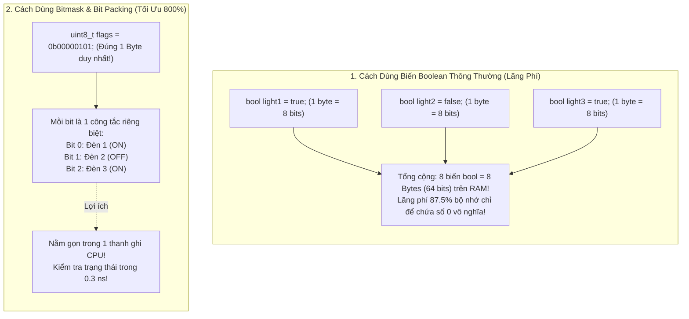

# 3.1. Bit, Byte & Bitwise Manipulation (Thao Tác Dữ Liệu Tầng Bit Cấp Thấp)

> [!IMPORTANT]
> **Tuyên ngôn Cốt lõi**: Thao tác bit (Bitwise Manipulation) là ngôn ngữ giao tiếp trực tiếp với các cổng logic của mạch ALU trong CPU. Thực hiện tính toán bằng phép bitmasking, dịch bit, XOR và các chỉ thị phần cứng tăng tốc (`POPCNT`, `LZCNT`, `TZCNT`) cho phép hoàn thành tác vụ chỉ trong **$1$ chu kỳ xung nhịp clock ($< 0.3\text{ ns}$)**, hoàn toàn loại bỏ phân nhánh điều kiện (Branchless Programming) và **nén mật độ dữ liệu lên tới $800\%$** trong bộ đệm L1 Cache. Luôn ghi nhớ cạm bẫy độ ưu tiên toán tử (`==` cao hơn `&`) và hiện tượng Undefined Behavior khi dịch quá số bit của kiểu dữ liệu.

---

## 1. Trực Quan Hóa: Bản Chất Thao Tác Bit Dưới Góc Nhìn Lập Trình Viên

Mục tiêu của phần này là giải mã lý do tại sao các kỹ sư lập trình nhân Kernel, Game Engine và High-Frequency Trading luôn dùng phép toán bit thay vì `if/else`, các thuật toán "ma thuật" (Bit Twiddling Hacks) vận hành ra sao, và các lỗi ngớ ngẩn về độ ưu tiên toán tử có thể phá hủy logic ứng dụng.

---

### 1.1. Ẩn Dụ Bảng Công Tắc Điện Tường vs Bảng Mạch DIP Switch (Bit Packing)

Hãy tưởng tượng bạn cần lưu trạng thái 8 thiết bị điện trong nhà (Bật/Tắt):



* Trong C/C++/Java/Go, một biến `bool` **không bao giờ chiếm 1 bit**, mà nó luôn chiếm **ít nhất 1 byte ($8\text{ bits}$)** (vì kiến trúc CPU không thể định địa chỉ ô nhớ nhỏ hơn 1 byte).
* **Bit Packing (Đóng gói bit)**: Nhồi 8 cờ boolean vào đúng 1 biến `uint8_t`, hoặc 64 cờ vào 1 biến `uint64_t`. Tiết kiệm tới $800\%$ bộ nhớ RAM và giúp CPU nạp toàn bộ cấu hình vào L1 Cache trong 1 chu kỳ!

---

### 1.2. "Ngũ Đại Thần Binh" Của Khối ALU: 5 Phép Toán Bit Cơ Bản

Các phép toán bitwise thực thi trực tiếp trên các cổng bán dẫn của CPU với tốc độ nhanh nhất trong toàn bộ kiến trúc máy tính:

| Toán Tử | Tên Gọi | Ẩn Dụ Thực Tế | Ứng Dụng Thực Chiến Tiêu Biểu |
| :--- | :--- | :--- | :--- |
| **`A & B`** | **AND** | **Chiếc kính lọc màu** | Trích xuất bit (Masking), kiểm tra số chẵn lẻ: `(x & 1) == 0`. |
| **`A | B`** | **OR** | **Công tắc bật đèn** | Kích hoạt cờ trạng thái mà không đổi các cờ khác: `flags |= READ_PERM`. |
| **`A ^ B`** | **XOR** | **Công tắc đảo chiều** | Đảo trạng thái (Toggle), mã hóa nhanh, xóa trắng thanh ghi CPU (`xor eax, eax`). |
| **`~A`** | **NOT** | **Gương phản chiếu** | Đảo toàn bộ bit ($0 \leftrightarrow 1$), kết hợp với AND để tước quyền: `flags &= ~WRITE_PERM`. |
| **`A << k` / `>> k`**| **SHIFT** | **Băng chuyền dịch chuyển**| Nhân hoặc chia nhanh cho lũy thừa của $2$: `x << 3` tương đương $x \times 8$. |

---

### 1.3. Ba Thuật Toán "Ma Thuật" (Bit Twiddling Hacks) Cực Kỳ Nổi Tiếng

#### 1. Kiểm tra một số có phải là Lũy thừa của 2 không?
```cpp
bool is_power_of_two = (x > 0) && ((x & (x - 1)) == 0);
```
* **Bản chất**: Một số là lũy thừa của 2 chỉ có duy nhất một bit 1 (ví dụ $8_{10} = 00001000_2$). Khi trừ 1, bit đó biến thành 0 và toàn bộ bit sau thành 1 ($7_{10} = 00000111_2$). Khi `AND` hai số này lại, kết quả **chắc chắn bằng 0**! Không cần dùng vòng lặp chia đôi tốn kém.

#### 2. Cô lập bit 1 thấp nhất (Isolate Lowest Set Bit)
```cpp
uint32_t lowest_bit = x & (-x);
```
* **Bản chất**: Trong hệ số bù 2, $-x = \sim x + 1$. Phép toán này đảo ngược mọi bit phía trước và giữ nguyên bit 1 thấp nhất. (Ví dụ: `x = 12` (`00001100`), `-x = 00000100` $\implies x \ \& \ (-x) = \mathbf{00000100}$ (số 4)).

#### 3. Thuật toán Kernighan: Đếm số bit 1 siêu tốc
```cpp
int count = 0;
while (x > 0) {
    x &= (x - 1); // Xóa bit 1 thấp nhất sau mỗi vòng lặp
    count++;
}
```
* Thay vì phải duyệt đủ 64 lần, thuật toán này **chỉ lặp đúng bằng số lượng bit 1** có trong số!

---

### 1.4. Lệnh Phần Cứng Tăng Tốc Chuyên Biệt Trong C++20 (`<bit>`)

Hiện nay, các vi xử lý x86 và ARM đều có các cổng logic phần cứng riêng biệt để xử lý bit trong **$1$ chu kỳ duy nhất**:
* `std::popcount(x)`: Đếm tổng số bit 1 (Lệnh ASM `POPCNT`).
* `std::countl_zero(x)`: Đếm số bit 0 ở đầu (Lệnh ASM `LZCNT` / `BSR`), dùng để tính nhanh $\log_2(x)$.
* `std::countr_zero(x)`: Đếm số bit 0 ở đuôi (Lệnh ASM `TZCNT` / `BSF`), dùng trong bộ lập lịch Thread Scheduler để tìm tác vụ ưu tiên cao nhất.

---

### 1.5. Hai Cạm Bẫy Chết Người Trong Sản Xuất

#### Cạm bẫy 1: Độ ưu tiên toán tử (`==` cao hơn `&` và `|`!)
Rất nhiều lập trình viên viết:
```cpp
if (flags & FLAG_READ == FLAG_READ) // BUG CHẾT NGƯỜI!
```
* Do `==` có độ ưu tiên cao hơn `&`, trình biên dịch sẽ hiểu ngầm là:
  `flags & (FLAG_READ == FLAG_READ)` $\to$ `flags & 1`!
* **Quy tắc vàng**: **Luôn luôn bọc phép toán bit trong ngoặc đơn**:
  ```cpp
  if ((flags & FLAG_READ) == FLAG_READ)
  ```

#### Cạm bẫy 2: Dịch quá số bit (Overshift Undefined Behavior)
```cpp
uint32_t x = 1;
uint32_t y = x << 32; // NGUY HIỂM: Dịch 32 bit trên biến 32-bit là UB!
```
* Trên CPU Intel/AMD, lệnh `shl` thực hiện cắt modulo 32 (`32 & 0x1F = 0`). Kết quả `y` **vẫn bằng 1** chứ không phải bằng 0 như bạn tưởng!

---

## 2. Chi tiết từng Keyword (Under-the-Hood Deep Dive)

### 2.1. Phân Cấp Đơn Vị Nhị Phân Trong Thanh Ghi Vi Xử Lý
| Đơn Vị | Số Bit | Số Byte | Tương Đương C++ | Thanh Ghi x86-64 |
| :--- | :--- | :--- | :--- | :--- |
| **Bit** | 1 | $1/8$ | `bool` | Cờ trạng thái `RFLAGS` (`CF`, `ZF`, `OF`) |
| **Nibble** | 4 | $0.5$ | 1 ký tự Hex | BCD (Binary-Coded Decimal) |
| **Byte** | 8 | 1 | `uint8_t` | `AL`, `BL`, `CL`, `DL`, `R8B` |
| **Word** | 16 | 2 | `uint16_t` | `AX`, `BX`, `CX`, `DX`, `R8W` |
| **Double Word (DWORD)**| 32 | 4 | `uint32_t` | `EAX`, `EBX`, `ECX`, `EDX`, `R8D` |
| **Quad Word (QWORD)** | 64 | 8 | `uint64_t` | `RAX`, `RBX`, `RCX`, `RDX`, `R8` - `R15` |

### 2.2. Dịch Bit: Logical Shift vs Arithmetic Shift
- **Logical Shift (`>>` trên unsigned)**: Luôn chèn bit `0` vào vị trí cao nhất (MSB).
- **Arithmetic Shift (`>>` trên signed)**: Bảo tồn bit dấu. Nếu số âm, chèn bit `1` vào MSB. Cần lưu ý phép dịch số học làm tròn về $-\infty$ (`(-5) >> 1 = -3`), trong khi phép chia nguyên làm tròn về $0$ (`(-5) / 2 = -2`).

---

## 3. Thực Thi Mã Nguồn & Mô Phỏng Chuyên Sâu (Dual-Engine Implementation)

### 3.1. C++20: Khai Thác Chỉ Thị Phần Cứng Trong `<bit>` & Lớp Network Bitmask

```cpp
// bitwise_engine.cpp
// Biên dịch: g++ -std=c++20 -O3 -Wall -Wextra -mpopcnt -mbmi -mbmi2 bitwise_engine.cpp -o bit_lab
#include <iostream>
#include <cstdint>
#include <bit>
#include <vector>
#include <chrono>
#include <format>

// Lớp nén 16 cờ trạng thái giao thức mạng vào đúng 2 bytes (uint16_t)
class NetworkPacketFlags {
public:
    enum Flag : uint16_t {
        SYN          = 1 << 0,  // 0x0001
        ACK          = 1 << 1,  // 0x0002
        FIN          = 1 << 2,  // 0x0004
        RST          = 1 << 3,  // 0x0008
        PSH          = 1 << 4,  // 0x0010
        URG          = 1 << 5,  // 0x0020
        IS_ENCRYPTED = 1 << 6,  // 0x0040
        HIGH_PRIORITY= 1 << 7   // 0x0080
    };

private:
    uint16_t flags_{0};

public:
    constexpr NetworkPacketFlags() = default;

    void set(Flag f) noexcept { flags_ |= f; }
    void clear(Flag f) noexcept { flags_ &= ~f; }
    void toggle(Flag f) noexcept { flags_ ^= f; }
    bool has(Flag f) const noexcept { return (flags_ & f) == f; }

    uint16_t raw() const noexcept { return flags_; }
};

int main() {
    std::cout << "=== THỬ THÁCH BITWISE ENGINE VÀ C++20 <bit> LAB ===\n";

    NetworkPacketFlags packet;
    packet.set(NetworkPacketFlags::SYN);
    packet.set(NetworkPacketFlags::HIGH_PRIORITY);

    std::cout << std::format("Packet Raw Flags: 0x{:04X}\n", packet.raw());
    std::cout << "Has SYN?           " << std::boolalpha << packet.has(NetworkPacketFlags::SYN) << "\n";
    std::cout << "Has ACK?           " << packet.has(NetworkPacketFlags::ACK) << "\n";
    std::cout << "Has HIGH_PRIORITY? " << packet.has(NetworkPacketFlags::HIGH_PRIORITY) << "\n";

    // Khảo sát các lệnh phần cứng trong C++20 <bit>
    uint64_t val = 0x0000800010000004ULL;
    std::cout << "\n--- C++20 <bit> HARDWARE INSTRUCTIONS DEMO ---\n";
    std::cout << std::format("Giá trị hex: 0x{:016X}\n", val);
    std::cout << std::format("1. std::popcount (Số bit 1)          : {} bits\n", std::popcount(val));
    std::cout << std::format("2. std::countl_zero (Bit 0 phía đầu) : {} bits\n", std::countl_zero(val));
    std::cout << std::format("3. std::countr_zero (Bit 0 phía cuối): {} bits\n", std::countr_zero(val));

    // Kiểm tra power of 2
    uint32_t p = 1024;
    std::cout << std::format("\nKiểm tra {} là Lũy thừa 2: {}\n", p, (p > 0 && (p & (p - 1)) == 0));

    return 0;
}
```

---

### 3.2. Python 3.11+: Hệ Thống Phân Quyền IAM Bằng Bitmask

```python
#!/usr/bin/env python3
# iam_bitmask.py

class Permission:
    READ    = 1 << 0  # 1 (0001)
    WRITE   = 1 << 1  # 2 (0010)
    DELETE  = 1 << 2  # 4 (0100)
    ADMIN   = 1 << 3  # 8 (1000)

class UserSession:
    def __init__(self, perms: int = 0):
        self.perms = perms

    def grant(self, perm: int):
        self.perms |= perm

    def revoke(self, perm: int):
        self.perms &= ~perm

    def has(self, perm: int) -> bool:
        return (self.perms & perm) == perm

if __name__ == "__main__":
    print("=== IAM PERMISSION ENGINE DÙNG BITMASK (PYTHON 3.11+) ===")
    user = UserSession(Permission.READ | Permission.WRITE)

    print(f"Trạng thái cờ quyền ban đầu : 0b{user.perms:04b}")
    print(f"Có quyền READ?              : {user.has(Permission.READ)}")
    print(f"Có quyền DELETE?            : {user.has(Permission.DELETE)}")

    user.revoke(Permission.WRITE)
    print(f"Sau khi thu hồi WRITE       : 0b{user.perms:04b}")
    print(f"Có quyền WRITE?             : {user.has(Permission.WRITE)}")
```

---

## 4. Systems Engineering & Production Pitfalls

### 4.1. Lỗi Undefined Behavior Khi Dịch Quá Giới Hạn Chiều Rộng Biến (Overshift)
- Nếu toán hạng bên phải của phép dịch bit là một số âm hoặc lớn hơn hoặc bằng tổng số bit của biến, hành vi là **Undefined Behavior (UB)**!
- Trên CPU x86, `val << 32` đối với biến 32-bit sẽ bị cắt modulo 32, biến thành `val << 0` và giữ nguyên giá trị!

### 4.2. Cạm Bẫy Độ Ưu Tiên Toán Tử: `==` Cao Hơn `&`
- Luôn luôn bao bọc toàn bộ cụm phép toán bitwise trong cặp ngoặc đơn:
  `if ((flags & MASK) == MASK)` thay vì `if (flags & MASK == MASK)`.

---

## 5. Bảng So Sánh & Decision Matrix

| Thao Tác Kỹ Thuật | Phương Pháp Bitwise | Phương Pháp Số Học Truyền Thống | Chu Kỳ CPU (Latency) | Khử Phân Nhánh (Branchless) |
| :--- | :--- | :--- | :--- | :---: |
| **Nhân với $2^k$** | `x << k` | `x * (1 << k)` | $1\text{ cycle}$ (ALU Shifter) | $100\%$ |
| **Chia cho $2^k$ (Dương)**| `x >> k` | `x / (1 << k)` | $1\text{ cycle}$ vs $10-40\text{ cycles}$ (IDIV) | $100\%$ |
| **Modulo cho $2^k$** | `x & ((1 << k) - 1)` | `x % (1 << k)` | $1\text{ cycle}$ vs $10-40\text{ cycles}$ (IDIV) | $100\%$ |
| **Đếm số bit 1** | `std::popcount(x)` | Vòng lặp `while(x) count += x%2;` | $1\text{ cycle}$ (`POPCNT`) vs $64\text{ cycles}$ | $100\%$ |
| **Kiểm tra lũy thừa 2**| `(x > 0) && !(x & (x - 1))` | Vòng lặp chia đôi liên tục | $1\text{ cycle}$ vs $15-30\text{ cycles}$ | $100\%$ |
| **Đảo cờ trạng thái** | `flags ^= MASK` | `if (has) remove(); else add();`| $1\text{ cycle}$ vs $5-15\text{ cycles}$ (Branch Miss)| $100\%$ |
