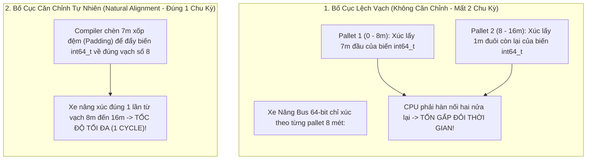

# 3.2. Binary Data Layout & Applications (Bố Cục Dữ Liệu Nhị Phân & Các Ứng Dụng Thực Chiến)

> [!IMPORTANT]
> **Tuyên ngôn Cốt lõi**: Dữ liệu trong RAM máy tính không bao giờ được xếp liền kề nhau một cách ngây thơ. Để tối ưu hóa các chu kỳ nạp của Bus dữ liệu 64-bit và L1 Data Cache, trình biên dịch tự động chèn các byte đệm vô hình (**Padding Bytes**) để bảo đảm mọi trường dữ liệu đều tuân thủ quy tắc căn chỉnh tự nhiên (**Natural Alignment**). Chỉ cần đổi thứ tự khai báo các biến trong struct từ lớn nhất tới nhỏ nhất, bạn có thể **tiết kiệm tới $33\% - 40\%$ RAM** của toàn bộ hệ thống; đồng thời việc dùng Packed Struct (`#pragma pack(1)`) chỉ được áp dụng ở biên giới I/O mạng hoặc file, không bao giờ dùng cho các đối tượng tính toán nóng trong vòng lặp vì nguy cơ **Alignment Fault (`SIGBUS`)** và tụt giảm thông lượng CPU do Split Cache-Line.

---

## 1. Trực Quan Hóa: Bản Chất Bố Cục Dữ Liệu Nhị Phân Dưới Góc Nhìn Lập Trình Viên

Mục tiêu của phần này là giải mã tại sao một struct gồm các biến có kích thước $1 + 8 + 4 = 13\text{ bytes}$ khi đo bằng `sizeof()` lại phình to thành $24\text{ bytes}$, tại sao code chạy mượt mà trên Intel x86 nhưng mang sang chip ARM lại bị crash `SIGBUS`, và cách các hệ điều hành nhận diện file mà không cần nhìn đuôi mở rộng.

---

### 1.1. Ẩn Dụ Chiếc Xe Nâng Hàng Tự Động Trong Kho

Hãy tưởng tượng hệ thống đọc bộ nhớ của CPU giống như một nhà kho vận hành bằng xe nâng tự động:



* **Quy tắc của phần cứng**: CPU Bus $64\text{-bit}$ không bao giờ đọc từng byte lẻ tẻ. Nó chỉ đọc những khối $8\text{ bytes}$ nằm tại các địa chỉ chia hết cho 8 (`0x00`, `0x08`, `0x10`, `0x18`...).
* Nếu bạn đặt một biến $8\text{ bytes}$ (`int64_t`) nằm lệch vạch (ví dụ bắt đầu ở địa chỉ lẻ `0x01`), CPU sẽ buộc phải thực hiện **2 lần đọc bộ nhớ** (Split Load) rồi dùng mạch ghép hai nửa lại, làm tốc độ đọc tụt dốc thảm hại.
* **Hành động của Compiler**: Để cứu vãn hiệu năng, trình biên dịch tự động chèn các **byte rác vô hình (Padding Bytes)** để đẩy các biến về đúng vạch địa chỉ chia hết cho kích thước của nó (**Natural Alignment**).

---

### 1.2. Hiện Tượng "Phình Bộ Nhớ Vô Hình" & Tuyệt Chiêu Tiết Kiệm 33% RAM

Hãy xem xét hai struct C++ có cùng các biến như nhau:

```cpp
// Cách 1: Khai báo lộn xộn (BAD LAYOUT)
struct UnoptimizedData {
    char    flag;    // 1 byte  | offset 0
    // [COMPILER TỰ ĐỘNG CHÈN 7 BYTES PADDING VÀO ĐÂY!]
    int64_t id;      // 8 bytes | offset 8 -> 15
    int32_t count;   // 4 bytes | offset 16 -> 19
    // [TRAILING PADDING: 4 BYTES ĐỆM Ở ĐUÔI ĐỂ STRUCT CHIA HẾT CHO 8!]
}; // sizeof = 24 BYTES (Dữ liệu thật chỉ có 13 bytes, lãng phí 45.8% RAM!)
```

```cpp
// Cách 2: Sắp xếp theo thứ tự kích thước GIẢM DẦN (OPTIMIZED LAYOUT)
struct OptimizedData {
    int64_t id;      // 8 bytes | offset 0 -> 7
    int32_t count;   // 4 bytes | offset 8 -> 11
    char    flag;    // 1 byte  | offset 12
    // [CHỈ CẦN 3 BYTES ĐỆM Ở ĐUÔI ĐỂ ĐỦ 16 BYTES!]
}; // sizeof = ĐÚNG 16 BYTES! (Tiết kiệm ngay lập tức 33.3% RAM mà không mất 1 dòng logic nào!)
```

> [!TIP]
> **Quy tắc vàng thiết kế Struct**:
> Luôn khai báo các thành viên theo **thứ tự kích thước giảm dần**:
> $$8\text{ bytes} \ (\text{con trỏ, } \text{int64\_t}) \ \longrightarrow \ 4\text{ bytes} \ (\text{int, float}) \ \longrightarrow \ 2\text{ bytes} \ (\text{short}) \ \longrightarrow \ 1\text{ byte} \ (\text{char, bool})$$

---

### 1.3. Packed Struct (`#pragma pack(1)`): Con Dao Hai Lưỡi

Khi lập trình mạng hoặc giải mã file nhị phân, bạn muốn struct khớp khít từng byte với gói tin truyền trên dây:
```cpp
#pragma pack(push, 1)
struct PackedHeader {
    char    flag;  // 1 byte  | offset 0
    int64_t id;    // 8 bytes | offset 1 (LỆCH CĂN CHỈNH TỰ NHIÊN!)
}; // sizeof = đúng 9 bytes!
#pragma pack(pop)
```

* **Mặt trái kinh hoàng khi port sang chip ARM / Apple Silicon**:
  * Trên chip Intel x86, CPU tự động chịu đựng việc đọc lệch địa chỉ (chỉ bị chậm đi một chút).
  * Nhưng trên kiến trúc **ARM64 hoặc vi điều khiển nhúng**, việc ép con trỏ đọc biến 64-bit tại địa chỉ lẻ sẽ kích hoạt ngay một ngắt phần cứng: **Alignment Exception $\rightarrow$ Hệ điều hành bắn tín hiệu `SIGBUS: Bus Error` và lập tức đánh sập tiến trình!**
* **Nguyên tắc**: Chỉ dùng Packed Struct ở ranh giới đọc ghi file hoặc giải mã gói tin mạng, không bao giờ dùng cho các đối tượng nghiệp vụ chạy trong vòng lặp tính toán.

---

### 1.4. Magic Bytes: Tại Sao Đổi Đuôi File Không Lừa Được Hệ Điều Hành?

Nếu một hacker đổi tên file mã độc `virus.exe` thành `avatar.png` rồi tải lên server:
* Hệ điều hành và các phần mềm bảo mật chuyên nghiệp **không bao giờ tin vào đuôi mở rộng `.png`**.
* Chúng nhìn thẳng vào **những byte đầu tiên của file (Magic Bytes / File Signature)**:

| Định Dạng File | Magic Bytes (Hexadecimal) | Biểu Diễn Ký Tự |
| :--- | :--- | :--- |
| **Ảnh PNG** | `89 50 4E 47 0D 0A 1A 0A` | `\x89PNG\r\n\x1a\n` |
| **Ảnh JPEG** | `FF D8 FF` | - |
| **Tài liệu PDF** | `25 50 44 46` | `%PDF` |
| **Linux ELF Binary**| `7F 45 4C 46` | `\x7fELF` |
| **Windows EXE** | `4D 5A` | `MZ` (Chữ viết tắt của Mark Zbikowski) |

Nếu file có tên `avatar.png` nhưng byte đầu tiên là `4D 5A` (`MZ`) hoặc `7F 45 4C 46`, hệ thống an ninh sẽ lập tức chặn đứng đòn tấn công File Extension Spoofing!

---

## 2. Chi tiết từng Keyword (Under-the-Hood Deep Dive)

### 2.1. Căn Chỉnh Bộ Nhớ (Memory Alignment) & Natural Alignment
Một biến có kích thước $K$ bytes ($K \in \{1, 2, 4, 8\}$) được gọi là căn chỉnh tự nhiên nếu địa chỉ bộ nhớ ảo của nó chia hết cho $K$:
$$\text{Address} \pmod K == 0$$
- `int8_t`: Căn chỉnh 1 byte (bất kỳ địa chỉ nào).
- `int16_t`: Căn chỉnh 2 bytes (địa chỉ chẵn).
- `int32_t`: Căn chỉnh 4 bytes.
- `int64_t`, con trỏ `void*`: Căn chỉnh 8 bytes.
- SIMD AVX-512 (`__m512`): Căn chỉnh đúng 64 bytes (khớp hoàn hảo 1 Cache Line của CPU).

### 2.2. Bẫy Hiệu Năng Split Cache-Line Access
Khi một biến số nguyên 64-bit trong một Packed Struct nằm vắt ngang giữa hai Cache Line (ví dụ bắt đầu ở byte thứ 60 và kết thúc ở byte thứ 67 của một Cache Line $64\text{ bytes}$):
- CPU buộc phải giữ hai ổ khóa Cache Line đồng thời (Split Lock), làm tắc nghẽn Bus đồng bộ dữ liệu giữa các Core vi xử lý, khiến thông lượng của toàn bộ hệ thống sụt giảm nghiêm trọng trong các hệ thống High-Frequency Trading.

---

## 3. Thực Thi Mã Nguồn & Mô Phỏng Chuyên Sâu (Dual-Engine Implementation)

### 3.1. C++20: Khảo Sát Bố Cục Struct, Padding & Giải Mã IPv4 Header Zero-Copy

```cpp
// binary_layout_lab.cpp
// Biên dịch: g++ -std=c++20 -O3 -Wall -Wextra binary_layout_lab.cpp -o layout_lab
#include <iostream>
#include <cstdint>
#include <iomanip>
#include <cstring>
#include <format>

// 1. Struct chưa tối ưu (Bad Layout)
struct UnalignedDemo {
    char    a; // 1 byte  | offset 0
               // 7 bytes padding
    int64_t b; // 8 bytes | offset 8
    char    c; // 1 byte  | offset 16
               // 7 bytes padding
}; // sizeof = 24 bytes

// 2. Struct đã tối ưu (Reordered Layout)
struct AlignedDemo {
    int64_t b; // 8 bytes | offset 0
    char    a; // 1 byte  | offset 8
    char    c; // 1 byte  | offset 9
               // 6 bytes padding
}; // sizeof = 16 bytes

// 3. Packed Struct chuẩn giao thức mạng IPv4 Header (20 bytes)
#pragma pack(push, 1)
struct Ipv4Header {
    uint8_t  version_ihl;
    uint8_t  type_of_service;
    uint16_t total_length;
    uint16_t identification;
    uint16_t flags_fragment_offset;
    uint8_t  time_to_live;
    uint8_t  protocol;
    uint16_t header_checksum;
    uint32_t source_ip;
    uint32_t destination_ip;
};
#pragma pack(pop)

int main() {
    std::cout << "=========================================================\n";
    std::cout << "  C++20 BINARY DATA LAYOUT & NETWORK PARSER LAB          \n";
    std::cout << "=========================================================\n";

    std::cout << "--- 1. ĐO LƯỜNG TÁC ĐỘNG CỦA PADDING ---\n";
    std::cout << std::format("sizeof(UnalignedDemo) : {} bytes (Chứa 14 bytes rác padding!)\n", sizeof(UnalignedDemo));
    std::cout << std::format("sizeof(AlignedDemo)   : {} bytes (Tiết kiệm 33.3% RAM!)\n", sizeof(AlignedDemo));
    std::cout << std::format("sizeof(Ipv4Header)    : {} bytes (Khớp khít 20 bytes chuẩn RFC)\n\n", sizeof(Ipv4Header));

    // 2. Thử nghiệm giải mã nhị phân Zero-Copy
    uint8_t packet_bytes[] = {
        0x45, 0x00, 0x00, 0x3C, 0x1C, 0x46, 0x40, 0x00,
        0x40, 0x06, 0xB1, 0xE6, 0xC0, 0xA8, 0x01, 0x69, // Source: 192.168.1.105
        0x08, 0x08, 0x08, 0x08                          // Dest: 8.8.8.8
    };

    const auto* ip = reinterpret_cast<const Ipv4Header*>(packet_bytes);
    std::cout << "--- KẾT QUẢ GIẢI MÃ HEADER IPv4 ZERO-COPY ---\n";
    std::cout << std::format("  Version        : IPv{}\n", (ip->version_ihl >> 4));
    std::cout << std::format("  Header Length  : {} bytes\n", (ip->version_ihl & 0x0F) * 4);
    std::cout << std::format("  TTL            : {}\n", ip->time_to_live);
    std::cout << std::format("  Protocol       : {}\n", ip->protocol);

    return 0;
}
```

---

### 3.2. Python 3.11+: Bộ Nhận Dạng Magic Bytes Chống Tấn Công Upload File

```python
#!/usr/bin/env python3
# magic_bytes_sniffer.py

MAGIC_SIGNATURES = {
    b"\x89PNG\r\n\x1a\n": "Image: PNG",
    b"\xFF\xD8\xFF": "Image: JPEG",
    b"%PDF": "Document: Adobe PDF",
    b"\x7fELF": "Executable: Linux ELF Binary",
    b"PK\x03\x04": "Archive: ZIP / JAR",
    b"MZ": "Executable: Windows PE / EXE"
}

def detect_file_format(data: bytes) -> str:
    for signature, description in MAGIC_SIGNATURES.items():
        if data.startswith(signature):
            return description
    return "Unknown Binary Format"

if __name__ == "__main__":
    print("=== BỘ QUÉT MAGIC BYTES NHẬN DIỆN TẬP TIN (PYTHON 3.11+) ===")
    
    samples = [
        (b"\x89PNG\r\n\x1a\n\x00\x00\x00\rIHDR", "avatar.png"),
        (b"\x7fELF\x02\x01\x01\x00", "payload_linux"),
        (b"%PDF-1.7\n...", "invoice.pdf"),
        (b"MZ\x90\x00\x03\x00\x00\x00", "trojan_disguised_as_avatar.png")
    ]

    for raw, filename in samples:
        fmt = detect_file_format(raw)
        print(f"File: {filename:<35} -> Định dạng thực: {fmt}")
```

---

## 4. Systems Engineering & Production Pitfalls

### 4.1. Lỗi Alignment Fault (`SIGBUS`) Khi Porting Code x86 Sang ARM
- Tuyệt đối không cast con trỏ thô lệch địa chỉ (`*(uint64_t*)(buf + 1)`). 
- Trên chip ARM64, thao tác này sẽ kích hoạt ngay một ngắt phần cứng **Alignment Fault** và quăng tín hiệu `SIGBUS: Bus Error` đánh sập hệ thống. Luôn dùng `std::memcpy` hoặc `std::bit_cast`.

### 4.2. Lỗ Hổng File Extension Spoofing Attack
- Không bao giờ tin tưởng đuôi mở rộng `.png` hay header `Content-Type` do người dùng gửi lên. Luôn đọc tối thiểu 16 bytes đầu tiên của file để kiểm tra Magic Bytes trước khi lưu trữ vào hệ thống.

---

## 5. Bảng So Sánh & Decision Matrix

| Tiêu Chí So Sánh | Aligned Struct (Tự Nhiên) | Packed Struct (`#pragma pack(1)`) | C/C++ Bit Fields | FlatBuffers / Cap'n Proto |
| :--- | :--- | :--- | :--- | :--- |
| **Kích Thước Bộ Nhớ** | Lớn hơn (Chứa byte padding) | Tối thiểu (Không có padding) | Nhỏ nhất có thể (Tầng bit) | Tối ưu kèm metadata offsets |
| **Tốc Độ Truy Xuất CPU**| Tối đa ($1\text{ cycle}$ RAM L1) | Chậm hơn (Nguy cơ Split Load) | Chậm (Tốn thêm lệnh ALU shift/mask)| Cực nhanh ($O(1)$ Direct Offset) |
| **An Toàn Khả Chuyển** | Rất cao | Khá cao (Cần chú ý Endianness)| Rất thấp (Compiler-dependent) | Hoàn hảo trên mọi nền tảng |
| **Nguy Cơ Lỗi Hệ Thống**| Không | Nguy cơ `SIGBUS` trên ARM/RISC| Sai thứ tự bit trên Big-Endian | Không có |
| **Trường Hợp Ứng Dụng** | Đối tượng nghiệp vụ, RAM cache | Header giao thức mạng, File parsing| Driver nhúng, thanh ghi MMIO | IPC hiệu năng cao, Microservices |

---

## 6. Enterprise Production Checklist & Verification

- [ ] **Tối Ưu Thứ Tự Thành Viên Struct**: Rà soát các struct cốt lõi của hệ thống bằng công cụ `pahole`, sắp xếp lại các trường theo thứ tự kích thước giảm dần để triệt tiêu các byte padding lãng phí.
- [ ] **Kiểm Tra Magic Bytes Ở Tầng Ingestion**: Mọi endpoint nhận tải lên file đều thực hiện xác thực chữ ký nhị phân Magic Bytes trước khi chuyển file vào bộ lưu trữ đám mây.
- [ ] **Cấm Giải Tham Chiếu Con Trỏ Không Căn Chỉnh**: Sử dụng `std::memcpy` hoặc `std::bit_cast` khi chuyển đổi dữ liệu từ byte stream mạng sang struct để ngăn ngừa lỗi `SIGBUS` trên kiến trúc ARM64.
- [ ] **Kiểm Soát Phạm Vi Packed Struct**: Không bao giờ sử dụng `#pragma pack(1)` trên các cấu trúc dữ liệu được lưu trữ trong danh sách liên kết hoặc mảng lớn chạy trong hot loops.
