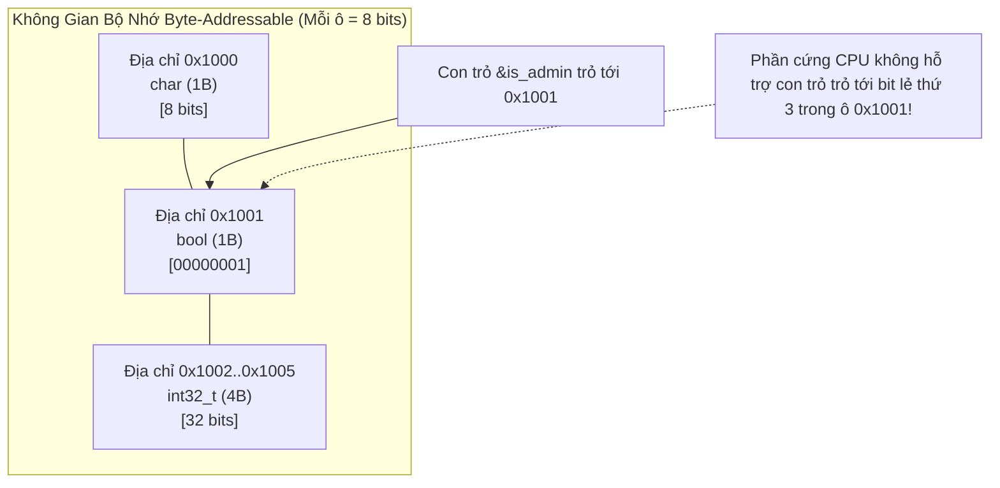
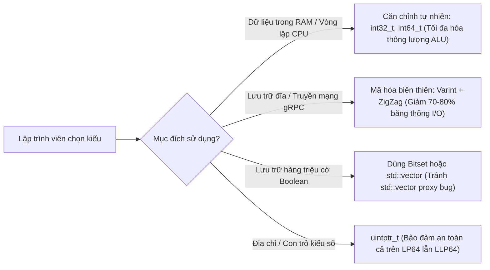

# 4.1. Primitive Data Types (Kiểu Dữ Liệu Nguyên Thủy & Biểu Diễn Ô Nhớ)

> [!IMPORTANT]
> **Nếu bạn chỉ được nhớ một điều duy nhất:** Kiểu dữ liệu nguyên thủy (Primitive Types) là sự trừu tượng hóa trực tiếp của các thanh ghi vật lý bên trong vi xử lý CPU. Do kiến trúc máy tính hiện đại được đánh địa chỉ theo từng Byte (Byte-Addressable), biến `bool` logic $1\text{ bit}$ bắt buộc phải chiếm $1\text{ Byte}$ trong RAM để có thể sở hữu một địa chỉ bộ nhớ độc lập. Tuyệt đối cấm sử dụng các kiểu dữ liệu phụ thuộc nền tảng (`long`, `unsigned int`) trong hệ thống phân tán vì sự phân mảnh mô hình dữ liệu (LP64 trên Linux vs LLP64 trên Windows); luôn dùng các kiểu có kích thước cố định tường minh (`int32_t`, `int64_t`) hoặc mã hóa nén biến thiên Varint/ZigZag để tối ưu hóa băng thông I/O.

---

## 1. Trực Quan Hóa: Bản Chất Kiểu Dữ Liệu Nguyên Thủy Dưới Góc Nhìn Lập Trình Viên

Mục tiêu của phần này là giải mã những câu hỏi nền tảng mà mọi kỹ sư phần mềm từng thắc mắc: Tại sao một biến `bool` chỉ mang giá trị 0 hoặc 1 ($1\text{ bit}$) nhưng `sizeof(bool)` lại luôn bằng $1\text{ Byte}$? Tại sao một đoạn code chạy hoàn hảo trên server Linux lại gây tràn số âm thảm khốc khi đem sang Windows? Và làm thế nào Protocol Buffers (Protobuf) có thể nén một số nguyên $64\text{-bit}$ xuống chỉ còn $1\text{ Byte}$ duy nhất trên đường truyền mạng?

---

### 1.1. Ẩn Dụ Hộp Bưu Kiện Tiêu Chuẩn & Tại Sao `bool` Phải Tốn $1\text{ Byte}$?

Hãy hình dung RAM máy tính như một trung tâm bưu điện với hàng triệu ngăn tủ gửi đồ:
- **Đánh địa chỉ theo Byte (Byte-Addressable Memory)**: Ban quản lý bưu điện quy định: *Ngăn tủ nhỏ nhất có thể gắn số nhà (địa chỉ bộ nhớ) có kích thước đúng bằng $1\text{ Byte} = 8\text{ bits}$*. CPU không thể gán số nhà riêng cho từng bit lẻ loi vì đường bus địa chỉ phần cứng chỉ có thể trỏ tới ranh giới của từng byte.
- **Tấm vé số $1\text{ bit}$ trong ngăn tủ $1\text{ Byte}$**: Khi bạn khai báo `bool is_active = true;`, về mặt toán học bạn chỉ cần đúng $1\text{ bit}$ (`1` hoặc `0`). Nhưng vì bạn có thể viết `&is_active` (lấy địa chỉ của biến), CPU bắt buộc phải cấp cho nó nguyên một ngăn tủ $1\text{ Byte}$ riêng biệt!

```cpp
bool is_admin = true;   // Về lý thuyết: 1 bit
// Nhưng trong RAM:
// [0 0 0 0 0 0 0 1] -> Chiếm trọn vẹn 1 Byte (8 bits) tại địa chỉ 0x7fff5fbff8ac
std::cout << sizeof(bool); // Kết quả: Luôn là 1 (Byte)
```



* **Cạm bẫy `std::vector<bool>`**: Để tiết kiệm RAM, C++ STL nén 8 giá trị boolean vào chung $1\text{ Byte}$. Tuy nhiên, vì không thể lấy địa chỉ của 1 bit, hàm `operator[]` không thể trả về `bool&` mà phải trả về một đối tượng đại diện tạm thời (**Proxy Object** `std::vector<bool>::reference`). Hậu quả: `auto& x = vec[0];` sẽ lập tức báo lỗi biên dịch!

---

### 1.2. Phân Mảnh Mô Hình Dữ Liệu (LP64 vs LLP64): Cái Bẫy "long" 32-bit vs 64-bit

Một trong những sai lầm kinh điển nhất của lập trình viên là tin rằng `long` luôn là $64\text{ bits}$ trên hệ điều hành 64-bit. Thực tế hoàn toàn trái ngược:

```cpp
// Nguy cơ bug phân tán xuyên nền tảng:
long user_id = 5000000000L; // 5 tỷ (cần ít nhất 33 bits)
```

- **Trên Linux / macOS (LP64)**: `sizeof(long) == 8 bytes` ($64\text{ bits}$). Biến `user_id` lưu trọn vẹn 5 tỷ.
- **Trên Windows 64-bit (LLP64 / MSVC)**: Microsoft giữ nguyên `sizeof(long) == 4 bytes` ($32\text{ bits}$) để tương thích ngược với Win32! Giá trị 5 tỷ bị tràn số (Integer Overflow) và biến thành một số âm kỳ quặc: `-358967296` hoặc bị cắt cụt!

| Kiểu Dữ Liệu | Linux 64-bit (LP64) | macOS (LP64) | Windows 64-bit (LLP64) | Giải Pháp Chuẩn Production |
| :--- | :---: | :---: | :---: | :--- |
| `int` | 4 Bytes (32b) | 4 Bytes (32b) | 4 Bytes (32b) | Dùng `int32_t` tường minh |
| `long` | **8 Bytes (64b)** | **8 Bytes (64b)** | **4 Bytes (32b)** ⚠️ | **CẤM DÙNG** trong distributed systems! |
| `long long` | 8 Bytes (64b) | 8 Bytes (64b) | 8 Bytes (64b) | Dùng `int64_t` tường minh |
| Con trỏ (`void*`) | 8 Bytes (64b) | 8 Bytes (64b) | 8 Bytes (64b) | Dùng `uintptr_t` khi thao tác số |

> [!WARNING]
> **Quy tắc vàng**: Tuyệt đối không bao giờ dùng `long` trong DTO, gRPC, REST payload hay struct lưu trữ database. Luôn dùng `<cstdint>` (`int32_t`, `int64_t`, `uint64_t`).

---

### 1.3. Varint & ZigZag Encoding: Bí Quyết Nén Số Của Protobuf & gRPC

Trong các hệ thống phân tán xử lý hàng tỷ message mỗi giây, phần lớn các số nguyên thực tế đều rất nhỏ (ví dụ HTTP Status `200`, số lượng sản phẩm `3`, điểm đánh giá `5`). Nếu dùng kiểu `int64_t` cố định, bạn đang gửi $7\text{ bytes}$ toàn số `0` qua cáp quang!

#### Cơ chế Varint (Variable-length Quantity / LEB128)
Varint chia số nguyên thành từng nhóm $7\text{ bits}$, và dùng bit thứ 8 (MSB - Most Significant Bit) làm cờ báo hiệu:
- `MSB = 1`: Vẫn còn byte tiếp theo.
- `MSB = 0`: Đây là byte kết thúc của số này.

```
Ví dụ số 300 (nhị phân: 00000001 00101100):
1. Tách thành 2 nhóm 7 bits:  [0000010] [0101100]
2. Đảo thứ tự (Little-Endian): [0101100] rồi đến [0000010]
3. Thêm MSB:
   - Byte 1: 1 (còn tiếp) + 0101100 = 10101100 (0xAC)
   - Byte 2: 0 (hết rồi)  + 0000010 = 00000010 (0x02)
=> Kết quả: Chỉ tốn 2 bytes (0xAC 0x02) thay vì 8 bytes!
```

#### Vấn đề số âm & Thuật toán ZigZag
Trong chuẩn bù hai, số $-1$ được biểu diễn bằng 64 bit toàn số 1 (`0xFFFFFFFFFFFFFFFF`). Nếu đưa vào Varint, nó sẽ phình to thành **$10\text{ Bytes}$**!
Để giải quyết, Google thiết kế thuật toán **ZigZag**: Ánh xạ xen kẽ số âm và dương về các số dương nhỏ:

$$\text{ZigZag}(n) = (n \ll 1) \oplus (n \gg 63)$$

```
Số ban đầu:    0  ->   -1  ->   1  ->  -2  ->   2  ->  -3
Sau ZigZag:    0  ->    1  ->   2  ->   3  ->   4  ->   5
```
Nhờ ZigZag, số $-1$ biến thành số nguyên dương $1$, và được nén bởi Varint thành **đúng $1\text{ Byte}$** (`0x01`)!

---

### 1.4. Tóm Tắt Kỹ Thuật Cho Backend & Systems Engineer



---

## 2. Chi tiết từng Keyword (Under-the-Hood Deep Dive)

### 2.1. Boolean & Character Primitives (Byte-Addressable Memory, `std::vector<bool>` & Unicode Chars)
- **Bản chất phần cứng của Boolean**:
  - Về mặt lý thuyết thông tin, một biến Boolean chỉ mang giá trị `0` (false) hoặc `1` (true), tức chỉ cần đúng $1\text{ bit}$.
  - Tuy nhiên, kiến trúc vi xử lý hiện đại (x86, ARM, RISC-V) không có chỉ thị nạp/ghi địa chỉ trực tiếp cho một bit đơn lẻ trong DRAM. Đường bus địa chỉ chỉ có thể trỏ tới ranh giới của từng **Byte ($8\text{ bits}$)**.
  - Do đó, toán tử lấy địa chỉ `&my_bool` bắt buộc phải trả về một con trỏ tới một byte hoàn chỉnh. Mỗi biến `bool` độc lập bắt buộc phải chiếm $1\text{ Byte} = 8\text{ bits}$.
- **Cạm bẫy `std::vector<bool>` trong C++ STL**:
  - Để tiết kiệm RAM, C++ STL đã cung cấp một bản chuyên biệt hóa (Template Specialization) cho `std::vector<bool>`: nén $8$ giá trị boolean vào đúng $1\text{ Byte}$.
  - *Cái giá phải trả*: Vì không thể lấy địa chỉ của một bit trong byte, `operator[]` của `std::vector<bool>` **không thể trả về `bool&` (tham chiếu trực tiếp)**. Thay vào đó, nó trả về một đối tượng đại diện tạm thời (**Proxy Object** `std::vector<bool>::reference`). Việc này phá vỡ hoàn toàn khả năng sử dụng các hàm nhận tham chiếu `auto& x = vec[0];` và gây ra các lỗi biên dịch template cực kỳ khó hiểu.
- **Các kiểu Character nguyên bản hiện đại**:
  - `char`: 1 byte. Tiêu chuẩn C/C++ không quy định là signed hay unsigned (phụ thuộc compiler và kiến trúc: x86 là signed, ARM thường là unsigned).
  - `char8_t` (C++20): Đúng 1 byte không dấu, chuẩn hóa riêng biệt cho Code Unit UTF-8, chấm dứt việc nhập nhằng giữa byte thô và chuỗi ký tự.
  - `char16_t` (C++11): Đúng 2 bytes, dùng cho Code Unit UTF-16.
  - `char32_t` (C++11): Đúng 4 bytes, chứa trọn vẹn 1 Unicode Code Point (UTF-32).

### 2.2. Fixed-Width Integers vs Data Model Fragmentation (LP64 vs LLP64 vs ILP32)
Trong tiêu chuẩn C90/C99 ban đầu, kích thước của các kiểu số nguyên cơ bản chỉ được định nghĩa tương đối:
$$\text{sizeof(short)} \le \text{sizeof(int)} \le \text{sizeof(long)} \le \text{sizeof(long long)}$$
Khi ngành công nghiệp điện toán chuyển dịch từ 32-bit sang 64-bit, các hệ điều hành đã đưa ra các quyết định phân mảnh nghiêm trọng:

| Mô Hình Dữ Liệu | Hệ Điều Hành Điển Hình | `int` | `long` | `long long` | Con Trỏ (`void*`) |
| :--- | :--- | :---: | :---: | :---: | :---: |
| **ILP32** | Hệ thống nhúng, Linux 32-bit, Win32 | 32 bits | 32 bits | 64 bits | 32 bits (4B) |
| **LP64** | Linux 64-bit, macOS, BSD, iOS, Android | 32 bits | **64 bits (8B)** | 64 bits | **64 bits (8B)** |
| **LLP64** | Windows 64-bit (Win64 / MSVC) | 32 bits | **32 bits (4B)** | 64 bits | **64 bits (8B)** |

- **Thảm họa kỹ nghệ phần mềm**:
  - Nếu một lập trình viên viết: `long user_id = get_id();`
  - Trên server Linux (LP64), `user_id` có kích thước $64\text{ bits}$ và có thể chứa số nguyên lên tới $9 \times 10^{18}$.
  - Khi chương trình đó được biên dịch trên Windows (LLP64), `sizeof(long)` bị co lại thành $32\text{ bits}$! Dữ liệu bị cắt cụt (Truncation), dẫn đến lỗi tràn số âm nghiêm trọng.
- **Biện pháp bắt buộc**: $100\%$ hệ thống production hiện đại bắt buộc phải loại bỏ hoàn toàn `int`, `long` và thay bằng các kiểu số nguyên có độ rộng cố định tường minh từ thư viện `<cstdint>` / `<stdint.h>`:
  - `int8_t`, `uint8_t` ($1\text{ Byte}$)
  - `int16_t`, `uint16_t` ($2\text{ Bytes}$)
  - `int32_t`, `uint32_t` ($4\text{ Bytes}$)
  - `int64_t`, `uint64_t` ($8\text{ Bytes}$)

### 2.3. Variable-Width Integers: Varint, LEB128 & ZigZag Encoding Internals
Trong cơ sở dữ liệu và giao tiếp mạng microservices (Protocol Buffers, gRPC, Apache Parquet, WebAssembly, Git), phần lớn các số nguyên thực tế có giá trị rất nhỏ (ví dụ số lượng mặt hàng $1-10$, mã trạng thái HTTP $200$, số trang $1$). Nếu dùng kiểu `int64_t`, hệ thống sẽ lãng phí $7\text{ bytes}$ toàn số `0` cho mỗi số!
- **Nguyên lý Varint / LEB128 (Little-Endian Base 128)**:
  - Chia số nguyên thành từng khối $7\text{ bits}$.
  - Dùng bit thứ 8 (bit cao nhất MSB - Most Significant Bit) làm cờ báo hiệu tiếp tục (**Continuation Bit**):
    - `MSB = 1`: Còn byte tiếp theo.
    - `MSB = 0`: Đây là byte cuối cùng của số nguyên.
  - Ví dụ: Số $1$ chỉ tốn đúng $1\text{ Byte}$ (`0x01`). Số $300$ chỉ tốn $2\text{ Bytes}$ (`0xAC 0x02`) thay vì $8\text{ Bytes}$!
- **Thuật toán ZigZag Encoding Cho Số Nguyên Có Dấu**:
  - Varint hoạt động rất kém với số âm trong hệ bù hai: số $-1$ có dạng nhị phân toàn số 1 (`0xFFFFFFFFFFFFFFFF`), khiến Varint phải tốn tới **$10\text{ Bytes}$** để lưu trữ!
  - **Giải pháp ZigZag**: Ánh xạ xen kẽ các số âm và dương về các số nguyên dương nhỏ:
    $$0 \to 0, \quad -1 \to 1, \quad 1 \to 2, \quad -2 \to 3, \quad 2 \to 4, \quad -3 \to 5$$
  - Công thức bitwise siêu tốc:
    $$\text{ZigZag32}(n) = (n \ll 1) \oplus (n \gg 31)$$
    $$\text{ZigZag64}(n) = (n \ll 1) \oplus (n \gg 63)$$
  - Nhờ ZigZag, số $-1$ chỉ cần đúng $1\text{ Byte}$ khi được nén bằng Varint!

### 2.4. Pointer Primitives & Address Bus Width (32-bit vs 64-bit Pointers, `uintptr_t`)
- Kích thước của kiểu con trỏ nguyên thủy (`void*`, `T*`) luôn luôn bằng đúng độ rộng của bus địa chỉ logic của hệ thống:
  - Hệ thống 32-bit: Con trỏ chiếm $4\text{ Bytes}$ ($32\text{ bits}$), định vị tối đa $2^{32} = 4\text{ GB}$ RAM.
  - Hệ thống 64-bit: Con trỏ chiếm $8\text{ Bytes}$ ($64\text{ bits}$), định vị lý thuyết tới $18.4\text{ Exabytes}$.
- **Kiểu số nguyên an toàn cho con trỏ (`uintptr_t` / `intptr_t`)**:
  - Không bao giờ được ép kiểu con trỏ sang `int` hay `long` (vì nguy cơ mất $4\text{ bytes}$ địa chỉ trên Windows LLP64).
  - Luôn sử dụng kiểu `uintptr_t`: kiểu số nguyên không dấu được tiêu chuẩn C/C++ cam kết có kích thước hoàn toàn bằng với con trỏ trên bất kỳ nền tảng nào.

### 2.5. Enums & Scoped Enums (`enum class`, Underlying Storage Types & Type Safety)
- **Unscoped Enum truyền thống (C-Style `enum`)**:
  - Phạm vi của các nhãn bị rò rỉ ra ngoài namespace bao quanh (Scope Pollution).
  - Tự động ép kiểu ngầm định sang số nguyên `int`, gây ra các lỗi so sánh logic sai trái (ví dụ so sánh `Status::OK == Color::RED`).
- **C++11 Scoped Enum (`enum class`)**:
  - Buộc phải truy cập qua tiền tố định danh: `Status::OK`.
  - Cấm hoàn toàn ép kiểu ngầm định sang số.
  - **Cho phép chỉ định kiểu dữ liệu nền (Underlying Type)**:
    ```cpp
    enum class NetworkState : uint8_t {
        DISCONNECTED = 0,
        CONNECTING   = 1,
        CONNECTED    = 2,
        ERROR_STATE  = 3
    }; // Chiếm đúng 1 byte trong RAM thay vì 4 bytes mặc định của int!
    ```

---

## 3. Thực thi Mã nguồn & Mô phỏng Chuyên sâu (Dual-Engine Implementation)

### 3.1. C++20 Varint / ZigZag Encoder-Decoder & Memory Footprint Dissector

Chương trình C++20 cài đặt thuật toán nén Varint chuẩn Protobuf kết hợp ZigZag encoding, và phẫu thuật kích thước bộ nhớ của các kiểu dữ liệu nguyên thủy:

```cpp
// Biên dịch: g++ -std=c++20 -O3 -Wall -Wextra primitive_types_lab.cpp -o primitive_lab
#include <iostream>
#include <cstdint>
#include <vector>
#include <format>
#include <type_traits>

// Thuật toán ZigZag Encoding cho số nguyên có dấu 64-bit
constexpr uint64_t encode_zigzag64(int64_t n) noexcept {
    return (static_cast<uint64_t>(n) << 1) ^ static_cast<uint64_t>(n >> 63);
}

constexpr int64_t decode_zigzag64(uint64_t z) noexcept {
    return static_cast<int64_t>((z >> 1) ^ -(static_cast<int64_t>(z & 1)));
}

// Bộ mã hóa Varint chuẩn Google Protocol Buffers
std::vector<uint8_t> encode_varint64(uint64_t val) {
    std::vector<uint8_t> buffer;
    while (val >= 0x80) { // Khi giá trị vượt quá 7 bits
        buffer.push_back(static_cast<uint8_t>((val & 0x7F) | 0x80)); // Bật bit MSB
        val >>= 7;
    }
    buffer.push_back(static_cast<uint8_t>(val & 0x7F)); // Byte cuối có MSB = 0
    return buffer;
}

// Bộ giải mã Varint
uint64_t decode_varint64(const std::vector<uint8_t>& bytes, size_t& bytes_read) {
    uint64_t result = 0;
    int shift = 0;
    bytes_read = 0;

    for (uint8_t b : bytes) {
        bytes_read++;
        result |= static_cast<uint64_t>(b & 0x7F) << shift;
        if ((b & 0x80) == 0) { // MSB = 0: Kết thúc
            return result;
        }
        shift += 7;
        if (shift >= 64) {
            throw std::runtime_error("Lỗi: Varint tràn 64-bit!");
        }
    }
    throw std::runtime_error("Lỗi: Varint cụt đầu giữa chừng!");
}

int main() {
    std::cout << "=========================================================\n";
    std::cout << "  C++20 PRIMITIVE TYPES ARCHITECTURE & VARINT LAB        \n";
    std::cout << "=========================================================\n";

    // 1. Phẫu thuật kích thước bộ nhớ nguyên thủy
    std::cout << "--- 1. KÍCH THƯỚC BỘ NHỚ Ô RAM (SYSTEM ARCHITECTURE) ---\n";
    std::cout << std::format("sizeof(bool)        : {} byte  (1 bit logic)\n", sizeof(bool));
    std::cout << std::format("sizeof(char)        : {} byte\n", sizeof(char));
    std::cout << std::format("sizeof(char8_t)     : {} byte  (C++20 UTF-8 Code Unit)\n", sizeof(char8_t));
    std::cout << std::format("sizeof(char16_t)    : {} bytes (UTF-16 Code Unit)\n", sizeof(char16_t));
    std::cout << std::format("sizeof(char32_t)    : {} bytes (UTF-32 Code Point)\n", sizeof(char32_t));
    std::cout << std::format("sizeof(int)         : {} bytes\n", sizeof(int));
    std::cout << std::format("sizeof(long)        : {} bytes (Cạm bẫy LP64 vs LLP64!)\n", sizeof(long));
    std::cout << std::format("sizeof(int64_t)     : {} bytes (Fixed-width chuẩn)\n", sizeof(int64_t));
    std::cout << std::format("sizeof(void*)       : {} bytes (Con trỏ 64-bit)\n", sizeof(void*));
    std::cout << std::format("sizeof(uintptr_t)   : {} bytes (Số nguyên kích thước con trỏ)\n\n", sizeof(uintptr_t));

    // 2. Thí nghiệm Varint & ZigZag Compression
    std::cout << "--- 2. HIỆU NĂNG NÉN VARINT & ZIGZAG CHO HỆ THỐNG PHÂN TÁN ---\n";
    int64_t test_values[] = { 0, 1, 127, 128, 300, -1, -1000, 1000000 };

    for (int64_t val : test_values) {
        uint64_t zz = encode_zigzag64(val);
        auto varint_bytes = encode_varint64(zz);
        size_t consumed = 0;
        uint64_t decoded_zz = decode_varint64(varint_bytes, consumed);
        int64_t final_val = decode_zigzag64(decoded_zz);

        std::cout << std::format("Giá trị: {:8d} | ZigZag: {:8d} | Bytes gốc: 8B | Varint: {}B | Hex: ",
                                 val, zz, varint_bytes.size());
        for (uint8_t b : varint_bytes) std::cout << std::format("{:02X} ", b);
        std::cout << std::format("| Decoded: {}\n", final_val);
    }

    return 0;
}
```

### 3.2. Python 3.11+: Protobuf-style Varint & ZigZag Simulator

Chương trình Python 3.11+ mô phỏng bộ mã hóa Varint chuẩn và phân tích hành vi đóng gói của các kiểu dữ liệu nguyên thủy:

```python
#!/usr/bin/env python3
"""
primitive_types_simulator.py: Mô phỏng cơ chế Varint, ZigZag và Data Models.
Yêu cầu: Python 3.11+
"""
from typing import List, Tuple

def encode_zigzag(n: int) -> int:
    """Mã hóa số nguyên có dấu sang số nguyên không dấu ZigZag."""
    return (n << 1) ^ (n >> 63) if n < 0 else (n << 1)

def decode_zigzag(z: int) -> int:
    """Giải mã ZigZag trở lại số nguyên có dấu ban đầu."""
    return (z >> 1) ^ (-(z & 1))

def encode_varint(val: int) -> bytes:
    """Nén số nguyên không dấu thành luồng byte Varint (LEB128)."""
    buf = bytearray()
    while val >= 0x80:
        buf.append((val & 0x7F) | 0x80)
        val >>= 7
    buf.append(val & 0x7F)
    return bytes(buf)

def decode_varint(data: bytes) -> Tuple[int, int]:
    """Giải mã Varint trả về (giá_trị, số_byte_đã_đọc)."""
    res = 0
    shift = 0
    for idx, b in enumerate(data):
        res |= (b & 0x7F) << shift
        if not (b & 0x80):
            return res, idx + 1
        shift += 7
    raise ValueError("Dữ liệu Varint bị cắt cụt!")

if __name__ == "__main__":
    print("=== MÔ PHỎNG NÉN VARINT & ZIGZAG TRONG PROTOBUF / GRPC ===")
    sample_integers = [0, 42, -1, -2, 300, 16384, -100000]

    for num in sample_integers:
        zz = encode_zigzag(num)
        v_bytes = encode_varint(zz)
        dec_zz, consumed = decode_varint(v_bytes)
        restored = decode_zigzag(dec_zz)

        hex_repr = " ".join(f"{b:02X}" for b in v_bytes)
        savings = (1 - (len(v_bytes) / 8)) * 100
        print(f"Số nguyên: {num:<8} -> ZigZag: {zz:<8} -> Bytes: {hex_repr:<12} ({len(v_bytes)}B) -> Tiết kiệm: {savings:5.1f}%")
        assert num == restored, "Giải mã thất bại!"
```

### 3.3. Terminal Output Mẫu & Phân Tích Thực Thi

```text
=========================================================
  C++20 PRIMITIVE TYPES ARCHITECTURE & VARINT LAB        
=========================================================
--- 1. KÍCH THƯỚC BỘ NHỚ Ô RAM (SYSTEM ARCHITECTURE) ---
sizeof(bool)        : 1 byte  (1 bit logic)
sizeof(char)        : 1 byte
sizeof(char8_t)     : 1 byte  (C++20 UTF-8 Code Unit)
sizeof(char16_t)    : 2 bytes (UTF-16 Code Unit)
sizeof(char32_t)    : 4 bytes (UTF-32 Code Point)
sizeof(int)         : 4 bytes
sizeof(long)        : 8 bytes (Cạm bẫy LP64 vs LLP64!)
sizeof(int64_t)     : 8 bytes (Fixed-width chuẩn)
sizeof(void*)       : 8 bytes (Con trỏ 64-bit)
sizeof(uintptr_t)   : 8 bytes (Số nguyên kích thước con trỏ)

--- 2. HIỆU NĂNG NÉN VARINT & ZIGZAG CHO HỆ THỐNG PHÂN TÁN ---
Giá trị:        0 | ZigZag:        0 | Bytes gốc: 8B | Varint: 1B | Hex: 00 | Decoded: 0
Giá trị:        1 | ZigZag:        2 | Bytes gốc: 8B | Varint: 1B | Hex: 02 | Decoded: 1
Giá trị:      127 | ZigZag:      254 | Bytes gốc: 8B | Varint: 2B | Hex: FE 01 | Decoded: 127
Giá trị:      128 | ZigZag:      256 | Bytes gốc: 8B | Varint: 2B | Hex: 80 02 | Decoded: 128
Giá trị:      300 | ZigZag:      600 | Bytes gốc: 8B | Varint: 2B | Hex: D8 04 | Decoded: 300
Giá trị:       -1 | ZigZag:        1 | Bytes gốc: 8B | Varint: 1B | Hex: 01 | Decoded: -1
Giá trị:    -1000 | ZigZag:     1999 | Bytes gốc: 8B | Varint: 2B | Hex: CF 0F | Decoded: -1000
Giá trị:  1000000 | ZigZag:  2000000 | Bytes gốc: 8B | Varint: 3B | Hex: 80 89 7A | Decoded: 1000000
```

---

## 4. Systems Engineering & Production Pitfalls

### 4.1. Thảm Họa Tràn Số 2GB Khi Dùng `int` Cho Offset Mảng Trên 64-bit
- **Kịch bản thực chiến**: Một kỹ sư viết hàm tải dữ liệu lớn từ đĩa vào RAM sử dụng kiểu `int` cho biến đếm kích thước:
  ```cpp
  int buffer_size = get_file_size(); // File có kích thước 3.5 GB!
  for (int i = 0; i < buffer_size; ++i) { process(buffer[i]); }
  ```
- **Hậu quả**: Kiểu `int` là số nguyên có dấu 32-bit, giá trị cực đại chỉ là $2^{31} - 1 \approx 2.14\text{ GB}$. Khi `buffer_size` vượt quá 2.14 GB, biến bị tràn sang số âm (`-2147483648`). Vòng lặp dừng ngay lập tức hoặc truy cập con trỏ với offset âm, kích hoạt `SIGSEGV` làm sập toàn bộ dịch vụ backend.
- **Biện pháp**: Luôn sử dụng kiểu `size_t` (cho mọi thao tác chỉ mục mảng và kích thước trong RAM) hoặc `uint64_t` cho kích thước file và dung lượng bộ nhớ.

### 4.2. Cạm Bẫy Tính Di Động Do Khác Biệt Mô Hình Dữ Liệu LP64 vs LLP64
- Khi serialize dữ liệu nhị phân xuống đĩa hoặc truyền qua mạng bằng cách ghi trực tiếp bộ nhớ của biến `long`:
  ```cpp
  long session_id = 12345;
  write(socket_fd, &session_id, sizeof(long)); // BUG PHÂN TÁN CHẾT NGƯỜI!
  ```
- Nếu client chạy trên Windows (Win64 LLP64), nó chỉ đọc và gửi $4\text{ Bytes}$. Nếu máy chủ chạy trên Linux (Ubuntu LP64), nó đọc $8\text{ Bytes}$, dẫn đến việc đọc lấn sang byte của biến tiếp theo, làm rò rỉ bộ nhớ hoặc corrupt luồng truyền tin.
- **Biện pháp**: Luôn sử dụng `int64_t` hoặc `uint64_t` trong mọi giao thức mạng và cấu trúc lưu trữ vĩnh viễn.

### 4.3. Suy Giảm Hiệu Năng Nghiêm Trọng Của `std::vector<bool>`
- Khi một thuật toán đa luồng cố gắng ghi đồng thời vào hai phần tử khác nhau của `std::vector<bool>`:
  ```cpp
  // Luồng 1 ghi vào bit 0
  vec[0] = true; 
  // Luồng 2 ghi vào bit 1
  vec[1] = false;
  ```
- Vì cả bit 0 và bit 1 đều nằm trong cùng một byte bộ nhớ, việc ghi đồng thời sẽ gây ra hiện tượng **Data Race ở tầng byte vật lý**, phá hủy dữ liệu của nhau dù hai luồng truy cập vào hai index khác nhau!
- **Biện pháp**: Nếu cần mảng boolean an toàn đa luồng hoặc cần hiệu năng cao, hãy sử dụng `std::vector<uint8_t>` hoặc `std::deque<bool>`.

### 4.4. CLI Diagnostics & Compiler Model Verification
- Kiểm tra mô hình kiến trúc của trình biên dịch mục tiêu:
  ```bash
  # Kiểm tra các định nghĩa tiền xử lý về kích thước kiểu
  g++ -dM -E - < /dev/null | grep -E "LONG_MAX|SIZEOF_LONG"

  # Kiểm tra target architecture
  g++ -dumpmachine
  ```
- Đo lường dung lượng nhị phân và các trường dữ liệu bằng `size`:
  ```bash
  size -A -d ./primitive_lab
  ```

---

## 5. Bảng So sánh & Decision Matrix

### Ma trận So sánh Các Kiểu Dữ Liệu Nguyên Thủy Cơ Bản

| Kiểu Dữ Liệu | Kích Thước Chuẩn | Miền Giá Trị Biểu Diễn | Tính Khả Chuyển (Portability) | Môi Trường Khuyên Dùng |
| :--- | :--- | :--- | :--- | :--- |
| `bool` | $1\text{ Byte}$ | `true` ($1$), `false` ($0$) | Toàn cầu ($1\text{ Byte}$) | Cờ trạng thái logic đơn lẻ |
| `char8_t` | $1\text{ Byte}$ | $0$ đến $255$ | Chuẩn C++20 | Xử lý ký tự và chuỗi UTF-8 |
| `int` | $4\text{ Bytes}$ | $[-2^{31}, 2^{31}-1]$ | $99\%$ hệ thống 32/64-bit | Biến đếm vòng lặp nhỏ cục bộ |
| `long` | $4\text{B}$ (Win) / $8\text{B}$ (Linux)| Phụ thuộc OS | **Cực kỳ nguy hiểm** | Tuyệt đối tránh dùng trong Backend |
| `int32_t` / `int64_t` | Cố định $4\text{B}$ / $8\text{B}$ | Độc lập tuyệt đối OS | **Hoàn hảo $100\%$** | Chuẩn hóa cho mọi Struct, API, Database |
| `size_t` | $4\text{B}$ (32-bit) / $8\text{B}$ (64-bit)| $[0, 2^{64}-1]$ | Phụ thuộc Address Bus | Kích thước mảng, dung lượng RAM, đếm phần tử |
| `uintptr_t` | Bằng kích thước con trỏ | $[0, 2^{\text{ptr\_bits}}-1]$| Hoàn hảo | Chuyển đổi an toàn giữa số nguyên và con trỏ |
| **Varint (LEB128)** | $1$ đến $10\text{ Bytes}$ | Toàn bộ miền số nguyên | Độc lập nền tảng | Wire format: Protobuf, gRPC, Parquet, Wasm |

---

## 6. Enterprise Production Checklist & Verification

- [ ] **Khử Trùng Hoàn Toàn Kiểu `long` Khỏi Codebase**: Quét toàn bộ repository để thay thế toàn bộ khai báo `long`, `unsigned long` bằng `int64_t` hoặc `uint64_t`.
- [ ] **Sử Dụng `size_t` Cho Mọi Biến Kích Thước Mảng**: Đảm bảo toàn bộ các biến đếm vòng lặp mảng và kích thước buffer đều dùng `size_t` để ngăn ngừa lỗi tràn số 2GB.
- [ ] **Chuẩn Hóa Scoped Enum Có Underlying Type**: Khai báo toàn bộ enum bằng cú pháp `enum class MyEnum : uint8_t` để vừa bảo đảm an toàn kiểu vừa tiết kiệm bộ nhớ RAM.
- [ ] **Tích Hợp Varint Cho Giao Thức Mạng Phân Tán**: Sử dụng Varint kết hợp ZigZag cho mọi trường số nguyên trong schema protobuf để giảm thiểu tối đa kích thước payload giữa các microservices.
- [ ] **Kiểm Tra Tránh Data Race Trên `std::vector<bool>`**: Đảm bảo không có luồng nào ghi đồng thời vào các phần tử của `std::vector<bool>`; thay thế bằng `std::vector<uint8_t>` trong môi trường đa luồng.
