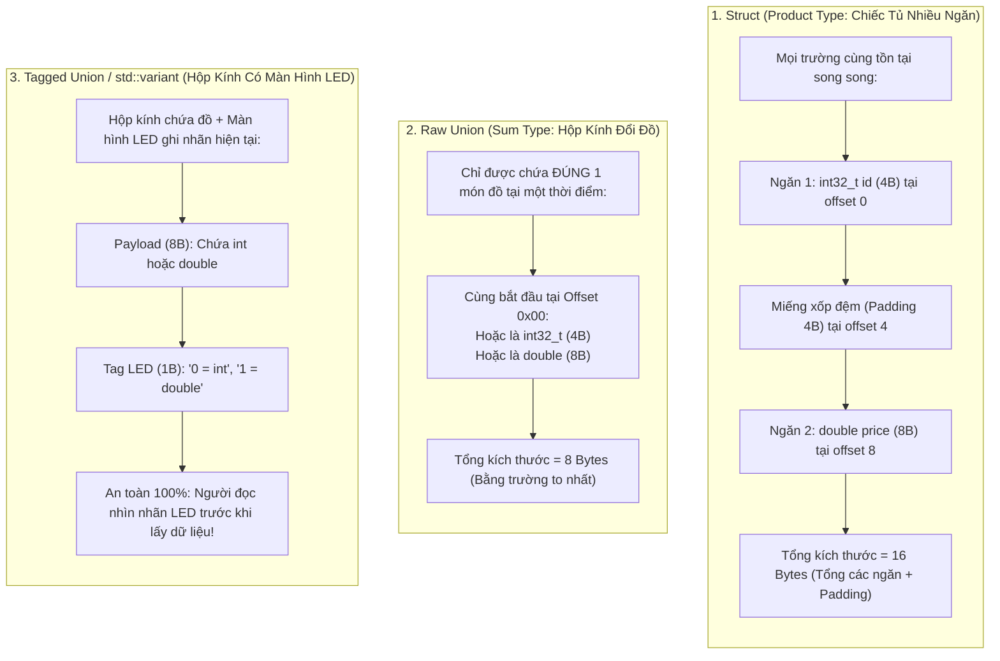
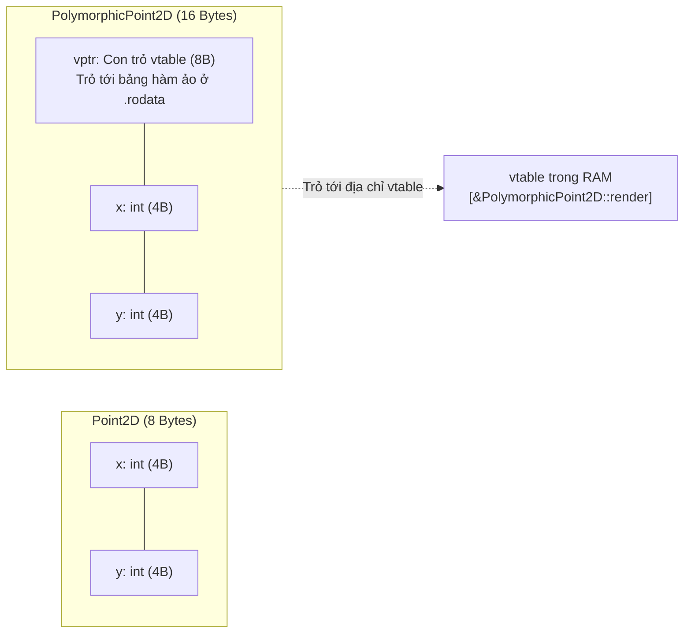
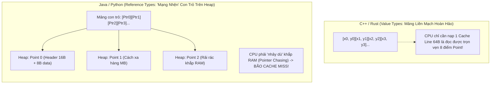

# 4.2. Composite Data Types (Kiểu Dữ Liệu Tổng Hợp: Struct, Union, Class & Tagged Union)

> [!IMPORTANT]
> **Nếu bạn chỉ được nhớ một điều duy nhất:** Kiểu dữ liệu tổng hợp (Composite Types) vận hành trên hai nguyên lý đại số kiểu dữ liệu cốt lõi: **Product Types (Kiểu Tích: Struct, Class, Array)** phân bổ không gian bộ nhớ bằng tổng kích thước các trường thành phần kèm padding căn chỉnh; trong khi **Sum Types (Kiểu Tổng: Union, Tagged Union / `std::variant`)** ép các trường dùng chung một ô nhớ duy nhất có kích thước bằng trường lớn nhất. Việc thêm dù chỉ một hàm `virtual` vào Class sẽ âm thầm chèn một con trỏ bảng ảo 64-bit (**vptr**) làm phình to kích thước đối tượng và gây trễ CPU do gọi gián tiếp (Indirect Call Cache Miss); do đó, trong kiến trúc hướng hiệu năng cao, Tagged Union và Data-Oriented Design luôn được ưu tiên hơn mô hình kế thừa OOP đa tầng cồng kềnh.

---

## 1. Trực Quan Hóa: Bản Chất Kiểu Dữ Liệu Tổng Hợp Dưới Góc Nhìn Lập Trình Viên

Mục tiêu của phần này là giải mã kiến trúc bộ nhớ đằng sau các cấu trúc dữ liệu tổng hợp hàng ngày: Tại sao chỉ cần thêm một từ khóa `virtual` vào class C++ thì kích thước của nó lại tăng vọt $300\%$? Tại sao mảng $1.000.000$ đối tượng trong Java/Python lại chạy chậm hơn gấp hàng chục lần so với C++/Rust? Và tại sao các hệ thống hiệu năng cao hiện đại đang dần từ bỏ mô hình kế thừa OOP truyền thống để chuyển sang Tagged Union (`std::variant` / Rust `enum`)?

---

### 1.1. Ẩn Dụ Tủ Nhiều Ngăn (Struct) vs Hộp Kính Trưng Bày (Union) vs Hộp Có Màn Hình LED (Tagged Union)

Hãy hình dung cách máy tính bố trí các kiểu dữ liệu phức hợp trong RAM:



- **Struct (Product Type: $A \times B$)**: Giống như chiếc tủ nhiều ngăn. Ngăn 1 đựng thẻ nhân viên (`int32_t`), ngăn 2 đựng sổ hộ chiếu (`int64_t`). Cả hai ngăn đều tồn tại đồng thời, xếp chồng lên nhau. Kích thước tủ bằng tổng các ngăn cộng padding.
- **Raw Union (Sum Type: $A + B$)**: Giống như chiếc hộp kính duy nhất trên bục bảo tàng. Bạn chỉ được phép đặt **một món đồ duy nhất** vào hộp tại một thời điểm. Mọi món đồ đều nằm tại cùng tọa độ bắt đầu (Offset 0). Kích thước hộp bằng món đồ lớn nhất.
  - *Hiểm họa*: Nếu người trước đặt vào một số thực `double 3.14`, nhưng người sau lại đọc ra như một số nguyên `int`, CPU sẽ diễn giải các bit nhị phân thành một con số rác vô nghĩa (Undefined Behavior / Type Punning)!
- **Tagged Union (`std::variant` / Rust `enum`)**: Là chiếc hộp kính gắn thêm chiếc màn hình LED (gọi là **Discriminant Tag**). Khi bạn nhét `double` vào, màn hình bật sáng `Tag = 1`. Người đọc buộc phải kiểm tra tag trước khi mở hộp, loại bỏ $100\%$ nguy cơ đọc sai kiểu dữ liệu!

---

### 1.2. Cạm Bẫy Vô Hình: Hàm `virtual` Làm Phình Bộ Nhớ $300\%$ Và Bão Cache Miss

Nhiều lập trình viên ngây thơ tin rằng việc biến một phương thức thành `virtual` chỉ là một quy ước cú pháp của trình biên dịch:

```cpp
// Class không có hàm ảo
struct Point2D {
    int x; // 4 bytes
    int y; // 4 bytes
}; // sizeof = 8 BYTES

// Chỉ cần thêm từ khóa "virtual" vào một hàm bất kỳ:
struct PolymorphicPoint2D {
    virtual void render(); // Thêm 1 hàm ảo!
    int x; // 4 bytes
    int y; // 4 bytes
}; // sizeof = 16 BYTES (TĂNG GẤP ĐÔI BỘ NHỚ!)
```



#### Tại sao lại tốn thêm bộ nhớ?
Khi một class có ít nhất một hàm `virtual`, trình biên dịch âm thầm chèn một **con trỏ bảng ảo (`vptr` - Virtual Table Pointer)** có kích thước **$8\text{ Bytes}$** vào ngay đầu struct (Offset 0).
- Nếu class chỉ có một biến `int` $4\text{ bytes}$, thêm `virtual` sẽ khiến nó tốn: $8\text{B vptr} + 4\text{B int} + 4\text{B padding} = \mathbf{16\text{ Bytes}}$ (tăng $300\%$ dung lượng RAM!).
- **Chi phí cuộc gọi gián tiếp (Indirect Call Overhead)**: Mỗi lần gọi `p->render()`, CPU không thể nhảy thẳng tới mã máy của hàm mà phải:
  1. Đọc con trỏ `vptr` từ RAM (tốn chu kỳ L1 Cache).
  2. Tra bảng `vtable` để lấy con trỏ hàm thật (thêm 1 lần đọc RAM).
  3. Nhảy gián tiếp qua con trỏ hàm $\rightarrow$ Bộ dự đoán rẽ nhánh (**Branch Target Buffer**) của CPU rất dễ bị trượt, làm xả sạch pipeline xử lý!

---

### 1.3. Value Types vs Reference Types: Sự Khác Biệt Giữa C++/Rust Struct Và Java/Python Class

Hãy xem điều gì xảy ra trong RAM khi bạn tạo một danh sách $1.000.000$ đối tượng `Point { int x; int y; }`:



- **Trong C++ / Rust (Value Types)**: Cả triệu điểm nằm liên tiếp nhau trong một khối RAM duy nhất. Khi CPU nạp một Cache Line ($64\text{ bytes}$), nó tự động nạp luôn 8 điểm kế tiếp. Tốc độ duyệt mảng đạt thông lượng tối đa của băng thông RAM.
- **Trong Java / Python (Reference Types)**: Danh sách thực chất chỉ là một mảng chứa **1 triệu con trỏ 64-bit**. Mỗi con trỏ lại trỏ tới một đối tượng nằm rải rác ở một góc ngẫu nhiên trên Heap. Để duyệt danh sách, CPU liên tục bị khựng lại để đợi RAM nạp dữ liệu từ các địa chỉ xa lạ (**Pointer Chasing**). Ngoài ra, mỗi đối tượng Java còn phải gánh thêm $16\text{ bytes}$ Object Header!

---

### 1.4. Tagged Union: Chuẩn Mực Hiện Đại Thay Thế Phân Cấp OOP

Thay vì tạo một lớp cha `Message` với hàng tá hàm ảo và lớp con `TextMessage`, `ImageMessage`, `PaymentMessage` (gây phân mảnh heap và vtable overhead), các kiến trúc hiện đại (Rust, C++17 `std::variant`, Swift, Go) sử dụng **Tagged Union**:

```cpp
// Thiết kế OOP Cũ (Nhiều con trỏ, heap allocation, vtable miss):
std::vector<std::unique_ptr<Message>> messages; // Rải rác khắp heap

// Thiết kế Tagged Union Hiện Đại (Zero heap allocation, nằm liền mạch trên RAM):
using Message = std::variant<TextMessage, ImageMessage, PaymentMessage>;
std::vector<Message> messages; // Dữ liệu nằm phẳng (Flat Memory), siêu tốc!
```

- **Lợi ích**:
  - Không cần cấp phát động trên Heap (Zero dynamic allocation).
  - Không tốn $8\text{ bytes vptr}$ cho mỗi đối tượng.
  - Sử dụng hàm `std::visit` ánh xạ trực tiếp mã xử lý mà không cần nhảy gián tiếp qua vtable.
  - An toàn kiểu tĩnh $100\%$ ngay tại thời điểm biên dịch.

---

### 1.5. Sơ đồ Khối So Sánh Bố Cục Bộ Nhớ: Struct vs Union vs Tagged Union vs Polymorphic Class

```mermaid
flowchart TD
    subgraph StructLayout["1. Struct Memory Layout (Product Type: Tuần Tự)"]
        S_FieldA["Trường A: int32_t (4B)<br/>Offset 0"]
        S_Pad["Padding: 4 Bytes Trống<br/>Offset 4-7"]
        S_FieldB["Trường B: int64_t (8B)<br/>Offset 8-15"]
        S_FieldA --> S_Pad --> S_FieldB
    end

    subgraph UnionLayout["2. Raw Union (Sum Type: Dùng Chung Offset 0)"]
        U_Base["Địa Chỉ Cơ Sở: Offset 0x00"]
        U_FieldA["as_int: int32_t (4B)"]
        U_FieldB["as_double: double (8B) - Chiếm Trọn 8B"]
        U_Base -.-> U_FieldA
        U_Base -.-> U_FieldB
    end

    subgraph VariantLayout["3. Tagged Union (std::variant: Tag + Max Payload)"]
        V_Payload["Max Payload Union: 8 Bytes (Chứa int hoặc double)"]
        V_Tag["Discriminant Tag: 1 Byte (0: int, 1: double)"]
        V_Pad["Padding: 7 Bytes"]
        V_Payload --> V_Tag --> V_Pad
    end

    subgraph ClassLayout["4. Polymorphic Class (vptr + Struct Data)"]
        C_Vptr["Con trỏ Bảng Hàm Ảo: vptr (8 Bytes)<br/>Offset 0 (Trỏ tới vtable)"]
        C_Data["Dữ liệu thành viên: int32_t (4B)<br/>Offset 8-11"]
        C_Pad["Trailing Padding: 4 Bytes<br/>Offset 12-15"]
        C_Vptr --> C_Data --> C_Pad
    end
```



---

## 2. Chi tiết từng Keyword (Under-the-Hood Deep Dive)

### 2.1. Product Types: Mảng (Arrays), Cấu Trúc (Structures) & Cơ Chế Định Địa Chỉ Bộ Nhớ
- **Mảng (Contiguous Arrays)**:
  - Là tập hợp các phần tử đồng nhất nằm liên tục trên RAM.
  - Công thức phần cứng tính địa chỉ hiệu dụng trong AGU (Address Generation Unit) của CPU:
    $$\text{Address}(A[i]) = \text{Base} + i \times \text{sizeof}(T)$$
  - Phép tính này được thực hiện trong đúng $1\text{ cycle}$ nhờ mạch dịch bit (Barrel Shifter) khi kích thước là $1, 2, 4, 8\text{ bytes}$ (lệnh hợp ngữ `mov eax, [rbx + rcx*4]`).
  - **Spatial Locality tối thượng**: Khi truy cập $A[0]$, dòng dữ liệu $64\text{ bytes}$ tiếp theo tự động được bộ điều khiển nạp vào L1 Data Cache.
- **Cấu Trúc (Structures / Records)**:
  - Là Product Type dị nhất gồm nhiều kiểu dữ liệu khác nhau ($A \times B \times C$).
  - Mỗi trường được cấp phát một độ lệch tĩnh (**Compile-Time Offset**):
    $$\text{Address}(\text{struct.member}) = \text{Base} + \text{Offset}_{\text{member}}$$
  - Các trường tuân thủ nghiêm ngặt quy tắc căn chỉnh tự nhiên (Natural Alignment), dẫn tới việc chèn các byte đệm (Padding Bytes) giữa các trường và ở cuối struct.

### 2.2. Sum Types: Raw Unions, Chia Sẻ Ô Nhớ & Hiểm Họa Type Punning
- **Đặc tính cơ học của Raw Union**:
  - Mọi thành viên trong `union` đều có chung địa chỉ bắt đầu:
    $$\text{Offset}(\text{member}_1) = \text{Offset}(\text{member}_2) = \dots = 0$$
  - Kích thước của `union` bằng kích thước của thành viên lớn nhất, được làm tròn lên bội số căn chỉnh lớn nhất của các thành viên:
    $$\text{sizeof}(\text{union}) = \text{AlignUp}(\max(\text{sizeof}(M_i)), \max(\text{alignof}(M_i)))$$
- **Hiểm họa Type Punning & Strict Aliasing Rule**:
  - Ghi vào trường `union.as_float = 3.14f` rồi đọc ra từ trường `union.as_int` được gọi là Type Punning.
  - Trong ngôn ngữ C (C99 trở đi), thao tác này được chuẩn hóa cho phép. Tuy nhiên, trong chuẩn C++, việc đọc một thành viên không phải là thành viên vừa được ghi gần nhất là **Undefined Behavior (UB)** theo luật bí danh nghiêm ngặt (Strict Aliasing Rule)! Trình tối ưu hóa của GCC/Clang có thể bỏ qua việc nạp lại dữ liệu từ bộ nhớ vì cho rằng hai kiểu dữ liệu khác nhau không bao giờ trỏ cùng ô nhớ.

### 2.3. Tagged Unions & `std::variant`: An Toàn Kiểu Tuyệt Đối (Discriminant Tag + Max Payload)
- **Cấu trúc Tagged Union**:
  Gồm hai thành phần vật lý:
  1. **Tag (Discriminant)**: Một số nguyên nhỏ (`uint8_t` hoặc `enum`) ghi nhận trường nào hiện đang mang dữ liệu thực.
  2. **Storage Payload**: Một vùng đệm byte thô (hoặc union) có kích thước bằng thành viên lớn nhất.
- **Cơ chế hoạt động của `std::variant` (C++17)**:
  - Kích thước: `sizeof(std::variant<T1, T2>)` = $\max(\text{sizeof}(T1), \text{sizeof}(T2)) + \text{sizeof(size\_t)} + \text{padding}$.
  - Hỗ trợ hàm `std::visit()`: Thực hiện ánh xạ hàm (Pattern Matching) an toàn tại compile-time thông qua một bảng con trỏ hàm nội bộ (Jump Table / Function Pointer Table), hoàn toàn không cần phân nhánh chuỗi `if-else` chậm chạp.
  - Trạng thái ngoại lệ `valueless_by_exception`: Xảy ra nếu một hàm khởi tạo ném ngoại lệ giữa chừng khi đang chuyển đổi kiểu.

### 2.4. Class Memory Layout: Con Trỏ Bảng Ảo (`vptr`), Bảng Hàm Ảo (`vtable`) & Chi Phí Đa Hình
Khi một Class trong C++ có ít nhất một phương thức ảo (`virtual`), trình biên dịch sẽ âm thầm biến đổi bố cục bộ nhớ của đối tượng:
1. **Con trỏ bảng ảo (`vptr` - Virtual Pointer)**:
   - Được chèn ngầm định vào đầu đối tượng (Offset 0 trên hầu hết các trình biên dịch ABI x86-64 như GCC, Clang, MSVC).
   - Chiếm đúng **$8\text{ Bytes}$** (trên kiến trúc 64-bit).
   - Trỏ tới bảng hàm ảo tĩnh (`vtable`) được lưu trong phân vùng bộ nhớ chỉ đọc `.rodata`.
2. **Chi phí hiệu năng của Hàm Ảo (Polymorphism Overhead)**:
   - *Phình to bộ nhớ (Memory Bloat)*: Một đối tượng chỉ chứa $1$ biến `int32_t` ($4\text{ Bytes}$) bình thường tốn $4\text{ Bytes}$. Khi thêm hàm `virtual`, kích thước tăng vọt lên **$16\text{ Bytes}$** ($8\text{B vptr} + 4\text{B int} + 4\text{B padding}$), tăng $300\%$ dung lượng RAM!
   - *Chi phí gián tiếp (Indirect Call Latency)*: Khi gọi `obj->draw()`, CPU phải thực hiện 3 bước:
     1. Nạp con trỏ `vptr` từ đối tượng: `vptr = obj[0]` (Truy xuất RAM/Cache Miss).
     2. Nạp địa chỉ hàm từ bảng `vtable`: `func_ptr = vptr[index]` (Thêm 1 lần truy xuất bộ nhớ).
     3. Nhảy tới địa chỉ hàm: `call func_ptr` (Lệnh nhảy gián tiếp khiến bộ dự đoán phân nhánh Branch Predictor của CPU dễ bị trượt - Branch Target Buffer Miss).

### 2.5. Tuples, Records & Đóng Gói Tham Chiếu (Reference Types vs Value Types)
- **`std::tuple` trong C++**: Thực chất là một cấu trúc lồng nhau (Recursive Inheritance hoặc Multiple Inheritance) của các struct đơn lẻ. Thứ tự thành viên và padding hoàn toàn tuân theo luật ABI thông thường.
- **Value Types vs Reference Types**:
  - *Value Types (C/C++ Struct, Rust Struct, Go Struct, C# `struct`)*: Dữ liệu nằm trực tiếp tại nơi khai báo (trên Stack hoặc nhúng liền mạch trong Struct cha). Truy xuất dữ liệu trong $0\text{ cycle}$ dereference, tối ưu hóa triệt để Cache Locality.
  - *Reference Types (Java Class, Python Object, C# `class`)*: Biến chỉ là một con trỏ 64-bit nằm trên Stack trỏ tới một đối tượng nằm rải rác trên Heap. Truy cập luôn tốn thêm một bước giải tham chiếu (Pointer Dereference), gây bão Cache Miss và tạo gánh nặng cực lớn cho bộ thu gom rác Garbage Collector.

---

## 3. Thực thi Mã nguồn & Mô phỏng Chuyên sâu (Dual-Engine Implementation)

### 3.1. C++20 Memory Layout Explorer: Raw Union, Vptr Dissection & `std::variant` Pattern Matching

Chương trình C++20 đo lường chính xác offset của con trỏ ảo `vptr`, phẫu thuật vùng nhớ dùng chung của `union` và kiểm chứng `std::variant`:

```cpp
// Biên dịch: g++ -std=c++20 -O3 -Wall -Wextra composite_types_lab.cpp -o composite_lab
#include <iostream>
#include <cstdint>
#include <variant>
#include <string>
#include <format>
#include <cstddef>

// 1. Raw Union: Dùng chung không gian địa chỉ
union SharedBuffer {
    uint32_t as_uint32;
    float    as_float;
    uint8_t  as_bytes[4];
};

// 2. So sánh Class thông thường vs Class Đa hình (Polymorphic)
class PlainEntity {
    int32_t id_;
public:
    void update() {} // Hàm thông thường: 0 byte overhead
};

class PolymorphicEntity {
    int32_t id_;
public:
    virtual void update() {} // Hàm ảo: Kích hoạt con trỏ vptr 8 bytes!
    virtual ~PolymorphicEntity() = default;
};

// 3. Tagged Union hiện đại: C++17 std::variant
using OrderAction = std::variant<std::string, int32_t, double>;

void process_action(const OrderAction& action) {
    // std::visit thực hiện Pattern Matching compile-time không rò rỉ nhánh
    std::visit([](auto&& arg) {
        using T = std::decay_t<decltype(arg)>;
        if constexpr (std::is_same_v<T, std::string>) {
            std::cout << std::format("  -> Lệnh hủy: Lý do = '{}'\n", arg);
        } else if constexpr (std::is_same_v<T, int32_t>) {
            std::cout << std::format("  -> Lệnh đổi mã kho: Warehouse ID = {}\n", arg);
        } else if constexpr (std::is_same_v<T, double>) {
            std::cout << std::format("  -> Lệnh hoàn tiền: Số tiền = ${:.2f}\n", arg);
        }
    }, action);
}

int main() {
    std::cout << "=========================================================\n";
    std::cout << "  C++20 COMPOSITE DATA TYPES & MEMORY DISSECTION LAB     \n";
    std::cout << "=========================================================\n";

    // 1. Phẫu thuật Raw Union
    std::cout << "--- 1. KHẢO SÁT CHIA SẺ VÙNG NHỚ CỦA RAW UNION ---\n";
    SharedBuffer buf;
    buf.as_uint32 = 0x3F800000; // Biểu diễn nhị phân IEEE 754 của float 1.0f

    std::cout << std::format("sizeof(SharedBuffer): {} bytes (Kích thước trường lớn nhất)\n", sizeof(SharedBuffer));
    std::cout << std::format("Địa chỉ as_uint32   : {}\n", static_cast<void*>(&buf.as_uint32));
    std::cout << std::format("Địa chỉ as_float    : {}\n", static_cast<void*>(&buf.as_float));
    std::cout << std::format("Địa chỉ as_bytes[0] : {}\n", static_cast<void*>(&buf.as_bytes[0]));
    std::cout << std::format("Đọc dạng uint32     : 0x{:08X}\n", buf.as_uint32);
    std::cout << std::format("Đọc dạng float      : {}\n", buf.as_float);

    // 2. Phẫu thuật Con Trỏ Hàm Ảo (vptr Overhead)
    std::cout << "\n--- 2. GIẢI PHẪU CON TRỎ BẢNG ẢO (VPTR OVERHEAD) ---\n";
    std::cout << std::format("sizeof(PlainEntity)       : {} bytes (Chỉ gồm 4B int32_t)\n", sizeof(PlainEntity));
    std::cout << std::format("sizeof(PolymorphicEntity) : {} bytes (8B vptr + 4B int + 4B pad!)\n", sizeof(PolymorphicEntity));

    PolymorphicEntity poly_instance;
    uintptr_t* raw_obj_ptr = reinterpret_cast<uintptr_t*>(&poly_instance);
    uintptr_t vptr_val = raw_obj_ptr[0]; // Offset 0 chính là vptr
    std::cout << std::format("Địa chỉ đối tượng Poly    : {}\n", static_cast<void*>(&poly_instance));
    std::cout << std::format("Giá trị vptr tại Offset 0 : 0x{:016X} (Trỏ tới .rodata vtable)\n", vptr_val);

    // 3. Khảo sát Tagged Union (std::variant)
    std::cout << "\n--- 3. KHẢO SÁT TAGGED UNION (std::variant) ---\n";
    std::cout << std::format("sizeof(OrderAction variant): {} bytes (Max payload 32B + Index + Pad)\n", sizeof(OrderAction));

    OrderAction act1 = std::string("Khách hàng đổi ý");
    OrderAction act2 = 9021;
    OrderAction act3 = 149.99;

    std::cout << "Thực thi Action 1:\n"; process_action(act1);
    std::cout << "Thực thi Action 2:\n"; process_action(act2);
    std::cout << "Thực thi Action 3:\n"; process_action(act3);

    return 0;
}
```

### 3.2. Python 3.11+: Discriminated Union / Algebraic Data Type Simulator

Chương trình Python 3.11+ mô phỏng Product Type, Sum Type và Pattern Matching với cú pháp `match-case`:

```python
#!/usr/bin/env python3
"""
composite_types_simulator.py: Mô phỏng Algebraic Data Types (ADT) và Discriminated Unions.
Yêu cầu: Python 3.11+
"""
from dataclasses import dataclass
from typing import Union

# Product Types: Data Classes (A x B x C)
@dataclass(frozen=True)
class CreditCardPayment:
    card_number_masked: str
    amount: float

@dataclass(frozen=True)
class CryptoPayment:
    wallet_address: str
    tx_hash: str
    network_fee: float

@dataclass(frozen=True)
class BankTransferPayment:
    bank_code: str
    account_number: str
    amount: float

# Sum Type: Tagged Union / Discriminated Union (A + B + C)
PaymentMethod = Union[CreditCardPayment, CryptoPayment, BankTransferPayment]

def route_payment(payment: PaymentMethod) -> str:
    """Mô phỏng Pattern Matching an toàn trên Sum Types."""
    match payment:
        case CreditCardPayment(card, amt):
            return f"[Cổng Thẻ] Trừ tiền thẻ {card}: ${amt:.2f}"
        case CryptoPayment(wallet, tx, fee):
            return f"[Blockchain] Xác thực Tx {tx[:10]}... trên ví {wallet} (Phí: {fee} ETH)"
        case BankTransferPayment(bank, acc, amt):
            return f"[Core Banking] Chuyển khoản {bank} - STK {acc}: ${amt:.2f}"
        case _:
            raise ValueError("Loại thanh toán không xác định!")

if __name__ == "__main__":
    print("=== MÔ PHỎNG ALGEBRAIC DATA TYPES (PYTHON 3.11+) ===")
    p1 = CreditCardPayment("****-****-****-4242", 250.00)
    p2 = CryptoPayment("0x71C...987B", "0x3f9a1b2c4d5e", 0.0015)
    p3 = BankTransferPayment("VCB", "9988776655", 1200.00)

    for p in [p1, p2, p3]:
        print(route_payment(p))
```

### 3.3. Terminal Output Mẫu & Phân Tích Thực Thi

```text
=========================================================
  C++20 COMPOSITE DATA TYPES & MEMORY DISSECTION LAB     
=========================================================
--- 1. KHẢO SÁT CHIA SẺ VÙNG NHỚ CỦA RAW UNION ---
sizeof(SharedBuffer): 4 bytes (Kích thước trường lớn nhất)
Địa chỉ as_uint32   : 0x16b057230
Địa chỉ as_float    : 0x16b057230
Địa chỉ as_bytes[0] : 0x16b057230
Đọc dạng uint32     : 0x3F800000
Đọc dạng float      : 1

--- 2. GIẢI PHẪU CON TRỎ BẢNG ẢO (VPTR OVERHEAD) ---
sizeof(PlainEntity)       : 4 bytes (Chỉ gồm 4B int32_t)
sizeof(PolymorphicEntity) : 16 bytes (8B vptr + 4B int + 4B pad!)
Địa chỉ đối tượng Poly    : 0x16b057240
Giá trị vptr tại Offset 0 : 0x0000000100003F60 (Trỏ tới .rodata vtable)

--- 3. KHẢO SÁT TAGGED UNION (std::variant) ---
sizeof(OrderAction variant): 40 bytes (Max payload 32B + Index + Pad)
Thực thi Action 1:
  -> Lệnh hủy: Lý do = 'Khách hàng đổi ý'
Thực thi Action 2:
  -> Lệnh đổi mã kho: Warehouse ID = 9021
Thực thi Action 3:
  -> Lệnh hoàn tiền: Số tiền = $149.99
```

---

## 4. Systems Engineering & Production Pitfalls

### 4.1. Thảm Họa Cache Thrashing Do Phình To Con Trỏ `vptr` Trong Gaming/Simulations
- **Kịch bản thực chiến**: Một game engine mô phỏng $1{,}000{,}000$ hạt vật lý (Particles). Lập trình viên thiết kế mỗi hạt là một class kế thừa từ `ParticleBase` với hàm ảo `virtual void update()`.
- **Hậu quả**:
  - Dữ liệu thực tế của một hạt chỉ gồm tọa độ 3D và vận tốc ($6$ số `float` = $24\text{ Bytes}$).
  - Do có hàm ảo, mỗi hạt bị chèn thêm con trỏ `vptr` ($8\text{ Bytes}$) và padding căn chỉnh, kích thước phình lên $32\text{ Bytes}$.
  - Tổng dung lượng bộ nhớ tăng thêm $8\text{ MB}$ chỉ dành riêng cho con trỏ `vptr`!
  - Khi duyệt mảng hạt trong vòng lặp game loop, CPU liên tục phải thực hiện các lệnh nhảy gián tiếp `call [rax]`. Con trỏ `vptr` đẩy văng dữ liệu hạt kế tiếp ra khỏi Cache L1, làm tụt FPS từ 120 FPS xuống còn 25 FPS.
- **Biện pháp**: Thay thế kế thừa đa hình bằng cấu trúc Mảng Cấu Trúc (Data-Oriented Design / ECS Pattern) hoặc Tagged Union (`std::variant`).

### 4.2. Vi Phạm Strict Aliasing Khi Cast Qua Lại Con Trỏ Union
- Việc lập trình viên cố gắng đọc nhanh byte nhị phân của một cấu trúc bằng cách ép kiểu con trỏ:
  ```cpp
  float f = 5.0f;
  int* p = (int*)&f; // VI PHẠM STRICT ALIASING TRONG C++!
  int i = *p;
  ```
- Trình biên dịch có quyền giả định rằng con trỏ `int*` và `float*` không bao giờ trỏ cùng một vùng nhớ. Nếu trước đó có lệnh ghi vào `f`, compiler có thể dời lệnh ghi đó ra sau lệnh đọc `*p`, dẫn tới việc biến `i` đọc phải giá trị rác cũ!
- **Biện pháp**: Luôn sử dụng C++20 `std::bit_cast<int>(f)` hoặc `std::memcpy`.

### 4.3. Phình To Kích Thước Bất Ngờ Của Tagged Union
- Một `std::variant<SmallData, HugeData>` sẽ luôn có kích thước bằng kích thước của `HugeData` cộng thêm cờ tag và padding.
- Nếu một mảng chứa $99\%$ phần tử là `SmallData` ($8\text{ Bytes}$) và chỉ $1\%$ phần tử là `HugeData` ($1024\text{ Bytes}$), toàn bộ mọi phần tử trong mảng đều bị phình lên $> 1032\text{ Bytes}$, lãng phí hơn $99\%$ dung lượng RAM!
- **Biện pháp**: Đưa phần tử lớn ra ngoài Heap và chỉ lưu con trỏ thông minh trong variant: `std::variant<SmallData, std::unique_ptr<HugeData>>`.

### 4.4. CLI Diagnostics & Class Hierarchy Inspection
- Xuất toàn bộ cấu trúc bảng ảo và layout của các class bằng GCC/Clang:
  ```bash
  # In cây phân cấp class và bảng vtable chi tiết
  g++ -fdump-class-hierarchy -fsyntax-only composite_types_lab.cpp
  cat composite_types_lab.cpp.*class
  ```
- Đo lường số lần Cache Miss do gọi hàm ảo bằng `perf`:
  ```bash
  perf stat -e dTLB-loads,dTLB-load-misses,branch-misses ./composite_lab
  ```

---

## 5. Bảng So sánh & Decision Matrix

### Ma trận So sánh Các Kiểu Dữ Liệu Tổng Hợp

| Kiểu Dữ Liệu | Loại Đại Số | Bố Cục Bộ Nhớ Trong RAM | An Toàn Kiểu (Type Safety) | Chi Phí Truy Xuất Phần Cứng | Môi Trường Khuyên Dùng |
| :--- | :--- | :--- | :--- | :--- | :--- |
| **Array** | Product | Khối liên tục đồng nhất | Tuyệt đối | Cực nhanh ($1\text{ cycle}$, L1 Cache friendly) | Buffer I/O, ma trận tính toán, danh sách tuyến tính |
| **Struct / Record**| Product | Tuần tự, có chèn padding | Tuyệt đối | Cực nhanh ($O(1)$ Direct Static Offset) | Đối tượng nghiệp vụ, DTO, Network Packet |
| **Raw Union** | Sum | Dùng chung một địa chỉ (Offset 0)| Rất thấp (Nguy cơ UB) | $1\text{ cycle}$ (Không có cờ kiểm tra) | Driver phần cứng, hệ thống nhúng cực hạn |
| **Tagged Union** | Sum | Max Payload + Discriminant Tag | Tuyệt đối (Pattern match) | Rất nhanh ($O(1)$ Jump Table / Visit) | Domain Events, Parser Token, AST Nodes |
| **Polymorphic Class**| Product + Vptr| Dữ liệu thành viên + con trỏ `vptr`| Tuyệt đối | Chậm hơn (Indirect Call + Cache Miss) | Plugin Architecture, Framework mở rộng mức cao |

---

## 6. Enterprise Production Checklist & Verification

- [ ] **Kiểm Tra Kích Thước Class Đa Hình**: Rà soát các class cốt lõi được khởi tạo hàng triệu lần; nếu chỉ chứa hàm thuần dữ liệu, loại bỏ toàn bộ từ khóa `virtual` để triệt tiêu 8 bytes con trỏ `vptr`.
- [ ] **Thay Thế Raw Union Bằng `std::variant`**: Loại bỏ $100\%$ các `union` truyền thống không có cờ tag trong mã nguồn C++ để bảo đảm an toàn kiểu tuyệt đối.
- [ ] **Tối Ưu Hóa Kích Thước Variant Với Con Trỏ Động**: Kiểm tra các kiểu dữ liệu thành phần trong `std::variant`; nếu có một nhánh lớn vượt trội so với các nhánh còn lại, bọc nhánh đó trong `std::unique_ptr`.
- [ ] **Tránh Vi Phạm Strict Aliasing**: Thay thế toàn bộ các phép cast con trỏ thô `(Type*)&var` bằng `std::bit_cast` (C++20) hoặc `std::memcpy`.
- [ ] **Ưu Tiên Composition & Value Types**: Thiết kế các entity trong hệ thống theo hướng Value Types liên tục trên RAM thay vì các cây kế thừa lồng ghép con trỏ Heap.
