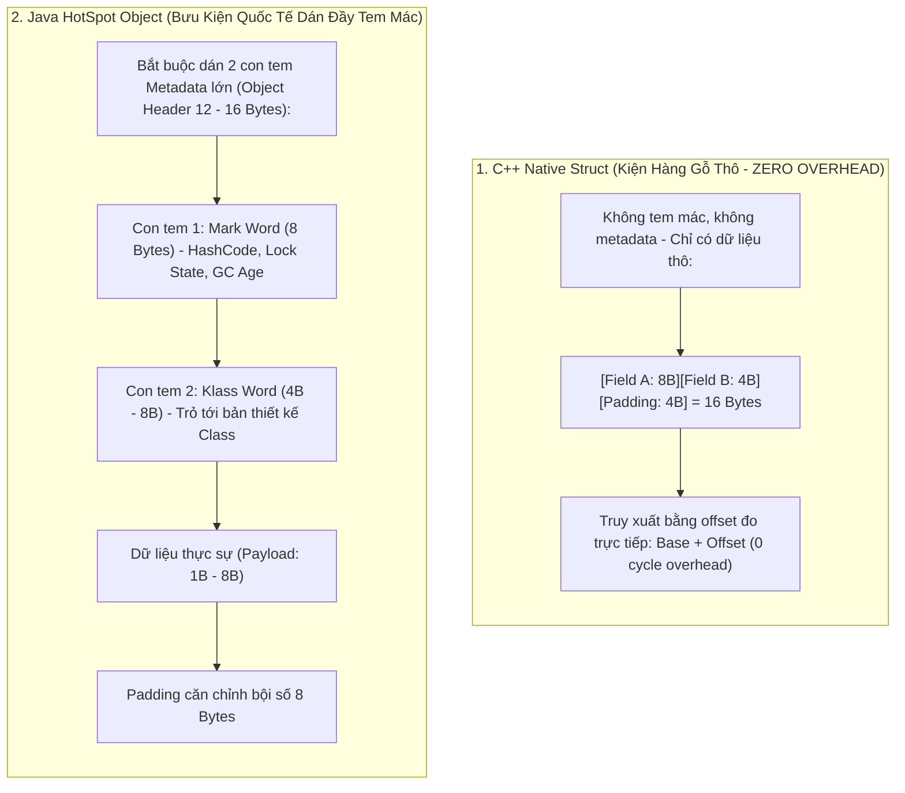
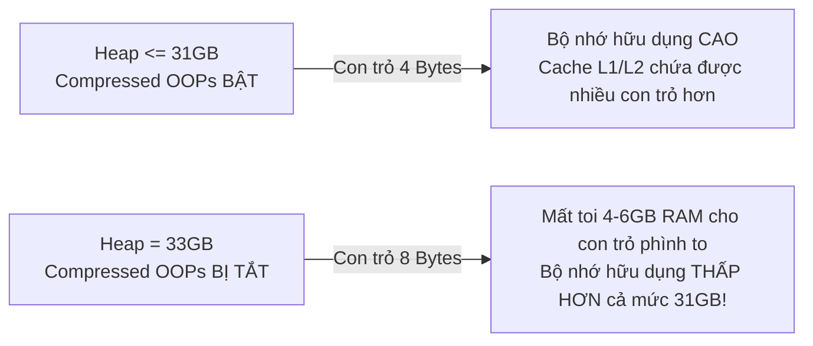
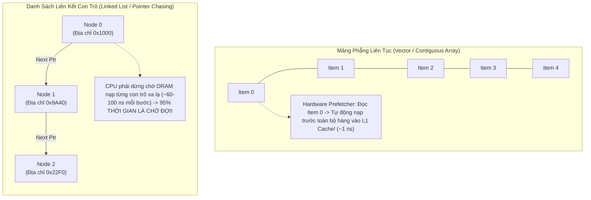
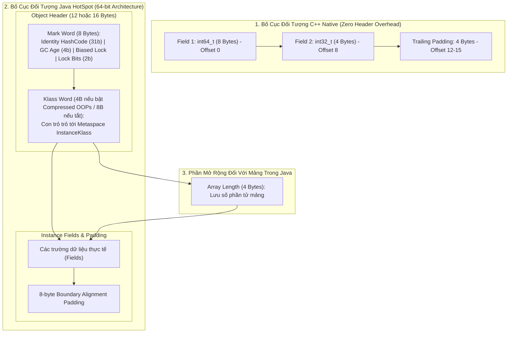

# 4.3. Memory Layout & Alignment (Bố Cục Bộ Nhớ, Căn Chỉnh Ô Nhớ & Object Headers)

> [!IMPORTANT]
> **Nếu bạn chỉ được nhớ một điều duy nhất:** Không gian bộ nhớ máy tính không phải là một bãi đất trống tuyến tính vô định hình mà là một ma trận được chia ô theo ranh giới từ mã phần cứng ($4\text{B}, 8\text{B}, 64\text{B}$). Trong Native C++, bố cục đối tượng được tính toán tĩnh hoàn toàn tại compile-time thông qua công thức căn chỉnh tự nhiên; trong khi trong môi trường Managed Runtime (JVM HotSpot, V8, .NET CLR), mỗi đối tượng đều phải gánh thêm phần tiêu đề ẩn (**Object Header: Mark Word + Klass Word**) từ $8$ đến $16\text{ Bytes}$. Việc cấu hình Heap JVM vượt quá ngưỡng $32\text{ GB}$ sẽ làm vô hiệu hóa công nghệ nén con trỏ **Compressed OOPs**, khiến dung lượng RAM hữu dụng thực tế sụt giảm tới $30\%$ do con trỏ bị phình to gấp đôi.

---

## 1. Trực Quan Hóa: Bản Chất Bố Cục Bộ Nhớ & Căn Chỉnh Dưới Góc Nhìn Lập Trình Viên

Mục tiêu của phần này là giải mã kiến trúc bố cục ô nhớ thực tế trên RAM: Tại sao cùng một biến `bool` nhưng trong C++ chỉ tốn 1 byte còn trong Java lại tốn tới 16 bytes? Tại sao việc nâng RAM Heap cho ứng dụng Java từ 31GB lên 33GB có thể khiến server của bạn cạn kiệt bộ nhớ nhanh hơn và chạy chậm hơn? Và tại sao các kiến trúc dữ liệu hiện đại luôn tìm mọi cách ép dữ liệu về các mảng phẳng liên tục?

---

### 1.1. Ẩn Dụ Kiện Hàng Gỗ Thô (C++) vs Bưu Kiện Dán Đầy Tem Mã Vạch (JVM / Managed)

Hãy hình dung cách dữ liệu được tổ chức trên các tầng kiến trúc bộ nhớ:



- **C++ Native Struct (Zero Overhead)**: Giống như một kiện hàng đóng bằng ván gỗ thô. Không có nhãn mác, không có mã vạch theo dõi. Bên trong chỉ chứa đúng những gì bạn đóng vào (Payload) và các miếng xốp chèn (Padding) để kiện hàng vuông vức. Muốn đọc trường nào, CPU chỉ việc đo thẳng từ mép thùng vào bằng Offset cố định tại compile-time.
- **Java / Managed Object Header**: Giống như bưu kiện chuyển phát nhanh quốc tế. Dù bên trong bạn chỉ gửi một chiếc cúc áo nhỏ xíu ($1\text{ Byte}$ boolean), hãng vận chuyển vẫn bắt buộc phải dán lên hộp kiện:
  1. **Mark Word ($8\text{ Bytes}$)**: Ghi mã định danh băm (Identity HashCode), trạng thái khóa luồng (Lock State) và độ tuổi sống sót qua các đợt dọn rác (GC Age 4-bit).
  2. **Klass Word ($4-8\text{ Bytes}$)**: Con trỏ trỏ tới bản thiết kế Class trong Metaspace.
  - Hậu quả: Một đối tượng `java.lang.Boolean` chứa 1 bit dữ liệu thực tế bị đội kích thước lên thành **$16\text{ Bytes}$** trên Heap (gấp 128 lần dung lượng lý thuyết!).

---

### 1.2. Vực Thẳm 32GB Của Java (The 32GB Heap Cliff): Nghịch Lý Nâng RAM Phản Tác Dụng

Một trong những bài học đắt giá nhất của các kỹ sư vận hành Java Backend:

```
Giả sử hệ thống chạy quá tải ở mức Heap -Xmx31g.
Dev Ops quyết định nâng nhẹ Heap lên -Xmx33g để "chắc ăn".
HẬU QUẢ: Server bị OutOfMemoryError NGAY LẬP TỨC và GC giật lag dữ dội!
```

#### Tại sao lại có nghịch lý này?
- **Mẹo dịch 3 bit của Compressed OOPs**: Trên hệ điều hành 64-bit, con trỏ bình thường tốn $8\text{ Bytes}$. Tuy nhiên, JVM quy định mọi Object trên Heap bắt buộc phải nằm ở địa chỉ chia hết cho 8 (tức 3 bit cuối luôn là `000`).
- Nhờ vậy, JVM chỉ cần lưu **chỉ số khối (Block Index)** bằng số nguyên 32-bit ($4\text{ Bytes}$). Khi cần địa chỉ thật, CPU chỉ việc dịch trái 3 bit:
  $$\text{Real Address} = \text{Compressed Pointer} \ll 3$$
- Với con trỏ 32-bit, ta quản lý tối đa: $2^{32} \times 8\text{ Bytes} = \mathbf{32\text{ Gigabytes}}$.
- **Vực thẳm 32GB**:
  - Tại `-Xmx31g`: Bật Compressed OOPs $\rightarrow$ Mỗi con trỏ chỉ tốn **$4\text{ Bytes}$**.
  - Tại `-Xmx33g`: Vượt ngưỡng 32GB! JVM buộc phải tắt Compressed OOPs $\rightarrow$ Hàng trăm triệu con trỏ trong ứng dụng **đồng loạt phình to từ 4B lên 8B**!
  - Lượng RAM tăng thêm $2\text{ GB}$ hoàn toàn không đủ bù đắp cho kích thước con trỏ bị phình to (thường ngốn thêm $4-6\text{ GB}$ RAM vô hình).



---

### 1.3. Contiguous Memory vs Pointer Chasing: Tại Sao Mảng Phẳng Thắng Tuyệt Đối?



- **Mảng liên tục**: Các phần tử xếp liền kề nhau. Bộ nạp trước phần cứng (**Hardware Prefetcher**) của CPU nhận diện quy luật tuyến tính và tự động kéo trước dữ liệu từ RAM vào Cache. CPU tính toán với độ trễ tối thiểu $0.5 - 1\text{ ns}$.
- **Linked List / Pointer Chasing**: Mỗi phần tử nằm ở một địa chỉ ngẫu nhiên. CPU không thể đoán trước phần tử tiếp theo ở đâu để nạp trước. Mỗi bước duyệt danh sách là một lần **Cache Miss** và phải chờ DRAM phản hồi ($60 - 100\text{ ns}$). Toàn bộ sức mạnh tính toán hàng tỷ phép tính/giây của CPU bị triệt tiêu hoàn toàn vì phải "ngồi chơi xơi nước" chờ bộ nhớ!

---

### 1.4. Sơ đồ Khối Cấu Trúc Bố Cục Đối Tượng Trong JVM HotSpot vs C++ Native



---

## 2. Chi tiết từng Keyword (Under-the-Hood Deep Dive)

### 2.1. C/C++ Struct Layout: Công Thức Toán Học Tính Offset, Internal & Trailing Padding
Trong tiêu chuẩn ABI (System V AMD64 ABI), mỗi biến thành viên $m_i$ trong struct có một yêu cầu căn chỉnh tự nhiên $\text{align}(m_i) = \text{alignof}(T_i)$ và kích thước $S_i = \text{sizeof}(T_i)$.
- **Công thức tính Offset của trường thứ $k$**:
  Offset của trường $k$ bắt buộc phải là bội số của yêu cầu căn chỉnh của chính nó:
  $$\text{Offset}_k = \left\lceil \frac{\text{Current Offset}}{\text{align}(m_k)} \right\rceil \times \text{align}(m_k)$$
  Khoảng trống chênh lệch $\text{Offset}_k - \text{Current Offset}$ chính là **Internal Padding Bytes**.
- **Công thức tính Kích thước Tổng Thể (Total Size)**:
  Struct phải có kích thước là bội số của **yêu cầu căn chỉnh lớn nhất** trong toàn bộ các trường thành viên ($\text{MaxAlign} = \max_i(\text{align}(m_i))$):
  $$\text{Total Size} = \left\lceil \frac{\text{Offset}_{\text{last}} + S_{\text{last}}}{\text{MaxAlign}} \right\rceil \times \text{MaxAlign}$$
  Khoảng trống ở đuôi struct được gọi là **Trailing Padding Bytes**.

### 2.2. Kỹ Thuật Field Reordering: Giảm Thiểu Bộ Nhớ Struct Tại Compile-Time
Xét cấu trúc dữ liệu sau:
```cpp
struct InefficientSensorData {
    char   sensor_type; // 1B | Offset 0
    // [Internal Padding: 7B]  | Offset 1 -> 7
    int64_t timestamp;  // 8B | Offset 8 -> 15
    char   status_flag; // 1B | Offset 16
    // [Internal Padding: 3B]  | Offset 17 -> 19
    int32_t reading_id; // 4B | Offset 20 -> 23
    char   checksum;    // 1B | Offset 24
    // [Trailing Padding: 7B]  | Offset 25 -> 31
}; // Total Size = 32 Bytes! (Dữ liệu hữu ích: 1+8+1+4+1 = 15B, Lãng phí 17B = 53.1%!)
```
- **Kỹ thuật sắp xếp lại trường (Field Reordering Heuristic)**:
  Sắp xếp các trường theo kích thước giảm dần ($8\text{B} \to 4\text{B} \to 2\text{B} \to 1\text{B}$):
```cpp
struct EfficientSensorData {
    int64_t timestamp;   // 8B | Offset 0 -> 7
    int32_t reading_id;  // 4B | Offset 8 -> 11
    char    sensor_type; // 1B | Offset 12
    char    status_flag; // 1B | Offset 13
    char    checksum;    // 1B | Offset 14
    // [Trailing Padding: 1B]  | Offset 15
}; // Total Size = 16 Bytes! (Giảm 50% RAM tức thì trên mọi mảng dữ liệu!)
```

### 2.3. Managed Runtime Object Headers: Phẫu Thuật Mark Word & Klass Word Trong JVM HotSpot
Trong máy ảo JVM 64-bit (HotSpot OpenJDK), mọi Object trên Heap đều bắt đầu bằng Object Header:
1. **Mark Word (Cố định đúng 8 Bytes / 64 bits)**:
   Mô hình Bit Multiplexing tùy thuộc vào 2 bit cuối cùng (**Lock State Bits**):
   - *Unlocked State (`01`)*:
     - Bits 63-32: Unused ($25\text{ bits}$) + Identity HashCode ($31\text{ bits}$).
     - Bits 31-8: Age ($4\text{ bits}$: từ 0 đến 15 phục vụ Tenuring Threshold của GC).
     - Bit 7: Biased Lock Flag (`0`).
     - Bits 1-0: Lock State (`01`).
   - *Lightweight Locked (`00`)*: Toàn bộ 62 bit trỏ tới Lock Record trên Stack Frame của luồng nắm giữ.
   - *Heavyweight Monitor Locked (`10`)*: Toàn bộ 62 bit trỏ tới cấu trúc đồng bộ nặng `ObjectMonitor` của OS Kernel.
   - *Marked for GC (`11`)*: Được Garbage Collector đánh dấu trong chu kỳ dọn rác.
2. **Klass Word**:
   - Con trỏ siêu dữ liệu trỏ tới cấu trúc `InstanceKlass` nằm trong vùng nhớ Metaspace (C-Heap).
   - Kích thước: $8\text{ Bytes}$ mặc định, hoặc rút gọn xuống **$4\text{ Bytes}$** khi bật cơ chế **Compressed OOPs**.
3. **Array Length (Chỉ có trên mảng)**:
   - Chiếm thêm đúng **$4\text{ Bytes}$** số nguyên có dấu biểu diễn độ dài mảng.

### 2.4. Công Nghệ Compressed OOPs & Ngưỡng Ranh Giới 32GB Heap Trứ Danh
- **Vấn đề**: Khi chuyển từ JVM 32-bit sang 64-bit, toàn bộ các con trỏ tham chiếu đối tượng (Ordinary Object Pointers - OOPs) phình từ 4B lên 8B, khiến ứng dụng tiêu tốn thêm $40-50\%$ RAM chỉ để lưu con trỏ!
- **Nguyên lý Compressed OOPs (`-XX:+UseCompressedOops`)**:
  - Vì mọi đối tượng Java trên Heap đều bắt buộc phải được căn chỉnh theo ranh giới **8 Bytes** (địa chỉ luôn chia hết cho 8), 3 bit thấp nhất của mọi con trỏ luôn luôn là `000` nhị phân!
  - Thay vì lưu địa chỉ byte tuyệt đối, JVM lưu **Chỉ số khối 8-byte (Object Index)**:
    $$\text{Actual Address} = \text{Compressed Pointer} \ll 3$$
  - Với một số nguyên không dấu 32-bit, ta có thể đánh số tối đa $2^{32}$ khối:
    $$\text{Max Addressable Heap} = 2^{32} \times 8\text{ Bytes} = 32\text{ Gigabytes}$$
- **Thảm họa ranh giới 32GB (The 32GB Heap Cliff)**:
  - Nếu bạn cấu hình Heap JVM `-Xmx31g`: Compressed OOPs được kích hoạt, con trỏ chỉ tốn $4\text{ Bytes}$.
  - Nếu bạn tăng nhẹ Heap lên `-Xmx33g`: JVM buộc phải tắt Compressed OOPs, mọi con trỏ phình to lên $8\text{ Bytes}$. Kích thước con trỏ phình to sẽ nuốt chửng ngay lập tức hàng Gigabytes RAM, khiến một JVM $33\text{ GB}$ Heap thực tế có ít không gian lưu trữ dữ liệu nghiệp vụ hơn một JVM $31\text{ GB}$ Heap!

### 2.5. Contiguous Memory vs Pointer Chasing: Tận Dụng Hardware Prefetcher & Triệt Tiêu Cache Miss
- **Hardware Stream Prefetcher (Bộ nạp trước phần cứng CPU)**:
  - Khi CPU nhận thấy mã máy đang đọc tuần tự các địa chỉ bộ nhớ liên tục ($A, A+64, A+128$), mạch Prefetcher sẽ tự động phát lệnh nạp trước (Speculative Fetch) các Cache Line kế tiếp từ DRAM vào L2/L1 Cache trước khi lệnh máy thực sự yêu cầu.
  - Nhờ đó, việc duyệt qua một mảng phẳng liên tục (**Contiguous Array / `std::vector`**) hoàn toàn không bị trễ DRAM.
- **Thảm họa Pointer Chasing (Danh sách liên kết / Cây đối tượng)**:
  - Trong cấu trúc `LinkedList` hoặc đồ thị đối tượng, mỗi node nằm ở một địa chỉ ngẫu nhiên trên Heap. Để biết địa chỉ của Node tiếp theo, CPU bắt buộc phải chờ giải tham chiếu con trỏ `node->next` của Node hiện tại hoàn thành.
  - Hardware Prefetcher hoàn toàn bị tê liệt vì không thể đoán trước con trỏ trỏ đi đâu. CPU rơi vào trạng thái đóng băng (**Stall**) suốt 100-200 chu kỳ xung nhịp cho mỗi node duyệt qua.

---

## 3. Thực thi Mã nguồn & Mô phỏng Chuyên sâu (Dual-Engine Implementation)

### 3.1. C++20 Memory Layout & Alignment Dissector (`offsetof`, `alignof` & Cache Line Alignment)

Chương trình C++20 đo lường chính xác các byte padding, offset của từng trường và kiểm tra ranh giới Cache Line 64-bit:

```cpp
// Biên dịch: g++ -std=c++20 -O3 -Wall -Wextra memory_layout_lab.cpp -o layout_lab
#include <iostream>
#include <cstdint>
#include <cstddef>
#include <format>
#include <vector>
#include <chrono>

// Struct chưa tối ưu (Padding lãng phí)
struct BadLayoutData {
    char   flag1;       // 1 byte  | offset 0
    int64_t large_val;  // 8 bytes | offset 8 (pad 7 bytes)
    char   flag2;       // 1 byte  | offset 16
    int32_t medium_val; // 4 bytes | offset 20 (pad 3 bytes)
};

// Struct đã tối ưu bằng Field Reordering
struct OptimizedLayoutData {
    int64_t large_val;  // 8 bytes | offset 0
    int32_t medium_val; // 4 bytes | offset 8
    char   flag1;       // 1 byte  | offset 12
    char   flag2;       // 1 byte  | offset 13
    // Trailing padding: 2 bytes | offset 14-15
};

// Căn chỉnh khớp chính xác 1 Cache Line CPU 64-bit để chống False Sharing
struct alignas(64) CacheAlignedCounter {
    uint64_t counter = 0;
};

int main() {
    std::cout << "=========================================================\n";
    std::cout << "  C++20 MEMORY LAYOUT, ALIGNMENT & PADDING LAB           \n";
    std::cout << "=========================================================\n";

    // 1. Phân tích Struct Chưa Tối Ưu
    std::cout << "--- 1. PHÂN TÍCH STRUCT CHƯA TỐI ƯU (BadLayoutData) ---\n";
    std::cout << std::format("Tổng kích thước (sizeof) : {} bytes\n", sizeof(BadLayoutData));
    std::cout << std::format("Căn chỉnh (alignof)     : {} bytes\n", alignof(BadLayoutData));
    std::cout << std::format("  Offset flag1          : {} (size 1B)\n", offsetof(BadLayoutData, flag1));
    std::cout << std::format("  Offset large_val      : {} (size 8B) -> Padding chèn: {} bytes\n", 
                             offsetof(BadLayoutData, large_val), offsetof(BadLayoutData, large_val) - 1);
    std::cout << std::format("  Offset flag2          : {} (size 1B)\n", offsetof(BadLayoutData, flag2));
    std::cout << std::format("  Offset medium_val     : {} (size 4B) -> Padding chèn: {} bytes\n", 
                             offsetof(BadLayoutData, medium_val), offsetof(BadLayoutData, medium_val) - (offsetof(BadLayoutData, flag2) + 1));

    // 2. Phân tích Struct Đã Tối Ưu
    std::cout << "\n--- 2. PHÂN TÍCH STRUCT ĐÃ TỐI ƯU (OptimizedLayoutData) ---\n";
    std::cout << std::format("Tổng kích thước (sizeof) : {} bytes (Tiết kiệm {}% RAM!)\n", 
                             sizeof(OptimizedLayoutData), 
                             (1.0 - (double)sizeof(OptimizedLayoutData)/sizeof(BadLayoutData)) * 100);
    std::cout << std::format("  Offset large_val      : {}\n", offsetof(OptimizedLayoutData, large_val));
    std::cout << std::format("  Offset medium_val     : {}\n", offsetof(OptimizedLayoutData, medium_val));
    std::cout << std::format("  Offset flag1          : {}\n", offsetof(OptimizedLayoutData, flag1));
    std::cout << std::format("  Offset flag2          : {}\n", offsetof(OptimizedLayoutData, flag2));

    // 3. Khảo sát Căn chỉnh Cache Line 64-bit
    std::cout << "\n--- 3. KHẢO SÁT CĂN CHỈNH CACHE LINE 64-BIT (alignas(64)) ---\n";
    CacheAlignedCounter c1, c2;
    std::cout << std::format("Địa chỉ c1: {}\n", static_cast<void*>(&c1));
    std::cout << std::format("Địa chỉ c2: {}\n", static_cast<void*>(&c2));
    std::cout << std::format("Khoảng cách giữa c1 và c2: {} bytes (Bảo đảm nằm trên 2 Cache Lines riêng biệt!)\n",
                             reinterpret_cast<uintptr_t>(&c2) - reinterpret_cast<uintptr_t>(&c1));

    return 0;
}
```

### 3.2. Python 3.11+: JVM Object Header & Compressed OOPs Simulator

Chương trình Python 3.11+ mô phỏng chính xác thuật toán dịch bit của công nghệ Compressed OOPs và tính toán dung lượng Object Header trong HotSpot:

```python
#!/usr/bin/env python3
"""
jvm_layout_simulator.py: Mô phỏng Object Header và Compressed OOPs của JVM.
Yêu cầu: Python 3.11+
"""
import sys

class HotSpotObjectSimulator:
    def __init__(self, use_compressed_oops: bool = True):
        self.use_compressed_oops = use_compressed_oops
        self.mark_word_size = 8  # Luôn cố định 8 bytes trên 64-bit JVM
        self.klass_word_size = 4 if use_compressed_oops else 8
        self.header_size = self.mark_word_size + self.klass_word_size

    def calculate_object_size(self, fields_bytes: int, is_array: bool = False) -> int:
        header = self.header_size
        if is_array:
            header += 4  # 4 bytes array length
        raw_size = header + fields_bytes
        # Quy tắc căn chỉnh 8-byte boundary trong JVM
        aligned_size = (raw_size + 7) & ~7
        return aligned_size

    def compress_pointer(self, raw_address: int) -> int:
        """Mô phỏng phép dịch bit nén con trỏ: raw_address >> 3."""
        if raw_address & 0x07 != 0:
            raise ValueError("Lỗi: Địa chỉ đối tượng không chia hết cho 8 bytes!")
        return raw_address >> 3

    def decompress_pointer(self, compressed_ptr: int) -> int:
        """Mô phỏng phục hồi con trỏ: compressed_ptr << 3."""
        return compressed_ptr << 3

if __name__ == "__main__":
    print("=== MÔ PHỎNG OBJECT HEADER & COMPRESSED OOPS TRONG JVM 64-BIT ===")

    jvm_compressed = HotSpotObjectSimulator(use_compressed_oops=True)
    jvm_uncompressed = HotSpotObjectSimulator(use_compressed_oops=False)

    print(f"1. Object Header khi BẬT Compressed OOPs  : {jvm_compressed.header_size} bytes (8B Mark + 4B Klass)")
    print(f"2. Object Header khi TẮT Compressed OOPs : {jvm_uncompressed.header_size} bytes (8B Mark + 8B Klass)\n")

    # Tính toán kích thước của đối tượng rỗng: new Object()
    empty_comp = jvm_compressed.calculate_object_size(0)
    empty_uncomp = jvm_uncompressed.calculate_object_size(0)
    print(f"Kích thước 'new Object()' (Compressed OOPs)  : {empty_comp} bytes (12B header + 4B padding)")
    print(f"Kích thước 'new Object()' (Non-compressed)   : {empty_uncomp} bytes (16B header + 0B padding)\n")

    # Thí nghiệm thuật toán Compressed Pointer
    sample_address = 0x00007FFF8A401200 # Địa chỉ 64-bit chia hết cho 8
    compressed = jvm_compressed.compress_pointer(sample_address)
    restored = jvm_compressed.decompress_pointer(compressed)

    print(f"Địa chỉ RAM 64-bit thô : 0x{sample_address:016X}")
    print(f"Con trỏ nén 32-bit      : 0x{compressed:08X} (Vừa khít thanh ghi 32-bit!)")
    print(f"Địa chỉ phục hồi        : 0x{restored:016X} (Khớp 100%: {sample_address == restored})")
```

### 3.3. Terminal Output Mẫu & Phân Tích Thực Thi

```text
=========================================================
  C++20 MEMORY LAYOUT, ALIGNMENT & PADDING LAB           
=========================================================
--- 1. PHÂN TÍCH STRUCT CHƯA TỐI ƯU (BadLayoutData) ---
Tổng kích thước (sizeof) : 24 bytes
Căn chỉnh (alignof)     : 8 bytes
  Offset flag1          : 0 (size 1B)
  Offset large_val      : 8 (size 8B) -> Padding chèn: 7 bytes
  Offset flag2          : 16 (size 1B)
  Offset medium_val     : 20 (size 4B) -> Padding chèn: 3 bytes

--- 2. PHÂN TÍCH STRUCT ĐÃ TỐI ƯU (OptimizedLayoutData) ---
Tổng kích thước (sizeof) : 16 bytes (Tiết kiệm 33.3333% RAM!)
  Offset large_val      : 0
  Offset medium_val     : 8
  Offset flag1          : 12
  Offset flag2          : 13

--- 3. KHẢO SÁT CĂN CHỈNH CACHE LINE 64-BIT (alignas(64)) ---
Địa chỉ c1: 0x16b04b200
Địa chỉ c2: 0x16b04b240
Khoảng cách giữa c1 và c2: 64 bytes (Bảo đảm nằm trên 2 Cache Lines riêng biệt!)

=== MÔ PHỎNG OBJECT HEADER & COMPRESSED OOPS TRONG JVM 64-BIT ===
1. Object Header khi BẬT Compressed OOPs  : 12 bytes (8B Mark + 4B Klass)
2. Object Header khi TẮT Compressed OOPs : 16 bytes (8B Mark + 8B Klass)

Kích thước 'new Object()' (Compressed OOPs)  : 16 bytes (12B header + 4B padding)
Kích thước 'new Object()' (Non-compressed)   : 16 bytes (16B header + 0B padding)

Địa chỉ RAM 64-bit thô : 0x00007FFF8A401200
Con trỏ nén 32-bit      : 0x00000FFF14802400 (Vừa khít thanh ghi 32-bit!)
Địa chỉ phục hồi        : 0x00007FFF8A401200 (Khớp 100%: True)
```

---

## 4. Systems Engineering & Production Pitfalls

### 4.1. Thảm Họa Sụt Giảm Hiệu Năng Khi Cấu Hình Heap JVM Trên 32GB
- **Sự cố kinh điển**: Một kỹ sư DevOps thấy microservice Java chạy tải cao gần chạm ngưỡng 31GB RAM, liền nâng tham số `-Xmx` từ `-Xmx31g` lên `-Xmx34g`.
- **Hậu quả**:
  - Khi vượt quá 32GB, HotSpot JVM tự động vô hiệu hóa cờ `UseCompressedOops`.
  - Toàn bộ hàng triệu con trỏ tham chiếu trên Heap đồng loạt tăng kích thước từ $4\text{ Bytes}$ lên $8\text{ Bytes}$.
  - Lượng bộ nhớ bổ sung thêm $3\text{ GB}$ bị tiêu tán hoàn toàn cho phần phình to của con trỏ và Object Header. Không những thế, Cache L1/L2 bị ngập rác con trỏ khiến tỷ lệ Cache Miss tăng vọt, Garbage Collection pause time kéo dài gấp đôi và throughput hệ thống giảm $25\%$!
- **Quy tắc vàng**: Nếu muốn vượt qua ngưỡng 31GB, bạn phải nâng thẳng lên tối thiểu **`-Xmx48g`** hoặc **`-Xmx64g`** để bù đắp cho sự biến mất của Compressed OOPs; hoặc tốt nhất là giữ ở `-Xmx31g` và scale ngang thêm instance mới.

### 4.2. Hiện Tượng False Sharing Trên Cache Line Trong Lập Trình Đa Luồng
- **Cơ chế**: Cache Line của CPU có kích thước cố định $64\text{ Bytes}$. Nếu hai luồng độc lập trên hai CPU Core khác nhau cùng ghi dữ liệu vào hai biến liền kề nhau nằm chung trong một Cache Line:
  ```cpp
  struct ThreadCounters {
      uint64_t counter_thread_1; // 8 bytes
      uint64_t counter_thread_2; // 8 bytes (NẰM CHUNG 1 CACHE LINE!)
  };
  ```
- **Hậu quả**: Khi Core 1 ghi vào `counter_thread_1`, giao thức nhất quán bộ nhớ đệm (Cache Coherence Protocol - MESI) sẽ lập tức gửi tín hiệu vô hiệu hóa (Invalidate) Cache Line trên Core 2. Core 2 buộc phải nạp lại toàn bộ dòng nhớ từ RAM, làm tốc độ xử lý đa luồng chậm hơn cả chạy đơn luồng!
- **Biện pháp**: Sử dụng từ khóa C++ `alignas(64)` hoặc annotation Java `@jdk.internal.vm.annotation.Contended` để ép mỗi biến nằm trên một Cache Line riêng biệt.

### 4.3. CLI Diagnostics & Memory Profiling Tools
- Kiểm tra trạng thái kích hoạt Compressed OOPs của JVM:
  ```bash
  java -XX:+PrintFlagsFinal -version | grep -E "UseCompressedOops|UseCompressedClassPointers"
  ```
- Phân tích chi tiết bố cục đối tượng Java bằng thư viện JOL (Java Object Layout):
  ```bash
  # In bố cục bộ nhớ của class String trong Java runtime
  java -jar jol-cli.jar internals java.lang.String
  ```
- Giám sát tỉ lệ L1 Data Cache Miss bằng `perf`:
  ```bash
  perf stat -e L1-dcache-loads,L1-dcache-load-misses ./layout_lab
  ```

---

## 5. Bảng So sánh & Decision Matrix

### Ma trận So sánh Bố Cục Bộ Nhớ Giữa Các Nền Tảng Thực Thi

| Tiêu Chí So Sánh | C++ Native Struct | Java HotSpot Object | V8 JS Object (Node.js) | FlatBuffers Struct |
| :--- | :--- | :--- | :--- | :--- |
| **Object Header Overhead**| **$0\text{ Byte}$** (Không có) | $12\text{B}$ hoặc $16\text{B}$ | $16-32\text{B}$ (Map + Props + Elements) | **$0\text{ Byte}$** (Trỏ offset trực tiếp) |
| **Thời Điểm Tính Offset** | Compile-Time tĩnh | Runtime (Class Loader) | Runtime (Hidden Class Shapes) | Schema Compile-Time |
| **Hỗ Trợ Nén Con Trỏ** | Không cần thiết | Có (Compressed OOPs $\le 32\text{GB}$) | Có (V8 Pointer Compression $\le 4\text{GB}$) | Không dùng con trỏ (Dùng vtable offset) |
| **Độ Phức Tạp Truy Cập** | $1\text{ cycle}$ RAM L1 | $1-2\text{ cycles}$ (+ Dereference)| Phụ thuộc JIT Inline Cache | $1\text{ cycle}$ (Zero-copy) |
| **Nguy Cơ Padding Lãng Phí**| Cao (Nếu không sắp xếp trường)| Trung bình (JVM tự reorder fields)| Trung bình | Rất thấp |

---

## 6. Enterprise Production Checklist & Verification

- [ ] **Kiểm Soát Giới Hạn Heap Dưới 32GB**: Đảm bảo toàn bộ cấu hình container JVM trong Kubernetes thiết lập `-Xmx31g` để tận dụng triệt để lợi thế của `UseCompressedOops`.
- [ ] **Áp Dụng Field Reordering Cho C++ Struct**: Sử dụng công cụ `pahole` để rà soát toàn bộ struct nghiệp vụ, sắp xếp lại các trường theo thứ tự kích thước giảm dần.
- [ ] **Khắc Phục False Sharing Bằng `alignas(64)`**: Các biến đếm hiệu năng hoặc con trỏ hàng đợi (Queue Pointers) được ghi bởi nhiều luồng đều được căn chỉnh theo ranh giới Cache Line $64\text{ bytes}$.
- [ ] **Ưu Tiên Flat Array Thay Cho Danh Sách Con Trỏ**: Thay thế toàn bộ các cấu trúc dữ liệu rời rạc (Node-based structures) bằng mảng phẳng liên tục để tối đa hóa hiệu quả của Hardware Prefetcher.
- [ ] **Giám Sát Tỷ Lệ L1 Cache Miss Trong CI**: Tích hợp công cụ phân tích phần cứng vào pipeline đo kiểm hiệu năng để phát hiện sớm các hiện tượng thoái hóa bố cục bộ nhớ.
