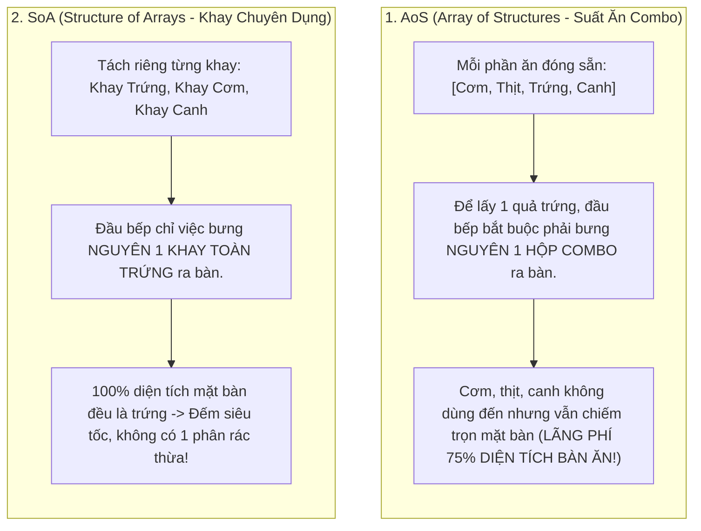
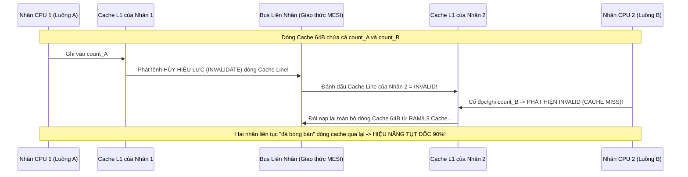
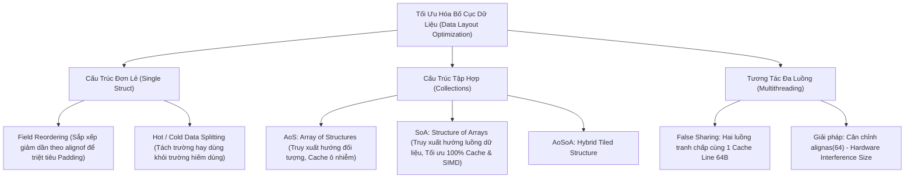
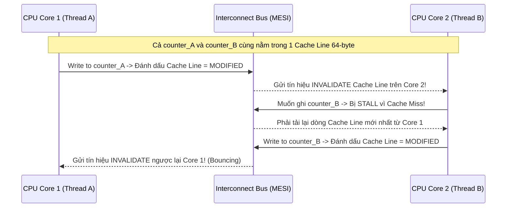

# 4.4. Data Layout Optimization (Tối Ưu Hóa Bố Cục Dữ Liệu: AoS vs SoA, Data-Oriented Design & False Sharing)

> [!IMPORTANT]
> **Nếu bạn chỉ được nhớ một điều duy nhất:** Hiệu năng tính toán của hệ thống hiện đại không bị nghẽn bởi tốc độ xung nhịp CPU mà bị nghẽn bởi tốc độ nạp dữ liệu từ RAM (**The Memory Wall**). CPU không bao giờ nạp từng byte riêng lẻ mà luôn nạp nguyên một dòng **Cache Line $64\text{ Bytes}$**. Chuyển đổi dữ liệu từ Mảng các Cấu trúc (**AoS**) sang Cấu trúc các Mảng (**SoA**) loại bỏ hoàn toàn ô nhiễm cache, khai mở sức mạnh vector hóa phần cứng **SIMD** giúp tăng tốc xử lý từ $400\% - 800\%$. Đồng thời, trong lập trình đa luồng, hai biến độc lập của hai luồng khác nhau bắt buộc phải cách nhau tối thiểu $64\text{ Bytes}$ (`alignas(64)`) để tránh thảm họa **False Sharing** làm tê liệt băng thông liên nhân.

---

## 1. Trực Quan Hóa: Bản Chất Tối Ưu Bố Cục Dữ Liệu Dưới Góc Nhìn Lập Trình Viên

Mục tiêu của phần này là giải mã sự đối lập giữa tư duy lập trình hướng đối tượng (OOP) và kiến trúc phần cứng thực tế: Tại sao viết code đúng chuẩn OOP lại khiến CPU lãng phí tới $75-90\%$ băng thông bộ nhớ? Tại sao việc chuyển đổi từ AoS sang SoA lại cho phép CPU thực hiện 8 phép tính trong đúng 1 chu kỳ xung nhịp? Và tại sao một đoạn code đa luồng không dùng bất kỳ cơ chế khóa (Lock-free) nào lại chạy chậm hơn gấp 10 lần so với chạy đơn luồng?

---

### 1.1. Ẩn Dụ Suất Ăn Combo Đóng Gói (AoS) vs Khay Thức Ăn Chuyên Dụng (SoA)

Hãy tưởng tượng bạn điều hành một căng-tin phục vụ hàng nghìn người và muốn tính xem hôm nay căng-tin tiêu thụ bao nhiêu quả trứng:



- **AoS (Array of Structures - Mô hình Hướng Đối Tượng)**: Mỗi phần tử là một đối tượng hoàn chỉnh gồm đầy đủ mọi thuộc tính: `User { id, balance, name, address, avatar }`. Khi bạn chạy một vòng lặp để tính tổng số dư (`sum += user.balance`), CPU nạp một Cache Line $64\text{ Bytes}$ vào bộ nhớ đệm, trong đó chỉ có 8 bytes `balance` là có ích, còn lại 56 bytes chứa tên, địa chỉ, ảnh đại diện bị nạp kèm một cách vô ích (**Cache Pollution**).
- **SoA (Structure of Arrays - Mô hình Hướng Dữ Liệu)**: Gom các thuộc tính cùng loại vào các mảng riêng biệt: một mảng toàn bộ `balance`, một mảng toàn bộ `id`. Khi cần tính tổng số dư, CPU nạp Cache Line chứa trọn vẹn **8 số dư liên tiếp**, hiệu suất sử dụng Cache Line đạt $100\%$ hoàn hảo!

---

### 1.2. Phân Tích Thực Tế: Cache Line $64\text{ Bytes}$ & Vector Hóa SIMD

Hãy so sánh cách CPU xử lý mảng $1.000.000$ phần tử:

```cpp
// AoS: Chuẩn OOP truyền thống
struct Order {
    uint64_t id;      // 8B
    double   amount;  // 8B  <-- Ta chỉ cần trường này!
    uint32_t user_id; // 4B
    char     desc[44];// 44B
}; // Kích thước: đúng 64 Bytes (khớp 1 Cache Line)
Order orders[1000000];

// Vòng lặp tính tổng doanh thu:
for (int i = 0; i < 1000000; ++i) {
    total += orders[i].amount; // Mỗi lần lặp tốn 1 lần nạp 64B từ RAM -> Dùng 8B, vứt 56B!
}
```

Trong mô hình AoS trên:
- Để cộng 1 triệu số, CPU phải nạp: $1.000.000 \times 64\text{ Bytes} = \mathbf{64\text{ MB}}$ dữ liệu từ RAM.
- Trong đó chỉ có $8\text{ MB}$ là dữ liệu thực sự cần dùng!

```cpp
// SoA: Chuẩn Data-Oriented Design (DOD)
struct OrdersSoA {
    double amount[1000000]; // 8MB liên tục 100%!
    // Các trường khác nằm ở các mảng riêng biệt...
};
```

Trong mô hình SoA:
- CPU chỉ cần nạp đúng **$8\text{ MB}$** dữ liệu. Băng thông bộ nhớ giảm ngay lập tức **8 lần**!
- Đặc biệt, vì các số `double` nằm liền kề nhau, trình biên dịch tự động kích hoạt tập lệnh **SIMD (AVX2 / AVX-512)**: CPU dùng đúng 1 lệnh nạp 4 hoặc 8 số thực cùng lúc và cộng song song trong 1 chu kỳ xung nhịp!

---

### 1.3. Cơn Ác Mộng Đa Luồng: Hiện Tượng False Sharing (Chia Sẻ Sai)

Một trong những nguyên nhân phổ biến nhất khiến code đa luồng chạy chậm hơn đơn luồng:

```cpp
struct ThreadCounters {
    uint64_t count_A; // Luồng 1 ghi vào đây | Offset 0
    uint64_t count_B; // Luồng 2 ghi vào đây | Offset 8
}; // CẢ HAI BIẾN NẰM CHUNG TRONG 1 DÒNG CACHE LINE 64 BYTES!
```



#### Cách giải quyết: Cách ly dòng Cache (`alignas(64)`)
Để triệt tiêu False Sharing, ta ép trình biên dịch cấp phát mỗi biến trên một dòng Cache Line $64\text{ Bytes}$ hoàn toàn riêng biệt:
```cpp
struct alignas(64) ThreadSafeCounter {
    uint64_t count;
    // Tự động chèn 56 bytes padding để lấp đầy 64 bytes!
};
```
Khi hai biến nằm trên hai Cache Line khác nhau, hai nhân CPU có thể ghi đồng thời với tốc độ tối đa mà không gây ra bất kỳ tranh chấp bus nào!

---

### 1.4. Tách Dữ Liệu Nóng / Lạnh (Hot/Cold Splitting)

Trong các entity Backend (như `User`, `Account`), có những trường được truy cập hàng triệu lần mỗi giây (Hot Data: `id`, `status`, `balance`), trong khi những trường khác chỉ đọc 1 lần mỗi tuần (Cold Data: `avatar_url`, `shipping_address`, `bio`).
- **Sai lầm**: Gom tất cả vào 1 struct lớn 512 bytes. Khi kiểm tra trạng thái đăng nhập, RAM nạp cả địa chỉ và tiểu sử của user vào Cache L1.
- **Giải pháp**: Tách thành `UserHot` (32 bytes) và `UserCold` (480 bytes). Toàn bộ danh sách `UserHot` của cả triệu người dùng có thể nằm gọn trong Cache L3, giúp các phép kiểm tra quyền hạn và số dư diễn ra trong vài nano-giây.

---

### 1.5. Sơ Đồ Khối Tổng Quan Tối Ưu Bố Cục Dữ Liệu



---

## 2. Chi tiết từng Keyword (Under-the-Hood Deep Dive)

### 2.1. Array of Structures (AoS) vs Structure of Arrays (SoA)

#### 1. Mô hình Mảng các Cấu trúc (AoS - Array of Structures)
- Đây là cách tổ chức tự nhiên nhất trong lập trình hướng đối tượng (OOP):
  ```cpp
  struct Order {
      uint64_t id;         // 8 bytes
      double   amount;     // 8 bytes
      uint32_t user_id;    // 4 bytes
      char     status[12]; // 12 bytes
  }; // Kích thước: 32 bytes
  Order orders[1000000]; // Mảng 1 triệu đơn hàng
  ```
- **Tử huyệt hiệu năng khi duyệt báo cáo**:
  - Giả sử bài toán nghiệp vụ cần tính tổng doanh thu: `total += orders[i].amount`.
  - CPU chỉ cần trường `amount` (8 bytes), nhưng mỗi lần truy cập, CPU Cache Controller buộc phải nạp nguyên một Cache Line 64-byte (chứa cả `id`, `user_id`, `status` của đơn hàng đó và đơn hàng kế tiếp).
  - Tỷ lệ dữ liệu hữu ích được sử dụng trong cache chỉ là:
    $$\frac{8\text{ bytes dùng}}{32\text{ bytes nạp}} = 25\%!$$
    $75\%$ dung lượng Cache L1/L2 quý giá bị chiếm dụng bởi rác (ô nhiễm cache).

#### 2. Mô hình Cấu trúc các Mảng (SoA - Structure of Arrays)
- Chuyển đổi toàn bộ mảng thành một struct chứa các mảng phẳng độc lập:
  ```cpp
  struct OrdersSoA {
      uint64_t id[1000000];
      double   amount[1000000];  // Mảng liên tục 100% của amount!
      uint32_t user_id[1000000];
      char     status[1000000][12];
  };
  ```
- **Lợi ích tối thượng của SoA**:
  1. **Hiệu suất Cache đạt $100\%$**: Mỗi Cache Line 64-byte nạp lên chứa trọn vẹn **8 biến `double amount` liên tiếp**. Không có 1 byte thừa nào!
  2. **Tự động Vector hóa SIMD (AVX2 / AVX-512)**: CPU có thể dùng 1 chỉ thị SIMD duy nhất (`_mm256_add_pd`) để cộng 4 số thực `amount` đồng thời trong 1 chu kỳ xung nhịp, tăng tốc độ tính toán lên gấp 4 đến 8 lần!

#### 3. Sơ đồ minh họa dòng Cache của AoS vs SoA
```text
AoS Cache Line (64 Bytes):
[ id_0 ][ amount_0 ][ user_0 ][ status_0 ][ id_1 ][ amount_1 ]  <-- Lẫn lộn, tốn cache!

SoA Cache Line cho trường amount (64 Bytes):
[ amount_0 ][ amount_1 ][ amount_2 ][ amount_3 ][ amount_4 ][ amount_5 ][ amount_6 ][ amount_7 ]
<------------------------------ 100% HỮU DỤNG CHO TÍNH TOÁN ------------------------------>
```

---

### 2.2. Data-Oriented Design (DOD) & Hot/Cold Data Splitting

#### 1. Triết lý Data-Oriented Design
- Khác với OOP (tập trung vào "Đóng gói dữ liệu và phương thức vào Class", che giấu thông tin), Data-Oriented Design (DOD) tập trung vào:
  - **Bản chất phần cứng**: Dữ liệu nằm ở đâu trong RAM? Dòng cache nạp cái gì?
  - **Luồng biến đổi dữ liệu**: Coi chương trình là một đường ống biến đổi dữ liệu đầu vào thành dữ liệu đầu ra với số lượng Cache Miss và Pointer Indirection ít nhất.

#### 2. Kỹ thuật Phân tách Dữ liệu Nóng / Lạnh (Hot/Cold Splitting)
Trong nhiều hệ thống Backend, một thực thể User có hàng chục trường, nhưng:
- **Hot Data (Dữ liệu nóng)**: Thường xuyên được đọc/ghi trong hot-path (ví dụ: `id`, `balance`, `status`, `auth_token`).
- **Cold Data (Dữ liệu lạnh)**: Rất hiếm khi dùng, chỉ nạp khi hiển thị hồ sơ chi tiết (ví dụ: `bio`, `shipping_address`, `avatar_url`, `created_at`).
- *Giải pháp*: Tách đối tượng thành 2 struct: `UserHot` và `UserCold`. Mảng các `UserHot` sẽ cực kỳ nhỏ gọn, cho phép nạp hàng nghìn User vào L1 Cache để kiểm tra quyền và xác thực trong micro-giây.

---

### 2.3. Hiện Tượng False Sharing Trong Lập Trình Đa Luồng

#### 1. Cơ chế hoạt động sâu của phần cứng (Giao thức MESI)
- Mỗi nhân CPU (Core) có L1/L2 Cache riêng. Để đảm bảo dữ liệu giữa các nhân nhất quán, phần cứng sử dụng giao thức **MESI (Modified, Exclusive, Shared, Invalid)**.
- Khi một Core ghi dữ liệu vào một địa chỉ, nó phải gửi tín hiệu qua bus phần cứng để **Hủy hiệu lực (Invalidate)** toàn bộ Cache Line chứa địa chỉ đó trên tất cả các Core khác!

#### 2. Kịch bản False Sharing tai hại
Giả sử ta có 2 luồng tính toán độc lập chạy trên 2 Core khác nhau:
- Luồng 1 ghi liên tục vào biến `counter_A`.
- Luồng 2 ghi liên tục vào biến `counter_B`.
- Nếu lập trình viên khai báo 2 biến này nằm cạnh nhau trong bộ nhớ:
  ```cpp
  struct Counters {
      uint64_t counter_A; // Offset 0
      uint64_t counter_B; // Offset 8 (CẢ HAI CÙNG NẰM TRONG 1 CACHE LINE 64B!)
  };
  ```
- **Hậu quả**:
  - Dù hai luồng không hề chia sẻ logic với nhau, việc Core 1 cập nhật `counter_A` liên tục đá văng Cache Line của Core 2 về trạng thái **Invalid**, buộc Core 2 phải tạm dừng và nạp lại dòng cache từ bộ nhớ dùng chung.
  - Dòng cache bị "bóng bàn" (Cache Line Bouncing) qua lại liên tục giữa các Core, khiến chương trình chạy đa luồng còn **chậm hơn gấp 10 lần so với chạy đơn luồng**!

#### 3. Sơ đồ cơ chế False Sharing


---

## 3. Thực thi Mã nguồn & Mô phỏng Chuyên sâu (Dual-Engine Implementation)

### 3.1. C++20: Khảo Sát Tốc Độ AoS vs SoA và Tiêu Diệt False Sharing Bằng `alignas(64)`

```cpp
#include <iostream>
#include <vector>
#include <chrono>
#include <thread>
#include <new>
#include <format>

// 1. So Sánh Hiệu Năng Duyệt AoS vs SoA
constexpr size_t NUM_ELEMENTS = 10'000'000;

struct AoS_Item {
    float x, y, z;
    char  metadata[52]; // Payload lớn khiến đối tượng tròn 64 bytes
};

struct SoA_Collection {
    std::vector<float> x;
    std::vector<float> y;
    std::vector<float> z;
};

void benchmark_aos_vs_soa() {
    // Khởi tạo AoS
    std::vector<AoS_Item> aos(NUM_ELEMENTS);
    for (size_t i = 0; i < NUM_ELEMENTS; ++i) aos[i].x = 1.0f;

    // Khởi tạo SoA
    SoA_Collection soa;
    soa.x.resize(NUM_ELEMENTS, 1.0f);

    // Đo lường AoS
    auto t1 = std::chrono::high_resolution_clock::now();
    float sum_aos = 0.0f;
    for (size_t i = 0; i < NUM_ELEMENTS; ++i) {
        sum_aos += aos[i].x; // Cache utilization chỉ 6.25% (4B / 64B)!
    }
    auto t2 = std::chrono::high_resolution_clock::now();

    // Đo lường SoA
    float sum_soa = 0.0f;
    for (size_t i = 0; i < NUM_ELEMENTS; ++i) {
        sum_soa += soa.x[i]; // Cache utilization 100% liên tục!
    }
    auto t3 = std::chrono::high_resolution_clock::now();

    std::cout << std::format("AoS Sum Time: {:.2f} ms\n", 
                 std::chrono::duration<double, std::milli>(t2 - t1).count());
    std::cout << std::format("SoA Sum Time: {:.2f} ms (Nhanh vượt trội nhờ Cache Locality)\n", 
                 std::chrono::duration<double, std::milli>(t3 - t2).count());
}

// 2. Khắc Phục Triệt Để False Sharing Bằng C++17 Hardware Destructive Interference Size
struct BadCounter {
    uint64_t val = 0;
};

struct alignas(64) SafeCounter { // Ép đối tượng chiếm trọn vẹn 1 Cache Line 64-byte riêng biệt
    uint64_t val = 0;
};

void benchmark_false_sharing() {
    constexpr int ITERS = 50'000'000;

    // Thí nghiệm 1: False Sharing (Hai biến nằm sát nhau trong RAM)
    BadCounter bad[2];
    auto t1 = std::chrono::high_resolution_clock::now();
    std::thread th1([&]() { for (int i = 0; i < ITERS; ++i) bad[0].val++; });
    std::thread th2([&]() { for (int i = 0; i < ITERS; ++i) bad[1].val++; });
    th1.join(); th2.join();
    auto t2 = std::chrono::high_resolution_clock::now();

    // Thí nghiệm 2: Cache-Aligned (Mỗi biến ở 1 Cache Line độc lập)
    SafeCounter safe[2];
    std::thread th3([&]() { for (int i = 0; i < ITERS; ++i) safe[0].val++; });
    std::thread th4([&]() { for (int i = 0; i < ITERS; ++i) safe[1].val++; });
    th3.join(); th4.join();
    auto t3 = std::chrono::high_resolution_clock::now();

    std::cout << "\n--- Multithreading False Sharing Benchmark ---\n";
    std::cout << std::format("Bad Counter (False Sharing): {:.2f} ms\n", 
                 std::chrono::duration<double, std::milli>(t2 - t1).count());
    std::cout << std::format("Safe Counter (alignas(64)):   {:.2f} ms (Triệt tiêu Cache Ping-Pong!)\n", 
                 std::chrono::duration<double, std::milli>(t3 - t2).count());
}

int main() {
    benchmark_aos_vs_soa();
    benchmark_false_sharing();
    return 0;
}
```

### 3.2. TypeScript: Triển Khai Hot/Cold Splitting Trong Kiến Trúc Backend Service

```typescript
// Mô hình thiết kế truyền thống (Tất cả dồn vào 1 Object khổng lồ)
interface BloatedUserProfile {
  id: string;              // Hot
  status: "ACTIVE" | "BAN";// Hot
  role: string;            // Hot
  bio: string;             // Cold (Hiếm khi dùng)
  addressHistory: string[];// Cold (Hiếm khi dùng)
  preferencesJson: string; // Cold (Hiếm khi dùng)
}

// Tối ưu hóa: Phân rã Hot / Cold Data để đệm Redis & RAM Application
interface UserIdentityHot {
  id: string;
  status: "ACTIVE" | "BAN";
  role: string;
}

interface UserProfileCold {
  bio: string;
  addressHistory: string[];
  preferencesJson: string;
}

export class OptimizedAuthCache {
  // Hot Cache: Lưu hàng triệu User trực tiếp trong RAM với kích thước nhỏ gọn
  private hotCache = new Map<string, UserIdentityHot>();

  public verifyUser(id: string): boolean {
    const user = this.hotCache.get(id);
    return user ? user.status === "ACTIVE" : false; // Cực nhanh, 0 lãng phí bộ nhớ
  }
}
```

---

## 4. Systems Engineering & Production Pitfalls
1. **Ép căn chỉnh bộ nhớ bừa bãi (`alignas`) làm lãng phí RAM**:
   - Chỉ nên áp dụng `alignas(64)` cho các biến toàn cục hoặc các trường Struct được **chia sẻ và ghi đồng thời (Concurrent Writes)** bởi nhiều luồng khác nhau.
   - Nếu áp dụng `alignas(64)` cho tất cả các phần tử trong một mảng triệu đối tượng, bạn sẽ làm phình to kích thước mảng lên gấp hàng chục lần và gây lãng phí hàng Gigabyte RAM vô ích.

---

## 5. Bảng So sánh & Ứng dụng Backend / Systems
- **Database Columnar Storage (Apache Parquet / ClickHouse / BigQuery)**:
  - Bản chất của các cơ sở dữ liệu phân tích số liệu lớn (OLAP) chính là hiện thực hóa mô hình **SoA ở quy mô đĩa cứng**: Lưu trữ dữ liệu theo từng Cột (Columnar Format) thay vì theo từng Dòng (Row-oriented AoS).
  - Khi bạn chạy câu lệnh `SELECT AVG(price) FROM sales`, ClickHouse chỉ cần quét đúng mảng liên tục của cột `price` mà không cần chạm vào 1 byte nào của 100 cột còn lại, giúp tốc độ xử lý nhanh gấp hàng nghìn lần so với MySQL/PostgreSQL truyền thống.
