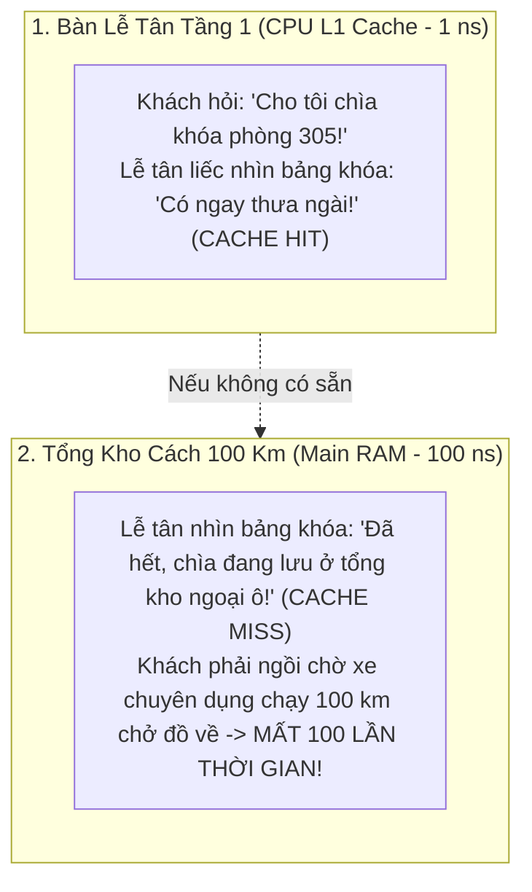
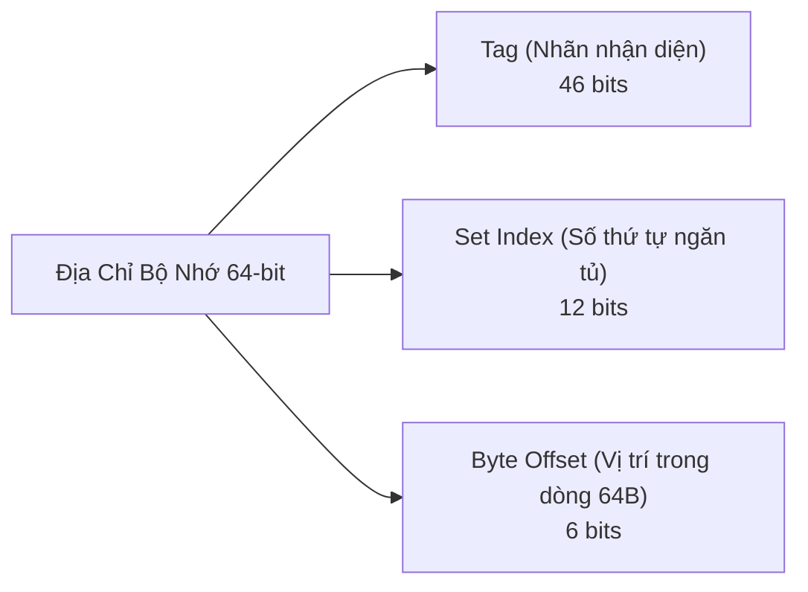
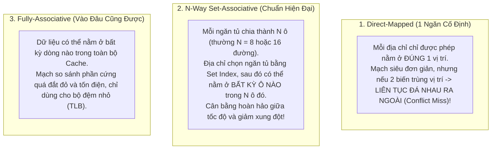
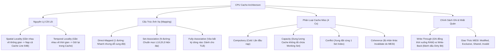

# 5.3. CPU Cache (Bộ Nhớ Đệm Vi Xử Lý: Cache Lines, Ánh Xạ & Giao Thức Nhất Quán)

> [!IMPORTANT]
> **Nếu bạn chỉ được nhớ một điều duy nhất:** CPU không bao giờ giao tiếp trực tiếp với RAM vật lý theo từng byte riêng lẻ; mọi trao đổi dữ liệu luôn diễn ra dưới dạng khối **Cache Line $64\text{ Bytes}$**. Tốc độ thực thi của một thuật toán phụ thuộc vào việc bạn có giữ được dữ liệu nằm trong L1/L2 Cache hay không: một lần **Cache Hit** chỉ tốn $\approx 1\text{ ns}$ (4 cycles), trong khi một lần **Cache Miss** phải chờ RAM mất tới $\approx 80 - 100\text{ ns}$ (gấp gần 100 lần!). Việc nắm vững cấu trúc giải mã địa chỉ (**Tag, Set Index, Offset**) và 4 dạng Cache Miss (**4 Cs**) là chìa khóa phân định giữa một lập trình viên bình thường và một kỹ sư hệ thống hiệu năng cao.

---

## 1. Trực Quan Hóa: Bản Chất CPU Cache Dưới Góc Nhìn Lập Trình Viên

Mục tiêu của phần này là giải mã cơ chế vận hành kỳ diệu của bộ nhớ đệm CPU: Làm thế nào CPU có thể kiểm tra xem một biến có nằm trong cache hay không trong đúng $1\text{ nano-giây}$ mà không phải duyệt tìm tuyến tính? Tại sao CPU luôn nạp dư thừa 64 bytes dù bạn chỉ đọc 1 ký tự? Và tại sao kiến trúc Set-Associative lại trở thành chuẩn mực thống trị trên mọi vi xử lý x86 và ARM hiện đại?

---

### 1.1. Ẩn Dụ Khách Sạn & Bàn Lễ Tân Giữ Chìa Khóa Siêu Tốc

Hãy tưởng tượng bạn là một vị khách VIP ở khách sạn cao cấp:



- **Quy tắc gói hàng 64 Bytes**: Khi xe chở đồ từ tổng kho về, quản lý khách sạn quy định: *Không bao giờ chở một chiếc chìa khóa lẻ! Xe luôn chở nguyên một chiếc hộp tiêu chuẩn chứa đúng $64\text{ Bytes}$ dữ liệu xung quanh phòng đó*. Nhờ vậy, nếu lát sau bạn hỏi tiếp phòng 306, 307... chìa khóa đã nằm sẵn trên bàn lễ tân!

---

### 1.2. Giải Mã Địa Chỉ Bộ Nhớ: Cách CPU Tìm Dữ Liệu Trong 1 Nano-Giây

Làm thế nào để CPU biết một địa chỉ RAM bất kỳ đang nằm ở đâu trong Cache mà không phải quét qua hàng nghìn dòng? CPU bẻ địa chỉ 64-bit thành 3 phần:



```
Ví dụ CPU muốn đọc 1 byte tại địa chỉ 0x7FFF5FBFF8AC:
1. Offset (6 bits cuối: 2^6 = 64 bytes): Chỉ rõ byte cần đọc nằm ở vị trí nào từ 0 đến 63 trong dòng Cache Line.
2. Set Index (12 bits tiếp theo: 2^12 = 4096 sets): CPU dùng thẳng số này làm CHỈ SỐ MẢNG để nhảy NGAY LẬP TỨC vào ngăn tủ số K trong đúng 1 chu kỳ clock!
3. Tag (Các bit còn lại): So sánh nhãn Tag của ngăn tủ xem có khớp với Tag của địa chỉ không. Nếu khớp: CACHE HIT! Nếu không khớp: CACHE MISS!
```

---

### 1.3. Ba Kiến Trúc Ánh Xạ: Direct-Mapped vs Set-Associative vs Fully-Associative



---

### 1.4. Tứ Đại Cache Miss (The 4 Cs) & Bài Học Viết Code

1. **Compulsory Miss (Cold Miss - Lần đầu tiên)**: Dữ liệu chưa từng được nạp vào cache bao giờ.
   - *Cách đối phó*: Dùng **Hardware Prefetcher** (duyệt mảng tuyến tính) để phần cứng tự động nạp trước.
2. **Capacity Miss (Tràn dung lượng)**: Kích thước tập dữ liệu đang xử lý (**Working Set**) lớn hơn tổng dung lượng Cache (ví dụ mảng $100\text{ MB}$ trong khi Cache L3 chỉ có $32\text{ MB}$).
   - *Cách đối phó*: Áp dụng kỹ thuật chia nhỏ khối (**Cache Blocking / Loop Tiling**) để xử lý từng mẩu vừa khít L1/L2 Cache.
3. **Conflict Miss (Xung đột ngăn)**: Xảy ra khi các biến khác nhau cùng ánh xạ vào chung một Set Index và đá văng nhau ra ngoài dù toàn bộ Cache vẫn còn thừa chỗ.
   - *Cách đối phó*: Tránh cấp phát các mảng có bước nhảy là lũy thừa của 2 ($2^{12}, 2^{16}$).
4. **Coherence Miss (Mất nhất quán)**: Dòng cache bị nhân CPU khác đánh dấu hủy hiệu lực (`INVALID`) do chia sẻ sai (**False Sharing**).
   - *Cách đối phó*: Dùng `alignas(64)` để cách ly biến của các luồng.

---

### 1.5. Sơ Đồ Tư Duy Tổng Quát Kiến Trúc CPU Cache



---

## 2. Chi tiết từng Keyword (Under-the-Hood Deep Dive)

### 2.1. Cache Line & Giải Mã Địa Chỉ Bộ Nhớ

#### 1. Đơn vị nguyên tử: Cache Line (64 Bytes)
- Bất kể bạn viết `char c = arr[0];` (chỉ đọc đúng 1 byte), phần cứng CPU Cache Controller vẫn phát lệnh kéo trọn vẹn **64 Bytes liên tiếp** chứa byte đó từ RAM vào L1 Cache. Khối 64 bytes này được gọi là một **Cache Line** (Dòng đệm).
- Nếu dữ liệu cần tìm đã nằm sẵn trong Cache Line: **Cache Hit** (Độ trễ: $\approx 1\text{ ns}$).
- Nếu chưa có: **Cache Miss** (Độ trễ: $\approx 60 - 100\text{ ns}$ do phải đợi kéo từ RAM).
- **Cache Hit Ratio**: Tỷ lệ phần trăm giữa số lần Hit và tổng số lần truy cập:
  $$\text{Hit Ratio} = \frac{\text{Hits}}{\text{Hits} + \text{Misses}} \times 100\%$$
  Trong các ứng dụng backend được tối ưu hóa tốt, tỷ lệ Cache Hit L1 thường đạt trên **$95 - 98\%$**.

#### 2. Cấu trúc chia tách địa chỉ bộ nhớ (Address Breakdown)
Để kiểm tra xem một địa chỉ 64-bit có đang nằm trong Cache hay không mà không phải duyệt tuần tự, CPU chia các bit của địa chỉ thành 3 trường:

```text
63                                                     s+b   s+b-1         b   b-1          0
+-------------------------------------------------------+-------------+---------------------+
|                          TAG                          |  SET INDEX  |     BYTE OFFSET     |
+-------------------------------------------------------+-------------+---------------------+
```

1. **Byte Offset ($b$ bits)**: Với Cache Line 64 bytes ($64 = 2^6$), trường này gồm **6 bit thấp nhất** (bits 0–5) để định vị chính xác byte thứ mấy trong 64 bytes của dòng cache.
2. **Set Index ($s$ bits)**: Dùng để chọn trực tiếp tập hợp (**Set**) mà dữ liệu này bắt buộc phải ngự trị.
3. **Tag (Các bit còn lại)**: Nhãn định danh duy nhất để đối chiếu kiểm tra xem dữ liệu trong Set đó có đúng là địa chỉ đang tìm kiếm hay không.

---

### 2.2. Ba Kiến Trúc Tổ Chức Cache: Direct-Mapped, Set-Associative, Fully-Associative

| Kiến Trúc | Cơ Chế Ánh Xạ | Ưu Điểm | Nhược Điểm |
| :--- | :--- | :--- | :--- |
| **Direct-Mapped Cache** | Mỗi địa chỉ bộ nhớ chỉ có thể nằm tại **đúng 1 dòng cache duy nhất**: $\text{Set} = \text{Addr} \pmod S$. | Mạch tra cứu cực kỳ đơn giản và nhanh nhất (0 phép so sánh song song). | **Xung đột khủng khiếp (Conflict Miss)**: Nếu 2 biến cùng ánh xạ vào 1 dòng cache, chúng sẽ liên tục đá nhau ra ngoài dù toàn bộ cache còn trống! |
| **Fully-Associative Cache** | Dữ liệu có thể được đặt tại **bất kỳ dòng cache nào** còn trống. | Tận dụng $100\%$ dung lượng, không bao giờ bị Conflict Miss. | Đòi hỏi mạch so sánh phần cứng song song khổng lồ, tiêu thụ điện lớn và chậm. Chỉ dùng cho các bộ đệm rất nhỏ như TLB. |
| **N-Way Set-Associative Cache** | Cache được chia thành nhiều Set, mỗi Set chứa đúng **$N$ dòng cache** (thường là 8-way hoặc 16-way). | **Cân bằng hoàn hảo**: Giảm thiểu tối đa xung đột mà mạch so sánh chỉ cần kiểm tra song song $N$ nhãn Tag trong cùng 1 Set. | Đây là **chuẩn mực tuyệt đối của toàn bộ L1, L2, L3 Cache trong CPU Intel, AMD, ARM hiện đại**. |

---

### 2.3. Phân Loại 4 Dạng Cache Misses (The 4 Cs)

1. **Compulsory Miss (Cold Miss - Bắt buộc)**:
   - Xảy ra khi một khối dữ liệu được truy cập **lần đầu tiên** trong chương trình.
   - *Khắc phục*: Tận dụng **Hardware Prefetcher** hoặc chỉ thị phần cứng `_mm_prefetch` để nạp trước vào cache trước khi CPU thực sự dùng đến.
2. **Capacity Miss (Dung lượng)**:
   - Xảy ra khi tập hợp dữ liệu đang hoạt động tích cực của chương trình (**Working Set**) có kích thước lớn hơn tổng dung lượng của CPU Cache. Dữ liệu cũ bị đẩy ra ngoài để nhường chỗ cho dữ liệu mới, sau đó lại bị kéo vào lại.
   - *Khắc phục*: Thu nhỏ cấu trúc dữ liệu, áp dụng kỹ thuật **Loop Tiling / Cache Blocking**.
3. **Conflict Miss (Xung đột)**:
   - Xảy ra trong Direct-Mapped hoặc Set-Associative Cache khi nhiều vùng nhớ khác nhau của chương trình cùng ánh xạ vào chung một **Set Index**, khiến chúng liên tục đá văng nhau ra ngoài dù tổng dung lượng cache vẫn còn thừa rất nhiều.
   - *Khắc phục*: Thay đổi Padding của Struct hoặc tránh phân bổ các mảng lớn có kích thước là lũy thừa của 2 ($2^k$).
4. **Coherence Miss (Mất tính nhất quán)**:
   - Xảy ra trên các hệ thống đa nhân (Multicore) khi một dòng cache bị vô hiệu hóa bởi một nhân khác đang ghi dữ liệu vào cùng dòng cache đó (giao thức MESI / False Sharing).

---

### 2.4. Chính Sách Ghi (Write Policies) & Giao Thức MESI

#### 1. Write-Through vs Write-Back
- **Write-Through (Ghi xuyên)**:
  - Khi CPU ghi dữ liệu, nó ghi đồng thời vào cả CPU Cache lẫn bộ nhớ RAM chính.
  - *Ưu điểm*: Đơn giản, dữ liệu trong RAM luôn luôn cập nhật mới nhất.
  - *Nhược điểm*: Làm bão hòa băng thông bus bộ nhớ vì mỗi lệnh ghi đều phải chịu độ trễ của RAM.
- **Write-Back (Ghi giữ lại - Chuẩn hiện đại)**:
  - Khi CPU ghi dữ liệu, nó **chỉ ghi vào CPU Cache** và bật một cờ hiệu gọi là **Dirty Bit** trên dòng cache đó. Dữ liệu trong RAM tạm thời là dữ liệu cũ!
  - Chỉ khi nào dòng cache đó bị trục xuất (Evicted) để nhường chỗ cho dữ liệu mới, CPU mới xả khối dữ liệu có Dirty Bit này xuống RAM.
  - *Hiệu năng*: Tối ưu tuyệt đối, giảm tới $90\%$ lưu lượng ghi xuống bus bộ nhớ.

#### 2. Giao thức Nhất quán Bộ nhớ MESI (Cache Coherence)
Trên CPU đa nhân, mỗi dòng cache tồn tại ở 1 trong 4 trạng thái:
- **`M` - Modified**: Dòng cache chỉ có mặt trên Core này và đã bị chỉnh sửa (Dirty Bit bật). Dữ liệu trong RAM chưa được cập nhật.
- **`E` - Exclusive**: Dòng cache chỉ có mặt duy nhất trên Core này nhưng chưa bị chỉnh sửa (giống hệt dữ liệu trong RAM).
- **`S` - Shared**: Dòng cache này đang có mặt đồng thời trên nhiều Core khác nhau (chỉ đọc - Read-only).
- **`I` - Invalid**: Dòng cache này đã bị hủy hiệu lực (chứa dữ liệu rác lỗi thời) do một Core khác vừa ghi đè dữ liệu lên địa chỉ này.

---

## 3. Thực thi Mã nguồn & Mô phỏng Chuyên sâu (Dual-Engine Implementation)

### 3.1. C++20: Khảo Sát Tác Động Kinh Hoàng Của Cache Locality (Duyệt Ma Trận Hàng vs Cột)

```cpp
#include <iostream>
#include <vector>
#include <chrono>
#include <format>

// Khảo sát bài toán kinh điển: Duyệt ma trận 2 chiều Row-Major vs Column-Major
constexpr size_t MATRIX_SIZE = 4096;

void benchmark_matrix_traversal() {
    // Cấp phát ma trận phẳng 4096 x 4096 kiểu int32_t (~64 MB - Tràn sạch L3 Cache)
    std::vector<int> matrix(MATRIX_SIZE * MATRIX_SIZE, 1);

    // 1. Row-Major Traversal (Duyệt theo hàng - Thân thiện tuyệt đối với CPU Cache Line 64B)
    // matrix[row][col] nằm tuần tự liên tiếp nhau trong RAM -> Spatial Locality 100%
    auto start_row = std::chrono::high_resolution_clock::now();
    uint64_t sum_row = 0;
    for (size_t r = 0; r < MATRIX_SIZE; ++r) {
        for (size_t c = 0; c < MATRIX_SIZE; ++c) {
            sum_row += matrix[r * MATRIX_SIZE + c];
        }
    }
    auto end_row = std::chrono::high_resolution_clock::now();

    // 2. Column-Major Traversal (Duyệt theo cột - Kẻ thù số 1 của CPU Cache)
    // Mỗi bước nhảy cách nhau 4096 phần tử (16 KB) -> Ép phát sinh Cache Miss ở MỌI LẦN ĐỌC!
    auto start_col = std::chrono::high_resolution_clock::now();
    uint64_t sum_col = 0;
    for (size_t c = 0; c < MATRIX_SIZE; ++c) {
        for (size_t r = 0; r < MATRIX_SIZE; ++r) {
            sum_col += matrix[r * MATRIX_SIZE + c];
        }
    }
    auto end_col = std::chrono::high_resolution_clock::now();

    double row_time = std::chrono::duration<double, std::milli>(end_row - start_row).count();
    double col_time = std::chrono::duration<double, std::milli>(end_col - start_col).count();

    std::cout << "--- Khảo Sát Tác Động Của CPU Cache Locality ---\n";
    std::cout << std::format("Row-Major (Cache-Friendly):   {:>8.2f} ms\n", row_time);
    std::cout << std::format("Column-Major (Cache-Hostile): {:>8.2f} ms\n", col_time);
    std::cout << std::format("-> Duyệt sai hướng làm chậm chương trình: {:.1f} LẦN!\n", 
                             col_time / row_time);
}

int main() {
    benchmark_matrix_traversal();
    return 0;
}
```

### 3.2. TypeScript: Triển Khai Thuật Toán Cache Replacement Policy (LRU Cache Thuần Túy)

```typescript
// Hiện thực hóa thuật toán thay thế Cache kinh điển: LRU (Least Recently Used) trong O(1)
// Sử dụng kết hợp Hash Map + Doubly Linked List tương tự cơ chế bộ đệm CPU / OS Page Cache
class DNode<K, V> {
  key: K;
  val: V;
  prev: DNode<K, V> | null = null;
  next: DNode<K, V> | null = null;
  constructor(k: K, v: V) { this.key = k; this.val = v; }
}

export class LRUCache<K, V> {
  private capacity: number;
  private map = new Map<K, DNode<K, V>>();
  private head: DNode<K, V>;
  private tail: DNode<K, V>;

  constructor(capacity: number) {
    this.capacity = capacity;
    this.head = new DNode<K, V>(null as any, null as any);
    this.tail = new DNode<K, V>(null as any, null as any);
    this.head.next = this.tail;
    this.tail.prev = this.head;
  }

  public get(key: K): V | undefined {
    const node = this.map.get(key);
    if (!node) return undefined;
    this.moveToHead(node); // Đánh dấu vừa được truy cập (Temporal Locality)
    return node.val;
  }

  public put(key: K, value: V): void {
    let node = this.map.get(key);
    if (node) {
      node.val = value;
      this.moveToHead(node);
    } else {
      if (this.map.size >= this.capacity) {
        // Trục xuất phần tử cũ nhất ở đuôi (Evict LRU Node)
        const lru = this.tail.prev!;
        this.removeNode(lru);
        this.map.delete(lru.key);
      }
      const newNode = new DNode(key, value);
      this.map.set(key, newNode);
      this.addNodeToHead(newNode);
    }
  }

  private moveToHead(node: DNode<K, V>): void {
    this.removeNode(node);
    this.addNodeToHead(node);
  }

  private removeNode(node: DNode<K, V>): void {
    node.prev!.next = node.next;
    node.next!.prev = node.prev;
  }

  private addNodeToHead(node: DNode<K, V>): void {
    node.next = this.head.next;
    node.prev = this.head;
    this.head.next!.prev = node;
    this.head.next = node;
  }
}
```

---

## 4. Systems Engineering & Production Pitfalls
1. **Lạm dụng cấu trúc dữ liệu dựa trên con trỏ (Node-based: `std::map`, `LinkedList`)**:
   - `std::map` trong C++ sử dụng Cây Đỏ-Đen (Red-Black Tree). Mỗi phần tử là một lần cấp phát Heap riêng biệt. Khi tìm kiếm một khóa, mỗi lần nhảy con trỏ sang nút con (`node->left`, `node->right`) là một lần phát sinh Cache Miss, khiến nó chậm hơn từ 5 đến 10 lần so với tìm kiếm nhị phân trên một mảng phẳng đã sắp xếp (`std::vector`).
2. **Kích thước bước nhảy là bội số của kích thước Set Cache (Power-of-Two Stride)**:
   - Nếu bạn bước nhảy các chỉ số mảng theo đúng $4096$ hoặc $8192$ bytes, toàn bộ các lần truy cập sẽ dồn về cùng một Set Index duy nhất trong L1 Cache, gây ra **Conflict Miss liên miên** và biến bộ nhớ cache 8-way thành một cache chỉ có dung lượng của 1 dòng đơn lẻ!

---

## 5. Bảng So sánh & Ứng dụng Backend / Systems
- **Tối ưu hóa B-Tree Node Size trong Database Engines**:
  - Tại sao kích thước của một Node trong cây B-Tree của SQLite/InnoDB thường được thiết kế là **$4\text{ KB}$** (khớp với kích thước Page của OS), trong khi các B-Tree In-Memory hiện đại (như B-Tree trong C++ Abseil của Google) lại chọn kích thước Node là đúng **$64$ bytes hoặc $256$ bytes**?
  - Để một Node nằm trọn vẹn trong **đúng 1 đến 4 Cache Lines của CPU**! Nhờ đó, việc duyệt tìm kiếm khóa bên trong Node chỉ tốn đúng 1 lần nạp Cache Line mà không hề gây phân mảnh bộ đệm.
