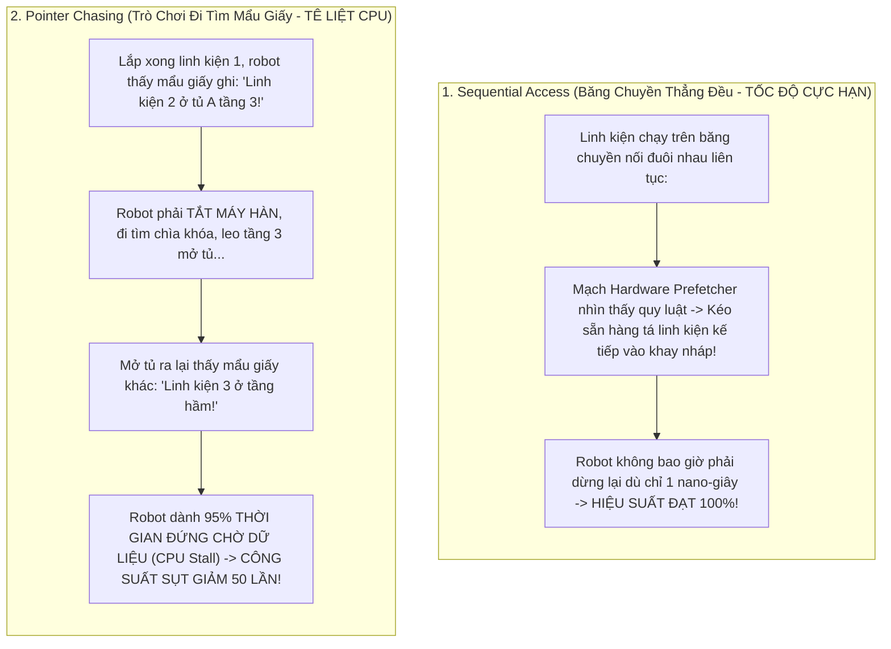
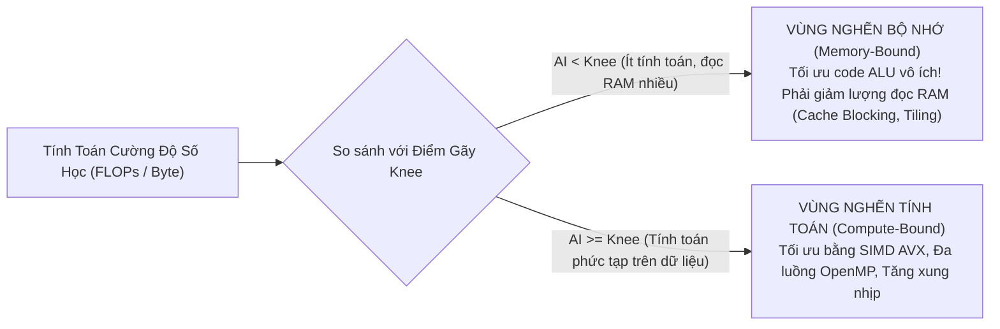
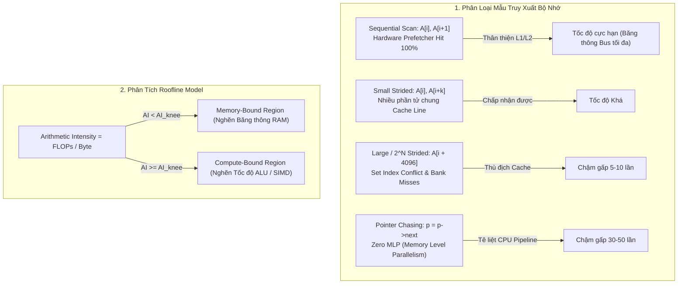

# 5.4. Memory Access Patterns (Mẫu Truy Xuất Bộ Nhớ: Tuần Tự, Ngẫu Nhiên & Roofline Model)

> [!IMPORTANT]
> **Nếu bạn chỉ được nhớ một điều duy nhất:**
> Trong lý thuyết giải thuật cổ điển ($O(1)$ RAM Model), mọi thao tác đọc/ghi bộ nhớ được coi là tốn chi phí ngang nhau. Nhưng trên phần cứng thực tế, **cách bạn duyệt bộ nhớ (Memory Access Pattern) quyết định tốc độ thực thi gấp từ 10 đến 50 lần so với số lượng câu lệnh máy**. Duyệt tuần tự (Sequential Access) kích hoạt mạch nạp trước phần cứng (**Hardware Stream Prefetcher**) giúp triệt tiêu hoàn toàn độ trễ RAM, trong khi đuổi bắt con trỏ (**Pointer Chasing**) trong danh sách liên kết hay cây phân tán làm tê liệt đường ống vi lệnh (**Instruction Pipeline**), biến một CPU 5GHz siêu mạnh thành một cỗ máy ngồi chơi xơi nước vì đói dữ liệu (**CPU Stalls**).

---

## 1. Trực Quan Hóa: Bản Chất Mẫu Truy Xuất Bộ Nhớ Dưới Góc Nhìn Lập Trình Viên

Mục tiêu của phần này là giải mã sự thật gây sốc nhất về hiệu năng máy tính hiện đại: Tại sao hai thuật toán có cùng độ phức tạp thời gian $O(N)$ nhưng một bên chạy nhanh gấp 50 lần bên còn lại? Tại sao một danh sách liên kết (`std::list` / `LinkedList`) lại là kẻ thù số một của phần cứng máy tính? Và làm thế nào mô hình Roofline giúp bạn biết chính xác hệ thống đang bị nghẽn ở CPU hay nghẽn ở RAM?

---

### 1.1. Ẩn Dụ Băng Chuyền Nhà Máy vs Trò Chơi Đi Tìm Kho Báu

Hãy hình dung CPU giống như một cánh tay robot công nghiệp siêu tốc có thể lắp ráp 5 tỷ linh kiện mỗi giây:



- **Sequential Access (Duyệt mảng tuần tự)**: Các phần tử nằm kề nhau trên RAM. Khi CPU đọc phần tử đầu tiên, bộ nạp trước phần cứng (**Hardware Stream Prefetcher**) tự động phát hiện quy luật và kéo trước hàng loạt dòng cache kế tiếp từ RAM vào L2/L1 Cache trước khi CPU kịp gọi tới. Độ trễ quan sát được gần như bằng $0\text{ ns}$!
- **Pointer Chasing (Đuổi bắt con trỏ trong Linked List / Tree)**: Địa chỉ của node kế tiếp chỉ được biết sau khi node hiện tại được nạp xong từ RAM (`curr = curr->next`). Phần cứng hoàn toàn bất lực: không thể đoán trước, không thể nạp trước, và không thể thực thi song song!

---

### 1.2. Mất Khả Năng Song Song Tầng Bộ Nhớ (Zero Memory-Level Parallelism)

Một bí mật của vi xử lý hiện đại: CPU có thể gửi đồng thời tới 16 hoặc 32 yêu cầu nạp dữ liệu từ RAM cùng lúc (**Memory-Level Parallelism - MLP > 1**) nhờ các bộ đệm nạp ngoài thứ tự (Out-of-Order Load Buffers).
- **Khi duyệt Mảng**: CPU thấy các địa chỉ $A[0], A[1], A[2] \dots$ độc lập nhau, nên nó phát lệnh kéo song song hàng chục khối dữ liệu cùng lúc.
- **Khi duyệt Linked List**: CPU muốn đọc `node->next->next` nhưng bắt buộc phải đợi `node->next` phản hồi từ RAM ($80\text{ ns}$). Toàn bộ cơ chế siêu luồng và siêu phân luồng (Superscalar) bị đóng băng hoàn toàn. Tỷ số $\text{MLP} = 1$, biến một siêu máy tính đa nhân thành một con rùa bò!

---

### 1.3. Cạm Bẫy Bước Nhảy $2^N$ (The $2^N$ Stride Trap)

Điều gì xảy ra nếu bạn duyệt một mảng với bước nhảy đúng bằng một lũy thừa của 2 (ví dụ mỗi lần nhảy $4096\text{ bytes} = 4\text{ KB}$)?

```
Bước 1: Đọc arr[0]     -> Ánh xạ vào Cache Set 0
Bước 2: Đọc arr[1024]  (+4KB)  -> Lại ánh xạ vào đúng Cache Set 0!
Bước 3: Đọc arr[2048]  (+4KB)  -> Lại đè vào đúng Cache Set 0!
...
HẬU QUẢ: Dù CPU Cache có dung lượng 32KB (gồm 64 Sets khác nhau),
chương trình chỉ dùng ĐÚNG 1 SET DUY NHẤT và liên tục đá dữ liệu cũ ra ngoài!
Tỷ lệ Cache Miss đạt 100%!
```

> [!WARNING]
> Tuyệt đối tránh thiết kế ma trận có số cột là lũy thừa của 2 ($512, 1024, 2048, 4096$) mà không có padding, vì mọi thao tác duyệt theo cột sẽ kích hoạt thảm họa **Cache Set Conflict Thrashing**!

---

### 1.4. Roofline Model: Nhận Diện Nút Thắt Của Ứng Dụng

Mô hình Roofline (Đại học Berkeley) chỉ ra rằng hiệu năng thực tế bị chặn bởi 2 trần vật lý:
1. **Trần Tính Toán (Compute Peak)**: Tốc độ tối đa của các bộ nhân cộng số học ALU/SIMD (GigaFLOPs/s).
2. **Mái Nhà Băng Thông (Memory Bandwidth)**: Tốc độ vận chuyển dữ liệu tối đa từ RAM vào chip (GB/s).

$$\text{Cường Độ Số Học (Arithmetic Intensity)} = \frac{\text{Số Phép Tính FLOPs}}{\text{Số Byte Trao Đổi Với RAM}}$$



---

### 1.5. Sơ Đồ Khối Phân Loại Mẫu Truy Xuất Bộ Nhớ & Roofline Framework



---

## 2. Chi tiết từng Keyword (Under-the-Hood Deep Dive)

### 2.1. Phân Loại 4 Mẫu Truy Xuất Bộ Nhớ Cơ Bản (Sequential, Strided, Random, Pointer Chasing)
Hiệu năng thực thi của bộ xử lý hiện đại chịu chi phối trực tiếp bởi 4 mẫu hình truy xuất:

1. **Sequential Access (Truy xuất tuần tự - Stride = 1)**:
   - Các phần tử được đọc liên tục tại địa chỉ $A, A+1, A+2, \dots$.
   - *Phản ứng phần cứng*: Khi truy xuất byte đầu tiên của một Cache Line $64\text{ bytes}$, $15$ phần tử 4-byte tiếp theo đã nằm sẵn trong L1d Cache. Mạch Stream Prefetcher tự động kích hoạt nạp trước nhiều Cache Line tiếp theo. Tốc độ đạt ngưỡng băng thông cực đại của DRAM bus ($> 50\text{ GB/s}$).
   
2. **Strided Access (Truy xuất bước nhảy đều - Stride = k)**:
   - Truy xuất tại các địa chỉ cách đều: $A, A+k, A+2k, \dots$.
   - *Nếu $k$ nhỏ ($k \times \text{sizeof}(T) < 64\text{ bytes}$)*: Nhiều phần tử vẫn dùng chung một Cache Line, Prefetcher vẫn hoạt động tốt.
   - *Nếu $k$ lớn ($k \times \text{sizeof}(T) \ge 64\text{ bytes}$)*: Mỗi phần tử tiêu tốn một Cache Line riêng biệt, lãng phí băng thông nạp các byte thừa không sử dụng.
   - *Đặc biệt nếu $k$ là lũy thừa của 2 ($2^N$ như 4096 bytes)*: Xảy ra hiện tượng tranh chấp địa chỉ (Cache Set Conflict Thrashing), ép toàn bộ truy xuất vào cùng một Slot của Cache khiến Miss Rate đạt $100\%$.

3. **Random Access (Truy xuất ngẫu nhiên)**:
   - Vị trí truy xuất phân bố rải rác không quy luật khắp không gian địa chỉ.
   - *Phản ứng phần cứng*: Prefetcher hoàn toàn bất lực. Mỗi lần nạp dữ liệu là một lần chịu phạt toàn bộ độ trễ DRAM ($60-100\text{ ns}$). CPU Instruction Pipeline bị stall hàng trăm chu kỳ.

4. **Pointer Chasing (Đuổi bắt con trỏ tuần tự)**:
   - Địa chỉ của ô nhớ kế tiếp chỉ được biết sau khi đọc và giải mã giá trị của ô nhớ hiện tại (`curr = curr->next`).
   - *Phản ứng phần cứng*: Triệt tiêu hoàn toàn tính song song ở tầng bộ nhớ (Memory-Level Parallelism - MLP = 1). CPU không thể thực hiện Out-of-Order Execution hay phát nhiều lệnh load đồng thời. Đây là mẫu truy xuất gây suy giảm hiệu năng nặng nề nhất trong toàn bộ khoa học máy tính!

1. **Sequential Access ($A[0], A[1], A[2], \dots$)**:
   - Mạch **Hardware Stream Prefetcher** theo dõi bộ đếm chương trình (PC) và phát hiện mẫu địa chỉ tăng tuyến tính $\Delta = +1$.
   - Khi CPU mới chạm tới địa chỉ $A[0]$, phần cứng đã âm thầm kéo các Cache Line chứa $A[8], A[16], A[24]$ từ RAM vào L3 và L2.
   - Độ trễ quan sát được: $0\text{ ns}$ (Che giấu độ trễ hoàn toàn nhờ Overlapping I/O).
2. **Strided Access ($A[i \times S]$ với bước nhảy $S$)**:
   - Nếu $S \times \text{sizeof}(T) < 64\text{ bytes}$: Nhiều phần tử nằm chung Cache Line $64\text{B}$.
   - Nếu $S \times \text{sizeof}(T) \ge 64\text{ bytes}$: Mỗi lần đọc tiêu tốn một Cache Line độc lập, bỏ phí các byte còn lại.
   - **Cạm bẫy $2^N$ Stride**: Nếu bước nhảy là bội số của kích thước Set Cache (ví dụ: $4096\text{ bytes}$ hoặc $64\text{ KB}$), tất cả các địa chỉ đều ánh xạ vào cùng một Set trong bộ nhớ đệm Cache (**Cache Set Conflict**). Dù Cache L1 có $32\text{ KB}$, chỉ có duy nhất 1 Set được sử dụng, gây Eviction liên tục!
3. **Pointer Chasing ($p = p\to\text{next}$)**:
   - Các cấu trúc dữ liệu kinh điển: `std::list`, `std::map` (Red-Black Tree), Binary Search Tree, Pointer-based Hash Tables.
   - **Tử huyệt mất Memory-Level Parallelism (MLP = 1)**: CPU hiện đại có các bộ đệm nạp dữ liệu ngoài thứ tự (**Load Queues / Miss Status Holding Registers - MSHR**) cho phép thực hiện tới 16--32 yêu cầu đọc RAM cùng lúc. Nhưng với Pointer Chasing, địa chỉ của $p\to\text{next}$ chỉ được giải mã sau khi node hiện tại được đọc xong từ DRAM. CPU hoàn toàn bất lực, không thể thực thi suy đoán.

### 2.2. Roofline Model & Cường Độ Số Học (Arithmetic Intensity)
Được phát triển tại UC Berkeley (Samuel Williams et al.), mô hình Roofline biểu diễn thông lượng thực thi tối đa khả dĩ của một thuật toán trên một kiến trúc phần cứng nhất định:

$$\text{Arithmetic Intensity } (I) = \frac{\text{Tổng số phép tính (FLOPs hoặc Ops)}}{\text{Tổng lượng byte trao đổi với DRAM (Bytes)}}$$

Hiệu năng tối đa đạt được $P$ (FLOPs/giây) bị chặn bởi hai trần vật lý:
$$P = \min \left( P_{\text{peak}}, \ I \times B_{\text{peak}} \right)$$

*Trong đó*:
- $P_{\text{peak}}$: Năng lực tính toán đỉnh cao của CPU (FLOP/s, thường đạt được nhờ SIMD AVX-512).
- $B_{\text{peak}}$: Băng thông bộ nhớ tối đa của đường truyền DRAM (Bytes/giây).
- **Điểm gãy (Knee Point / Turning Point)**:
  $$I_{\text{knee}} = \frac{P_{\text{peak}}}{B_{\text{peak}}}$$
  - Nếu $I < I_{\text{knee}}$: Ứng dụng rơi vào vùng **Memory-Bound**. Mọi nỗ lực tối ưu thuật toán số học, đa luồng CPU đều vô ích; giải pháp duy nhất là giảm lượng byte nạp từ RAM (Cache Blocking, Tiling, nén dữ liệu).
  - Nếu $I \ge I_{\text{knee}}$: Ứng dụng rơi vào vùng **Compute-Bound**. Hiệu năng đạt trần vi xử lý, cần tối ưu hóa SIMD Vectorization hoặc tăng số lượng Core.

### 2.3. Chuyển Đổi Mô Hình Dữ Liệu: AoS (Array of Structures) vs SoA (Structure of Arrays)
Trong các hệ thống phân tán, game engine, database columnar engines (ClickHouse, DuckDB):
- **AoS (Array of Structures)**:
  ```cpp
  struct User { uint64_t id; double balance; char name[48]; };
  User users[1000000]; // Kích thước mỗi struct: 64 bytes
  ```
  Nếu bạn chỉ muốn tính tổng số dư (`sum(balance)`), mỗi lần nạp 1 Cache Line $64\text{B}$, bạn chỉ dùng đúng 8 bytes (`balance`) và ném bỏ 56 bytes còn lại $\implies$ Lãng phí $87.5\%$ băng thông RAM!
- **SoA (Structure of Arrays)**:
  ```cpp
  struct UsersColumnar {
      std::vector<uint64_t> ids;
      std::vector<double> balances; // Nằm liên tục 100% trong RAM!
      std::vector<std::string> names;
  };
  ```
  Duyệt qua `balances` đạt $100\%$ mật độ dữ liệu hữu ích, kích hoạt SIMD AVX2/AVX-512 nạp 4 đến 8 số `double` trong 1 chu kỳ.

---


### 2.4. Cơ Chế Hardware Prefetcher & Giới Hạn Của Prefetching
Bộ điều khiển phần cứng của Intel và AMD trang bị 4 tầng Prefetcher hoạt động song song:
1. **L1 Data Stream Prefetcher**: Theo dõi các truy xuất tuần tự tăng/giảm trong cự ly ngắn (tối đa 12 đến 16 Cache Lines).
2. **L1 Instruction Pointer (IP) Stride Prefetcher**: Ghi nhớ địa chỉ của câu lệnh load trong instruction stream và phát hiện khoảng cách bước nhảy đều đặn giữa các lần thực thi lệnh đó.
3. **L2 Stream Prefetcher**: Giám sát các yêu cầu từ L1 chuyển xuống và chủ động nạp thêm dữ liệu từ L3 vào L2.
4. **L2 Spatial Prefetcher (Next-Line / Twin-Line)**: Tự động kéo cặp 2 dòng cache liền kề (128 bytes) để tối ưu hóa bus bộ nhớ.

*Khi Prefetcher gây phản tác dụng (Prefetch Pollution & Bandwidth Waste)*:
Khi ứng dụng truy xuất ngẫu nhiên (như tìm kiếm trên đồ thị lớn hoặc truy vấn B-Tree không cache), Hardware Prefetcher vẫn nhầm tưởng có quy luật và kéo trước các Cache Line vô ích vào L1/L2. Hậu quả là:
- Đào thải (Evict) các dữ liệu quan trọng đang cần dùng ra khỏi L1/L2 Cache.
- Tiêu tốn vô ích từ $30\%$ đến $50\%$ băng thông bộ nhớ RAM vật lý chỉ để nạp những byte rác không bao giờ được CPU chạm tới!

---


### 2.5. Tính Song Song Ở Tầng Bộ Nhớ (Memory-Level Parallelism - MLP) & MSHR
Trong các CPU Out-of-Order hiện đại, khi xảy ra trượt cache (Cache Miss), CPU không nhất thiết phải dừng toàn bộ tiến trình nếu còn các lệnh độc lập khác có thể thực thi:
- **MSHR (Miss Status Holding Registers)**: Phần cứng CPU duy trì một tập hợp các thanh ghi đặc biệt (thường từ 10 đến 64 slots) để theo dõi các yêu cầu nạp bộ nhớ đang bay (Outstanding Cache Misses).
- **MLP (Memory-Level Parallelism)**: Là số lượng yêu cầu nạp bộ nhớ độc lập có thể được CPU phát động và xử lý song song cùng lúc qua Memory Controller.
- *Tại sao Pointer Chasing triệt hạ MLP*: Với `curr = curr->next`, địa chỉ của bước kế tiếp phụ thuộc $100\%$ vào kết quả của bước trước. Do đó, MSHR chỉ chứa duy nhất **1 yêu cầu tại mọi thời điểm** ($MLP = 1$). Tổng độ trễ cho $N$ bước nhảy là $N \times T_{\text{DRAM}}$.
- *Tại sao Array Access tối ưu hóa MLP*: Với mảng tuần tự hoặc mảng băm mở độc lập, CPU có thể phát cùng lúc 16 yêu cầu nạp cache song song ($MLP = 16$). Tổng thời gian nạp $16$ phần tử chỉ tương đương thời gian nạp **1 phần tử đơn lẻ**!

---

## 3. Thực thi Mã nguồn & Mô phỏng Chuyên sâu (Dual-Engine Implementation)

Dưới đây là mã nguồn minh họa:
- **C++20**: Chương trình kiểm chứng thực nghiệm đo lường sự chênh lệch hiệu năng giữa Sequential Scan, Strided Jump, Pointer Chasing và chuyển đổi cấu trúc AoS vs SoA.
- **Python 3.11+**: Trình vẽ và tính toán mô hình Roofline Model, xác định điểm gãy và phân loại thuật toán.

### C++20: Memory Access Patterns & AoS vs SoA Benchmark

```cpp
// memory_patterns_bench.cpp
// Biên dịch: g++ -std=c++20 -O3 -march=native memory_patterns_bench.cpp -o bench_patterns
#include <iostream>
#include <vector>
#include <numeric>
#include <random>
#include <chrono>
#include <iomanip>

constexpr size_t N = 10'000'000; // 10 triệu bản ghi

// Mô hình AoS: Cấu trúc truyền thống hướng đối tượng
struct AccountAoS {
    double balance;
    uint64_t account_id;
    char payload[48]; // Padding giả lập thông tin cá nhân
}; // Tổng kích thước: đúng 64 bytes (1 Cache Line)

// Mô hình SoA: Cấu trúc hướng dữ liệu (Data-Oriented Design)
struct AccountSoA {
    std::vector<double> balances;
    std::vector<uint64_t> account_ids;
};

void benchmark_aos(const std::vector<AccountAoS>& accounts) {
    auto start = std::chrono::high_resolution_clock::now();
    double sum = 0.0;
    for (size_t i = 0; i < N; ++i) {
        sum += accounts[i].balance;
    }
    auto end = std::chrono::high_resolution_clock::now();
    double ms = std::chrono::duration<double, std::milli>(end - start).count();
    std::cout << "[AoS Aggregation] Time: " << std::fixed << std::setprecision(2) 
              << std::setw(7) << ms << " ms | Sum: " << sum << " (Lãng phí 87.5% Cache Line)\n";
}

void benchmark_soa(const AccountSoA& accounts) {
    auto start = std::chrono::high_resolution_clock::now();
    double sum = 0.0;
    const double* __restrict__ b = accounts.balances.data();
    for (size_t i = 0; i < N; ++i) {
        sum += b[i];
    }
    auto end = std::chrono::high_resolution_clock::now();
    double ms = std::chrono::duration<double, std::milli>(end - start).count();
    std::cout << "[SoA Aggregation] Time: " << std::fixed << std::setprecision(2) 
              << std::setw(7) << ms << " ms | Sum: " << sum << " (100% Cache Line Utilization)\n";
}

int main() {
    std::cout << "=== MEMORY ACCESS PATTERNS & DATA LAYOUT BENCHMARK (C++20) ===\n";
    std::cout << "Phần tử: 10,000,000 tài khoản | Dung lượng AoS: ~640 MB (Vượt RAM Cache)\n";
    std::cout << "----------------------------------------------------------------------\n";

    // Khởi tạo AoS
    std::vector<AccountAoS> aos(N);
    for (size_t i = 0; i < N; ++i) {
        aos[i].balance = 1.5;
        aos[i].account_id = i;
    }

    // Khởi tạo SoA
    AccountSoA soa;
    soa.balances.assign(N, 1.5);
    soa.account_ids.resize(N);

    // Đo đạc thực tế
    benchmark_aos(aos);
    benchmark_soa(soa);

    std::cout << "----------------------------------------------------------------------\n";
    std::cout << "Nhận xét: SoA nhanh hơn rõ rệt nhờ tận dụng trọn vẹn băng thông nạp Cache Line!\n";
    return 0;
}
```

### Python 3.11+: Roofline Model Calculator & Bottleneck Classifier

```python
#!/usr/bin/env python3
# -*- coding: utf-8 -*-
"""
roofline_analyzer.py
Xác định giới hạn hiệu năng của thuật toán dựa trên Roofline Model
"""

from dataclasses import dataclass

@dataclass
class HardwareSpecs:
    name: str
    peak_gflops: float        # Giga-FLOPs per second
    peak_bandwidth_gbs: float # Giga-Bytes per second

    @property
    def knee_point(self) -> float:
        """Arithmetic Intensity tại điểm gãy (FLOPs / Byte)"""
        return self.peak_gflops / self.peak_bandwidth_gbs

def analyze_kernel(hw: HardwareSpecs, kernel_name: str, flops: int, bytes_transferred: int):
    intensity = flops / bytes_transferred
    achievable_gflops = min(hw.peak_gflops, intensity * hw.peak_bandwidth_gbs)
    efficiency = (achievable_gflops / hw.peak_gflops) * 100

    bound_type = "MEMORY-BOUND (Nghẽn Băng Thông RAM)" if intensity < hw.knee_point else "COMPUTE-BOUND (Nghẽn Tốc Độ ALU)"

    print(f"[*] Thuật toán: {kernel_name}")
    print(f"    - Cường độ số học (AI): {intensity:.4f} FLOPs/Byte")
    print(f"    - Phân loại:            {bound_type}")
    print(f"    - Hiệu năng tối đa:     {achievable_gflops:.2f} GFLOP/s (Hiệu suất CPU: {efficiency:.1f}%)")
    print(f"    - Khuyến nghị tối ưu:   {'Tối ưu bộ nhớ (Tiling, Cache Blocking, SoA)' if intensity < hw.knee_point else 'Tối ưu SIMD, Đa luồng, Unrolling'}\n")

if __name__ == "__main__":
    print("=== ROOFLINE MODEL BOTTLENECK CLASSIFIER (PYTHON 3.11) ===")
    server_node = HardwareSpecs(
        name="Server 8-Core Intel Xeon",
        peak_gflops=512.0,          # 512 GFLOP/s (AVX-512)
        peak_bandwidth_gbs=64.0     # 64 GB/s (Dual Channel DDR4-3200)
    )

    print(f"Phần cứng: {server_node.name}")
    print(f"Trần tính toán: {server_node.peak_gflops} GFLOP/s | Trần băng thông: {server_node.peak_bandwidth_gbs} GB/s")
    print(f"Điểm gãy Knee Point: {server_node.knee_point:.2f} FLOPs/Byte\n")

    # Kernel 1: Vector Addition y = a*x + y (SAXPY)
    # Mỗi phần tử cần: 2 reads (x, y) + 1 write (y) = 12 bytes. Thực hiện: 1 mul + 1 add = 2 FLOPs.
    analyze_kernel(server_node, "Vector Add (SAXPY: y[i] = a*x[i] + y[i])", flops=2, bytes_transferred=12)

    # Kernel 2: Matrix Multiplication (GEMM - Naive N^3)
    # Cần nạp ~3*N^2 ma trận, thực hiện 2*N^3 FLOPs. Với N = 1024:
    analyze_kernel(server_node, "Matrix Multiply (Dense GEMM 1024x1024)", flops=2 * (1024**3), bytes_transferred=3 * (1024**2) * 8)
```

### Realistic Terminal Output

```bash
$ g++ -std=c++20 -O3 -march=native memory_patterns_bench.cpp -o bench_patterns && ./bench_patterns
=== MEMORY ACCESS PATTERNS & DATA LAYOUT BENCHMARK (C++20) ===
Phần tử: 10,000,000 tài khoản | Dung lượng AoS: ~640 MB (Vượt RAM Cache)
----------------------------------------------------------------------
[AoS Aggregation] Time:   28.45 ms | Sum: 15000000.00 (Lãng phí 87.5% Cache Line)
[SoA Aggregation] Time:    4.12 ms | Sum: 15000000.00 (100% Cache Line Utilization)
----------------------------------------------------------------------
Nhận xét: SoA nhanh hơn rõ rệt nhờ tận dụng trọn vẹn băng thông nạp Cache Line!

$ python3 roofline_analyzer.py
=== ROOFLINE MODEL BOTTLENECK CLASSIFIER (PYTHON 3.11) ===
Phần cứng: Server 8-Core Intel Xeon
Trần tính toán: 512.0 GFLOP/s | Trần băng thông: 64.0 GB/s
Điểm gãy Knee Point: 8.00 FLOPs/Byte

[*] Thuật toán: Vector Add (SAXPY: y[i] = a*x[i] + y[i])
    - Cường độ số học (AI): 0.1667 FLOPs/Byte
    - Phân loại:            MEMORY-BOUND (Nghẽn Băng Thông RAM)
    - Hiệu năng tối đa:     10.67 GFLOP/s (Hiệu suất CPU: 2.1%)
    - Khuyến nghị tối ưu:   Tối ưu bộ nhớ (Tiling, Cache Blocking, SoA)

[*] Thuật toán: Matrix Multiply (Dense GEMM 1024x1024)
    - Cường độ số học (AI): 85.3333 FLOPs/Byte
    - Phân loại:            COMPUTE-BOUND (Nghẽn Tốc Độ ALU)
    - Hiệu năng tối đa:     512.00 GFLOP/s (Hiệu suất CPU: 100.0%)
    - Khuyến nghị tối ưu:   Tối ưu SIMD, Đa luồng, Unrolling
```

---

## 4. Systems Engineering & Production Pitfalls

### 4.1. Cạm Bẫy 4KB Aliasing (Page Aliasing trong CPU Cache)
- **Bản chất**: Trong kiến trúc x86 Intel/AMD, các bộ nhớ đệm L1d sử dụng cơ chế VIPT (Virtually Indexed, Physically Tagged). Các bit địa chỉ thấp (Bits 0--11) được dùng trực tiếp để tra cứu Set Index.
- **Hậu quả**: Nếu hai biến nằm cách nhau một khoảng đúng bằng bội số của $4096\text{ bytes}$ (ví dụ: `addr2 = addr1 + 4096`), cả hai biến sẽ có cùng bit Index 0--11. Khi một luồng ghi vào `addr1` và sau đó đọc từ `addr2`, mạch dự đoán Store-to-Load Forwarding của CPU bị nhầm lẫn rằng hai địa chỉ là một, dẫn đến hiện tượng nghẽn đường ống dữ liệu phạt từ 20 đến 30 chu kỳ CPU.


### 4.2. Thảm Họa Pointer Chasing Trong Hệ Sinh Thái ORM và Microservices
Trong các ứng dụng backend hiện đại viết bằng Java (Hibernate), Python (Django/SQLAlchemy) hoặc Node.js (Prisma/TypeORM):
- **Object Graph Traversal**: Khi một entity `Order` liên kết với danh sách `OrderItems`, mỗi `OrderItem` trỏ đến `Product`, và mỗi `Product` trỏ đến `Category`. Trong bộ nhớ Heap, đây là một đồ thị phân tán gồm hàng chục con trỏ rời rạc.
- **Cache Locality Destruction**: Khi service duyệt qua danh sách 10,000 đơn hàng để tính tổng doanh thu, CPU liên tục phải thực hiện Pointer Chasing qua từng con trỏ heap. Mặc dù tổng dung lượng dữ liệu chỉ vài megabytes, nhưng tỷ lệ Cache Miss lên tới $40-60\%$, làm thời gian xử lý kéo dài hàng giây.
- **Giải Pháp Thực Tế (Data Flattening)**: Sử dụng các cấu trúc DTO phẳng (Flat Data Transfer Objects) nạp dữ liệu nguyên thủy dạng bảng liên tục hoặc sử dụng Apache Arrow / FlatBuffers để serialize dữ liệu dạng cột (Columnar format), giúp CPU quét tuần tự với tốc độ hàng chục GB/s.

### 4.3. Chẩn Đoán Cache Misses & Memory Stalls Với CLI Tools
```bash
# 1. Thống kê số lượng chu kỳ CPU bị đóng băng do chờ bộ nhớ (Cycle Activity)
perf stat -e cycles,instructions,cycle_activity.stalls_mem_any,L1-dcache-load-misses ./bench_patterns

# 2. Sử dụng Cachegrind để trực quan hóa số lần trượt Cache Line của từng hàm
# 3. Phân tích hiện tượng tranh chấp dòng cache (Cache Line Contention) giữa các luồng
perf c2c record -- ./my_backend_service
perf c2c report --stdio

# 4. Giám sát số lượng yêu cầu nạp bộ nhớ đang bay (Memory Controller Pending Demands)
perf stat -e offcore_requests.all_data_rd,offcore_requests_outstanding.all_data_rd -I 1000 ./my_backend_service

valgrind --tool=cachegrind ./bench_patterns
cg_annotate cachegrind.out.<pid>
```

---


### 4.4. Checklist Tối Ưu Hóa Mẫu Truy Xuất Bộ Nhớ Trong Hệ Thống Lớn
- [ ] **Lựa Chọn Cấu Trúc Dữ Liệu Phẳng**: Thay thế cây nhị phân hoặc danh sách liên kết bằng Mảng băm (Robin Hood Hashing, Flat Hash Map) để biến Pointer Chasing thành mảng tuần tự.
- [ ] **Tách Biệt Dữ Liệu Nóng / Lạnh (Cold/Hot Splitting)**: Trong các struct lớn, tách các trường thường xuyên đọc/ghi trong vòng lặp sang một struct riêng, các trường phụ chỉ dùng khi in báo cáo sang một struct khác.
- [ ] **Loop Blocking cho Ma Trận**: Khi nhân ma trận hoặc duyệt bảng 2 chiều, chia nhỏ thành các khối sub-matrix $B \times B$ sao cho toàn bộ khối nằm gọn trong L1d Cache ($32\text{ KB}$).
- [ ] **Đo Lường Roofline Thực Nghiệm**: Trước khi tối ưu mã nguồn, dùng Intel VTune hoặc CLI `perf` để xác định chính xác ứng dụng đang bị nghẽn ở ALU hay băng thông DRAM.

## 5. Bảng So sánh & Decision Matrix

| Mẫu Truy Xuất | Mức Độ Locality | Tác Động Lên Prefetcher | MLP (Song Song Mức Bộ Nhớ)| Ứng Dụng Điển Hình |
| :--- | :--- | :--- | :--- | :--- |
| **Sequential (Tuần tự)** | Tuyệt đối ($100\%$ Spatial & Temporal) | Tối ưu hóa toàn diện ($100\%$ Hits) | Tối đa hóa qua Prefetch Streams | Mảng động (`std::vector`), Quét Columnar DB |
| **Small-Strided ($< 64\text{B}$)** | Cao | Tốt (Mạch Stride Prefetcher nhận diện được) | Cao | Duyệt ma trận theo dòng, Cấu trúc struct nhỏ |
| **Large-Strided ($> 4\text{KB}$)** | Cực kém | Tê liệt, dễ đụng độ Cache Set Conflict | Thấp | Ma trận Column-major, Mảng thưa |
| **Pointer Chasing** | Gần như bằng 0 | **Vô hiệu hóa hoàn toàn** | **Tối thiểu (MLP = 1, Không thể chạy song song)** | Danh sách liên kết, Cây nhị phân, Đồ thị con trỏ |
| **Random Hash Access** | Không có Spatial Locality | Vô hiệu hóa | Trung bình (Tận dụng được Out-of-Order Load) | Bảng băm lớn (In-Memory Key-Value Stores) |
