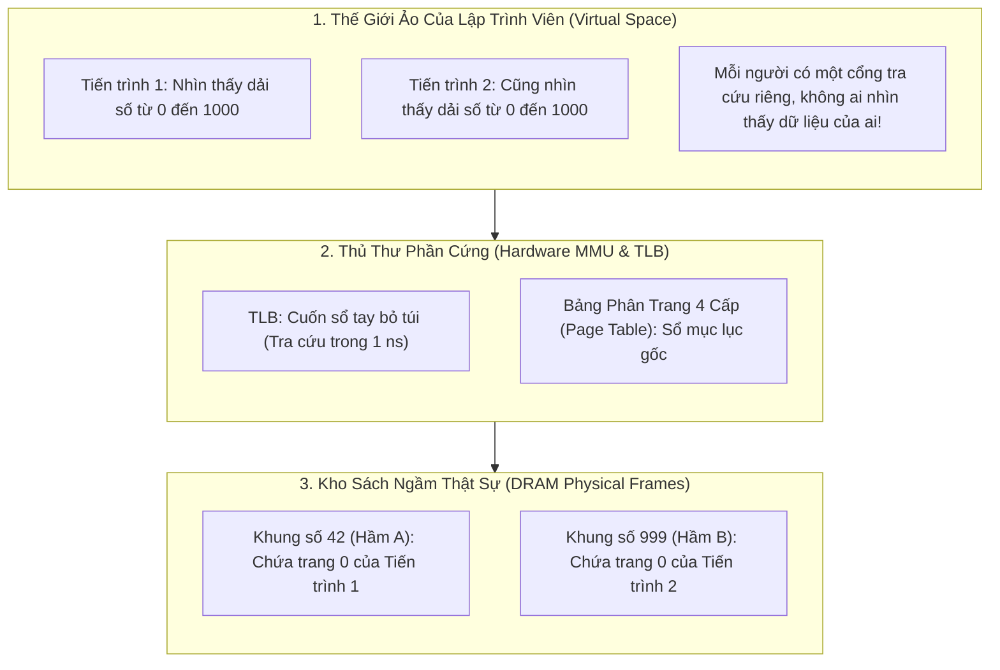
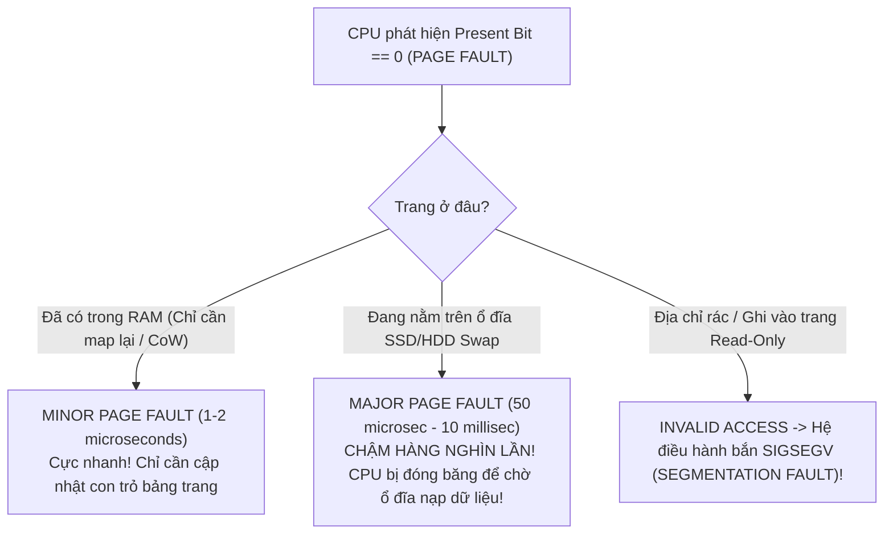
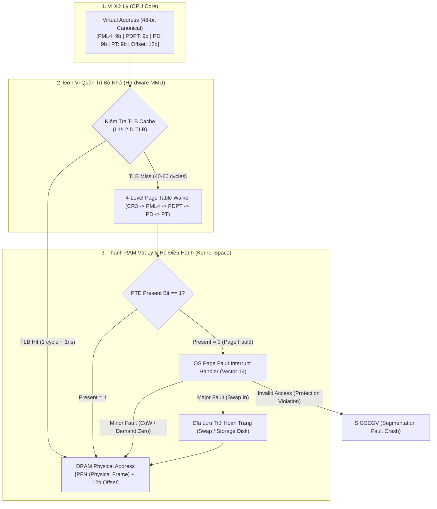

# 5.5. Virtual Memory & Paging (Bộ Nhớ Ảo, Phân Trang & Cơ Chế MMU Trong Nhân Hệ Điều Hành)

> [!IMPORTANT]
> **Nếu bạn chỉ được nhớ một điều duy nhất:** Bộ nhớ ảo (Virtual Memory) là tầng trừu tượng hóa phần cứng và hệ điều hành tách rời hoàn toàn không gian địa chỉ tuyến tính của tiến trình khỏi các ô nhớ bán dẫn vật lý trên thanh DRAM. Mọi thao tác truy xuất con trỏ đều phải đi qua bộ quản lý bộ nhớ phần cứng (**MMU**) và bộ đệm dịch địa chỉ siêu tốc (**TLB**). Nếu trang chưa có trong RAM, ngắt phần cứng **Page Fault** sẽ được kích hoạt để nạp trang theo nhu cầu (Demand Paging) hoặc nhân bản trang theo cơ chế Copy-on-Write (CoW). Trong production, hiện tượng hoán đĩa (Swapping/Thrashing) và cạm bẫy Transparent Huge Pages (THP) là hai nguyên nhân hàng đầu khiến cơ sở dữ liệu in-memory (Redis, Elasticsearch) bị suy sụp thông lượng tới $99\%$.

---

## 1. Trực Quan Hóa: Bản Chất Bộ Nhớ Ảo & Phân Trang Dưới Góc Nhìn Lập Trình Viên

Mục tiêu của phần này là giải mã lớp trừu tượng hóa vĩ đại nhất của hệ điều hành hiện đại: Tại sao mọi chương trình bạn viết đều tin rằng nó đang độc chiếm toàn bộ $128\text{ TB}$ bộ nhớ của hệ thống? Tại sao hai tiến trình cùng ghi vào địa chỉ `0x7fff5fbff8ac` lại không bao giờ bị đè dữ liệu lên nhau? Và sự cố rò rỉ swap (Swap Thrashing) có thể biến một máy chủ triệu đô thành một khối sắt bị tê liệt hoàn toàn như thế nào?

---

### 1.1. Ẩn Dụ Cổng Tra Cứu Trực Tuyến & Cuốn Sổ Mục Lục Của Thủ Thư

Hãy hình dung RAM máy tính giống như một mạng lưới thư viện quốc gia khổng lồ:



- **Địa chỉ ảo (Virtual Address)**: Là mã số sách trên trang web mà độc giả nhìn thấy. Tiến trình A và Tiến trình B đều có thể yêu cầu: *"Cho tôi đọc cuốn sách số 5"*, nhưng chúng không hề biết cuốn sách đó thực tế nằm ở đâu.
- **MMU & Bảng Phân Trang (Page Table)**: Là người thủ thư. Người này tra cuốn sổ mục lục để biết: Cuốn số 5 của Tiến trình A thực chất nằm ở **Kệ số 42 tầng hầm**, còn cuốn số 5 của Tiến trình B lại nằm ở **Kệ số 999 ngoài kho bãi**.
- **Tính Cô Lập Tuyệt Đối (Memory Isolation)**: Tiến trình A hoàn toàn không có cách nào chạm tới dữ liệu của Tiến trình B, vì bảng phân trang của Tiến trình A không hề có con trỏ nào dẫn tới khung nhớ của Tiến trình B!

---

### 1.2. Giải Mã Hiện Tượng Page Fault: Minor Fault vs Major Fault (Swap Thrashing)

Khi CPU yêu cầu một trang nhớ ảo mà trang đó chưa sẵn sàng trong RAM, phần cứng kích hoạt ngắt **Page Fault (Vector 14)**:



* **Thảm họa Swap Thrashing trong Production**:
  Khi RAM máy chủ bị cạn kiệt, hệ điều hành bắt đầu đẩy các trang nhớ ít dùng xuống ổ cứng (Swap Out). Nếu các trang này lại tiếp tục được ứng dụng gọi tới, hệ điều hành phải dừng mọi tiến trình để nạp ngược lại từ đĩa (Swap In).
  CPU dành $99\%$ thời gian chỉ để dọn nhà qua lại giữa RAM và đĩa cứng (**Thrashing**). Toàn bộ hệ thống (như Redis, Elasticsearch, Kafka) sụp đổ thông lượng và rơi vào trạng thái tê liệt hoàn toàn!

---

### 1.3. Copy-on-Write (CoW): Phép Thuật Giúp `fork()` Chạy Trong Vài Micro-Giây

Khi một tiến trình Linux nặng $32\text{ GB}$ gọi `fork()` để tạo tiến trình con:
- Hệ điều hành **không hề sao chép $32\text{ GB}$ dữ liệu**!
- Nó chỉ nhân bản bảng phân trang ($32\text{ MB}$) và gắn cờ tất cả các trang nhớ là **Chỉ Đọc (Read-Only)**.
- Khi một trong hai tiến trình cố ghi dữ liệu vào một trang, CPU bắn ra Page Fault. Kernel chặn ngắt này lại, **âm thầm nhân bản đúng $4\text{ KB}$ của trang đó**, cấp quyền ghi cho tiến trình đó và để nó chạy tiếp!
- Đây chính là bí mật giúp lệnh sao lưu ngầm `BGSAVE` của Redis có thể chụp snapshot toàn bộ database in-memory mà không hề làm khóa hệ thống!

---

### 1.4. Huge Pages (2MB / 1GB): Giải Phóng Tắc Nghẽn Cho Database Lớn

- Với trang chuẩn **$4\text{ KB}$**, bộ đệm TLB (chứa khoảng 1024 mục) chỉ có thể ghi nhớ: $1024 \times 4\text{ KB} = \mathbf{4\text{ MB}}$ bộ nhớ. Nếu ứng dụng của bạn là MySQL/PostgreSQL với $64\text{ GB}$ RAM, tỷ lệ trượt TLB Miss sẽ lên tới $90\%$!
- Bằng cách kích hoạt **Huge Pages $2\text{ MB}$**, 1024 mục TLB có thể che phủ tới: $1024 \times 2\text{ MB} = \mathbf{2\text{ GB}}$ RAM! Giảm thiểu tới $99\%$ chu kỳ xung nhịp bị lãng phí cho việc tra cứu bảng phân trang.

---

### 1.5. Sơ Đồ Khối Chu Trình Dịch Địa Chỉ Ảo Sang Địa Chỉ Vật Lý (MMU & TLB)



---

## 2. Chi tiết từng Keyword (Under-the-Hood Deep Dive)

### 2.1. Phân Trang (Paging), Trang Ảo (Pages) & Khung Trang Vật Lý (Page Frames)
- **Kích thước trang chuẩn (Base Page Size)**:
  - Hệ thống chia không gian địa chỉ thành các khối đồng kích thước, tiêu chuẩn là **$4\text{ KB}$** ($4096\text{ bytes} = 2^{12}$).
  - Không gian ảo được chia thành các **Trang Ảo (Virtual Pages)**.
  - Không gian DRAM vật lý được chia thành các **Khung Trang Vật Lý (Physical Page Frames)**.
- **Giải phẫu cấu trúc địa chỉ ảo 64-bit (48-bit Addressing)**:
  Địa chỉ ảo được chia thành hai trường toán học:
  $$\text{Virtual Address} = \text{Virtual Page Number (VPN)} \ + \ \text{Page Offset (12 bits)}$$
  - Vì trang có kích thước $4\text{ KB} = 2^{12}$, **$12\text{ bits}$ thấp nhất chính là độ lệch (Offset) bên trong trang**.
  - Quá trình dịch địa chỉ bộ nhớ ảo thực chất chỉ là việc tìm ánh xạ:
    $$\mathcal{T}: \text{Virtual Page Number (VPN)} \longrightarrow \text{Physical Frame Number (PFN)}$$
    Sau khi tìm được $\text{PFN}$, địa chỉ vật lý được tạo thành bằng cách ghép $\text{PFN}$ với nguyên vẹn $12\text{ bits}$ Offset ban đầu:
    $$\text{Physical Address} = (\text{PFN} \ll 12) \ | \ \text{Offset}$$

### 2.2. Bảng Phân Trang Đa Cấp (4-Level Page Table), Thanh Ghi CR3 & Cấu Trúc PTE
Nếu dùng một bảng phân trang phẳng duy nhất (Single-level Page Table) trên kiến trúc 64-bit, việc theo dõi $2^{52}$ trang sẽ tiêu tốn $2^{52} \times 8\text{ Bytes} = 32\text{ Petabytes}$ chỉ để lưu bảng phân trang!
- **Kiến trúc Bảng Phân Trang 4 Cấp (4-Level Paging Trên x86-64)**:
  - Thanh ghi đặc biệt của CPU **`CR3`** lưu địa chỉ vật lý của thư mục trang gốc cấp 4 (**PML4 - Page Map Level 4**).
  - Không gian $48\text{ bits}$ được phân rã thành $4$ chỉ số cấp, mỗi cấp chiếm đúng $9\text{ bits}$ ($2^9 = 512$ mục nhập, vừa khít một trang $4\text{ KB}$):
    - Bits 47-39 ($9\text{ bits}$): PML4 Index (Cấp 4).
    - Bits 38-30 ($9\text{ bits}$): PDPT Index (Page Directory Pointer Table - Cấp 3).
    - Bits 29-21 ($9\text{ bits}$): Page Directory Index (PD - Cấp 2).
    - Bits 20-12 ($9\text{ bits}$): Page Table Index (PT - Cấp 1).
    - Bits 11-0 ($12\text{ bits}$): Byte Offset trong trang $4\text{ KB}$.
  - *Lợi ích kỳ diệu*: Các vùng nhớ ảo chưa được cấp phát (Non-allocated regions) sẽ mang giá trị con trỏ `0` ở các tầng cao. Hệ điều hành không cần phải phân bổ bất kỳ bảng trang cấp dưới nào, giúp tiết kiệm tới $99.99\%$ dung lượng RAM quản trị.
- **Cấu trúc một mục nhập trong bảng phân trang (PTE - Page Table Entry 64-bit)**:
  - Bit 0 (`P` - Present): `1` nếu trang đang nằm trong RAM vật lý; `0` nếu trang nằm trên đĩa Swap hoặc chưa nạp.
  - Bit 1 (`R/W` - Read/Write): `0` là chỉ đọc (Read-only); `1` là cho phép ghi.
  - Bit 2 (`U/S` - User/Supervisor): `0` chỉ dành cho mã Kernel (Ring 0); `1` cho phép User Space (Ring 3) truy cập.
  - Bit 5 (`A` - Accessed): CPU tự động bật lên `1` mỗi khi trang được đọc/ghi (dùng cho thuật toán thu hồi trang LRU).
  - Bit 6 (`D` - Dirty): CPU tự động bật lên `1` khi trang bị ghi đè dữ liệu (cần ghi ngược xuống đĩa khi swap-out).
  - Bit 7 (`PS` - Page Size): Bật lên `1` tại tầng PDPT/PD để báo hiệu đây là Huge Page ($1\text{ GB}$ hoặc $2\text{ MB}$).
  - Bit 63 (`NX` - No-Execute / XD): Cấm thực thi lệnh máy trên trang này (ngăn chặn tấn công chèn mã Shellcode / Buffer Overflow).

### 2.3. Translation Lookaside Buffer (TLB), TLB Shootdown & Huge Pages (2MB / 1GB)
- **TLB (Translation Lookaside Buffer)**:
  - Là bộ nhớ đệm phần cứng liên kết toàn phần (Fully Associative Cache) cực nhanh tích hợp ngay bên trong CPU Core.
  - *Độ trễ*: TLB Hit chỉ tốn $0.5 - 1\text{ ns}$ ($1\text{ cycle}$). Ngược lại, TLB Miss buộc CPU phải thực hiện Page Table Walk duyệt 4 tầng bộ nhớ, tốn từ $40$ đến $100$ chu kỳ xung nhịp clock!
- **TLB Shootdown (Bão liên lõi khi giải phóng bộ nhớ)**:
  - Khi một tiến trình đa luồng giải phóng một vùng nhớ lớn (`munmap` hoặc `free`), CPU Core đang chạy phải sửa lại bảng phân trang và phát tín hiệu ngắt liên xử lý (**Inter-Processor Interrupt - IPI**) tới tất cả các Core khác để buộc chúng xóa bỏ dòng TLB tương ứng (TLB Invalidation).
  - Thao tác này khiến hàng chục Core CPU bị đóng băng đồng thời, làm sụt giảm nghiêm trọng hiệu năng của các hệ thống xử lý song song lớn.
- **Huge Pages (Trang Nhớ Khổng Lồ: 2MB và 1GB)**:
  - *Standard Page ($4\text{ KB}$)*: 1 mục nhập TLB quản lý được $4\text{ KB}$ RAM. Với 1024 mục TLB, độ phủ (TLB Reach) chỉ đạt vỏn vẹn $4\text{ MB}$ RAM!
  - *2MB Huge Page*: Loại bỏ tầng Page Table cấp 1, PD trỏ thẳng vào khối $2\text{ MB}$ vật lý. 1024 mục TLB quản lý được **$2\text{ GB}$ RAM**!
  - *1GB Huge Page*: Loại bỏ cả tầng cấp 2, PDPT trỏ thẳng vào khối $1\text{ GB}$.
  - Giúp triệt tiêu tới $99\%$ tỉ lệ TLB Miss cho các hệ thống ngốn RAM lớn (PostgreSQL Shared Buffers, JVM Heap, QEMU/KVM Virtual Machines).

### 2.4. Cơ Chế Xử Lý Page Fault: Minor Fault, Major Fault & Invalid Access (SIGSEGV)
Khi một chỉ thị CPU truy cập một địa chỉ ảo mà mục nhập PTE có cờ `Present = 0` hoặc vi phạm quyền hạn, CPU tạm dừng luồng thực thi và kích hoạt ngắt phần cứng **Page Fault Interrupt (Vector 14)**:
1. **Minor Page Fault (Soft Page Fault)**:
   - Trang thực chất đã nằm sẵn trên RAM vật lý nhưng chưa được liên kết vào bảng phân trang của tiến trình hiện tại.
   - *Ví dụ*: Cấp phát bộ nhớ lười (**Demand Zero Paging** - `malloc` cấp không gian ảo nhưng chỉ khi chạm vào ghi dữ liệu mới cấp RAM thật), hoặc tiến trình đọc trang dùng chung đã được tiến trình khác nạp vào Page Cache.
   - *Độ trễ*: Cực nhanh ($1 - 2\text{ microseconds}$), chỉ tốn chu kỳ xử lý của Kernel trap.
2. **Major Page Fault (Hard Page Fault)**:
   - Trang dữ liệu chưa hề có trong RAM và bắt buộc phải đọc từ ổ đĩa lưu trữ (Đĩa Swap hoặc File trên hệ thống tệp).
   - Tiến trình bị Kernel đưa vào trạng thái ngủ (**Blocked / Uninterruptible Sleep `D`**) để chờ bộ điều khiển đĩa nạp dữ liệu qua DMA.
   - *Độ trễ*: Cực kỳ khủng khiếp ($5 - 10\text{ milliseconds}$ trên HDD, $50 - 100\text{ microseconds}$ trên NVMe SSD), chậm hơn tốc độ RAM hàng chục nghìn lần!
3. **Invalid Access (Segmentation Fault - `SIGSEGV`)**:
   - Tiến trình cố ghi vào trang chỉ đọc (`R/W = 0`, ví dụ ghi đè vào phân vùng code `.text` hoặc chuỗi string literal), hoặc truy cập vào vùng địa chỉ ảo ngoài phạm vi phân bổ.
   - Kernel gửi tín hiệu mã lỗi `SIGSEGV` (Signal 11) và tiến trình bị tiêu diệt ngay lập tức.

### 2.5. Copy-on-Write (CoW), System Call `fork()` & Memory-Mapped Files (`mmap`)
- **Copy-on-Write (CoW) trong `fork()`**:
  - Khi một tiến trình gọi system call `fork()` để tạo tiến trình con, hệ điều hành **hoàn toàn không sao chép bất kỳ trang RAM vật lý nào**!
  - Kernel chỉ nhân bản cấu trúc bảng phân trang của tiến trình cha sang tiến trình con, đồng thời đánh dấu tất cả các trang của cả cha và con về chế độ **Chỉ Đọc (Read-Only)**.
  - Khi một trong hai tiến trình cố gắng ghi dữ liệu vào một trang, CPU lập tức kích hoạt Page Fault. Kernel bắt lấy ngắt này, âm thầm cấp một trang RAM vật lý mới, sao chép $4\text{ KB}$ của trang đó sang trang mới, mở lại quyền ghi (Read/Write) cho riêng tiến trình đó rồi tiếp tục thực thi.
  - *Ứng dụng đỉnh cao*: Giúp lệnh `fork()` hoàn thành chỉ trong vài micro-giây; nền tảng cho cơ chế snapshot dữ liệu `BGSAVE` không khóa của Redis.
- **Memory-Mapped Files (`mmap`)**:
  - Ánh xạ trực tiếp các khối của file trên đĩa vào không gian địa chỉ ảo của tiến trình.
  - Khi chương trình giải tham chiếu con trỏ trỏ vào vùng `mmap`, Kernel sử dụng cơ chế Page Fault để tự động nạp các khối của file từ Page Cache của OS vào RAM theo cơ chế Zero-Copy, bỏ qua hoàn toàn chi phí sao chép trung gian của system call `read()` và `write()`.

---

## 3. Thực thi Mã nguồn & Mô phỏng Chuyên sâu (Dual-Engine Implementation)

### 3.1. C++20 Zero-Copy File I/O với `mmap` & Giám Sát Page Fault Trong Tiến Trình

Chương trình C++20 sử dụng system call `mmap` để đọc/ghi file nhị phân theo cơ chế Zero-Copy, đo lường các sự kiện Minor/Major Page Faults qua `getrusage`:

```cpp
// Biên dịch: g++ -std=c++20 -O3 -Wall -Wextra mmap_page_fault_lab.cpp -o mmap_lab
#include <iostream>
#include <fcntl.h>
#include <sys/mman.h>
#include <sys/stat.h>
#include <sys/resource.h>
#include <unistd.h>
#include <format>
#include <cstring>
#include <vector>

void print_page_fault_stats(const char* checkpoint) {
    struct rusage usage;
    getrusage(RUSAGE_SELF, &usage);
    std::cout << std::format("[{}] Minor Page Faults: {:6d} | Major Page Faults: {:4d}\n",
                             checkpoint, usage.ru_minflt, usage.ru_majflt);
}

int main() {
    std::cout << "=========================================================\n";
    std::cout << "  C++20 ZERO-COPY MMAP & PAGE FAULT DIAGNOSTICS LAB      \n";
    std::cout << "=========================================================\n";

    print_page_fault_stats("Khởi động tiến trình");

    // 1. Tạo một file tạm thời có kích thước 16 MB (4096 trang 4KB)
    const char* filename = "mmap_demo_payload.bin";
    constexpr size_t FILE_SIZE = 16 * 1024 * 1024; // 16 MB

    int fd = open(filename, O_RDWR | O_CREAT | O_TRUNC, 0644);
    if (fd == -1) {
        std::cerr << "Không thể mở file!\n";
        return 1;
    }
    // Cấp phát kích thước file trên đĩa
    ftruncate(fd, FILE_SIZE);

    // 2. Gọi mmap: Ánh xạ không gian địa chỉ ảo (Demand Paging Lazy Allocation)
    void* mapped_mem = mmap(nullptr, FILE_SIZE, PROT_READ | PROT_WRITE, MAP_SHARED, fd, 0);
    if (mapped_mem == MAP_FAILED) {
        std::cerr << "mmap thất bại!\n";
        close(fd);
        return 1;
    }

    std::cout << std::format("File mapped at Virtual Address: {}\n", mapped_mem);
    print_page_fault_stats("Sau khi gọi mmap (Chưa chạm RAM)");

    // 3. Ghi dữ liệu vào trang: Kích hoạt Minor Page Faults theo nhu cầu
    uint8_t* ptr = static_cast<uint8_t*>(mapped_mem);
    constexpr size_t PAGE_SIZE = 4096;

    // Chạm vào 1000 trang cách rời nhau (Mỗi bước nhảy 4KB)
    for (size_t i = 0; i < 1000; ++i) {
        ptr[i * PAGE_SIZE] = static_cast<uint8_t>(i & 0xFF);
    }
    print_page_fault_stats("Sau khi ghi vào 1000 trang (Demand Paging)");

    // 4. Đồng bộ dữ liệu xuống đĩa vật lý bằng msync
    msync(mapped_mem, FILE_SIZE, MS_SYNC);

    // 5. Giải phóng tài nguyên
    munmap(mapped_mem, FILE_SIZE);
    close(fd);
    unlink(filename);

    print_page_fault_stats("Hoàn tất dọn dẹp munmap");
    return 0;
}
```

### 3.2. Python 3.11+: 4-Level Page Table Address Translation Simulator

Chương trình Python 3.11+ mô phỏng chính xác thuật toán bóc tách bit và duyệt bảng phân trang 4 cấp (PML4, PDPT, PD, PT) của kiến trúc x86-64:

```python
#!/usr/bin/env python3
"""
virtual_memory_simulator.py: Mô phỏng phân rã địa chỉ ảo x86-64 và 4-Level Page Walk.
Yêu cầu: Python 3.11+
"""
from typing import NamedTuple

class DecodedVirtualAddress(NamedTuple):
    raw_hex: str
    is_canonical: bool
    space_domain: str
    pml4_idx: int
    pdpt_idx: int
    pd_idx: int
    pt_idx: int
    offset_12b: int

def decode_x86_64_address(vaddr: int) -> DecodedVirtualAddress:
    # Kiểm tra Canonical 48-bit (Sign Extension từ bit 47)
    bit_47 = (vaddr >> 47) & 1
    top_16_bits = (vaddr >> 48) & 0xFFFF
    expected_top = 0xFFFF if bit_47 else 0x0000
    is_canonical = (top_16_bits == expected_top)

    space_domain = "Unknown / Non-Canonical"
    if is_canonical:
        space_domain = "Kernel Space (Top 128TB)" if bit_47 else "User Space (Bottom 128TB)"

    # Bóc tách các trường 9 bits cho 4 cấp phân trang
    pml4 = (vaddr >> 39) & 0x1FF  # Bits 47-39
    pdpt = (vaddr >> 30) & 0x1FF  # Bits 38-30
    pd   = (vaddr >> 21) & 0x1FF  # Bits 29-21
    pt   = (vaddr >> 12) & 0x1FF  # Bits 20-12
    offset = vaddr & 0xFFF        # Bits 11-0 (12 bits)

    return DecodedVirtualAddress(
        raw_hex=f"0x{vaddr:016X}",
        is_canonical=is_canonical,
        space_domain=space_domain,
        pml4_idx=pml4,
        pdpt_idx=pdpt,
        pd_idx=pd,
        pt_idx=pt,
        offset_12b=offset
    )

def simulate_page_walk():
    print("=== MÔ PHỎNG GIẢI MÃ ĐỊA CHỈ BẢNG PHÂN TRANG 4 CẤP X86-64 ===")
    test_addresses = [
        0x00007FFF5FBFF840,  # User Space Stack Address điển hình
        0x0000000000401020,  # User Space Code (.text) Address
        0xFFFF888002400000,  # Linux Kernel Direct Mapping Address
        0x0000800000000000   # Non-canonical Hole (Vi phạm quy tắc!)
    ]

    for addr in test_addresses:
        dec = decode_x86_64_address(addr)
        print(f"Kiểm tra địa chỉ : {dec.raw_hex}")
        print(f"  -> Canonical     : {dec.is_canonical} ({dec.space_domain})")
        if dec.is_canonical:
            print(f"  -> 4-Level Walk  : PML4[{dec.pml4_idx:3d}] -> PDPT[{dec.pdpt_idx:3d}] -> PD[{dec.pd_idx:3d}] -> PT[{dec.pt_idx:3d}]")
            print(f"  -> 4KB Offset    : 0x{dec.offset_12b:03X} ({dec.offset_12b} bytes)")
        print()

if __name__ == "__main__":
    simulate_page_walk()
```

### 3.3. Terminal Output Mẫu & Phân Tích Thực Thi

```text
=========================================================
  C++20 ZERO-COPY MMAP & PAGE FAULT DIAGNOSTICS LAB      
=========================================================
[Khởi động tiến trình] Minor Page Faults:    142 | Major Page Faults:    0
File mapped at Virtual Address: 0x104868000
[Sau khi gọi mmap (Chưa chạm RAM)] Minor Page Faults:    144 | Major Page Faults:    0
[Sau khi ghi vào 1000 trang (Demand Paging)] Minor Page Faults:   1145 | Major Page Faults:    0
[Hoàn tất dọn dẹp munmap] Minor Page Faults:   1147 | Major Page Faults:    0

=== MÔ PHỎNG GIẢI MÃ ĐỊA CHỈ BẢNG PHÂN TRANG 4 CẤP X86-64 ===
Kiểm tra địa chỉ : 0x00007FFF5FBFF840
  -> Canonical     : True (User Space (Bottom 128TB))
  -> 4-Level Walk  : PML4[255] -> PDPT[509] -> PD[254] -> PT[511]
  -> 4KB Offset    : 0x840 (2112 bytes)

Kiểm tra địa chỉ : 0x0000000000401020
  -> Canonical     : True (User Space (Bottom 128TB))
  -> 4-Level Walk  : PML4[  0] -> PDPT[  1] -> PD[  0] -> PT[  1]
  -> 4KB Offset    : 0x020 (32 bytes)

Kiểm tra địa chỉ : 0xFFFF888002400000
  -> Canonical     : True (Kernel Space (Top 128TB))
  -> 4-Level Walk  : PML4[273] -> PDPT[  0] -> PD[ 18] -> PT[  0]
  -> 4KB Offset    : 0x000 (0 bytes)

Kiểm tra địa chỉ : 0x0000800000000000
  -> Canonical     : False (Unknown / Non-Canonical)
```

---

## 4. Systems Engineering & Production Pitfalls

### 4.1. Thảm Họa Hiện Tượng Swapping & Thrashing Trong In-Memory Databases
- **Kịch bản thực chiến**: Một cụm Redis hoặc Elasticsearch chạy trên máy chủ có 64GB RAM. Do tải tăng đột biến, lượng dữ liệu vượt quá 64GB và hệ điều hành bắt đầu đẩy các trang RAM ra vùng nhớ Swap trên ổ đĩa SSD.
- **Hậu quả**:
  - Khi Redis thực hiện các lệnh quét dữ liệu, mọi lệnh đọc đều chạm phải trang đã bị swap-out, gây ra hàng nghìn **Major Page Faults** liên tục mỗi giây.
  - Luồng đơn duy nhất của Redis bị Kernel đóng băng trong trạng thái chờ I/O đĩa (`D state`).
  - Toàn bộ các kết nối API Client bị nghẽn (Timeout), độ trễ P99 tăng vọt từ $1\text{ ms}$ lên tới $30{,}000\text{ ms}$, thông lượng server sụp đổ hoàn toàn (hiện tượng **Thrashing**).
- **Biện pháp bắt buộc**: Với các database in-memory, luôn luôn:
  ```bash
  # Tắt hoàn toàn Swap trên server database
  sudo swapoff -a

  # Thiết lập swappiness tối thiểu trong sysctl
  sudo sysctl -w vm.swappiness=0
  ```

### 4.2. Cạm Bẫy Transparent Huge Pages (THP) Gây Đóng Băng JVM GC & Redis
- **Vấn đề**: Tính năng **Transparent Huge Pages (THP)** của Linux Kernel cố gắng tự động gộp các trang nhỏ $4\text{ KB}$ thành các trang lớn $2\text{ MB}$ trong chế độ ngầm định.
- **Hậu quả trên Production**:
  - Khi tiến trình thực hiện thao tác ghi nhỏ vào một trang CoW (Copy-on-Write) hoặc bộ thu gom rác JVM GC thực hiện dọn dẹp, thay vì sao chép $4\text{ KB}$, hệ điều hành buộc phải cấp phát và sao chép toàn bộ khối **$2\text{ MB}$**.
  - Nếu RAM đang bị phân mảnh, Kernel phải kích hoạt luồng dồn bộ nhớ đồng bộ (**Direct Compaction**), khiến toàn bộ tiến trình Java hoặc Redis bị treo cứng (**Freeze**) từ vài trăm mili-giây tới vài giây ngẫu nhiên!
- **Biện pháp**: Luôn tắt THP trên các máy chủ chạy Database và JVM:
  ```bash
  echo never | sudo tee /sys/kernel/mm/transparent_hugepage/enabled
  echo never | sudo tee /sys/kernel/mm/transparent_hugepage/defrag
  ```

### 4.3. CLI Diagnostics & Memory Subsystem Monitoring Tools
- Giám sát tỷ lệ Page Fault và hoạt động Paging theo thời gian thực:
  ```bash
  # Giám sát số lượng minor/major page faults mỗi giây
  sar -B 1 10

  # Kiểm tra hoạt động Swap in (si) và Swap out (so)
  vmstat 1 10
  ```
- Xem chi tiết bản đồ phân trang và các vùng nhớ ảo của một tiến trình:
  ```bash
  cat /proc/<PID>/smaps | grep -E "Size|Rss|Pss|Shared|Private|Swap"
  ```
- Đo lường số lượng Page Faults phát sinh khi chạy một ứng dụng:
  ```bash
  perf stat -e page-faults,minor-faults,major-faults ./mmap_lab
  ```

---

## 5. Bảng So sánh & Decision Matrix

### Ma trận So sánh Các Kỹ Thuật Phân Trang Bộ Nhớ Ảo

| Tiêu Chí So Sánh | Standard Paging ($4\text{ KB}$) | Transparent Huge Pages (THP) | Explicit Huge Pages ($2\text{ MB}$ / $1\text{ GB}$) | Memory-Mapped I/O (`mmap`) |
| :--- | :--- | :--- | :--- | :--- |
| **Kích Thước Trang** | $4096\text{ Bytes}$ | $2\text{ MB}$ tự động | $2\text{ MB}$ hoặc $1\text{ GB}$ tĩnh | Bội số của $4\text{ KB}$ |
| **Độ Phủ TLB (TLB Reach)**| Thấp ($4-8\text{ MB}$) | Rất cao | Tối đa ($2-64\text{ GB}$) | Phụ thuộc kích thước trang nền |
| **Chi Phí Cấp Phát RAM**| Cực thấp, chống lãng phí | Nguy cơ phân mảnh cao | Khóa chặt RAM, không trả lại OS | Theo nhu cầu (Demand Paging) |
| **Nguy Cơ Độ Trễ (Latency Spikes)**| Không có | Rất cao (Direct Compaction)| Cực thấp (Đã pre-allocated) | Thấp (Chỉ có minor fault lần đầu) |
| **Ứng Dụng Khuyên Dùng**| Ứng dụng thông thường, Web backend | Không khuyến khích cho DB | In-memory DB, PostgreSQL, KVM/QEMU | File I/O lớn, IPC Shared Memory |

---

## 6. Enterprise Production Checklist & Verification

- [ ] **Vô Hiệu Hóa Hoàn Toàn Swap Cho In-Memory Cache**: Chạy lệnh `swapoff -a` và cấu hình `vm.swappiness=0` trên toàn bộ các node chạy Redis, Kafka, Elasticsearch.
- [ ] **Tắt Transparent Huge Pages (THP)**: Đảm bảo script khởi động hệ thống tự động ghi `never` vào `/sys/kernel/mm/transparent_hugepage/enabled` trên server production.
- [ ] **Tận Dụng Explicit Huge Pages Cho Database Lớn**: Cấu hình `huge_pages = try` hoặc `on` trong `postgresql.conf` và cấp phát trước qua `vm.nr_hugepages`.
- [ ] **Sử Dụng `mmap` Cho File Dữ Liệu Lớn**: Thay thế các hàm đọc tuần tự `read()` buffer trung gian bằng `mmap` Zero-Copy khi phân tích các file dữ liệu read-heavy lớn hơn $100\text{ MB}$.
- [ ] **Giám Sát Major Page Faults Trong Hệ Thống Alerting**: Thiết lập cảnh báo Prometheus nếu tỷ lệ Major Page Faults (`node_vmstat_pgmajfault`) vượt quá ngưỡng 10 faults/giây trên các cụm dịch vụ nhạy cảm độ trễ.
