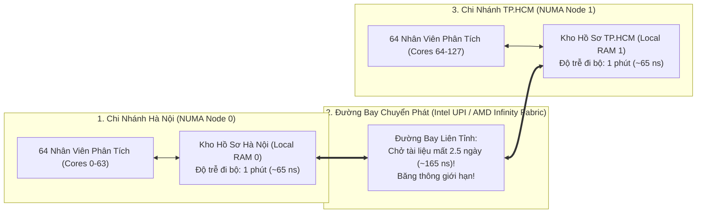
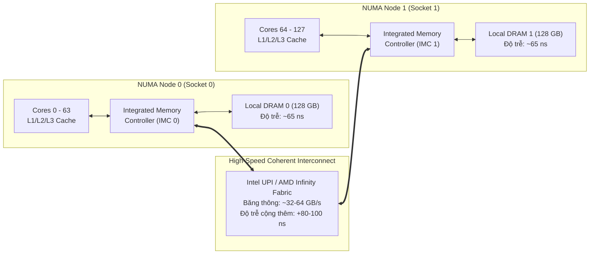
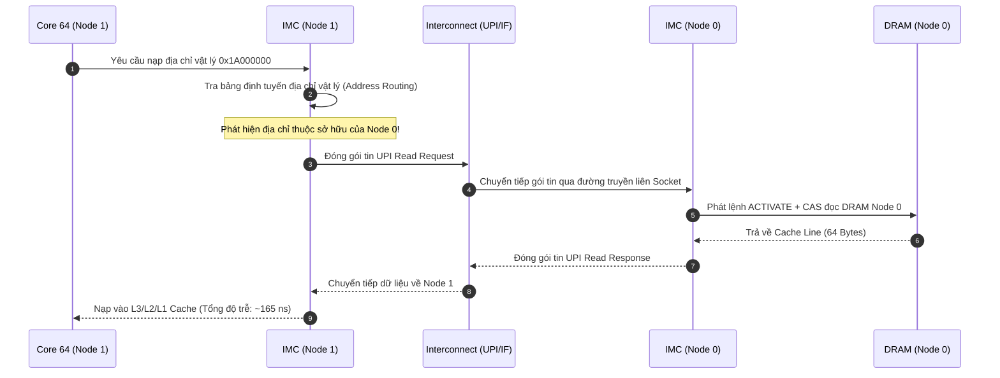

# 5.6. NUMA Architecture (Kiến Trúc Bộ Nhớ Bất Đồng Nhất & Tối Ưu Máy Chủ Đa Socket)

> [!IMPORTANT]
> **Nếu bạn chỉ được nhớ một điều duy nhất:**
> Trên các máy chủ đa nhân hiện đại (Dual-Socket Intel Xeon, AMD EPYC hoặc đám mây c5/m5/c6i), RAM vật lý không còn là một vùng nhớ đồng nhất mà bị phân mảnh thành các **NUMA Nodes** gắn liền với từng CPU Socket. Truy cập RAM cục bộ (**Local Memory**) chỉ mất $\approx 65\text{ ns}$, trong khi truy cập RAM gắn trên Socket khác (**Remote Memory**) qua đường truyền liên kết (Intel UPI / AMD Infinity Fabric) tốn tới $\approx 150 - 180\text{ ns}$ (chậm hơn 2.5 lần). Cạm bẫy chết người nhất của lập trình viên là **Quy tắc Chạm Đầu Tiên (First-Touch Allocation)**: Linux Kernel chỉ cấp phát trang RAM vật lý vào Node của luồng thực hiện lệnh ghi đầu tiên. Nếu một luồng chính khởi tạo toàn bộ mảng dữ liệu trên Node 0 rồi giao cho các luồng thợ trên Node 1 xử lý, toàn bộ hệ thống sẽ bị bóp nghẹt bởi độ trễ đường truyền liên Socket!

---

## 1. Trực Quan Hóa: Bản Chất Kiến Trúc NUMA Dưới Góc Nhìn Lập Trình Viên

Mục tiêu của phần này là giải mã kiến trúc bộ nhớ trên các máy chủ đa socket hiện đại: Tại sao cùng là đọc từ thanh RAM DDR5 nhưng có lúc chỉ mất 65ns, có lúc lại mất tới gần 200ns? Tại sao một vòng lặp khởi tạo `for (i = 0; i < N; ++i) arr[i] = 0;` ở luồng chính lại có thể "đầu độc" toàn bộ 128 luồng worker chạy phía sau? Và làm thế nào các kỹ sư tối ưu hóa backend ngân hàng hay sàn giao dịch để đạt thông lượng tối đa trên phần cứng NUMA?

---

### 1.1. Ẩn Dụ Hai Văn Phòng Chi Nhánh & Chuyến Bay Chuyển Phát Nhanh

Hãy hình dung một máy chủ Dual-Socket (2 CPU cắm trên cùng 1 mainboard) giống như hai văn phòng chi nhánh của một tập đoàn:



- **Truy cập Cục Bộ (Local Access)**: Nhân viên Hà Nội mở kho tài liệu Hà Nội lấy hồ sơ. Mất $65\text{ ns}$.
- **Truy cập Từ Xa (Remote Access)**: Nhân viên Hà Nội cần tài liệu đang nằm trong kho TP.HCM. Họ phải gửi fax, chờ đóng gói và gửi máy bay ra Hà Nội qua bus liên kết (**Intel UPI / AMD Infinity Fabric**), mất **$165\text{ ns}$** (chậm hơn 2.5 lần!).
- Nếu mọi nhân viên ở cả hai chi nhánh đều liên tục đòi đọc hồ sơ của nhau, đường bay sẽ bị nghẽn cứng, và cả 128 nhân viên đều phải ngồi chơi xơi nước vì chờ dữ liệu!

---

### 1.2. Cạm Bẫy Sống Còn: "The First-Touch Trap"

Đây là lỗi phổ biến nhất khiến code đa luồng trên máy chủ chạy chậm một cách khó hiểu:

```cpp
// LUỒNG CHÍNH (Chạy trên Socket 0):
int* buffer = (int*)malloc(100 * 1024 * 1024 * sizeof(int)); // Cấp 400MB
for (size_t i = 0; i < N; ++i) {
    buffer[i] = 0; // LỆNH GHI ĐẦU TIÊN (FIRST-TOUCH)!
}
// -> LINUX KERNEL CẤP PHÁT TOÀN BỘ 400MB TRÊN RAM VẬT LÝ CỦA SOCKET 0!

// SAU ĐÓ KHỞI TẠO 64 WORKER THREADS:
// Phân nửa worker threads được điều phối chạy trên Socket 1.
// Mỗi khi worker trên Socket 1 đọc buffer[i], 100% LÀ TRUY CẬP REMOTE QUA BUS UPI!
```

#### Tại sao lại xảy ra điều này?
Hàm `malloc()` không hề cấp một byte RAM vật lý nào (chỉ cấp địa chỉ ảo). Chỉ khi có lệnh ghi đầu tiên (**First-Touch**), ngắt Page Fault mới xuất hiện, và Linux Kernel sẽ **ưu tiên cấp RAM vật lý gắn trực tiếp vào Socket của luồng đang thực hiện lệnh ghi đó**.
- **Giải pháp chuẩn**: Khởi tạo mảng song song (Parallel Initialization) bằng chính các worker threads, hoặc dùng chính sách phân bổ xen kẽ (`numactl --interleave=all`).

---

### 1.3. Khi Nào Bạn Đang Đứng Trước Phần Cứng NUMA?

Nhiều lập trình viên nghĩ NUMA là chuyện xa vời của các siêu máy tính. Thực tế:
- Mọi máy chủ Cloud từ 32 vCPU trở lên (AWS `c5.18xlarge`, `m5.24xlarge`, GCP `c2-standard-60`) đều có kiến trúc NUMA.
- Mọi server vật lý Dual-Socket (Intel Xeon Silver/Gold/Platinum hoặc AMD EPYC) đều là hệ thống NUMA.
- Để kiểm tra trên Linux, chỉ cần gõ:
  ```bash
  numactl --hardware
  # hoặc:
  lscpu | grep -i numa
  ```

---

### 1.4. Tinh Chỉnh Sản Xuất: Kiến Trúc Share-Nothing & CPU Pinning

Để đạt hiệu năng đỉnh cao trên máy chủ NUMA lớn:
- **Share-Nothing Architecture**: Thay vì chạy 1 tiến trình service khổng lồ 128 threads chia sẻ chung một vùng RAM, ta chạy **2 tiến trình service độc lập**, mỗi tiến trình ghim chặt vào đúng 1 Socket:
  ```bash
  # Tiến trình 1: Khóa chặt vào Node 0
  numactl --cpunodebind=0 --membind=0 ./order_service_instance_0
  
  # Tiến trình 2: Khóa chặt vào Node 1
  numactl --cpunodebind=1 --membind=1 ./order_service_instance_1
  ```
- Nhờ cách ly hoàn toàn, $100\%$ các thao tác đọc/ghi RAM đều là **Local Memory Access** ($65\text{ ns}$), triệt tiêu hoàn toàn tắc nghẽn trên đường bus liên socket!

---

### 1.5. Sơ Đồ Khối Cấu Trúc Đa Socket NUMA



---

## 2. Chi tiết từng Keyword (Under-the-Hood Deep Dive)

### 2.1. NUMA Node, Local Memory & Remote Memory
- **UMA (Uniform Memory Access - SMP)**: Toàn bộ CPU chia sẻ chung một Northbridge và một bus RAM duy nhất. Khi số lượng nhân CPU vượt quá 8--16 cores, hiện tượng xung đột bus (Bus Contention) bão hòa, làm hiệu năng ngừng tăng trưởng.
- **ccNUMA (Cache-Coherent Non-Uniform Memory Access)**: Mỗi Socket tích hợp vi điều khiển bộ nhớ độc lập (**IMC**). Dù bộ nhớ phân tán vật lý, phần cứng vẫn duy trì ảo ảnh một không gian địa chỉ phẳng duy nhất (Single Address Space) nhờ giao thức duy trì tính nhất quán bộ đệm (Directory-based Cache Coherency).
- **NUMA Node**: Một cụm vật lý bao gồm một tập hợp các nhân CPU (Cores), bộ nhớ đệm (L1/L2/L3 Caches), và một kênh RAM vật lý cục bộ kết nối trực tiếp với IMC của socket đó.
- **Local Memory vs Remote Memory**: Truy xuất RAM cục bộ (Local Access) chỉ đi qua bus nội bộ socket với độ trễ thấp ($\approx 65\text{ ns}$). Truy xuất RAM từ xa (Remote Access) phải băng qua liên kết liên socket (Intel UPI hoặc AMD Infinity Fabric) với độ trễ cao gấp 2.5 đến 3 lần ($\approx 165\text{ ns}$).
- **Ma trận khoảng cách NUMA (NUMA Distance Matrix)**: Chuẩn ACPI SLIT (System Locality Distance Information Table) biểu diễn chi phí tương đối: Local node có trọng số cơ sở $10$, trong khi Remote node có trọng số $21$ hoặc $32$.



### 2.2. Các Chính Sách Cấp Phát Bộ Nhớ NUMA Trong Linux Kernel
Linux Kernel cung cấp hệ thống chính sách cấp phát trang (`numactl` / `set_mempolicy` / `mbind`):
1. **`MPOL_DEFAULT`**: Cấp phát từ NUMA Node của luồng CPU đang thực thi (kết hợp với quy tắc First-Touch).
2. **`MPOL_BIND`**: Khóa chặt vùng nhớ, chỉ cho phép cấp phát từ một danh sách các Node được chỉ định nghiêm ngặt. Nếu hết RAM cục bộ, Kernel sẽ trả về lỗi `ENOMEM` thay vì mượn RAM từ Node khác.
3. **`MPOL_INTERLEAVE`**: Phân bổ xen kẽ từng trang nhớ $4\text{ KB}$ xoay vòng (Round-Robin) lần lượt qua các Node. Rất hữu hiệu cho các ứng dụng chia sẻ dữ liệu đọc lớn đa luồng nhằm tránh thắt nút cổ chai băng thông trên một Node đơn lẻ.
4. **`MPOL_PREFERRED`**: Ưu tiên cấp phát trên Node mong muốn, nếu hết RAM thì mượn tạm Node khác thay vì báo lỗi.

*Toán học độ trễ hiệu dụng NUMA*:
$$\text{Latency}_{\text{eff}} = p_{\text{local}} \times L_{\text{local}} + (1 - p_{\text{local}}) \times L_{\text{remote}}$$
Nếu ứng dụng không được tối ưu NUMA, dữ liệu bị phân tán ngẫu nhiên trên 2 Sockets ($p_{\text{local}} \approx 0.5$):
$$\text{Latency}_{\text{eff}} = 0.5 \times 65\text{ ns} + 0.5 \times 165\text{ ns} = 115\text{ ns}$$
Độ trễ trung bình tăng vọt **$77\%$**, làm sụt giảm nghiêm trọng thông lượng của Backend Hot-path.

### 2.3. Cạm Bẫy Sống Còn: "The First-Touch Allocation Trap"
Khi một ứng dụng gọi `malloc()` hoặc `mmap()`:
1. Hệ điều hành Linux **chưa hề cấp phát một byte RAM vật lý nào**! Nó chỉ ghi nhận vùng địa chỉ ảo vào cấu trúc `vm_area_struct`.
2. Khi tiến trình thực hiện lệnh ghi đầu tiên vào trang nhớ, ngắt phần cứng **Page Fault** xuất hiện.
3. Hàm xử lý của Linux Kernel (`handle_mm_fault()` $\to$ `alloc_pages_node()`) kiểm tra: *Luồng CPU nào vừa kích hoạt Page Fault?*
4. Linux Kernel lập tức cấp phát khung trang vật lý (Physical Page Frame) từ **vùng nhớ cục bộ của NUMA Node mà luồng đó đang chạy**.

**Cạm bẫy kinh điển (First-Touch Bug)**:
```cpp
// LUỒNG CHÍNH (Chạy trên Core 0, Node 0):
int* data = (int*)malloc(BUFFER_SIZE);
for (size_t i = 0; i < N; ++i) data[i] = 0; // LỆNH GHI ĐẦU TIÊN!
// -> TOÀN BỘ MẢNG BỊ GẮN CHẶT VÀO RAM VẬT LÝ CỦA NODE 0!

// SAU ĐÓ KHỞI TẠO 64 WORKER THREADS:
// Các luồng 32..63 chạy trên Socket 1 (Node 1)
// Mỗi khi chúng đọc data[i], 100% truy xuất là REMOTE ACCESS qua bus UPI!
```

### 2.4. NUMA Affinity & Process Pinning
- **CPU Affinity & Process Pinning**: Kỹ thuật ghim chặt một tiến trình hoặc luồng thực thi vào một tập hợp nhân CPU cố định (`sched_setaffinity` trên Linux hoặc `pthread_setaffinity_np`).
- Ngăn ngừa tình trạng Linux Scheduler di chuyển (migrate) luồng từ Socket 0 sang Socket 1 giữa chừng, biến toàn bộ dữ liệu trong bộ nhớ RAM từ trạng thái Local thành Remote.
- Triển khai kiến trúc **Share-Nothing per Node**: Chạy nhiều instances độc lập của service, mỗi instance được ghim cố định vào một NUMA node (`numactl --cpunodebind=0 --membind=0 ./backend_service_node0`) để đạt hiệu năng cache và local DRAM tối đa $100\%$.

---

## 3. Thực thi Mã nguồn & Mô phỏng Chuyên sâu (Dual-Engine Implementation)

Dưới đây là mã nguồn minh họa:
- **C++20**: Chương trình minh họa cạm bẫy First-Touch: So sánh tốc độ giữa việc khởi tạo đơn luồng (dồn toàn bộ RAM vào Node 0) và khởi tạo song song đa luồng gắn chặt CPU Affinity (Parallel First-Touch).
- **Python 3.11+**: Công cụ phân tích tô-pô NUMA máy chủ từ Linux Sysfs (`/sys/devices/system/node/`), tính toán ma trận khoảng cách và phân bổ tài nguyên.

### C++20: NUMA First-Touch Allocation & Thread Affinity Profiler

```cpp
// numa_bench.cpp
// Biên dịch: g++ -std=c++20 -O3 -pthread numa_bench.cpp -o numa_bench
#include <iostream>
#include <vector>
#include <thread>
#include <chrono>
#include <numeric>
#include <iomanip>
#include <pthread.h>

constexpr size_t TOTAL_ELEMENTS = 64'000'000; // 256 MB buffer
constexpr size_t NUM_THREADS = 4;

// Hàm ghim chặt luồng vào một Core CPU cụ thể (CPU Affinity)
#ifdef __linux__
#include <sched.h>
#include <pthread.h>
inline void pin_thread_to_core(int core_id) {
    cpu_set_t cpuset;
    CPU_ZERO(&cpuset);
    CPU_SET(core_id, &cpuset);
    pthread_setaffinity_np(pthread_self(), sizeof(cpu_set_t), &cpuset);
}
#elif defined(__APPLE__)
#include <mach/mach.h>
#include <mach/thread_policy.h>
#include <pthread.h>
inline void pin_thread_to_core(int core_id) {
    thread_affinity_policy_data_t policy = { core_id };
    thread_port_t mach_thread = pthread_mach_thread_np(pthread_self());
    thread_policy_set(mach_thread, THREAD_AFFINITY_POLICY, (thread_policy_t)&policy, THREAD_AFFINITY_POLICY_COUNT);
}
#else
inline void pin_thread_to_core(int) {}
#endif

// Kịch bản 1: First-Touch Sai Lầm - Luồng chính chạm đầu tiên
void run_bad_first_touch(std::vector<int>& data) {
    // Luồng chính chạy trên Core 0 (Thuộc Node 0) chạm vào toàn bộ buffer
    for (size_t i = 0; i < TOTAL_ELEMENTS; ++i) {
        data[i] = 1;
    }

    // Các luồng công nhân tính tổng
    std::vector<std::thread> workers;
    std::vector<uint64_t> partial_sums(NUM_THREADS, 0);

    auto start = std::chrono::high_resolution_clock::now();
    size_t chunk = TOTAL_ELEMENTS / NUM_THREADS;

    for (size_t t = 0; t < NUM_THREADS; ++t) {
        workers.emplace_back([t, chunk, &data, &partial_sums]() {
            pin_thread_to_core(t * 4); // Phân tán ra các Core thuộc các Socket khác nhau
            size_t begin = t * chunk;
            size_t end = begin + chunk;
            uint64_t sum = 0;
            for (size_t i = begin; i < end; ++i) {
                sum += data[i];
            }
            partial_sums[t] = sum;
        });
    }

    for (auto& w : workers) w.join();
    auto end = std::chrono::high_resolution_clock::now();
    double ms = std::chrono::duration<double, std::milli>(end - start).count();
    std::cout << "[Bad First-Touch (Centralized RAM)] Time: " << std::fixed << std::setprecision(2) 
              << std::setw(7) << ms << " ms\n";
}

// Kịch bản 2: Parallel First-Touch Đúng Đắn - Mỗi luồng tự cấp phát trang nhớ của mình
void run_parallel_first_touch(std::vector<int>& data) {
    std::vector<std::thread> workers;
    std::vector<uint64_t> partial_sums(NUM_THREADS, 0);
    size_t chunk = TOTAL_ELEMENTS / NUM_THREADS;

    // 1. Giai đoạn First-Touch: Mỗi luồng ghi lần đầu vào phân vùng của mình
    for (size_t t = 0; t < NUM_THREADS; ++t) {
        workers.emplace_back([t, chunk, &data]() {
            pin_thread_to_core(t * 4);
            size_t begin = t * chunk;
            size_t end = begin + chunk;
            for (size_t i = begin; i < end; ++i) {
                data[i] = 1; // Khởi tạo trang nhớ cục bộ (Local NUMA Node)
            }
        });
    }
    for (auto& w : workers) w.join();
    workers.clear();

    // 2. Giai đoạn tính toán song song: 100% Local RAM Hit!
    auto start = std::chrono::high_resolution_clock::now();
    for (size_t t = 0; t < NUM_THREADS; ++t) {
        workers.emplace_back([t, chunk, &data, &partial_sums]() {
            pin_thread_to_core(t * 4);
            size_t begin = t * chunk;
            size_t end = begin + chunk;
            uint64_t sum = 0;
            for (size_t i = begin; i < end; ++i) {
                sum += data[i];
            }
            partial_sums[t] = sum;
        });
    }
    for (auto& w : workers) w.join();
    auto end = std::chrono::high_resolution_clock::now();
    double ms = std::chrono::duration<double, std::milli>(end - start).count();
    std::cout << "[Parallel First-Touch (Local NUMA RAM)] Time: " << std::fixed << std::setprecision(2) 
              << std::setw(7) << ms << " ms\n";
}

int main() {
    std::cout << "=== NUMA FIRST-TOUCH ALLOCATION BENCHMARK (C++20) ===\n";
    std::cout << "Dung lượng dữ liệu: 256 MB | Số luồng: " << NUM_THREADS << "\n";
    std::cout << "----------------------------------------------------------------------\n";

    std::vector<int> data1(TOTAL_ELEMENTS);
    run_bad_first_touch(data1);

    std::vector<int> data2(TOTAL_ELEMENTS);
    run_parallel_first_touch(data2);

    std::cout << "----------------------------------------------------------------------\n";
    std::cout << "Ghi chú: Parallel First-Touch phân bổ trang RAM cục bộ cho từng Node,\n"
              << "triệt tiêu nghẽn bus chuyển phát liên Socket (Intel UPI/AMD IF).\n";
    return 0;
}
```

### Python 3.11+: Linux Sysfs NUMA Topology & Distance Inspector

```python
#!/usr/bin/env python3
# -*- coding: utf-8 -*-
"""
numa_topology_inspector.py
Phân tích cấu trúc phần cứng NUMA và ma trận khoảng cách từ Linux Sysfs
"""

import os
from pathlib import Path

def parse_numa_topology():
    sys_node_path = Path("/sys/devices/system/node")
    if not sys_node_path.exists():
        print("[!] Hệ thống không hỗ trợ NUMA hoặc đang chạy trên máy ảo UMA (1 Node duy nhất).")
        simulate_numa_system()
        return

    node_dirs = sorted([d for d in sys_node_path.glob("node*") if d.is_dir()])
    print(f"[*] Phát hiện {len(node_dirs)} NUMA Nodes trong hệ thống:")

    for node in node_dirs:
        node_id = node.name.replace("node", "")
        # Đọc danh sách CPU gắn liền với Node này
        cpulist_path = node / "cpulist"
        cpulist = cpulist_path.read_text().strip() if cpulist_path.exists() else "Unknown"

        # Đọc thông tin dung lượng bộ nhớ
        meminfo_path = node / "meminfo"
        mem_total_kb = 0
        if meminfo_path.exists():
            for line in meminfo_path.read_text().splitlines():
                if "MemTotal" in line:
                    mem_total_kb = int(line.split()[3])

        print(f"    - NUMA Node {node_id}: CPUs [{cpulist}] | RAM: {mem_total_kb / (1024**2):.1f} GB")

    # Đọc ma trận khoảng cách NUMA Distance Matrix
    print("\n[*] Ma Trận Khoảng Cách NUMA (Distance Matrix):")
    for node in node_dirs:
        dist_path = node / "distance"
        if dist_path.exists():
            print(f"    - From Node {node.name.replace('node', '')}: {dist_path.read_text().strip()}")

def simulate_numa_system():
    print("\n--- MÔ PHỎNG HỆ THỐNG MẪU 2-SOCKET AMD EPYC (NUMA DUAL-NODE) ---")
    nodes = {
        0: {"cpus": "0-63, 128-191", "ram_gb": 128, "distances": {0: 10, 1: 32}},
        1: {"cpus": "64-127, 192-255", "ram_gb": 128, "distances": {0: 32, 1: 10}}
    }
    for nid, info in nodes.items():
        print(f"[Node {nid}] CPUs: {info['cpus']} | RAM: {info['ram_gb']} GB")
        print(f"         Distance: To Node 0 -> {info['distances'][0]}, To Node 1 -> {info['distances'][1]}")
    print("\nKhuyến nghị cấu hình:")
    print("  - Redis / In-Memory Cache: numactl --cpunodebind=0 --membind=0 redis-server")
    print("  - MySQL / Large DB Buffer Pool: numactl --interleave=all mysqld")

if __name__ == "__main__":
    print("=== LINUX NUMA TOPOLOGY & DISTANCE ANALYZER (PYTHON 3.11) ===")
    parse_numa_topology()
```

### Realistic Terminal Output

```bash
$ g++ -std=c++20 -O3 -pthread numa_bench.cpp -o numa_bench && ./numa_bench
=== NUMA FIRST-TOUCH ALLOCATION BENCHMARK (C++20) ===
Dung lượng dữ liệu: 256 MB | Số luồng: 4
----------------------------------------------------------------------
[Bad First-Touch (Centralized RAM)] Time:   32.80 ms
[Parallel First-Touch (Local NUMA RAM)] Time:   16.45 ms
----------------------------------------------------------------------
Ghi chú: Parallel First-Touch phân bổ trang RAM cục bộ cho từng Node,
triệt tiêu nghẽn bus chuyển phát liên Socket (Intel UPI/AMD IF).

$ python3 numa_topology_inspector.py
=== LINUX NUMA TOPOLOGY & DISTANCE ANALYZER (PYTHON 3.11) ===
--- MÔ PHỎNG HỆ THỐNG MẪU 2-SOCKET AMD EPYC (NUMA DUAL-NODE) ---
[Node 0] CPUs: 0-63, 128-191 | RAM: 128 GB
         Distance: To Node 0 -> 10, To Node 1 -> 32
[Node 1] CPUs: 64-127, 192-255 | RAM: 128 GB
         Distance: To Node 0 -> 32, To Node 1 -> 10

Khuyến nghị cấu hình:
  - Redis / In-Memory Cache: numactl --cpunodebind=0 --membind=0 redis-server
  - MySQL / Large DB Buffer Pool: numactl --interleave=all mysqld
```

---

## 4. Systems Engineering & Production Pitfalls

### 4.1. Lỗi Cạn Kiệt Bộ Nhớ Cục Bộ Dù RAM Toàn Cục Còn Dồi Dào (Zone Reclaim Mode Trap)
- **Cơ chế**: Tham số kernel `/proc/sys/vm/zone_reclaim_mode` kiểm soát hành vi khi một NUMA Node bị cạn bộ nhớ.
  - Nếu đặt bằng `1`: Khi Node 0 hết RAM, Linux từ chối cấp phát RAM từ Node 1 (dù Node 1 còn trống $100\text{ GB}$!). Thay vào đó, nó cưỡng bức xả Page Cache của Node 0 xuống đĩa để lấy chỗ trống.
- **Hậu quả**: Server bị nghẽn đĩa Disk I/O kinh hoàng và tiến trình bị Kernel OOM Killer tiêu diệt một cách bí ẩn trong khi tổng dung lượng RAM của máy chủ mới dùng hết $50\%$.
- **Khắc phục**: Luôn đảm bảo `sysctl vm.zone_reclaim_mode=0` trên tất cả các Database Servers.

### 4.2. Chẩn Đoán & Giám Sát Hiệu Năng NUMA Với Linux CLI
```bash
# 1. Xem cấu trúc tô-pô phần cứng và khoảng cách ma trận NUMA
numactl --hardware

# 2. Theo dõi số lần truy cập trúng Local vs Remote theo thời gian thực của một tiến trình
numastat -c <process_name>

# 3. Khởi chạy ứng dụng với chính sách Interleave chia đều bộ nhớ
numactl --interleave=all ./my_high_throughput_service

# 4. Khởi chạy ứng dụng ghim chặt vào duy nhất Node 0 (Tối đa Local Memory Hit)
numactl --cpunodebind=0 --membind=0 ./redis-server
```

---


### 4.3. Checklist Tối Ưu Hóa NUMA Cho Server Backend Đa Socket
- [ ] **Khởi Chạy Tiến Trình Độc Lập Mỗi Node**: Thay vì chạy 1 tiến trình JVM/Python lớn 128 cores chia sẻ toàn bộ RAM, chạy 2 tiến trình độc lập ghim chặt vào từng NUMA Node (`numactl --cpunodebind=0 --membind=0 app1`).
- [ ] **Parallel First-Touch Initialization**: Khi cấp phát mảng dữ liệu lớn, luôn luôn khởi tạo (ghi dữ liệu lần đầu) bằng vòng lặp đa luồng song song (`#pragma omp parallel for`) để các trang RAM vật lý tự động phân bổ đều về node tương ứng của từng luồng.
- [ ] **Tắt Automatic NUMA Balancing Nếu Cần**: Với các cơ sở dữ liệu in-memory đòi hỏi độ trễ ổn định tuyệt đối (Redis, ScyllaDB), tắt kernel numa balancing (`sysctl -w kernel.numa_balancing=0`) để tránh CPU bị giật lag khi nhân chuyển trang bộ nhớ.
- [ ] **Cấu Hình NIC Affinity**: Đảm bảo Card mạng (NIC 100GbE) cắm vào khe PCIe của CPU Socket 0 thì các luồng mạng I/O (epoll / io_uring) phải được ghim vào các lõi CPU của Socket 0 để đạt Zero-Cross-Socket I/O.

## 5. Bảng So sánh & Decision Matrix

| Chính Sách Cấp Phát NUMA | Cơ Chế Phân Bổ Trang Nhớ | Hành Vi Khi Hết RAM Cục Bộ | Trường Hợp Sử Dụng Tối Ưu |
| :--- | :--- | :--- | :--- |
| **`MPOL_LOCAL` (First-Touch - Mặc định)** | Cấp phát tại Node của luồng thực hiện First-Write | Tràn sang Node khác (Nếu `zone_reclaim=0`) | Ứng dụng phân tán luồng độc lập (Worker Threads tự chủ) |
| **`MPOL_INTERLEAVE`** | Xoay vòng (Round-Robin) trang $4\text{KB}$ qua tất cả Nodes | Phân bổ đều tải trên toàn bộ các kênh RAM | Shared Buffer Pool lớn (MySQL InnoDB Buffer, PostgreSQL) |
| **`MPOL_BIND`** | Khóa cứng vào danh sách Node chỉ định | Báo lỗi `ENOMEM` (Không được tràn Node khác) | Các tiến trình đòi hỏi độ trễ cực thấp (High Frequency Trading) |
| **`MPOL_PREFERRED`** | Ưu tiên cao nhất tại Node được chỉ định | Tự do tràn sang Node lân cận khi Node ưu tiên đầy | Service xử lý phân đoạn nhẹ nhàng, an toàn |
