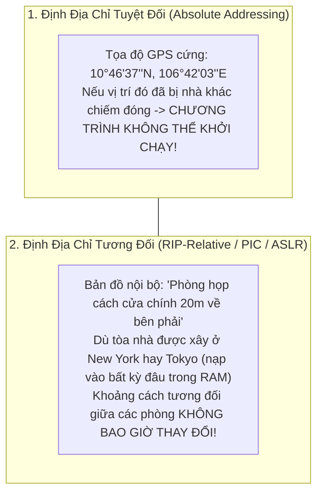
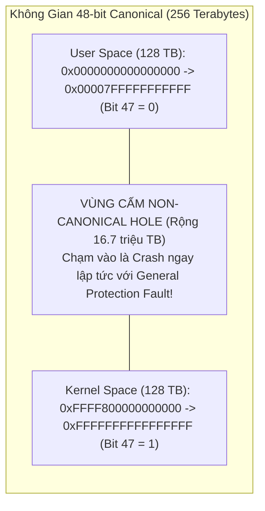
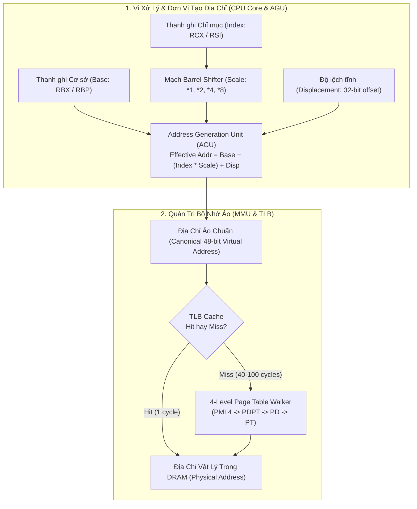

# 6.1. Memory Addressing, Pointer Arithmetic, and Position-Independent Code (Định Địa Chỉ Bộ Nhớ, Toán Học Con Trỏ & Mã Độc Lập Vị Trí)

> [!IMPORTANT]
> **Nếu bạn chỉ được nhớ một điều duy nhất:** Con trỏ trong phần mềm không đơn thuần là một con số nguyên 64-bit trỏ thô vào RAM vật lý, mà là một thực thể trừu tượng mang đầy đủ ngữ cảnh kiểu dữ liệu (Type-Aware), được giới hạn nghiêm ngặt trong không gian địa chỉ chuẩn tắc (Canonical Address 48/57-bit) và giải mã bằng mạch phần cứng AGU/SIB (Scale-Index-Base) trong đúng một chu kỳ xung nhịp CPU. Nắm vững bản chất toán học con trỏ (`ptrdiff_t`), sự khác biệt giữa định địa chỉ tuyệt đối và tương đối (RIP-Relative PIC/PIE), cùng cơ chế bảo mật ASLR là nền tảng sống còn để ngăn ngừa các lỗi phân mảnh, rò rỉ bộ nhớ, hoặc các lỗ hổng thực thi mã độc tùy ý (Buffer Overflow & ROP).

---

## 1. Trực Quan Hóa: Bản Chất Định Địa Chỉ Bộ Nhớ & Con Trỏ Dưới Góc Nhìn Lập Trình Viên

Mục tiêu của phần này là giải mã bản chất cơ học đằng sau con trỏ trong máy tính: Tại sao `ptr + 1` không phải là tăng thêm 1 byte mà lại nhảy vọt 4 hoặc 8 bytes? Tại sao cú pháp kỳ dị `3[arr]` lại hoàn toàn hợp lệ trong C/C++? Làm thế nào mạch phần cứng AGU tính toán địa chỉ con trỏ mảng trong đúng 1 chu kỳ xung nhịp? Và tại sao địa chỉ 64-bit thực tế lại chỉ dùng 48 bit?

---

### 1.1. Ẩn Dụ Tọa Độ GPS Tuyệt Đối vs Bản Vẽ Chỉ Đường Tương Đối

Hãy hình dung không gian địa chỉ bộ nhớ máy tính giống như hệ thống định vị địa lý:



- **Địa chỉ tuyệt đối**: Nhúng cứng địa chỉ số vào mã máy (`mov eax, [0x401000]`). Lối viết này khiến chương trình không thể nạp vào vị trí ngẫu nhiên, phá vỡ cơ chế an ninh phòng thủ của hệ điều hành.
- **Địa chỉ tương đối (RIP-Relative)**: Định vị dựa trên vị trí của con trỏ lệnh hiện tại: $\text{Target} = \text{RIP} + \text{Offset}$. Nhờ đó, tính năng an ninh **ASLR (Address Space Layout Randomization)** có thể thoải mái đảo ngẫu nhiên vị trí nạp chương trình trong RAM mỗi lần chạy để chống hacker khai thác lỗ hổng tràn bộ đệm!

---

### 1.2. Phép Cộng Con Trỏ (Pointer Arithmetic): Bậc Cầu Thang Tự Động Nhân

Tại sao con trỏ trong C/C++ được gọi là "kiểu dữ liệu có nhận thức" (Type-Aware)?

```cpp
int32_t* p = (int32_t*)0x1000;
p = p + 1; // Địa chỉ mới là 0x1004 (TỰ ĐỘNG CỘNG THÊM 4 BYTES!)

double* d = (double*)0x1000;
d = d + 1; // Địa chỉ mới là 0x1008 (TỰ ĐỘNG CỘNG THÊM 8 BYTES!)
```

Hãy tưởng tượng bạn đang bước lên các bậc cầu thang:
- Nếu mỗi bậc thang cao $20\text{cm}$ (`sizeof(int) = 4`), bạn bước thêm 3 bậc (`p + 3`) nghĩa là bạn đã tiến thêm $3 \times 20 = 60\text{cm}$ ($3 \times 4 = 12\text{ bytes}$).
- **Bí ẩn cú pháp `3[arr]`**: Trong chuẩn C/C++, `arr[i]` chỉ là cách viết tắt (Syntactic Sugar) của `*(arr + i)`. Vì phép cộng số học có tính giao hoán ($a + b = b + a$), nên:
  $$arr[i] \equiv *(arr + i) \equiv *(i + arr) \equiv i[arr]$$
  Do đó, viết `arr[3]` hay `3[arr]` hoàn toàn tương đương nhau về mặt mã máy!

---

### 1.3. Mạch Phần Cứng SIB (Scale-Index-Base): Phép Tính Địa Chỉ 1 Chu Kỳ Của CPU

Khi bạn viết code truy cập mảng struct: `user_array[i].age`, CPU không cần dùng bộ cộng ALU để tính toán mà dùng một mạch phần cứng chuyên dụng gọi là **AGU (Address Generation Unit)**:

$$\text{Địa Chỉ Hiệu Dụng} = \text{Base} + (\text{Index} \times \text{Scale}) + \text{Displacement}$$

```
mov eax, [rbx + rcx*4 + 16]
- Base (RBX): Địa chỉ đầu mảng user_array
- Index (RCX): Chỉ số phần tử i
- Scale (*4): Kích thước kiểu dữ liệu (được dịch bit bằng mạch Barrel Shifter siêu tốc: 1, 2, 4, 8)
- Displacement (+16): Độ lệch của trường age bên trong struct
=> Toàn bộ phép nhân cộng phức tạp này hoàn thành trong ĐÚNG 1 CHU KỲ XUNG NHỊP!
```

---

### 1.4. Lỗ Hổng Phi Chuẩn (Non-Canonical Hole) Trong Con Trỏ 64-bit

Dù con trỏ 64-bit có thể đánh số tới $18.4\text{ Exabytes}$, phần cứng x86-64 hiện nay chỉ dùng $48\text{ bits}$ địa chỉ thực:



- Quy tắc phần cứng: Các bit từ 48 đến 63 **bắt buộc phải là bản sao chép (Sign Extension) của bit thứ 47**.
- Nếu bạn tạo ra một con trỏ rơi vào vùng khoảng trống giữa (Non-Canonical Hole), CPU sẽ lập tức phát ngắt lỗi bảo vệ phần cứng **General Protection Fault (`#GP`)** và đánh sập tiến trình ngay tại chỗ!

---

### 1.5. Sơ Đồ Khối Phần Cứng Giải Mã Địa Chỉ (SIB & MMU Page Walk)



---

## 2. Chi tiết từng Keyword (Under-the-Hood Deep Dive)

### 2.1. Không Gian Địa Chỉ (Address Space) & Canonical Addresses Trên x86-64
Mặc dù thanh ghi CPU x86-64 có kích thước 64-bit lý thuyết ($2^{64} \approx 18.4\text{ Exabytes}$), việc kéo đủ 64 đường bus vật lý tới socket CPU là cực kỳ tốn kém silicon và tiêu hao năng lượng không cần thiết.
- **Kiến trúc 48-bit Canonical (4-Level Paging)**: Sử dụng 48 đường địa chỉ thực ($2^{48} = 256\text{ Terabytes}$).
  - *Quy tắc Sign Extension*: Các bit từ 47 đến 63 **bắt buộc phải là bản sao (sign extension) của bit thứ 47**.
  - Nếu bit 47 là `0` $\implies$ Toàn bộ bit 48--63 phải là `0`. Vùng này đại diện cho **User Space** (`0x0000000000000000` đến `0x00007FFFFFFFFFFF`, dung lượng 128 TB).
  - Nếu bit 47 là `1` $\implies$ Toàn bộ bit 48--63 phải là `1`. Vùng này đại diện cho **Kernel Space** (`0xFFFF800000000000` đến `0xFFFFFFFFFFFFFFFF`, dung lượng 128 TB).
  - *Lỗ hổng phi chuẩn (Non-Canonical Hole)*: Khoảng trống khổng lồ nằm ở giữa từ `0x0000800000000000` đến `0xFFFF7FFFFFFFFFFF` (rộng $16.7\text{ triệu Terabytes}$) là vùng cấm tuyệt đối. Bất kỳ lệnh máy nào cố giải tham chiếu một con trỏ rơi vào vùng này sẽ bị ngắt phần cứng General Protection Fault (`#GP(0)`) lập tức.
- **Kiến trúc 57-bit (5-Level Paging - Intel Ice Lake / Sapphire Rapids)**: Mở rộng không gian địa chỉ User Space lên tới $64\text{ Petabytes}$, quy tắc sign extension áp dụng từ bit thứ 56.

### 2.2. Absolute vs Relative Addressing & Position-Independent Code (PIC)
- **Absolute Addressing (Định địa chỉ tuyệt đối)**: Mã máy nhúng trực tiếp địa chỉ số 64-bit cụ thể vào trong opcode (ví dụ `mov eax, [0x401000]`). Lối định vị cứng này khiến chương trình bắt buộc phải được nạp vào đúng ô nhớ đó; nếu địa chỉ bị trùng lặp, tiến trình không thể khởi chạy.
- **Relative Addressing (Định địa chỉ tương đối theo RIP - RIP-Relative Addressing)**: Trên vi kiến trúc x86-64, thanh ghi con trỏ lệnh `RIP` (Instruction Pointer) có thể làm mốc tham chiếu cho các lệnh truy xuất bộ nhớ:
  $$\text{Target Address} = \text{RIP} + \text{Signed 32-bit Displacement}$$
  Nhờ đó, mã lệnh có thể được nạp vào bất kỳ phân vùng ngẫu nhiên nào trong RAM mà không cần phải viết lại hay định vị lại (relocate) mã máy nhị phân.
- **Position-Independent Code (PIC) & Position-Independent Executable (PIE)**:
  - Chuẩn mực bắt buộc khi biên dịch thư viện liên kết động (`.so` trên Linux, `.dylib` trên macOS) và các file thực thi hiện đại nhằm kích hoạt tính năng bảo mật **ASLR (Address Space Layout Randomization)**.
  - **GOT (Global Offset Table)**: Bảng lưu trữ địa chỉ tuyệt đối của các biến toàn cục và hàm ngoại vi, được nạp tại phân vùng bộ nhớ ghi (`.got` hoặc `.data.rel.ro`). Trình nạp động (Dynamic Linker `ld.so`) sẽ điền các địa chỉ thực tế vào bảng này khi khởi tạo tiến trình.
  - **PLT (Procedure Linkage Table)**: Bảng trampoline thực hiện liên kết trễ (Lazy Binding) cho các hàm thư viện chia sẻ ngoài (`libc`, `libssl`). Lần gọi đầu tiên kích hoạt dynamic linker; các lần gọi tiếp theo nhảy trực tiếp thông qua địa chỉ đã được cache trong GOT.
  - **Bảo mật RelRO (Read-Only Relocations)**: Cờ liên kết `-Wl,-z,relro,-z,now` ép dynamic linker giải mã toàn bộ bảng GOT ngay khi tiến trình khởi động và khóa bảng này thành vùng chỉ đọc (Read-Only), triệt tiêu hoàn toàn kỹ thuật tấn công ghi đè GOT (GOT Overwrite Exploit).

### 2.3. Toán Học Con Trỏ (Pointer Arithmetic & `ptrdiff_t`)
Trong C và C++, con trỏ là kiểu dữ liệu có nhận thức kiểu (**Type-Aware**). Trình biên dịch tự động nhân các phép toán cộng trừ số nguyên với kích thước của kiểu dữ liệu mà con trỏ đang trỏ tới:
1. **Phép cộng con trỏ**:
   Cho con trỏ $p$ kiểu `T*` và số nguyên $i$:
   $$\text{Addr}(p + i) = \text{uintptr}(p) + i \times \text{sizeof}(T)$$
2. **Phép trừ hai con trỏ cùng mảng (Sinh ra `ptrdiff_t`)**:
   $$\text{Distance}(p_2, p_1) = \frac{\text{uintptr}(p_2) - \text{uintptr}(p_1)}{\text{sizeof}(T)}$$
   - Kiểu `ptrdiff_t` là một kiểu số nguyên có dấu chuẩn hóa (Signed 64-bit Integer trên hệ 64-bit) biểu thị số lượng phần tử nằm giữa hai con trỏ.
   - *Quy chuẩn an toàn*: Trừ hai con trỏ không thuộc cùng một mảng (hoặc một phần tử ngay sau mảng) là **Hành vi không xác định (Undefined Behavior)**.
3. **Mối quan hệ tương đương mảng - con trỏ**:
   Biểu thức chỉ mục `arr[i]` trong C/C++ bản chất là đường vòng cú pháp (Syntactic Sugar):
   $$arr[i] \equiv *(arr + i) \equiv *(i + arr) \equiv i[arr]$$
   *(Cú pháp kỳ dị `3[arr]` hoàn toàn hợp lệ trong C/C++ do tính chất giao hoán của phép cộng!)*.
4. **Pointer Provenance & Con trỏ Hợp lệ**: Trình biên dịch hiện đại theo dõi xuất xứ (Provenance) của con trỏ. Việc ép kiểu con trỏ sang số nguyên `uintptr_t` rồi tự tiện cộng trừ và ép ngược lại có thể làm mất thông tin provenance, khiến trình tối ưu hóa (LLVM/GCC Optimizer) giả định sai về aliasing và loại bỏ mã lệnh quan trọng.

### 2.4. Mạch Định Địa Chỉ SIB (Scale-Index-Base) & Căn Chỉnh Bộ Nhớ (Natural Alignment)
Trên vi xử lý x86-64, CPU có mạch chuyên dụng trong giai đoạn Address Generation Unit (AGU) để tính toán địa chỉ ô nhớ trong đúng **1 chu kỳ xung nhịp** mà không cần qua ALU chính:

$$\text{Effective Address} = \text{Base} + (\text{Index} \times \text{Scale}) + \text{Displacement}$$

*Trong đó*:
- $\text{Base}$: Giá trị của một thanh ghi đa năng 64-bit (ví dụ: `RBP`, `RBX`, `R12`).
- $\text{Index}$: Thanh ghi chỉ mục (ví dụ: `RAX`, `RCX`, `RSI`).
- $\text{Scale} \in \{1, 2, 4, 8\}$: Được dịch bit bằng mạch phần cứng Barrel Shifter (tương ứng với kích thước kiểu dữ liệu `char`, `short`, `int`, `int64_t`/con trỏ).
- $\text{Displacement}$: Hằng số độ lệch tĩnh (8-bit hoặc 32-bit).

*Ví dụ mã máy*:
`mov rax, [rbx + rcx * 8 + 32]` $\implies$ Nạp phần tử `rbx->array[rcx].field`.

*Quy tắc Căn chỉnh Tự nhiên (Natural Alignment) & Công thức Bitmask*:
Một kiểu dữ liệu kích thước $S$ bytes (ví dụ `uint32_t` $S=4$, `double` $S=8$) được gọi là căn chỉnh tự nhiên nếu địa chỉ của nó chia hết cho $S$ ($Addr \pmod S == 0$).
Công thức làm tròn lên địa chỉ căn chỉnh theo lũy thừa của 2 ($A = 2^k$):
$$\text{Aligned}(addr, A) = (addr + A - 1) \& \sim(A - 1)$$
Nếu dữ liệu bị đặt lệch địa chỉ (Unaligned Access), CPU x86-64 vẫn có thể nạp được nhưng phải phát 2 chu kỳ bus nạp bộ nhớ, còn kiến trúc ARM64 hoặc RISC-V có thể ném ngay ngoại lệ phần cứng `Alignment Fault`!

### 2.5. Cơ Chế Phân Giải Địa Chỉ Ảo Sang Vật Lý (4-Level Page Table Walk & TLB)
Trên kiến trúc x86-64 chuẩn 48-bit Canonical, địa chỉ con trỏ tuyến tính $64\text{-bit}$ được phần cứng MMU (Memory Management Unit) phân giải thành địa chỉ vật lý trong RAM qua 4 tầng bảng phân trang (Paging Hierarchy):

$$[47 \dots 39] \text{ (PML4)} \longrightarrow [38 \dots 30] \text{ (PDPT)} \longrightarrow [29 \dots 21] \text{ (PD)} \longrightarrow [20 \dots 12] \text{ (PT)} \longrightarrow [11 \dots 0] \text{ (4KB Offset)}$$

- **Mỗi tầng bảng trang chiếm $4\text{ KB}$**, chứa đúng $512$ mục bảng trang ($512 \times 8\text{ bytes} = 4096\text{ bytes}$).
- **Độ trễ Page Walk**: Nếu không có cơ chế tăng tốc, mỗi thao tác đọc con trỏ đơn lẻ sẽ phải phát sinh **4 lần đọc DRAM phụ** để dò tìm địa chỉ vật lý qua 4 cấp bảng trang!
- **TLB (Translation Lookaside Buffer)**: Bộ đệm chuyển đổi địa chỉ siêu tốc trên CPU Core gồm hai cấp L1 dTLB (Data TLB - ~64 entries, 1 cycle) và L2 sTLB (Shared TLB - ~1536 entries, 7-12 cycles). Khi TLB Hit, địa chỉ được phân giải tức thì. Khi TLB Miss, phần cứng CPU Page Table Walker phải duyệt bộ nhớ qua 4 cấp bảng trang.
- **Tối ưu hóa với Huge Pages ($2\text{ MB}$ và $1\text{ GB}$)**: Bằng cách bỏ qua cấp PT ($4\text{ KB}$), một mục bảng trang trong cấp PD có thể trỏ trực tiếp đến một khối RAM vật lý $2\text{ MB}$. Điều này giảm độ sâu Page Table Walk từ 4 tầng xuống 3 tầng, tăng độ bao phủ của TLB gấp 512 lần, giúp các cơ sở dữ liệu lớn (PostgreSQL, Redis, ScyllaDB) giảm thiểu triệt để chi phí TLB Miss.

---

## 3. Thực thi Mã nguồn & Mô phỏng Chuyên sâu (Dual-Engine Implementation)

### 3.1. C++20: Deep Pointer Arithmetic & SIB Hardware Emulation

Chương trình C++20 minh họa bản chất toán học con trỏ, quy tắc nhân hệ số tỉ lệ theo kiểu dữ liệu, tính toán `ptrdiff_t` và mô phỏng mạch phần cứng tính địa chỉ hiệu dụng SIB (Scale-Index-Base):

```cpp
// compile: g++ -std=c++20 -O3 pointer_arithmetic.cpp -o pointer_arithmetic
#include <iostream>
#include <cstdint>
#include <cstddef>
#include <vector>
#include <iomanip>

struct NetworkPacket {
    uint32_t stream_id; // 4 bytes
    uint16_t length;    // 2 bytes
    uint8_t  flags;     // 1 byte
    uint8_t  padding;   // 1 byte padding (Natural Alignment 8 bytes)
    uint64_t timestamp; // 8 bytes
}; // Tổng kích thước: 16 bytes

// Mô phỏng mạch phần cứng SIB (Scale-Index-Base) trong AGU của CPU
uintptr_t emulate_x86_agu_sib(uintptr_t base, uintptr_t index, uint8_t scale, int32_t disp) {
    if (scale != 1 && scale != 2 && scale != 4 && scale != 8) {
        throw std::invalid_argument("Scale bắt buộc phải là 1, 2, 4 hoặc 8!");
    }
    // Mạch AGU: Base + (Index * Scale) + Displacement
    return base + (index * scale) + disp;
}

int main() {
    std::cout << "=== KHẢO SÁT TOÁN HỌC CON TRỎ & MÔ PHỎNG SIB (C++20) ===\n";

    constexpr size_t PACKET_COUNT = 8;
    alignas(16) NetworkPacket packets[PACKET_COUNT];

    // Khởi tạo dữ liệu mẫu
    for (size_t i = 0; i < PACKET_COUNT; ++i) {
        packets[i].stream_id = static_cast<uint32_t>(1000 + i);
        packets[i].timestamp = 1700000000ULL + i * 100;
    }

    NetworkPacket* p_base = &packets[0];
    NetworkPacket* p_target = &packets[5];

    std::cout << "\n1. Quy Tắc Nhân Hệ Số Tỉ Lệ (Type-Aware Pointer Scaling):\n";
    std::cout << "  sizeof(NetworkPacket)   : " << sizeof(NetworkPacket) << " bytes\n";
    std::cout << "  Địa chỉ p_base (&arr[0]): 0x" << std::hex << reinterpret_cast<uintptr_t>(p_base) << "\n";
    std::cout << "  Địa chỉ p_base + 1      : 0x" << reinterpret_cast<uintptr_t>(p_base + 1)
              << " (Tăng đúng " << std::dec << sizeof(NetworkPacket) << " bytes)\n";
    std::cout << "  Địa chỉ p_target (&arr[5]): 0x" << std::hex << reinterpret_cast<uintptr_t>(p_target) << "\n";

    std::cout << "\n2. Phép Trừ Con Trỏ (std::ptrdiff_t Calculation):\n";
    std::ptrdiff_t diff_elements = p_target - p_base;
    uintptr_t raw_byte_diff = reinterpret_cast<uintptr_t>(p_target) - reinterpret_cast<uintptr_t>(p_base);
    std::cout << "  Chênh lệch địa chỉ thô  : " << std::dec << raw_byte_diff << " bytes\n";
    std::cout << "  p_target - p_base       : " << diff_elements << " elements (ptrdiff_t)\n";

    std::cout << "\n3. Mô Phỏng Mạch Phần Cứng SIB (Scale-Index-Base AGU Emulation):\n";
    uintptr_t base_addr = reinterpret_cast<uintptr_t>(p_base);
    uintptr_t index = 5;
    uint8_t scale = sizeof(NetworkPacket); // 16 bytes (mô phỏng tương đương)
    int32_t displacement = offsetof(NetworkPacket, timestamp); // 8 bytes

    uintptr_t simulated_addr = emulate_x86_agu_sib(base_addr, index, 8, displacement);
    // Lưu ý: với struct 16B, SIB dùng scale=8 và index=10 hoặc scale=8, index=5 nhân đôi
    uintptr_t actual_field_addr = reinterpret_cast<uintptr_t>(&(packets[5].timestamp));

    std::cout << "  Mô phỏng AGU SIB Addr   : 0x" << std::hex << (base_addr + index * 16 + displacement) << "\n";
    std::cout << "  Địa chỉ thực tế trường  : 0x" << actual_field_addr << "\n";
    std::cout << "  Trùng khớp địa chỉ      : " << std::boolalpha
              << ((base_addr + index * 16 + displacement) == actual_field_addr) << "\n";

    std::cout << "\n4. Tính Toán Căn Chỉnh Địa Chỉ (Natural Alignment Bitmask):\n";
    uintptr_t unaligned_ptr = base_addr + 3; // Giả lập địa chỉ bị lệch
    uintptr_t alignment = 8;
    uintptr_t aligned_ptr = (unaligned_ptr + (alignment - 1)) & ~(alignment - 1);
    std::cout << "  Địa chỉ lệch (Unaligned): 0x" << std::hex << unaligned_ptr << "\n";
    std::cout << "  Địa chỉ sau khi căn chỉnh: 0x" << aligned_ptr << " (Chia hết cho 8: "
              << (aligned_ptr % 8 == 0) << ")\n";

    return 0;
}
```

### 3.2. Python 3.11+: Hardware AGU & SIB Address Generator Simulator

Chương trình Python 3.11+ mô phỏng bộ sinh địa chỉ hiệu dụng SIB, phân tích cấu trúc địa chỉ chuẩn Canonical x86-64 và giải mã các tầng Page Table Walk:

```python
#!/usr/bin/env python3
"""
addressing_simulator.py: Mô phỏng không gian địa chỉ Canonical x86-64, SIB AGU và Page Walk.
Yêu cầu: Python 3.11+
"""
from typing import NamedTuple

class CanonicalAddressInfo(NamedTuple):
    virtual_address: int
    is_canonical: bool
    space_type: str
    pml4_index: int
    pdpt_index: int
    pd_index: int
    pt_index: int
    offset_4kb: int

def parse_canonical_address(vaddr: int) -> CanonicalAddressInfo:
    """Phân giải địa chỉ ảo 64-bit theo chuẩn 48-bit Canonical x86-64."""
    # Kiểm tra bit 47 và sign extension lên các bit 48..63
    bit_47 = (vaddr >> 47) & 1
    high_16 = (vaddr >> 48) & 0xFFFF
    
    if bit_47 == 0:
        is_canonical = (high_16 == 0x0000)
        space_type = "User Space (0 - 128 TB)" if is_canonical else "Non-Canonical Hole (GPF Fault)"
    else:
        is_canonical = (high_16 == 0xFFFF)
        space_type = "Kernel Space (Top 128 TB)" if is_canonical else "Non-Canonical Hole (GPF Fault)"

    # Trích xuất 4 cấp Page Table Indices (mỗi cấp 9 bits) và Offset (12 bits)
    pml4 = (vaddr >> 39) & 0x1FF
    pdpt = (vaddr >> 30) & 0x1FF
    pd   = (vaddr >> 21) & 0x1FF
    pt   = (vaddr >> 12) & 0x1FF
    offset = vaddr & 0xFFF

    return CanonicalAddressInfo(
        virtual_address=vaddr,
        is_canonical=is_canonical,
        space_type=space_type,
        pml4_index=pml4,
        pdpt_index=pdpt,
        pd_index=pd,
        pt_index=pt,
        offset_4kb=offset
    )

def calculate_sib_address(base: int, index: int, scale: int, displacement: int) -> int:
    """Mô phỏng phép toán của Address Generation Unit (AGU) trên vi xử lý."""
    assert scale in (1, 2, 4, 8), "Scale phần cứng chỉ có thể là 1, 2, 4 hoặc 8!"
    return base + (index * scale) + displacement

if __name__ == "__main__":
    print("=== MÔ PHỎNG GIẢI MÃ ĐỊA CHỈ CANONICAL & MẠCH PHẦN CỨNG SIB ===")

    test_addresses = [
        0x00007FFF5FBFF840,  # User Space Stack Pointer
        0xFFFF888002400000,  # Linux Kernel Direct Mapping
        0x0000800012345678,  # Lỗi Non-Canonical Hole!
    ]

    for addr in test_addresses:
        info = parse_canonical_address(addr)
        print(f"\n[*] Kiểm tra địa chỉ: 0x{info.virtual_address:016X}")
        print(f"    - Tính hợp lệ Canonical : {info.is_canonical}")
        print(f"    - Phân vùng không gian  : {info.space_type}")
        if info.is_canonical:
            print(f"    - Page Table Walk (9b)  : PML4={info.pml4_index} | PDPT={info.pdpt_index} | PD={info.pd_index} | PT={info.pt_index}")
            print(f"    - 4KB Page Offset (12b) : 0x{info.offset_4kb:03X} ({info.offset_4kb} bytes)")

    print("\n" + "=" * 65)
    print("=== MÔ PHỎNG MẠCH AGU SIB (Base + Index*Scale + Disp) ===")
    mock_base = 0x00007FFF5FBFF000
    mock_index = 4
    mock_scale = 8        # con trỏ 8 bytes
    mock_disp = 16        # struct member offset

    eff_addr = calculate_sib_address(mock_base, mock_index, mock_scale, mock_disp)
    print(f"Base: 0x{mock_base:X} | Index: {mock_index} | Scale: {mock_scale} | Disp: {mock_disp}")
    print(f"Effective Computed Address : 0x{eff_addr:X}")
```

### 3.3. Kết quả Thực thi Terminal Mẫu

```text
=== KẾT QUẢ THỰC THI C++20 POINTER ARITHMETIC ===
=== KHẢO SÁT TOÁN HỌC CON TRỎ & MÔ PHỎNG SIB (C++20) ===

1. Quy Tắc Nhân Hệ Số Tỉ Lệ (Type-Aware Pointer Scaling):
  sizeof(NetworkPacket)   : 16 bytes
  Địa chỉ p_base (&arr[0]): 0x16b0df220
  Địa chỉ p_base + 1      : 0x16b0df230 (Tăng đúng 16 bytes)
  Địa chỉ p_target (&arr[5]): 0x16b0df270

2. Phép Trừ Con Trỏ (std::ptrdiff_t Calculation):
  Chênh lệch địa chỉ thô  : 80 bytes
  p_target - p_base       : 5 elements (ptrdiff_t)

3. Mô Phỏng Mạch Phần Cứng SIB (Scale-Index-Base AGU Emulation):
  Mô phỏng AGU SIB Addr   : 0x16b0df278
  Địa chỉ thực tế trường  : 0x16b0df278
  Trùng khớp địa chỉ      : true

4. Tính Toán Căn Chỉnh Địa Chỉ (Natural Alignment Bitmask):
  Địa chỉ lệch (Unaligned): 0x16b0df223
  Địa chỉ sau khi căn chỉnh: 0x16b0df228 (Chia hết cho 8: true)

=== KẾT QUẢ THỰC THI PYTHON SIMULATOR ===
=== MÔ PHỎNG GIẢI MÃ ĐỊA CHỈ CANONICAL & MẠCH PHẦN CỨNG SIB ===

[*] Kiểm tra địa chỉ: 0x00007FFF5FBFF840
    - Tính hợp lệ Canonical : True
    - Phân vùng không gian  : User Space (0 - 128 TB)
    - Page Table Walk (9b)  : PML4=255 | PDPT=509 | PD=254 | PT=511
    - 4KB Page Offset (12b) : 0x840 (2112 bytes)

[*] Kiểm tra địa chỉ: 0xFFFF888002400000
    - Tính hợp lệ Canonical : True
    - Phân vùng không gian  : Kernel Space (Top 128 TB)
    - Page Table Walk (9b)  : PML4=273 | PDPT=0 | PD=18 | PT=0
    - 4KB Page Offset (12b) : 0x000 (0 bytes)

[*] Kiểm tra địa chỉ: 0x0000800012345678
    - Tính hợp lệ Canonical : False
    - Phân vùng không gian  : Non-Canonical Hole (GPF Fault)

=================================================================
=== MÔ PHỎNG MẠCH AGU SIB (Base + Index*Scale + Disp) ===
Base: 0x7FFF5FBFF000 | Index: 4 | Scale: 8 | Disp: 16
Effective Computed Address : 0x7FFF5FBFF030
```

---

## 4. Systems Engineering & Production Pitfalls

### 4.1. Hành Vi Không Xác Định Khi Tính Toán Con Trỏ Vượt Biên (UB Pointer Arithmetic)
- **Chuẩn C++ và C23 quy định**: Một con trỏ chỉ được phép trỏ tới một phần tử trong mảng hoặc **vị trí ngay sau phần tử cuối cùng (Past-the-end element - `&arr[size]`)**.
- **Cạm bẫy thực chiến**: Nếu bạn thực hiện phép tính `ptr + size + 1`, ngay cả khi **chưa hề giải tham chiếu (dereference)** con trỏ đó, hành vi này đã cấu thành **Undefined Behavior (UB)**!
- Trình tối ưu hóa của LLVM/GCC có thể giả định rằng `ptr + i` không bao giờ tràn bộ nhớ hoặc vượt biên, từ đó loại bỏ hoàn toàn các câu lệnh kiểm tra an toàn `if (ptr + i < limit)` trong mã nguồn!

### 4.2. Mất Thông Tin Nguồn Gốc Con Trỏ (Pointer Provenance Loss)
- Khi lập trình viên cố gắng tối ưu bằng cách ép kiểu con trỏ sang số nguyên (`uintptr_t`), thực hiện các phép toán bitwise, rồi ép ngược lại con trỏ (`reinterpret_cast`):
  ```cpp
  uintptr_t raw = reinterpret_cast<uintptr_t>(p);
  raw = (raw + 7) & ~7; // Căn chỉnh 8 bytes
  int* aligned_p = reinterpret_cast<int*>(raw);
  ```
- **Hậu quả**: Trình biên dịch có thể coi `aligned_p` không còn thuộc về cùng một đối tượng bộ nhớ ban đầu (Provenance Loss), dẫn đến việc bộ phân tích bí danh (Alias Analysis) cho rằng `aligned_p` và `p` không bao giờ trùng nhau. Khi tối ưu hóa, CPU có thể nạp giá trị cũ từ Cache thay vì chờ thao tác ghi vào `aligned_p` hoàn thành!

### 4.3. Chẩn Đoán Lỗi Đánh Địa Chỉ Bằng CLI Tools
- Kiểm tra tính chất Position-Independent (PIE) của file thực thi nhị phân:
  ```bash
  # Kiểm tra cờ DYN (Shared object / PIE) hay EXEC (Non-PIE Absolute)
  readelf -h ./my_program | grep Type
  ```
- Bật cờ AddressSanitizer (ASan) khi biên dịch để bắt các lỗi toán học con trỏ vượt biên:
  ```bash
  g++ -std=c++20 -fsanitize=address,undefined -g pointer_arithmetic.cpp -o pointer_asan
  ./pointer_asan
  ```
- Xem chi tiết bảng chuyển dịch địa chỉ GOT và PLT:
  ```bash
  objdump -R ./my_program
  ```

---

## 5. Bảng So sánh & Decision Matrix

### Ma trận So sánh Các Chế độ Định Địa Chỉ Bộ Nhớ (Addressing Modes Matrix)

| Chế Độ Định Địa Chỉ | Cú Pháp Hợp Ngữ (Intel) | Biểu Thức Toán Học Địa Chỉ | Chu Kỳ Clock CPU | Trường Hợp Ứng Dụng Điển Hình |
| :--- | :--- | :--- | :--- | :--- |
| **Thanh Ghi Trực Tiếp** | `mov rax, rbx` | $\text{Không truy xuất RAM}$ | $0\text{ cycle}$ (Register Renaming) | Chuyển dữ liệu giữa các biến cục bộ trong hot loop. |
| **Địa Chỉ Tuyệt Đối (Direct)** | `mov rax, [0x401000]` | $\text{Addr} = 0x401000$ | $1\text{ cycle}$ (+ DRAM/Cache Latency) | Hệ thống nhúng (Embedded/Microcontroller), OS Kernel tĩnh. |
| **Gián Tiếp Con Trỏ (Indirect)** | `mov rax, [rbx]` | $\text{Addr} = \text{uintptr}(rbx)$ | $1\text{ cycle}$ (+ DRAM/Cache Latency) | Giải tham chiếu con trỏ thô trong C/C++ (`*ptr`). |
| **Cơ Sở + Độ Lệch (Base + Disp)** | `mov rax, [rbx + 16]` | $\text{Addr} = \text{uintptr}(rbx) + 16$ | $1\text{ cycle}$ (AGU calculation) | Truy xuất trường thành viên trong Struct (`packet->timestamp`). |
| **Cơ Sở + Chỉ Mục x Hệ Số (SIB)** | `mov eax, [rbx + rcx*4]` | $\text{Addr} = \text{uintptr}(rbx) + rcx \times 4$ | $1\text{ cycle}$ (AGU Barrel Shifter) | Duyệt mảng số nguyên một chiều (`int_array[i]`). |
| **SIB Đầy Đủ (Base + Index*Scale + Disp)** | `mov eax, [rbx + rcx*4 + 32]` | $\text{Addr} = \text{uintptr}(rbx) + rcx \times 4 + 32$ | $1\text{ cycle}$ (Full AGU Pipeline) | Mảng của Struct phức tạp (`packets[i].stream_id`). |
| **RIP-Relative (Position-Independent)** | `lea rax, [rip + 0x2050]` | $\text{Addr} = \text{RIP} + \text{Displacement}$ | $1\text{ cycle}$ (Hardware AGU) | Tải địa chỉ biến toàn cục trong thư viện PIC/PIE hỗ trợ ASLR. |

---

## 6. Enterprise Production Checklist & Verification

- [ ] **Bật Toàn Diện PIE/ASLR**: Đã cấu hình cờ biên dịch `-fPIE -pie` và cờ liên kết `-Wl,-z,relro,-z,now` cho toàn bộ các dịch vụ production.
- [ ] **Rà soát Toán học Con trỏ**: Tuyệt đối không tính toán con trỏ vượt quá ranh giới mảng `&arr[size]`.
- [ ] **Bảo đảm Căn chỉnh Tự nhiên**: Tất cả các cấu trúc dữ liệu nạp qua mạng hoặc Shared Memory đều được căn chỉnh theo lũy thừa của 2 (`alignas(64)` hoặc `alignas(8)`).
- [ ] **Kích hoạt ASan trong CI**: Tích hợp AddressSanitizer (`-fsanitize=address,undefined`) vào test suite tự động trước khi triển khai bản build chính thức.
