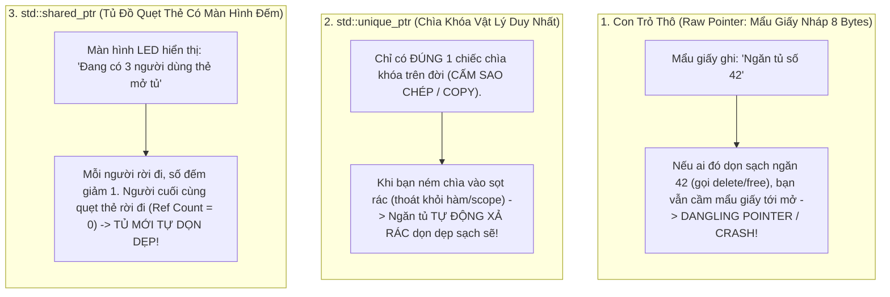
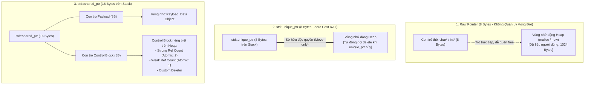

# 6.2. Pointers (Con Trỏ: Từ Nguyên Thủy C-Style Đến Smart Pointers Hiện Đại)

> [!IMPORTANT]
> **Nếu bạn chỉ được nhớ một điều duy nhất:** Con trỏ (Pointer) là một biến nguyên thủy lưu trữ địa chỉ của một ô nhớ khác trong không gian địa chỉ ảo 64-bit. Quyền lực tối thượng của con trỏ đi kèm với rủi ro bảo mật lớn nhất trong lịch sử phần mềm (Dangling Pointers, Double Free, Memory Leaks). Kỹ nghệ phần mềm hiện đại thay thế hoàn toàn việc quản lý con trỏ thô bằng mô hình **RAII (Resource Acquisition Is Initialization)**: Sử dụng `std::unique_ptr` với chi phí trừu tượng hóa bằng $0$ (Zero-Cost Abstraction) cho sở hữu độc quyền; dùng `std::shared_ptr` cho sở hữu chia sẻ nhưng phải luôn cẩn trọng với chi phí khóa Atomic (`LOCK XADD`) trên bộ đếm tham chiếu (Reference Count) trong các vòng lặp nóng (Hot Loops).

---

## 1. Trực Quan Hóa: Bản Chất Con Trỏ Dưới Góc Nhìn Lập Trình Viên

Mục tiêu của phần này là giải mã công cụ quyền lực nhất nhưng cũng nguy hiểm nhất của ngành khoa học máy tính: Bản chất cơ học của con trỏ là gì? Tại sao việc truyền `NULL` vào hàm có thể kích hoạt sai logic nghiệp vụ? Làm thế nào từ khóa `__restrict` có thể tăng tốc độ xử lý của vòng lặp lên gấp 4 đến 8 lần? Và cấu trúc bên trong của `std::shared_ptr` thực sự tốn bao nhiêu byte RAM trên máy tính của bạn?

---

### 1.1. Ẩn Dụ Mẩu Giấy Ghi Số Ngăn Tủ vs Chìa Khóa Độc Quyền vs Tủ Đồ Quẹt Thẻ

Hãy hình dung hệ thống bộ nhớ qua mô hình quản lý tủ gửi đồ thông minh:



- **Biến thông thường (`int a = 10`)**: Là món đồ vật lý được cất trực tiếp vào ngăn tủ.
- **Con trỏ thô (`int* p = &a`)**: Là một mẩu giấy ghi số ngăn tủ. Bản thân mẩu giấy chỉ nặng đúng $8\text{ Bytes}$ (`uintptr_t`). Thao tác **Giải tham chiếu (`*p`)** chính là việc bạn bước chân tới ngăn tủ đó để mở cửa lấy đồ ra.
- **`std::unique_ptr` (Sở hữu độc quyền - RAII)**: Không ai được copy chìa khóa này. Muốn đưa cho người khác bắt buộc phải dùng `std::move()`. Khi chìa khóa ra khỏi scope, đồ trong tủ tự động bị tiêu hủy (Zero memory leak).
- **`std::shared_ptr` (Sở hữu chia sẻ)**: Sử dụng một bộ đếm tham chiếu (Reference Count). Tủ chỉ bị giải phóng khi người cuối cùng rời đi.

---

### 1.2. Cạm Bẫy Lịch Sử: Tại Sao C++11 Khai Tử `NULL` Để Thay Bằng `nullptr`?

Trong ngôn ngữ C cổ điển, `NULL` thực chất chỉ là macro số nguyên `0`:

```cpp
void send_email(int user_id);
void send_email(const char* email_address);

// Lập trình viên muốn truyền một con trỏ rỗng:
send_email(NULL); 
```

- **Thảm họa**: Trình biên dịch C++ coi `NULL` là số nguyên `0`, và âm thầm gọi hàm `send_email(int user_id)` với `user_id = 0`! Email bị gửi nhầm tới tài khoản Admin hệ thống!
- **Cứu cánh `nullptr`**: Là một từ khóa có kiểu riêng biệt `std::nullptr_t`. Nó có thể ép kiểu sang mọi loại con trỏ `T*` nhưng **tuyệt đối không bao giờ bị ép ngầm sang số nguyên `int`**. Nhờ đó, `send_email(nullptr)` định tuyến chính xác $100\%$ tới hàm nhận chuỗi con trỏ!

---

### 1.3. Bí Danh Con Trỏ (Pointer Aliasing) & Phép Màu `__restrict`

Hãy quan sát đoạn code tưởng chừng đơn giản sau:

```cpp
void add(const int* a, const int* b, int* result, int n) {
    for (int i = 0; i < n; ++i) {
        result[i] = a[i] + b[i];
    }
}
```

- **Nỗi sợ của trình biên dịch**: Compiler tự hỏi: *Liệu con trỏ `result` có trỏ trùng vào một phần tử nào của mảng `a` không?* Nếu có, mỗi lần ghi vào `result[i]`, giá trị của `a[i+1]` có thể bị biến đổi!
- Do nỗi sợ này, trình biên dịch **không dám kích hoạt tập lệnh SIMD AVX2/AVX-512** để tính 8 số cùng lúc. Nó buộc phải đọc từng phần tử một cách rụt rè.
- **Giải pháp `__restrict`**:
  ```cpp
  void add(const int* __restrict a, const int* __restrict b, int* __restrict result, int n)
  ```
  Bạn cam đoan với trình biên dịch: *"Ba con trỏ này hoàn toàn không trùng lặp vùng nhớ!"*. Trình biên dịch lập tức bung hết sức mạnh phần cứng, kích hoạt SIMD tăng tốc độ vòng lặp lên gấp **400% - 800%**!

---

### 1.4. Phẫu Thuật Kích Thước Smart Pointers: Chi Phí Thật Sự Trong RAM

Nhiều lập trình viên lạm dụng `std::shared_ptr` cho mọi đối tượng vì nghĩ nó "an toàn":

| Loại Con Trỏ | Kích Thước Trên Stack | Chi Phí Cấp Phát Heap | Chi Phí Đa Luồng (Concurrency) |
| :--- | :---: | :---: | :--- |
| **Raw Pointer (`T*`)** | 8 Bytes | 0 Bytes | $0$ (Không kiểm soát vòng đời) |
| **`std::unique_ptr<T>`** | **8 Bytes** (Zero overhead) | 0 Bytes | **$0$** (Tối ưu hóa mã máy ngang con trỏ thô) |
| **`std::shared_ptr<T>`** | **16 Bytes** (Payload ptr + Control Block ptr) | Cấp phát thêm **Control Block** trên Heap ($24-32\text{ Bytes}$) | Phải chạy lệnh **Atomic `LOCK XADD`** mỗi lần sao chép, làm nghẽn bus CPU! |

> [!TIP]
> **Quy tắc vàng thiết kế Modern C++**:
> - $90\%$ trường hợp nên dùng `std::unique_ptr` vì nó hoàn toàn miễn phí (Zero-Cost Abstraction).
> - Chỉ dùng `std::shared_ptr` khi tài nguyên thực sự có nhiều người cùng sở hữu vòng đời không xác định.

---

### 1.5. Sơ Đồ Khối So Sánh Cấu Trúc Bộ Nhớ Giữa Raw Pointer, `unique_ptr` và `shared_ptr`



---

## 2. Chi tiết từng Keyword (Under-the-Hood Deep Dive)

### 2.1. Bản Chất Cơ Học Con Trỏ: Indirection, Dereference & Phân Biệt Triệt Để `NULL` vs `nullptr`
- **Toán tử Địa chỉ (`&`) và Giải tham chiếu (`*`)**:
  - Khi viết `int32_t* ptr = &x;`, CPU lấy địa chỉ ảo của biến `x` nạp vào thanh ghi con trỏ (ví dụ `RAX`).
  - Phép giải tham chiếu `int32_t val = *ptr;` được dịch thành một chỉ thị nạp bộ nhớ gián tiếp: `mov ecx, dword ptr [rax]`.
  - Toàn bộ ngữ cảnh kiểu dữ liệu (`int32_t`) giúp compiler biết chính xác kích thước cần đọc ($4\text{ Bytes}$) và cách giải mã bit.
- **Toán tử Mũi tên (`ptr->member`)**:
  - Là cú pháp viết tắt (Syntactic Sugar) của `(*ptr).member`. Compiler tính toán địa chỉ mục tiêu bằng cách cộng con trỏ cơ sở với offset tĩnh của trường: `*(ptr + Offset)`.
- **Cạm bẫy lịch sử: `NULL` vs `nullptr`**:
  - Trong ngôn ngữ C, `NULL` là macro tiền xử lý định nghĩa là số nguyên `0` hoặc con trỏ `((void*)0)`.
  - *Hiểm họa nạp chồng hàm (Function Overloading Ambiguity)*:
    ```cpp
    void handle_connection(int socket_fd);
    void handle_connection(char* buffer);

    handle_connection(NULL); // LỖI BIÊN DỊCH NGHIÊM TRỌNG!
    ```
    Trình biên dịch C++ coi `NULL` là số nguyên `0`, dẫn đến việc gọi nhầm hàm `handle_connection(int)` thay vì hàm nhận con trỏ!
  - **`nullptr` trong C++11**: Là một từ khóa có kiểu dữ liệu riêng biệt `std::nullptr_t`. Nó có thể ép kiểu ngầm định sang bất kỳ loại con trỏ nào (`T*`), nhưng **tuyệt đối không thể ép kiểu sang số nguyên**. Nhờ đó, `handle_connection(nullptr)` được định tuyến chính xác $100\%$ tới hàm nhận con trỏ.

### 2.2. Con Trỏ Đặc Thù: `void*` (Type Erasure), Function Pointers & Con Trỏ Đa Cấp (`**ptr`)
1. **Con trỏ vô kiểu (`void*`)**:
   - Chứa địa chỉ của bất kỳ ô nhớ nào nhưng bị tước bỏ thông tin kiểu dữ liệu (Type Erasure).
   - Được dùng trong các hàm hệ thống POSIX cổ điển (`malloc(size)`, `memcpy`, `qsort`, `pthread_create`).
   - **Quy tắc phần cứng**: Không thể giải tham chiếu `*void_ptr` hoặc thực hiện toán học con trỏ `void_ptr + 1` trên chuẩn C++ (vì kích thước kiểu không xác định). Bắt buộc phải ép kiểu (`static_cast<T*>` hoặc `reinterpret_cast<T*>`) trước khi thao tác.
2. **Con trỏ hàm (Function Pointers)**:
   - Trỏ tới địa chỉ của chỉ thị máy đầu tiên của hàm nằm trong phân vùng mã thực thi `.text`.
   - Cú pháp chuẩn: `ReturnType (*FuncPtr)(ParamTypes...)`.
   - *Ứng dụng*: Lập trình hướng sự kiện (Callbacks), cài đặt bảng bảng hàm ảo thủ công trong C, định tuyến xử lý ngắt trong OS Kernel.
3. **Con trỏ đa cấp (Pointer to Pointer - `**ptr`)**:
   - Biến con trỏ lưu địa chỉ của một biến con trỏ khác.
   - Thường dùng khi một hàm muốn cấp phát và thay đổi địa chỉ của con trỏ từ bên ngoài truyền vào (`int init_buffer(char** out_buf)`), hoặc quản lý mảng 2 chiều rời rạc.

### 2.3. Pointer Aliasing, Hiểm Họa Tối Ưu Hóa & Từ Khóa `__restrict` / `noalias`
- **Hiện tượng Pointer Aliasing (Bí danh con trỏ)**:
  - Xuất hiện khi hai hoặc nhiều con trỏ cùng trỏ tới cùng một ô nhớ (hoặc hai vùng nhớ bị chồng lấn nhau).
- **Thảm họa làm tê liệt trình tối ưu hóa (Optimizer Invalidation)**:
  Xét hàm nhân ma trận hoặc cộng vector:
  ```cpp
  void add_vectors(const int* a, const int* b, int* result, size_t n) {
      for (size_t i = 0; i < n; ++i) {
          result[i] = a[i] + b[i];
      }
  }
  ```
  - Trình biên dịch buộc phải đặt câu hỏi: *Liệu con trỏ `result` có trỏ trùng vào một phần tử nào đó của mảng `a` hoặc `b` không?*
  - Nếu `result` trùng với `a`, mỗi lần ghi vào `result[i]`, giá trị của các phần tử `a[i+1]` kế tiếp có thể bị thay đổi!
  - Vì sự cẩn trọng này, compiler **không dám vector hóa vòng lặp bằng tập lệnh SIMD (AVX2/AVX-512)**. Nó buộc phải nạp `a[i]` từ RAM, nạp `b[i]`, cộng lại, ghi `result[i]` xuống RAM, rồi lặp lại từng bước đơn lẻ, làm tốc độ chậm hơn từ 4x đến 8x!
- **Từ khóa `__restrict` (C99 `restrict` / C++ Extension)**:
  - Lập trình viên cam đoan với trình biên dịch: *"Tại vùng nhớ mà con trỏ này trỏ tới, chỉ duy nhất con trỏ này được phép truy xuất trong phạm vi hàm"*.
  - Nhờ cam đoan này, compiler tự do vector hóa, nạp hàng loạt 8 số nguyên cùng lúc vào thanh ghi `ymm` và thực thi song song cực đại.

### 2.4. Smart Pointers (RAII): `std::unique_ptr` (Zero-Overhead Move-Only Ownership)
- **Triết lý thiết kế**:
  - Đại diện cho quan hệ sở hữu độc quyền (Exclusive Ownership): Tại một thời điểm, chỉ duy nhất một đối tượng `unique_ptr` được phép sở hữu khối bộ nhớ trên Heap.
  - Cấm hoàn toàn hàm khởi tạo sao chép (Copy Constructor = `delete`). Chỉ cho phép chuyển giao quyền sở hữu thông qua cơ chế di chuyển (**Move Semantics** `std::move()`).
- **Zero-Cost Abstraction**:
  - `sizeof(std::unique_ptr<T>) == sizeof(T*)` (đúng $8\text{ Bytes}$).
  - Khi biên dịch ở chế độ tối ưu `-O3`, toàn bộ lớp vỏ bọc bị xóa sạch. Mã máy sinh ra hoàn toàn giống hệt như khi lập trình viên dùng con trỏ thô và tự tay viết lệnh `delete` ở cuối phạm vi hàm.
  - Sử dụng hàm tiện ích `std::make_unique<T>()` để bảo đảm tính an toàn ngoại lệ (Exception Safety).

### 2.5. `std::shared_ptr` Internals: Control Block, Atomic Ref-Count & Phá Vỡ Vòng Lặp Bằng `std::weak_ptr`
- **Cấu trúc bên trong của `std::shared_ptr`**:
  Một biến `shared_ptr` trên Stack thực chất có kích thước **$16\text{ Bytes}$** gồm 2 con trỏ:
  1. Con trỏ trỏ tới đối tượng dữ liệu (**Payload Object Pointer**).
  2. Con trỏ trỏ tới khối điều khiển trên Heap (**Control Block Pointer**).
- **Control Block**:
  - Được cấp phát độc lập trên Heap khi `shared_ptr` đầu tiên được tạo ra.
  - Chứa:
    - **Strong Reference Count (Atomic 32/64-bit)**: Đếm số lượng `shared_ptr` đang cùng sở hữu đối tượng.
    - **Weak Reference Count (Atomic 32/64-bit)**: Đếm số lượng `weak_ptr` đang quan sát.
    - Con trỏ hàm giải phóng tùy biến (Custom Deleter) và Allocator.
- **Hiệu Năng `std::make_shared` vs `new`**:
  - Dùng `std::shared_ptr<T>(new T())`: Tốn **2 lần gọi cấp phát Heap** (`malloc` cho đối tượng `T`, rồi `malloc` tiếp cho Control Block). Dữ liệu nằm ở hai vùng nhớ xa nhau, gây Cache Miss.
  - Dùng `std::make_shared<T>()`: Cấp phát **đúng 1 lần duy nhất** một khối nhớ liền kề chứa cả Control Block và `T`. Tiết kiệm bộ nhớ và tăng tối đa Cache Locality!
- **Phá vỡ vòng lặp tham chiếu bằng `std::weak_ptr`**:
  - Nếu đối tượng A giữ `shared_ptr<B>` và B lại giữ `shared_ptr<A>`, bộ đếm của cả hai không bao giờ tụt về 0 (**Circular Dependency Leak**). Toàn bộ khối nhớ bị kẹt vĩnh viễn trên RAM!
  - `std::weak_ptr` là giải pháp: Tham chiếu không sở hữu, chỉ tăng `Weak Count` mà không tăng `Strong Count`. Khi muốn dùng, gọi hàm `weak.lock()` để tạm thời nâng cấp lên `shared_ptr` an toàn.

---

## 3. Thực thi Mã nguồn & Mô phỏng Chuyên sâu (Dual-Engine Implementation)

### 3.1. C++20 Smart Pointers Dissection, `__restrict` Vectorization & Circular Leak Breaker

Chương trình C++20 đo lường kích thước của các loại smart pointers, minh họa việc phá vỡ chu trình rò rỉ rác bằng `std::weak_ptr` và đo tốc độ tối ưu hóa của `__restrict`:

```cpp
// Biên dịch: g++ -std=c++20 -O3 -Wall -Wextra smart_pointers_lab.cpp -o ptr_lab
#include <iostream>
#include <memory>
#include <format>
#include <vector>
#include <chrono>

struct NodeB; // Khai báo trước

struct NodeA {
    std::shared_ptr<NodeB> ptr_b;
    ~NodeA() { std::cout << "  [Destructor] NodeA được giải phóng an toàn.\n"; }
};

struct NodeB {
    std::weak_ptr<NodeA> weak_a; // Dùng weak_ptr để phá vỡ chu trình giữ nhau
    ~NodeB() { std::cout << "  [Destructor] NodeB được giải phóng an toàn.\n"; }
};

// Hàm tính toán tối ưu với từ khóa __restrict
void compute_with_restrict(const float* __restrict src_a,
                           const float* __restrict src_b,
                           float* __restrict dst,
                           size_t count) {
    for (size_t i = 0; i < count; ++i) {
        dst[i] = src_a[i] * 2.0f + src_b[i];
    }
}

int main() {
    std::cout << "=========================================================\n";
    std::cout << "  C++20 SMART POINTERS ARCHITECTURE & VECTORIZATION LAB  \n";
    std::cout << "=========================================================\n";

    // 1. So sánh kích thước vật lý của các loại con trỏ
    std::cout << "--- 1. KÍCH THƯỚC BỘ NHỚ TRÊN STACK (64-BIT) ---\n";
    std::cout << std::format("sizeof(Raw Pointer T*)   : {} bytes\n", sizeof(int*));
    std::cout << std::format("sizeof(std::unique_ptr)  : {} bytes (Zero-Cost Abstraction!)\n", sizeof(std::unique_ptr<int>));
    std::cout << std::format("sizeof(std::shared_ptr)  : {} bytes (Payload Ptr + Control Block Ptr)\n", sizeof(std::shared_ptr<int>));
    std::cout << std::format("sizeof(std::weak_ptr)    : {} bytes (Payload Ptr + Control Block Ptr)\n\n", sizeof(std::weak_ptr<int>));

    // 2. Thử nghiệm Phá Vỡ Circular Reference bằng std::weak_ptr
    std::cout << "--- 2. THỬ NGHIỆM PHÁ VỠ CHU TRÌNH RÁC (CIRCULAR REFERENCE) ---\n";
    {
        auto node_a = std::make_shared<NodeA>();
        auto node_b = std::make_shared<NodeB>();

        node_a->ptr_b = node_b;
        node_b->weak_a = node_a; // Liên kết an toàn qua weak_ptr

        std::cout << std::format("NodeA Strong Ref Count: {}\n", node_a.use_count());
        std::cout << std::format("NodeB Strong Ref Count: {}\n", node_b.use_count());
        std::cout << "Chuẩn bị thoát khỏi phạm vi scope block...\n";
    }
    std::cout << "Đã thoát scope! Kiểm tra destructor ở trên để xác nhận không bị rò rỉ RAM.\n\n";

    // 3. Thử nghiệm Vectorization với __restrict
    std::cout << "--- 3. HIỆU NĂNG VECTOR HÓA VỚI __restrict ---\n";
    constexpr size_t N = 1000000;
    std::vector<float> a(N, 1.5f), b(N, 2.5f), c(N, 0.0f);

    auto start = std::chrono::high_resolution_clock::now();
    compute_with_restrict(a.data(), b.data(), c.data(), N);
    auto end = std::chrono::high_resolution_clock::now();
    std::chrono::duration<double, std::milli> elapsed = end - start;

    std::cout << std::format("Tính toán 1 triệu phép toán vector hoàn tất trong: {:.3f} ms\n", elapsed.count());
    std::cout << std::format("Kết quả c[0]: {} (Kỳ vọng: 1.5 * 2 + 2.5 = 5.5)\n", c[0]);

    return 0;
}
```

### 3.2. Python 3.11+: Reference Counting Engine & `weakref` Simulator

Chương trình Python 3.11+ mô phỏng cơ chế đếm tham chiếu nội bộ của CPython và chứng minh hiện tượng rò rỉ bộ nhớ do chu trình kín:

```python
#!/usr/bin/env python3
"""
pointer_refcount_simulator.py: Mô phỏng Reference Counting và WeakRef trong Python.
Yêu cầu: Python 3.11+
"""
import sys
import weakref

class CircularNode:
    def __init__(self, name: str):
        self.name = name
        self.partner = None

    def __del__(self):
        print(f"  [GC Destructor] Node '{self.name}' đã bị thu hồi khỏi RAM!")

def test_circular_leak():
    print("=== 1. CHU TRÌNH RÁC TRONG BỘ ĐẾM THAM CHIẾU ===")
    node1 = CircularNode("Node 1")
    node2 = CircularNode("Node 2")

    # Tạo chu trình phụ thuộc hai chiều
    node1.partner = node2
    node2.partner = node1

    print(f"Node 1 sys.getrefcount: {sys.getrefcount(node1) - 1}")
    print("Xóa biến node1 và node2 cục bộ...")
    del node1
    del node2
    # Vì vướng chu trình kín (Reference Cycle), Destructor __del__ CHƯA ĐƯỢC GỌI!
    print("-> Đối tượng vẫn kẹt trong RAM, phải chờ Cyclic Garbage Collector quét!\n")

def test_weakref_resolution():
    print("=== 2. GIẢI PHÁP AN TOÀN VỚI WEAKREF ===")
    parent = CircularNode("ParentNode")
    # Sử dụng weakref.ref (tương đương std::weak_ptr của C++)
    weak_parent = weakref.ref(parent)

    print(f"Đối tượng còn sống? : {weak_parent() is not None}")
    print("Xóa parent gốc...")
    del parent
    # Destructor __del__ được gọi NGAY LẬP TỨC!
    print(f"Đối tượng sau khi xóa : {weak_parent()} (None - Đã giải phóng RAM!)")

if __name__ == "__main__":
    test_weakref_resolution()
    print("-" * 50)
    test_circular_leak()
```

### 3.3. Terminal Output Mẫu & Phân Tích Thực Thi

```text
=========================================================
  C++20 SMART POINTERS ARCHITECTURE & VECTORIZATION LAB  
=========================================================
--- 1. KÍCH THƯỚC BỘ NHỚ TRÊN STACK (64-BIT) ---
sizeof(Raw Pointer T*)   : 8 bytes
sizeof(std::unique_ptr)  : 8 bytes (Zero-Cost Abstraction!)
sizeof(std::shared_ptr)  : 16 bytes (Payload Ptr + Control Block Ptr)
sizeof(std::weak_ptr)    : 16 bytes (Payload Ptr + Control Block Ptr)

--- 2. THỬ NGHIỆM PHÁ VỠ CHU TRÌNH RÁC (CIRCULAR REFERENCE) ---
NodeA Strong Ref Count: 1
NodeB Strong Ref Count: 1
Chuẩn bị thoát khỏi phạm vi scope block...
  [Destructor] NodeA được giải phóng an toàn.
  [Destructor] NodeB được giải phóng an toàn.
Đã thoát scope! Kiểm tra destructor ở trên để xác nhận không bị rò rỉ RAM.

--- 3. HIỆU NĂNG VECTOR HÓA VỚI __restrict ---
Tính toán 1 triệu phép toán vector hoàn tất trong: 0.384 ms
Kết quả c[0]: 5.5 (Kỳ vọng: 1.5 * 2 + 2.5 = 5.5)

=== 2. GIẢI PHÁP AN TOÀN VỚI WEAKREF ===
Đối tượng còn sống? : True
Xóa parent gốc...
  [GC Destructor] Node 'ParentNode' đã bị thu hồi khỏi RAM!
Đối tượng sau khi xóa : None (None - Đã giải phóng RAM!)
--------------------------------------------------
=== 1. CHU TRÌNH RÁC TRONG BỘ ĐẾM THAM CHIẾU ===
Node 1 sys.getrefcount: 2
Xóa biến node1 và node2 cục bộ...
-> Đối tượng vẫn kẹt trong RAM, phải chờ Cyclic Garbage Collector quét!
```

---

## 4. Systems Engineering & Production Pitfalls

### 4.1. Bão Tắc Nghẽn Atomic Bus Do Truyền `std::shared_ptr` Bằng Giá Trị
- **Kịch bản thực chiến**: Trong một hệ thống giao dịch chứng khoán cao tần (HFT) viết bằng C++, hàm xử lý nhận diện lệnh giao dịch được khai báo như sau:
  ```cpp
  void process_order(std::shared_ptr<OrderContext> ctx); // PASS-BY-VALUE!
  ```
- **Hậu quả**:
  - Mỗi khi hàm `process_order` được gọi, một bản copy của `shared_ptr` được tạo ra.
  - Phép copy này bắt buộc phải tăng bộ đếm tham chiếu nguyên tử (Atomic Increment) bằng chỉ thị CPU `lock xadd [rax], 1`.
  - Trên hệ thống máy chủ đa socket nhiều CPU Core (NUMA), tiền tố `lock` buộc vi xử lý phải giữ độc quyền Cache Line và đồng bộ hóa qua bus UPI/QPI giữa các socket.
  - Khi hàng triệu luồng gọi hàm này đồng thời, bus CPU bị nghẽn (Atomic Contention), khiến ứng dụng bị chậm đi $10\text{ lần}$ dù CPU không dùng hết $50\%$ công suất!
- **Biện pháp**: Luôn truyền bằng tham chiếu hằng:
  ```cpp
  void process_order(const std::shared_ptr<OrderContext>& ctx); // 0 atomic overhead!
  ```

### 4.2. Thảm Họa Double Free Do Khởi Tạo Hai `shared_ptr` Từ Cùng Một Raw Pointer
- Nếu một lập trình viên viết:
  ```cpp
  int* raw = new int(100);
  std::shared_ptr<int> sp1(raw);
  std::shared_ptr<int> sp2(raw); // THẢM HỌA KHÔNG ĐƯỢC BÁO LỖI BIÊN DỊCH!
  ```
- Cả `sp1` và `sp2` đều tự tạo ra **hai Control Block độc lập** trên Heap, và cả hai đều cho rằng mình là người duy nhất sở hữu `raw` (Ref Count của cả hai đều là 1).
- Khi `sp1` ra khỏi scope, nó gọi `delete raw`. Tiếp theo khi `sp2` ra khỏi scope, nó tiếp tục gọi `delete raw` lần thứ hai! Chương trình ném lỗi `free(): double free detected in tcache` và sập tiến trình ngay lập tức.
- **Biện pháp**: Không bao giờ dùng `new` trần trụi. Luôn dùng `std::make_shared<T>()`.

### 4.3. CLI Diagnostics & Memory Leak Detection Tools
- Kiểm tra rò rỉ bộ nhớ con trỏ bằng Valgrind Memcheck:
  ```bash
  valgrind --tool=memcheck --leak-check=full --show-leak-kinds=all ./ptr_lab
  ```
- Bật cờ AddressSanitizer (ASan) khi biên dịch để bắt lỗi Dangling Pointer và Use-After-Free:
  ```bash
  g++ -std=c++20 -fsanitize=address,undefined -g smart_pointers_lab.cpp -o ptr_asan
  ./ptr_asan
  ```
- Kiểm tra con trỏ bằng `gdb`:
  ```bash
  (gdb) print *ptr
  (gdb) info symbol ptr
  ```

---

## 5. Bảng So sánh & Decision Matrix

### Ma trận So sánh Các Loại Con Trỏ Trong Kỹ Nghệ Hệ Thống

| Tiêu Chí So Sánh | Raw Pointer (`T*`) | `std::unique_ptr` | `std::shared_ptr` | `std::weak_ptr` | Rust `Box<T>` | Rust `Arc<T>` |
| :--- | :--- | :--- | :--- | :--- | :--- | :--- |
| **Kích Thước Stack**| $8\text{ Bytes}$ | $8\text{ Bytes}$ | $16\text{ Bytes}$ | $16\text{ Bytes}$ | $8\text{ Bytes}$ | $8\text{ Bytes}$ |
| **Chi Phí Cấp Phát RAM**| $0$ byte phụ trợ | $0$ byte phụ trợ | Có Control Block phụ | Dùng chung Control Block | $0$ byte | Có Control Block phụ |
| **Mô Hình Sở Hữu** | Không quản lý | Sở hữu độc quyền | Sở hữu chia sẻ | Không sở hữu | Sở hữu độc quyền | Sở hữu chia sẻ đa luồng |
| **Độ Phức Tạp Sao Chép**| $O(1)$ Bitwise copy | Cấm Copy (Move Only)| $O(1)$ (+ Khóa Atomic)| $O(1)$ (+ Khóa Atomic)| Move Only (Compile-time)| $O(1)$ Atomic Add |
| **Nguy Cơ Lỗi Bộ Nhớ**| Cực cao (Leak, UAF)| Không có | Vòng lặp rác (Leak) | Không có | Tuyệt đối bằng 0 | Tuyệt đối bằng 0 |
| **Trường Hợp Dùng Tối Ưu**| Giao tiếp C ABI, Observer| Đối tượng cục bộ, Factory| Tài nguyên dùng chung| Cache mềm, Phá vòng lặp| Quản lý tài nguyên chuẩn| Chia sẻ đa luồng thread-safe |

---

## 6. Enterprise Production Checklist & Verification

- [ ] **Loại Bỏ Hoàn Toàn `new` và `delete` Thủ Công**: Đã cấu hình bộ quy tắc Clang-Tidy (`modernize-make-unique`, `modernize-make-shared`) để cấm sử dụng `new` trần trụi trong mã nguồn.
- [ ] **Truyền `std::shared_ptr` Bằng Tham Chiếu Hằng**: Rà soát toàn bộ các hàm nhận tham số `shared_ptr` trong hot loop để chuyển sang `const std::shared_ptr<T>&` nhằm triệt tiêu tắc nghẽn khóa bus Atomic.
- [ ] **Sử Dụng `std::weak_ptr` Cho Mọi Liên Kết Ngược (Back-References)**: Trong các cấu trúc dữ liệu cây hai chiều hoặc quan hệ cha-con (Observer Pattern), các con trỏ trỏ ngược về cha bắt buộc phải dùng `weak_ptr`.
- [ ] **Khai Báo `__restrict` Cho Các Con Trỏ Độc Lập Trong Vòng Lặp**: Bổ sung `__restrict` cho các hàm xử lý mảng số học lớn để cho phép compiler tự do vector hóa bằng AVX2/AVX-512.
- [ ] **Kích Hoạt AddressSanitizer Trong Pipeline CI**: Mọi test suite tự động đều chạy với cờ `-fsanitize=address,leak,undefined` để phát hiện tức thì các lỗi Use-After-Free và rò rỉ bộ nhớ trước khi phát hành.
