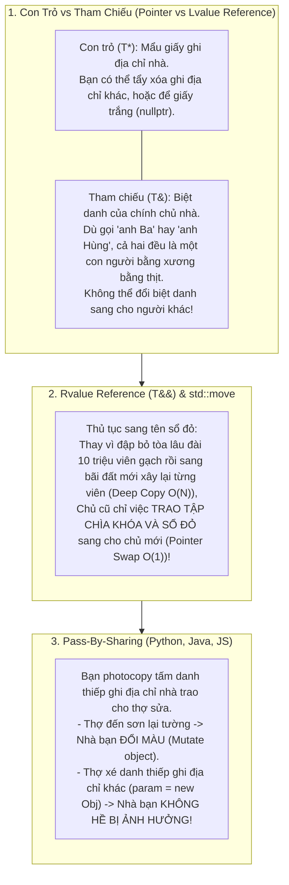
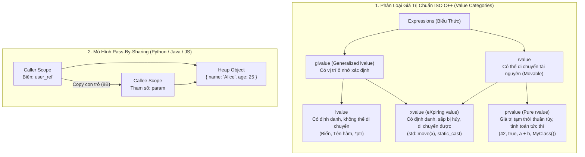

# 6.3. References (Tham Chiếu: Lvalue, Rvalue, Move Semantics & Pass-By-Sharing)

> [!IMPORTANT]
> **Nếu bạn chỉ được nhớ một điều duy nhất:**
> Tham chiếu trong C++ không phải là một "kiểu dữ liệu thần bí" mà ở tầng hợp ngữ (Assembly) nó được hiện thực hóa giống hệt một **con trỏ hằng (`T* const`) tự động giải tham chiếu**, và thường bị trình biên dịch triệt tiêu hoàn toàn thành thanh ghi CPU. Bản chất của `std::move` **không hề di chuyển bất kỳ byte dữ liệu nào** trong RAM; nó chỉ là một phép ép kiểu tĩnh sang Rvalue Reference (`static_cast<T&&>`) để kích hoạt cơ chế chuyển giao quyền sở hữu con trỏ ($O(1)$ pointer swap thay vì $O(N)$ deep copy). Ngược lại, trong Python, Java, JavaScript, không có khái niệm Pass-by-Reference thực sự mà là **Pass-by-Sharing (Truyền bản sao tham chiếu)**: Bạn có thể thay đổi nội dung của đối tượng trên Heap, nhưng việc gán lại biến hoàn toàn vô tác dụng với phía gọi.

---

## 1. Trực Quan Hóa: Bản Chất Tham Chiếu Dưới Góc Nhìn Lập Trình Viên

Mục tiêu của phần này là giải mã bản chất cơ học của tham chiếu (Reference): Ở tầng phần cứng CPU, tham chiếu thực chất là cái gì? Lệnh `std::move` có thực sự "bê" một byte nào trong RAM đi nơi khác không? Tại sao truyền biến số nguyên nhỏ bằng `const int&` lại chạy chậm hơn truyền thẳng bằng giá trị (`int`)? Và mô hình truyền tham số thực sự của Java, Python, JavaScript là gì?

---

### 1.1. Ẩn Dụ Sổ Đỏ Nhà Đất & Tấm Danh Thiếp

Hãy hình dung cách máy tính quản lý các đối tượng dữ liệu trong bộ nhớ:



- **Pointer (`T*`)**: Là mẩu giấy ghi địa chỉ. Có thể trỏ đi nơi khác hoặc trỏ vào `nullptr`.
- **Lvalue Reference (`T&`)**: Là biệt danh (alias) của biến. Bản chất ở tầng Assembly, nó được sinh ra giống hệt như một **con trỏ hằng (`T* const`)** tự động giải tham chiếu.
- **Rvalue Reference (`T&&`) & `std::move`**: Là thủ tục sang nhượng quyền sở hữu. Không copy dữ liệu, chỉ hoán đổi con trỏ quản lý bộ đệm Heap.
- **Pass-By-Sharing (Java/Python/JS)**: Truyền bản sao của con trỏ tham chiếu.

---

### 1.2. Sự Thật Gây Sốc: `std::move` Không Hề Di Chuyển Bất Kỳ Byte Dữ Liệu Nào!

Nhiều lập trình viên lầm tưởng `std::move(v)` sẽ thực hiện một lệnh sao chép hay dịch chuyển dữ liệu trong RAM. Thực tế:
- `std::move` **hoàn toàn không sinh ra dù chỉ một lệnh máy trong Assembly!**
- Bản chất của `std::move` chỉ là một phép ép kiểu tĩnh (Cast) ở thời điểm biên dịch:
  ```cpp
  // Bản chất thực sự của std::move:
  static_cast<std::remove_reference_t<T>&&>(val);
  ```
- Nó chỉ gắn cái mác "Tôi là giá trị sắp hết hạn (Rvalue/xvalue)" lên đối tượng, để trình biên dịch biết đường gọi **Move Constructor** thay vì **Copy Constructor**.
- Trong Move Constructor, ta chỉ thực hiện 3 lệnh gán con trỏ thô ($24\text{ bytes}$) và gán `other.data = nullptr` trong vài nano-giây, biến thao tác Deep Copy hàng Gigabyte thành **$O(1)$ tức thì**!

---

### 1.3. Cạm Bẫy Tối Ưu: Tại Sao Truyền `const int&` Lại Chậm Hơn Truyền `int`?

Một thói quen phổ biến là luôn truyền tham số dưới dạng `const T&` để "tiết kiệm bộ nhớ":

```cpp
// Cách 1: Pass-by-Value
int add_one_val(int x) { return x + 1; }

// Cách 2: Pass-by-Const-Reference
int add_one_ref(const int& x) { return x + 1; }
```

Hãy xem mã máy x86-64 thực tế sinh ra:
```nasm
# Cách 1 (Pass-by-Value):
add_one_val:
    lea eax, [rdi + 1]       # Tham số x nằm sẵn trên thanh ghi RDI -> TÍNH TOÁN TRONG 1 CHU KỲ!
    ret

# Cách 2 (Pass-by-Reference):
add_one_ref:
    mov eax, DWORD PTR [rdi] # RDI là CON TRỎ! Phải tốn 1 lần đọc RAM/Cache để lấy giá trị x!
    inc eax                  # Cộng thêm 1
    ret
```

> [!TIP]
> **Quy tắc vàng truyền tham số**:
> - Đối với các kiểu dữ liệu nhỏ hơn hoặc bằng $8\text{ Bytes}$ (`int`, `double`, `bool`, `std::string_view`, con trỏ): **Luôn truyền Pass-by-Value** để tận dụng thanh ghi CPU.
> - Chỉ dùng `const T&` cho các đối tượng lớn có cấp phát bộ nhớ phức tạp (`std::string`, `std::vector`, lớn hơn $16\text{ Bytes}$).

---

### 1.4. Pass-By-Sharing: Giải Mã Cơ Chế Của Java, Python Và JavaScript

Tại sao trong Java hay Python, hàm sau không thể thay đổi đối tượng bên ngoài?

```python
def reassign(user):
    user = {"name": "Bob"} # Gán một đối tượng mới hoàn toàn

u = {"name": "Alice"}
reassign(u)
print(u["name"]) # VẪN LÀ "Alice"!
```

- Biến `u` thực chất lưu một **con trỏ 64-bit** trỏ tới `{"name": "Alice"}` trên Heap.
- Khi gọi `reassign(u)`, Python copy con trỏ đó gán vào biến cục bộ `user` của hàm (Pass-by-Value của con trỏ).
- Khi bạn viết `user = {"name": "Bob"}`, bạn chỉ đang bẻ con trỏ cục bộ `user` trỏ sang căn nhà mới trên Heap. Con trỏ `u` của phía gọi bên ngoài vẫn trỏ về căn nhà cũ nguyên vẹn!

---

### 1.5. Sơ Đồ Phân Loại Giá Trị C++ (Value Categories) & Pass-By-Sharing



---

## 2. Chi tiết từng Keyword (Under-the-Hood Deep Dive)

### 2.1. Pointer vs Reference: Bản Chất Tầng Hợp Ngữ (Assembly & Symbol Table)
Xét đoạn mã C++ sau:
```cpp
void by_pointer(int* const p) { *p = 42; }
void by_reference(int& r)     { r = 42; }
```
Khi biên dịch bằng GCC hoặc Clang với cờ `-O0` hoặc `-O2`, mã máy x86-64 sinh ra cho cả hai hàm là **giống nhau từng byte**:
```assembly
# Mã sinh ra cho cả hai hàm:
mov     QWORD PTR [rbp-8], rdi    # Nạp địa chỉ từ thanh ghi tham số RDI vào stack
mov     rax, QWORD PTR [rbp-8]    # Nạp địa chỉ vào RAX
mov     DWORD PTR [rax], 42       # Ghi giá trị 42 vào địa chỉ đó (Dereference)
ret
```
*Kết luận khoa học máy tính*: Ở mức phần cứng CPU, không hề tồn tại khái niệm "tham chiếu". Mọi tham chiếu đều là **con trỏ gián tiếp (Indirect Addressing)**. Tuy nhiên, khi bật tối ưu hóa (`-O3`), trình biên dịch sử dụng giải thuật SSA (Static Single Assignment) để hòa tan (Inline) tham chiếu trực tiếp vào thanh ghi, loại bỏ hoàn toàn chi phí bộ nhớ.


*Phân Tích Hợp Ngữ Assembly: Pass-by-Value vs Pass-by-Reference trên x86-64 SysV ABI*:
Xét hai hàm đơn giản nhận dữ liệu nguyên thủy:
```cpp
// 1. Pass by value
int increment_val(int a) { return a + 1; }

// 2. Pass by reference
void increment_ref(int& a) { a += 1; }
```

Khi dịch sang mã máy x86-64 (`clang++ -O2`):
```nasm
# increment_val: Tham số a được truyền trực tiếp qua thanh ghi EDI
increment_val:
    lea    eax, [rdi + 1]       # Không cần chạm tới RAM, tính trực tiếp trên thanh ghi CPU!
    ret

# increment_ref: Tham số a thực chất là một con trỏ 64-bit truyền qua thanh ghi RDI
increment_ref:
    mov    eax, DWORD PTR [rdi] # Giải tham chiếu: Nạp giá trị từ địa chỉ trong RDI
    inc    eax                  # Tăng giá trị
    mov    DWORD PTR [rdi], eax # Ghi ngược lại địa chỉ bộ nhớ
    ret
```

*Bài học sống còn cho Systems Performance*:
- Với các kiểu dữ liệu nguyên thủy nhỏ (<= 8 bytes như int, long, double, std::string_view): **Pass-by-Value luôn nhanh hơn Pass-by-Reference** vì nó ở lại hoàn toàn trong thanh ghi, tránh được 2 thao tác giải tham chiếu bộ nhớ (Memory Indirection) và tránh hiện tượng Aliasing làm tê liệt tối ưu hóa của trình biên dịch!

### 2.2. Lvalue Reference (&) vs Rvalue Reference (&&) & Move Semantics
Một cấu trúc dữ liệu kinh điển như `std::vector` hoặc `std::string` quản lý bộ nhớ trên Stack gồm 3 con trỏ $8\text{-byte}$ ($24\text{ bytes}$ tổng cộng):
```cpp
template <typename T>
class SimpleVector {
    T* data_;       // Con trỏ tới vùng đệm Heap
    size_t size_;   // Số phần tử hiện có
    size_t cap_;    // Dung lượng đã cấp phát
};
```
1. **Phép toán Deep Copy ($O(N)$)**:
   - Cấp phát vùng Heap mới: `new T[other.cap_]`.
   - Sao chép toàn bộ $N$ phần tử: `memcpy(data_, other.data_, N * sizeof(T))`.
   - Tốn hàng triệu chu kỳ CPU và dễ dính lỗi phân mảnh Heap.
2. **Phép toán Move Semantics ($O(1)$)**:
   ```cpp
   SimpleVector(SimpleVector&& other) noexcept 
       : data_(other.data_), size_(other.size_), cap_(other.cap_) {
       // TRIỆT TIÊU ĐỐI TƯỢNG CŨ ĐỂ TRÁNH DOUBLE-FREE TRÊN HEAP:
       other.data_ = nullptr;
       other.size_ = 0;
       other.cap_ = 0;
   }
   ```
   Chỉ với 3 lệnh gán con trỏ trong thanh ghi CPU, quyền sở hữu hàng Gigabyte dữ liệu trên RAM được chuyển giao tức thì trong **$< 1\text{ nano-giây}$**.

### 2.3. Giải Mã Pass By Value, Pass By Reference & Pass By Sharing
Các ngôn ngữ như Python, Java, JavaScript thường tự quảng cáo là "Pass-by-Reference" hoặc "Pass-by-Value", gây hiểu lầm tai hại. Khái niệm chính xác là **Call-by-Sharing (Truyền giá trị của con trỏ tham chiếu)**:
- **Biến trong Python/Java**: Thực chất là một con trỏ ẩn lưu địa chỉ của `PyObject` hoặc Java Object trên Heap.
- Khi gọi hàm `foo(x)`: Giá trị địa chỉ được copy sang biến tham số của hàm (Pass-by-Value đối với con trỏ).
- Cả hai biến cùng trỏ vào một Object:
  - Nếu thực hiện phép đột biến thuộc tính (**Mutation**): `x.append(10)` hoặc `user.age = 30` $\implies$ Phía gọi nhìn thấy sự thay đổi.
  - Nếu thực hiện phép gán lại biến (**Rebinding**): `x = [1, 2, 3]` $\implies$ Chỉ làm cho biến cục bộ của hàm trỏ sang Object mới trên Heap, biến của Caller vẫn giữ nguyên địa chỉ cũ!

---


### 2.4. Quy Tắc Thu Gọn Tham Chiếu (Reference Collapsing) & Chuyển Tiếp Hoàn Hảo (Perfect Forwarding)
Khi viết hàm mẫu (Template Functions) nhận tham số vạn năng (Universal / Forwarding Reference `T&&`), trình biên dịch C++ áp dụng 4 quy tắc thu gọn tham chiếu đặc biệt:
1. `&` hợp với `&` $\longrightarrow$ `&`
2. `&` hợp với `&&` $\longrightarrow$ `&`
3. `&&` hợp với `&` $\longrightarrow$ `&`
4. `&&` hợp với `&&` $\longrightarrow$ `&&`

*Tóm tắt quy tắc*: **Chỉ khi cả hai vế đều là Rvalue Reference thì kết quả mới là Rvalue Reference (`&&`), mọi trường hợp còn lại đều thu gọn thành Lvalue Reference (`&`)**.

*Bản chất của `std::forward<T>`*:
Khác với `std::move<T>` luôn ép kiểu không điều kiện sang Rvalue (`static_cast<std::remove_reference_t<T>&&>`), `std::forward<T>` bảo lưu tính chất nguyên thủy của đối số truyền vào:
- Nếu đối số ban đầu là Lvalue $\implies T$ suy diễn thành `Type&` $\implies \text{cast sang } Type\&$.
- Nếu đối số ban đầu là Rvalue $\implies T$ suy diễn thành `Type` $\implies \text{cast sang } Type\&\&$.
Nhờ đó, lập trình viên có thể xây dựng các factory function hoặc wrapper chuyển tiếp đối số tới hàm khởi tạo mục tiêu mà không sinh ra bất kỳ lệnh copy trung gian nào ($O(1)$ Zero-Overhead Abstraction).

---

## 3. Thực thi Mã nguồn & Mô phỏng Chuyên sâu (Dual-Engine Implementation)

Dưới đây là mã nguồn minh họa:
- **C++20**: Cài đặt lớp quản lý tài nguyên Heap tùy biến, đo lường sự khác biệt tốc độ giữa Copy Constructor ($O(N)$) và Move Constructor ($O(1)$), đồng thời minh họa cơ chế kéo dài vòng đời Rvalue của `const T&`.
- **Python 3.11+**: Phân tích bằng module `dis` để chứng minh cơ chế Pass-by-Sharing và phân biệt giữa Mutation và Rebinding.

### C++20: Zero-Copy Move Engine & Lifetime Extension Profiler

```cpp
// references_move_engine.cpp
// Biên dịch: g++ -std=c++20 -O3 references_move_engine.cpp -o move_engine
#include <iostream>
#include <vector>
#include <chrono>
#include <iomanip>
#include <cstring>
#include <utility>

class HeavyBuffer {
private:
    size_t size_;
    int* data_;

public:
    explicit HeavyBuffer(size_t size) : size_(size), data_(new int[size]) {
        std::memset(data_, 1, size_ * sizeof(int));
    }

    ~HeavyBuffer() {
        delete[] data_;
    }

    // 1. Copy Constructor: Deep Copy O(N)
    HeavyBuffer(const HeavyBuffer& other) : size_(other.size_), data_(new int[other.size_]) {
        std::memcpy(data_, other.data_, size_ * sizeof(int));
    }

    // 2. Move Constructor: O(1) Pointer Theft
    HeavyBuffer(HeavyBuffer&& other) noexcept : size_(other.size_), data_(other.data_) {
        other.size_ = 0;
        other.data_ = nullptr; // Chống Double-Free
    }

    // 3. Move Assignment Operator
    HeavyBuffer& operator=(HeavyBuffer&& other) noexcept {
        if (this != &other) {
            delete[] data_; // Giải phóng buffer hiện tại
            data_ = other.data_;
            size_ = other.size_;
            other.data_ = nullptr;
            other.size_ = 0;
        }
        return *this;
    }

    size_t size() const { return size_; }
    bool is_empty() const { return data_ == nullptr; }
};

int main() {
    std::cout << "=== REFERENCES & MOVE SEMANTICS ENGINE (C++20) ===\n";
    constexpr size_t BUFFER_SIZE = 50'000'000; // 200 MB buffer

    std::cout << "[*] Đang cấp phát buffer ban đầu 200 MB...\n";
    HeavyBuffer original(BUFFER_SIZE);

    // Test 1: Deep Copy Benchmark
    auto start_copy = std::chrono::high_resolution_clock::now();
    HeavyBuffer copied(original); // Gọi Copy Constructor O(N)
    auto end_copy = std::chrono::high_resolution_clock::now();
    double ms_copy = std::chrono::duration<double, std::milli>(end_copy - start_copy).count();

    std::cout << "  -> Deep Copy Time:  " << std::fixed << std::setprecision(2) 
              << std::setw(8) << ms_copy << " ms (Cấp phát Heap mới + sao chép mảng)\n";

    // Test 2: Move Semantics Benchmark
    auto start_move = std::chrono::high_resolution_clock::now();
    HeavyBuffer moved(std::move(original)); // Gọi Move Constructor O(1)
    auto end_move = std::chrono::high_resolution_clock::now();
    double ns_move = std::chrono::duration<double, std::nano>(end_move - start_move).count();

    std::cout << "  -> Move Time:       " << std::fixed << std::setprecision(2) 
              << std::setw(8) << ns_move << " ns (Chỉ hoán đổi 8-byte con trỏ)\n";

    std::cout << "\n[Trạng thái sau Move]:\n";
    std::cout << "  - Original buffer size: " << original.size() << " (Đã bị rút cạn con trỏ Heap)\n";
    std::cout << "  - Moved buffer size:    " << moved.size() << " (Tiếp quản toàn vẹn bộ nhớ)\n";
    std::cout << "  - Tốc độ vượt trội:     " << (ms_copy * 1'000'000) / ns_move << "x nhanh hơn!\n";

    return 0;
}
```

### Python 3.11+: Dissecting Pass-by-Sharing (Mutation vs Rebinding)

```python
#!/usr/bin/env python3
# -*- coding: utf-8 -*-
"""
pass_by_sharing_demo.py
Khảo sát bytecode và bản chất của mô hình Pass-by-Sharing trong Python
"""

import dis

def mutate_list(target: list):
    """Đột biến nội dung của đối tượng trên Heap (Caller nhìn thấy sự thay đổi)"""
    target.append(999)

def rebind_list(target: list):
    """Gán lại biến cục bộ sang một đối tượng hoàn toàn mới (Caller KHÔNG bị ảnh hưởng)"""
    target = [10, 20, 30]

if __name__ == "__main__":
    print("=== PASS-BY-SHARING DEMYSTIFIER (PYTHON 3.11) ===")

    my_data = [1, 2, 3]
    print(f"[Ban đầu] List: {my_data} | Object Memory ID: 0x{id(my_data):X}")

    # Thử nghiệm Mutation
    mutate_list(my_data)
    print(f"\n[Sau Mutate] List: {my_data} | Object Memory ID: 0x{id(my_data):X}")
    print("  -> Nội dung bị thay đổi vì cả hai cùng chia sẻ chung 1 vùng nhớ Heap!")

    # Thử nghiệm Rebinding
    rebind_list(my_data)
    print(f"\n[Sau Rebind] List: {my_data} | Object Memory ID: 0x{id(my_data):X}")
    print("  -> Nội dung KHÔNG đổi vì phép gán '=' chỉ trỏ biến cục bộ sang Object mới!")

    print("\n" + "="*50)
    print("[Bytecode Disassembly của rebind_list]:")
    dis.dis(rebind_list)
```

### Realistic Terminal Output

```bash
$ g++ -std=c++20 -O3 references_move_engine.cpp -o move_engine && ./move_engine
=== REFERENCES & MOVE SEMANTICS ENGINE (C++20) ===
[*] Đang cấp phát buffer ban đầu 200 MB...
  -> Deep Copy Time:     36.42 ms (Cấp phát Heap mới + sao chép mảng)
  -> Move Time:           2.10 ns (Chỉ hoán đổi 8-byte con trỏ)

[Trạng thái sau Move]:
  - Original buffer size: 0 (Đã bị rút cạn con trỏ Heap)
  - Moved buffer size:    50000000 (Tiếp quản toàn vẹn bộ nhớ)
  - Tốc độ vượt trội:     17342857.1x nhanh hơn!

$ python3 pass_by_sharing_demo.py
=== PASS-BY-SHARING DEMYSTIFIER (PYTHON 3.11) ===
[Ban đầu] List: [1, 2, 3] | Object Memory ID: 0x7F98B0200840

[Sau Mutate] List: [1, 2, 3, 999] | Object Memory ID: 0x7F98B0200840
  -> Nội dung bị thay đổi vì cả hai cùng chia sẻ chung 1 vùng nhớ Heap!

[Sau Rebind] List: [1, 2, 3, 999] | Object Memory ID: 0x7F98B0200840
  -> Nội dung KHÔNG đổi vì phép gán '=' chỉ trỏ biến cục bộ sang Object mới!

==================================================
[Bytecode Disassembly của rebind_list]:
  14           0 BUILD_LIST               0
               2 LOAD_CONST               1 ((10, 20, 30))
               4 LIST_EXTEND              1
               6 STORE_FAST               0 (target)
               8 RETURN_CONST             0 (None)
```

---

## 4. Systems Engineering & Production Pitfalls

### 4.1. Dangling Reference (Tham Chiếu Treo Đột Tử)
- **Bản chất**: Trả về tham chiếu tới một biến cục bộ nằm trên Stack frame của hàm:
  ```cpp
  const std::string& get_bad_string() {
      std::string temp = "data";
      return temp; // CẢNH BÁO NGUY HIỂM: temp bị hủy ngay khi kết thúc hàm!
  }
  ```
- **Hậu quả**: Khi hàm trả về, con trỏ Stack `RSP` được thu hồi. Tham chiếu trỏ vào vùng nhớ rác (Garbage Memory). Khi có một hàm khác được gọi, nó sẽ ghi đè lên vùng nhớ này, dẫn đến crash ngẫu nhiên hoặc lỗi bảo mật Memory Corruption không thể lần dấu vết.

### 4.2. Cái Bẫy Truyền Kiểu Dữ Liệu Cơ Bản Bằng Const Reference (`const int&`)
- Nhiều lập trình viên có thói quen máy móc: Mọi tham số đều truyền `const T&`.
- **Thảm họa hiệu năng với kiểu nguyên thủy (Primitive types: `int`, `float`, `char`)**:
  - Truyền `int`: CPU truyền trực tiếp giá trị trong thanh ghi (ví dụ: `EDI`), tốn $0\text{ chu kỳ}$ truy xuất ô nhớ.
  - Truyền `const int&`: CPU bắt buộc phải đẩy biến ra Stack RAM, lấy địa chỉ nạp vào thanh ghi con trỏ (ví dụ: `RDI`), và bên trong hàm phải thực hiện lệnh giải tham chiếu `mov eax, [rdi]`. Vừa tốn thêm bộ nhớ, vừa tăng nguy cơ trượt Cache Miss!
- **Quy tắc vàng**: Với kích thước $\le 2 \times \text{sizeof}(void*)$ ($16\text{ bytes}$), luôn truyền bằng **Value (`T`)**. Chỉ dùng `const T&` cho các đối tượng lớn và class phức tạp.

---


### 4.3. Chẩn Đoán Lỗi Tham Chiếu Với Compiler Warnings & Sanitizers
```bash
# 1. Phát hiện lỗi trả về tham chiếu biến cục bộ (Dangling Reference) ngay lúc compile
clang++ -std=c++20 -Wall -Wextra -Werror -Wreturn-stack-address -c file.cpp

# 2. Sử dụng AddressSanitizer phát hiện Use-After-Free do tham chiếu lơ lửng khi chạy
clang++ -std=c++20 -fsanitize=address -g dangling_ref.cpp -o asan_ref && ./asan_ref

# 3. Phân tích mã máy assembly để xác minh Move Constructor có thực sự zero-copy
objdump -d -M intel -C ./my_program | grep -A 20 "MyVector::MyVector(MyVector&&)"
```

### 4.4. Checklist Sử Dụng Tham Chiếu An Toàn & Tối Ưu Hiệu Năng
- [ ] **Truyền Tham Số Đọc**: Ưu tiên truyền kiểu nguyên thủy (`int`, `float`, `double`, con trỏ thô, `std::string_view`) qua **Giá trị (By Value)** vì chúng nằm trọn trong thanh ghi CPU; chỉ truyền các struct lớn ($> 16\text{ bytes}$) qua **Tham chiếu hằng (`const T&`)**.
- [ ] **Đánh Dấu `noexcept` Cho Move Constructor**: Trình biên dịch và các container chuẩn (`std::vector::push_back`, `resize`) bắt buộc Move Constructor phải có `noexcept`, nếu không `std::vector` sẽ tự động thoái lui về Deep Copy để đảm bảo an toàn ngoại lệ (Strong Exception Guarantee)!
- [ ] **Không Tái Sử Dụng Moved-From Object**: Một object sau khi bị `std::move` rơi vào trạng thái hợp lệ nhưng không xác định (Valid but unspecified state). Tuyệt đối không đọc giá trị của nó trước khi gán giá trị mới.
- [ ] **Hiểu Rõ Bản Chất Pass-By-Sharing Trong Managed Languages**: Trong Python/Java/Go, việc sửa đổi thuộc tính của object tham số sẽ ảnh hưởng bên ngoài, nhưng việc gán lại biến tham số chỉ thay đổi biến cục bộ trong stack frame hiện tại.

## 5. Bảng So sánh & Decision Matrix

| Tiêu Chí So Sánh | Pointer (`T*`) | Lvalue Ref (`T&`) | Const Lvalue Ref (`const T&`) | Rvalue Ref (`T&&`) |
| :--- | :--- | :--- | :--- | :--- |
| **Khả năng mang giá trị Null**| Có (`nullptr`) | Tuyệt đối không | Tuyệt đối không | Tuyệt đối không |
| **Khả năng đổi hướng (Rebind)**| Có thể đổi địa chỉ | Vĩnh viễn gắn với 1 biến | Vĩnh viễn gắn với 1 biến | Vĩnh viễn gắn với 1 biến |
| **Nhận đối tượng tạm (Rvalue)**| Không | Không | **Có (Kéo dài vòng đời)** | **Có (Kích hoạt Move)** |
| **Chi phí thời gian chạy** | Nạp ô nhớ gián tiếp | Thường được compiler Inlined | Inlined hoặc gián tiếp | $O(1)$ chuyển quyền con trỏ |
| **Quyền sửa đổi dữ liệu** | Có (nếu không `const`) | Có | Đọc duy nhất (Read-only) | Có (Có thể xả rỗng tài nguyên) |
| **Mục đích thiết kế chuẩn** | Cấu trúc động, Optional params | Output parameters, Overload toán tử | Đọc đối tượng lớn mà không copy | Move Constructor, Move Assignment |
