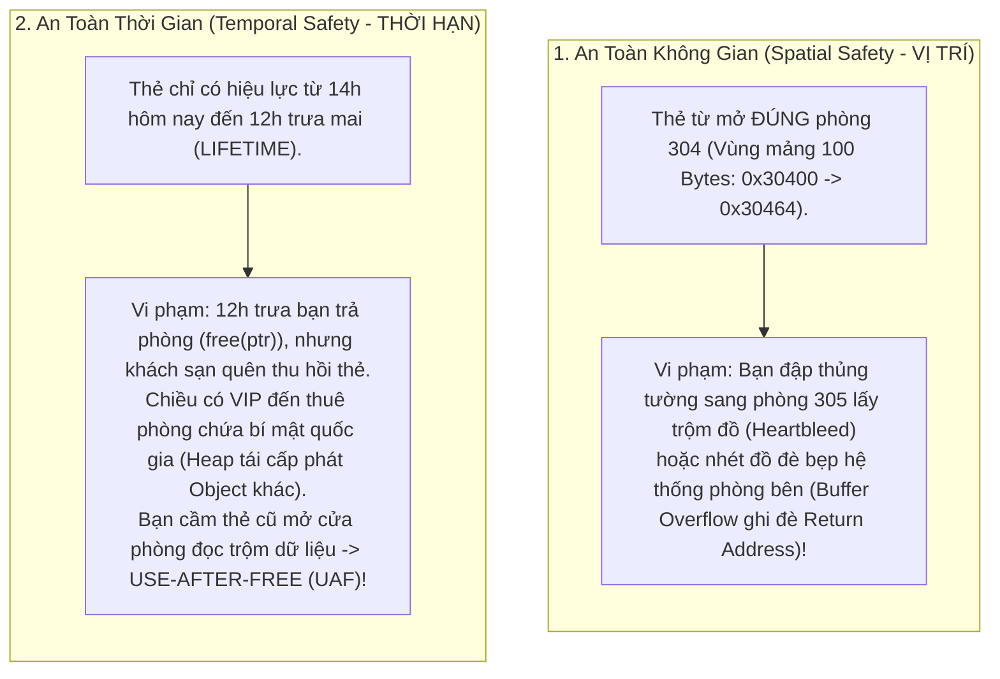
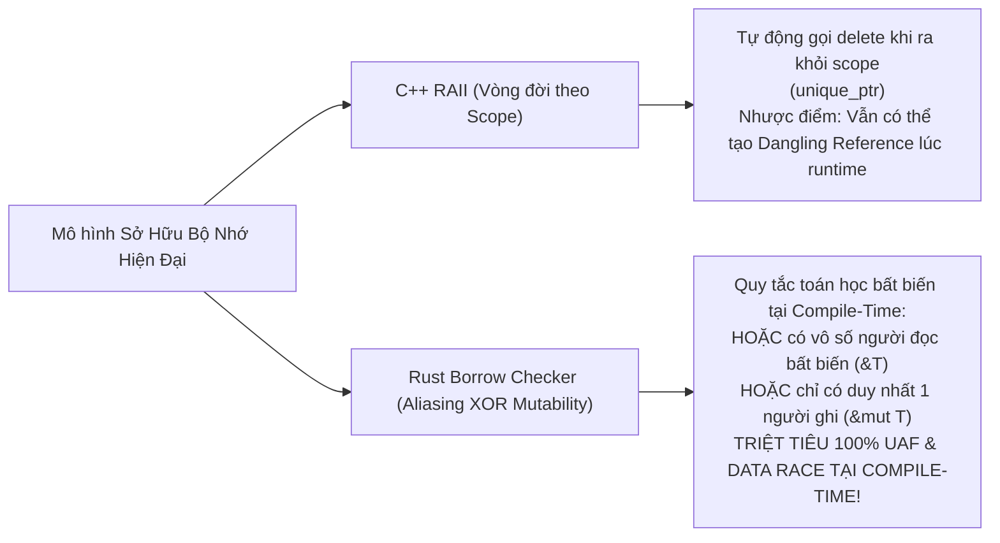
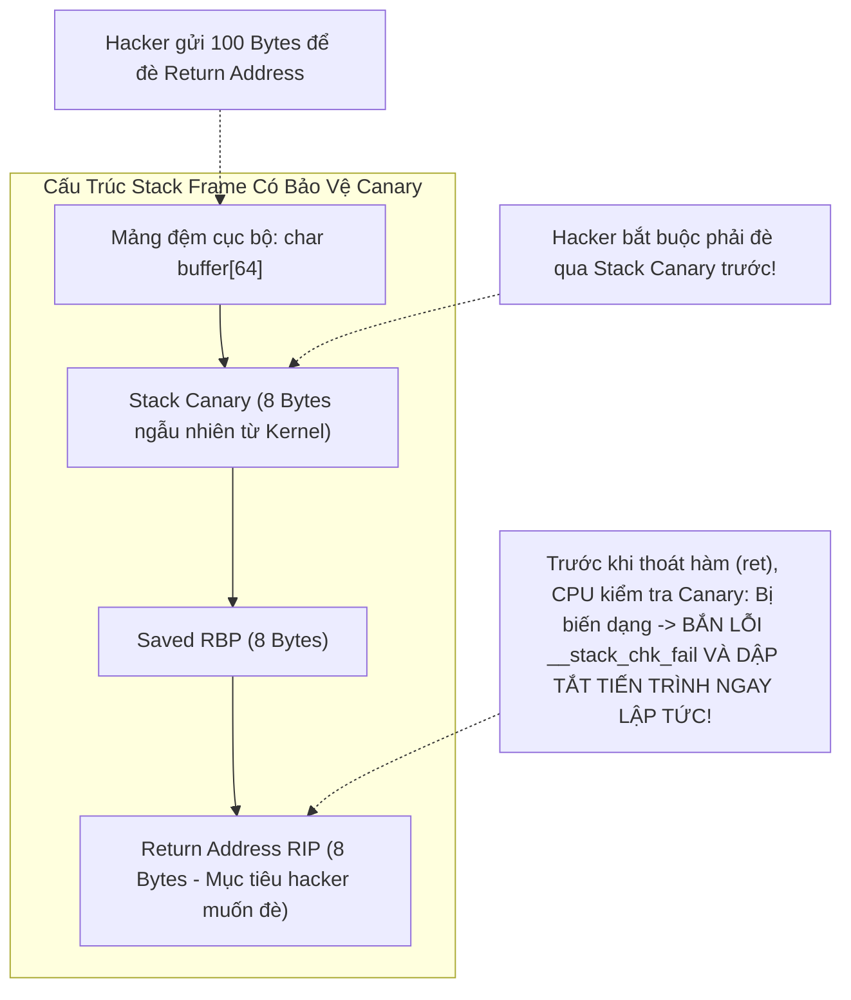
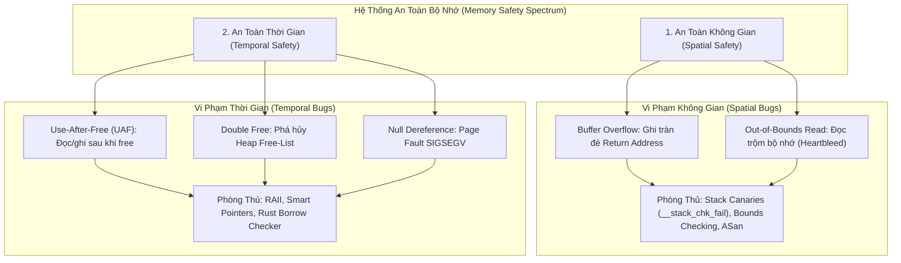

# 6.4. Pointer Safety (An Toàn Con Trỏ, Quản Trị Vòng Đời & Các Lỗ Hổng Bộ Nhớ Cốt Tử)

> [!IMPORTANT]
> **Nếu bạn chỉ được nhớ một điều duy nhất:** Hơn $70\%$ toàn bộ các lỗ hổng bảo mật nghiêm trọng (CVEs) trong lịch sử của Microsoft, Google Chromium và nhân Linux đều bắt nguồn từ hai nhóm vi phạm an toàn bộ nhớ cốt tử: **An toàn không gian (Spatial Safety - Buffer Overflow, Out-of-Bounds)** và **An toàn thời gian (Temporal Safety - Use-After-Free, Double Free)**. Kỷ nguyên hiện đại giải quyết triệt để vấn đề này không phải bằng các bộ thu gom rác Garbage Collector chậm chạp, mà bằng mô hình quyền sở hữu toán học nghiêm ngặt: nguyên lý RAII trong C++ và quy tắc Aliasing XOR Mutability (Hoặc nhiều tham chiếu đọc `&T`, hoặc một tham chiếu ghi duy nhất `&mut T`) được kiểm chứng tĩnh tại thời điểm biên dịch (Compile-time Borrow Checker).

---

## 1. Trực Quan Hóa: Bản Chất An Toàn Con Trỏ Dưới Góc Nhìn Lập Trình Viên

Mục tiêu của phần này là giải mã nguồn gốc của hơn $70\%$ toàn bộ các lỗi bảo mật nghiêm trọng nhất thế giới (từ Microsoft Windows, Google Chrome đến iOS/Android): Lỗ hổng an toàn không gian (Spatial) và thời gian (Temporal) là gì? Hacker đã dùng Use-After-Free để chiếm quyền điều khiển máy chủ như thế nào? Tại sao ngôn ngữ Rust lại có thể đảm bảo an toàn bộ nhớ $100\%$ mà không cần bất kỳ bộ dọn rác (GC) nào? Và "chú chim hoàng yến" (Stack Canary) cứu mạng chương trình của bạn ra sao?

---

### 1.1. Ẩn Dụ Thẻ Phòng Khách Sạn: An Toàn Không Gian vs An Toàn Thời Gian

Hãy hình dung hệ thống an toàn con trỏ giống như cơ chế quản lý an ninh tại một khách sạn cao cấp:



- **An toàn không gian (Spatial Safety)**: Con trỏ chỉ được phép đọc/ghi bên trong phạm vi hợp lệ của đối tượng ($\text{Base} \le ptr < \text{Base} + \text{Size}$).
- **An toàn thời gian (Temporal Safety)**: Con trỏ chỉ được phép truy cập trong khoảng thời gian đối tượng còn sống hợp lệ ($t_{\text{alloc}} \le t < t_{\text{free}}$).

---

### 1.2. Tứ Đại Sát Thủ Bộ Nhớ (The 4 Fatal Memory Bugs)

1. **Buffer Overflow (Tràn bộ đệm)**: Nhập dữ liệu vượt quá kích thước mảng trên Stack $\implies$ Đè nát Return Address $\implies$ CPU nhảy thẳng vào mã độc của hacker khi thoát hàm!
2. **Use-After-Free (UAF - Dùng sau khi giải phóng)**: Bộ nhớ đã `free()`, nhưng con trỏ vẫn trỏ tới đó (**Dangling Pointer**). Hacker lấp một đối tượng giả mạo vào ô nhớ đó rồi gọi hàm ảo để chiếm quyền thực thi (**Arbitrary Code Execution**).
3. **Double Free**: Gọi `free()` hai lần trên cùng 1 con trỏ $\implies$ Phá hỏng danh sách các khối trống của Heap (Free-List Corruption), khiến `malloc` cấp phát trùng địa chỉ cho 2 đối tượng khác nhau!
4. **Null Dereference**: Đọc/ghi vào địa chỉ `0x00000000` $\implies$ Chạm vào trang nhớ cấm của Kernel $\implies$ Bắn ngắt Page Fault và sập tiến trình ngay lập tức với tín hiệu `SIGSEGV` (Segmentation Fault).

---

### 1.3. C++ RAII vs Rust Borrow Checker: Trận Chiến Giải Cứu Bộ Nhớ

Làm thế nào để tiêu diệt $100\%$ các lỗi trên mà không phải dùng Garbage Collector chậm chạp?



---

### 1.4. Chú Chim Hoàng Yến Trong Mỏ Than (Stack Canary)

Trong lịch sử, những người thợ mỏ thường mang theo một chú chim hoàng yến xuống hầm mỏ: nếu có khí độc rò rỉ, chú chim sẽ chết trước để cảnh báo thợ mỏ tháo chạy.



Trình biên dịch hiện đại (`-fstack-protector-strong`) tự động chèn một **con tem Canary ngẫu nhiên** ngay trước Return Address. Nếu hacker cố tình ghi tràn bộ đệm để đổi Return Address, con tem Canary sẽ bị biến dạng trước. CPU phát hiện ngay lập tức và dập tắt tiến trình trước khi mã độc kịp chạy!

---

### 1.5. Sơ Đồ Khối Phân Loại Lỗ Hổng An Toàn Bộ Nhớ & Cơ Chế Phòng Ngự



---

## 2. Chi tiết từng Keyword (Under-the-Hood Deep Dive)

### 2.1. Phân Loại Ranh Giới: An Toàn Không Gian (Spatial) vs An Toàn Thời Gian (Temporal)
1. **An toàn không gian (Spatial Memory Safety)**:
   - Một thao tác giải tham chiếu con trỏ $P$ được định nghĩa là an toàn về mặt không gian nếu và chỉ nếu địa chỉ mục tiêu nằm hoàn toàn trong ranh giới bộ nhớ được cấp phát hợp lệ cho đối tượng đó:
     $$\text{Base}(Obj) \le P < \text{Base}(Obj) + \text{Size}(Obj)$$
   - Mọi thao tác truy cập $P < \text{Base}$ (Underflow) hoặc $P \ge \text{Base} + \text{Size}$ (Overflow) đều cấu thành hành vi vi phạm an toàn không gian (Spatial Violation).
2. **An toàn thời gian (Temporal Memory Safety)**:
   - Một thao tác truy cập bộ nhớ được định nghĩa là an toàn về mặt thời gian nếu nó diễn ra trong khoảng thời gian đối tượng đó còn tồn tại hợp lệ (Lifetime) trong không gian địa chỉ:
     $$t_{\text{alloc}} \le t_{\text{access}} < t_{\text{dealloc}}$$
   - Nếu một con trỏ tiếp tục được giải tham chiếu tại thời điểm $t \ge t_{\text{dealloc}}$, hành vi này cấu thành vi phạm an toàn thời gian (Temporal Violation).

### 2.2. Bốn Sát Thủ Bộ Nhớ Cốt Tử: Buffer Overflow, Use-After-Free (UAF), Double Free & Null Dereference
1. **Buffer Overflow (Tràn bộ đệm) & Stack Smashing**:
   - Khi một mảng trên Stack (ví dụ `char buffer[64]`) nhận dữ liệu đầu vào không được kiểm soát kích thước (sử dụng các hàm C nguy hiểm như `gets()`, `strcpy()`, `sprintf()`):
   - Dữ liệu người dùng sẽ tràn qua ranh giới mảng, đè bẹp con trỏ khung ngăn xếp cũ (**Saved Frame Pointer `RBP`**), và quan trọng nhất là ghi đè lên **Địa chỉ trả về của hàm (Return Address `RIP`)**.
   - Khi hàm thực hiện lệnh `ret`, CPU nạp địa chỉ độc hại do hacker chỉ định vào thanh ghi `RIP`, chuyển hướng luồng điều khiển sang mã độc (**Arbitrary Code Execution / Shellcode Injection**).
2. **Use-After-Free (UAF)**:
   - Xảy ra khi một vùng nhớ trên Heap bị giải phóng bằng `free(ptr)` nhưng con trỏ `ptr` không được gán về `nullptr` (**Dangling Pointer**).
   - Kẻ tấn công lợi dụng kỹ thuật **Heap Spraying**: Cấp phát một đối tượng mới (ví dụ một Object có chứa con trỏ bảng ảo `vtable`) vào chính ô nhớ vừa bị giải phóng. Sau đó, kẻ tấn công kích hoạt hàm gọi thông qua con trỏ `ptr` cũ. CPU sẽ giải tham chiếu con trỏ bảng ảo giả mạo của hacker và thực thi mã tùy ý.
3. **Double Free**:
   - Gọi hàm `free(ptr)` hai lần liên tiếp trên cùng một con trỏ.
   - Thao tác này làm hỏng cấu trúc danh sách liên kết đơn của các khối trống trong bộ cấp phát Heap (**Tcache Bin / Fastbin Corruption** trong Glibc `ptmalloc`), biến một khối nhớ thành một chu trình khép kín, cho phép kẻ tấn công buộc `malloc()` trả về cùng một địa chỉ bộ nhớ cho hai đối tượng khác nhau.
4. **Null Dereference**:
   - Giải tham chiếu một con trỏ có giá trị `0x0000000000000000`.
   - Trang đầu tiên của không gian bộ nhớ ảo (Trang 0: từ `0x0000` đến `0x0FFF`) luôn được Kernel đánh dấu cấm đọc cấm ghi (`Present = 0`). Thao tác này kích hoạt ngắt phần cứng Page Fault ngay lập tức và tiến trình bị tiêu diệt bằng tín hiệu `SIGSEGV` (Segmentation Fault).

### 2.3. Cuộc Cách Mạng Quản Trị Sở Hữu: C++ RAII vs Rust Borrow Checker (Aliasing XOR Mutability)
- **Mô hình RAII trong C++ (Resource Acquisition Is Initialization)**:
  - Gắn chặt vòng đời của tài nguyên bộ nhớ Heap với vòng đời của một đối tượng quản lý nằm trên Stack.
  - Khi đối tượng Stack đi ra khỏi phạm vi khối lệnh (Out of Scope), hàm hủy (**Destructor**) tự động được gọi ngầm định để thu hồi bộ nhớ.
  - *Hạn chế của C++*: C++ vẫn cho phép con trỏ thô và tham chiếu sống lâu hơn đối tượng chủ sở hữu (Dangling References), và không thể ngăn chặn Data Races trong môi trường đa luồng tại compile-time.
- **Hệ thống Sở Hữu & Mượn của Rust (Ownership & Borrow Checker)**:
  - Được xây dựng trên nguyên lý toán học **Affine Type System**:
    1. Mỗi giá trị trong bộ nhớ chỉ có **duy nhất một biến chủ sở hữu (Owner)** tại một thời điểm.
    2. Khi chủ sở hữu ra khỏi scope, bộ nhớ tự động được giải phóng (`drop`).
    3. **Định lý Bất Biến Cốt Lõi: Aliasing XOR Mutability**:
       - Bạn có thể có **vô số tham chiếu chỉ đọc bất biến (`&T`)** trỏ vào dữ liệu.
       - **HOẶC** chỉ có **duy nhất một tham chiếu có thể sửa đổi (`&mut T`)** tại một thời điểm.
       - Tuyệt đối cấm vừa có người đọc vừa có người ghi đồng thời!
  - Nhờ luật này, Rust loại bỏ $100\%$ các lỗi Use-After-Free, Double Free, Dangling Pointer và Data Race ngay tại thời điểm biên dịch (**Zero-Cost Compile-Time Safety**) mà không tốn một chu kỳ CPU nào lúc runtime!

### 2.4. Cơ Chế Phòng Thủ Tầng Compiler & OS: Stack Canaries, ASLR/PIE & Shadow Memory Trong ASan
1. **Stack Canaries (`-fstack-protector-strong`)**:
   - Trình biên dịch tự động chèn một giá trị ngẫu nhiên bí mật ($8\text{ Bytes}$, gọi là Canary) vào ngay trước Return Address trên Stack Frame.
   - Trước khi thoát hàm (lệnh `ret`), mã máy kiểm tra xem giá trị Canary có bị biến dạng không:
     ```assembly
     mov rax, [rbp - 8]
     xor rax, fs:[0x28]  ; So sánh với giá trị ngẫu nhiên của Kernel
     jne __stack_chk_fail ; Nếu bị sai lệch -> DỪNG CHƯƠNG TRÌNH NGAY!
     ```
   - Ngăn chặn hoàn toàn việc ghi đè Return Address qua Buffer Overflow.
2. **ASLR (Address Space Layout Randomization) & PIE (Position Independent Executable)**:
   - Hệ điều hành ngẫu nhiên hóa vị trí nạp của Stack, Heap, và các thư viện động `.so`/`.dll` vào các địa chỉ RAM ngẫu nhiên trong mỗi lần chạy chương trình.
   - Khiến kẻ tấn công không thể hardcode địa chỉ cố định để nhảy tới shellcode.
3. **AddressSanitizer (ASan - Shadow Memory Architecture)**:
   - Sử dụng kỹ thuật ánh xạ vùng nhớ bóng (**Shadow Memory Mapping**): Mỗi $8\text{ Bytes}$ của bộ nhớ tiến trình được theo dõi bởi đúng $1\text{ Byte}$ trong vùng nhớ Shadow.
   - ASan bao bọc mọi mảng và khối cấp phát Heap bằng các **Vùng đệm cấm (Redzones)**. Mỗi khi chương trình đọc/ghi bộ nhớ, compiler chèn lệnh kiểm tra byte Shadow tương ứng. Nếu con trỏ chạm vào Redzone hoặc vùng nhớ đã bị `free`, ASan lập tức dừng tiến trình và in ra dấu vết stack chi tiết (Crash Report).

### 2.5. Memory Tagging Extensions (ARM MTE / CHERI): Tương Lai An Toàn Bộ Nhớ Phần Cứng
- **ARMv8.5-A MTE (Memory Tagging Extension)**:
  - Khắc phục lỗi con trỏ ở tầng bán dẫn phần cứng vi xử lý.
  - Sử dụng 4 bit chưa dùng ở phần đầu của con trỏ 64-bit (Top-Byte Ignore) để lưu một mã màu (**Pointer Tag: 4 bits** từ 0 đến 15).
  - Đồng thời, mỗi khối $16\text{ Bytes}$ trong RAM vật lý được gán một mã màu tương ứng (**Memory Tag**).
  - Khi CPU thực hiện lệnh `LDR` hoặc `STR`, mạch phần cứng tự động đối soát xem Pointer Tag có trùng khớp với Memory Tag hay không. Nếu không khớp (ví dụ truy cập sau khi ô nhớ đã bị free và đổi màu), CPU kích hoạt ngắt phần cứng ngay lập tức trong $0\text{ cycle}$ overhead!

---

## 3. Thực thi Mã nguồn & Mô phỏng Chuyên sâu (Dual-Engine Implementation)

### 3.1. C++20 Move-Only Safe Lifetime RAII Wrapper & ASan Violation Lab

Chương trình C++20 cài đặt lớp vỏ bọc RAII Move-Only an toàn tuyệt đối, triệt tiêu nguy cơ Double Free và Null Dereference:

```cpp
// Biên dịch: g++ -std=c++20 -O3 -Wall -Wextra safe_pointer_lifetime_lab.cpp -o safe_ptr_lab
#include <iostream>
#include <cstdint>
#include <utility>
#include <stdexcept>
#include <format>

// Lớp vỏ bọc RAII quản trị vòng đời con trỏ độc quyền an toàn
template <typename T>
class SafeUniqueResource {
private:
    T* payload_ = nullptr;

public:
    // Khởi tạo và tiếp nhận sở hữu con trỏ
    explicit SafeUniqueResource(T* raw_ptr) noexcept : payload_(raw_ptr) {}

    // Hủy và dọn dẹp tài nguyên tự động (RAII)
    ~SafeUniqueResource() {
        if (payload_) {
            delete payload_;
            payload_ = nullptr;
        }
    }

    // CẤM SAO CHÉP (Cấm Copy Constructor & Copy Assignment để ngăn Double Free)
    SafeUniqueResource(const SafeUniqueResource&) = delete;
    SafeUniqueResource& operator=(const SafeUniqueResource&) = delete;

    // CHO PHÉP DI CHUYỂN (Move Semantics: Chuyển giao quyền sở hữu duy nhất)
    SafeUniqueResource(SafeUniqueResource&& other) noexcept : payload_(other.payload_) {
        other.payload_ = nullptr; // Con trỏ cũ bị vô hiệu hóa hoàn toàn
    }

    SafeUniqueResource& operator=(SafeUniqueResource&& other) noexcept {
        if (this != &other) {
            delete payload_; // Giải phóng tài nguyên cũ của chính mình
            payload_ = other.payload_;
            other.payload_ = nullptr;
        }
        return *this;
    }

    // Giải tham chiếu an toàn có kiểm tra con trỏ Null
    T& operator*() {
        if (!payload_) {
            throw std::runtime_error("Lỗi chí tử: Cố giải tham chiếu con trỏ rỗng/đã bị di chuyển!");
        }
        return *payload_;
    }

    const T& operator*() const {
        if (!payload_) {
            throw std::runtime_error("Lỗi chí tử: Cố giải tham chiếu con trỏ rỗng/đã bị di chuyển!");
        }
        return *payload_;
    }

    bool is_valid() const noexcept { return payload_ != nullptr; }
};

int main() {
    std::cout << "=========================================================\n";
    std::cout << "  C++20 SAFE LIFETIME & MEMORY SAFETY RAII LAB           \n";
    std::cout << "=========================================================\n";

    // 1. Kiểm chứng an toàn sở hữu và di chuyển
    {
        SafeUniqueResource<int32_t> resource_a(new int32_t(9999));
        std::cout << std::format("Giá trị ban đầu trong Resource A: {}\n", *resource_a);

        // Chuyển quyền sở hữu từ A sang B
        SafeUniqueResource<int32_t> resource_b = std::move(resource_a);
        std::cout << std::format("Chuyển giao quyền sở hữu thành công sang Resource B: {}\n", *resource_b);
        std::cout << std::format("Resource A còn hợp lệ không? {}\n", resource_a.is_valid());

        // Thử truy cập Resource A sau khi đã bị Move (Bắt ngoại lệ an toàn)
        try {
            std::cout << "Cố giải tham chiếu Resource A: " << *resource_a << "\n";
        } catch (const std::exception& ex) {
            std::cout << std::format("  -> Đã chặn đứng Null Dereference: {}\n", ex.what());
        }
    } // resource_b tự động hủy và giải phóng Heap tại đây mà không lo Double Free!

    std::cout << "\nToàn bộ vùng nhớ Heap đã được dọn dẹp sạch sẽ theo nguyên lý RAII.\n";
    return 0;
}
```

### 3.2. Python 3.11+: Safe Memory Buffer Simulator & Bounds Checker

Chương trình Python 3.11+ mô phỏng bộ đệm an toàn bộ nhớ, phát hiện các nỗ lực tấn công Buffer Overflow và Out-of-Bounds Access:

```python
#!/usr/bin/env python3
"""
pointer_safety_simulator.py: Mô phỏng Bounds Checking và an toàn không gian bộ nhớ.
Yêu cầu: Python 3.11+
"""
import sys

class SpatialSafeBuffer:
    """Bộ đệm nhị phân mô phỏng cơ chế Bounds Checking phần cứng."""
    def __init__(self, capacity_bytes: int):
        self._capacity = capacity_bytes
        # Tự động zero-fill toàn bộ bộ nhớ (chống rò rỉ rác dữ liệu)
        self._storage = bytearray(capacity_bytes)

    def write_at(self, offset: int, data: bytes) -> None:
        """Ghi dữ liệu có kiểm soát biên giới nghiêm ngặt (Spatial Safety)."""
        data_len = len(data)
        if offset < 0 or (offset + data_len) > self._capacity:
            raise IndexError(
                f"[SPATIAL VIOLATION] Buffer Overflow bị chặn đứng! "
                f"Offset {offset} + Độ dài {data_len} vượt quá dung lượng {self._capacity} bytes!"
            )
        self._storage[offset : offset + data_len] = data

    def read_at(self, offset: int, length: int) -> bytes:
        """Đọc dữ liệu có kiểm tra ranh giới (Chống Heartbleed OOB Read)."""
        if offset < 0 or (offset + length) > self._capacity:
            raise IndexError(
                f"[SPATIAL VIOLATION] Out-of-bounds Read bị chặn đứng! "
                f"Offset {offset} + Độ dài {length} vượt quá giới hạn {self._capacity} bytes!"
            )
        return bytes(self._storage[offset : offset + length])

if __name__ == "__main__":
    print("=== MÔ PHỎNG AN TOÀN KHÔNG GIAN BỘ NHỚ (PYTHON 3.11+) ===")
    safe_buf = SpatialSafeBuffer(16) # Bộ đệm an toàn 16 bytes

    # Ghi hợp lệ
    safe_buf.write_at(0, b"HEADER_1234")
    print("Ghi hợp lệ 11 bytes vào offset 0: Thành công!")

    # Thử nghiệm 1: Tấn công Buffer Overflow (Spatial Write Violation)
    try:
        print("\nThử nghiệm 1: Ghi 8 bytes vào offset 12 (Vượt quá biên 16B)...")
        safe_buf.write_at(12, b"OVERFLOW")
    except IndexError as err:
        print(f"  -> {err}")

    # Thử nghiệm 2: Tấn công Heartbleed Out-of-Bounds Read (Spatial Read Violation)
    try:
        print("\nThử nghiệm 2: Đọc 32 bytes từ offset 0 (Cố tình đọc trộm dữ liệu lân cận)...")
        leaked = safe_buf.read_at(0, 32)
    except IndexError as err:
        print(f"  -> {err}")
```

### 3.3. Terminal Output Mẫu & Phân Tích Thực Thi

```text
=========================================================
  C++20 SAFE LIFETIME & MEMORY SAFETY RAII LAB           
=========================================================
Giá trị ban đầu trong Resource A: 9999
Chuyển giao quyền sở hữu thành công sang Resource B: 9999
Resource A còn hợp lệ không? false
  -> Đã chặn đứng Null Dereference: Lỗi chí tử: Cố giải tham chiếu con trỏ rỗng/đã bị di chuyển!

Toàn bộ vùng nhớ Heap đã được dọn dẹp sạch sẽ theo nguyên lý RAII.

=== MÔ PHỎNG AN TOÀN KHÔNG GIAN BỘ NHỚ (PYTHON 3.11+) ===
Ghi hợp lệ 11 bytes vào offset 0: Thành công!

Thử nghiệm 1: Ghi 8 bytes vào offset 12 (Vượt quá biên 16B)...
  -> [SPATIAL VIOLATION] Buffer Overflow bị chặn đứng! Offset 12 + Độ dài 8 vượt quá dung lượng 16 bytes!

Thử nghiệm 2: Đọc 32 bytes từ offset 0 (Cố tình đọc trộm dữ liệu lân cận)...
  -> [SPATIAL VIOLATION] Out-of-bounds Read bị chặn đứng! Offset 0 + Độ dài 32 vượt quá giới hạn 16 bytes!
```

---

## 4. Systems Engineering & Production Pitfalls

### 4.1. Lỗ Hổng Rò Rỉ Bí Mật Từ `Buffer.allocUnsafe()` Trong Node.js Backend
- **Sự cố thực tế**: Để tối ưu thông lượng I/O trong một ứng dụng Node.js tải cao, lập trình viên sử dụng `Buffer.allocUnsafe(size)` thay vì `Buffer.alloc(size)`.
- **Hậu quả**:
  - `Buffer.allocUnsafe` không ghi đè số `0` lên các byte bộ nhớ vừa cấp phát mà tái sử dụng ngay bộ nhớ đệm C++ cũ.
  - Vùng nhớ này có thể chứa các mẩu dữ liệu nhạy cảm từ các HTTP Request trước đó của khách hàng khác (như Private Token JWT, thông tin thẻ tín dụng, mật khẩu).
  - Khi phản hồi một payload có kích thước thực tế nhỏ hơn buffer đã cấp, đoạn dữ liệu rác nhạy cảm này bị gửi thẳng về trình duyệt của người dùng khác (lỗ hổng rò rỉ bộ nhớ nghiêm trọng tương đương thảm họa Heartbleed).
- **Biện pháp**: Luôn sử dụng `Buffer.alloc(size)` trừ khi bạn chắc chắn $100\%$ rằng toàn bộ buffer sẽ được ghi đè ngay lập tức bằng dữ liệu mới.

### 4.2. Lỗ Hổng Stack Smashing Từ Variable Length Arrays (VLA) Trong C/C++
- Khi khai báo mảng cục bộ trên Stack với kích thước do người dùng truyền vào:
  ```c
  void process_input(int user_len) {
      char dynamic_buf[user_len]; // VLA: VÔ CÙNG NGUY HIỂM!
  }
  ```
- Nếu kẻ tấn công truyền vào `user_len = 10000000` (10 MB), con trỏ ngăn xếp `RSP` sẽ nhảy qua ranh giới Stack Guard Page của hệ điều hành, làm hỏng các trang nhớ khác hoặc gây crash sập server ngay lập tức.
- **Quy tắc**: Tuyệt đối cấm sử dụng VLA trong chuẩn C hiện đại (bật cờ `-Wvla` để compiler cảnh báo).

### 4.3. CLI Diagnostics & Binary Security Auditing Tools
- Kiểm tra toàn diện các cơ chế bảo mật nhị phân của file thực thi bằng `checksec`:
  ```bash
  checksec --file=./safe_ptr_lab
  # Kiểm tra các cờ: Canary (Stack protector), NX (No-Execute), PIE (ASLR), RELRO
  ```
- Biên dịch với AddressSanitizer và UndefinedBehaviorSanitizer:
  ```bash
  g++ -std=c++20 -fsanitize=address,undefined -fstack-protector-all -g safe_pointer_lifetime_lab.cpp -o asan_lab
  ./asan_lab
  ```
- Phân tích sự cố Segmentation Fault trong Kernel dmesg:
  ```bash
  dmesg | grep -E "segfault|traps"
  ```

---

## 5. Bảng So sánh & Decision Matrix

### Ma trận So sánh Các Cơ Chế Đảm Bảo An Toàn Bộ Nhớ

| Mô Hình Ngôn Ngữ | Cơ Chế An Toàn Bộ Nhớ | Thời Điểm Phát Hiện Lỗi | Chi Phí Hiệu Năng Runtime | Nguy Cơ Rò Rỉ / UAF | Môi Trường Khuyên Dùng |
| :--- | :--- | :--- | :--- | :--- | :--- |
| **C Thuần** | Trách nhiệm hoàn toàn của lập trình viên | Runtime (Nếu may mắn có Crash) | $0\%$ (Nhanh nhất) | Cực kỳ nguy hiểm ($>70\%$ CVEs)| OS Kernel, Driver vi điều khiển |
| **C++ Hiện Đại** | RAII + Smart Pointers (`unique_ptr`) | Compile-time + Runtime checks | $0\%$ (`unique_ptr`) đến $5\%$ | Rất thấp (Nếu tuân thủ RAII) | Game Engines, HFT, Hạ tầng đám mây |
| **Rust** | Ownership, Borrow Checker, Lifetimes | **$100\%$ Compile-Time** | **$0\%$ Runtime Overhead** | **Tuyệt đối bằng 0** (Safe Rust) | Systems Programming thế hệ mới |
| **Java / Go** | Managed Runtime + Garbage Collector | Runtime (Safe Bounds, GC sweep) | $15-30\%$ CPU/RAM overhead | An toàn bộ nhớ, nhưng tốn RAM | Enterprise Backend, REST Microservices |

---

## 6. Enterprise Production Checklist & Verification

- [ ] **Kích Hoạt Stack Protection Toàn Diện**: Mọi bản build biên dịch C/C++ production đều phải kích hoạt cờ `-fstack-protector-strong` và `-D_FORTIFY_SOURCE=2`.
- [ ] **Bắt Buộc Bật PIE / Full RELRO**: Đảm bảo cờ `-fPIE -pie` và `-Wl,-z,relro,-z,now` được áp dụng cho mọi file thực thi để tối đa hóa hiệu lực của ASLR.
- [ ] **Cấm Sử Dụng VLA (`-Wvla`)**: Thêm cờ `-Werror=vla` vào build system (CMake/Makefile) để loại bỏ hoàn toàn các mảng có kích thước biến thiên trên Stack.
- [ ] **Tích Hợp ASan Vào Pipeline CI/CD**: Chạy toàn bộ test suite với AddressSanitizer để phát hiện mọi lỗi Use-After-Free, Double Free và Out-of-Bounds trước khi hợp nhất mã nguồn.
- [ ] **Cấm Sử Dụng `Buffer.allocUnsafe` Trong Node.js**: Sử dụng linter ESLint cấu hình rule `security/detect-buffer-noassert` để chặn việc dùng bộ đệm không khởi tạo sạch.
