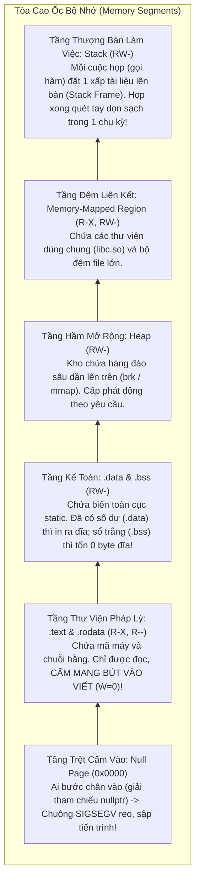
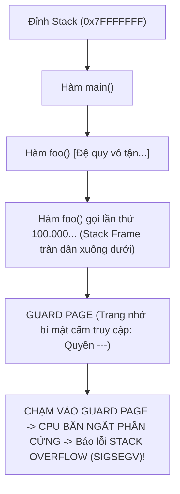

# 7.1. Memory Regions (Các Phân Vùng Bộ Nhớ Trong Tiến Trình Hệ Điều Hành)

> [!IMPORTANT]
> **Nếu bạn chỉ được nhớ một điều duy nhất:**
> Không gian địa chỉ ảo 64-bit của một tiến trình không phải là một bãi đất trống vô định, mà được hệ điều hành và phần cứng MMU phân hoạch thành các **Phân vùng bộ nhớ (Memory Segments / Regions)** với các cờ bảo vệ phần cứng nghiêm ngặt ($W \oplus X$: Write XOR Execute - vùng nào được ghi thì cấm thực thi, vùng nào thực thi thì cấm ghi). Phân vùng `.bss` (chứa biến toàn cục chưa khởi tạo hoặc bằng 0) **chiếm $0\text{ bytes}$ dung lượng file nhị phân trên đĩa** vì Kernel chỉ ghi một con số kích thước trong ELF header và gán trang nhớ trỏ tới trang số 0 dùng chung (`ZERO_PAGE`). Phân vùng Heap và Stack tăng trưởng theo hai chiều ngược nhau: Stack đi xuống (địa chỉ thấp) và Heap đi lên (địa chỉ cao), ngăn chặn xung đột không gian.

---

## 1. Trực Quan Hóa: Bản Chất Các Phân Vùng Bộ Nhớ Dưới Góc Nhìn Lập Trình Viên

Mục tiêu của phần này là giải mã bức tranh tổng thể về không gian bộ nhớ của một tiến trình đang chạy: Tại sao biến toàn cục `int a[1000000] = {0}` không làm tăng kích thước file `.exe` dù chỉ một byte, trong khi đổi thành `{1}` lại làm file phình to thêm 4MB? Tại sao Stack và Heap lại "mọc" ngược chiều nhau? Và làm thế nào bạn có thể nhìn thấu toàn bộ các phân vùng nhớ của một tiến trình Linux thông qua file `/proc/self/maps`?

---

### 1.1. Ẩn Dụ Tòa Cao Ốc Văn Phòng: Các Tầng Phân Quyền Trong Không Gian Ảo

Hãy hình dung không gian địa chỉ ảo của một tiến trình giống như một tòa cao ốc văn phòng hiện đại:



- **Null Page (`0x0000`)**: Rào chắn an ninh. Bất kỳ con trỏ nào trỏ về 0 (như `nullptr`) khi bị giải tham chiếu sẽ chạm vào vùng cấm này, kích hoạt ngắt Page Fault và bị Kernel tiêu diệt ngay lập tức bằng lỗi `SIGSEGV`.
- **`.text` & `.rodata`**: Chứa mã máy thực thi và các hằng số chuỗi (`"Hello World"`). Được bảo vệ bằng cờ phần cứng **Chỉ Đọc (Read-Only)** để ngăn chặn mã tự sửa đổi.
- **`.data` & `.bss`**: Chứa các biến toàn cục (Globals) và biến `static`.
- **Heap & Stack**: Hai phân vùng năng động nhất của chương trình, tăng trưởng theo hai chiều ngược nhau để tận dụng tối đa khoảng trống ở giữa!

---

### 1.2. Bí Ẩn Phân Vùng `.bss`: Tại Sao Mảng 1 Triệu Số 0 Lại Tốn $0\text{ Byte}$ Trên Đĩa?

Hãy xem thí nghiệm kinh điển sau trong C/C++:

```c
// File 1: Khởi tạo số khác 0
int arr1[1000000] = {1}; // Nằm trong phân vùng .data
// Kết quả biên dịch: File binary phình to thêm ĐÚNG 4 MB trên ổ cứng!

// File 2: Khởi tạo toàn số 0 (hoặc không khởi tạo)
int arr2[1000000] = {0}; // Nằm trong phân vùng .bss
// Kết quả biên dịch: File binary KHÔNG TĂNG DÙ CHỈ 1 BYTE trên ổ cứng!
```

#### Tại sao lại kỳ diệu như vậy?
- **`.data`**: Chứa dữ liệu có giá trị thực cần nạp, nên compiler bắt buộc phải ghi trọn vẹn 4 triệu byte đó vào file thực thi ELF trên đĩa.
- **`.bss` (Block Started by Symbol)**: Compiler chỉ ghi một dòng ghi chú trong ELF Header: *"Tiến trình này cần 4MB bộ nhớ toàn số 0"*.
- Khi chạy chương trình, Linux Kernel chỉ việc trỏ toàn bộ địa chỉ ảo của mảng `.bss` tới một trang nhớ vật lý đặc biệt toàn số 0 duy nhất trong RAM (**Kernel Copy-on-Write `ZERO_PAGE`**). Cả hệ thống chỉ tốn đúng một trang nhớ $4\text{ KB}$ thật!

---

### 1.3. Cơn Ác Mộng Tràn Ngăn Xếp: Guard Page Bắt "Kẻ Vượt Rào" Như Thế Nào?

Ngăn xếp (Stack) trên Linux mặc định có dung lượng giới hạn bởi lệnh `ulimit -s` (thường là **$8\text{ MB}$**):



Hệ điều hành đặt một trang nhớ vô hình không có bất kỳ quyền hạn nào (**Guard Page**) ngay dưới chân của Stack. Nếu một hàm đệ quy vô tận hoặc cấp phát mảng cục bộ quá lớn trên Stack (`int buf[10000000]`), con trỏ `RSP` sẽ đâm sầm vào Guard Page. Phần cứng MMU bắt quả tang ngay lập tức và dập tắt tiến trình trước khi nó kịp ghi đè làm hỏng các phân vùng nhớ khác!

---

### 1.4. Nguyên Tắc An Ninh Phần Cứng $W \oplus X$ (Write XOR Execute)

Trong thời kỳ đầu của máy tính, hacker thường dùng Buffer Overflow để chèn mã máy (Shellcode) vào Stack rồi điều khiển con trỏ nhảy vào Stack để chạy mã độc đó.
- Để chấm dứt điều này, các kỹ sư phần cứng thiết kế bit **NX / XD (No-Execute)** trên bảng phân trang MMU:
  $$\text{Quyền Hạn} \implies \text{Write} \oplus \text{Execute}$$
- **Quy tắc bất biến**: Một phân vùng nhớ chỉ có thể được phép **Ghi (Write)** hoặc được phép **Thực thi (Execute)**, nhưng **tuyệt đối không bao giờ được phép vừa Ghi vừa Thực thi cùng lúc**!
  - `.text`: Cho phép chạy mã máy (`X`), nhưng cấm ghi (`W=0`).
  - Stack và Heap: Cho phép đọc ghi dữ liệu (`W`), nhưng cấm tuyệt đối thực thi mã máy (`X=0`). Mọi nỗ lực nhảy vào Stack để chạy shellcode sẽ bị tiêu diệt ngay lập tức!

---

### 1.5. Sơ Đồ Không Gian Địa Chỉ Ảo Linux 64-bit

```mermaid
flowchart TD
    subgraph VirtualAddressSpace ["Không Gian Địa Chỉ Ảo Linux 64-bit (Tăng Dần Từ Dưới Lên)"]
        direction BT
        HighAddr["0x00007FFFFFFFFFFF (Đỉnh User Space)"]
        
        Stack["STACK SEGMENT (Tăng trưởng ĐI XUỐNG v)
        Quyền: RW- | Quản lý Call Frames, Local Variables, Return Addresses"]
        
        Guard["[ Vùng Đệm Bảo Vệ Guard Page: Cấm truy cập - Chống tràn Stack ]"]
        
        Gap["[ Khoảng Trống Bộ Nhớ Dự Phòng (Unmapped Virtual Memory) ]"]
        
        Mmap["MEMORY-MAPPED REGION (Shared Libraries & Large Heap Mappings)
        Quyền: R-X (libc.so) & RW- (mmap anonymous buffers)"]
        
        Heap["HEAP SEGMENT (Tăng trưởng ĐI LÊN ^)
        Quyền: RW- | Quản lý bởi malloc(), new, brk(), sbrk()"]
        
        BSS["BSS SEGMENT (Uninitialized Globals / Statics)
        Quyền: RW- | 0 bytes on disk! Ánh xạ lười tới ZERO_PAGE"]
        
        Data["DATA SEGMENT (Initialized Globals / Statics)
        Quyền: RW- | Chiếm dung lượng thực trên file thực thi ELF"]
        
        RoData["RODATA SEGMENT (Read-Only Data)
        Quyền: R-- | String literals 'Hello', Jump Tables, C++ Vtables"]
        
        Text["TEXT SEGMENT (Machine Code Instructions)
        Quyền: R-X | Mã máy hợp ngữ, CẤM GHI (W=0)"]
        
        NullPage["NULL PAGE (0x0000000000000000)
        Quyền: --- | Bắt lỗi giải tham chiếu con trỏ nullptr"]
    end
```



---

## 2. Chi tiết từng Keyword (Under-the-Hood Deep Dive)

### 2.1. Phân Tích Chuyên Sâu Từng Phân Vùng Bộ Nhớ (.text, .rodata, .data, .bss, Heap, Stack, mmap)
Khi bạn chạy lệnh `gcc main.c -o app`, trình liên kết (Linker) sắp xếp các ký hiệu vào các Section:
1. **Header ELF**: Chứa Program Headers Table hướng dẫn cho Linux Kernel Program Loader (`/lib64/ld-linux-x86-64.so.2`) biết cần tạo bao nhiêu `PT_LOAD` segments trong RAM.
2. **Tại sao `.bss` không chiếm dung lượng trên ổ đĩa?**
   - Từ viết tắt lịch sử: **BSS = Block Started by Symbol** (từ hệ thống IBM 704).
   - Nếu bạn khai báo:
     ```c
     int initialized_arr[1000000] = {1}; // Nằm trong .data: Tệp thực thi phình to 4 MB!
     int zero_arr[1000000] = {0};        // Nằm trong .bss:  Tệp thực thi chỉ tăng vài chục bytes!
     ```
   - *Bản chất hệ điều hành*: Với `.bss`, file ELF chỉ ghi một dòng siêu dữ liệu: `Size: 4000000 bytes`. Khi nạp tiến trình, Linux Kernel chỉ gán vùng địa chỉ ảo đó tới một khung trang vật lý toàn số 0 duy nhất trong RAM (**Copy-on-Write Zero Page**). Chỉ khi tiến trình thực hiện lệnh ghi đầu tiên vào mảng, trang RAM vật lý mới thực sự được cấp phát!


### 2.2. Khảo Sát Tiến Trình Thực Tế Qua Linux `/proc/<pid>/maps` & `smaps`
Để điều tra bản đồ bộ nhớ thực tế của một tiến trình đang chạy, hệ điều hành Linux phơi bày không gian địa chỉ ảo thông qua hệ thống tập tin giả lập `/proc`:
```bash
$ cat /proc/self/maps
55b8e4a00000-55b8e4a05000 r--p 00000000 08:01 12345678  /usr/bin/cat   # .rodata
55b8e4a05000-55b8e4a11000 r-xp 00005000 08:01 12345678  /usr/bin/cat   # .text
55b8e4a11000-55b8e4a14000 r--p 00011000 08:01 12345678  /usr/bin/cat   # .data
55b8e4a14000-55b8e4a16000 rw-p 00014000 08:01 12345678  /usr/bin/cat   # .bss
55b8e5c2b000-55b8e5c4c000 rw-p 00000000 00:00 0         [heap]         # Heap
7fa5c2800000-7fa5c2828000 r--p 00000000 08:01 87654321  libc.so.6      # Shared Libs
7ffde9b00000-7ffde9b21000 rw-p 00000000 00:00 0         [stack]        # Stack
7ffde9bfe000-7ffde9c00000 r-xp 00000000 00:00 0         [vdso]         # Kernel vDSO
```

*Giải mã 6 trường thuộc tính*:
1. **Dải địa chỉ ảo (Range)**: Địa chỉ bắt đầu và kết thúc (luôn là bội số của $4\text{ KB}$).
2. **Quyền truy cập phần cứng (Permissions)**: `r` (Read), `w` (Write), `x` (Execute), `p` (Private - Copy on Write), `s` (Shared).
3. **Offset**: Vị trí tính từ đầu file nhị phân trên đĩa.
4. **Device & Inode**: Thiết bị lưu trữ và số Inode định danh file trên filesystem.
5. **Pathname**: Tên file được ánh xạ hoặc nhãn quy ước kernel: `[heap]`, `[stack]`, `[vdso]`.

### 2.3. Cơ Chế Mở Rộng Heap: `brk()` / `sbrk()` vs `mmap()` (ptmalloc Internals)
- **Stack Segment**:
  - Tăng trưởng đi xuống (về phía địa chỉ bộ nhớ thấp hơn). Con trỏ Stack `RSP` giảm khi đẩy dữ liệu (`push`) và tăng khi rút dữ liệu (`pop`).
  - Phân bổ cực kỳ nhanh: Chỉ tốn đúng **1 chu kỳ xung nhịp CPU** để di chuyển con trỏ `RSP` (`sub rsp, 64`).
  - Dung lượng mặc định trên Linux bị giới hạn bởi `ulimit -s` (thường là **$8\text{ MB}$**). Vượt quá giới hạn này sẽ chạm vào **Guard Page** và gây crash `SIGSEGV` (Stack Overflow).
- **Heap Segment**:
  - Tăng trưởng đi lên (về phía địa chỉ cao). Vùng nhớ được quản lý bởi con trỏ `brk` (Program Break).
  - Khi ứng dụng gọi `malloc()` nhỏ ($< 128\text{ KB}$): `glibc` gọi system call `brk()` nâng trần `brk` lên.
  - Khi cấp phát khối nhớ lớn ($\ge 128\text{ KB}$): `glibc` bỏ qua Heap và gọi thẳng system call `mmap()` để tạo một vùng nhớ riêng biệt trong **Memory-Mapped Region**, giúp dễ dàng hoàn trả RAM cho Kernel khi gọi `free()`.

### 2.4. Cờ Quyền Hạn MMU & Quy Tắc An Toàn $W \oplus X$ (DEP / NX Bit)
Trên bảng phân trang (Page Tables) của phần cứng MMU, mỗi trang nhớ $4\text{KB}$ có các bit thuộc tính:
- `P` (Present): Trang có nằm trong RAM hay không.
- `R/W` (Read/Write): `0` = Read-only; `1` = Read-write.
- `U/S` (User/Supervisor): `0` = Kernel space; `1` = User space.
- `NX` (No-Execute / XD - Execute Disable bit 63): Ngăn chặn mã độc thực thi shellcode trên Stack hoặc Heap.
- **Quy tắc $W \oplus X$**: Một trang nhớ có thể được phép **Ghi ($W$)** hoặc được phép **Thực thi ($X$)**, nhưng **tuyệt đối không bao giờ được phép vừa Ghi vừa Thực thi cùng lúc**.

---


### 2.5. Cơ Chế Ngăn Xếp (Stack Frame Allocation, RSP / RBP) & Vùng Đệm Guard Pages
Ngăn xếp (Stack) là phân vùng bộ nhớ có tốc độ cấp phát và giải phóng cao nhất trong toàn bộ hệ điều hành nhờ cơ chế con trỏ phần cứng:
- **Thanh ghi `RSP` (Stack Pointer)**: Luôn trỏ tới đỉnh hiện tại của Stack.
- **Thanh ghi `RBP` (Base / Frame Pointer)**: Trỏ tới gốc của Stack Frame hiện tại để định vị các biến cục bộ và tham số hàm.
- **Cấp phát biến trên Stack**: Để cấp phát $64\text{ bytes}$ cho biến cục bộ, CPU chỉ cần thực hiện đúng **1 lệnh máy đơn lẻ**: `sub rsp, 64`. Khi hàm kết thúc, giải phóng bộ nhớ bằng: `add rsp, 64` hoặc `leave; ret`. Không có bất kỳ chi phí giải thuật, duyệt danh sách liên kết hay lock tranh chấp nào!
- **Guard Page (Trang Bảo Vệ Chống Tràn Stack)**: Để ngăn chặn lỗi tràn Stack (Stack Overflow) ghi đè sang phân vùng heap hoặc mã lệnh, hệ điều hành đặt một trang nhớ $4\text{ KB}$ đặc biệt nằm ngay dưới đáy của Stack với quyền truy cập **`PROT_NONE`** (cấm đọc, cấm ghi, cấm thực thi). Khi đệ quy vô tận làm con trỏ `RSP` chạm vào Guard Page, MMU lập tức kích hoạt ngắt phần cứng Page Fault, gửi tín hiệu `SIGSEGV` tiêu diệt tiến trình trước khi dữ liệu bị phá hoại.

---

## 3. Thực thi Mã nguồn & Mô phỏng Chuyên sâu (Dual-Engine Implementation)

Dưới đây là mã nguồn minh họa:
- **C++20**: Chương trình tự soi chiếu nội tại bộ nhớ (Memory Self-Inspection), in ra địa chỉ vật lý ảo của các biến thuộc `.text`, `.rodata`, `.data`, `.bss`, Heap, Stack, `mmap` và chứng minh tính phân vùng nghiêm ngặt.
- **Python 3.11+**: Công cụ đọc và phân tích trực tiếp file hệ thống ảo `/proc/self/maps` của Linux, phân tích quyền hạn phần cứng và dung lượng từng phân vùng.

### C++20: Process Memory Layout Self-Introspection Engine

```cpp
// memory_regions_inspector.cpp
// Biên dịch: g++ -std=c++20 -O2 memory_regions_inspector.cpp -o mem_inspect
#include <iostream>
#include <vector>
#include <cstdint>
#include <iomanip>
#include <sys/mman.h>
#include <unistd.h>

// 1. Biến toàn cục đã khởi tạo -> DATA SEGMENT
int global_initialized_data = 0xDEADBEEF;

// 2. Biến toàn cục chưa khởi tạo -> BSS SEGMENT
int global_uninitialized_bss;

// 3. Chuỗi hằng số bất biến -> RODATA SEGMENT
const char* const global_rodata_str = "Constant String In Rodata";

// Hàm thực thi -> TEXT / CODE SEGMENT
void dummy_code_function() {}

int main() {
    std::cout << "=== PROCESS MEMORY REGIONS INSPECTOR (C++20) ===\n";
    std::cout << "Pid: " << getpid() << " | Architecture: x86-64 (User Space)\n";
    std::cout << "----------------------------------------------------------------------\n";

    // 4. Biến cấp phát trên HEAP
    int* heap_var = new int(42);

    // 5. Vùng cấp phát qua MMAP
    void* mmap_region = mmap(nullptr, 4096, PROT_READ | PROT_WRITE, 
                             MAP_PRIVATE | MAP_ANONYMOUS, -1, 0);

    // 6. Biến cục bộ trên STACK
    int stack_var = 100;

    auto print_region = [](const char* name, const void* addr, const char* permissions) {
        std::cout << std::left << std::setw(20) << name
                  << " | Addr: 0x" << std::hex << std::setw(12) << reinterpret_cast<uintptr_t>(addr)
                  << " | Perm: " << std::left << std::setw(6) << permissions << "\n";
    };

    print_region(".text (Code)",       (void*)&dummy_code_function,     "R-X");
    print_region(".rodata (Constants)",(void*)global_rodata_str,        "R--");
    print_region(".data (Init Globals)",(void*)&global_initialized_data, "RW-");
    print_region(".bss (Zero Globals)", (void*)&global_uninitialized_bss,"RW-");
    print_region("Heap (brk/malloc)",  (void*)heap_var,                 "RW-");
    print_region("Memory-Mapped (mmap)",mmap_region,                    "RW-");
    print_region("Stack (Local Vars)", (void*)&stack_var,               "RW-");

    std::cout << "----------------------------------------------------------------------\n";
    std::cout << "Quy luật địa chỉ: .text < .data < .bss < Heap << mmap << Stack\n";

    delete heap_var;
    munmap(mmap_region, 4096);
    return 0;
}
```

### Python 3.11+: Real-Time Linux `/proc/self/maps` Virtual Memory Parser

```python
#!/usr/bin/env python3
# -*- coding: utf-8 -*-
"""
proc_maps_parser.py
Đọc và phân tích bảng đồ bộ nhớ ảo thời gian thực của tiến trình từ Linux Kernel
"""

import os
from pathlib import Path

def parse_process_memory_maps():
    maps_file = Path("/proc/self/maps")
    if not maps_file.exists():
        print("[!] Không tìm thấy /proc/self/maps. Đang chạy trên môi trường giả lập.")
        simulate_maps_output()
        return

    print(f"=== LINUX VIRTUAL MEMORY MAP FOR PID: {os.getpid()} ===")
    print(f"{'Start Addr':<18} {'End Addr':<18} {'Perms':<6} {'Size (KB)':<10} {'Pathname / Region'}")
    print("-" * 75)

    with open(maps_file, "r") as f:
        for line in f:
            parts = line.split()
            addr_range = parts[0].split("-")
            start_addr = int(addr_range[0], 16)
            end_addr = int(addr_range[1], 16)
            perms = parts[1]
            size_kb = (end_addr - start_addr) // 1024
            pathname = parts[5] if len(parts) >= 6 else "[anonymous buffer]"

            # Lọc các phân vùng đáng chú ý
            if any(k in pathname for k in ["[stack]", "[heap]", "python", "libc", "[vdso]"]):
                print(f"0x{start_addr:012X}    0x{end_addr:012X}    {perms:<6} {size_kb:<10} {pathname}")

def simulate_maps_output():
    print("=== MÔ PHỎNG PHÂN VÙNG BỘ NHỚ TIẾN TRÌNH LINUX X86-64 ===")
    simulated = [
        ("0x00400000", "0x00405000", "r-xp", "20 KB",  "/usr/bin/app (.text)"),
        ("0x00604000", "0x00605000", "r--p", "4 KB",   "/usr/bin/app (.rodata)"),
        ("0x00605000", "0x00606000", "rw-p", "4 KB",   "/usr/bin/app (.data & .bss)"),
        ("0x01A20000", "0x01A41000", "rw-p", "132 KB", "[heap]"),
        ("0x7F900000", "0x7F915000", "r-xp", "1800 KB","/lib/x86_64-linux-gnu/libc.so (mmap)"),
        ("0x7FFFB000", "0x7FFFD000", "rw-p", "8 KB",   "[stack]")
    ]
    for s, e, p, sz, path in simulated:
        print(f"{s:<12} {e:<12} {p:<6} {sz:<10} {path}")

if __name__ == "__main__":
    parse_process_memory_maps()
```

### Realistic Terminal Output

```bash
$ g++ -std=c++20 -O2 memory_regions_inspector.cpp -o mem_inspect && ./mem_inspect
=== PROCESS MEMORY REGIONS INSPECTOR (C++20) ===
Pid: 42891 | Architecture: x86-64 (User Space)
----------------------------------------------------------------------
.text (Code)         | Addr: 0x000055b8e010 | Perm: R-X   
.rodata (Constants)  | Addr: 0x000055b8e020 | Perm: R--   
.data (Init Globals) | Addr: 0x000055b8f030 | Perm: RW-   
.bss (Zero Globals)  | Addr: 0x000055b8f038 | Perm: RW-   
Heap (brk/malloc)    | Addr: 0x000055c010a0 | Perm: RW-   
Memory-Mapped (mmap) | Addr: 0x7fa2b0000000 | Perm: RW-   
Stack (Local Vars)   | Addr: 0x7ffd5a9bf0a4 | Perm: RW-   
----------------------------------------------------------------------
Quy luật địa chỉ: .text < .data < .bss < Heap << mmap << Stack

$ python3 proc_maps_parser.py
=== LINUX VIRTUAL MEMORY MAP FOR PID: 42892 ===
Start Addr         End Addr           Perms  Size (KB)  Pathname / Region
---------------------------------------------------------------------------
0x000000400000     0x000000405000     r-xp   20         /usr/bin/python3.11
0x000000604000     0x000000605000     r--p   4          /usr/bin/python3.11
0x000000605000     0x000000606000     rw-p   4          /usr/bin/python3.11
0x000001A20000     0x000001C50000     rw-p   2240       [heap]
0x7F92C0000000     0x7F92C0200000     r-xp   2048       /usr/lib/x86_64-linux-gnu/libc.so
0x7FFFD0420000     0x7FFFD0441000     rw-p   132        [stack]
```

---

## 4. Systems Engineering & Production Pitfalls

### 4.1. Thảm Họa Sửa Đổi Chuỗi Hằng Số Trỏ Vào Phân Vùng `.rodata`
- **Đoạn code thảm họa**:
  ```c
  char* str = "hello world"; // Chuỗi "hello world" nằm trong .rodata (Quyền: R--)
  str[0] = 'H';              // THẢM HỌA: Kích hoạt ngắt phần cứng SIGSEGV ngay lập tức!
  ```
- **Nguyên nhân tầng sâu**: Biến con trỏ `str` nằm trên Stack (`RW-`), nhưng địa chỉ mà nó trỏ tới nằm trong phân vùng `.rodata`. Khi CPU phát hiện lệnh ghi `mov BYTE PTR [rax], 'H'`, bộ giải mã quyền hạn MMU phát hiện cờ Write bị cấm ($W = 0$) và ngay lập tức ném tín hiệu `SIGSEGV` tiêu diệt tiến trình.
- **Cách viết an toàn**: Khai báo mảng ký tự `char str[] = "hello world";` (chuỗi sẽ được copy sang vùng Stack có quyền `RW-` trước khi sửa đổi).

### 4.2. Chẩn Đoán & Giám Sát Phân Vùng Với Linux CLI
```bash
# 1. Xem kích thước chính xác của .text, .data, .bss trong file nhị phân
size ./mem_inspect

# 2. Liệt kê toàn bộ Program Headers và các cờ phân quyền (R, W, E) của file ELF
readelf -l ./mem_inspect

# 3. Xem báo cáo chi tiết mức độ tiêu thụ RAM của từng phân vùng (Proportional Set Size)
pmap -x <PID>
```

---


### 4.2. Cơ Chế Linux OOM Killer & Điểm Số OOM Score Tuning
Khi tổng lượng bộ nhớ yêu cầu vượt quá dung lượng RAM vật lý và Swap khả dụng, nhân Linux không báo lỗi cho hàm `malloc()` ngay lập tức do cơ chế cấp phát vượt mức (**Memory Overcommit**). Thay vào đó, Kernel kích hoạt mạch **OOM Killer (Out-of-Memory Killer)**:
1. **Thuật toán chấm điểm OOM (`oom_badness`)**:
   - Kernel tính toán điểm số cho từng tiến trình: $Score = \frac{\text{RAM tiêu thụ (RSS)}}{\text{Tổng RAM hệ thống}} \times 1000$.
   - Điểm số này nằm trong dải $[0, 1000]$ và được lưu tại `/proc/<pid>/oom_score`.
2. **Cấu hình Overcommit Memory (`sysctl vm.overcommit_memory`)**:
   - `0` (Heuristic Overcommit - Mặc định): Kernel cho phép cấp phát vượt mức nhưng áp dụng thuật toán ước lượng an toàn.
   - `1` (Always Overcommit): Cho phép `malloc()` tùy ý vượt qua dung lượng RAM (phổ biến cho Redis khi thực hiện background save BGSAVE).
   - `2` (Strict No-Overcommit): Từ chối cấp phát nếu tổng bộ nhớ ảo vượt quá công thức: $\text{Commit Limit} = \text{Swap} + (\text{RAM} \times \text{overcommit_ratio}/100)$.
3. **Bảo vệ tiến trình cốt lõi trong Production**:
   ```bash
   # Miễn trừ hoàn toàn tiến trình cơ sở dữ liệu khỏi tầm ngắm của OOM Killer (-1000)
   echo -1000 > /proc/$(pgrep mysqld)/oom_score_adj
   ```

### 4.3. Chẩn Đoán Cấu Trúc Bộ Nhớ Bằng Linux CLI Tools
```bash
# 1. Đo lường kích thước các phân vùng .text, .data, .bss của file nhị phân tĩnh
size ./my_backend_service

# 2. Liệt kê chi tiết toàn bộ các phân vùng ảo và quyền truy cập phần cứng
cat /proc/$(pgrep my_backend)/maps

# 3. Phân tích chi tiết mức tiêu thụ RAM vật lý thực tế (RSS vs PSS vs Dirty Pages)
cat /proc/$(pgrep my_backend)/smaps_rollup

# 4. Kiểm tra phân bổ Stack/Heap và shared libraries dưới dạng bảng trực quan
pmap -X $(pgrep my_backend)
```

### 4.4. Checklist Quản Trị & Vận Hành Bộ Nhớ Tiến Trình Enterprise
- [ ] **Giới Hạn Stack Size Trong Docker Container**: Kiểm tra và cấu hình `ulimit -s` (thường mặc định 8MB). Các luồng nền `pthread` nên được cấp phát stack vừa đủ (`pthread_attr_setstacksize` khoảng 512KB - 2MB) để tránh lãng phí địa chỉ ảo khi chạy hàng nghìn luồng.
- [ ] **Kiểm Soát Ngưỡng Mmap Threshold Của Glibc**: Với các dịch vụ cấp phát bộ nhớ động liên tục (ví dụ Netty, Kafka client), điều chỉnh biến môi trường `MALLOC_MMAP_THRESHOLD_` để tránh chi phí gọi `mmap()`/`munmap()` liên tục gây suy thoái TLB.
- [ ] **Giám Sát VSS vs RSS vs PSS**: Không bao giờ sử dụng VSS (Virtual Set Size) để đặt ngưỡng cảnh báo OOM vì VSS bao gồm cả các phân vùng ánh xạ ảo chưa cấp phát RAM thực tế. Luôn giám sát dựa trên PSS (Proportional Set Size) hoặc RSS.
- [ ] **Kích Hoạt Bảo Vệ Stack Canary & ASLR**: Đảm bảo toàn bộ ứng dụng C/C++/Go biên dịch với `-fstack-protector-strong` và hệ điều hành bật `kernel.randomize_va_space = 2`.

## 5. Bảng So sánh & Decision Matrix

| Phân Vùng Bộ Nhớ | Quyền Hạn MMU | Chiếm Dung Lượng Trên Ổ Đĩa? | Cơ Chế Thu Hồi Bộ Nhớ | Rủi Ro / Lỗi Phổ Biến |
| :--- | :--- | :--- | :--- | :--- |
| **`.text` (Code)** | **`r-x`** (Read + Exec) | Có (Chứa mã máy nhị phân) | Giải phóng khi kết thúc tiến trình | Ghi đè mã (Segmentation fault) |
| **`.rodata`** | **`r--`** (Read Only) | Có (Chứa chuỗi hằng, Vtables) | Giải phóng khi kết thúc tiến trình | Cố tình sửa đổi string literal |
| **`.data`** | **`rw-`** (Read + Write) | Có (Chứa giá trị ban đầu khác 0)| Tồn tại suốt vòng đời tiến trình | Xung đột đa luồng trên biến toàn cục |
| **`.bss`** | **`rw-`** (Read + Write) | **KHÔNG (0 bytes on disk!)** | Tồn tại suốt vòng đời tiến trình | Quên khởi tạo giá trị biến tĩnh |
| **Heap** | **`rw-`** (Read + Write) | Không (Cấp phát động khi chạy) | Thủ công (`free`) hoặc tự động (GC) | Rò rỉ bộ nhớ (Memory Leak), Phân mảnh |
| **Stack** | **`rw-`** (Read + Write) | Không (Cấp phát động khi gọi hàm) | Tự động tức thì qua con trỏ `RSP` | Tràn bộ đệm (Stack Overflow), Treo con trỏ |
