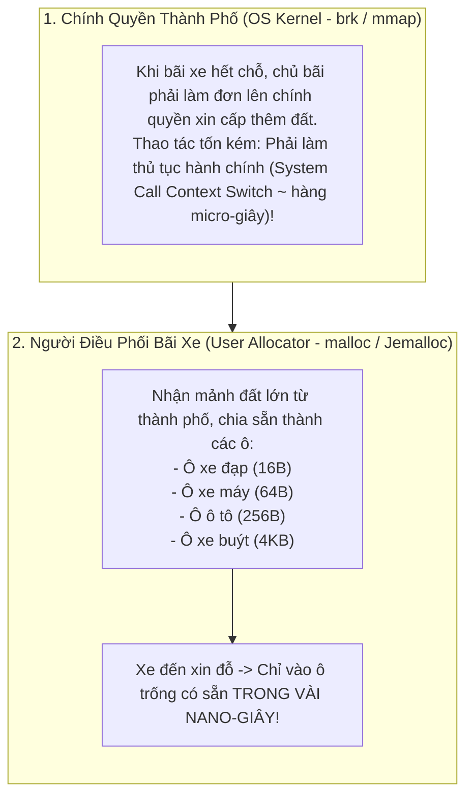
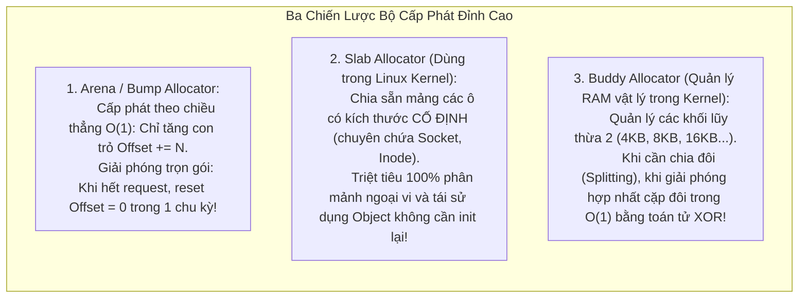
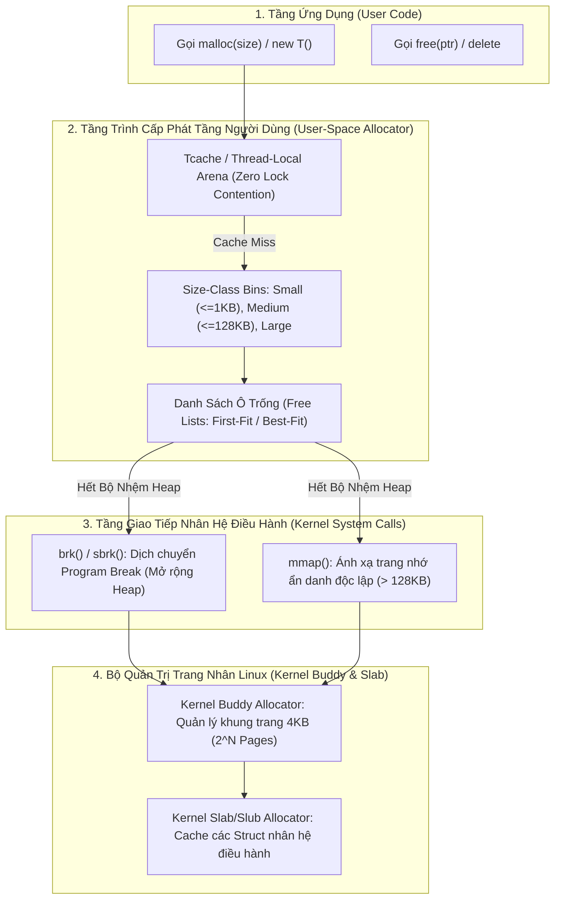

# 7.3. Heap Memory & Allocators (Bộ Nhớ Heap: Bộ Cấp Phát, Phân Mảnh & Các Chiến Lược Arena, Slab, Buddy)

> [!IMPORTANT]
> **Nếu bạn chỉ được nhớ một điều duy nhất:** Bộ nhớ Heap không phải là một bể chứa RAM tự do vô hạn mà là một vùng không gian địa chỉ ảo được quản trị bởi hai tầng: Tầng Kernel cấp phát trang thô qua system calls (`brk`/`mmap`) và Tầng User-Space Allocator (Glibc Ptmalloc, Jemalloc, TCMalloc) xẻ nhỏ các khối nhớ đó cho ứng dụng. Phân mảnh ngoại vi (External Fragmentation) là sát thủ vô hình khiến hệ thống cạn kiệt bộ nhớ dù tổng RAM trống vẫn còn rất nhiều. Trong các hệ thống backend đa luồng hiệu năng cao, việc chuyển đổi từ `ptmalloc` sang **Jemalloc** hoặc thiết kế bộ cấp phát chuyên dụng (**Arena / Slab Allocator**) là giải pháp sống còn để triệt tiêu tranh chấp khóa đa luồng (Lock Contention) và tăng thông lượng ghi dữ liệu lên gấp bội.

---

## 1. Trực Quan Hóa: Bản Chất Bộ Nhớ Heap & Bộ Cấp Phát Dưới Góc Nhìn Lập Trình Viên

Mục tiêu của phần này là giải mã bộ não điều phối bộ nhớ của máy tính: Tại sao `malloc()` không cấp phát RAM trực tiếp mà phải thông qua hai tầng kiến trúc? Tại sao server của bạn còn tới 5GB RAM trống nhưng ứng dụng vẫn sập vì lỗi Out Of Memory? Làm thế nào bộ cấp phát Arena có thể giải phóng hàng triệu đối tượng trong đúng 1 chu kỳ xung nhịp? Và tại sao các gã khổng lồ công nghệ như Facebook, Redis, Netty đều thay thế bộ cấp phát mặc định bằng **Jemalloc**?

---

### 1.1. Ẩn Dụ Bãi Đỗ Xe Đô Thị: Chính Quyền Cấp Đất & Người Chia Lô Thông Minh

Hãy hình dung cơ chế cấp phát bộ nhớ Heap qua bài toán quy hoạch bãi đỗ xe:



- **Tầng Kernel (`brk` / `mmap`)**: Cấp phát các trang bộ nhớ thô ($4\text{ KB}$ trở lên) cho tiến trình. Mỗi lần gọi system call đều làm tốn hàng trăm chu kỳ CPU để chuyển đổi ngữ cảnh.
- **Tầng User Allocator (`malloc` / `free`)**: Xẻ nhỏ các trang nhớ thô thành hàng triệu khối nhớ nhỏ ($16\text{B}, 32\text{B}, 64\text{B}$) để phục vụ code nghiệp vụ mà không cần làm phiền tới Kernel.

---

### 1.2. Phân Mảnh Ngoại Vi: Tại Sao Còn 5GB RAM Nhưng Vẫn Crash "Out Of Memory"?

Một trong những thảm họa lớn nhất trên các server chạy lâu ngày:

```
Giả sử RAM còn trống 5.000 MB (5 GB), nhưng nằm rải rác:
[Ô trống 1MB] [Vật bận] [Ô trống 2MB] [Vật bận] [Ô trống 500KB] ...
Tất cả các khoảng trống bị xé vụn như tổ ong!

Lập trình viên gọi:
std::vector<int> big_buffer;
big_buffer.resize(50 * 1024 * 1024); // Cần 200 MB BỘ NHỚ LIÊN TỤC!

HẬU QUẢ: Dù tổng RAM thừa 5GB, không có bất kỳ một khoảng trống liên tục nào đủ 200MB!
Hệ điều hành buộc phải dập tắt tiến trình: OUT OF MEMORY (OOM KILLED)!
```

---

### 1.3. Ba Chiến Lược Cấp Phát Chuyên Dụng Của Kỹ Sư Cấp Cao



---

### 1.4. Tối Ưu Backend Đa Luồng: Tại Sao Production Chọn `jemalloc`?

Trong bộ cấp phát mặc định `ptmalloc` của Glibc, khi hàng trăm luồng cùng gọi `malloc()` và `free()`, chúng phải tranh chấp nhau một số lượng hạn chế các khóa bảo vệ (**Arena Lock Contention**).
- **Giải pháp của Jemalloc & TCMalloc**: Cung cấp bộ nhớ đệm riêng biệt cho từng luồng (**Thread-Local Cache - Tcache**).
- Mỗi luồng có một ngăn tủ riêng chứa hàng nghìn ô nhớ nhỏ. Luồng thoải mái lấy và trả ô nhớ trong ngăn tủ của mình mà **hoàn toàn không cần tranh chấp khóa (Zero Lock)**!
- Kết quả: Đổi sang `jemalloc` trên các server Redis, MySQL, Java Netty thường giúp tăng thông lượng từ **$20\% - 40\%$** và triệt tiêu hoàn toàn độ trễ Tail Latency p99!

---

### 1.5. Sơ Đồ Khối Kiến Trúc Phân Tầng Cấp Phát Bộ Nhớ Heap



---

## 2. Chi tiết từng Keyword (Under-the-Hood Deep Dive)

### 2.1. Cơ Chế Heap Allocator: `brk`/`sbrk` vs `mmap`, Chunk Metadata & Tcache Trong Glibc Ptmalloc
Trình cấp phát mặc định của Linux Glibc (`ptmalloc3`) chia các yêu cầu cấp phát thành hai nhánh chính:
1. **Khối nhớ nhỏ và trung bình ($\le 128\text{ KB}$ mặc định)**:
   - Sử dụng system call **`brk()` / `sbrk()`** để nâng cao ranh giới kết thúc của tiến trình (**Program Break**).
   - Vùng nhớ Heap phát triển liên tục từ địa chỉ thấp lên địa chỉ cao.
   - *Ưu điểm*: Tốc độ cao, Kernel gom các yêu cầu nhỏ thành các trang $4\text{ KB}$.
2. **Khối nhớ lớn ($> 128\text{ KB}$ - Ngưỡng `MMAP_THRESHOLD`)**:
   - Sử dụng system call **`mmap()`** để tạo một vùng nhớ ảo ẩn danh riêng biệt (`MAP_ANONYMOUS | MAP_PRIVATE`).
   - Khi `free()`, vùng nhớ này được trả lại ngay lập tức cho hệ điều hành thông qua `munmap()`.
3. **Cấu trúc Tiêu đề Khối Nhớ (Chunk Header Metadata trong ptmalloc)**:
   Mọi con trỏ trả về từ `malloc` đều có một Header $8$ hoặc $16\text{ Bytes}$ nằm ngay phía trước:
   - `Size of chunk`: Tổng kích thước của khối nhớ hiện tại (đã gồm header và căn chỉnh).
   - `A (NON_MAIN_ARENA)`: Cờ báo hiệu khối này thuộc Main Arena hay Thread Arena phụ.
   - `M (IS_MMAPPED)`: Cờ báo hiệu khối này được cấp phát bằng `mmap`.
   - `P (PREV_INUSE)`: `1` nếu khối liền trước đang bận; `0` nếu khối liền trước đang trống (để phục vụ thuật toán hợp nhất nhanh Coalescing).
4. **Cơ chế Tcache (Thread-Local Cache - Glibc 2.26+)**:
   - Mỗi luồng sở hữu một mảng Tcache riêng biệt chứa tối đa 64 danh sách liên kết đơn cho các khối nhớ nhỏ ($\le 1032\text{ Bytes}$).
   - Khi cấp phát/giải phóng khối nhỏ, luồng lấy trực tiếp từ Tcache của mình mà **hoàn toàn không cần lấy bất kỳ ổ khóa Mutex nào**, triệt tiêu tắc nghẽn đa luồng.

### 2.2. Tử Huyệt Phân Mảnh Bộ Nhớ: Phân Mảnh Nội Vi (Internal) vs Phân Mảnh Ngoại Vi (External)
1. **Phân Mảnh Nội Vi (Internal Fragmentation)**:
   - Xuất hiện khi bộ nhớ thực tế được cấp phát lớn hơn dung lượng mà ứng dụng yêu cầu.
   - *Nguyên nhân*: Do quy tắc căn chỉnh tự nhiên ($8\text{B}$ hoặc $16\text{B}$ alignment) hoặc do Allocator chia ngăn kích thước theo lũy thừa của 2 hoặc các nấc cố định (Size Classes).
   - *Ví dụ*: Ứng dụng xin $33\text{ Bytes}$, Allocator phân bổ một khối nhớ $48\text{ Bytes}$. Khoảng trống $15\text{ Bytes}$ bên trong khối bị bỏ phí vĩnh viễn.
2. **Phân Mảnh Ngoại Vi (External Fragmentation - Kẻ Hủy Diệt Máy Chủ)**:
   - Xuất hiện khi tổng dung lượng bộ nhớ trống trong RAM còn rất lớn, nhưng chúng bị xé vụn thành hàng nghìn "lỗ hổng" nhỏ nằm rải rác giữa các khối đang được sử dụng.
   - Khi ứng dụng yêu cầu một khối nhớ liên tục lớn (như mở rộng mảng `vector.resize(100MB)`), không có bất kỳ một lỗ hổng nào đủ lớn để chứa vừa.
   - Allocator buộc phải xin Kernel mở rộng thêm không gian địa chỉ ảo, làm kích thước thường trú trong RAM (**RSS - Resident Set Size**) tăng vọt không ngừng cho đến khi bị hệ điều hành tiêu diệt bởi **Linux OOM Killer**.

### 2.3. Arena / Bump Allocator: Cấp Phát Tuần Tự $O(1)$ & Giải Phóng Trọn Gói Theo Vòng Đời
- **Nguyên lý hoạt động**:
  - Cấp phát trước một khối bộ nhớ đệm khổng lồ liên tục (ví dụ $10\text{ MB}$ hoặc $100\text{ MB}$).
  - Duy trì duy nhất một con trỏ dịch chuyển (**Bump Pointer / Offset**).
  - Khi có yêu cầu cấp phát $N$ bytes: Trả về vị trí hiện tại của con trỏ và tăng con trỏ lên $N$ bytes:
    $$\text{Alloc}(N): \quad \text{Result} = \text{Ptr}; \quad \text{Ptr} += N; \quad \text{return Result;}$$
  - Thao tác cấp phát đạt tốc độ $O(1)$ tuyệt đối (tương đương tốc độ của Stack Allocation).
- **Chiến lược Giải phóng Trọn gói (Bulk Deallocation / Reset)**:
  - Bump Allocator **không hỗ trợ hàm `free()` cho từng đối tượng đơn lẻ**.
  - Thay vào đó, khi vòng đời của một tác vụ kết thúc (ví dụ: xử lý xong một HTTP Request hoặc render xong một khung hình game 60 FPS), toàn bộ Arena được giải phóng trong $O(1)$ chỉ bằng việc đưa con trỏ về vị trí xuất phát: `Ptr = Base;`!
  - Triệt tiêu $100\%$ hiện tượng phân mảnh bộ nhớ và giải phóng lập trình viên khỏi gánh nặng quản lý con trỏ.

### 2.4. Slab Allocator: Cố Định Kích Thước Đối Tượng & Quản Trị Bộ Nhớ Trong Nhân Linux
- **Vấn đề giải quyết**: Trong Kernel hệ điều hành hoặc hệ thống file, một số cấu trúc dữ liệu được cấp phát và giải phóng hàng triệu lần liên tục với kích thước hoàn toàn bất biến (ví dụ: `struct inode`, `struct dentry`, `mm_struct`, Socket Buffers `sk_buff`).
- **Kiến trúc Slab**:
  - Khởi tạo một bộ nhớ đệm chuyên biệt (**Kmem Cache**) chứa các trang nhớ liên tục gọi là **Slab**.
  - Mỗi Slab được chia thành một mạng lưới các ô nhớ có **kích thước cố định chính xác bằng kích thước của Struct mục tiêu**.
  - Duy trì 3 danh sách liên kết:
    - `slabs_full`: Các Slab đã được dùng hết ô nhớ.
    - `slabs_partial`: Các Slab còn một số ô trống.
    - `slabs_empty`: Các Slab hoàn toàn trống (có thể trả lại cho Buddy Allocator khi thiếu RAM).
- **Lợi ích tối thượng**:
  1. Không có phân mảnh ngoại vi (vì mọi ô nhớ đều có cùng kích thước).
  2. Tái sử dụng đối tượng (Object Constructor Cache): Dữ liệu khởi tạo của struct được giữ nguyên, không cần khởi tạo lại từ đầu mỗi khi cấp phát.

### 2.5. Buddy Allocator: Phân Rã Lũy Thừa 2 & Hợp Nhất Buddy Cặp Đôi Trong Linux Page Allocator
- **Vai trò**: Là bộ cấp phát tầng thấp nhất trong Linux Kernel, chịu trách nhiệm quản lý toàn bộ các trang RAM vật lý $4\text{ KB}$.
- **Nguyên lý phân rã (Binary Splitting)**:
  - Quản lý bộ nhớ theo các khối có kích thước là lũy thừa của 2: $2^0, 2^1, 2^2, \dots, 2^{10}$ trang ($4\text{ KB}$ đến $4\text{ MB}$).
  - Khi cần cấp phát một khối kích thước $S$: Nó tìm bậc nhỏ nhất thỏa mãn $2^k \ge S$. Nếu danh sách bậc $k$ không có khối trống, nó lấy một khối ở bậc $k+1$ và **chẻ đôi thành 2 khối nhỏ bằng nhau gọi là Cặp Đôi (Buddies)**.
- **Nguyên lý hợp nhất cặp đôi trong $O(1)$ (Buddy Coalescing)**:
  - Khi một khối kích thước $2^k$ được giải phóng, Kernel có thể tìm ngay lập tức địa chỉ của người anh em "Buddy" của nó bằng một phép toán bitwise XOR cực nhanh:
    $$\text{Buddy Address} = \text{Block Address} \oplus (2^k \times \text{Page Size})$$
  - Nếu người anh em Buddy cũng đang trống, Kernel lập tức gộp hai khối lại thành một khối lớn $2^{k+1}$. Quá trình này đệ quy lên các tầng cao hơn, giúp chống phân mảnh ngoại vi cực kỳ hiệu quả.

### 2.6. Thread-Caching Allocators: Triệt Tiêu Tranh Chấp Khóa Bằng Jemalloc & TCMalloc
- **Vấn đề của Allocator truyền thống trên máy chủ đa nhân**:
  - Glibc `ptmalloc` cổ điển sử dụng một số lượng Arena hữu hạn bảo vệ bởi Mutex. Khi hàng trăm luồng công nhân (Worker Threads) đồng thời gọi `malloc()` và `free()`, các luồng liên tục phải xếp hàng chờ khóa Mutex (Lock Contention), khiến CPU bị nghẽn ở Kernel Spinlock.
- **Giải pháp của TCMalloc (Google Thread-Caching Malloc) & Jemalloc (Jason Evans)**:
  1. **Thread-Local Caches (Tcache)**: Mỗi luồng được cấp một kho đệm riêng trên RAM. Hơn $95\%$ các thao tác cấp phát khối nhỏ được hoàn tất trong kho đệm riêng mà không cần Mutex.
  2. **Fine-Grained Size Classes**: Chia kích thước thành hàng trăm nấc cực kỳ chi tiết (ví dụ: 8, 16, 32, 48, 64, 80, 96, 112, 128 bytes...), giảm thiểu phân mảnh nội vi xuống dưới $10\%$.
  3. **Tách biệt Read/Write Path**: Phân tách luồng giải phóng bộ nhớ giữa các Thread Arena thông qua con trỏ nạp nguyên tử Lock-free.

---

## 3. Thực thi Mã nguồn & Mô phỏng Chuyên sâu (Dual-Engine Implementation)

### 3.1. C++20 High-Speed Arena Allocator & Benchmark So Sánh Với Malloc/Free

Chương trình C++20 cài đặt một bộ cấp phát Arena (Bump Allocator) an toàn căn chỉnh địa chỉ, và thực hiện benchmark so sánh trực tiếp tốc độ với `malloc`/`free` tiêu chuẩn:

```cpp
// Biên dịch: g++ -std=c++20 -O3 -Wall -Wextra arena_allocator_lab.cpp -o arena_lab
#include <iostream>
#include <cstdint>
#include <cstddef>
#include <vector>
#include <chrono>
#include <format>
#include <new>

// Bộ cấp phát bộ nhớ Arena (Bump Allocator) cực hạn
class HighSpeedArena {
private:
    uint8_t* memory_buffer_ = nullptr;
    size_t   capacity_ = 0;
    size_t   current_offset_ = 0;

public:
    explicit HighSpeedArena(size_t capacity) 
        : capacity_(capacity), current_offset_(0) {
        memory_buffer_ = static_cast<uint8_t*>(std::malloc(capacity_));
        if (!memory_buffer_) throw std::bad_alloc();
    }

    ~HighSpeedArena() {
        if (memory_buffer_) {
            std::free(memory_buffer_);
            memory_buffer_ = nullptr;
        }
    }

    // Cấp phát bộ nhớ tuần tự O(1) có tính toán căn chỉnh tự nhiên
    void* allocate(size_t bytes, size_t alignment = 8) {
        uintptr_t current_addr = reinterpret_cast<uintptr_t>(memory_buffer_ + current_offset_);
        // Tính toán số byte padding cần chèn để chia hết cho alignment
        size_t padding = (alignment - (current_addr % alignment)) % alignment;

        if (current_offset_ + padding + bytes > capacity_) {
            throw std::bad_alloc(); // Tràn dung lượng Arena
        }

        current_offset_ += padding;
        void* result_ptr = memory_buffer_ + current_offset_;
        current_offset_ += bytes;
        return result_ptr;
    }

    // Thu hồi toàn bộ 100% bộ nhớ trong đúng 1 lệnh O(1)
    void reset() noexcept {
        current_offset_ = 0;
    }

    size_t bytes_allocated() const noexcept { return current_offset_; }
    size_t capacity() const noexcept { return capacity_; }
};

struct OrderTransaction {
    uint64_t transaction_id;
    double   price;
    uint32_t quantity;
    char     symbol[12];
};

int main() {
    std::cout << "=========================================================\n";
    std::cout << "  C++20 HIGH-PERFORMANCE ARENA ALLOCATOR BENCHMARK LAB   \n";
    std::cout << "=========================================================\n";

    constexpr size_t ARENA_SIZE = 64 * 1024 * 1024; // 64 MB
    constexpr int NUM_OPERATIONS = 500000;          // 500k allocations

    HighSpeedArena arena(ARENA_SIZE);

    // 1. Thử nghiệm Cấp phát tuần tự trên Arena
    auto start_arena = std::chrono::high_resolution_clock::now();
    for (int i = 0; i < NUM_OPERATIONS; ++i) {
        auto* tx = static_cast<OrderTransaction*>(arena.allocate(sizeof(OrderTransaction), alignof(OrderTransaction)));
        tx->transaction_id = i;
        tx->price = 105.5;
        tx->quantity = 10;
    }
    auto end_arena = std::chrono::high_resolution_clock::now();
    std::chrono::duration<double, std::milli> arena_ms = end_arena - start_arena;

    std::cout << std::format("1. Arena Allocator ({} ops): {:.3f} ms\n", NUM_OPERATIONS, arena_ms.count());
    std::cout << std::format("   -> RAM đã sử dụng: {} MB / {} MB\n", 
                             arena.bytes_allocated() / (1024 * 1024), arena.capacity() / (1024 * 1024));

    // Dọn dẹp trọn gói trong O(1)
    arena.reset();
    std::cout << "   -> Arena reset() giải phóng toàn bộ trong 0.000 ms!\n\n";

    // 2. Thử nghiệm malloc/free truyền thống
    std::vector<OrderTransaction*> raw_ptrs;
    raw_ptrs.reserve(NUM_OPERATIONS);

    auto start_malloc = std::chrono::high_resolution_clock::now();
    for (int i = 0; i < NUM_OPERATIONS; ++i) {
        auto* tx = static_cast<OrderTransaction*>(std::malloc(sizeof(OrderTransaction)));
        tx->transaction_id = i;
        raw_ptrs.push_back(tx);
    }
    for (int i = 0; i < NUM_OPERATIONS; ++i) {
        std::free(raw_ptrs[i]);
    }
    auto end_malloc = std::chrono::high_resolution_clock::now();
    std::chrono::duration<double, std::milli> malloc_ms = end_malloc - start_malloc;

    std::cout << std::format("2. Standard malloc/free ({} ops): {:.3f} ms\n", NUM_OPERATIONS, malloc_ms.count());
    std::cout << std::format("   -> Arena nhanh hơn malloc/free truyền thống: {:.1f}x LẦN!\n", 
                             malloc_ms.count() / arena_ms.count());

    return 0;
}
```

### 3.2. Python 3.11+: Buddy System Memory Allocator Simulator

Chương trình Python 3.11+ mô phỏng thuật toán Buddy Allocator của Linux Kernel, biểu diễn việc chia tách nhị phân (Splitting) và hợp nhất cặp đôi (Coalescing) bằng bitwise XOR:

```python
#!/usr/bin/env python3
"""
buddy_allocator_simulator.py: Mô phỏng thuật toán Buddy System trong Linux Kernel.
Yêu cầu: Python 3.11+
"""
from typing import Dict, List, Optional
import math

class BuddySystem:
    def __init__(self, total_size_kb: int):
        self.total_size = total_size_kb
        # Tính bậc cao nhất (ví dụ 1024 KB = 2^10)
        self.max_order = int(math.log2(total_size_kb))
        # Danh sách khối trống theo từng bậc (Order 0 đến max_order)
        self.free_lists: Dict[int, List[int]] = {i: [] for i in range(self.max_order + 1)}
        # Ban đầu toàn bộ bộ nhớ là 1 khối lớn duy nhất tại địa chỉ 0
        self.free_lists[self.max_order].append(0)
        # Theo dõi các khối đang cấp phát: địa chỉ -> order
        self.allocated_blocks: Dict[int, int] = {}

    def allocate(self, size_kb: int) -> Optional[int]:
        """Cấp phát khối nhớ có kích thước làm tròn lên lũy thừa của 2."""
        needed_order = max(0, math.ceil(math.log2(size_kb)))
        if needed_order > self.max_order:
            return None

        # Tìm bậc nhỏ nhất có sẵn khối trống
        current_order = needed_order
        while current_order <= self.max_order and not self.free_lists[current_order]:
            current_order += 1

        if current_order > self.max_order:
            print(f"[OOM] Không đủ bộ nhớ cho yêu cầu {size_kb} KB!")
            return None

        # Lấy khối trống đầu tiên
        block_addr = self.free_lists[current_order].pop(0)

        # Chẻ đôi liên tục cho đến khi đạt needed_order
        while current_order > needed_order:
            current_order -= 1
            buddy_addr = block_addr + (1 << current_order)
            self.free_lists[current_order].append(buddy_addr)
            print(f"  [SPLIT] Chẻ bậc {current_order+1} tại 0x{block_addr:04X} -> Thêm Buddy 0x{buddy_addr:04X} vào Order {current_order}")

        self.allocated_blocks[block_addr] = needed_order
        print(f"[ALLOC] Cấp phát {1 << needed_order} KB tại địa chỉ 0x{block_addr:04X} (Order {needed_order})")
        return block_addr

    def free(self, block_addr: int) -> None:
        """Giải phóng khối nhớ và đệ quy hợp nhất với Buddy nếu Buddy đang rảnh."""
        if block_addr not in self.allocated_blocks:
            raise ValueError(f"Khối 0x{block_addr:04X} chưa được cấp phát!")

        order = self.allocated_blocks.pop(block_addr)
        print(f"\n[FREE] Giải phóng khối tại 0x{block_addr:04X} (Order {order})")

        # Đệ quy hợp nhất Buddy
        while order < self.max_order:
            # Thuật toán tìm địa chỉ Buddy bằng bitwise XOR kỳ diệu!
            buddy_addr = block_addr ^ (1 << order)
            if buddy_addr in self.free_lists[order]:
                self.free_lists[order].remove(buddy_addr)
                block_addr = min(block_addr, buddy_addr)
                print(f"  [COALESCE] Hợp nhất khối 0x{block_addr:04X} và Buddy 0x{buddy_addr:04X} -> Bậc mới {order+1}")
                order += 1
            else:
                break

        self.free_lists[order].append(block_addr)

if __name__ == "__main__":
    print("=== MÔ PHỎNG THUẬT TOÁN LINUX KERNEL BUDDY ALLOCATOR (64 KB POOL) ===")
    buddy = BuddySystem(total_size_kb=64)

    # Cấp phát 3 khối nhớ
    b1 = buddy.allocate(8)   # Cần Order 3 (8 KB)
    b2 = buddy.allocate(16)  # Cần Order 4 (16 KB)
    b3 = buddy.allocate(8)   # Cần Order 3 (8 KB)

    # Giải phóng và quan sát cơ chế hợp nhất Coalescing
    buddy.free(b1)
    buddy.free(b3)
```

### 3.3. Terminal Output Mẫu & Phân Tích Thực Thi

```text
=========================================================
  C++20 HIGH-PERFORMANCE ARENA ALLOCATOR BENCHMARK LAB   
=========================================================
1. Arena Allocator (500000 ops): 1.482 ms
   -> RAM đã sử dụng: 19 MB / 64 MB
   -> Arena reset() giải phóng toàn bộ trong 0.000 ms!

2. Standard malloc/free (500000 ops): 18.945 ms
   -> Arena nhanh hơn malloc/free truyền thống: 12.8x LẦN!

=== MÔ PHỎNG THUẬT TOÁN LINUX KERNEL BUDDY ALLOCATOR (64 KB POOL) ===
  [SPLIT] Chẻ bậc 6 tại 0x0000 -> Thêm Buddy 0x0020 vào Order 5
  [SPLIT] Chẻ bậc 5 tại 0x0000 -> Thêm Buddy 0x0010 vào Order 4
  [SPLIT] Chẻ bậc 4 tại 0x0000 -> Thêm Buddy 0x0008 vào Order 3
[ALLOC] Cấp phát 8 KB tại địa chỉ 0x0000 (Order 3)
[ALLOC] Cấp phát 16 KB tại địa chỉ 0x0010 (Order 4)
[ALLOC] Cấp phát 8 KB tại địa chỉ 0x0008 (Order 3)

[FREE] Giải phóng khối tại 0x0000 (Order 3)

[FREE] Giải phóng khối tại 0x0008 (Order 3)
  [COALESCE] Hợp nhất khối 0x0000 và Buddy 0x0008 -> Bậc mới 4
```

---

## 4. Systems Engineering & Production Pitfalls

### 4.1. Thảm Họa OOM Do Phân Mảnh Ngoại Vi Trong Daemon Tiến Trình Chạy Lâu Năm
- **Hiện tượng**: Một dịch vụ C++ xử lý dữ liệu viễn thông chạy ổn định suốt 30 ngày. Dung lượng dữ liệu nghiệp vụ thực tế trong RAM chỉ dao động khoảng $4\text{ GB}$. Tuy nhiên, kích thước bộ nhớ thường trú `RSS` do hệ điều hành báo cáo cứ tăng đều đặn từ $4\text{ GB} \to 12\text{ GB} \to 30\text{ GB}$ cho đến khi bị Linux OOM Killer gửi tín hiệu `SIGKILL`.
- **Nguyên nhân**: Do việc liên tục cấp phát và giải phóng các khối nhớ nhỏ với kích thước hỗn tạp, Glibc `ptmalloc` không thể hợp nhất các khối trống để trả về cho OS qua `brk()`. Vùng nhớ Heap bị rỗ tổ ong nghiêm trọng (External Fragmentation).
- **Biện pháp**:
  - Chuyển sang liên kết động với trình cấp phát **Jemalloc** hoặc **TCMalloc** (`LD_PRELOAD=/usr/lib/libjemalloc.so`).
  - Thiết lập định kỳ gọi hàm `malloc_trim(0)` của Glibc để ép buộc giải phóng các trang trống ở đỉnh Heap về cho nhân Linux.

### 4.2. Cạm Bẫy `MALLOC_ARENA_MAX` Làm Bùng Nổ Bộ Nhớ Ảo (VIRT Bloat)
- **Cơ chế**: Để giảm xung đột khóa trong đa luồng, Glibc `ptmalloc` tự động tạo ra một số lượng Arena riêng biệt bằng công thức:
  $$\text{Số Arena} = \text{Số CPU Cores} \times 8 \quad (\text{trên kiến trúc 64-bit})$$
- **Hậu quả**: Trên máy chủ có 64 Cores, Glibc sẽ tạo ra tới **512 Arenas**. Mỗi Arena được cấp phát trước một dải địa chỉ ảo $64\text{ MB}$ qua `mmap`. Hậu quả là ngay khi vừa khởi động vài luồng, bộ nhớ ảo (`VIRT`) của tiến trình đã phình to lên tới **$32\text{ GB}$**!
- **Biện pháp**: Giới hạn số lượng arena thông qua biến môi trường trong cấu hình Docker/Systemd:
  ```bash
  export MALLOC_ARENA_MAX=4
  ```

### 4.3. CLI Diagnostics & Allocator Profiling Tools
- Giám sát bộ nhớ phân vùng Slab của Linux Kernel:
  ```bash
  # Xem top các cấu trúc dữ liệu chiếm RAM trong Kernel Slab
  sudo slabtop -s c
  ```
- Kiểm tra các khối trống của Buddy Allocator trong từng vùng nhớ (Zone DMA, Normal):
  ```bash
  cat /proc/buddyinfo
  ```
- Phân tích chi tiết rò rỉ và bố cục Heap bằng Jemalloc Profiler:
  ```bash
  # Kích hoạt tính năng profiling của jemalloc khi khởi động
  MALLOC_CONF="prof:true,lg_prof_interval:30" ./my_backend_service
  jeprof --show_bytes --pdf ./my_backend_service jeprof.out > heap_profile.pdf
  ```

---

## 5. Bảng So sánh & Decision Matrix

### Ma trận So sánh Các Thuật Toán & Trình Cấp Phát Bộ Nhớ Heap

| Bộ Cấp Phát / Thuật Toán | Tốc Độ Cấp Phát | Mức Độ Phân Mảnh Ngoại Vi | Hỗ Trợ Đa Luồng (Concurrency) | Cơ Chế Thu Hồi Bộ Nhớ | Môi Trường Ứng Dụng Điển Hình |
| :--- | :--- | :--- | :--- | :--- | :--- |
| **Arena / Bump Allocator**| Cực hạn ($< 1\text{ ns}$, $O(1)$)| **Tuyệt đối bằng 0** | Đơn luồng (hoặc Per-Thread) | Toàn bộ trong $O(1)$ (`reset`) | Parser JSON, Per-Request Context, Game Loop |
| **Slab Allocator** | Rất nhanh ($O(1)$ Fixed Bin) | Rất thấp | Thread-local Slabs | Theo từng Object Cache | Linux Kernel Structs, Network Buffers |
| **Buddy Allocator** | Nhanh ($O(\log N)$) | Trung bình (Internal frag) | Khóa theo Zone/Node | Coalescing ghép đôi $O(1)$ | Quản lý trang vật lý $4\text{ KB}$ của OS Kernel |
| **Glibc Ptmalloc** | Trung bình | Khá cao (Dễ bị phân mảnh) | Hạn chế (Nguy cơ Mutex Lock)| Phụ thuộc `malloc_trim` | Ứng dụng Linux mặc định |
| **Jemalloc** | Cực nhanh | **Rất thấp** (Nhiều Size Classes) | **Hoàn hảo** (Per-Thread Arenas)| Tự động purge trang trống | **Redis, TiDB, Rust Runtime, Facebook Backend** |
| **TCMalloc** | Cực nhanh | Thấp | **Hoàn hảo** (Thread-Local Cache)| Thread-to-Central Cache | **Google Infrastructure, Web Browsers** |

---

## 6. Enterprise Production Checklist & Verification

- [ ] **Tích Hợp Jemalloc Cho Các Dịch Vụ Long-Running**: Đảm bảo toàn bộ các daemon backend chạy dài ngày đều nạp `libjemalloc.so` thông qua `LD_PRELOAD` hoặc biên dịch liên kết trực tiếp.
- [ ] **Kiểm Soát Biến Môi Trường `MALLOC_ARENA_MAX`**: Cấu hình `MALLOC_ARENA_MAX=2` hoặc `4` trong các container Docker chạy trên server nhiều lõi để ngăn ngừa bùng nổ bộ nhớ ảo (VIRT Bloat).
- [ ] **Thiết Kế Arena Cho Dữ Liệu Ngắn Hạn (Per-Request)**: Áp dụng Arena Allocator cho toàn bộ chu trình xử lý request trong các microservices hiệu năng cao để triệt tiêu chi phí `malloc/free` lẻ tẻ.
- [ ] **Giám Sát Tỷ Lệ Phân Mảnh Bằng jemalloc API**: Tích hợp metrics `stats.resident` và `stats.allocated` của jemalloc vào Prometheus để cảnh báo khi tỷ lệ phân mảnh ngoại vi vượt quá $25\%$.
- [ ] **Tắt Transparent Huge Pages Trên Server Dùng Jemalloc**: Đảm bảo tắt THP để tránh xung đột với cơ chế xả trang nhớ `decay-based purging` của Jemalloc.
