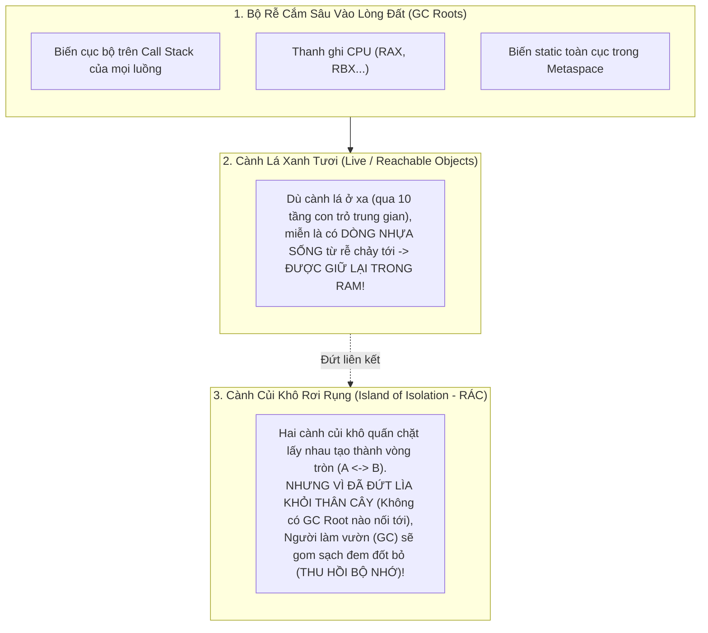
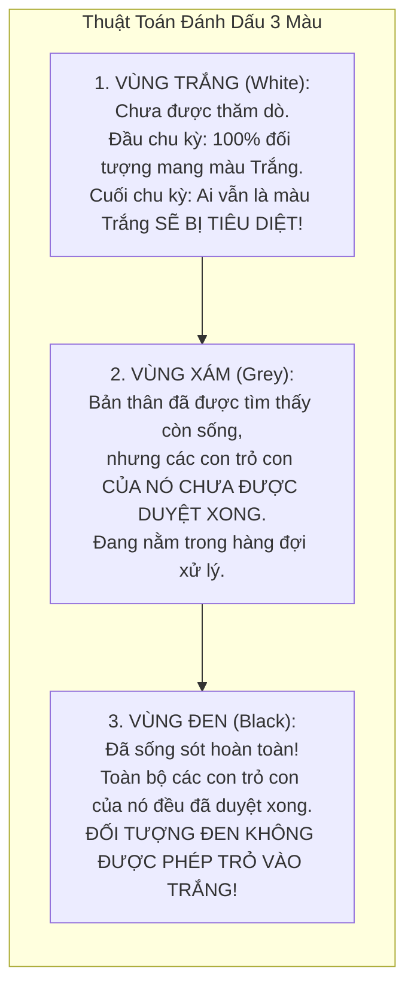
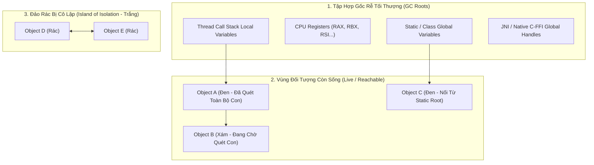

# 8.1. GC Fundamentals (Nguyên Lý Nền Tảng Của Garbage Collection & GC Roots)

> [!IMPORTANT]
> **Nếu bạn chỉ được nhớ một điều duy nhất:** Trong lý thuyết đồ thị bộ nhớ, một khối nhớ trên Heap chỉ được coi là "sống" nếu và chỉ nếu tồn tại một đường đi có hướng (Directed Path) từ tập hợp các gốc rễ tối thượng (**GC Roots**) dẫn tới nó. Ngay khi đường dẫn này bị cắt đứt, dù đối tượng có phức tạp hay nằm trong chu trình tự tham chiếu khép kín (Island of Isolation), nó vẫn lập tức trở thành rác. Cơ chế đánh dấu 3 màu (**Tri-Color Marking**) và việc đưa các luồng ứng dụng về điểm an toàn (**Safepoints**) trong chu kỳ Stop-the-World (STW) là trái tim vận hành của mọi máy ảo hiện đại (HotSpot JVM, V8, Go Runtime, .NET CLR).

---

## 1. Trực Quan Hóa: Bản Chất Nền Tảng Của Garbage Collection Dưới Góc Nhìn Lập Trình Viên

Mục tiêu của phần này là giải mã trái tim của mọi máy ảo hiện đại (JVM, V8, Go Runtime, .NET): Định nghĩa toán học chính xác của "rác" trong bộ nhớ là gì? Tại sao hai đối tượng tự trỏ vòng tròn vào nhau vẫn bị GC dọn sạch không còn dấu vết? Thuật toán đánh dấu 3 màu (Tri-Color Marking) vận hành như thế nào? Và kỹ thuật bẫy phần cứng nào cho phép máy ảo ép hàng trăm luồng ứng dụng phải đồng loạt "đứng bất động" (Stop-The-World)?

---

### 1.1. Ẩn Dụ Cây Cổ Thụ, Dòng Nhựa Sống & Cành Củi Khô Gãy Lìa

Hãy hình dung toàn bộ vùng nhớ Heap giống như một cái cây cổ thụ vĩ đại:



- **GC Roots**: Là bộ rễ của toàn bộ hệ thống. Bao gồm: các biến cục bộ trên Stack của mọi luồng đang chạy, các thanh ghi CPU, và các biến toàn cục `static`.
- **Reachability (Tính tiếp cận được)**: Một đối tượng chỉ được coi là "sống" nếu tồn tại một đường dẫn có hướng từ GC Roots dẫn tới nó.

---

### 1.2. Giải Mã Hiện Tượng Đảo Cô Lập (Island of Isolation)

Trong các ngôn ngữ chỉ dùng Đếm tham chiếu (như Python hoặc `std::shared_ptr` C++):
```python
class Node:
    def __init__(self):
        self.partner = None

a = Node()
b = Node()
a.partner = b # a trỏ tới b
b.partner = a # b trỏ ngược lại a

a = None # Hủy con trỏ từ ngoài
b = None # Hủy con trỏ từ ngoài
```
- Nếu chỉ đếm số người trỏ vào, `a` và `b` đều có `ref_count = 1` (vì chúng tự trỏ vào nhau), dẫn đến rò rỉ bộ nhớ vĩnh viễn!
- **Giải pháp của Tracing GC**: Bắt đầu duyệt từ GC Roots. Vì không có biến cục bộ hay biến static nào trỏ tới cụm `a <-> b`, bộ dọn rác coi toàn bộ cụm này là **Rác hoàn toàn** và quét sạch cả hai trong một chu kỳ duy nhất!

---

### 1.3. Giải Thuật Đánh Dấu 3 Màu (Tri-Color Marking)

Mọi bộ dọn rác Tracing GC hiện đại đều phân loại đối tượng thành 3 màu:



---

### 1.4. Cơn Ác Mộng Stop-The-World (STW) & Cơ Chế Bẫy Trang Safepoint

Tại sao bộ dọn rác phải ép mọi luồng ứng dụng đứng bất động (**Stop-The-World**)?
- Nếu các luồng ứng dụng vẫn chạy trong khi GC đang đánh dấu, một luồng có thể lấy một con trỏ từ đối tượng màu Xám gắn sang đối tượng màu Đen, rồi xóa con trỏ ở đối tượng Xám đi.
- Hậu quả: Đối tượng màu Trắng đó bị "vô hình" trước mắt bộ dọn rác và bị xóa nhầm, làm sập toàn bộ hệ thống!

#### Làm thế nào JVM ép hàng trăm luồng dừng lại trong vài micro-giây?
Trình biên dịch JIT tự động chèn một câu lệnh kiểm tra cực nhỏ vào cuối mỗi vòng lặp (**Safepoint Poll**):
```assembly
test eax, [safepoint_polling_page] ; Đọc vào một trang nhớ đặc biệt
```
- Bình thường: Trang nhớ này có quyền đọc, lệnh chạy trong $1\text{ cycle}$ (không tốn chi phí).
- Khi GC muốn kích hoạt STW: Nó phát lệnh cho Kernel **tước bỏ quyền đọc của trang nhớ đó** (`PROT_NONE`).
- Tất cả các luồng ứng dụng khi chạy tới vòng lặp kế tiếp sẽ đọc vào trang này, kích hoạt ngắt phần cứng **Page Fault** và bị hệ điều hành đóng băng đồng loạt tại **Điểm An Toàn (Safepoint)**!

---

### 1.5. Sơ Đồ Khối Đồ Thị Đối Tượng (Object Graph), GC Roots & Thuật Toán Đánh Dấu 3 Màu



---

## 2. Chi tiết từng Keyword (Under-the-Hood Deep Dive)

### 2.1. Reachability & Mô Hình Đồ Thị Đối Tượng (Object Graph & Island of Isolation)
- **Đồ thị đối tượng $G = (V, E)$**:
  - Tập đỉnh $V$: Các đối tượng được cấp phát trên Heap.
  - Tập cạnh có hướng $E$: Các con trỏ hoặc tham chiếu giữa các đối tượng.
- **Toán học về Khả năng tiếp cận (Reachability)**:
  Một đối tượng $X \in V$ được định nghĩa là **Còn sống (Live / Reachable)** khi và chỉ khi:
  $$\exists R \in \text{GC Roots} \quad \text{sao cho tồn tại đường đi có hướng: } R \rightsquigarrow X$$
  Nếu không tồn tại đường đi nào từ bất kỳ Root nào tới $X$, $X$ là **Rác (Garbage / Dead Object)** và bắt buộc phải bị tiêu hủy.
- **Hiện tượng Đảo Rác Cô Lập (Island of Isolation)**:
  - Giả sử đối tượng $A$ giữ tham chiếu tới $B$, và $B$ giữ tham chiếu ngược lại $A$ ($A \leftrightarrow B$).
  - Nếu ta gán con trỏ gốc ngoài hàm `root = null`, cụm $A \leftrightarrow B$ vẫn có `Reference Count = 1`.
  - Trong các hệ thống chỉ dùng Đếm tham chiếu ngây thơ (Reference Counting cổ điển), cụm này sẽ bị rò rỉ vĩnh viễn trên RAM.
  - Ngược lại, thuật toán **Tracing GC** (Quét đồ thị) bắt đầu từ GC Roots sẽ không bao giờ duyệt tới $A$ hay $B$. Do đó, cả hai đối tượng bị quét sạch đồng thời trong một chu kỳ thu gom.

### 2.2. Bốn Nguồn Cội Tuyệt Đối Của GC Roots Trong Managed Runtimes
Bộ thu gom rác Tracing GC bắt đầu hành trình duyệt đồ thị từ 4 nguồn cội duy nhất của hệ thống:
1. **Thread Call Stacks (Ngăn xếp của toàn bộ các luồng)**:
   - Tất cả các biến cục bộ, tham số hàm và con trỏ tạm thời nằm trong các Stack Frames đang hoạt động của mọi luồng (Worker Threads).
   - Khi một hàm hoàn tất và trả về (`ret`), khung ngăn xếp bị pop khỏi Stack, ngay lập tức cắt đứt đường dẫn tới các đối tượng trên Heap mà nó từng nắm giữ.
2. **CPU Registers (Thanh ghi vi xử lý)**:
   - Các con trỏ đối tượng đang được nạp tạm thời vào thanh ghi CPU (`RAX`, `RBX`, `RCX`, `RDX`, `RSI`, `RDI`) phục vụ tính toán số học.
3. **Static & Global Variables (Biến tĩnh và Biến toàn cục)**:
   - Được nạp trong phân vùng dữ liệu tĩnh hoặc `Metaspace` của ClassLoader.
   - Các đối tượng này có vòng đời vĩnh viễn đi cùng với vòng đời của ứng dụng hoặc ClassLoader.
4. **JNI / Native Handles (Con trỏ giao tiếp C/C++ FFI)**:
   - Các tham chiếu toàn cục hoặc cục bộ do mã nguồn C/C++ Native nắm giữ thông qua Java Native Interface (JNI) hoặc C-FFI trong Node.js/Python.

### 2.3. Tracing GC vs Reference Counting: Cơ Chế Tri-Color Marking (White, Grey, Black)
- **Đánh Đổi Bản Chất (Trade-Off)**:
  - *Reference Counting (Python, Swift, Objective-C, C++ `std::shared_ptr`)*: Giải phóng bộ nhớ tức thì khi refcount về 0 ($0\text{ latency}$); nhưng tốn chi phí đồng bộ hóa nguyên tử `atomic increment/decrement` trên mỗi lệnh gán và bất lực trước chu trình Circular Reference.
  - *Tracing Garbage Collection (JVM, V8, Go, .NET)*: Không tốn chi phí trên từng lệnh gán, giải quyết triệt để chu trình rác; nhưng phải chịu đựng các đợt quét đồ thị định kỳ và độ trễ Stop-the-World.
- **Giải Thuật Đánh Dấu 3 Màu (Tri-Color Marking Algorithm)**:
  Tại một thời điểm trong chu kỳ dọn rác, mọi đối tượng trên Heap được phân vào đúng một trong 3 tập hợp:
  1. **Tập Trắng (White - Ứng viên rác)**: Các đối tượng chưa được bộ dọn rác ghé thăm. Khi bắt đầu chu kỳ GC, $100\%$ đối tượng đều mang màu Trắng. Kết thúc chu kỳ, những đối tượng nào vẫn còn màu Trắng chính là rác cần bị tiêu diệt.
  2. **Tập Xám (Grey - Đang thăm dò)**: Các đối tượng bản thân nó đã được xác định là còn sống, nhưng **các đối tượng con mà nó trỏ tới vẫn chưa được quét xong**. Chúng được đưa vào một hàng đợi làm việc (Worklist / Mark Stack).
  3. **Tập Đen (Black - Đã sống sót hoàn toàn)**: Các đối tượng bản thân nó còn sống, và **toàn bộ các con trỏ con của nó đều đã được quét sạch sẽ**. Đối tượng màu Đen không bao giờ được phép trỏ trực tiếp tới một đối tượng màu Trắng mà không có cơ chế rào cản ghi (Write Barrier)!

### 2.4. Cơn Ác Mộng Stop-the-World (STW), Safepoints & Polling Page Mechanism
- **Tại sao bắt buộc phải có Stop-the-World (STW)?**
  - Nếu các luồng ứng dụng (**Mutator Threads**) vẫn tiếp tục ghi và sửa đổi con trỏ trong lúc GC đang đánh dấu 3 màu, một luồng có thể lấy một con trỏ từ đối tượng màu Xám gắn sang đối tượng màu Đen, rồi xóa con trỏ ở đối tượng màu Xám đi.
  - Kết quả: Đối tượng màu Trắng đó bị "vô hình" trước mắt bộ dọn rác và bị xóa oan uổng, gây lỗi Memory Corruption phá hủy toàn bộ hệ thống!
- **Điểm An Toàn (Safepoints)**:
  - CPU không thể dừng một luồng tại bất kỳ dòng lệnh ngẫu nhiên nào (vì thanh ghi và Stack có thể đang ở trạng thái dở dang không an toàn).
  - Trình biên dịch JIT tự động chèn các chỉ thị kiểm tra điểm an toàn (**Safepoint Polls**) vào cuối mỗi vòng lặp hoặc tại lời gọi hàm.
- **Cơ chế Polling Page Hardware Trap**:
  - Trong HotSpot JVM, mỗi lệnh Safepoint Poll thực chất chỉ là một lệnh đọc bộ nhớ vô hại: `test eax, [safepoint_page_addr]`.
  - Bình thường, trang này có quyền đọc nên lệnh chạy trong $1\text{ cycle}$.
  - Khi GC muốn kích hoạt STW: Nó lập tức dùng system call `mprotect()` tước quyền đọc của trang đó thành `PROT_NONE`.
  - Toàn bộ hàng trăm luồng của ứng dụng khi chạy tới vòng lặp tiếp theo sẽ đọc vào trang này, kích hoạt ngắt phần cứng Page Fault và bị Kernel ép dừng lại đồng loạt tại Safepoints!

### 2.5. Ba Thuật Toán Thu Gom Nền Tảng: Mark-Sweep, Mark-Compact & Copying Collector
1. **Mark-Sweep (Đánh dấu & Quét sạch)**:
   - *Phase 1 (Mark)*: Duyệt từ GC Roots, đánh dấu bit sống trên Mark Bitmap.
   - *Phase 2 (Sweep)*: Quét toàn bộ Heap, đưa các ô nhớ chết vào Free List.
   - *Nhược điểm chí mạng*: Gây ra **phân mảnh ngoại vi (External Fragmentation)** trầm trọng. Cấp phát sau đó phải duyệt Free List chậm chạp.
2. **Mark-Compact (Đánh dấu & Dồn nén - Thuật toán Lisp2 / Two-Finger)**:
   - Sau khi đánh dấu, di dời toàn bộ các đối tượng còn sống dồn chặt về một đầu của Heap, giải phóng toàn bộ không gian còn lại thành một khối trống liên tục.
   - *Ưu điểm*: Xóa sạch $100\%$ phân mảnh bộ nhớ. Cấp phát mới đạt tốc độ $O(1)$ bằng Bump Pointer.
   - *Nhược điểm*: Chi phí CPU rất cao vì phải duyệt qua Heap tới 3 lần và cập nhật lại toàn bộ các con trỏ trỏ tới đối tượng bị dời chỗ.
3. **Copying Collector (Thu gom kiểu sao chép - Thuật toán Cheney's Semispaces)**:
   - Chia không gian Heap thành hai nửa bằng nhau: **From-Space** và **To-Space**.
   - Tại một thời điểm, chỉ một nửa được dùng để cấp phát. Khi đầy, GC quét From-Space và sao chép toàn bộ các đối tượng còn sống sang To-Space, xếp khít liền kề nhau. Toàn bộ From-Space cũ bị xóa sạch trong $O(1)$.
   - *Ưu điểm*: Cực nhanh, thời gian chạy chỉ tỷ lệ với số lượng đối tượng còn sống, triệt tiêu phân mảnh.
   - *Nhược điểm*: Lãng phí đúng **$50\%$ dung lượng RAM** cho không gian dự phòng.

---

## 3. Thực thi Mã nguồn & Mô phỏng Chuyên sâu (Dual-Engine Implementation)

### 3.1. C++20 Tri-Color Tracing Garbage Collector & Island of Isolation Breaker

Chương trình C++20 cài đặt hoàn chỉnh một máy ảo mini tích hợp bộ dọn rác Tracing GC đánh dấu 3 màu (Tri-Color Marking), chứng minh khả năng tiêu diệt chu trình rác (Island of Isolation):

```cpp
// Biên dịch: g++ -std=c++20 -O3 -Wall -Wextra tri_color_gc_lab.cpp -o gc_lab
#include <iostream>
#include <vector>
#include <unordered_set>
#include <format>
#include <cstdint>

enum class Color : uint8_t {
    WHITE, // Chưa ghé thăm (Ứng viên rác)
    GREY,  // Bản thân sống, con chưa quét xong
    BLACK  // Sống hoàn toàn, con đã quét xong
};

struct GcNode {
    uint32_t id;
    Color color = Color::WHITE;
    std::vector<GcNode*> children;

    explicit GcNode(uint32_t i) : id(i) {}
};

class MiniVmTracingGc {
public:
    std::vector<GcNode*> all_allocated_heap;
    std::vector<GcNode*> gc_roots;

    GcNode* allocate_object(uint32_t id) {
        auto* node = new GcNode(id);
        all_allocated_heap.push_back(node);
        return node;
    }

    // Thuật toán Tri-Color Marking
    void mark_phase() {
        std::vector<GcNode*> grey_worklist;

        // 1. Chuyển toàn bộ GC Roots từ White sang Grey
        for (auto* root : gc_roots) {
            if (root) {
                root->color = Color::GREY;
                grey_worklist.push_back(root);
            }
        }

        // 2. Vòng lặp quét lan tỏa qua đồ thị
        while (!grey_worklist.empty()) {
            GcNode* current = grey_worklist.back();
            grey_worklist.pop_back();

            // Khảo sát toàn bộ con trỏ con của đối tượng xám
            for (auto* child : current->children) {
                if (child && child->color == Color::WHITE) {
                    child->color = Color::GREY; // Nạp vào hàng đợi xử lý
                    grey_worklist.push_back(child);
                }
            }

            // Đã duyệt xong toàn bộ con -> Chuyển thành BLACK
            current->color = Color::BLACK;
        }
    }

    // Giai đoạn Quét (Sweep Phase)
    void sweep_phase() {
        auto it = all_allocated_heap.begin();
        while (it != all_allocated_heap.end()) {
            GcNode* obj = *it;
            if (obj->color == Color::WHITE) {
                // Vẫn là White -> Rác không thể tiếp cận (Unreachable)!
                std::cout << std::format("  -> [SWEEP RECLAIM] Tiêu hủy đối tượng rác ID: {}\n", obj->id);
                delete obj;
                it = all_allocated_heap.erase(it);
            } else {
                // Đối tượng sống (Black) -> Đặt lại White cho chu kỳ tiếp theo
                obj->color = Color::WHITE;
                ++it;
            }
        }
    }

    void run_full_gc() {
        std::cout << "\n[Stop-the-World] Bắt đầu chu trình Tracing GC...\n";
        mark_phase();
        sweep_phase();
        std::cout << std::format("[STW Ended] Dọn rác hoàn tất. Số đối tượng còn sống trong RAM: {}\n", 
                                 all_allocated_heap.size());
    }

    ~MiniVmTracingGc() {
        for (auto* obj : all_allocated_heap) delete obj;
    }
};

int main() {
    std::cout << "=========================================================\n";
    std::cout << "  C++20 TRI-COLOR TRACING GC & ISLAND OF ISOLATION LAB   \n";
    std::cout << "=========================================================\n";

    MiniVmTracingGc vm;

    // Cấp phát 5 đối tượng
    auto* obj1 = vm.allocate_object(1); // Sống (Root)
    auto* obj2 = vm.allocate_object(2); // Sống (Được obj1 trỏ tới)
    auto* obj3 = vm.allocate_object(3); // Sống (Được obj2 trỏ tới)
    auto* obj4 = vm.allocate_object(4); // RÁC (Island of Isolation)
    auto* obj5 = vm.allocate_object(5); // RÁC (Island of Isolation)

    // Thiết lập đồ thị tham chiếu
    vm.gc_roots.push_back(obj1);      // Root -> Obj 1
    obj1->children.push_back(obj2);   // Obj 1 -> Obj 2
    obj2->children.push_back(obj3);   // Obj 2 -> Obj 3

    // Obj 4 và Obj 5 tạo chu trình tham chiếu Circular khép kín
    obj4->children.push_back(obj5);
    obj5->children.push_back(obj4);

    std::cout << std::format("Số đối tượng ban đầu trên Heap: {}\n", vm.all_allocated_heap.size());
    std::cout << "Obj 4 và Obj 5 trỏ vòng tròn lẫn nhau nhưng không nối với Root.\n";

    vm.run_full_gc();

    return 0;
}
```

### 3.2. Python 3.11+: GC Graph Reachability & Circular Reference Simulator

Chương trình Python 3.11+ mô phỏng bộ theo dõi đồ thị đối tượng và kiểm chứng cơ chế thu hồi chu trình kín của module `gc`:

```python
#!/usr/bin/env python3
"""
gc_fundamentals_simulator.py: Mô phỏng Reachability Graph và Cyclic GC trong Python.
Yêu cầu: Python 3.11+
"""
import gc
import sys

class TrackedHeapObject:
    def __init__(self, name: str):
        self.name = name
        self.links = []

    def link_to(self, target: 'TrackedHeapObject'):
        self.links.append(target)

    def __del__(self):
        print(f"  [Destructor] '{self.name}' đã bị giải phóng khỏi RAM!")

def test_reachability_and_cyclic_gc():
    print("=== MÔ PHỎNG ĐỒ THỊ REACHABILITY & CHU TRÌNH RÁC TRONG PYTHON ===")
    gc.disable() # Tạm tắt automatic GC để quan sát tường minh

    # Tạo GC Root cục bộ
    root_obj = TrackedHeapObject("RootNode")
    child_obj = TrackedHeapObject("ChildNode")
    root_obj.link_to(child_obj)

    # Tạo Island of Isolation (Hai đối tượng trỏ chéo nhau)
    garbage_a = TrackedHeapObject("GarbageIsland_A")
    garbage_b = TrackedHeapObject("GarbageIsland_B")
    garbage_a.link_to(garbage_b)
    garbage_b.link_to(garbage_a)

    print("Cắt đứt con trỏ tới Garbage Island...")
    del garbage_a
    del garbage_b
    print("-> Lúc này GarbageIsland_A và B có RefCount=1 (Không thể chết bằng RefCount thuần túy!)")

    print("\nKích hoạt ép buộc Tracing Cyclic Garbage Collection: gc.collect()...")
    unreachable_count = gc.collect()
    print(f"-> Số đối tượng chu trình rác bị phát hiện và dọn sạch: {unreachable_count}")

    print("\nTiếp tục giữ RootNode sống:")
    print(f"  RootNode name: {root_obj.name}, Child: {root_obj.links[0].name}")

if __name__ == "__main__":
    test_reachability_and_cyclic_gc()
```

### 3.3. Terminal Output Mẫu & Phân Tích Thực Thi

```text
=========================================================
  C++20 TRI-COLOR TRACING GC & ISLAND OF ISOLATION LAB   
=========================================================
Số đối tượng ban đầu trên Heap: 5
Obj 4 và Obj 5 trỏ vòng tròn lẫn nhau nhưng không nối với Root.

[Stop-the-World] Bắt đầu chu trình Tracing GC...
  -> [SWEEP RECLAIM] Tiêu hủy đối tượng rác ID: 4
  -> [SWEEP RECLAIM] Tiêu hủy đối tượng rác ID: 5
[STW Ended] Dọn rác hoàn tất. Số đối tượng còn sống trong RAM: 3

=== MÔ PHỎNG ĐỒ THỊ REACHABILITY & CHU TRÌNH RÁC TRONG PYTHON ===
Cắt đứt con trỏ tới Garbage Island...
-> Lúc này GarbageIsland_A và B có RefCount=1 (Không thể chết bằng RefCount thuần túy!)

Kích hoạt ép buộc Tracing Cyclic Garbage Collection: gc.collect()...
  [Destructor] 'GarbageIsland_A' đã bị giải phóng khỏi RAM!
  [Destructor] 'GarbageIsland_B' đã bị giải phóng khỏi RAM!
-> Số đối tượng chu trình rác bị phát hiện và dọn sạch: 4

Tiếp tục giữ RootNode sống:
  RootNode name: RootNode, Child: ChildNode
```

---

## 4. Systems Engineering & Production Pitfalls

### 4.1. Thảm Họa Rò Rỉ Bộ Nhớ Do GC Root "Rỉ Máu" (Retained Listeners / Static Collections)
- **Kịch bản thực chiến**: Trong một hệ thống Spring Boot / Node.js, lập trình viên tạo một bộ nhớ cache tĩnh:
  ```java
  public static final Map<String, UserSession> SESSION_CACHE = new ConcurrentHashMap<>();
  ```
- **Hậu quả**:
  - Vì `SESSION_CACHE` là một trường tĩnh (`static`), nó được coi là một **GC Root bất tử** gắn liền với ClassLoader.
  - Mỗi khi khách hàng đăng nhập, một `UserSession` được đẩy vào map. Tuy nhiên, lập trình viên quên viết cơ chế dọn dẹp khi session hết hạn (Time-To-Live).
  - Vì toàn bộ hàng triệu session đều có đường dẫn nối trực tiếp từ GC Root, Garbage Collector **tuyệt đối không bao giờ được phép dọn dẹp chúng**. Bộ nhớ RAM tăng đều đặn cho đến khi hệ thống ném lỗi `OutOfMemoryError: Java heap space`.
- **Biện pháp**: Luôn sử dụng các cấu trúc Cache có giới hạn dung lượng và giải thuật loại bỏ (LRU Cache như Guava/Caffeine), hoặc bọc đối tượng trong `WeakReference` để GC tự do thu hồi khi bộ nhớ căng thẳng.

### 4.2. Thảm Họa Trễ P99 Do STW Safepoint Pause Time Kéo Dài Trong FinTech
- **Hiện tượng**: Một dịch vụ API xử lý lệnh chứng khoán có thời gian phản hồi trung bình (P50) rất đẹp: $2\text{ ms}$. Nhưng độ trễ phân vị thứ 99 (P99) thỉnh thoảng nhảy vọt lên tới $1500\text{ ms}$, gây rớt lệnh và phạt vi phạm SLA.
- **Nguyên nhân**:
  - Ứng dụng có một luồng thực hiện vòng lặp tính toán nặng không chứa Safepoint Poll (ví dụ vòng lặp đếm số nguyên kiểu `int` trong Java JIT cũ).
  - Khi GC muốn kích hoạt STW để dọn rác, nó phải chờ luồng này chạy tới Safepoint tiếp theo. Toàn bộ các luồng API khác đã dừng lại tại Safepoints và bị treo cứng suốt $1.5\text{ giây}$ chỉ để chờ một luồng duy nhất!
- **Biện pháp**: Bật cờ JVM JIT Loop Strip Mining: `-XX:+UseCountedLoopSafepoints`, hoặc nâng cấp lên JDK 17+ / JDK 21 sử dụng bộ dọn rác siêu tốc **ZGC** (`-XX:+UseZGC`).

### 4.3. CLI Diagnostics & GC Profiling Tools
- Giám sát hoạt động thu gom rác thời gian thực trong Java HotSpot:
  ```bash
  # Giám sát tỷ lệ dùng heap và thời gian STW mỗi giây
  jstat -gcutil <PID> 1000
  ```
- Bật cờ ghi log chi tiết của Garbage Collector (Unified JVM GC Logging):
  ```bash
  java -Xlog:gc*,gc+safepoint=info:file=gc.log:time,uptime,pid:filecount=5,filesize=100M -jar app.jar
  ```
- Phân tích rò rỉ đồ thị đối tượng và tìm kiếm GC Roots bằng Eclipse Memory Analyzer (MAT):
  ```bash
  # Tạo Heap Dump khi bị OutOfMemoryError
  -XX:+HeapDumpOnOutOfMemoryError -XX:HeapDumpPath=/var/log/dumps/
  ```

---

## 5. Bảng So sánh & Decision Matrix

### Ma trận So sánh Các Mô Hình Quản Trị Bộ Nhớ

| Mô Hình Quản Trị | Tracing GC (Java, Go, V8) | Reference Counting (Swift, Python) | RAII (C++20) | Borrow Checker (Rust) |
| :--- | :--- | :--- | :--- | :--- |
| **Chi Phí Trên Phép Gán Con Trỏ**| **$0\text{ cycle}$** (Cực nhanh) | Chậm (Atomic Ref Increment/Decrement) | **$0\text{ cycle}$** (Raw ptr/Move) | **$0\text{ cycle}$** (Compile-time) |
| **Độ Trễ Thu Hồi (Latency)**| Có độ trễ STW Pauses | Tức thời ngay khi ref=0 | Tức thời ngay khi out-of-scope | Tức thời ngay khi drop |
| **Xử Lý Chu Trình Rác (Cycles)**| **Hoàn hảo $100\%$** | Thất bại (Cần WeakRef hoặc Cycle GC) | Bị rò rỉ nếu dùng `shared_ptr`| **Cấm hoàn toàn từ compile-time**|
| **Dung Lượng RAM Phụ Trợ**| Tốn thêm $20-30\%$ Heap dự phòng | Tốn $8\text{ Bytes}$ counter per object | **$0\text{ Byte}$ phụ trợ** | **$0\text{ Byte}$ phụ trợ** |
| **Độ Phức Tạp Lập Trình**| Rất thấp (Nhẹ đầu cho lập trình viên)| Trung bình (Cần tránh retain cycle)| Cao (Cần kỷ luật RAII chặt chẽ) | Rất cao (Đấu tranh với compiler)|

---

## 6. Enterprise Production Checklist & Verification

- [ ] **Kiểm Soát Vòng Đời Biến Tĩnh Toàn Cục**: Đảm bảo không lưu trữ các tập hợp dữ liệu không giới hạn kích thước trong các biến `static` hoặc Global Singletons.
- [ ] **Hủy Đăng Ký Event Listeners**: Luôn gọi `removeListener()` hoặc `unsubscribe()` trong các hàm cleanup/teardown của component để cắt đứt liên kết tới GC Roots.
- [ ] **Kích Hoạt Unified GC Logging**: Cấu hình `-Xlog:gc*` trong script triển khai Kubernetes để liên tục theo dõi thời gian dừng STW và nhịp độ thăng hạng đối tượng.
- [ ] **Đảm Bảo Bật Safepoints Cho Counted Loops**: Bật cờ `-XX:+UseCountedLoopSafepoints` nếu sử dụng các phiên bản JDK cũ để tránh tình trạng "Time-To-Safepoint" kéo dài hàng giây.
- [ ] **Sử Dụng WeakReference Cho In-Memory Cache**: Thiết kế các bảng băm cache bộ nhớ sử dụng `WeakHashMap` hoặc thư viện Caffeine để Garbage Collector có thể chủ động thu hồi bộ nhớ khi phát hiện áp lực RAM cao.
