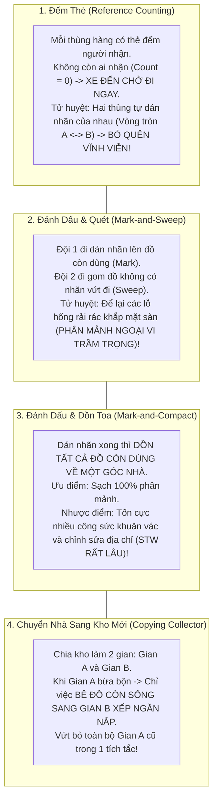
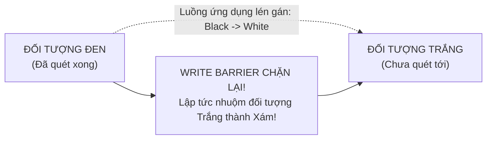
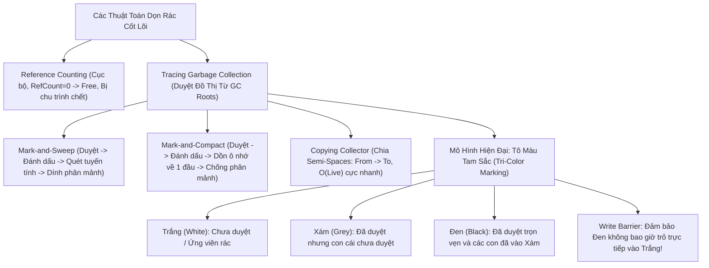

# 8.2. GC Algorithms (Các Thuật Toán Thu Gom Rác: Mark-Sweep, Copying, Compact & Tô Màu Tam Sắc)

> [!IMPORTANT]
> **Nếu bạn chỉ được nhớ một điều duy nhất:** Không có thuật toán dọn rác nào hoàn hảo tuyệt đối; mọi thuật toán đều là một bài toán đánh đổi giữa ba biến số: **Thông lượng tính toán (Throughput)**, **Thời gian dừng hệ thống (STW Latency)**, và **Dung lượng RAM tiêu hao (Footprint)**. Thuật toán sao chép ô nhớ (**Copying Collector**) sở hữu tốc độ siêu việt $O(\text{Live})$ vì nó hoàn toàn không quan tâm đến kích thước của rác (dọn 99MB rác trong $0\text{ ns}$!), nhưng bắt buộc phải hy sinh $50\%$ dung lượng RAM làm vùng đệm dự phòng. Để chạy dọn rác đồng thời (**Concurrent GC**) mà không cần dừng hệ thống, máy ảo bắt buộc phải tuân thủ **Quy tắc Bất biến Tam Sắc (Tri-Color Invariant)** và chặn bắt mọi thao tác gán con trỏ bằng **Write Barrier**.

---

## 1. Trực Quan Hóa: Bản Chất Các Thuật Toán Dọn Rác Dưới Góc Nhìn Lập Trình Viên

Mục tiêu của phần này là giải mã 4 trụ cột thuật toán dọn rác từ năm 1960 đến nay: Tại sao Mark-Sweep lại để lại thảm họa phân mảnh bộ nhớ? Làm thế nào thuật toán Cheney's Copying có thể dọn sạch hàng trăm megabyte rác chỉ trong một cái chớp mắt? Quy tắc toán học nào của nhà khoa học Edsger Dijkstra cho phép máy ảo dọn rác song song cùng lúc với các luồng ứng dụng mà không làm sai lệch con trỏ? Và sự khác biệt bản chất giữa Parallel GC, Concurrent GC và Incremental GC là gì?

---

### 1.1. Ẩn Dụ Bốn Đội Thu Dọn Rác Đô Thị

Hãy tưởng tượng một khu đô thị đang tìm giải pháp xử lý phế liệu:



---

### 1.2. Phép Màu Cheney's Copying: Độ Phức Tạp $O(\text{Live})$ Độc Nhất Vô Nhị

Hãy xem xét một vùng nhớ có $100\text{ MB}$ dữ liệu, nhưng trong đó chỉ có $1\text{ MB}$ là đối tượng còn sống, còn lại $99\text{ MB}$ là các đối tượng rác tạm thời (ví dụ chuỗi string, đối tượng DTO trong HTTP request vừa kết thúc):
- **Trong thuật toán Mark-and-Sweep**: GC phải duyệt qua toàn bộ $100\text{ MB}$ để tìm từng khối rác nhỏ $\implies$ Tốn công vô ích!
- **Trong Cheney's Copying Collector**:
  $$\text{Độ Phức Tạp} = O(\text{Live Objects})$$
  Thuật toán **hoàn toàn không quan tâm đến $99\text{ MB}$ rác kia**! Nó chỉ việc sao chép đúng $1\text{ MB}$ đối tượng còn sống sang nửa kho bên cạnh (To-Space), sau đó chỉ việc reset con trỏ của From-Space về 0! Toàn bộ $99\text{ MB}$ rác bị xóa sạch trong **$0\text{ nano-giây}$**!

---

### 1.3. Quy Tắc Bất Biến Tam Sắc Của Dijkstra & Chiếc Khiên Write Barrier

Khi bộ dọn rác chạy song song cùng lúc với ứng dụng (**Concurrent GC**):
- **Đối tượng Đen**: Đã được GC quét xong toàn bộ và xác nhận còn sống.
- **Đối tượng Trắng**: Chưa được quét, là ứng viên sẽ bị tiêu diệt.



- **Quy tắc bất biến nghiêm ngặt**: *Đối tượng màu Đen TUYỆT ĐỐI KHÔNG BAO GIỜ được trỏ trực tiếp vào đối tượng màu Trắng*.
- Nếu một luồng ứng dụng lén lút thực hiện lệnh gán: `blackObj.child = whiteObj`, đoạn mã chặn **Write Barrier** sẽ lập tức bắt quả tang và **nhuộm `whiteObj` thành màu Xám** (đưa vào hàng đợi quét), cứu sống đối tượng và bảo vệ tính toàn vẹn của dữ liệu!

---

### 1.4. Phân Biệt: Parallel GC vs Concurrent GC vs Incremental GC

| Tiêu Chí | Parallel GC (Song Song Đa Luồng) | Concurrent GC (Đồng Thời Không Khóa) | Incremental GC (Gia Tăng Từng Bước) |
| :--- | :--- | :--- | :--- |
| **Stop-The-World (STW)** | **CÓ** (Dừng toàn bộ luồng ứng dụng) | **GẦN NHƯ KHÔNG** (Dừng vài microsec để chốt pha) | **KHÔNG** (Dừng những lát cắt siêu ngắn) |
| **Cơ chế chạy** | Nhiều luồng GC cùng chia việc dọn dẹp | Luồng GC chạy song song cùng luồng ứng dụng | Chia nhỏ chu kỳ GC xen kẽ giữa các khung hình |
| **Độ phức tạp** | Thấp, dễ cài đặt | **Rất cao** (Cần Write Barrier bảo vệ con trỏ) | Trung bình |
| **Môi trường phù hợp**| Batch processing, tính toán nặng (JVM ParallelGC) | **Web Microservices, API p99 thấp (ZGC, Go GC)** | **Game UI, Hoạt hình 60 FPS (V8 Scavenger)** |

---

### 1.5. Sơ Đồ Tư Duy Tiến Hóa Của Các Thuật Toán GC



---

## 2. Chi tiết từng Keyword (Under-the-Hood Deep Dive)

### 2.1. Bốn Thuật Toán Dọn Rác Nền Tảng

#### 1. Reference Counting (Đếm tham chiếu)
- **Cơ chế**: Mỗi đối tượng mang một trường số nguyên `ref_count`. Khi có con trỏ mới trỏ tới, `ref_count++`. Khi con trỏ bị hủy hoặc gán sang chỗ khác, `ref_count--`. Khi `ref_count == 0`, đối tượng bị thu hồi **ngay lập tức trong cùng micro-giây đó**.
- **Ưu điểm**: Độ trễ cực thấp, không có những khoảng dừng STW dài bất ngờ.
- **Tử huyệt**:
  - Không thể giải phóng **Vòng tròn tham chiếu (Circular References)** như $A \to B \to A$.
  - Chi phí phần cứng: Mọi phép gán con trỏ đều phải thực thi lệnh khóa bus atomic `LOCK XADD` trên CPU đa nhân, làm nghẽn hiệu năng.

#### 2. Mark-and-Sweep (Đánh dấu và Quét dọn - McCarthy 1960)
- **Giai đoạn 1 (Mark Phase)**: Bắt đầu từ GC Roots, duyệt toàn bộ đồ thị theo chiều sâu (DFS) hoặc chiều rộng (BFS). Bật cờ `Mark Bit = 1` cho mọi đối tượng còn sống.
- **Giai đoạn 2 (Sweep Phase)**: Duyệt tuyến tính qua toàn bộ không gian Heap từ đầu đến cuối. Bất kỳ khối nhớ nào có `Mark Bit == 0` sẽ bị thu hồi và đưa vào Free List. Khối nào có `Mark Bit == 1` thì được reset về `0` để chuẩn bị cho chu kỳ sau.
- **Hạn chế**: Để lại hiện tượng **Phân mảnh ngoại vi (External Fragmentation)** trầm trọng, khiến các lần cấp phát mảng lớn trong tương lai bị thất bại.

#### 3. Mark-and-Compact (Đánh dấu và Dồn ô nhớ)
- Sau khi đánh dấu xong các đối tượng còn sống, thuật toán không chỉ đơn thuần đưa rác vào Free List mà **dồn toàn bộ các đối tượng còn sống trượt dồn về một đầu của vùng nhớ Heap** (thường dùng thuật toán LISP 2 hoặc Edwards Two-Finger).
- **Ưu điểm**: Không gian bộ nhớ sau khi dồn trở nên hoàn toàn liên tục ($100\%$ sạch phân mảnh), cho phép các lần cấp phát mới sử dụng Bump Allocator siêu tốc.
- **Nhược điểm**: Thời gian dừng STW rất lâu vì CPU phải thực hiện 3 vòng duyệt: Tính toán địa chỉ mới $\to$ Cập nhật lại toàn bộ con trỏ trong hệ thống $\to$ Sao chép vật lý dữ liệu sang vị trí mới.

#### 4. Copying Collector (Cheney's Algorithm 1970)
- Không gian Heap được chia đôi thành 2 nửa bằng nhau: **From-Space** và **To-Space**.
- Toàn bộ việc cấp phát mới diễn ra trên From-Space. Khi From-Space đầy:
  1. GC duyệt qua GC Roots, sao chép toàn bộ các đối tượng còn sống sang **To-Space** và xếp chúng san sát nhau (tự động dồn ô nhớ).
  2. Bỏ rơi toàn bộ From-Space (toàn bộ rác bị xóa sạch trong 1 tích tắc).
  3. Hoán đổi vai trò giữa From-Space và To-Space (**Role Swap**).
- **Độ phức tạp toán học tuyệt đỉnh**:
  $$\text{Time Complexity} = O(\text{Live Objects})$$
  Thuật toán này **hoàn toàn không quan tâm đến kích thước của rác**! Nếu trong $100\text{ MB}$ dữ liệu chỉ có $1\text{ MB}$ đối tượng còn sống, GC chỉ mất thời gian sao chép đúng $1\text{ MB}$ đó rồi dọn sạch $99\text{ MB}$ rác trong $0$ nano-giây.

---

### 2.2. Mô Hình Tô Màu Tam Sắc (Dijkstra's Tri-Color Marking Abstraction)

Để cho phép Garbage Collector chạy song song cùng lúc với các luồng ứng dụng (**Concurrent GC**) mà không cần dừng hệ thống, Edsger W. Dijkstra đã phát minh ra mô hình **Tô Màu Tam Sắc**:

```text
              +-------------+
              | WHITE (Trắng)| <--- Ứng viên rác (Chưa được quét tới)
              +------+------+
                     ^
                     | (Bị cấm bởi Tri-Color Invariant!)
                     |
              +------+------+
              |  GREY (Xám) | <--- Đã duyệt qua, nhưng các con trỏ bên trong chưa quét xong
              +------+------+
                     ^
                     |
              +------+------+
              | BLACK (Đen) | <--- Đã quét trọn vẹn bản thân và toàn bộ con cái (Chắc chắn sống)
              +-------------+
```

1. **Trạng thái 3 màu**:
   - **Màu Trắng (White)**: Các đối tượng chưa được thuật toán chạm tới. Khi chu kỳ GC kết thúc, mọi đối tượng vẫn còn màu Trắng chính là rác cần tiêu hủy.
   - **Màu Xám (Grey)**: Các đối tượng bản thân nó đã được xác định là còn sống, nhưng các đối tượng con mà nó trỏ tới vẫn chưa được quét hết. Đóng vai trò là hàng đợi duyệt (Wavefront).
   - **Màu Đen (Black)**: Các đối tượng đã được quét toàn diện, toàn bộ các đối tượng con của nó đã được đưa vào tập màu Xám.
2. **Quy tắc Bất biến Tam Sắc (The Strong Tri-Color Invariant)**:
   $$\textbf{Một đối tượng màu Đen TUYỆT ĐỐI KHÔNG BAO GIỜ được trỏ trực tiếp tới một đối tượng màu Trắng!}$$
   *(Trừ khi có ít nhất một đối tượng màu Xám gián tiếp bắc cầu tới đối tượng màu Trắng đó).*
3. **Cứu cánh: Hàng rào Ghi (Write Barrier)**:
   - Trong lúc GC đang tô màu, nếu một luồng ứng dụng thực thi lệnh gán: `blackObj.field = whiteObj`, luồng này đã vi phạm quy tắc bất biến (khiến `whiteObj` có nguy cơ bị xóa sổ oan ức).
   - Trình biên dịch chèn một đoạn mã chặn gọi là **Write Barrier** vào mọi phép gán con trỏ. Ngay khi phát hiện lệnh gán này, Write Barrier sẽ lập tức **đổi màu `whiteObj` thành Xám (hoặc đổi `blackObj` về lại Xám)**, đảm bảo tính toàn vẹn toán học của thuật toán.

---

### 2.3. Phân Biệt: Parallel GC vs Concurrent GC vs Incremental GC

- **Parallel GC (Dọn rác song song)**: Vẫn kích hoạt Stop-the-World, nhưng sử dụng **nhiều luồng CPU chuyên dụng** để cùng nhau chia việc quét đồ thị và dồn ô nhớ. Rút ngắn thời gian dừng hệ thống nhờ tận dụng phần cứng đa nhân.
- **Concurrent GC (Dọn rác đồng thời)**: Các luồng dọn rác chạy **đồng thời cùng lúc với các luồng ứng dụng** mà không dừng server (hoặc thời gian dừng chỉ vài micro-giây để chốt pha). Đòi hỏi Write Barrier phức tạp.
- **Incremental GC (Dọn rác gia tăng)**: Chia nhỏ chu kỳ dọn rác thành nhiều bước siêu nhỏ (Time Slices) xen kẽ giữa các tác vụ ứng dụng, giúp triệt tiêu hiện tượng lag giật trong các hệ thống thời gian thực hoặc Game UI.

---

## 3. Thực thi Mã nguồn & Mô phỏng Chuyên sâu (Dual-Engine Implementation)

### 3.1. C++20: Mô Phỏng Thuật Toán Cheney's Copying Collector Với Hai Semi-Spaces

```cpp
#include <iostream>
#include <vector>
#include <cstdint>
#include <format>
#include <cstring>

// Mô phỏng Cheney's Copying Collector (Semi-space Garbage Collection)
class SemiSpaceCopyingGc {
private:
    static constexpr size_t SPACE_SIZE = 1024; // 1 KB mỗi nửa không gian
    uint8_t from_space_[SPACE_SIZE];
    uint8_t to_space_[SPACE_SIZE];
    
    size_t alloc_offset_ = 0;

public:
    SemiSpaceCopyingGc() {
        std::memset(from_space_, 0, SPACE_SIZE);
        std::memset(to_space_, 0, SPACE_SIZE);
    }

    struct Header {
        size_t size;
        bool is_forwarded;
        void* forwarding_address; // Địa chỉ mới bên To-Space
    };

    void* allocate(size_t payload_size) {
        size_t total_size = sizeof(Header) + payload_size;
        if (alloc_offset_ + total_size > SPACE_SIZE) {
            std::cout << "[From-Space Đầy] Cần kích hoạt Cheney Copying Collector!\n";
            return nullptr;
        }

        auto* h = reinterpret_cast<Header*>(&from_space_[alloc_offset_]);
        h->size = payload_size;
        h->is_forwarded = false;
        h->forwarding_address = nullptr;

        void* payload = &from_space_[alloc_offset_ + sizeof(Header)];
        alloc_offset_ += total_size;
        return payload;
    }

    // Sao chép đối tượng sống từ From-Space sang To-Space
    void* copy_object(void* old_payload, size_t& to_offset) {
        if (!old_payload) return nullptr;

        auto* old_header = reinterpret_cast<Header*>(static_cast<uint8_t*>(old_payload) - sizeof(Header));
        
        // Nếu đối tượng đã được copy sang To-Space trước đó, trả về địa chỉ chuyển tiếp
        if (old_header->is_forwarded) {
            return old_header->forwarding_address;
        }

        // Cấp phát vị trí mới bên To-Space
        size_t total_size = sizeof(Header) + old_header->size;
        auto* new_header = reinterpret_cast<Header*>(&to_space_[to_offset]);
        new_header->size = old_header->size;
        new_header->is_forwarded = false;

        void* new_payload = &to_space_[to_offset + sizeof(Header)];
        std::memcpy(new_payload, old_payload, old_header->size);

        // Đánh dấu chuyển tiếp trên From-Space cũ
        old_header->is_forwarded = true;
        old_header->forwarding_address = new_payload;

        to_offset += total_size;
        return new_payload;
    }
};

int main() {
    SemiSpaceCopyingGc gc;
    void* p1 = gc.allocate(32);
    void* p2 = gc.allocate(64);

    std::cout << "--- Mô Phỏng Semi-Space Copying Collector ---\n";
    std::cout << std::format("Cấp phát p1: {}\n", p1);
    std::cout << std::format("Cấp phát p2: {}\n", p2);

    size_t to_space_offset = 0;
    // Giả sử p1 còn sống (Reachable từ Root), p2 đã chết (Garbage)
    void* new_p1 = gc.copy_object(p1, to_space_offset);

    std::cout << std::format("p1 được sao chép sang To-Space tại: {} (Zero Fragmentation)\n", new_p1);
    std::cout << "p2 bị bỏ rơi và tiêu hủy tự động mà không tốn 1 phép toán quét dọn rác nào!\n";

    return 0;
}
```

### 3.2. TypeScript: Trực Quan Hóa Hàng Rào Ghi (Write Barrier) Trong Tracing GC

```typescript
// Mô phỏng cơ chế Write Barrier trong thuật toán Tô Màu Tam Sắc
type GcColor = "WHITE" | "GREY" | "BLACK";

interface TracedNode {
  id: string;
  color: GcColor;
  child: TracedNode | null;
}

export class ConcurrentGcSimulator {
  // Write Barrier được tự động kích hoạt mỗi khi có phép gán con trỏ
  public static onWritePointer(source: TracedNode, field: "child", target: TracedNode | null): void {
    // Kiểm tra vi phạm Bất Biến Tam Sắc: Đen trỏ trực tiếp vào Trắng!
    if (source.color === "BLACK" && target && target.color === "WHITE") {
      console.log(
        `-> [WRITE BARRIER INTERCEPTED] Phát hiện ${source.id} (BLACK) trỏ vào ${target.id} (WHITE)!`
      );
      // Cứu thoát target bằng cách đưa nó về màu GREY để đưa vào danh sách quét tiếp
      target.color = "GREY";
      console.log(`   Đã chuyển màu ${target.id} thành GREY an toàn.`);
    }

    source.child = target; // Thực thi phép gán thực tế
  }
}

// Kiểm thử kịch bản
const blackNode: TracedNode = { id: "RootNode", color: "BLACK", child: null };
const whiteNode: TracedNode = { id: "NewPayload", color: "WHITE", child: null };

console.log("Thực thi phép gán: blackNode.child = whiteNode...");
ConcurrentGcSimulator.onWritePointer(blackNode, "child", whiteNode);
console.log(`Màu sắc cuối cùng của NewPayload: ${whiteNode.color}`); // GREY (Bảo vệ thành công!)
```

---

## 4. Systems Engineering & Production Pitfalls
1. **Dồn ép bộ nhớ Heap quá ngưỡng trong thuật toán Copying Collector**:
   - Nhược điểm chí mạng của Copying Collector là việc phải duy trì $50\%$ dung lượng bộ nhớ dự phòng (To-Space). Nếu bộ nhớ ứng dụng phình to vượt quá $50\%$ tổng RAM của máy chủ, thuật toán Copying Collector sẽ bị tê liệt hoàn toàn do không còn đủ không gian To-Space để sao chép đối tượng sống.

---

## 5. Bảng So sánh & Ứng dụng Backend / Systems
- **Kiến Trúc Thu Gom Rác Thế Hệ Trẻ Trong V8 & JVM**: Toàn bộ các hệ thống Backend hiện đại đều không dùng một thuật toán duy nhất cho toàn bộ Heap. Thay vào đó, chúng kết hợp hoàn hảo: Sử dụng **Copying Collector** cho phân vùng đối tượng trẻ (Young Generation) vì $95\%$ đối tượng chết ngay lập tức (chi phí sao chép cực kỳ nhỏ), và sử dụng **Mark-and-Compact** hoặc **Concurrent Tri-Color Marking** cho phân vùng đối tượng sống lâu (Old Generation).
