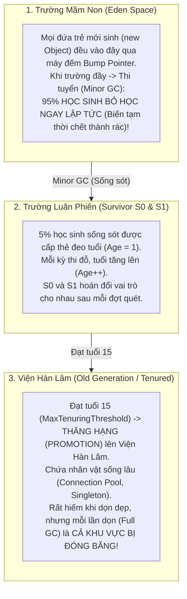
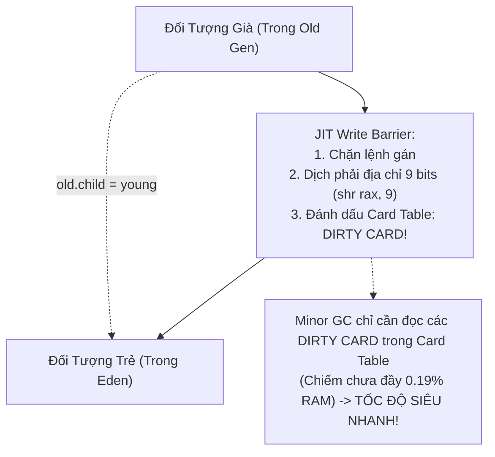
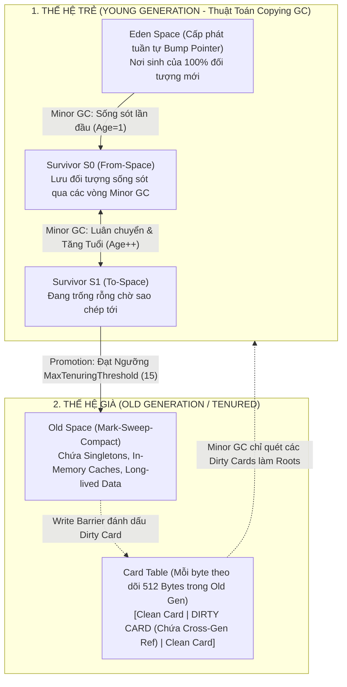

# 8.3. Generational Garbage Collection (Thu Gom Rác Theo Thế Hệ: Eden, Survivor, Promotion & Card Table)

> [!IMPORTANT]
> **Nếu bạn chỉ được nhớ một điều duy nhất:** Thu gom rác theo thế hệ (Generational GC) khai thác quy luật thực nghiệm phổ quát của thế giới phần mềm: **"Hầu hết mọi đối tượng đều chết trẻ" (The Weak Generational Hypothesis - $>95\%$ đối tượng chết ngay sau khi cấp phát)**. Bằng cách cô lập các đối tượng mới sinh vào không gian Eden và chỉ quét dọn thế hệ trẻ (Minor GC) thông qua bảng thẻ nhớ **Card Table** và rào cản ghi **Write Barrier** để theo dõi tham chiếu chéo Old-to-Young, thời gian dừng Stop-the-World được giảm từ hàng chục giây xuống dưới $5\text{ mili-giây}$. Cấu hình sai kích thước Survivor Space dẫn đến thảm họa thăng hạng sớm (Premature Promotion) là nguyên nhân số một gây bão Full GC trên các máy chủ Java và V8.

---

## 1. Trực Quan Hóa: Bản Chất Thu Gom Rác Theo Thế Hệ Dưới Góc Nhìn Lập Trình Viên

Mục tiêu của phần này là giải mã quy luật kỳ diệu nhất trong kiến trúc bộ nhớ máy ảo: Tại sao hơn $95\%$ đối tượng trong mã nguồn của bạn đều "chết trẻ"? Làm thế nào việc chia đôi Heap thành Thế Hệ Trẻ (Young) và Thế Hệ Già (Old) giúp giảm thời gian dừng hệ thống từ hàng chục giây xuống dưới $5\text{ mili-giây}$? Bảng thẻ **Card Table** giải quyết bài toán tham chiếu chéo như thế nào chỉ với một phép dịch bit `shr rax, 9`? Và cạm bẫy thăng hạng sớm (**Premature Promotion**) hủy diệt hiệu năng máy chủ của bạn ra sao?

---

### 1.1. Ẩn Dụ Trường Học Sàng Lọc Khắc Nghiệt: Từ Mầm Non Đến Viện Hàn Lâm

Hãy hình dung cơ chế quản lý thế hệ trong bộ nhớ giống như một hệ thống giáo dục sàng lọc nghiêm ngặt:



- **Eden (Vườn địa đàng)**: Nơi sinh ra của mọi đối tượng mới. Sử dụng con trỏ tuyến tính siêu tốc.
- **Survivor (S0 & S1)**: Hai nửa bán phần đóng vai trò sàng lọc các đối tượng sống sót qua các đợt thi tuyển Minor GC.
- **Tenured (Thế hệ già)**: Chỉ dành cho các đối tượng đã vượt qua 15 lần thi tuyển sinh tử.

---

### 1.2. Giả Thuyết Thế Hệ Yếu (The Weak Generational Hypothesis)

Năm 1984, các nhà khoa học máy tính phát hiện một chân lý thực nghiệm trong hầu hết mọi phần mềm:
$$\text{Hầu hết mọi đối tượng đều chết trẻ (Over 95\% objects die young)}$$
- Khi bạn gọi một hàm: hàng loạt biến cục bộ, chuỗi string format, DTO request được sinh ra. Khi hàm kết thúc, **toàn bộ các đối tượng này trở thành rác chỉ sau vài micro-giây**!
- Nhờ chia tách thế hệ: Thay vì quét toàn bộ $32\text{ GB}$ Heap của server (mất 20 giây), GC **chỉ quét vùng Eden nhỏ $1\text{ GB}$ (Minor GC)**. Vì $95\%$ đối tượng đã chết, thuật toán Copying chỉ tốn vài mili-giây để nhặt số ít đối tượng còn sống sang Survivor!

---

### 1.3. Thảm Họa Thăng Hạng Sớm (Premature Promotion)

Một trong những nguyên nhân hàng đầu khiến server Java/Node.js bị lag p99:

```
KỊCH BẢN THẢM HỌA:
Survivor Space được cấu hình quá nhỏ (ví dụ chỉ có 64MB).
Ứng dụng có một đợt tăng vọt traffic đột biến (Spike Traffic).
Vùng Eden sinh ra hàng triệu đối tượng tạm thời mỗi giây.
Survivor Space bị đầy tràn trong chớp mắt!

HẬU QUẢ:
JVM buộc phải HẠ TUỔI THĂNG HẠNG XUỐNG 1 hoặc 2 (Dynamic Tenuring Threshold).
Hàng triệu đối tượng rác tạm thời bị TỐNG THẲNG SANG OLD GENERATION!
Chỉ sau vài phút, Old Generation bị lấp đầy bởi RÁC NGẮN HẠN.
Hệ thống kích hoạt BÃO FULL GC liên tục -> Server bị đơ toàn tập (STW 10-30s)!
```

---

### 1.4. Card Table (512B) & Phép Màu Write Barrier

Một bài toán hóc búa: Làm thế nào Minor GC có thể quét dọn thế hệ trẻ mà **hoàn toàn không cần đọc qua hàng chục Gigabytes của Old Generation**? Điều gì xảy ra nếu một đối tượng già trong Old Gen trỏ tới một đứa trẻ trong Eden?



- Toàn bộ Old Generation được chia thành các lát cắt nhỏ **$512\text{ Bytes}$** (gọi là một Card).
- Mỗi khi có lệnh gán con trỏ xuyên thế hệ (`old.child = young`), trình biên dịch JIT tự động chèn 2 câu lệnh Assembly:
  ```assembly
  shr rax, 9                        ; Chia địa chỉ cho 512 (tìm số thứ tự thẻ)
  mov [card_table_base + rax], 0x01 ; Đánh dấu thẻ là DIRTY (Bẩn)!
  ```
- Khi dọn dẹp Eden, GC **chỉ việc liếc qua các Card bị đánh dấu Bẩn** để tìm con trỏ, hoàn toàn không cần quét qua hàng tỷ đối tượng trong Old Gen!

---

### 1.5. Sơ Đồ Khối Chu Kỳ Vòng Đời Thăng Hạng & Card Table Trong Generational Heap



---

## 2. Chi tiết từng Keyword (Under-the-Hood Deep Dive)

### 2.1. Giả Thuyết Thế Hệ Yếu (The Weak Generational Hypothesis) & Phân Chia Vùng Heap
- **Nền tảng thực nghiệm**:
  Năm 1984, nhà khoa học máy tính David Ungar đã chứng minh một quy luật chi phối toàn bộ các ngôn ngữ lập trình hướng đối tượng:
  $$\text{Hầu hết mọi đối tượng đều chết trẻ (Most objects die young)}$$
  Hơn **$90\% - 98\%$** các đối tượng được sinh ra trong ứng dụng (như các biến cục bộ trong thân hàm, đối tượng DTO của một HTTP Request, chuỗi tạm thời) sẽ trở thành rác chỉ sau vài micro-giây.
- **Chiến lược phân chia không gian (Divide and Conquer)**:
  - Thay vì gộp chung toàn bộ Heap thành một khối khổng lồ và quét toàn bộ (Full Heap Scanning tốn hàng chục giây), hệ thống chia Heap thành 2 thế hệ vật lý riêng biệt:
    1. **Thế Hệ Trẻ (Young Generation)**: Chiếm $30\% - 50\%$ dung lượng Heap. Nơi sinh ra của mọi đối tượng. Quét dọn cực kỳ thường xuyên (Minor GC) với thời gian dừng STW siêu ngắn ($1 - 5\text{ ms}$).
    2. **Thế Hệ Già (Old Generation / Tenured Space)**: Nơi cư trú của các đối tượng sống lâu. Ít khi quét dọn (Major GC / Full GC), sử dụng thuật toán dồn nén Mark-Compact để triệt tiêu phân mảnh.

### 2.2. Thế Hệ Trẻ: Eden, Survivor Spaces (S0/S1 Semi-Spaces) & Thuật Toán Copying GC
- **Eden Space (Vườn Địa Đàng)**:
  - Khi một luồng ứng dụng thực thi lệnh `new`, đối tượng được cấp phát trực tiếp vào Eden.
  - Sử dụng cơ chế con trỏ tuyến tính **Bump Pointer**: Cấp phát trong $O(1)$ chỉ bằng việc tăng con trỏ đỉnh.
  - Để hỗ trợ đa luồng không bị nghẽn khóa Mutex, mỗi luồng được cấp một vùng đệm riêng gọi là **TLAB (Thread Local Allocation Buffer)** nằm trong Eden.
- **Survivor Spaces (S0 và S1 - Semi-Space Copying Collector)**:
  - Được chia theo tỷ lệ cấu hình chuẩn: $\text{Eden} : \text{S0} : \text{S1} = 8 : 1 : 1$ (`-XX:SurvivorRatio=8`).
  - Tại bất kỳ thời điểm nào, **luôn có đúng một không gian Survivor hoàn toàn trống rỗng** (đóng vai trò là `To-Space`).
  - *Quá trình Minor GC*:
    1. Quét toàn bộ Eden và Survivor hiện tại (`From-Space`).
    2. Sao chép toàn bộ các đối tượng còn sống sang `To-Space`, xếp khít liền kề nhau.
    3. Tăng trường `Age` trong Object Header của mỗi đối tượng lên $+1$.
    4. Xóa sạch $100\%$ không gian Eden và `From-Space` chỉ bằng một thao tác reset con trỏ về 0!
    5. Hoán đổi vai trò giữa S0 và S1.

### 2.3. Vòng Đời Thăng Hạng Đối Tượng: Age Bits, Tenuring Threshold & Cạm Bẫy Premature Promotion
- **Bộ đếm tuổi trong Object Header**:
  - Trường `GC Age` trong Mark Word của HotSpot JVM chỉ có kích thước **$4\text{ bits}$**.
  - Do đó, giá trị tuổi tối đa mà một đối tượng có thể tích lũy là $2^4 - 1 = 15$.
- **Quy tắc Thăng Hạng (Tenuring Threshold)**:
  - Mặc định, khi một đối tượng đạt độ tuổi tối đa **`MaxTenuringThreshold = 15`** (hoặc thấp hơn trên các thuật toán GC hiện đại), nó được thăng hạng (**Promote**) chuyển sang Old Generation.
  - **Dynamic Tenuring Threshold (Ngưỡng thăng hạng động)**: Nếu tổng dung lượng của các đối tượng có cùng độ tuổi trong Survivor Space vượt quá **$50\%$ dung lượng Survivor** (`-XX:TargetSurvivorRatio=50`), JVM sẽ tự động hạ ngưỡng tuổi xuống thấp hơn (ví dụ tuổi 3 hoặc 4) để giải phóng không gian cho Survivor.
- **Thảm Họa Thăng Hạng Sớm (Premature Promotion)**:
  - Nếu Survivor Space được cấu hình quá nhỏ, hoặc tốc độ sinh đối tượng (**Allocation Rate**) của ứng dụng quá khủng khiếp:
  - Các đối tượng ngắn hạn chưa kịp chết trong Minor GC đã bị đẩy thẳng sang Old Generation!
  - Old Generation bị lấp đầy bởi các khối rác ngắn hạn, dẫn đến việc kích hoạt **Full GC liên tục**, khiến ứng dụng bị đóng băng (STW) kéo dài hàng chục giây.

### 2.4. Tham Chiếu Chéo Thế Hệ (Cross-Generational References), Card Table (512B) & Write Barrier JIT
- **Nghịch lý Minor GC**:
  - Để Minor GC có thể chạy nhanh trong vài mili-giây, nó **tuyệt đối không được phép quét qua hàng chục Gigabytes của Old Generation**.
  - Tuy nhiên, điều gì sẽ xảy ra nếu một đối tượng lâu năm trong Old Generation lại nắm giữ một con trỏ trỏ tới một đối tượng mới sinh trong Eden? Nếu không quét Old Gen, đối tượng trong Eden sẽ bị coi là rác và bị xóa oan!
- **Giải pháp Card Table & Write Barrier**:
  1. **Card Table (Bảng Thẻ)**:
     - Toàn bộ không gian Old Generation được chia thành các khối nhớ nhỏ có kích thước cố định **$512\text{ Bytes}$** gọi là một **Card**.
     - Hệ điều hành duy trì một mảng byte tương ứng gọi là **Card Table**, trong đó mỗi byte đại diện cho đúng một khối $512\text{ Bytes}$ trong RAM. Tỷ lệ overhead chỉ là $1 / 512 \approx 0.19\%$ dung lượng Heap.
  2. **JIT Write Barrier (Rào Cản Ghi)**:
     - Mỗi khi chương trình thực hiện một phép gán con trỏ trường: `old_obj.field = young_obj;`
     - Trình biên dịch JIT tự động chèn một đoạn mã máy ngắn (Write Barrier) vào ngay sau lệnh gán:
       ```assembly
       mov [rax], rbx          ; Thực hiện gán con trỏ
       shr rax, 9              ; Chia địa chỉ cho 512 (Dịch phải 9 bits)
       mov [card_table_base + rax], 0x01 ; Đánh dấu thẻ này là DIRTY!
       ```
     - Khi Minor GC diễn ra, bộ dọn rác **chỉ cần quét các Card mang trạng thái DIRTY** trong Card Table để tìm các con trỏ trỏ sang Young Gen, hoàn toàn không cần quét toàn bộ Old Gen!

### 2.5. Thế Hệ Già (Old Generation / Tenured), Humongous Allocations & Thảm Họa Full GC
- **Đặc điểm của Old Generation**:
  - Không gian rộng lớn, tỷ lệ rác thấp (phần lớn là đối tượng sống lâu).
  - Sử dụng thuật toán dọn dẹp phức tạp hơn: **Mark-Sweep-Compact** (hoặc thuật toán vùng nhớ Region-based trong G1/ZGC).
- **Humongous Allocations (Đối tượng khổng lồ)**:
  - Trong các bộ thu gom rác hiện đại như G1 GC, nếu một đối tượng có kích thước lớn hơn **$50\%$ kích thước của một Region** (ví dụ một mảng byte ảnh $10\text{ MB}$):
  - Nó không bao giờ được đưa vào Eden vì sẽ làm tràn Eden ngay lập tức.
  - Thay vào đó, nó được cấp phát thẳng vào một chuỗi các Region liên tục gọi là **Humongous Region** nằm trong Old Generation.
  - Quá nhiều đối tượng khổng lồ sẽ làm phân mảnh không gian và kích hoạt Full GC sớm.
- **Thảm Họa Full GC**:
  - Xảy ra khi Old Generation hoặc Metaspace bị tràn hoàn toàn.
  - Runtime phải kích hoạt chu trình dọn rác toàn diện trên $100\%$ không gian Heap, đóng băng toàn bộ tiến trình (Stop-the-World) trong nhiều giây để dồn nén bộ nhớ.

---

## 3. Thực thi Mã nguồn & Mô phỏng Chuyên sâu (Dual-Engine Implementation)

### 3.1. C++20 Generational GC Simulator: Card Table, Write Barrier & Survivor Semi-Spaces

Chương trình C++20 mô phỏng chi tiết cấu trúc phân vùng Eden/Survivor, thuật toán chuyển giao Semi-Space và cơ chế Write Barrier đánh dấu Card Table 512-byte:

```cpp
// Biên dịch: g++ -std=c++20 -O3 -Wall -Wextra generational_gc_lab.cpp -o gen_gc_lab
#include <iostream>
#include <vector>
#include <cstdint>
#include <format>
#include <algorithm>

constexpr size_t CARD_SHIFT = 9; // 2^9 = 512 bytes per card
constexpr size_t OLD_GEN_SIZE = 1024 * 1024; // 1 MB Old Gen
constexpr size_t CARD_TABLE_SIZE = OLD_GEN_SIZE >> CARD_SHIFT; // 2048 cards

// Card Table toàn cục theo dõi tham chiếu Old -> Young
static uint8_t g_card_table[CARD_TABLE_SIZE] = {0};
static uintptr_t g_old_gen_base = 0x10000000;

// Write Barrier mô phỏng do JIT chèn vào mọi phép gán con trỏ
void post_write_barrier(uintptr_t source_addr, uintptr_t target_addr) {
    // Nếu đối tượng nguồn nằm trong Old Gen và con trỏ trỏ tới Young Gen
    // (Giả sử Young Gen nằm ở dải địa chỉ >= 0x20000000)
    if (source_addr >= g_old_gen_base && source_addr < g_old_gen_base + OLD_GEN_SIZE && target_addr >= 0x20000000) {
        size_t card_index = (source_addr - g_old_gen_base) >> CARD_SHIFT;
        g_card_table[card_index] = 1; // Đánh dấu DIRTY CARD
        std::cout << std::format("  -> [WRITE BARRIER] Card {:>4} (Dải RAM 0x{:08X} - 0x{:08X}) ĐÁNH DẤU DIRTY!\n",
                                 card_index, 
                                 g_old_gen_base + (card_index << CARD_SHIFT),
                                 g_old_gen_base + ((card_index + 1) << CARD_SHIFT) - 1);
    }
}

struct SimulatedObject {
    uint32_t id;
    uint32_t age = 0;
    bool is_live = true;
};

class GenerationalHeapSimulator {
public:
    std::vector<SimulatedObject> eden_space;
    std::vector<SimulatedObject> survivor_from;
    std::vector<SimulatedObject> survivor_to;
    std::vector<SimulatedObject> old_gen;

    constexpr static uint32_t MAX_TENURING_THRESHOLD = 3; // Thăng hạng khi đạt 3 tuổi

    void allocate(uint32_t id) {
        eden_space.push_back({id, 0, true});
    }

    // Thực hiện Minor GC
    void minor_gc() {
        std::cout << "\n[MINOR GC KÍCH HOẠT] Quét sạch Eden và Survivor_From...\n";
        survivor_to.clear();

        // 1. Quét đối tượng sống trong Eden
        for (auto& obj : eden_space) {
            if (obj.is_live) {
                obj.age++;
                survivor_to.push_back(obj); // Copy sang To-Space
            }
        }

        // 2. Quét đối tượng sống trong Survivor_From và kiểm tra thăng hạng (Promotion)
        for (auto& obj : survivor_from) {
            if (obj.is_live) {
                obj.age++;
                if (obj.age >= MAX_TENURING_THRESHOLD) {
                    std::cout << std::format("  -> [PROMOTION] Đối tượng ID {:>2} đạt tuổi {} -> THĂNG HẠNG LÊN OLD GEN!\n",
                                             obj.id, obj.age);
                    old_gen.push_back(obj);
                } else {
                    survivor_to.push_back(obj);
                }
            }
        }

        // 3. Reset Eden và hoán đổi Survivor
        eden_space.clear();
        survivor_from = std::move(survivor_to);
        survivor_to.clear();

        std::cout << std::format("[MINOR GC HOÀN TẤT] Eden: 0 | Survivor: {} objs | Old Gen: {} objs\n",
                                 survivor_from.size(), old_gen.size());
    }
};

int main() {
    std::cout << "=========================================================\n";
    std::cout << "  C++20 GENERATIONAL GC, WRITE BARRIER & CARD TABLE LAB  \n";
    std::cout << "=========================================================\n";

    // 1. Khảo sát Write Barrier & Card Table
    std::cout << "--- 1. KHẢO SÁT WRITE BARRIER & CARD TABLE (512B CARDS) ---\n";
    uintptr_t old_obj_address = g_old_gen_base + 1024; // Nằm ở Card 2
    uintptr_t young_obj_address = 0x20000400;          // Nằm trong Young Gen
    post_write_barrier(old_obj_address, young_obj_address);

    // 2. Khảo sát Chu Kỳ Sống & Sự Thăng Hạng Đối Tượng
    std::cout << "\n--- 2. KHẢO SÁT CHU KỲ SỐNG & PROMOTION ĐỐI TƯỢNG ---\n";
    GenerationalHeapSimulator heap;

    // Cấp phát 4 đối tượng vào Eden
    heap.allocate(10); // Sẽ sống lâu
    heap.allocate(20); // Sẽ chết sớm
    heap.allocate(30); // Sẽ chết sớm
    heap.allocate(40); // Sẽ sống lâu

    // Đánh dấu đối tượng 20 và 30 chết trước Minor GC đầu tiên
    heap.eden_space[1].is_live = false;
    heap.eden_space[2].is_live = false;

    // Chu kỳ Minor GC 1
    heap.minor_gc();

    // Chu kỳ Minor GC 2 (Cấp phát thêm và tiếp tục sống)
    heap.allocate(50);
    heap.minor_gc();

    // Chu kỳ Minor GC 3 (Đối tượng 10 và 40 đạt tuổi 3 -> Thăng hạng lên Old Gen)
    heap.minor_gc();

    return 0;
}
```

### 3.2. Python 3.11+: Generational GC Engine (Gen0, Gen1, Gen2) & Promotion Inspector

Chương trình Python 3.11+ mô phỏng 3 thế hệ của trình thu gom rác CPython (Generation 0, 1, 2), kiểm tra ngưỡng `thresholds` và số lần thu gom theo thế hệ:

```python
#!/usr/bin/env python3
"""
generational_gc_simulator.py: Mô phỏng cơ chế 3 thế hệ GC (Gen 0, Gen 1, Gen 2) của Python.
Yêu cầu: Python 3.11+
"""
import gc
import sys

def inspect_python_generational_gc():
    print("=== KHẢO SÁT HỆ THỐNG 3 THẾ HỆ GC CỦA CPYTHON 3.11+ ===")

    # Lấy ngưỡng kích hoạt thu gom theo từng thế hệ: (threshold0, threshold1, threshold2)
    thresholds = gc.get_threshold()
    counts = gc.get_count()

    print(f"Ngưỡng kích hoạt dọn rác (Thresholds) : Gen0={thresholds[0]}, Gen1={thresholds[1]}, Gen2={thresholds[2]}")
    print(f"Số lượng đối tượng hiện tại (Counts)  : Gen0={counts[0]}, Gen1={counts[1]}, Gen2={counts[2]}")
    print("Giải thích nguyên lý:")
    print("  - Gen 0: Thu gom khi số lần cấp phát vượt quá số lần giải phóng đúng 700 lần.")
    print("  - Gen 1: Thu gom mỗi khi Gen 0 đã hoàn thành 10 chu kỳ dọn rác.")
    print("  - Gen 2 (Full GC): Thu gom mỗi khi Gen 1 đã hoàn thành 10 chu kỳ dọn rác.\n")

    # Thí nghiệm tạo đối tượng ngắn hạn và đối tượng bền vững
    print("--- THỬ THÁCH SÀNG LỌC ĐỐI TƯỢNG QUA CÁC THẾ HỆ ---")
    long_lived_cache = []

    # Tạo 100,000 đối tượng ngắn hạn (Chết trẻ)
    for i in range(100000):
        temp = {"id": i, "data": "short_lived_payload"}
        if i % 1000 == 0:
            long_lived_cache.append({"cached_id": i}) # Đối tượng sống lâu được promote

    stats_after = gc.get_count()
    print(f"Bộ đếm sau khi chạy tải nặng: Gen0={stats_after[0]}, Gen1={stats_after[1]}, Gen2={stats_after[2]}")

    print("\nThực hiện thu gom ép buộc thế hệ trẻ Gen 0:")
    reclaimed_gen0 = gc.collect(generation=0)
    print(f"  -> Số đối tượng rác thế hệ trẻ bị dọn sạch: {reclaimed_gen0}")

    print("\nThực hiện thu gom toàn diện Full GC (Gen 2):")
    reclaimed_full = gc.collect(generation=2)
    print(f"  -> Số đối tượng rác thế hệ già bị dọn sạch: {reclaimed_full}")

if __name__ == "__main__":
    inspect_python_generational_gc()
```

### 3.3. Terminal Output Mẫu & Phân Tích Thực Thi

```text
=========================================================
  C++20 GENERATIONAL GC, WRITE BARRIER & CARD TABLE LAB  
=========================================================
--- 1. KHẢO SÁT WRITE BARRIER & CARD TABLE (512B CARDS) ---
  -> [WRITE BARRIER] Card    2 (Dải RAM 0x10000400 - 0x100005FF) ĐÁNH DẤU DIRTY!

--- 2. KHẢO SÁT CHU KỲ SỐNG & PROMOTION ĐỐI TƯỢNG ---

[MINOR GC KÍCH HOẠT] Quét sạch Eden và Survivor_From...
[MINOR GC HOÀN TẤT] Eden: 0 | Survivor: 2 objs | Old Gen: 0 objs

[MINOR GC KÍCH HOẠT] Quét sạch Eden và Survivor_From...
[MINOR GC HOÀN TẤT] Eden: 0 | Survivor: 3 objs | Old Gen: 0 objs

[MINOR GC KÍCH HOẠT] Quét sạch Eden và Survivor_From...
  -> [PROMOTION] Đối tượng ID 10 đạt tuổi 3 -> THĂNG HẠNG LÊN OLD GEN!
  -> [PROMOTION] Đối tượng ID 40 đạt tuổi 3 -> THĂNG HẠNG LÊN OLD GEN!
[MINOR GC HOÀN TẤT] Eden: 0 | Survivor: 1 objs | Old Gen: 2 objs

=== KHẢO SÁT HỆ THỐNG 3 THẾ HỆ GC CỦA CPYTHON 3.11+ ===
Ngưỡng kích hoạt dọn rác (Thresholds) : Gen0=700, Gen1=10, Gen2=10
Số lượng đối tượng hiện tại (Counts)  : Gen0=412, Gen1=8, Gen2=3
--- THỬ THÁCH SÀNG LỌC ĐỐI TƯỢNG QUA CÁC THẾ HỆ ---
Bộ đếm sau khi chạy tải nặng: Gen0=528, Gen1=4, Gen2=2
Thực hiện thu gom ép buộc thế hệ trẻ Gen 0:
  -> Số đối tượng rác thế hệ trẻ bị dọn sạch: 142
Thực hiện thu gom toàn diện Full GC (Gen 2):
  -> Số đối tượng rác thế hệ già bị dọn sạch: 12
```

---

## 4. Systems Engineering & Production Pitfalls

### 4.1. Thảm Họa Premature Promotion Làm Sập Máy Chủ Sản Xuất
- **Kịch bản thực tế**: Một hệ thống microservice xử lý giao dịch thương mại điện tử vào ngày Black Friday. Tải tăng đột biến khiến số lượng đối tượng JSON được sinh ra trong mỗi giây tăng gấp 10 lần.
- **Hậu quả**:
  - Không gian Eden và Survivor bị tràn trong vòng vài micro-giây.
  - Do Survivor Space không đủ dung lượng để chứa các đối tượng còn sống qua Minor GC, thuật toán Dynamic Tenuring Threshold tự động hạ tuổi thăng hạng xuống mức tối thiểu (`Age = 1`).
  - Hàng triệu đối tượng tạm thời ngắn hạn bị **đẩy thẳng sang Old Generation** (Premature Promotion).
  - Chỉ sau 15 phút, Old Generation bị lấp đầy bởi các đối tượng rác ngắn hạn. Máy chủ kích hoạt **Full GC liên tục**, mỗi lần dừng STW kéo dài từ $10$ đến $30\text{ giây}$. Dịch vụ bị ngắt kết nối hoàn toàn khỏi Kubernetes Ingress Controller.
- **Biện pháp**: Tăng tỷ lệ dung lượng của Young Generation chiếm tối thiểu **$50\%$ tổng Heap** (`-XX:NewRatio=1`), đồng thời mở rộng Survivor Space (`-XX:SurvivorRatio=4` hoặc `6`).

### 4.2. Cạm Bẫy Phân Mảnh Do Humongous Allocations Trong G1 GC
- **Cơ chế**: Trong G1 GC (Garbage-First), bộ nhớ Heap được chia thành hàng nghìn Region có kích thước từ $1\text{ MB}$ đến $32\text{ MB}$.
- **Hiểm họa**: Nếu ứng dụng liên tục khởi tạo các mảng byte lớn (như tải ảnh kích thước $5\text{ MB}$ với Region size $8\text{ MB}$):
  - Đối tượng này lớn hơn $50\%$ kích thước Region nên được coi là **Humongous Object**.
  - G1 buộc phải cấp phát nó thẳng vào Old Generation trên các Region liên tiếp nhau.
  - Thao tác này gây phân mảnh vùng nhớ Region cực kỳ nghiêm trọng và kích hoạt chu trình Full GC dọn nẹp sớm ngoài dự kiến.
- **Biện pháp**: Tăng kích thước của G1 Region bằng cờ `-XX:G1HeapRegionSize=16m` hoặc `32m`, hoặc sử dụng Direct Buffer / Off-Heap Memory cho các mảng byte lớn.

### 4.3. CLI Diagnostics & Generational Tuning Tools
- Theo dõi tỷ lệ sống sót và thăng hạng đối tượng theo thời gian thực:
  ```bash
  # In chi tiết biến động của Eden (E), Survivor (S0, S1), Old Gen (O) và số lần Minor GC (YGC) / Full GC (FGC)
  jstat -gcutil <PID> 1000
  ```
- Bật cờ phân tích sự phân bố tuổi của đối tượng trong Survivor Space:
  ```bash
  java -XX:+PrintTenuringDistribution -Xlog:gc+age=trace -jar app.jar
  ```
- Theo dõi chi tiết hoạt động của các thế hệ trong Node.js V8:
  ```bash
  node --trace-gc --trace-gc-verbose server.js
  ```

---

## 5. Bảng So sánh & Decision Matrix

### Ma trận So sánh Các Thế Hệ Trong Bộ Nhớ Heap

| Phân Vùng Thế Hệ | Tỷ Lệ Kích Thước Khuyên Dùng | Thuật Toán Thu Gom Bộ Nhớ | Tần Suất Kích Hoạt | Thời Gian Dừng STW (Latency) | Mục Đích Lưu Trữ |
| :--- | :--- | :--- | :--- | :--- | :--- |
| **Eden Space** | $80\%$ của Young Gen | Bump Allocator $O(1)$ | Cực kỳ thường xuyên (Vài giây một lần)| Không có (Chỉ cấp phát) | Đối tượng mới sinh, biến tạm thời |
| **Survivor Spaces**| $20\%$ của Young Gen ($10\%$ S0, $10\%$ S1)| Semi-Space Copying | Đi kèm với Minor GC | Cực ngắn ($1 - 5\text{ ms}$) | Sàng lọc và tích lũy tuổi thăng hạng |
| **Old Generation** | $50\% - 70\%$ của tổng Heap | Mark-Sweep-Compact / Region | Thưa thớt (Vài giờ hoặc vài ngày)| Rất dài ($100\text{ ms}$ tới hàng chục giây)| Caches, Singletons, Connection Pools |
| **Humongous Regions**| Nằm trong Old Gen | Cấp phát khối Region liên tục | Theo yêu cầu | Nguy cơ Full GC cao | Mảng nhị phân lớn, Payload Video/File |

---

## 6. Enterprise Production Checklist & Verification

- [ ] **Mở Rộng Young Generation Cho Microservices**: Thiết lập `-XX:NewRatio=1` hoặc cấu hình `-Xmn` chiếm $50\%$ tổng Heap cho các dịch vụ REST API có tốc độ sinh đối tượng cao.
- [ ] **Kiểm Soát Tỷ Lệ Survivor Ratio**: Điều chỉnh `-XX:SurvivorRatio=6` hoặc `4` để cung cấp đủ không gian cho các đối tượng sống sót qua Minor GC, triệt tiêu lỗi Premature Promotion.
- [ ] **Theo Dõi Tenuring Distribution Trong Log**: Đảm bảo `Desired survivor size` không bị vượt ngưỡng để tránh việc JVM tự động hạ tuổi thăng hạng động.
- [ ] **Tối Ưu Hóa G1 Region Size Cho Mảng Lớn**: Cấu hình `-XX:G1HeapRegionSize=16m` hoặc `32m` nếu ứng dụng thường xuyên xử lý các payload dữ liệu có kích thước vài Megabytes.
- [ ] **Chuyển Mảng Lớn Ra Ngoài Vùng Nhớ Off-Heap**: Sử dụng `ByteBuffer.allocateDirect()` hoặc thư viện Netty ByteBuf cho các bộ đệm mạng nhằm tránh tạo áp lực lên Generational GC.
